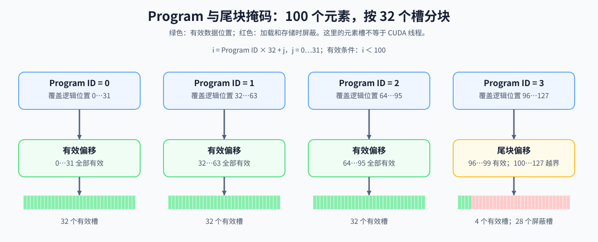

# 18. Triton Block Model | Triton Block 模型

**难度：** Medium | **环境：** CPU-first | **标签：** `算子编程`, `Triton`, `Block Model` | **目标人群：** 编译与系统入门者

> 🚀 **云端运行环境**
>
> 本章节的实战代码可以点击以下链接在免费 GPU 算力平台上直接运行：
>
> [](https://colab.research.google.com/github/datawhalechina/llm-algo-leetcode/blob/main/01_Hardware_Math_and_Systems/18_Triton_Block_Model.ipynb)
> [](https://modelscope.cn/my/mynotebook) *(国内推荐：魔搭社区免费实例)*


---

## 本节导读

Triton用程序实例（Program）处理逻辑数据块（Tile）。例如100个元素按32个槽分块，需要4个Program；最后一块只有4个有效元素，其余28个槽在访问时用掩码（Mask）屏蔽。

本节先计算一维覆盖，再比较二维分块的填充，最后逐项核对有效索引是否完整且不重复。这些计算支撑算子优化中的分块与边界处理，实际加载和存储可继续在Part03·01向量加法中核对。

**关键词：** `program`, `block`, `tile`



---

## 前置阅读

**导语：** 先理解编程模型与设备执行层级，再看 Triton Program 如何用 tile 和 mask 覆盖张量空间。

- [08. Programming Models and CUDA/Triton | 编程模型演进](./08_Programming_Models_CUDA_Triton.md)
- [15. CUDA Execution Model | CUDA 执行模型](./15_CUDA_Execution_Model.md)

## Q1：Program、数据块与线程是什么关系？

Program 是处理一块逻辑数据的执行实例，Tile（数据块）描述它覆盖的张量元素。Program ID 确定区域位置，块内偏移确定元素索引；这些是数据空间的划分，不是物理线程数量。Triton 的启动网格指定 Program 实例数，不是 SM 数量。

例如一个 Program 处理 1024 个元素，采用 `num_warps=4`，在本节普通 NVIDIA 单 CTA 路径下使用 4 个 Warp、128 个线程。1024 是逻辑元素槽数，128 是线程数，编译布局将多个元素的工作分配给线程；不能为每个元素直接分配一个线程，也不能把这个逻辑块叫作“1024 线程的 CUDA Block”。这里的 CTA 是 CUDA 线程块，特殊的多 CTA 或 Warp 专业化配置另需核对其映射。

改变 `BLOCK_SIZE` 会改变数据覆盖，改变 `num_warps` 会改变执行配置，两者又可能影响寄存器、共享内存和实际指令。本例先用向上取整得到最小网格，只验证 Program 数量、尾块有效元素与被屏蔽的元素槽；物理布局和资源留给生成代码与实际内核验证。

### Q1 机制计算器：Program 如何覆盖一维张量

计算最小覆盖网格和逻辑元素槽数。一个元素槽不等于一个 CUDA 线程或硬件 lane，实际线程映射由编译布局决定；本例只验证数据覆盖。


```python
def program_coverage(num_elements: int, block_size: int) -> dict:
    """返回一维最小网格的Program数、逻辑槽数和尾块有效元素数。"""
    if any(type(value) is not int or value <= 0 for value in (num_elements, block_size)):
        raise ValueError("输入元素数与块大小须为正整数")
    programs = (num_elements + block_size - 1) // block_size
    covered_slots = programs * block_size
    last_program_valid = num_elements - (programs - 1) * block_size
    return {
        "programs": programs, "covered_slots": covered_slots,
        "last_program_valid": last_program_valid,
        "masked_slots": covered_slots - num_elements,
    }


# 对应主图：100个元素按32个逻辑槽分块，尾块只含4个有效元素。
num_elements, block_size = 100, 32
coverage = program_coverage(num_elements=num_elements, block_size=block_size)
assert coverage == {
    "programs": 4, "covered_slots": 128, "last_program_valid": 4, "masked_slots": 28,
}
for size, expected in (
    (1, (1, 1, 31)), (32, (1, 32, 0)), (33, (2, 1, 31)), (64, (2, 32, 0)),
):
    result = program_coverage(num_elements=size, block_size=32)
    assert (result["programs"], result["last_program_valid"],
            result["masked_slots"]) == expected
print(f"{num_elements} 个元素：{coverage['programs']} 个Program，"
      f"尾块有效 {coverage['last_program_valid']} 个，"
      f"总屏蔽槽 {coverage['masked_slots']} 个")

```

## Q2：为什么 Triton 要先明确数据布局？

布局决定同一张量中的元素怎样分配给 Program，再怎样由线程加载与计算。例如一个二维矩阵按行切块，可以让同一 Program 处理连续列；若输入是转置视图，同样的逻辑列在物理地址上可能并不连续。只看数据块形状，无法知道加载是否合并，也无法知道元素是否在片上反复使用。

增大 Tile 可能减少 Program 数量并增加复用机会，也可能增加中间值、尾块填充和资源需求。不同设备与编译器对同一逻辑布局可能生成不同执行安排，因此“逻辑块更大”不等于“线程更多”或“执行更快”。以100×130矩阵和32×32数据块为例，行方向需要4个Program，列方向需要5个，共覆盖20,480个逻辑槽；其中13,000个有效，7,480个被屏蔽。几何覆盖之外，还需检查实际地址、指令与时间。

### Q2 布局计算：分块形状带来多少边界填充

比较相同矩阵的几何覆盖量，元素槽数不代表线程数。任意正整数块形状均可参与此几何计算，但不保证对应形状可以直接编译成 Triton 核函数。


```python
def tile_layout(rows: int, cols: int, block_rows: int, block_cols: int) -> dict:
    """返回二维几何覆盖的Program网格、逻辑槽数与有效元素比例。"""
    if any(type(value) is not int or value <= 0
           for value in (rows, cols, block_rows, block_cols)):
        raise ValueError("矩阵和块形状须为正整数")
    row_programs = (rows + block_rows - 1) // block_rows
    col_programs = (cols + block_cols - 1) // block_cols
    useful_elements = rows * cols
    covered_elements = row_programs * col_programs * block_rows * block_cols
    return {
        "program_grid": (row_programs, col_programs),
        "useful_elements": useful_elements, "covered_elements": covered_elements,
        "padding_elements": covered_elements - useful_elements,
        "useful_ratio": useful_elements / covered_elements,
    }


rows, cols = 100, 130
reports = {tile: tile_layout(rows=rows, cols=cols, block_rows=tile[0], block_cols=tile[1])
           for tile in ((16, 16), (32, 32), (64, 64))}
# 32×32块：4×5个Program，共20,480槽；有效13,000个，屏蔽7,480个。
assert reports[(32, 32)] == {
    "program_grid": (4, 5), "useful_elements": 13_000, "covered_elements": 20_480,
    "padding_elements": 7480, "useful_ratio": 13_000 / 20_480,
}
assert reports[(16, 16)]["covered_elements"] == 16_128
assert reports[(64, 64)]["padding_elements"] == 11_576
assert tile_layout(rows=128, cols=128, block_rows=32, block_cols=32)["useful_ratio"] == 1
assert tile_layout(rows=1, cols=1, block_rows=16, block_cols=16)["padding_elements"] == 255
for tile, result in reports.items():
    print(f"块形状 {tile}：网格 {result['program_grid']}，"
          f"覆盖 {result['covered_elements']} 槽，屏蔽 {result['padding_elements']} 槽")

```

## Q3：Program ID、偏移和 Mask 怎样保证边界安全？

Program ID 确定当前块的位置，块内偏移给出元素索引，Mask 屏蔽超出输入范围的加载与存储。先检查本例最小网格中的有效索引是否完整且不重复，再检查尾块被屏蔽的元素。

CPU 计算器只验证逻辑索引；实际 Triton 实现还需使用编译器支持的块形状与布局，把 Mask 应用于加载和存储，并核对数值结果与资源用量。

### Q3 边界验证：最小网格中的索引是否完整且不重复

先检查 Program ID 是否属于本例的最小覆盖网格，再生成偏移与 Mask。遍历全部 Program，验证有效索引恰好覆盖输入一次；最后检查尾块与整除情形。


```python
def program_offsets(program_id: int, block_size: int, num_elements: int) -> dict:
    """返回最小覆盖网格中一个Program的偏移、布尔掩码与有效索引。"""
    coverage = program_coverage(num_elements=num_elements, block_size=block_size)
    if type(program_id) is not int or not 0 <= program_id < coverage["programs"]:
        raise ValueError("Program ID须属于本例的最小覆盖网格")
    offsets = [program_id * block_size + slot for slot in range(block_size)]
    mask = [0 <= offset < num_elements for offset in offsets]
    valid_offsets = [offset for offset, valid in zip(offsets, mask) if valid]
    return {
        "offsets": offsets, "mask": mask, "valid_offsets": valid_offsets,
        "valid_count": len(valid_offsets),
        "safe": all(0 <= offset < num_elements for offset in valid_offsets),
    }


tail = program_offsets(program_id=3, block_size=32, num_elements=100)
assert tail["offsets"] == list(range(96, 128))
assert tail["mask"] == [True] * 4 + [False] * 28
assert tail["valid_offsets"] == [96, 97, 98, 99]
assert tail["valid_count"] == 4 and tail["safe"]
for size in (1, 31, 32, 33, 64, 100):
    coverage = program_coverage(num_elements=size, block_size=32)
    all_valid = [
        offset
        for program_id in range(coverage["programs"])
        for offset in program_offsets(program_id=program_id, block_size=32,
                                      num_elements=size)["valid_offsets"]
    ]
    assert all_valid == list(range(size))
assert program_offsets(program_id=1, block_size=32, num_elements=64)["valid_count"] == 32
print("尾块有效索引：", tail["valid_offsets"])
print(f"尾块屏蔽 {tail['mask'].count(False)} 个槽；全部Program恰好覆盖输入一次。")

```

## 相关阅读

把数据空间覆盖接到实际 kernel，再检查逻辑块怎样对应生成代码和资源。

- [Part03·01 向量加法](../03_Triton_Kernels/01_Triton_Vector_Addition.md)：Program ID、偏移与尾块掩码。
- [Part03·18 编译产物与执行核对](../03_Triton_Kernels/18_Triton_Compilation_Artifacts_and_Execution.md)：特化条件、资源与实际启动对象。
- [Triton 向量加法教程](https://triton-lang.org/main/getting-started/tutorials/01-vector-add.html)：逻辑块与启动网格的官方示例。
