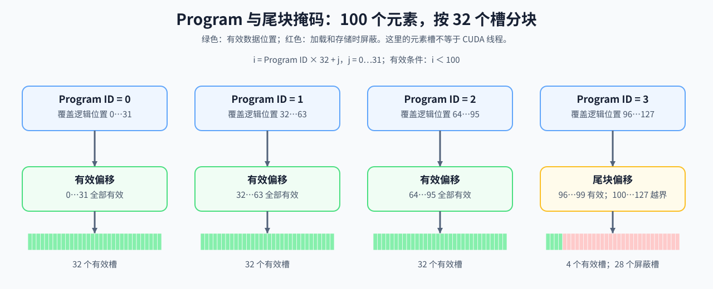

# 18. Triton Block Model | Triton Block 模型

**难度：** Medium | **环境：** CPU-first | **标签：** `算子编程`, `Triton`, `Block Model` | **目标人群：** 编译与系统入门者

> 🚀 **云端运行环境**
>
> 本章节的实战代码可以点击以下链接在免费 GPU 算力平台上直接运行：
>
> [](https://colab.research.google.com/github/datawhalechina/llm-algo-leetcode/blob/main/01_Hardware_Math_and_Systems/18_Triton_Block_Model.ipynb)
> [](https://modelscope.cn/my/mynotebook) *(国内推荐：魔搭社区免费实例)*


---

## 本节导读

Triton 使用 Program 和 Tile 把张量空间分块。张量尺寸不能被块大小整除时，最后一个 Program 的逻辑数据块会包含超出输入的元素槽，需要通过 Mask 保护边界访问。

本节从一维覆盖、二维 Tile 布局和边界 Mask 建立空间映射。完成后，你应能计算 Program 数、边界填充和有效索引；这些能力直接连接算子优化路线与 Part 03 的 Triton Kernel。

**关键词：** `program`, `block`, `tile`



---

## 前置阅读

**导语：** 先理解编程模型与设备执行层级，再看 Triton Program 如何用 tile 和 mask 覆盖张量空间。

- [08. Programming Models and CUDA/Triton | 编程模型演进](./08_Programming_Models_CUDA_Triton.md)
- [15. CUDA Execution Model | CUDA 执行模型](./15_CUDA_Execution_Model.md)
- [Group 1D: Execution Models, Asynchrony and Operator Mapping | 1D: 执行模型、异步调度与算子映射](./1D.md)

## Q1：Program、数据块与线程是什么关系？

Program 是处理一块逻辑数据的执行实例，数据块形状描述它覆盖哪些元素。Program ID 确定区域位置，块内偏移确定各元素索引；这些是数据空间中的划分，不应把每个逻辑元素直接对应成一个 CUDA 线程。

本例让一个 Program 覆盖一段连续元素，用向上取整得到最小网格。随后只改变块大小，检查 Program 数量、尾块有效元素与被屏蔽的元素槽数。

### Q1 机制计算器：Program 如何覆盖一维张量

计算最小覆盖网格和逻辑元素槽数。一个元素槽不等于一个 CUDA 线程或硬件 lane，实际线程映射由编译布局决定；本例只验证数据覆盖。


```python
def program_coverage(num_elements, block_size):
    """计算最小网格的 Program 数、逻辑元素槽数与尾块有效元素。"""
    if any(type(value) is not int or value <= 0 for value in (num_elements, block_size)):
        raise ValueError('输入元素数与块大小必须是正整数')
    programs = (num_elements + block_size - 1) // block_size
    covered_slots = programs * block_size
    last_program_valid = num_elements - (programs - 1) * block_size
    return {
        'programs': programs,
        'covered_slots': covered_slots,
        'last_program_valid': last_program_valid,
        'masked_slots': covered_slots - num_elements,
    }

for block_size in [64, 128, 256]:
    print(block_size, '->', program_coverage(1000, block_size))
assert program_coverage(1000, 256)['masked_slots'] == 24

```

## Q2：为什么 Triton 要强调“先布局，再写细节”？


Triton 的写法先强调数据怎么切块、怎么映射、怎么覆盖整个张量，然后才决定具体算什么。

这是因为 kernel 的性能往往不是先被算法名决定，而是先被数据组织方式决定。块切得合不合理、映射是否连续、每个 program 的职责是否清晰，都会影响后面的访存和复用。

所以 Triton 看起来像在写“布局代码”，其实是在决定每个块如何靠近计算单元、如何减少无效搬运、以及如何把张量空间映射成更规整的执行单元。

### Q2 布局计算：分块形状带来多少边界填充

比较相同矩阵的几何覆盖量，元素槽数不代表线程数。任意正整数块形状均可参与此几何计算，但不保证对应形状可以直接编译成 Triton 核函数。


```python
def tile_layout(rows, cols, block_rows, block_cols):
    """计算二维分块网格、逻辑元素槽数与边界填充比例。"""
    if any(type(value) is not int or value <= 0 for value in (rows, cols, block_rows, block_cols)):
        raise ValueError('矩阵和块形状必须是正整数')
    row_programs = (rows + block_rows - 1) // block_rows
    col_programs = (cols + block_cols - 1) // block_cols
    useful_elements = rows * cols
    covered_elements = row_programs * col_programs * block_rows * block_cols
    return {
        'program_grid': (row_programs, col_programs),
        'useful_elements': useful_elements,
        'covered_elements': covered_elements,
        'padding_elements': covered_elements - useful_elements,
        'useful_ratio': useful_elements / covered_elements,
    }

for tile in [(16, 16), (32, 32), (64, 64)]:
    print(tile, '->', tile_layout(100, 130, *tile))
assert tile_layout(128, 128, 32, 32)['padding_elements'] == 0

```

## Q3：Program ID、偏移和 Mask 怎样保证边界安全？

Program ID 确定当前块的位置，块内偏移给出元素索引，Mask 屏蔽超出输入范围的加载与存储。先检查本例最小网格中的有效索引是否完整且不重复，再检查尾块被屏蔽的元素。

CPU 计算器只验证逻辑索引；实际 Triton 实现还需使用编译器支持的块形状与布局，把 Mask 应用于加载和存储，并核对数值结果与资源用量。

### Q3 边界验证：最小网格中的索引是否完整且不重复

先检查 Program ID 是否属于本例的最小覆盖网格，再生成偏移与 Mask。遍历全部 Program，验证有效索引恰好覆盖输入一次；最后检查尾块与整除情形。


```python
def program_offsets(program_id, block_size, num_elements):
    """生成最小覆盖网格内一个 Program 的偏移与边界 Mask。"""
    coverage = program_coverage(num_elements, block_size)
    if type(program_id) is not int or not 0 <= program_id < coverage['programs']:
        raise ValueError('Program ID 必须属于本例的最小覆盖网格')
    offsets = [program_id * block_size + slot for slot in range(block_size)]
    mask = [0 <= offset < num_elements for offset in offsets]
    valid_offsets = [offset for offset, valid in zip(offsets, mask) if valid]
    return {
        'offsets': offsets, 'mask': mask, 'valid_offsets': valid_offsets,
        'valid_count': len(valid_offsets),
        'safe': all(0 <= offset < num_elements for offset in valid_offsets),
    }


tail = program_offsets(program_id=3, block_size=32, num_elements=100)
assert tail['valid_offsets'] == [96, 97, 98, 99]
assert tail['valid_count'] == 4 and tail['safe']
for size in [1, 32, 64, 100]:
    coverage = program_coverage(size, 32)
    all_valid = [
        offset
        for program_id in range(coverage['programs'])
        for offset in program_offsets(program_id, 32, size)['valid_offsets']
    ]
    assert all_valid == list(range(size))
assert program_offsets(1, 32, 64)['valid_count'] == 32
print(tail)

```

## 相关阅读

**导语：** 把 Triton 的 block 模型继续接到入门 kernel、GEMM 和 FlashAttention，会更容易把空间划分和真实实现串起来。

- [01. Triton 入门与 Hello World：向量加法 (Vector Addition)](../03_Triton_Kernels/01_Triton_Vector_Addition.md)
- [04. Triton 矩阵乘法 (GEMM) 与自动调优 (Autotune)](../03_Triton_Kernels/04_Triton_GEMM_Tutorial.md)
- [08. Triton Flash Attention | 真正的 Flash Attention 前向算子](../03_Triton_Kernels/08_Triton_Flash_Attention.md)
---
