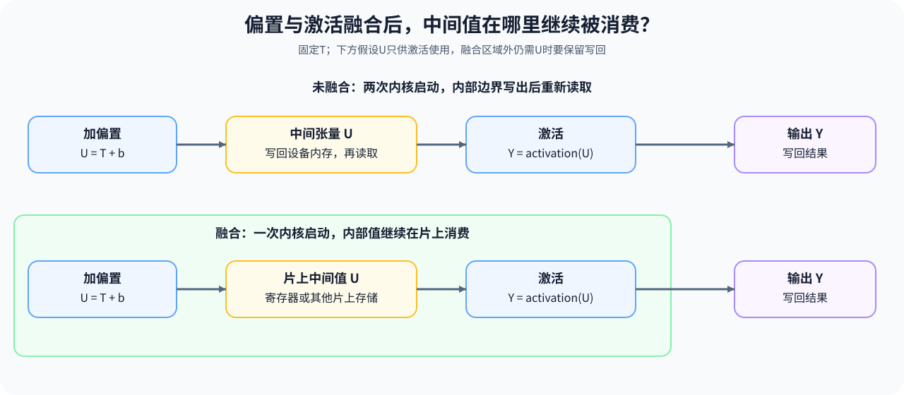

# 19. Operator Fusion Introduction | 算子融合导论

**难度：** Medium | **环境：** CPU-first | **标签：** `编译系统`, `算子融合`, `性能优化` | **目标人群：** 编译与系统入门者

> 🚀 **云端运行环境**
>
> 本章节的实战代码可以点击以下链接在免费 GPU 算力平台上直接运行：
>
> [](https://colab.research.google.com/github/datawhalechina/llm-algo-leetcode/blob/main/01_Hardware_Math_and_Systems/19_Operator_Fusion_Introduction.ipynb)
> [](https://modelscope.cn/my/mynotebook) *(国内推荐：魔搭社区免费实例)*


---

## 本节导读

把矩阵乘结果记为T，加偏置得到U，再由激活得到输出Y。分开执行时可能先写出U，再由下一步读取；将偏置与激活融合，U就有机会算完即用。如果另一个计算仍在融合内核之外使用U，写回却可能仍要保留。

本节先计算组间边界的读写与启动，再沿U的使用者检查哪些写回和读取真正可以省去，最后核对样例输出与给定实现条件。它支撑算子优化的融合判断，实际三路径调用与计时可继续进入Part03·03 SwiGLU。

**关键词：** 算子融合、中间张量、使用者、逻辑读写、布局转换



## 前置阅读

先理解计算图怎样表达运算及依赖，再跟踪中间值的写出与读取。

- [09 AI编译器与计算图优化](./09_AI_Compilers_and_Graph_Optimization.md)：区分计算关系、生成实现与设备调用。

## Q1：中间张量怎样增加逻辑读写？

沿导读的三步计算，保留矩阵乘结果T，只融合偏置与激活，便可去掉U这一个组间边界。下面回顾等大张量串行链的账目：每个边界写一次、读一次，减少8 KiB逻辑读写；再进入Q2，检查U还有其他使用者时这笔减少量怎样变化。每组一次启动是这里的给定安排，实际显存流量与调用成本需由实现记录核对。

### Q1 机制计算器：比较分组边界的读写字节


```python
def fusion_traffic(num_ops: int, tensor_bytes: int, fused_groups: int) -> dict:
    """按等大边界的串行链，返回启动数、组间边界数及写出加重读的逻辑字节数。"""
    if (type(num_ops) is not int or type(fused_groups) is not int
            or num_ops < 1 or not 1 <= fused_groups <= num_ops):
        raise ValueError("算子数须为正整数，分组数须在 1 到算子数之间")
    if type(tensor_bytes) is not int or tensor_bytes <= 0:
        raise ValueError("tensor_bytes 须为正整数")
    materialized_boundaries = fused_groups - 1
    intermediate_bytes = 2 * materialized_boundaries * tensor_bytes
    return {
        "launches": fused_groups,
        "materialized_boundaries": materialized_boundaries,
        "intermediate_bytes": intermediate_bytes,
    }


# 对应导读的矩阵乘、偏置、激活三步，假设 T、U 均含 1024 个 FP32 元素。
tensor_bytes = 1024 * 4
unfused = fusion_traffic(num_ops=3, tensor_bytes=tensor_bytes, fused_groups=3)
partial = fusion_traffic(num_ops=3, tensor_bytes=tensor_bytes, fused_groups=2)
full = fusion_traffic(num_ops=3, tensor_bytes=tensor_bytes, fused_groups=1)
assert unfused == {
    "launches": 3, "materialized_boundaries": 2, "intermediate_bytes": 16_384,
}
assert partial == {
    "launches": 2, "materialized_boundaries": 1, "intermediate_bytes": 8_192,
}
assert full == {
    "launches": 1, "materialized_boundaries": 0, "intermediate_bytes": 0,
}
assert unfused["intermediate_bytes"] - partial["intermediate_bytes"] == 8_192
assert fusion_traffic(num_ops=1, tensor_bytes=4, fused_groups=1) == {
    "launches": 1, "materialized_boundaries": 0, "intermediate_bytes": 0,
}
# 扩大张量和算子链，仍按每个组间边界写一次、读一次计算。
scaled = fusion_traffic(num_ops=4, tensor_bytes=64 * 1024**2, fused_groups=2)
assert scaled["intermediate_bytes"] == 128 * 1024**2
for name, result in (("分离", unfused), ("偏置与激活融合", partial), ("全部融合假设", full)):
    print(f"{name}: 启动 {result['launches']} 次，"
          f"中间逻辑读写 {result['intermediate_bytes'] / 1024:g} KiB")

```

## Q2：U还有其他使用者时，哪些读写仍能省去？

固定矩阵乘结果T，计算偏置相加 `U = T + b` 与激活 `Y = activation(U)`。使用者（consumer）指读取U的后续运算。U只供激活使用时，融合可让它在同一内核中生成并消费，省去一次完整写回和一次读取；这就是本例的数据局部性变化。U有1024个FP32元素，占4 KiB，因此减少8 KiB逻辑读写。

若另一个辅助计算仍在融合区域外使用U，当前内核还需写出这4 KiB，辅助计算也仍需读取；此时只省去激活原来那次读取，即4 KiB。若两个使用者都一起融合，原来的U写回与两次读取才都可省去，共12 KiB。下面固定U不被重算，只统计它自身的读写；T与偏置的输入、各使用者最终输出以及可能发生的寄存器溢出另计。

| U的使用方式 | 融合前U的读写 | 融合后仍需保留 | 减少的逻辑字节 |
| --- | --- | --- | --- |
| 仅激活使用，偏置与激活融合 | 写4 KiB、读4 KiB | 无完整U写回／读取 | 8 KiB |
| 激活融合，辅助计算留在外部 | 写4 KiB、读8 KiB | 写4 KiB、辅助读取4 KiB | 4 KiB |
| 激活与辅助计算都融合 | 写4 KiB、读8 KiB | 无完整U写回／读取 | 12 KiB |

### Q2 机制计算器：从使用者集合推导U的写回与读取

分别列出全部使用者和本次一起融合的使用者，找出仍留在区域外的计算，再核对表中的8、4、12 KiB。尚未融合任何使用者时，读写应保持不变。


```python
def intermediate_traffic(
    tensor_bytes: int, consumers: set, fused_consumers: set,
) -> dict:
    """估算U的完整逻辑读写；每个使用者读一次，外部仍使用时写回一次，不重算U。"""
    if type(tensor_bytes) is not int or tensor_bytes <= 0:
        raise ValueError("U的载荷字节数须为正整数")
    if type(consumers) is not set or not consumers or type(fused_consumers) is not set:
        raise ValueError("全部使用者须为非空集合，融合使用者须为集合")
    if not fused_consumers.issubset(consumers):
        raise ValueError("融合使用者须属于全部使用者")
    outside = consumers - fused_consumers
    before_write = tensor_bytes
    before_read = tensor_bytes * len(consumers)
    after_write = tensor_bytes if outside else 0
    after_read = tensor_bytes * len(outside)
    return {
        "outside_consumers": sorted(outside),
        "write_bytes_before": before_write, "read_bytes_before": before_read,
        "write_bytes_after": after_write, "read_bytes_after": after_read,
        "saved_write_bytes": before_write - after_write,
        "saved_read_bytes": before_read - after_read,
        "total_saved_bytes": before_write + before_read - after_write - after_read,
    }


u_bytes = 1024 * 4
only_activation = intermediate_traffic(
    tensor_bytes=u_bytes, consumers={"activation"}, fused_consumers={"activation"})
outside_auxiliary = intermediate_traffic(
    tensor_bytes=u_bytes, consumers={"activation", "aux"}, fused_consumers={"activation"})
both_inside = intermediate_traffic(
    tensor_bytes=u_bytes, consumers={"activation", "aux"}, fused_consumers={"activation", "aux"})
unchanged = intermediate_traffic(
    tensor_bytes=u_bytes, consumers={"activation"}, fused_consumers=set())
assert only_activation["total_saved_bytes"] == 8192
assert outside_auxiliary["outside_consumers"] == ["aux"]
assert outside_auxiliary["saved_write_bytes"] == 0
assert outside_auxiliary["saved_read_bytes"] == 4096
assert outside_auxiliary["write_bytes_after"] == outside_auxiliary["read_bytes_after"] == 4096
assert both_inside["total_saved_bytes"] == 12288
assert unchanged["total_saved_bytes"] == 0
assert only_activation["total_saved_bytes"] == (
    fusion_traffic(num_ops=2, tensor_bytes=u_bytes, fused_groups=2)["intermediate_bytes"]
    - fusion_traffic(num_ops=2, tensor_bytes=u_bytes, fused_groups=1)["intermediate_bytes"])
for name, row in (("仅激活", only_activation), ("辅助计算在外部", outside_auxiliary),
                  ("两个使用者都在内部", both_inside)):
    print(f"{name}: 省写 {row['saved_write_bytes'] / 1024:g} KiB，"
          f"省读 {row['saved_read_bytes'] / 1024:g} KiB")

```

## Q3：哪些检查能在CPU例子中完成，哪些还需要实际实现？

ReLU激活把负值变为0、保留非负值。用三个值 `T = [-2, 0, 2]` 和偏置 `b = 1` 比较：先加偏置再激活得到 `[0, 1, 3]`；若错误地先激活再加偏置，就得到 `[1, 1, 3]`。相同算子换序可能改变结果，CPU样例可以发现这类错误；一般融合还要满足预定浮点容差，并保留副作用，即输出值之外的可见状态改变，例如共享缓存写入的顺序。

下面的实现计划还声明输出形状、给U小块预留的字节数，以及后端提供的运算集合。后端是把运算落实为设备实现的软件部分；其能力声明不等于已经生成或执行了融合内核。小块按三个FP32元素估算为12 B，预算不足仅表示这个给定分块假设不满足，其他临时值、寄存器分配和真实驻留还需结合编译结果检查。布局转换指为满足实现要求而重新排列或复制数据，其逻辑读写量单独记录，不直接当作不可执行的理由；一般分块复用继续见[24 SRAM优化](./24_SRAM_Optimization_Techniques.md)。

### Q3 对照验证：由样例、形状、配额和声明产生检查结果

固定加偏置与ReLU的参考结果，分别改变候选的运算顺序、输出形状、小块预算或运算支持；最后添加一次12 B写出与12 B读取的布局转换。


```python
def fusion_decision(
    sample_matches: bool, shape_matches: bool, u_slice_fits: bool,
    backend_declared: bool, reorder_bytes: int = 0,
) -> dict:
    """汇总CPU样例、给定分块与后端声明；不证明一般语义或真实融合执行。"""
    checks = {
        "sample_matches": sample_matches, "shape_matches": shape_matches,
        "u_slice_fits": u_slice_fits, "backend_declared": backend_declared,
    }
    if any(type(value) is not bool for value in checks.values()):
        raise ValueError("样例、形状、小块预算与后端声明的检查结果须为布尔值")
    if type(reorder_bytes) is not int or reorder_bytes < 0:
        raise ValueError("布局转换的逻辑读写字节数须为非负整数")
    failures = [name for name, passed in checks.items() if not passed]
    return {"stated_conditions_met": not failures, "failures": failures,
            "extra_reorder_bytes": reorder_bytes}


t_values, bias = [-2, 0, 2], 1
u_values = [value + bias for value in t_values]
reference = [max(value, 0) for value in u_values]
assert u_values == [-1, 1, 3] and reference == [0, 1, 3]
u_slice_bytes = len(t_values) * 4  # 给U的三个FP32元素预留载荷，不是完整内核资源用量。
base = dict(output=[max(value + bias, 0) for value in t_values],
            output_shape=(3,), u_budget_bytes=12, declared_ops={"add", "relu"},
            reorder_bytes=0)
changes = {
    "matched": {},
    "wrong_order": {"output": [max(value, 0) + bias for value in t_values]},
    "shape_miss": {"output_shape": (1, 3)},
    "budget_miss": {"u_budget_bytes": 11},
    "backend_miss": {"declared_ops": {"add"}},
    "layout_copy": {"reorder_bytes": 2 * u_slice_bytes},
}
results = {}
for name, change in changes.items():
    plan = base | change
    results[name] = fusion_decision(
        sample_matches=plan["output"] == reference,
        shape_matches=plan["output_shape"] == (len(t_values),),
        u_slice_fits=u_slice_bytes <= plan["u_budget_bytes"],
        backend_declared={"add", "relu"}.issubset(plan["declared_ops"]),
        reorder_bytes=plan["reorder_bytes"])
assert results["matched"]["stated_conditions_met"]
assert results["wrong_order"]["failures"] == ["sample_matches"]
assert results["shape_miss"]["failures"] == ["shape_matches"]
assert results["budget_miss"]["failures"] == ["u_slice_fits"]
assert results["backend_miss"]["failures"] == ["backend_declared"]
assert results["layout_copy"]["stated_conditions_met"]
assert results["layout_copy"]["extra_reorder_bytes"] == 24
for name, row in results.items():
    print(f"{name}: 本例检查通过={row['stated_conditions_met']}，"
          f"未满足项={row['failures']}，额外布局读写 {row['extra_reorder_bytes']} B")

```

## 相关阅读

从逐元素融合进入共享行状态，或进一步比较实现与配置：

- [Part 03 · 03 SwiGLU](../03_Triton_Kernels/03_Triton_Fused_SwiGLU.md)：对照分离计算、编译融合与手写实现的完整调用成本。
- [Part 03 · 07 融合Softmax](../03_Triton_Kernels/07_Triton_Fused_Softmax.md)：观察归约所需的共享行尺度与中间状态。
- [Part 03 · 09 自动调优与基准测量](../03_Triton_Kernels/09_Triton_Autotune_and_Profiling.md)：分开编译、搜索与稳态时间。
