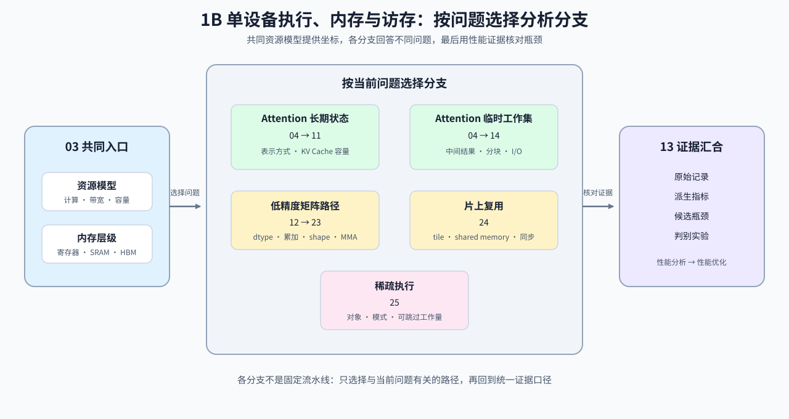

# Group 1B: Single-Device Execution, Memory and Data Access | 1B: 单设备执行、内存与访存

本组以 GPU 为例解释单设备计算、内存与访存约束。

## Group Goal | 学习目标

这一组建立单设备资源判断所需的三条线索：GPU 执行单元负责什么，数据经过哪些内存层级，以及当前阶段的工作集如何形成。学习者从共同硬件模型进入注意力状态、临时工作集、低精度矩阵、片上复用或稀疏执行分支，再把计算、带宽和容量假设交给性能分析验证。CPU、GPU、NPU 与 TPU 的运行时兼容性由 [1F](./1F.md) 补充；建议先完成 [1A](./1A.md) 的数量级账本。

## Learning Entries | 学习入口

| 小节 | 核心职责 | 学习角色 |
|:---|:---|:---|
| [03](./03_GPU_Architecture_and_Memory.md) | 识别 GPU 层次结构与访存瓶颈 | 单设备硬件入口 |
| [04](./04_Attention_Memory_Optimization.md) | 区分 Attention 的表示、工作集与缓存组织 | Attention 显存杠杆总览 |
| [11](./11_KV_Cache_and_Memory_Growth.md) | 解释 KV Cache 为什么增长 | KV 状态容量账本 |
| [12](./12_TensorCore_and_Mixed_Precision.md) | 区分精度对存储字节与矩阵计算路径的影响 | 低精度执行入口 |
| [13](./13_Profiling_and_Bottleneck_Analysis.md) | 将已有记录转换为资源归因和判别实验 | 性能归因入口 |
| [14](./14_FlashAttention_Memory_Model.md) | 看懂 FlashAttention 的显存收益 | Attention 工作集与 I/O |
| [23](./23_TensorCore_Deep_Dive.md) | 看清 TensorCore 的加速边界 | 矩阵计算路径 |
| [24](./24_SRAM_Optimization_Techniques.md) | 比较共享内存复用、同步、存储体冲突与寄存器溢出的代价 | 片上复用机制 |
| [25](./25_Sparse_Computation_and_Sparse_Attention.md) | 判断稀疏何时真正有效 | 稀疏执行可行性 |

## Group Mechanism Chains | 机制子链

先用 03 理解执行单元与内存层级，再按问题选择分支。各分支提供计算量、存储量或执行条件；13 练习把工作量与给定耗时组合，区分理论资源上限、低利用率现象和待验证的瓶颈。真实运行还需补齐同一工作负载的计时、执行轨迹或驻留数据。

| 分支 | 阅读顺序 | 能计算或检查什么 | 后续学习入口 |
|:---|:---|:---|:---|
| Attention 长期状态 | [03](./03_GPU_Architecture_and_Memory.md) → [04](./04_Attention_Memory_Optimization.md) → [11](./11_KV_Cache_and_Memory_Growth.md) | KV 表示与容量增长账本 | [大模型架构演进](../topic_discussion/llm_architecture_evolution/intro.md) → [推理优化](../topic_discussion/inference_optimization/intro.md) |
| Attention 临时工作集 | [03](./03_GPU_Architecture_and_Memory.md) → [04](./04_Attention_Memory_Optimization.md) → [14](./14_FlashAttention_Memory_Model.md) | 中间矩阵、分块工作集和显存读写假设 | [算子优化](../topic_discussion/operator_optimization/intro.md) |
| 低精度矩阵执行 | [03](./03_GPU_Architecture_and_Memory.md) → [12](./12_TensorCore_and_Mixed_Precision.md) → [23](./23_TensorCore_Deep_Dive.md) | 数据类型、累加方式、矩阵形状和硬件路径条件 | [量化与压缩](../topic_discussion/quantization_compression/intro.md)、[算子优化](../topic_discussion/operator_optimization/intro.md) |
| 片上复用 | [03](./03_GPU_Architecture_and_Memory.md) → [24](./24_SRAM_Optimization_Techniques.md) | 分块、共享内存、同步和资源限制 | [算子优化](../topic_discussion/operator_optimization/intro.md) |
| 稀疏执行 | [03](./03_GPU_Architecture_and_Memory.md) → [25](./25_Sparse_Computation_and_Sparse_Attention.md) | 可跳过工作量、结构粒度和执行条件 | [大模型架构演进](../topic_discussion/llm_architecture_evolution/intro.md)、[算子优化](../topic_discussion/operator_optimization/intro.md) |
| 资源判断 | 前述任一分支 → [13](./13_Profiling_and_Bottleneck_Analysis.md) | 理论上限、参考效率、暴露等待与单变量验证方法 | [性能分析](../topic_discussion/performance_analysis/intro.md) → [性能优化](../topic_discussion/performance_optimization/intro.md) |
