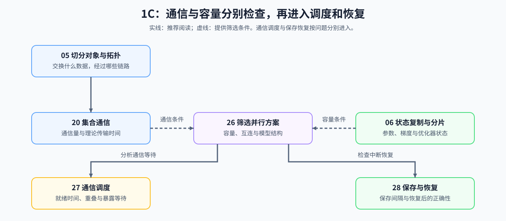

# Group 1C: Communication, Parallelism and Fault Tolerance | 1C: 通信、并行与容错

本组解释多设备切分带来的容量收益、通信代价和恢复要求。

## Group Goal | 学习目标

学习者在这一组回答三个问题：什么对象需要切分，每一步交换哪些数据，以及系统中断后如何恢复。拓扑与集合通信给出交换条件，训练状态账本给出容量条件；两路信息汇合后筛选并行候选，再分别检查通信关键路径和恢复成本。建议先完成 [1A](./1A.md) 的规模账本和 [1B](./1B.md) 的单设备资源模型。

## Learning Entries | 学习入口

| 小节 | 核心职责 | 学习角色 |
|:---|:---|:---|
| [05](./05_Communication_Topologies.md) | 识别切分对象、通信原语和拓扑域 | 通信分类入口 |
| [20](./20_NCCL_and_AllReduce_Basics.md) | 展开 All-Reduce 的数据流与理论代价 | 集合通信机制 |
| [06](./06_VRAM_Calculation_and_ZeRO.md) | 估算显存开销与 ZeRO 收益 | 训练状态分片账本 |
| [26](./26_Parallel_Strategy_Decision_Framework.md) | 按训练状态、模型、上下文、专家和请求筛选并行策略 | 并行候选入口 |
| [27](./27_Communication_Scheduling_Optimization.md) | 压缩通信调度的关键路径 | 通信重叠入口 |
| [28](./28_Fault_Tolerance_and_Checkpointing.md) | 评估容错与检查点代价 | 恢复成本入口 |

## Inputs and Follow-up Paths | 两路输入与后续分支

| 路径 | 阅读顺序 | 交付对象 | 首先进入的专题 |
|:---|:---|:---|:---|
| 通信条件 | [05 通信拓扑](./05_Communication_Topologies.md) → [20 NCCL 与 AllReduce](./20_NCCL_and_AllReduce_Basics.md) | 链路、集合通信语义、通信量与理论时间 | [通信与并行](../topic_discussion/communication_parallelism/intro.md) |
| 容量条件 | [06 显存计算与 ZeRO](./06_VRAM_Calculation_and_ZeRO.md) | 参数、梯度和优化器状态的复制 / 分片账本 | [反向传播与训练机制](../topic_discussion/backpropagation_training_mechanism/intro.md)、[通信与并行](../topic_discussion/communication_parallelism/intro.md) |
| 候选汇合 | 两路输入 → [26 并行策略决策](./26_Parallel_Strategy_Decision_Framework.md) | 排除不满足容量、互连或结构条件的候选 | [通信与并行](../topic_discussion/communication_parallelism/intro.md)；MoE / EP 候选同时进入[大模型架构演进](../topic_discussion/llm_architecture_evolution/intro.md) |
| 通信分支 | [26](./26_Parallel_Strategy_Decision_Framework.md) → [27 通信调度](./27_Communication_Scheduling_Optimization.md) | 通信就绪时间、调度顺序与暴露等待 | [性能分析](../topic_discussion/performance_analysis/intro.md) → [性能优化](../topic_discussion/performance_optimization/intro.md) |
| 恢复分支 | [26](./26_Parallel_Strategy_Decision_Framework.md) → [28 容错与检查点](./28_Fault_Tolerance_and_Checkpointing.md) | 保存清单、间隔成本、分片一致性与恢复条件 | [通信与并行](../topic_discussion/communication_parallelism/intro.md)、[后训练优化](../topic_discussion/post_training_optimization/intro.md) |

这些条件用于形成并行与恢复候选，不代表多卡收益已经成立。通信时间、单步时间、扩展效率和恢复结果仍需在固定工作负载上验证。
