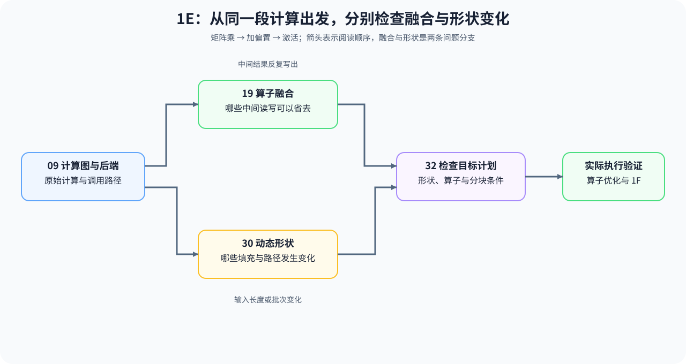

# 1E：编译与后端

同一段“矩阵乘 → 加偏置 → 激活”，为什么会有不同的启动次数和中间读写？输入长度变化后，原来的执行路径还能不能复用？本组沿着这条计算链，解释图变换、融合、动态形状和目标后端如何共同影响执行。

## 学习目标

先在 [09](./09_AI_Compilers_and_Graph_Optimization.md) 中识别计算图与执行路径，再按问题分别进入融合或形状分支，最后在 [32](./32_TVM_MLIR_Deep_Practice.md) 中检查目标计划。你应能计算哪些中间读写可以省去、哪些填充会增加，以及计划缺少哪个执行条件。CPU 示例使用给定能力和 Python 计划，真实编译产物与耗时由算子优化实验验证。

## 学习入口

| 遇到的问题 | 阅读入口 | 要算清或查清什么 |
|:---|:---|:---|
| 相同计算为什么会使用不同的内核调用与数据路径 | [09 图优化与编译器](./09_AI_Compilers_and_Graph_Optimization.md) | 图变换省去了哪些启动或中间读写，后端还需要什么条件 |
| 中间结果反复写出，融合之后是否更省 | [19 算子融合](./19_Operator_Fusion_Introduction.md) | 内部边界能否消除，有无新增布局转换和资源压力 |
| 输入长度变化，缓存和填充开销随之改变 | [30 动态形状](./30_Dynamic_Shape_Handling.md) | 形状种类、缓存复用、填充数量和路径切换分别怎样变化 |
| 形状正确，目标计划却无法继续生成 | [32 TVM / MLIR](./32_TVM_MLIR_Deep_Practice.md) | 形状绑定、算子支持、分块资源或阶段依赖在哪一步失败 |

## 阅读顺序与后续验证

程序怎样映射到 Warp、Block 与 Program，可回看 [1D 执行模型与异步调度](./1D.md)；目标设备、运行时版本与回退条件继续在 [1F](./1F.md)检查。实际图变换是否减少时间和资源占用，需要固定工作负载，核对编译产物、执行路径与重复计时。

| 路径 | 阅读顺序 | 能计算或检查什么 | 后续学习入口 |
|:---|:---|:---|:---|
| 中间读写较多 | [09](./09_AI_Compilers_and_Graph_Optimization.md) → [19](./19_Operator_Fusion_Introduction.md) → [32](./32_TVM_MLIR_Deep_Practice.md) | 从图边界计算读写，再检查融合与目标计划 | [算子优化](../topic_discussion/operator_optimization/intro.md) |
| 输入形状变化 | [09](./09_AI_Compilers_and_Graph_Optimization.md) → [30](./30_Dynamic_Shape_Handling.md) → [32](./32_TVM_MLIR_Deep_Practice.md) | 先统计形状与填充，再检查目标计划覆盖范围 | [推理优化](../topic_discussion/inference_optimization/intro.md)、[算子优化](../topic_discussion/operator_optimization/intro.md) |
| 需要确认是否更快 | 固定输入、检查实际执行路径、重复计时 | 省去的读写与启动是否带来端到端收益 | [性能分析](../topic_discussion/performance_analysis/intro.md) → [性能优化](../topic_discussion/performance_optimization/intro.md) |
| 需要换设备或运行时 | 目标计划 → [1F 硬件适配与系统约束](./1F.md) | 产物、形状、关键算子和版本是否兼容，失败时如何回退 | [部署与异构系统](../topic_discussion/deployment_heterogeneous/intro.md) |
