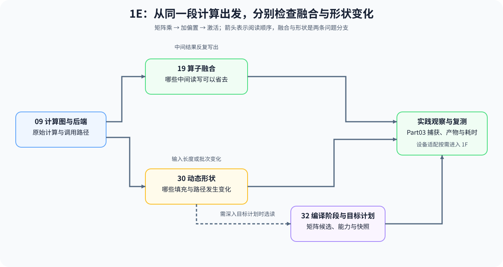

# Group 1E: Compilation and Backends | 1E: 编译与后端

同一段“矩阵乘 → 加偏置 → 激活”，为什么会有不同的启动次数和中间读写？输入长度变化后，原来的执行路径还能不能复用？本组沿着这条计算链，解释图变换、融合、动态形状和目标后端如何共同影响执行。

## Group Goal | 学习目标

从[09](./09_AI_Compilers_and_Graph_Optimization.md)识别计算图与执行路径，再按问题进入[19 融合](./19_Operator_Fusion_Introduction.md)或[30 形状变化](./30_Dynamic_Shape_Handling.md)；两者是不同分支。若尚未区分框架表达和内核实现，先回看[08](./08_Programming_Models_CUDA_Triton.md)，不必先完成整个执行模型组。在30之后，可按需选读[32 编译阶段与目标计划](./32_TVM_MLIR_Deep_Practice.md)，用Python计划衔接形状、分块和目标能力。

## Learning Entries | 学习入口

| 遇到的问题 | 阅读入口 | 要算清或查清什么 |
|:---|:---|:---|
| 相同计算为什么会使用不同的内核调用与数据路径 | [09 图优化与编译器](./09_AI_Compilers_and_Graph_Optimization.md) | 图变换省去了哪些启动或中间读写，后端还需要什么条件 |
| 中间结果反复写出，融合之后是否更省 | [19 算子融合](./19_Operator_Fusion_Introduction.md) | 内部边界能否消除，有无新增布局转换和资源压力 |
| 输入长度变化，缓存和填充开销随之改变 | [30 动态形状](./30_Dynamic_Shape_Handling.md) | 形状种类、缓存复用、填充数量和路径切换分别怎样变化 |
| 想继续理解目标计划怎样形成 | [32 编译阶段与目标计划](./32_TVM_MLIR_Deep_Practice.md)（进阶） | 同一矩阵的形状、分块、能力与阶段内容是否一致 |

## Reading Paths and Validation | 阅读顺序与后续验证

程序怎样映射到Warp、Block与Program，可按需回看[16 块内协作](./16_Warp_Block_SharedMemory_Basics.md)和[18 Triton程序块](./18_Triton_Block_Model.md)。本组用逻辑字节数、给定能力和构造耗时解释候选；真实图捕获、设备产物和重复计时从下表进入，设备与运行时适配再接到[1F](./1F.md)。

| 路径 | 阅读顺序 | 能计算或检查什么 | 后续学习入口 |
|:---|:---|:---|:---|
| 中间读写较多 | [09](./09_AI_Compilers_and_Graph_Optimization.md) → [19](./19_Operator_Fusion_Introduction.md) | 找出区域外仍在使用的中间值，推导可减少的逻辑读写 | [Part03·03 SwiGLU三路径对照](../03_Triton_Kernels/03_Triton_Fused_SwiGLU.md) |
| 输入形状变化 | [09](./09_AI_Compilers_and_Graph_Optimization.md) → [30](./30_Dynamic_Shape_Handling.md) | 分开形状统计、填充与运行分支，再观察真实版本复用 | [Part03·21 图捕获与版本复用](../03_Triton_Kernels/21_Torch_Compile_Graph_Reuse.md)、[推理优化](../topic_discussion/inference_optimization/intro.md) |
| 深入目标实现计划 | [09](./09_AI_Compilers_and_Graph_Optimization.md) → [30](./30_Dynamic_Shape_Handling.md) → 按需进入[32](./32_TVM_MLIR_Deep_Practice.md) | 形状绑定、分块预算、目标能力和阶段快照共同约束计划 | [Part03·18 编译产物与实际执行](../03_Triton_Kernels/18_Triton_Compilation_Artifacts_and_Execution.md) |
| 需要确认是否更快 | 固定输入、检查实际执行路径、重复计时 | 省去的读写与启动是否带来端到端收益 | [性能优化·测量与诊断方法](../topic_discussion/performance_optimization/methods/intro.md) |
| 需要换设备或运行时 | 目标计划 → [1F 硬件适配与系统约束](./1F.md) | 产物、形状、关键算子和版本是否兼容，失败时如何回退 | [模型部署与异构执行](../topic_discussion/deployment_heterogeneous/intro.md) |
