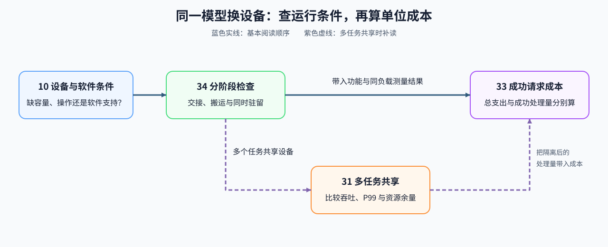

# Group 1F: Hardware Adaptation and System Constraints | 1F: 硬件适配与系统约束

把一个模型迁移到另一种设备，可能遇到容量够却无法加载、预处理能跑但生成失败、共享后尾延迟上升，以及设备便宜却单位成本更高等问题。本组沿着这次迁移，依次检查缺少的运行条件、各阶段的资源需求，以及运行后的隔离与成本取舍。

## Group Goal | 学习目标

主线按10 → 34 → 33阅读：先筛选设备与软件声明，再计算阶段交接与同时驻留，最后比较同负载下的持有期成本。10所需的后端概念可回看[09](./09_AI_Compilers_and_Graph_Optimization.md)，34的搬运估算可回看[07](./07_CPU_GPU_Heterogeneous_Scheduling.md)，按具体缺口补读即可。多个任务共享设备时，在34之后补读31，用给定吞吐与尾延迟筛选隔离方案，再把相同成功标准下的处理量带入33。

## Learning Entries | 学习入口

| 遇到的问题 | 阅读入口 | 本节要算清或查清什么 |
|:---|:---|:---|
| 容量够、峰值高，却缺少运行所需的操作或软件支持 | [10 加速器选型与软件栈适配](./10_Domestic_AI_Chips_Overview.md) | 从同一任务需求列出容量、精度、操作与软件缺项，再检查迁移条件 |
| 阶段各自可执行，交接后却超出容量或增加等待 | [34 异构加速器与运行时](./34_Heterogeneous_Accelerators_and_Runtime_Constraints.md) | 输入类型转换、搬运载荷、缓冲寿命与明确同时驻留的对象 |
| 多个任务共享后尾延迟上升，隔离又损失吞吐或容量弹性 | [31 GPU 虚拟化与 MIG](./31_GPU_Virtualization_and_MIG.md) | 理想切片的资源余量，以及给定服务指标能否同时满足吞吐和延迟要求 |
| 采购价低，但空闲、能耗或迁移让每个成功请求更贵 | [33 TCO 与成本](./33_TCO_and_Cost_Model.md) | 持有期模型成本和成功请求分母分别怎样变化；全额采购与折旧分摊怎样计入成本 |

## Main Path and Multi-Tenant Branch | 主线与多租户分支

四节分别使用CPU条件筛选、交接账目、分区与指标对照、成本计算器。教学例子可用给定数据推导；判断实际迁移方案时，则先在目标路径核对加载、交接和输出，再以共同负载测量时间、资源与成功处理量。编译产物与形状条件可回看 [1E 编译与后端](./1E.md)，搬运时间估算可回看 [07 异构调度](./07_CPU_GPU_Heterogeneous_Scheduling.md)。

| 路径 | 阅读顺序 | 带到后续实验的问题 | 后续入口 |
|:---|:---|:---|:---|
| 单任务迁移 | [10](./10_Domestic_AI_Chips_Overview.md) → [34](./34_Heterogeneous_Accelerators_and_Runtime_Constraints.md) → [33](./33_TCO_and_Cost_Model.md) | 能否完成加载和整条执行路径；在实际处理量下成本多少 | [模型部署与异构执行](../topic_discussion/deployment_heterogeneous/intro.md) |
| 多任务共享 | [34](./34_Heterogeneous_Accelerators_and_Runtime_Constraints.md) → [31](./31_GPU_Virtualization_and_MIG.md) → [33](./33_TCO_and_Cost_Model.md) | 干扰发生在哪里；隔离是否满足服务目标；剩余资源能否利用 | [性能优化·测量与诊断方法](../topic_discussion/performance_optimization/methods/intro.md)、[模型部署与异构执行](../topic_discussion/deployment_heterogeneous/intro.md) |
| 路径可运行后比较收益 | 保持模型、输入与质量要求一致，采集重复测量结果 | 时间、容量和单位成本是否改善，有无新增失败或回退 | [性能优化](../topic_discussion/performance_optimization/intro.md) |
