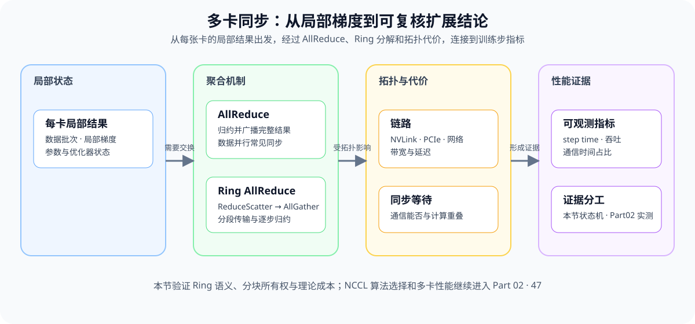

# 20. NCCL and AllReduce Basics | NCCL 与 AllReduce 基础

**难度：** Medium | **环境：** CPU-first | **标签：** `并行通信`, `NCCL`, `AllReduce` | **目标人群：** 通信机制入门者

> 🚀 **云端运行环境**
>
> 本章节的实战代码可以点击以下链接在免费 GPU 算力平台上直接运行：
>
> [](https://colab.research.google.com/github/datawhalechina/llm-algo-leetcode/blob/main/01_Hardware_Math_and_Systems/20_NCCL_and_AllReduce_Basics.ipynb)
> [](https://modelscope.cn/my/mynotebook) *(国内推荐：魔搭社区免费实例)*


---

## 本节导读

多卡训练扩展不理想时，问题可能来自集合通信和同步等待，而不只是单卡算子速度。增加 GPU 数量也会增加需要协调的数据和参与者。

本节建立“局部结果 → All-Reduce → 环形传播 → 延迟与带宽成本”的关系。完成后，你应能解释 Reduce-Scatter 与 All-Gather 如何组成环形 All-Reduce，并估算每个进程的通信量和理论时间。


**关键词：** `NCCL`, `AllReduce`, `DP`



---
## 前置阅读

**导语：** 先区分集合通信的输入输出和链路单位，再用环形传播过程核对归约结果与发送载荷。

- [05. Communication Topologies | 通信拓扑与分布式基石](./05_Communication_Topologies.md)
---
## Q1：NCCL 在分布式训练里到底解决什么问题？


NCCL 为 NVIDIA GPU 提供集合通信和点到点通信实现。它执行 All-Reduce、All-Gather、Reduce-Scatter 等原语，但不负责选择 DP、TP 或 PP，也不替代上层调度器。

在数据并行训练中，各进程（rank）先得到局部梯度，再调用集合通信形成一致结果。这里假设通信与独立计算可以重叠；通信未被覆盖的尾部等待会延长训练步。下面用给定区间计算完成时间，实际重叠窗口仍需从执行记录中观察。

### Q1小验证：同步等待如何进入训练步

计算时间与 collective 时间不能按 GPU 数量线性相乘；先扣除真正被计算覆盖的通信时间，再得到训练步关键路径。

```python
def training_step_time(compute_ms, collective_ms, overlap_ms=0.0):
    """返回计算与 collective 共同形成的关键路径时间。"""
    if min(compute_ms, collective_ms, overlap_ms) < 0:
        raise ValueError('时间必须非负')
    hidden_ms = min(overlap_ms, collective_ms, compute_ms)
    exposed_ms = collective_ms - hidden_ms
    return {
        'step_ms': compute_ms + exposed_ms,
        'hidden_collective_ms': hidden_ms,
        'exposed_collective_ms': exposed_ms,
    }

reports = [training_step_time(10.0, 3.0, overlap) for overlap in [0.0, 1.5, 3.0]]
assert reports[0]['exposed_collective_ms'] == 3.0
assert reports[-1]['exposed_collective_ms'] == 0.0
for report in reports:
    print(report)

```

## Q2：AllReduce 为什么是最核心的通信原语之一？


All-Reduce 接收每个 rank 的同形状局部张量，执行归约，并把相同的完整结果返回给所有 rank。其不变量是：输出形状与局部输入相同，各 rank 输出一致。

数据并行常用它聚合局部梯度。求和与平均只差一个缩放步骤，但该缩放必须与损失归约和优化器语义一致。

### Q2小验证：AllReduce 的输出不变量是什么

先把“局部结果 -> 全局一致”这件事想清楚。

```python
def allreduce_sum(local_vectors):
    """逐元素归约，并把相同的完整结果返回给每个 rank。"""
    if not local_vectors or len({len(row) for row in local_vectors}) != 1:
        raise ValueError('所有 rank 必须提供等长向量')
    reduced = [sum(items) for items in zip(*local_vectors)]
    return [reduced.copy() for _ in local_vectors]

local_gradients = [[1.0, 2.0], [10.0, 20.0], [100.0, 200.0], [1000.0, 2000.0]]
global_gradients = allreduce_sum(local_gradients)
print('rank 0 local:', local_gradients[0])
print('all ranks  :', global_gradients)
assert global_gradients == [[1111.0, 2222.0] for _ in range(4)]

```

## Q3：Ring All-Reduce每个rank发送多少数据？

设参与进程数为P，每rank持有的完整输入载荷为S字节。等长分片的环形算法包含两个阶段，每阶段有P−1轮，每轮每rank向相邻rank发送S/P字节。因此，单rank总发送量为 `2(P−1)S/P`；接收量相同，发送与接收之和再乘2。

发送和接收可以同时发生。用单向带宽估算传输时间时采用发送量，不能把收发合计再除以同一单向带宽。总时间还要加上每轮启动时延。

继续使用256 MiB输入、8个rank：每rank发送448 MiB，接收448 MiB；按100 GiB/s、每轮0.01 ms估算，传输4.375 ms、启动0.14 ms，合计4.515 ms。相同条件换为12.5 GiB/s时，合计35.14 ms。

### Q3机制计算器：分开发送量、接收量与完成时间

载荷能被进程数整除时，每轮发送等长字节片段。两条教学链路沿用05节的GiB/s单位；本例按每轮通信串行推进、单轮收发可并行估算。


```python
def ring_cost(payload_bytes, world_size, alpha_ms, bandwidth_gib_s):
    """估算等长分片Ring的每rank收发字节与时间；带宽按单向GiB/s。"""
    if type(payload_bytes) is not int or payload_bytes < 0:
        raise ValueError('载荷须为非负整数字节')
    if type(world_size) is not int or world_size < 2 or payload_bytes % world_size:
        raise ValueError('至少两个进程，等长分片要求载荷能被进程数整除')
    if alpha_ms < 0 or bandwidth_gib_s <= 0:
        raise ValueError('每轮启动时延须非负，单向带宽须为正')
    rounds = 2 * (world_size - 1)
    send_bytes = rounds * (payload_bytes // world_size)
    latency_ms = rounds * alpha_ms
    transfer_ms = send_bytes / (bandwidth_gib_s * 2**30) * 1000
    return {
        'rounds': rounds,
        'send_bytes_per_rank': send_bytes,
        'receive_bytes_per_rank': send_bytes,
        'send_receive_bytes_per_rank': 2 * send_bytes,
        'latency_ms': latency_ms,
        'transfer_ms': transfer_ms,
        'total_ms': latency_ms + transfer_ms,
    }


PAYLOAD_BYTES = 256 * 1024 * 1024
fast_link = ring_cost(PAYLOAD_BYTES, world_size=8, alpha_ms=0.01, bandwidth_gib_s=100)
slow_link = ring_cost(PAYLOAD_BYTES, world_size=8, alpha_ms=0.01, bandwidth_gib_s=12.5)
assert fast_link['rounds'] == 14
assert fast_link['send_bytes_per_rank'] == 448 * 2**20
assert fast_link['receive_bytes_per_rank'] == 448 * 2**20
assert fast_link['send_receive_bytes_per_rank'] == 896 * 2**20
assert abs(fast_link['total_ms'] - 4.515) < 1e-12
assert abs(slow_link['total_ms'] - 35.14) < 1e-12
print('100 GiB/s单向链路：', fast_link)
print('12.5 GiB/s单向链路：', slow_link)

```

## Q4：Ring AllReduce 为什么常被用来解释 AllReduce 的实现思路？


Ring AllReduce 的关键点，不是“名字里有 ring”，而是它把一次全量聚合拆成了两个更可控的阶段：

1. **Reduce-Scatter**：先沿着环把各卡的数据逐步归约，并把结果切成若干块分散到各卡；
2. **All-Gather**：再沿着环把这些局部归约结果重新拼回完整结果。

这样做的好处是：每张卡在每一轮只发送和接收一小块数据，通信负载更均匀，不需要某一张卡一次性承担全部传输压力。

这个模拟器只验证算法状态变化。真实 NCCL 会根据拓扑、消息规模和配置选择具体算法，实际性能需要在多卡环境中测量。

### Q4小验证：逐轮追踪 chunk 所有权与归约状态

输入矩阵的第一个维度表示 rank，第二个维度表示 chunk。Reduce-Scatter 每轮只移动一个 partial chunk，All-Gather 再传播已经完成归约的 chunk。

```python
def ring_allreduce(local_chunks):
    """用同步快照模拟 Ring Reduce-Scatter 与 All-Gather。"""
    world_size = len(local_chunks)
    if world_size < 2 or any(len(row) != world_size for row in local_chunks):
        raise ValueError('需要 world_size × world_size 的 chunk 矩阵')

    partial = [list(row) for row in local_chunks]
    trace = []
    for step in range(world_size - 1):
        snapshot = [row.copy() for row in partial]
        transfers = []
        for rank in range(world_size):
            source = (rank - 1) % world_size
            chunk = (rank - step - 1) % world_size
            partial[rank][chunk] += snapshot[source][chunk]
            transfers.append({'from': source, 'to': rank, 'chunk': chunk})
        trace.append({'phase': 'reduce_scatter', 'step': step, 'transfers': transfers})

    owned = {(rank + 1) % world_size: partial[rank][(rank + 1) % world_size] for rank in range(world_size)}
    gathered = [{(rank + 1) % world_size: partial[rank][(rank + 1) % world_size]} for rank in range(world_size)]
    for step in range(world_size - 1):
        snapshot = [dict(items) for items in gathered]
        transfers = []
        for rank in range(world_size):
            source = (rank - 1) % world_size
            chunk = (rank - step) % world_size
            gathered[rank][chunk] = snapshot[source][chunk]
            transfers.append({'from': source, 'to': rank, 'chunk': chunk})
        trace.append({'phase': 'all_gather', 'step': step, 'transfers': transfers})

    outputs = [[items[index] for index in range(world_size)] for items in gathered]
    expected = [sum(local_chunks[rank][chunk] for rank in range(world_size)) for chunk in range(world_size)]
    assert all(row == expected for row in outputs)
    return {'outputs': outputs, 'owned_after_reduce_scatter': owned, 'trace': trace}

local_chunks = [[rank * 10 + chunk for chunk in range(4)] for rank in range(4)]
result = ring_allreduce(local_chunks)
print('reduce-scatter owners:', result['owned_after_reduce_scatter'])
print('rank 0 output:', result['outputs'][0])
print('rounds:', len(result['trace']))

assert result['outputs'] == [[60, 64, 68, 72] for _ in range(4)]
assert len(result['trace']) == 6
assert result['owned_after_reduce_scatter'] == {0: 60, 1: 64, 2: 68, 3: 72}

```

---
## 相关阅读
继续在固定消息大小和进程数下观察实际算法、链路带宽与完成时间。NCCL可采用Ring、Tree等实现，下面的资料用于核对本例与真实运行的差异。
- [NCCL 官方文档](https://docs.nvidia.com/deeplearning/nccl/user-guide/docs/)：查阅集合通信原语、拓扑和通信环境。
- [NCCL Tests](https://github.com/NVIDIA/nccl-tests)：用固定消息大小和 GPU 数量观察集合通信带宽。
- [47. Communication Profiling with NCCL | NCCL 通信剖析](../02_PyTorch_Algorithms/47_Communication_Profiling_with_NCCL.md)

---
