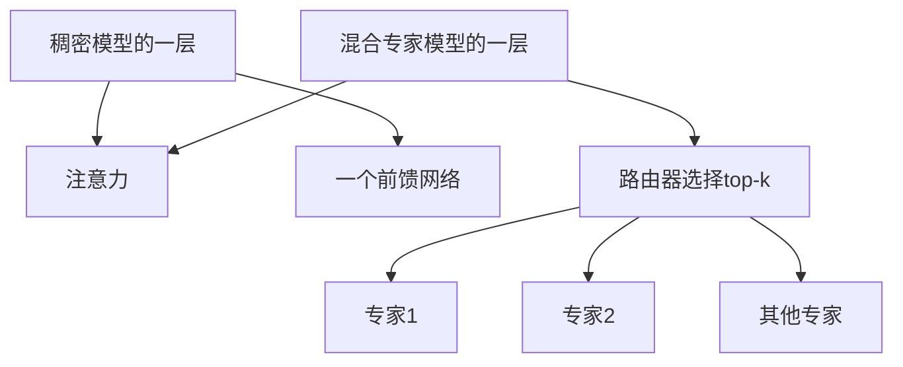

# 22. MoE Parameter and Compute | MoE 模型参数量计算

**难度：** Medium-Hard | **环境：** CPU-first | **标签：** `模型结构`, `MoE`, `参数与计算` | **目标人群：** 硬件约束学习者

> 🚀 **云端运行环境**
>
> 本章节的实战代码可以点击以下链接在免费 GPU 算力平台上直接运行：
>
> [](https://colab.research.google.com/github/datawhalechina/llm-algo-leetcode/blob/main/01_Hardware_Math_and_Systems/22_MoE_Parameter_and_Compute.ipynb)
> [](https://modelscope.cn/my/mynotebook) *(国内推荐：魔搭社区免费实例)*


---

## 本节导读

混合专家模型（MoE）通过增加专家扩大总参数量，但每个 Token 只激活其中一部分。总参数量、活跃计算量和专家负载因此不再同步增长。
本节建立“路由选择 → 专家激活 → 容量与负载 → 通信代价”的关系。完成后，你应能解释稀疏激活为何可以控制计算量，以及负载不均如何削弱这种收益。

**关键词：** 专家、路由器、负载均衡


---
## 前置阅读

**导语：** 先复习参数量、显存和分布式通信，再观察为什么 MoE 能扩大总容量，却同时引入路由、负载均衡和专家并行通信问题。

- [01. Data Types and Precision | 大模型的数据格式与混合精度](./01_Data_Types_and_Precision.md)
- [02. LLM Params and FLOPs | 大模型参数量与算力推导](./02_LLM_Params_and_FLOPs.md)
- [05. Communication Topologies | 通信拓扑与分布式基石](./05_Communication_Topologies.md)
---
## Q1：MoE如何增加总参数，同时限制单个token的计算量？

混合专家模型（MoE）用多个专家前馈网络替换原来的单个前馈网络。路由器为每个token选择得分最高的 $k$ 个专家（top-k路由）；模型保存全部专家参数，单个token只经过选中的专家。

先用一个简化的单层模型计算：隐藏维度4096，中间维度16384，共8个专家，每个token选择2个专家。每个专家采用升维、降维两个矩阵，因此参数量为 `2 × 4096 × 16384 = 134217728`；8个专家共1073741824个参数，单token使用的专家参数为268435456个。按每个矩阵权重对应一次乘法、一次加法，专家前馈计算约为536870912 FLOPs/token。

这些数字对应两矩阵专家的教学配置。三矩阵SwiGLU专家应使用 `3 × d × d_ff`，真实模型还要按各层结构累计。下面单层总量另外计入MHA的四个投影和一个线性路由器；完整前向还包含注意力计算、激活函数和路由处理。



### Q1小验证：计算专家参数量与活跃 FFN FLOPs

运行两矩阵专家的参考公式，对比 dense 和 MoE 的总参数、活跃参数与专家 FFN FLOPs。

```python
import math
import torch
from typing import Dict, List


def dense_ffn_params(d: int, d_ff: int) -> int:
    """Dense FFN/MLP 的参数量，按 2 * d * d_ff 估算。"""
    return 2 * d * d_ff


def moe_expert_params(d: int, d_ff: int, num_experts: int) -> int:
    """MoE 所有专家的总参数量。"""
    return num_experts * dense_ffn_params(d, d_ff)


def active_expert_params(d: int, d_ff: int, active_experts: int) -> int:
    """单个 token 激活的专家参数量。"""
    return active_experts * dense_ffn_params(d, d_ff)


def active_expert_ffn_flops(d: int, d_ff: int, active_experts: int, flops_per_param: int = 2) -> int:
    """估算单 token 激活专家的 FFN 矩阵乘 FLOPs。

    这里只估算专家 FFN 的乘加，不包含 Attention、Router、路由搬运和通信。
    """
    if active_experts <= 0 or flops_per_param <= 0:
        raise ValueError('active_experts 和 flops_per_param 必须为正数')
    return active_expert_params(d, d_ff, active_experts) * flops_per_param


def moe_layer_params(d: int, d_ff: int, num_experts: int, include_router: bool = True) -> int:
    """MoE 单层粗略参数量：Attention + Experts + Router。"""
    attention_params = 4 * d * d
    router_params = d * num_experts if include_router else 0
    return attention_params + moe_expert_params(d, d_ff, num_experts) + router_params


def to_million(x: int) -> float:
    return x / 1e6


def to_billion(x: int) -> float:
    return x / 1e9

```


```python
def test_moe_parameter_formulas():
    d = 4096
    d_ff = 16384
    experts = 8
    active = 2

    dense = dense_ffn_params(d, d_ff)
    total_expert = moe_expert_params(d, d_ff, experts)
    active_params = active_expert_params(d, d_ff, active)
    active_flops = active_expert_ffn_flops(d, d_ff, active)
    layer_params = moe_layer_params(d, d_ff, experts)

    assert dense == 134_217_728, dense
    assert total_expert == 1_073_741_824, total_expert
    assert active_params == 268_435_456, active_params
    assert active_flops == 536_870_912, active_flops
    assert layer_params == 1_140_883_456, layer_params
    print('✅ MoE 参数量公式测试通过')


test_moe_parameter_formulas()

print('单个 dense FFN 参数量:', to_million(dense_ffn_params(4096, 16384)), 'M')
print('8 个专家的总参数量:', to_billion(moe_expert_params(4096, 16384, 8)), 'B')
print('top-2 激活参数量:', to_billion(active_expert_params(4096, 16384, 2)), 'B')
print('top-2 专家 FFN FLOPs / token:', active_expert_ffn_flops(4096, 16384, 2))
print('MoE 单层粗略参数量:', to_billion(moe_layer_params(4096, 16384, 8)), 'B')

```

## Q2：top-k路由怎样形成专家负载和容量溢出？

路由器（Router，也称Gate）先对专家打分，再选出每个token要访问的专家。同一个token选择两个专家时，会产生两次“token—专家”分配；专家负载统计的是这些分配次数，而不是互不重复的token数量。

例如4个token、4个专家、top-2路由，共有8次分配。按容量因子1平均分配，每个专家容量为2；若实际负载为[4, 3, 1, 0]，前两个专家分别超出2次和1次，合计3次分配溢出，占全部分配的3/8。这个比例与“有多少个独立token完全失去专家输出”不同。

实际实现可丢弃、重分配或延后处理超量分配，也可使用负载均衡损失调整路由。本例只统计选择与溢出，后续在MoE Router与负载均衡机制页中继续观察训练过程。

### Q2小验证：由同一份路由结果计算负载和溢出

先核对4个token产生8次分配，再计算每专家容量与3次溢出。修改专家分数时，保持token数量和top-k不变，观察负载分布如何变化。


```python
def expert_capacity(num_tokens: int, num_experts: int, capacity_factor: float = 1.0, top_k: int = 1) -> int:
    """按token数×top-k估算每专家可接收的分配次数。"""
    if num_tokens < 0 or num_experts <= 0 or not 1 <= top_k <= num_experts or capacity_factor <= 0:
        raise ValueError('检查token数、专家数、top-k和容量因子')
    return math.ceil(num_tokens * top_k / num_experts * capacity_factor)


def overflow_tokens(token_counts: List[int], capacity: int) -> int:
    """统计超出专家容量的分配次数，同一token可能出现多次。"""
    return sum(max(0, count - capacity) for count in token_counts)


def load_balance_stats(token_counts: List[int], capacity: int) -> Dict[str, float]:
    """由专家分配计数计算负载与溢出比例。"""
    total = sum(token_counts)
    overflow = overflow_tokens(token_counts, capacity)
    return {
        'total_assignments': total,
        'capacity_per_expert': capacity,
        'max_assignments': max(token_counts),
        'min_assignments': min(token_counts),
        'overflow_assignments': overflow,
        'overflow_assignment_rate': overflow / total if total else 0.0,
    }


def route_tokens(router_scores: torch.Tensor, top_k: int = 1) -> Dict[str, object]:
    """为[num_tokens, num_experts]分数选择top-k，返回选择与专家分配次数。"""
    if router_scores.ndim != 2:
        raise ValueError('router_scores须为二维张量')
    num_tokens, num_experts = router_scores.shape
    if not 1 <= top_k <= num_experts:
        raise ValueError('top_k须在1与专家数之间')
    selected = torch.topk(router_scores, k=top_k, dim=-1).indices
    counts = torch.bincount(selected.reshape(-1), minlength=num_experts).tolist()
    return {'selected_experts': selected, 'token_counts': counts, 'top_k': top_k}


router_scores = torch.tensor([
    [4.0, 3.0, 0.0, -1.0],
    [4.0, 3.0, 0.0, -1.0],
    [4.0, 0.0, 3.0, -1.0],
    [4.0, 3.0, 0.0, -1.0],
])
route = route_tokens(router_scores, top_k=2)
assert route['selected_experts'].shape == (4, 2)
assert route['token_counts'] == [4, 3, 1, 0]

```


```python
token_counts = route['token_counts']
capacity = expert_capacity(
    num_tokens=router_scores.shape[0], num_experts=router_scores.shape[1],
    top_k=route['top_k'], capacity_factor=1.0,
)
stats = load_balance_stats(token_counts, capacity)
assert stats['total_assignments'] == 8
assert capacity == 2
assert stats['overflow_assignments'] == 3
assert stats['overflow_assignment_rate'] == 3 / 8
print('专家分配次数：', token_counts)
print('容量与溢出：', stats)

```

## Q3：专家分配怎样转成跨设备通信量？

专家并行（Expert Parallelism，EP）把专家放到不同设备。输入按路由选择分发（dispatch）给专家，计算后再把专家输出送回原来的token位置并合并（combine）。输入与输出都按隐藏维度传输时，每次远程分配各产生一次去程和回程载荷。

先计算全部分配的逻辑载荷：`token数 × top-k × 隐藏维度 × 每元素字节数 × 2`。其中只有源设备与专家设备不同的分配需要跨设备传输；专家总数本身不再额外乘到流量上。按每次分配分别传输时，同一设备上的多个专家也可能重复接收输入；实际实现还可能合并这些副本。

若专家等量放在各设备，路由选择与源设备无关，则远程分配比例的期望值为 `1 − 1/设备数`。8台设备对应7/8，单设备对应0。若已有路由与放置记录，就直接使用统计得到的远程比例。下面按整层全部输入统计期望发送载荷，每份远程载荷计一次，包含分发和回传；实际链路耗时还受路由偏斜与通信实现影响。

### Q3机制计算器：区分全部分配载荷与远程发送载荷

固定token数、top-k和数据宽度，只改变专家数、设备数或远程比例。先核对手算字节数，再观察本地分配为什么不会产生跨设备发送。


```python
def estimate_expert_parallel_traffic(
    batch: int, seq_len: int, hidden_dim: int, num_experts: int,
    num_devices: int, top_k: int = 1, bytes_per_element: int = 2,
    dispatch_and_gather_factor: float = 2.0, remote_fraction=None,
) -> int:
    """估算整层远程发送字节数，包含分发与回传；每份载荷计一次。

    未给远程比例时，假设专家等量分布、路由与源设备无关。
    输入与输出等宽，按每次专家分配独立传输，忽略跨分配副本合并。
    """
    if min(batch, seq_len) < 0 or min(hidden_dim, num_experts, num_devices, bytes_per_element) <= 0:
        raise ValueError('token数量须非负，维度、专家数、设备数和数据宽度须为正')
    if not 1 <= top_k <= num_experts or dispatch_and_gather_factor <= 0:
        raise ValueError('top-k须在专家数范围内，传输次数因子须为正')
    if remote_fraction is None:
        if num_experts % num_devices != 0:
            raise ValueError('等量放置假设要求专家数能被设备数整除，其他放置请给定远程比例')
        remote_fraction = 1 - 1 / num_devices
    if not 0 <= remote_fraction <= 1 or (num_devices == 1 and remote_fraction != 0):
        raise ValueError('远程比例须在[0, 1]内，单设备时为0')
    assignments = batch * seq_len * top_k
    logical_bytes = assignments * hidden_dim * bytes_per_element * dispatch_and_gather_factor
    return int(logical_bytes * remote_fraction)


def bytes_to_mb(x: int) -> float:
    """把字节换算成十进制MB。"""
    return x / 1e6


def bytes_to_gb(x: int) -> float:
    """把字节换算成十进制GB。"""
    return x / 1e9

```


```python
batch = 8
seq_len = 2048
hidden_dim = 4096
num_experts = 8
num_devices = 8
top_k = 2
traffic = estimate_expert_parallel_traffic(
    batch, seq_len, hidden_dim, num_experts, num_devices, top_k=top_k
)

print('等量专家放置、均匀路由假设下的整层远程发送量：')
print('-' * 60)
print(f'batch={batch}, seq_len={seq_len}, hidden_dim={hidden_dim}, top_k={top_k}')
print(f'remote send = {bytes_to_mb(traffic):.1f} MB / layer（含分发与回传）')
print(f'remote send = {bytes_to_gb(traffic):.3f} GB / layer')

```


```python
def test_traffic_estimation():
    """核对载荷字节、路由副本数与本地分配的影响。"""
    # 4 tokens × top-2 × 32元素 × 2字节 × 去回2次 × 远程比例3/4。
    expected = 768
    assert estimate_expert_parallel_traffic(1, 4, 32, 8, 4, top_k=2) == expected
    assert estimate_expert_parallel_traffic(1, 4, 32, 16, 4, top_k=2) == expected
    assert estimate_expert_parallel_traffic(1, 4, 32, 8, 1, top_k=2) == 0
    assert estimate_expert_parallel_traffic(1, 4, 32, 8, 4, top_k=1) == expected / 2
    assert estimate_expert_parallel_traffic(1, 4, 32, 8, 4, top_k=2, remote_fraction=0.5) == 512
    print('专家并行发送载荷公式核对通过')


test_traffic_estimation()

```

## Q4：MoE 账本还缺哪些采用证据？


参数与计算账本可以识别 MoE 容量候选，但不能直接决定采用 MoE。形成候选通常需要两个前提：

- 你想扩大模型容量，但不希望每次推理都把计算量一起放大
- 你能接受更复杂的路由、调度和通信实现

下面这些情况说明证据仍不完整：
- 你更在意实现简单、稳定和可预测
- 你的系统带宽 / 通信条件并不理想
- 你很难接受路由不均衡带来的训练波动

可以先用下面的条件表记录账本信号和缺失证据，再进入架构、通信与性能专题验证：

| 账本或系统信号 | 仍需验证 |
| --- | --- |
| 总参数需求高，活跃参数明显低于总参数 | 质量、实际吞吐和显存驻留 |
| 专家需要跨设备放置 | All-to-All 通信量、暴露时间和扩展效率 |
| 专家负载不均或发生容量溢出 | Router 分布、overflow 和尾部等待 |
| 服务要求实现简单、延迟可预测 | 调度复杂度、尾延迟和回退方案 |

这张表只把理论账本转换成待测清单；最终选择仍需要记录质量、吞吐、通信时间和尾延迟。

### Q4小验证：从账本生成待测清单

把容量需求、通信条件、负载均衡和工程简洁度转换成后续需要补齐的证据。


```python
def moe_follow_up_evidence(capacity_need, communication_ready, load_balance_ok, simplicity_priority):
    """把 MoE 账本信号转换成后续待测证据，不直接给出采用决策。"""
    flags = [capacity_need, communication_ready, load_balance_ok, simplicity_priority]
    if not all(isinstance(value, bool) for value in flags):
        raise TypeError('四个条件必须是 bool')
    required = ['quality', 'throughput', 'tail_latency']
    if capacity_need:
        required.append('capacity_gain')
    if not communication_ready:
        required.extend(['all_to_all_time', 'scaling_efficiency'])
    if not load_balance_ok:
        required.extend(['expert_load_distribution', 'overflow_rate'])
    if simplicity_priority:
        required.extend(['scheduling_complexity', 'fallback_path'])
    return {
        'ledger_signal': 'capacity_candidate' if capacity_need else 'no_capacity_pressure',
        'required_measurements': sorted(set(required)),
        'evidence_level': 'theoretical_ledger',
    }

cases = [
    (True, True, True, False),
    (True, False, True, False),
    (False, True, True, True),
]
for case in cases:
    print(case, '->', moe_follow_up_evidence(*case))
assert 'capacity_gain' in moe_follow_up_evidence(True, True, True, False)['required_measurements']
assert 'all_to_all_time' in moe_follow_up_evidence(True, False, True, False)['required_measurements']
assert 'fallback_path' in moe_follow_up_evidence(False, True, True, True)['required_measurements']
print('✅ MoE 待测证据清单检查通过')

```

---
## 相关阅读

**导语：** 把参数与计算账本接到 Router 和专家并行，继续观察 capacity、overflow 与跨卡 token 交换。

- [Part 02 · 06 MoE Router](../02_PyTorch_Algorithms/06_MoE_Router.md)
- [Part 02 · 07 MoE Load Balancing](../02_PyTorch_Algorithms/07_MoE_Load_Balancing_Loss.md)
- [Part 02 · 46 MoE Expert Parallel](../02_PyTorch_Algorithms/46_MoE_Expert_Parallel.md)
---
