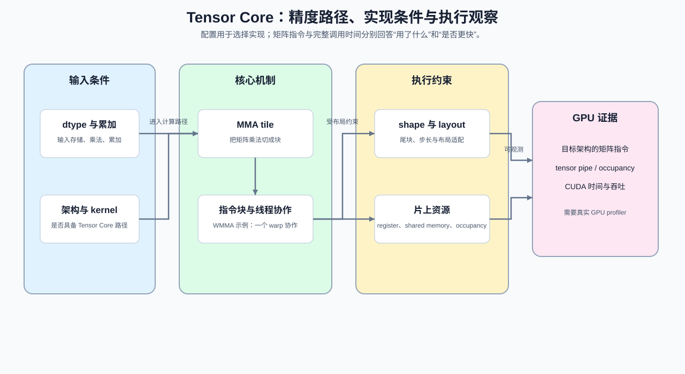

# 23. TensorCore Deep Dive | Tensor Core 深度剖析

**难度：** Hard | **环境：** CPU-first | **标签：** `硬件系统`, `Tensor Core`, `MMA` | **目标人群：** 系统性能入门者

> 🚀 **云端运行环境**
>
> 本章节的实战代码可以点击以下链接在免费 GPU 算力平台上直接运行：
>
> [](https://colab.research.google.com/github/datawhalechina/llm-algo-leetcode/blob/main/01_Hardware_Math_and_Systems/23_TensorCore_Deep_Dive.ipynb)
> [](https://modelscope.cn/my/mynotebook) *(国内推荐：魔搭社区免费实例)*


---

## 本节导读

相同的矩阵乘可以采用不同精度组合、指令分块和数据布局。一个实现因尾块或布局转换增加成本，另一个实现可能仍能使用矩阵指令；仅凭“不是16的倍数”或“占用率不足50%”，无法判断是否用了Tensor Core。

本节先计算矩阵块的工作量，再核对给定精度路径与具体实现条件，最后分别读取指令观察和耗时。它支撑算子优化的矩阵实现选择，真实指令执行可继续在Part04·07 WMMA与Part03·18编译产物中核对。

**关键词：** 矩阵乘加、精度组合、分块覆盖、指令观察



## 前置阅读

先区分存储与计算精度，再理解数据块和线程的协作范围。

- [12 Tensor Core与混合精度](./12_TensorCore_and_Mixed_Precision.md)：输入、乘法、累加和不同张量的字节账目。
- [15 CUDA执行模型](./15_CUDA_Execution_Model.md)：线程、Warp与资源约束。
- [16 Warp与共享内存](./16_Warp_Block_SharedMemory_Basics.md)：块内协作、复用和同步。

## Q1：逻辑矩阵块与矩阵指令是什么关系？

矩阵乘加（MMA）完成一块矩阵的乘积与累加；融合乘加（FMA）处理标量乘加。把16×16×16的逻辑子问题按每次乘加两次运算计，共8192 FLOPs。这个数字描述工作量，不表示整个逻辑块由一条指令完成。

实际实现还要把逻辑块分解为目标架构和精度支持的指令形状，并安排线程协作。WMMA（Warp Matrix Multiply Accumulate）是由一个Warp协作完成矩阵乘加的编程接口；fragment是矩阵片段在协作线程中的表示。更新代际还可能采用不同的协作与指令接口。逻辑Tile（分块）、指令块与线程块需要分别核对，不能用一张统一16×16图代表所有设备路径。

### Q1 机制计算器：同一逻辑子问题需要多少运算？

先核对16×16×16对应8192 FLOPs，再把K翻倍；使用何种指令不改变这一工作量约定。


```python
def mma_flops(m: int, n: int, k: int) -> int:
    """计算逻辑矩阵乘加块的2MNK，不将逻辑块等同于一条MMA指令。"""
    if any(type(dim) is not int or dim <= 0 for dim in (m, n, k)):
        raise ValueError("矩阵块维度须为正整数")
    return 2 * m * n * k


one = mma_flops(m=16, n=16, k=16)
twice_k = mma_flops(m=16, n=16, k=32)
assert one == 8192 and twice_k == 16_384
assert mma_flops(m=2, n=3, k=4) == 48
print(f"16×16×16逻辑子问题：{one} FLOPs；K翻倍后：{twice_k} FLOPs")

```

## Q2：怎样核对输入、乘法和累加的精度组合？

对一条给定实现，分别记录输入存储、乘法模式与累加类型。例如BF16输入可以与BF16乘法、FP32累加配合；FP32输入也可能走TF32乘法与FP32累加。能否采用这组组合，取决于设备指令、软件实现和配置，不能只将所有低精度格式列为“支持”。

下面为一个假设目标显式声明三组路径，用完整三元组匹配。该目标未声明的组合只表示此配置未提供，不代表所有GPU都不支持。高精度累加减轻部分累积误差，却不能恢复输入转换前已经丢失的精度；输出类型还要另行记录。

### Q2 条件核对：匹配完整精度路径，不只看输入dtype

固定相同元素数，比较BF16／BF16／FP32与FP32／TF32／FP32，再检查目标未声明的FP32乘法和BF16累加组合。


```python
def tensorcore_dtype_path(
    input_dtype: str, multiplication_dtype: str, accumulation_dtype: str,
    numel: int, supported_paths: set,
) -> dict:
    """核对给定精度三元组，并返回输入载荷字节；不查询真实设备。"""
    if type(numel) is not int or numel <= 0:
        raise ValueError("numel须为正整数")
    dtype_bytes = {"FP32": 4, "FP16": 2, "BF16": 2, "FP8": 1}
    if input_dtype not in dtype_bytes:
        raise ValueError("输入存储类型须为已列出的浮点格式")
    path = (input_dtype, multiplication_dtype, accumulation_dtype)
    return {"precision_path": path, "input_storage_bytes": numel * dtype_bytes[input_dtype],
            "declared_path_supported": path in supported_paths}


# 假设目标实现声明的组合；不是当前设备的查询结果。
supported_paths = {
    ("FP16", "FP16", "FP32"),
    ("BF16", "BF16", "FP32"),
    ("FP32", "TF32", "FP32"),
}
inputs = dict(numel=1024, supported_paths=supported_paths)
bf16 = tensorcore_dtype_path(input_dtype="BF16", multiplication_dtype="BF16",
                             accumulation_dtype="FP32", **inputs)
tf32 = tensorcore_dtype_path(input_dtype="FP32", multiplication_dtype="TF32",
                             accumulation_dtype="FP32", **inputs)
undeclared = tensorcore_dtype_path(input_dtype="FP32", multiplication_dtype="FP32",
                                   accumulation_dtype="FP32", **inputs)
other_accumulation = tensorcore_dtype_path(input_dtype="BF16", multiplication_dtype="BF16",
                                          accumulation_dtype="BF16", **inputs)
assert bf16["declared_path_supported"] and bf16["input_storage_bytes"] == 2048
assert tf32["declared_path_supported"] and tf32["input_storage_bytes"] == 4096
assert not undeclared["declared_path_supported"]
assert not other_accumulation["declared_path_supported"]
for result in (bf16, tf32, undeclared, other_accumulation):
    print(result["precision_path"], "：给定目标已声明=", result["declared_path_supported"],
          "，输入载荷", result["input_storage_bytes"], "B")

```

## Q3：哪些是实现要求，哪些只是性能线索？

给定一个按16×16×16分块、只直接处理整除形状和连续输入的示例内核，128×128×128可以直接进入；M改成130时，需要尾块处理或补齐，输入为转置视图时，需要相应地址计算或布局转换。这些是该示例的能力范围。库或其他内核可能处理不整除与非连续输入，不能把这个示例的范围当成Tensor Core的统一限制。

SM驻留占用率表示驻留Warp数相对上限的比例，寄存器用量影响资源可用性；较低占用率不自动排除矩阵指令，也不直接预测耗时。下面将几何覆盖、是否需要布局适配、给定寄存器预算和占用率分开记录，不把它们乘成利用率或固定加速分数。

### Q3 机制计算器：分别记录覆盖与资源，不合并成速度门槛

比较M=128与130，再改变布局和给定占用率。128与16整除时不补齐；130按16补齐到144，额外输出槽单独计算。


```python
def inspect_matrix_configuration(
    m: int, n: int, k: int, tile: int = 16, layout_contiguous: bool = True,
    occupancy: float = 1.0, register_pressure: int = 32, register_budget: int = 64,
) -> dict:
    """返回本例几何覆盖与资源观察；占用率输入不充当指令路径门槛。"""
    if any(type(value) is not int or value <= 0 for value in (m, n, k, tile, register_budget)):
        raise ValueError("矩阵维度、块大小和寄存器预算须为正整数")
    if type(register_pressure) is not int or register_pressure < 0:
        raise ValueError("每线程寄存器用量须为非负整数")
    if (type(layout_contiguous) is not bool or type(occupancy) not in (int, float)
            or not 0 <= occupancy <= 1):
        raise ValueError("布局条件须为布尔值，占用率须为[0,1]内的实数")
    padded = tuple((dim + tile - 1) // tile * tile for dim in (m, n, k))
    return {
        "shape_aligned_for_example": padded == (m, n, k),
        "padded_shape_mnk": padded, "extra_output_slots": padded[0] * padded[1] - m * n,
        "layout_adaptation_needed": not layout_contiguous,
        "given_occupancy": occupancy, "register_budget_met": register_pressure <= register_budget,
    }


base = dict(m=128, n=128, k=128)
aligned = inspect_matrix_configuration(**base)
tail = inspect_matrix_configuration(**(base | {"m": 130}))
strided = inspect_matrix_configuration(**base, layout_contiguous=False)
low_occupancy = inspect_matrix_configuration(**base, occupancy=0.3)
assert aligned["shape_aligned_for_example"] and aligned["extra_output_slots"] == 0
assert tail["padded_shape_mnk"] == (144, 128, 128)
assert tail["extra_output_slots"] == 1792
assert strided["layout_adaptation_needed"]
assert low_occupancy["shape_aligned_for_example"] and low_occupancy["given_occupancy"] == 0.3
assert inspect_matrix_configuration(**base, register_pressure=64)["register_budget_met"]
assert not inspect_matrix_configuration(**base, register_pressure=65)["register_budget_met"]
for name, result in (("整除", aligned), ("尾块", tail), ("转置输入", strided), ("低占用率", low_occupancy)):
    print(name, "：补齐形状", result["padded_shape_mnk"],
          "，额外输出槽", result["extra_output_slots"],
          "，需布局适配", result["layout_adaptation_needed"])

```

## Q4：观察到矩阵指令，是否就说明完整调用更快？

先把同输入的数值结果核对通过，再关联目标调用、实际内核、矩阵指令或相应计算通路计数。内核名称可以帮助找到对象，但名称、dtype或一次吞吐变化都不能单独证明采用了哪条指令路径。计数器应按目标架构、实际内核及采集范围选择；HMMA只是部分架构上的指令名称，不是所有Tensor Core路径的统一名称。

下面用构造的时间与指令计数分别练习判断。采到矩阵指令但调用变慢，说明路径存在仍未带来净收益；调用更快但没采集指令计数，则只能报告时间改善，不能补写指令结论。真实测量还需固定工作量、精度要求、预热与重复次数，并包含布局转换等必要开销。

### Q4 对照验证：把指令观察与时间改善分开

计数为None表示未采集，0表示本次记录未观察到所选指令；两者不同。各行均为构造记录，不登记为GPU实测。


```python
import math


def summarize_tensorcore_observation(
    baseline_ms: float, candidate_ms: float, tensor_instruction_count: int | None,
) -> dict:
    """汇总给定目标调用的构造记录，分别返回指令观察与时间差。"""
    if any(type(value) not in (int, float) or not math.isfinite(value) or value <= 0
           for value in (baseline_ms, candidate_ms)):
        raise ValueError("调用时间须为有限正实数")
    if (tensor_instruction_count is not None
            and (type(tensor_instruction_count) is not int or tensor_instruction_count < 0)):
        raise ValueError("指令计数须为非负整数或None")
    return {
        "tensor_instructions_observed": None if tensor_instruction_count is None
                                       else tensor_instruction_count > 0,
        "time_ratio": baseline_ms / candidate_ms,
        "saved_ms": baseline_ms - candidate_ms,
    }


cases = {
    "instructions_but_slower": dict(candidate_ms=3, tensor_instruction_count=64),
    "instructions_and_faster": dict(candidate_ms=1.6, tensor_instruction_count=64),
    "counter_not_collected": dict(candidate_ms=1.6, tensor_instruction_count=None),
    "no_matching_instructions": dict(candidate_ms=3, tensor_instruction_count=0),
}
reports = {name: summarize_tensorcore_observation(baseline_ms=2, **values)
           for name, values in cases.items()}
assert reports["instructions_but_slower"]["tensor_instructions_observed"] is True
assert reports["instructions_but_slower"]["saved_ms"] == -1
assert reports["instructions_and_faster"]["time_ratio"] == 1.25
assert reports["counter_not_collected"]["tensor_instructions_observed"] is None
assert reports["no_matching_instructions"]["tensor_instructions_observed"] is False
assert summarize_tensorcore_observation(baseline_ms=2, candidate_ms=2,
                                       tensor_instruction_count=64)["saved_ms"] == 0
for name, result in reports.items():
    print(f"{name}: 指令观察={result['tensor_instructions_observed']}，"
          f"调用节省 {result['saved_ms']:g} ms，时间比 {result['time_ratio']:.3f}")

```

## 相关阅读

把给定路径和CPU账目接到真实执行，再确认实际采用的指令与完整成本。

- [Part04·07 WMMA编程](../04_CUDA_and_System_Optimization/07_Tensor_Core_MMA_Programming.md)：在具体接口与设备上核对矩阵片段、协作和数值结果。
- [Part03·18 编译产物与实际执行](../03_Triton_Kernels/18_Triton_Compilation_Artifacts_and_Execution.md)：关联编译产物、启动对象与执行记录。
- [NVIDIA矩阵乘性能说明](https://docs.nvidia.com/deeplearning/performance/dl-performance-matrix-multiplication/index.html)：重点看Tensor Core Requirements，区分版本、尺寸适配与效率条件。
