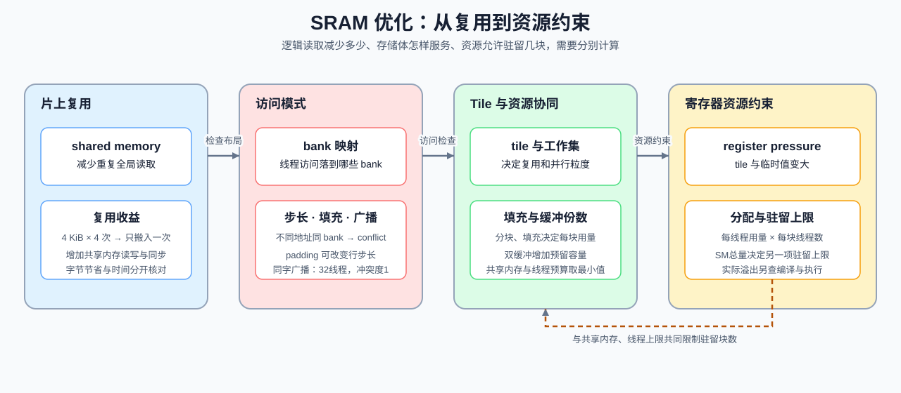

# 24. SRAM Optimization Techniques | SRAM 优化技术

**难度：** Hard | **环境：** CPU-first | **标签：** `硬件系统`, `SRAM`, `访存优化` | **目标人群：** 系统性能入门者

> 🚀 **云端运行环境**
>
> 本章节的实战代码可以点击以下链接在免费 GPU 算力平台上直接运行：
>
> [](https://colab.research.google.com/github/datawhalechina/llm-algo-leetcode/blob/main/01_Hardware_Math_and_Systems/24_SRAM_Optimization_Techniques.ipynb)
> [](https://modelscope.cn/my/mynotebook) *(国内推荐：魔搭社区免费实例)*


---

## 本节导读

一个4 KiB数据块若被完整使用四次，逐次读取需要16 KiB的全局读取；先搬入共享内存再复用，可将这部分逻辑读取降到4 KiB，同时增加片上读写与同步。节省的字节是否值得这些代价，还要看访问方式和资源用量。

SRAM是片上静态存储电路的实现技术；这里讨论由线程块显式使用的共享内存，并把寄存器作为另一项资源单独计算。本节支撑算子优化中的分块设计，先估算复用、存储体映射与驻留上限，再进入Part04·06的共享内存矩阵乘验证。

**关键词：** 共享内存、数据复用、存储体冲突、驻留块数、寄存器



## 前置阅读

先了解线程块的协作范围，再比较共享内存与寄存器对驻留的限制。

- [15 CUDA执行模型](./15_CUDA_Execution_Model.md)：线程、线程块与SM调度范围。
- [16 Warp与共享内存](./16_Warp_Block_SharedMemory_Basics.md)：块内复用、同步和资源预算。

## Q1：共享内存复用能减少多少全局读取？

同一数据块被使用多次时，可以每次从全局内存读取，也可以先搬入共享内存，再由线程复用。先假设每次全局读取都需要搬运整个数据块，暂不计缓存命中：数据块大小乘以使用次数，就是未复用方案的读取字节数；共享内存方案只搬入一次，同时增加片上写入、读取和同步。

下面分开记录各类字节数和同步次数。全局读取减少量是这个访问模型的结果，实际 HBM 流量还受缓存影响；字节数与同步次数不能直接相减得到耗时。

### Q1小验证：固定数据块，只改变使用次数

先预测使用一次和使用多次的全局读取量，再检查共享内存写入、读取与同步的增量。


```python
def reuse_traffic_ledger(tile_bytes: int, uses: int, sync_points: int = 1) -> dict:
    """计算整块重复读取模型的字节数，不包含缓存和耗时估计。"""
    for name, value in {'tile_bytes': tile_bytes, 'uses': uses}.items():
        if type(value) is not int or value <= 0:
            raise ValueError(f'{name} 必须是正整数')
    if type(sync_points) is not int or sync_points < 0:
        raise ValueError('sync_points 必须是非负整数')
    return {
        'global_read_bytes_without_reuse': tile_bytes * uses,
        'global_read_bytes_with_reuse': tile_bytes,
        'global_read_bytes_saved': tile_bytes * (uses - 1),
        'shared_write_bytes': tile_bytes,
        'shared_read_bytes': tile_bytes * uses,
        'sync_points': sync_points,
    }


TILE_BYTES = 4096  # 可修改：每次完整使用的数据块大小，单位字节。
for uses in [1, 2, 4]:
    print(uses, '次使用 ->', reuse_traffic_ledger(TILE_BYTES, uses))
assert reuse_traffic_ledger(4096, 1)['global_read_bytes_saved'] == 0
assert reuse_traffic_ledger(4096, 4)['global_read_bytes_saved'] == 12288
assert reuse_traffic_ledger(4096, 4, 3)['sync_points'] == 3

```

## Q2：同一个存储体里的访问，为什么有的冲突、有的广播？

共享内存分为多个存储体（bank）。在下面的32个存储体、每个32位字映射到一个存储体的模型中，字地址除以32的余数就是存储体编号。一个Warp的32个线程各读一个字：步长1时分别落到32个存储体；步长32时访问32个不同字，却都落到同一个存储体，需要分轮次服务。这叫存储体冲突（bank conflict），不是全局内存的合并访存问题。

如果这32个线程读取的是同一个字，硬件可以广播（broadcast）这个字，不能记作32路冲突。读取二维数组同一列时，行步长32改为33相当于每行增加一个填充字（padding），映射便重新分散。下方分别统计同一存储体的线程数与不同字数；它只模拟一次单Warp、每线程读取一个32位字的情况，更宽访问应按实际指令拆分分析。

### Q2 对照验证：同一存储体的32个线程，访问了几个不同字？

先比较步长1、2、32，再将行步长32加一个填充字，最后与同地址广播比较。


```python
def bank_access_report(stride: int, banks: int = 32, threads: int = 32,
                       padding_words: int = 0,
                       access_mode: str = "strided") -> dict:
    """模拟单Warp、每线程一个32位字的读取；冲突度按不同字计。"""
    if any(type(value) is not int or value <= 0 for value in (stride, banks, threads)):
        raise ValueError("字步长、存储体数与线程数须为正整数")
    if threads > 32:
        raise ValueError("本模型限一个Warp，每次至多32个线程")
    if type(padding_words) is not int or padding_words < 0:
        raise ValueError("每行填充字数须为非负整数")
    if access_mode not in {"strided", "broadcast"}:
        raise ValueError("访问模式须为strided或broadcast")
    effective_stride = stride + padding_words
    word_addresses = ([0] * threads if access_mode == "broadcast" else
                      [lane * effective_stride for lane in range(threads)])
    bank_ids = [address % banks for address in word_addresses]
    words_by_bank = {bank: set() for bank in bank_ids}
    for address, bank in zip(word_addresses, bank_ids):
        words_by_bank[bank].add(address)
    degree = max(len(words) for words in words_by_bank.values())
    return {
        "bank_ids": bank_ids, "unique_banks": len(words_by_bank),
        "effective_stride": effective_stride, "access_mode": access_mode,
        "max_lanes_per_bank": max(bank_ids.count(bank) for bank in words_by_bank),
        "max_conflict_degree": degree, "serialized_risk": degree > 1,
    }


for stride in (1, 2, 16, 32, 33):
    report = bank_access_report(stride=stride)
    print(f"字步长={stride}: 存储体数 {report['unique_banks']}，冲突度 {report['max_conflict_degree']}")
assert bank_access_report(stride=1)["max_conflict_degree"] == 1
assert bank_access_report(stride=2)["max_conflict_degree"] == 2
assert bank_access_report(stride=32)["max_conflict_degree"] == 32
assert bank_access_report(stride=32, padding_words=1)["max_conflict_degree"] == 1
broadcast = bank_access_report(stride=32, access_mode="broadcast")
assert broadcast["max_lanes_per_bank"] == 32
assert broadcast["max_conflict_degree"] == 1 and not broadcast["serialized_risk"]
print("广播：32个线程读取同一字，冲突度为1。")

```

## Q3：分块、填充和缓冲如何限制驻留块数？

例如32×32×32的矩阵分块，两份四字节输入子块共8 KiB；双缓冲时为16 KiB。在假设每SM有64 KiB共享内存的预算下，两者分别允许至多8块与4块驻留。驻留块是已经分配资源、可以在SM上推进的线程块，而非整个网格中的所有块。

矩阵乘法的一个线程块可以同时保存左矩阵的 $M\times K$ 子块和右矩阵的 $K\times N$ 子块。设每元素占 $b$ 字节，右矩阵每行额外填充 $p$ 个元素，缓冲份数为 $q$ ，共享内存用量为：

$$
S_{\mathrm{block}}=q b [MK+K(N+p)].
$$

这里 $M,N,K$ 是分块维度， $p$ 用于改变右矩阵的行步长， $q=2$ 表示为两组数据预留双缓冲。双缓冲只是容量条件，是否形成计算与搬运重叠还取决于执行调度。代码用假设的每 SM 预算，分别计算共享内存、线程数和块数限制，取最小值作为驻留块数上限；该上限尚未计入寄存器、分配粒度等限制。

| 设计项 | 可计算的变化 | 需要同时检查 |
|:---|:---|:---|
| 分块维度 | 左右子块的元素数与共享内存字节数 | 更大的工作集可能减少驻留块数 |
| 行填充 | 增加 $Kp$ 个元素的容量 | 存储体映射是否改善，见前一问 |
| 缓冲份数 | 共享内存用量按份数增长 | 调度是否真正重叠搬运与计算 |
| 每块线程数 | 线程预算允许的驻留块数 | 多个资源上限取最小值 |

### Q3小验证：比较单缓冲、双缓冲与行填充

固定分块维度，分别改变缓冲份数或填充量，检查共享内存字节数和驻留块数上限。


```python
def tile_resource_ledger(tile_m: int, tile_n: int, tile_k: int, element_bytes: int = 4,
                         buffers: int = 1, padding: int = 0, threads_per_block: int = 256,
                         smem_per_sm_bytes: int = 65536, max_threads_per_sm: int = 2048,
                         max_blocks_per_sm: int = 16) -> dict:
    """按给定预算估算驻留上限；预算是教学输入，不代表特定 GPU。"""
    positive = {
        'tile_m': tile_m, 'tile_n': tile_n, 'tile_k': tile_k,
        'element_bytes': element_bytes, 'buffers': buffers,
        'threads_per_block': threads_per_block,
        'smem_per_sm_bytes': smem_per_sm_bytes,
        'max_threads_per_sm': max_threads_per_sm,
        'max_blocks_per_sm': max_blocks_per_sm,
    }
    if any(type(value) is not int or value <= 0 for value in positive.values()):
        raise ValueError('维度、字节数、份数与资源预算必须是正整数')
    if type(padding) is not int or padding < 0:
        raise ValueError('padding 必须是非负整数')
    shared_bytes = buffers * element_bytes * (
        tile_m * tile_k + tile_k * (tile_n + padding)
    )
    limits = {
        'shared_memory': smem_per_sm_bytes // shared_bytes,
        'threads': max_threads_per_sm // threads_per_block,
        'blocks': max_blocks_per_sm,
    }
    resident_blocks = min(limits.values())
    return {
        'shared_bytes_per_block': shared_bytes,
        'padding_bytes_per_block': buffers * element_bytes * tile_k * padding,
        'resident_block_limits': limits,
        'resident_blocks_upper_bound': resident_blocks,
        'active_thread_fraction_upper_bound':
            resident_blocks * threads_per_block / max_threads_per_sm,
    }


for buffers, padding in [(1, 0), (2, 0), (1, 1)]:
    print(buffers, padding, '->', tile_resource_ledger(
        32, 32, 32, buffers=buffers, padding=padding
    ))
single = tile_resource_ledger(32, 32, 32)
double = tile_resource_ledger(32, 32, 32, buffers=2)
padded = tile_resource_ledger(32, 32, 32, padding=1)
assert single['shared_bytes_per_block'] == 8192
assert double['shared_bytes_per_block'] == 16384
assert single['resident_blocks_upper_bound'] == 8
assert double['resident_blocks_upper_bound'] == 4
assert padded['padding_bytes_per_block'] == 128
assert padded['resident_blocks_upper_bound'] == 7
assert tile_resource_ledger(128, 128, 128)['resident_blocks_upper_bound'] == 0
assert tile_resource_ledger(32, 32, 32, smem_per_sm_bytes=8192)["resident_blocks_upper_bound"] == 1
assert tile_resource_ledger(32, 32, 32, smem_per_sm_bytes=8191)["resident_blocks_upper_bound"] == 0

```

## Q4：寄存器需求增加后，哪些资源限制会先出现？

分块与临时值增加时，每线程寄存器需求可能上升。在给定每线程预算下，先记录需求超出量；再把每线程需求乘以每块线程数，估算一个块需要多少寄存器。每 SM 寄存器总量除以每块需求，给出另一项驻留块数上限；它与上一问的共享内存和线程上限共同约束驻留。

下面假设输入需求就是每线程分配量，暂不计寄存器分配粒度。超出所设预算说明需要检查编译结果，而不等于已经产生同等数量的溢出读写：编译器可能缩短变量生命周期、重算或把值存入本地内存。实际溢出字节数与耗时要查看编译报告及执行指标。

### Q4小验证：固定线程数，只增加寄存器需求

观察每块寄存器总量、预算超出量和驻留块数上限，再与上一问的共享内存上限取最小值。


```python
def register_resource_ledger(registers_per_thread: int, threads_per_block: int = 256,
                             per_thread_budget: int = 64, registers_per_sm: int = 65536,
                             max_threads_per_sm: int = 2048,
                             max_blocks_per_sm: int = 16) -> dict:
    """按假设分配量计算寄存器约束，不推算实际溢出或加速比。"""
    values = (registers_per_thread, threads_per_block, per_thread_budget,
              registers_per_sm, max_threads_per_sm, max_blocks_per_sm)
    if any(type(value) is not int or value <= 0 for value in values):
        raise ValueError('寄存器数量、线程数与预算必须是正整数')
    registers_per_block = registers_per_thread * threads_per_block
    return {
        'registers_per_block': registers_per_block,
        'excess_registers_per_thread': max(
            registers_per_thread - per_thread_budget, 0
        ),
        'resident_blocks_upper_bound': min(
            registers_per_sm // registers_per_block,
            max_threads_per_sm // threads_per_block,
            max_blocks_per_sm,
        ),
    }


SHARED_LIMIT = tile_resource_ledger(32, 32, 32)['resident_blocks_upper_bound']
for registers in [32, 64, 80, 96]:
    record = register_resource_ledger(registers)
    record['combined_resident_blocks_upper_bound'] = min(
        SHARED_LIMIT, record['resident_blocks_upper_bound']
    )
    print(registers, '寄存器/线程 ->', record)
assert register_resource_ledger(32)['resident_blocks_upper_bound'] == 8
assert register_resource_ledger(64)['resident_blocks_upper_bound'] == 4
assert register_resource_ledger(80)['excess_registers_per_thread'] == 16
assert register_resource_ledger(80)['resident_blocks_upper_bound'] == 3
assert register_resource_ledger(64)['excess_registers_per_thread'] == 0

```

## 相关阅读

把逻辑字节数与资源上限接到实际内核，检查布局与同步是否实现了预期复用。

- [Part04·06 共享内存矩阵乘](../04_CUDA_and_System_Optimization/06_CUDA_Shared_Memory_Optimization.md)：验证子块加载、两处同步与数值结果。
- [18 Triton块模型](./18_Triton_Block_Model.md)：区分逻辑数据块与实际线程、资源映射。
- [CUDA最佳实践：共享内存与存储体](https://docs.nvidia.com/cuda/cuda-c-best-practices-guide/index.html#shared-memory-and-memory-banks)：查看32位字的存储体映射、广播与矩阵填充例子。
