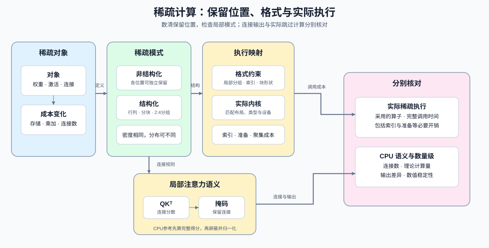

# 25. Sparse Computation and Sparse Attention | 稀疏计算与稀疏注意力

**难度：** Hard | **环境：** CPU-first | **标签：** `模型结构`, `Sparse`, `Sparse Attention` | **目标人群：** 系统性能入门者

> 🚀 **云端运行环境**
>
> 本章节的实战代码可以点击以下链接在免费 GPU 算力平台上直接运行：
>
> [](https://colab.research.google.com/github/datawhalechina/llm-algo-leetcode/blob/main/01_Hardware_Math_and_Systems/25_Sparse_Computation_and_Sparse_Attention.ipynb)
> [](https://modelscope.cn/my/mynotebook) *(国内推荐：魔搭社区免费实例)*


---

## 本节导读

两个矩阵都只有一半非零元素，非零位置却可能完全不同：一个每四项保留两项，另一个把非零项集中在少数位置。它们的密度相同，但索引方式、可选内核与实际执行工作未必相同。

本节先数保留了多少内容，再检查局部分组、索引存储和准备开销，最后用局部注意力观察连接变化与输出差异。它支撑算子优化中的稀疏分支，注意力访问范围可继续进入Part02·44核对。

**关键词：** 密度、稀疏模式、索引存储、局部窗口、掩码



## 前置阅读

先理解注意力连接的含义，再区分矩阵工作量和实际指令路径。

- [04 Attention与显存优化](./04_Attention_Memory_Optimization.md)：查询、键、值与得分矩阵。
- [23 Tensor Core矩阵路径](./23_TensorCore_Deep_Dive.md)：精度、布局、指令观察与时间改善的区别。

## Q1：有多少非零值，与允许多少注意力连接是一回事吗？

权重或激活的密度是非零元素占全部元素的比例；稀疏率是其补数。注意力连接的密度则按掩码允许的位置计数。比如八个位置允许四个参与，连接密度为0.5，即使这四个位置的得分恰好都是零，它们仍会参与Softmax归一化。

仅把权重置零而继续用稠密张量与矩阵乘，存储大小和运算遍历范围可能完全不变。下面从实际布尔保留标记计数，不根据“权重”或“注意力”标签直接判断性能；非零权重与允许连接要分别生成各自的标记。

### Q1 机制计算器：同样的密度，保留位置可以不同

先核对八项保留四项，再比较全保留与全移除。后者可以用于统计，但注意力中整行移除会失去归一化对象。


```python
def retained_position_report(keep: list) -> dict:
    """统计非空布尔序列的保留位置、密度与移除比例。"""
    if not keep or any(type(value) is not bool for value in keep):
        raise ValueError("保留标记须为非空布尔序列")
    retained = sum(keep)
    return {"total_positions": len(keep), "retained_positions": retained,
            "density": retained / len(keep), "removed_ratio": 1 - retained / len(keep)}


balanced = [True, False, True, False, True, False, True, False]
clustered = [True, True, True, False, False, False, False, True]
assert retained_position_report(balanced)["retained_positions"] == 4
assert retained_position_report(balanced)["density"] == retained_position_report(clustered)["density"] == 0.5
assert retained_position_report([True] * 8)["removed_ratio"] == 0
assert retained_position_report([False] * 8)["density"] == 0
for name, keep in (("分散保留", balanced), ("集中保留", clustered)):
    row = retained_position_report(keep)
    print(f"{name}: 保留 {row['retained_positions']}/{row['total_positions']}，密度 {row['density']:g}")

```

## Q2：总体密度相同，为什么局部稀疏模式未必合格？

非结构化稀疏允许各位置独立保留；行列稀疏直接移除整行或整列；块稀疏以小矩阵为单位保留。半结构化稀疏又增加局部约束，例如2:4模式按指定维度的每四项保留两个存储槽，其余位置为零，保留槽本身也可能包含零值。全矩阵有一半零值，并不保证每组四项都满足要求。

下方只检查给定一行的每四项是否至多有两个非零值；非零数为三的组明确违规。它不是设备能力查询：实际稀疏矩阵乘还要满足接口规定的维度、格式、布局和设备支持。任意块稀疏或行列稀疏都不能仅因“规则”就被认定为可使用稀疏矩阵乘加指令。

### Q2 条件核对：50%非零，能否通过每四项的局部检查？

用两行八元素权重复现全局密度相同、局部非零数却为“2、2”与“3、1”的区别。


```python
def group_sparsity_report(values: list, group_size: int = 4,
                          max_nonzero: int = 2) -> dict:
    """检查一行连续分组的非零数上限，不判断硬件或内核可用性。"""
    if (type(group_size) is not int or group_size <= 0
            or type(max_nonzero) is not int or not 0 <= max_nonzero <= group_size):
        raise ValueError("组大小须为正整数，非零上限须位于组大小范围内")
    if not values or len(values) % group_size:
        raise ValueError("输入须非空且可划为完整分组")
    counts = [sum(value != 0 for value in values[start:start + group_size])
              for start in range(0, len(values), group_size)]
    violating = [index for index, count in enumerate(counts) if count > max_nonzero]
    return {"nonzero_counts": counts, "violating_groups": violating,
            "pattern_matches": not violating}


balanced_weights = [1, 0, 2, 0, 3, 0, 4, 0]
clustered_weights = [1, 2, 3, 0, 0, 0, 0, 4]
assert sum(value != 0 for value in balanced_weights) == sum(value != 0 for value in clustered_weights) == 4
regular = group_sparsity_report(balanced_weights)
irregular = group_sparsity_report(clustered_weights)
assert regular["nonzero_counts"] == [2, 2] and regular["pattern_matches"]
assert irregular["nonzero_counts"] == [3, 1] and irregular["violating_groups"] == [0]
assert group_sparsity_report([0, 0, 0, 0])["pattern_matches"]
print("分散非零：", regular)
print("集中非零：", irregular)

```

## Q3：非零元素少了，为什么索引存储仍可能更大？

稀疏存储需要告诉计算程序“值在哪里”。坐标格式（COO）为每个保留的二维权重保存数值、行索引和列索引。一个4×4权重矩阵若数值占两字节，稠密载荷为32 B；只保留四个数值虽只需8 B，但两份四字节索引又占32 B，合计40 B。块格式和2:4压缩元数据有不同账目，不能套用这个COO例子。

对输入 $M \times K$ 与权重 $K \times N$ 相乘，按一次乘加计两次运算，稠密工作量为 $2MKN$ ；若确实逐个跳过零权重，理想算术工作量为 $2M n_{\mathrm{nz}}$ ，其中 $n_{\mathrm{nz}}$ 是保留权重数。这里未计索引遍历、Softmax或负载不均衡；权重稀疏、注意力连接稀疏和前馈网络的动态通道选择，分别省去不同工作，不能共用一个密度乘耗时公式。

| 稀疏对象 | 可跳过的对象 | 还需核对的代价 |
| --- | --- | --- |
| 权重 | 被移除权重参与的乘加 | 索引、格式转换和实际稀疏矩阵乘 |
| 注意力连接 | 选定查询—键连接的得分及值加权 | 掩码生成、连接选择和输出质量 |
| 前馈网络通道／激活 | 未选通道或零激活参与的计算 | 选择、聚集和各工作块的负载差异 |

### Q3 机制计算器：分别计算数值、索引和乘加工作量

固定4×4权重与两行输入，比较保留四项、两项和零项的COO载荷与理想运算量。零项仅用于权重账目，不作为全屏蔽注意力示例。


```python
def sparse_matmul_ledger(m: int, n: int, k: int, retained_weights: int,
                         value_bytes: int = 2, index_bytes: int = 4) -> dict:
    """估算二维COO载荷与2M乘保留项数的理想FLOPs，忽略容器开销。"""
    if any(type(value) is not int or value <= 0 for value in (m, n, k, value_bytes, index_bytes)):
        raise ValueError("矩阵维度与元素字节数须为正整数")
    if type(retained_weights) is not int or not 0 <= retained_weights <= k * n:
        raise ValueError("保留权重数须位于[0,K×N]内")
    return {
        "dense_weight_bytes": k * n * value_bytes,
        "coo_value_bytes": retained_weights * value_bytes,
        "coo_index_bytes": retained_weights * 2 * index_bytes,
        "coo_total_bytes": retained_weights * (value_bytes + 2 * index_bytes),
        "dense_flops": 2 * m * k * n,
        "ideal_sparse_flops": 2 * m * retained_weights,
    }


four = sparse_matmul_ledger(m=2, n=4, k=4, retained_weights=4)
two = sparse_matmul_ledger(m=2, n=4, k=4, retained_weights=2)
assert four["dense_weight_bytes"] == 32
assert four["coo_value_bytes"] == 8 and four["coo_index_bytes"] == 32
assert four["coo_total_bytes"] == 40 > four["dense_weight_bytes"]
assert four["dense_flops"] == 64 and four["ideal_sparse_flops"] == 16
assert two["coo_total_bytes"] == 20 and two["ideal_sparse_flops"] == 8
assert sparse_matmul_ledger(m=2, n=4, k=4, retained_weights=0)["ideal_sparse_flops"] == 0
for retained in (4, 2, 0):
    row = sparse_matmul_ledger(m=2, n=4, k=4, retained_weights=retained)
    print(f"保留{retained}项：COO载荷 {row['coo_total_bytes']} B，理想乘加 {row['ideal_sparse_flops']} FLOPs")

```

## Q4：矩阵乘变快了，为什么一次完整调用还可能更慢？

稀疏路径往往先准备掩码、索引或压缩格式，再执行乘法。假设稠密调用为1 ms，稀疏主体为0.6 ms，一次准备需要2 ms：仅调用一次时共2.6 ms；同一份准备结果可复用十次时，平均每次为0.8 ms。是否允许复用取决于权重和稀疏模式是否保持不变；动态激活或每次变化的注意力连接可能需要重新准备。

下面用给定的构造耗时练习摊销计算，不由密度预测稀疏耗时。比较时应把每次发生的索引、聚集等开销纳入主体，并检查相同输入的数值或任务质量。图中和代码中的时间差是不同于模式合格、存储节省的另一项判断。

### Q4 对照验证：只改变准备结果的复用次数

固定三项构造耗时，比较复用一次与十次，再核对平均耗时恰好等于基线的边界。


```python
import math


def sparse_call_cost(dense_ms: float, sparse_ms: float, setup_ms: float,
                     reuse_calls: int) -> dict:
    """按一次准备、复用N次的串行模型计算平均ms；输入是给定耗时。"""
    times = (dense_ms, sparse_ms, setup_ms)
    if any(type(value) not in (int, float) or not math.isfinite(value) or value < 0 for value in times):
        raise ValueError("各项耗时须为有限非负实数")
    if dense_ms == 0 or sparse_ms == 0 or type(reuse_calls) is not int or reuse_calls <= 0:
        raise ValueError("主体耗时与复用次数须为正")
    average = sparse_ms + setup_ms / reuse_calls
    return {"average_sparse_ms": average, "saved_ms_per_call": dense_ms - average}


once = sparse_call_cost(dense_ms=1, sparse_ms=0.6, setup_ms=2, reuse_calls=1)
reused = sparse_call_cost(dense_ms=1, sparse_ms=0.6, setup_ms=2, reuse_calls=10)
assert math.isclose(once["average_sparse_ms"], 2.6)
assert once["saved_ms_per_call"] < 0
assert math.isclose(reused["average_sparse_ms"], 0.8)
assert reused["saved_ms_per_call"] > 0
assert sparse_call_cost(dense_ms=1, sparse_ms=0.5, setup_ms=2, reuse_calls=4)["saved_ms_per_call"] == 0
print(f"复用一次：平均 {once['average_sparse_ms']:g} ms")
print(f"复用十次：平均 {reused['average_sparse_ms']:g} ms")

```

## Q5：局部窗口减少连接后，输出和实际计算各改变了什么？

局部窗口仅允许查询位置关注附近的键。下方采用双向、包含自身、左右半径为1的窗口：长度8时保留22个连接，而全连接有64个；批量与头数各自重复这个连接图。它不是自回归因果窗口，若用于因果生成还需排除未来位置。

掩码（mask）中的True表示允许连接。这个CPU参考先计算完整 $QK^T$ ，再把不允许的得分设为负无穷、重新归一化，因此验证的是访问语义，而非真正跳过矩阵乘；仅把被屏蔽得分改成零，仍会留下非零概率。以全部得分为零、值为位置编号为例，稠密输出均值为3.5，局部窗口首位置的输出为0.5。改变连接会改变模型函数，输出差异应解释与评估，不能一律要求与稠密结果相等。

### Q5 对照验证：先数22个连接，再核对输出均值

固定CPU输入，比较全连接、半径1和只看自身；将窗口扩大到覆盖整个序列时，才要求与全连接结果一致。所有行都至少保留一个键。


```python
import torch


def build_local_attention_mask(seq_len: int, window: int):
    """返回[1,1,L,L]布尔掩码，表示双向、含自身的窗口半径。"""
    if type(seq_len) is not int or seq_len <= 0 or type(window) is not int or window < 0:
        raise ValueError("序列长度须为正整数，窗口半径须为非负整数")
    positions = torch.arange(seq_len, device="cpu")
    return (positions[:, None] - positions[None, :]).abs().le(window)[None, None]


def masked_attention_cpu(q, k, v, mask):
    """对同形状[B,H,L,D] CPU浮点输入做完整得分计算，再施加布尔掩码。"""
    if (q.ndim != 4 or q.shape != k.shape or q.shape != v.shape
            or any(size == 0 for size in q.shape)):
        raise ValueError("Q/K/V须为相同的非空[B,H,L,D]形状")
    if any(x.device.type != "cpu" or not x.is_floating_point() or x.dtype != q.dtype for x in (q, k, v)):
        raise ValueError("Q/K/V须为同类型CPU浮点张量")
    length = q.shape[-2]
    if mask.device.type != "cpu" or mask.dtype != torch.bool or mask.shape != (1, 1, length, length):
        raise ValueError("掩码须为[1,1,L,L] CPU布尔张量")
    if not mask.any(dim=-1).all().item():
        raise ValueError("每个查询须至少允许一个键参与归一化")
    scores = q @ k.transpose(-2, -1) / math.sqrt(q.shape[-1])
    weights = torch.softmax(scores.masked_fill(~mask, -math.inf), dim=-1)
    return weights @ v


batch, heads, seq_len, head_dim = 1, 2, 8, 2
q = torch.zeros(batch, heads, seq_len, head_dim, device="cpu")
k = torch.zeros_like(q)
v = torch.arange(seq_len, dtype=q.dtype).view(1, 1, seq_len, 1).expand_as(q)
dense_mask = build_local_attention_mask(seq_len=seq_len, window=seq_len - 1)
local_mask = build_local_attention_mask(seq_len=seq_len, window=1)
dense_out = masked_attention_cpu(q, k, v, dense_mask)
local_out = masked_attention_cpu(q, k, v, local_mask)
self_out = masked_attention_cpu(q, k, v, build_local_attention_mask(seq_len=seq_len, window=0))
assert dense_mask.sum().item() == 64 and local_mask.sum().item() == 22
assert dense_out.shape == local_out.shape == (batch, heads, seq_len, head_dim)
torch.testing.assert_close(dense_out, torch.full_like(dense_out, 3.5))
torch.testing.assert_close(local_out[0, 0, :, 0], torch.tensor([0.5, 1, 2, 3, 4, 5, 6, 6.5]))
torch.testing.assert_close(self_out, v)
torch.testing.assert_close(masked_attention_cpu(q, k, v, build_local_attention_mask(seq_len, seq_len)), dense_out)
assert torch.isfinite(local_out).all()
# 每连接的QK与加权V共约4D FLOPs，不含Softmax；实际参考仍遍历全部连接。
dense_flops = 4 * batch * heads * seq_len**2 * head_dim
ideal_local_flops = 4 * batch * heads * int(local_mask.sum().item()) * head_dim
assert dense_flops == 1024 and ideal_local_flops == 352
print(f"每头连接：64→22；理想QK/PV工作量 {dense_flops}→{ideal_local_flops} FLOPs")
print(f"局部首位置输出 {local_out[0, 0, 0, 0].item():g}，稠密输出 {dense_out[0, 0, 0, 0].item():g}")

```

## 相关阅读

从连接语义进入机制练习，再对照具体格式的实际支持条件。

- [Part02·44 局部、滑动与稀疏注意力](../02_PyTorch_Algorithms/44_Local_Sliding_and_Sparse_Attention.md)：核对窗口方向、掩码和输出变化。
- [PyTorch半结构化稀疏教程](https://docs.pytorch.org/tutorials/advanced/semi_structured_sparse.html)：区分剪枝置零、格式转换与稀疏内核，检查所用版本的支持条件。
- [PyTorch 2.11 SDPA接口](https://docs.pytorch.org/docs/2.11/generated/torch.nn.functional.scaled_dot_product_attention.html)：查看布尔掩码与归一化语义，区分接口与实际选择的后端。
