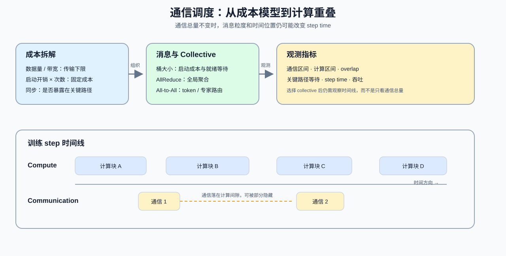

# 27. Communication Scheduling Optimization | 通信调度优化

**难度：** Hard | **环境：** CPU-first | **标签：** `并行通信`, `通信优化`, `Overlap` | **目标人群：** 通信机制入门者

> 🚀 **云端运行环境**
>
> 本章节的实战代码可以点击以下链接在免费 GPU 算力平台上直接运行：
>
> [](https://colab.research.google.com/github/datawhalechina/llm-algo-leetcode/blob/main/01_Hardware_Math_and_Systems/27_Communication_Scheduling_Optimization.ipynb)
> [](https://modelscope.cn/my/mynotebook) *(国内推荐：魔搭社区免费实例)*


---

## 本节导读

通信总时长不一定全部暴露在训练步关键路径上。消息大小、启动次数、依赖关系和可重叠计算共同决定通信是否真正拉长单步时间。

本节建立“通信负载 → 启动与带宽成本 → 调度次序 → 暴露时间”的关系。完成后，你应能比较分桶、集合通信选择和计算重叠对关键路径的影响。

**关键词：** 计算—通信重叠、`All-Reduce`、`All-to-All`




## 前置阅读

**导语：** 先把通信拓扑、并行策略和 NCCL 同步原语对应到一次训练 step，再分析通信放在什么位置、以什么粒度发送，以及哪些计算可以与它重叠。

- [05. Communication Topologies | 通信拓扑与分布式基石](./05_Communication_Topologies.md)
- [20. NCCL and AllReduce Basics | NCCL 与 AllReduce 基础](./20_NCCL_and_AllReduce_Basics.md)
- [26. Parallel Strategy Decision Framework | 并行策略决策框架](./26_Parallel_Strategy_Decision_Framework.md)

## Q1：相同总发送量，为什么拆分次数会影响时间？

通信时间可拆成固定开销和载荷传输两项。这里的载荷是一个rank在整个通信阶段发送的总MiB；拆成更多调用时，传输总量不变，固定开销重复支付。与26节“每次发送量×调用次数”的输入方式不同，这里直接给总量。

环形All-Reduce的梯度张量大小需先乘 `2(P−1)/P` 才得到每rank发送量。每次调用的固定开销则作为给定条件，已汇总该次集合通信的启动成本。下面用50 GiB/s、每次8 μs比较，接收可与发送同时进行，传输项按单向发送量计算。

### Q1机制计算器：先换算发送量，再比较调用次数

固定总发送载荷为256 MiB，传输项始终为5 ms，只有固定开销随调用次数变化。


```python
def ring_allreduce_payload_mib(tensor_mib, world_size):
    """把完整输入张量MiB换算为等长Ring每rank的发送MiB，不含接收。"""
    if tensor_mib < 0 or type(world_size) is not int or world_size < 2:
        raise ValueError('张量容量须非负，进程数须为至少2的整数')
    return tensor_mib * 2 * (world_size - 1) / world_size


def communication_time_ms(payload_mib, bandwidth_gib_s, latency_us, launches=1):
    """估算总发送MiB的串行完成时间；latency_us是每次调用的给定固定开销。"""
    if payload_mib < 0 or bandwidth_gib_s <= 0 or latency_us < 0 or type(launches) is not int or launches < 1:
        raise ValueError('载荷、带宽、固定开销或调用次数无效')
    transfer_ms = payload_mib / 1024 / bandwidth_gib_s * 1000
    launch_ms = launches * latency_us / 1000
    return {
        'payload_mib': payload_mib,
        'launches': launches,
        'transfer_ms': transfer_ms,
        'launch_ms': launch_ms,
        'communication_ms': transfer_ms + launch_ms,
    }


for launches in (1, 8, 64):
    print(communication_time_ms(256, bandwidth_gib_s=50, latency_us=8, launches=launches))
assert communication_time_ms(256, 50, 8, 8)['transfer_ms'] == 5.0
assert communication_time_ms(256, 50, 8, 8)['launch_ms'] == 0.064

```

## Q2：合并梯度什么时候省启动，什么时候增加等待？

梯度桶（bucket）把若干层的梯度合成一次通信；桶内所有梯度就绪后才能发送。小桶通常较早启动，大桶减少调用次数，却可能把已有梯度留在桶中等待其他层。比较时要同时看通信结束时间与反向结束后的等待。

固定4个rank、4层梯度，每层32 MiB，分别在2、5、9、14 ms就绪。桶容量32、64、128 MiB时，每rank总发送量均为192 MiB；按Q1条件计算，反向结束后的等待分别为0.9455、1.883、3.758 ms，大桶在这个例子中更晚完成。如果四层都在0 ms就绪，合桶不再增加就绪等待，反而能节省固定开销。

代码按给定层顺序装桶，假设各rank采用相同顺序和就绪时间，通信在一个队列中串行执行。本例不拆分单层梯度，因此桶容量须不小于最大单层梯度。

### Q2对照验证：总梯度不变，只改变桶容量

先观察分批就绪，再把四层就绪时间同时设为0，比较两种情况下合桶的效果。


```python
def schedule_gradient_buckets(layers, bucket_cap_mib, bandwidth_gib_s=50, latency_us=8, world_size=4):
    """按给定层顺序和容量装桶；以每rank Ring发送量计算串行通信时间线。"""
    if bucket_cap_mib <= 0 or not layers:
        raise ValueError('桶容量须为正，层列表须非空')
    if any(layer['ready_ms'] < 0 or not 0 < layer['size_mib'] <= bucket_cap_mib for layer in layers):
        raise ValueError('就绪时间须非负，每层梯度须非零且能装入单桶')
    buckets, pending, pending_mib = [], [], 0.0
    for layer in layers:
        if pending and pending_mib + layer['size_mib'] > bucket_cap_mib:
            buckets.append((pending, pending_mib))
            pending, pending_mib = [], 0.0
        pending.append(layer)
        pending_mib += layer['size_mib']
    if pending:
        buckets.append((pending, pending_mib))

    timeline, communication_available_ms = [], 0.0
    for bucket_id, (members, tensor_mib) in enumerate(buckets):
        ready_ms = max(member['ready_ms'] for member in members)
        start_ms = max(ready_ms, communication_available_ms)
        send_mib = ring_allreduce_payload_mib(tensor_mib, world_size)
        duration_ms = communication_time_ms(send_mib, bandwidth_gib_s, latency_us)['communication_ms']
        end_ms = start_ms + duration_ms
        timeline.append({
            'bucket_id': bucket_id,
            'layers': [member['name'] for member in members],
            'tensor_mib': tensor_mib, 'send_mib_per_rank': send_mib,
            'ready_ms': ready_ms, 'start_ms': start_ms, 'end_ms': end_ms,
        })
        communication_available_ms = end_ms

    backward_end_ms = max(layer['ready_ms'] for layer in layers)
    return {
        'bucket_count': len(timeline),
        'total_send_mib_per_rank': sum(row['send_mib_per_rank'] for row in timeline),
        'backward_end_ms': backward_end_ms,
        'communication_end_ms': round(communication_available_ms, 4),
        'exposed_after_backward_ms': round(max(communication_available_ms - backward_end_ms, 0), 4),
        'timeline': timeline,
    }


layers = [
    dict(name='L4', ready_ms=2.0, size_mib=32),
    dict(name='L3', ready_ms=5.0, size_mib=32),
    dict(name='L2', ready_ms=9.0, size_mib=32),
    dict(name='L1', ready_ms=14.0, size_mib=32),
]
for capacity, expected_tail in [(32, 0.9455), (64, 1.883), (128, 3.758)]:
    result = schedule_gradient_buckets(layers, capacity)
    assert result['total_send_mib_per_rank'] == 192
    assert result['exposed_after_backward_ms'] == expected_tail
    print('分批就绪，桶容量', capacity, 'MiB：', result['communication_end_ms'], 'ms结束')

ready_together = [dict(layer, ready_ms=0) for layer in layers]
small = schedule_gradient_buckets(ready_together, 32)
large = schedule_gradient_buckets(ready_together, 128)
assert small['communication_end_ms'] == 3.782
assert large['communication_end_ms'] == 3.758
print('同时就绪，小桶／大桶结束时间：', small['communication_end_ms'], large['communication_end_ms'])

```

## Q3：All-Reduce发送量与All-to-All路由负载怎样区分？

4个rank对256 MiB张量做环形All-Reduce时，每rank发送384 MiB，接收量相同；这沿用20节的计量方向。

All-to-All的输入则是一张路由计数矩阵：行表示源rank，列表示目标rank，每格记录token分配次数。对角线是本地分配，其他格才产生跨rank发送；把这些格相加，可得全组远程载荷，每份发送计一次。MoE中同一token可能被分配给多个专家，因此分配次数可大于独立token数。

下面另列每rank的远程发送、远程接收及包含本地分配的总接收负载。网络接收不均衡用“最大远程接收量÷平均远程接收量”表示；没有远程流量时，比例记为 `None`。这可区分网络压力与本地专家计算负载。

### Q3对照验证：平衡路由、倾斜路由和零流量

固定每次分配的字节数，观察远程载荷与最忙接收rank。只有本地分配时，网络载荷应为0。


```python
def alltoall_route_ledger(token_matrix, bytes_per_token):
    """按源×目标分配矩阵计算全组唯一远程发送载荷，以及各rank接收负载。"""
    world_size = len(token_matrix)
    if world_size < 2 or any(len(row) != world_size for row in token_matrix):
        raise ValueError('路由矩阵须为至少2个rank的方阵')
    if type(bytes_per_token) is not int or bytes_per_token <= 0:
        raise ValueError('每次分配的字节数须为正整数')
    if any(type(count) is not int or count < 0 for row in token_matrix for count in row):
        raise ValueError('分配次数须为非负整数')
    received = [sum(token_matrix[src][dst] for src in range(world_size)) for dst in range(world_size)]
    remote_sent = [sum(row[dst] for dst in range(world_size) if src != dst) for src, row in enumerate(token_matrix)]
    remote_received = [
        sum(token_matrix[src][dst] for src in range(world_size) if src != dst)
        for dst in range(world_size)
    ]
    total_remote = sum(remote_sent)
    mean_remote_received = total_remote / world_size
    return {
        'remote_send_mib': total_remote * bytes_per_token / 2**20,
        'remote_send_assignments_per_rank': remote_sent,
        'remote_receive_assignments_per_rank': remote_received,
        'received_assignments_including_local': received,
        'max_to_mean_remote_receive_ratio': (
            max(remote_received) / mean_remote_received if total_remote else None
        ),
    }


balanced = [[16, 16, 16, 16] for _ in range(4)]
skewed = [[4, 4, 52, 4] for _ in range(4)]
assert ring_allreduce_payload_mib(256, 4) == 384
assert alltoall_route_ledger(balanced, 4096)['remote_send_mib'] == 0.75
assert alltoall_route_ledger(skewed, 4096)['max_to_mean_remote_receive_ratio'] == 3.25
assert alltoall_route_ledger([[0, 0], [0, 0]], 4096)['max_to_mean_remote_receive_ratio'] is None
for matrix in (balanced, skewed, [[8, 0], [0, 4]]):
    print(alltoall_route_ledger(matrix, bytes_per_token=4096))

```

## Q4：怎样把通信排进计算间隙？

先假设计算与通信没有未解决的数据依赖、资源争用也不改变各自耗时，再用给定区间观察重叠。多个计算区间可能彼此重叠，需要先求区间并集，再统计覆盖通信的时间；重复覆盖的一段只能计一次。这个理想覆盖量可帮助解释时间线，实际收益仍要比较整步完成时间。

| 时间量 | 含义 | 与关键路径的关系 |
| --- | --- | --- |
| 通信总时间 | 集合通信在设备上的活动区间 | 不一定全部延长 step |
| 已隐藏通信 | 被独立计算区间覆盖的通信 | 不再单独增加关键路径 |
| 暴露通信 | 通信区间中未被覆盖的部分 | 是调度优化要减少的直接对象 |
| 重叠比例 | 已隐藏时间 / 通信总时间 | 要与 step 时间一起解读 |

### Q4小验证

观察通信进入计算间隙后，关键路径成本如何变化。

```python
def communication_exposure(comm_interval, independent_compute_intervals):
    """裁剪并合并计算区间，返回已隐藏与暴露通信时间。"""
    comm_start, comm_end = comm_interval
    if comm_end < comm_start:
        raise ValueError('通信区间非法')
    clipped = []
    for start, end in independent_compute_intervals:
        if end < start:
            raise ValueError('计算区间非法')
        left, right = max(start, comm_start), min(end, comm_end)
        if left < right:
            clipped.append((left, right))

    merged = []
    for start, end in sorted(clipped):
        if not merged or start > merged[-1][1]:
            merged.append([start, end])
        else:
            merged[-1][1] = max(merged[-1][1], end)

    communication_ms = comm_end - comm_start
    hidden_ms = sum(end - start for start, end in merged)
    exposed_ms = communication_ms - hidden_ms
    return {
        'communication_ms': round(communication_ms, 4),
        'hidden_ms': round(hidden_ms, 4),
        'exposed_ms': round(exposed_ms, 4),
        'overlap_ratio': round(hidden_ms / communication_ms, 4) if communication_ms else None,
        'merged_overlap_intervals': [tuple(interval) for interval in merged],
    }

cases = [
    ((0, 12), []),
    ((0, 12), [(1, 4), (3, 8)]),
    ((0, 12), [(-2, 5), (5, 20)]),
]
for case in cases:
    print(case, '->', communication_exposure(*case))

assert communication_exposure((0, 12), [(1, 4), (3, 8)])['hidden_ms'] == 7
assert communication_exposure((0, 12), [(-2, 20)])['exposed_ms'] == 0

```

## 相关阅读

**导语：** 把理论调度继续接到 CUDA 依赖和 Part 02 的真实通信时间线。

- [17. CUDA Stream and Asynchrony | CUDA Stream 与异步执行](./17_CUDA_Stream_and_Asynchrony.md)
- [29. CUDA Stream Advanced Scheduling | CUDA Stream 高级调度](./29_CUDA_Stream_Advanced_Scheduling.md)
- [Part 02 · 48 通信热点与缓解](../02_PyTorch_Algorithms/48_Communication_Hotspots_and_Mitigation.md)
---
