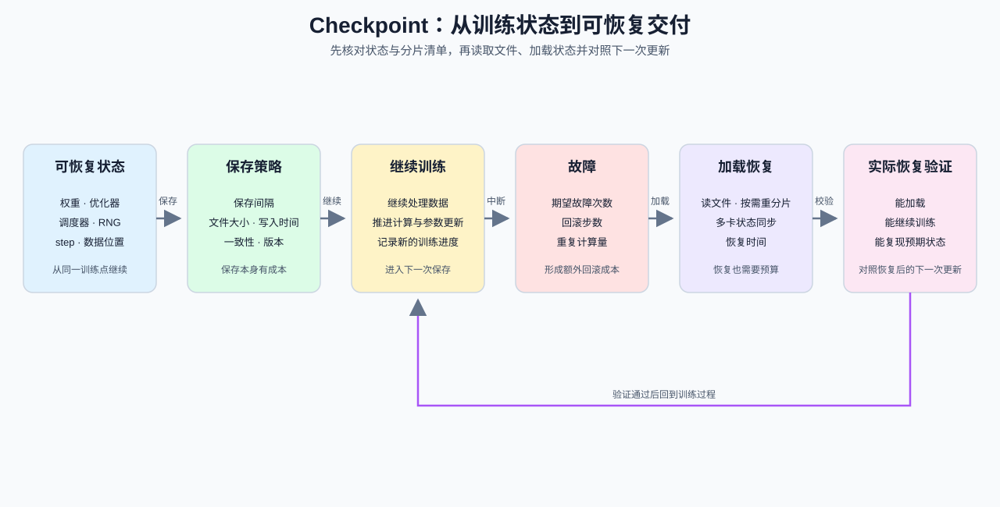

# 28. Fault Tolerance and Checkpointing | 容错与检查点

**难度：** Medium-Hard | **环境：** CPU-first | **标签：** `系统工程`, `容错恢复`, `Checkpoint` | **目标人群：** 系统性能入门者

> 🚀 **云端运行环境**
>
> 本章节的实战代码可以点击以下链接在免费 GPU 算力平台上直接运行：
>
> [](https://colab.research.google.com/github/datawhalechina/llm-algo-leetcode/blob/main/01_Hardware_Math_and_Systems/28_Fault_Tolerance_and_Checkpointing.ipynb)
> [](https://modelscope.cn/my/mynotebook) *(国内推荐：魔搭社区免费实例)*


---

## 本节导读

长时间训练可能因进程、设备或节点故障中断。检查点（checkpoint）必须保存足够状态，使训练恢复后继续沿一致的更新轨迹运行。

先列出恢复需要的状态，再比较保存频率、写入成本和故障后的回滚时间。最后核对分片清单，并说明加载后还要检查哪些状态与更新结果；这些条件可用于后训练与分布式训练的实验准备。

**关键词：** 检查点、恢复、容错


## 前置阅读

先回看训练状态组成与并行分片方式，再判断保存哪些对象、需要收齐哪些进程的分片。

- [06 显存计算与ZeRO](./06_VRAM_Calculation_and_ZeRO.md)
- [26 并行策略决策](./26_Parallel_Strategy_Decision_Framework.md)

## Q1：恢复训练需要保存哪些状态？

检查点（checkpoint）保存模型权重、优化器状态和训练进度。本例还使用学习率调度器，并保存随机数生成器状态（RNG state）：它记录生成器已经推进到的位置，只有初始种子不足以恢复这一位置。训练进度也应包含当前数据位置，避免重复或跳过已处理批次。

使用混合精度损失缩放、独立数据采样器等配置时，还需保存对应状态。下面的必需角色集合针对本例，其他配置可显式增补。

清单（manifest）描述状态角色、路径与大小；提交标记表示这组记录已完成发布。代码先检查给定清单，实际恢复还要读取文件、校验内容、加载状态，并对照恢复后的下一次更新。

### Q1清单检查：区分状态缺失与记录通过

先核对本例的完整角色集合，再只保留权重，观察缺少哪些训练状态。通过结果表示给定清单条件满足，尚未读取磁盘文件。


```python
import math


def inspect_checkpoint_manifest(entries, committed, required_roles=None):
    """核对给定清单的角色、路径、正大小与提交标记，不读取文件。"""
    if type(committed) is not bool:
        raise ValueError('提交标记须为布尔值')
    if required_roles is None:
        required_roles = {'model', 'optimizer', 'scheduler', 'rng', 'progress'}
    roles = {entry['role'] for entry in entries}
    missing = sorted(set(required_roles) - roles)
    paths = [entry['path'] for entry in entries]
    duplicates = sorted({path for path in paths if paths.count(path) > 1})
    invalid_files = sorted(
        entry['path'] for entry in entries
        if not entry['path'] or not math.isfinite(entry['size_mib']) or entry['size_mib'] <= 0
    )
    return {
        'total_mib': round(sum(entry['size_mib'] for entry in entries), 2),
        'missing_roles': missing,
        'invalid_files': invalid_files,
        'duplicate_paths': duplicates,
        'committed': committed,
        'manifest_checks_passed': committed and not missing and not invalid_files and not duplicates,
    }


complete_entries = [
    dict(role='model', path='model.bin', size_mib=2400),
    dict(role='optimizer', path='optimizer.bin', size_mib=4800),
    dict(role='scheduler', path='scheduler.json', size_mib=0.01),
    dict(role='rng', path='rng.bin', size_mib=0.01),
    dict(role='progress', path='trainer.json', size_mib=0.01),
]
complete = inspect_checkpoint_manifest(complete_entries, committed=True)
weights_only = inspect_checkpoint_manifest(complete_entries[:1], committed=True)
assert complete['manifest_checks_passed']
assert not weights_only['manifest_checks_passed']
assert weights_only['missing_roles'] == ['optimizer', 'progress', 'rng', 'scheduler']
print('角色齐全的清单：', complete)
print('仅登记权重：', weights_only)

```

## Q2：保存间隔怎样影响预期回滚时间？

先假设任务开始时已有一个可用检查点，故障均匀落在计划计算时间内。一个完整保存间隔中的平均回滚时间为间隔的一半。任务末尾不足一个间隔时，则按这一段的实际长度加权；若任务本身短于保存间隔，平均回滚只取任务时长的一半。

例如计划运行72小时、每小时期望故障0.02次，预期故障次数为1.44。每60分钟保存、重新加载需8分钟时，预期回滚43.2分钟、加载11.52分钟，合计54.72分钟。这个一阶模型按计划计算时长统计故障，先忽略写入期间的故障与额外执行引起的再次故障。

### Q2机制计算器：完整间隔与末尾短间隔分别计数

先复现72小时的例子，再把任务缩短到30分钟、间隔保持60分钟，核对平均回滚只为15分钟。


```python
def mean_rollback_minutes(run_minutes, interval_minutes):
    """按计划计算窗口内的均匀故障时刻，计算平均回滚分钟数。"""
    if run_minutes < 0 or interval_minutes <= 0:
        raise ValueError('运行分钟数须非负，保存间隔须为正')
    full_intervals = math.floor(run_minutes / interval_minutes)
    tail = run_minutes - full_intervals * interval_minutes
    if run_minutes == 0:
        return 0.0
    return (full_intervals * interval_minutes**2 + tail**2) / (2 * run_minutes)


def expected_failure_overhead(run_hours, fault_rate_per_hour, interval_minutes, reload_minutes):
    """以计划计算小时数估算故障次数及回滚、加载分钟数，含末尾短间隔。"""
    if min(run_hours, fault_rate_per_hour, reload_minutes) < 0:
        raise ValueError('运行时间、故障率和加载时间须非负')
    mean_rollback = mean_rollback_minutes(run_hours * 60, interval_minutes)
    expected_faults = run_hours * fault_rate_per_hour
    rollback_minutes = expected_faults * mean_rollback
    reload_total_minutes = expected_faults * reload_minutes
    return {
        'expected_faults': round(expected_faults, 3),
        'mean_rollback_minutes': mean_rollback,
        'expected_rollback_minutes': round(rollback_minutes, 2),
        'expected_reload_minutes': round(reload_total_minutes, 2),
        'expected_failure_overhead_minutes': round(rollback_minutes + reload_total_minutes, 2),
    }


hourly = expected_failure_overhead(72, 0.02, 60, 8)
half_hourly = expected_failure_overhead(72, 0.02, 30, 8)
assert hourly['expected_failure_overhead_minutes'] == 54.72
assert half_hourly['expected_rollback_minutes'] == 21.6
assert mean_rollback_minutes(30, 60) == 15
print('每60分钟保存：', hourly)
print('每30分钟保存：', half_hourly)

```

## Q3：怎样同时比较写入成本与故障损失？

缩短保存间隔会减少回滚，却增加同步写入次数。下面固定计划计算时长1440分钟，每次保存耗时2分钟，故障率每小时0.02，加载耗时8分钟；比较15、30、60、120分钟四种间隔。

保存次数只统计计划结束前的恢复检查点，结束时的最终模型交付另计。例如120分钟间隔需要在120至1320分钟保存11次，写入22分钟；加上预期故障开销32.64分钟，共54.64分钟。异步写入还需另看它与计算、I/O争用的时间线，这里先比较同步暂停的模型。

### Q3小验证
扫描多个保存间隔，观察写入成本和故障回滚成本如何变化。


```python
def checkpoint_interval_cost(run_minutes, interval_minutes, save_minutes, fault_rate_per_hour, reload_minutes):
    """汇总计划结束前的同步保存与Q2故障开销；最终交付保存另计。"""
    if run_minutes < 0 or save_minutes < 0 or interval_minutes <= 0:
        raise ValueError('计划时长与保存耗时须非负，保存间隔须为正')
    save_count = max(math.ceil(run_minutes / interval_minutes) - 1, 0)
    failure = expected_failure_overhead(run_minutes / 60, fault_rate_per_hour, interval_minutes, reload_minutes)
    save_overhead = save_count * save_minutes
    failure_overhead = failure['expected_failure_overhead_minutes']
    return {
        'interval_minutes': interval_minutes,
        'save_count': save_count,
        'save_overhead_minutes': round(save_overhead, 2),
        'failure_overhead_minutes': failure_overhead,
        'total_overhead_minutes': round(save_overhead + failure_overhead, 2),
    }


intervals = [15, 30, 60, 120]
reports = [checkpoint_interval_cost(1440, interval, 2, 0.02, 8) for interval in intervals]
best = min(reports, key=lambda report: report['total_overhead_minutes'])
assert best['interval_minutes'] == 120
assert best['save_count'] == 11
assert best['total_overhead_minutes'] == 54.64
for report in reports:
    print(report)
print('给定四种间隔中开销最小：', best['interval_minutes'], '分钟')

```

## Q4：分片清单一致后，还需要怎样验证恢复？

这里采用每个保存rank登记一个分片包的简化布局。先复用Q1检查必需状态角色，再核对分片数、rank是否唯一且覆盖完整、检查点标识是否相同，以及各分片登记的大小是否为正。重复rank会使“所有rank都出现过”的集合检查失去作用，因此数量与唯一性都要检查。

这些记录通过后，再读取并校验实际文件、加载模型与优化器状态，对照下一次更新。若恢复时的进程数与保存时不同，还需要目标框架支持并正确执行重分片（reshard）；下面单独标记这一变化，不把清单一致当作加载成功。

### Q4一致性检查：缺片、重复rank与恢复进程数变化

固定检查点标识，分别删去一个分片、重复一个rank，再修改恢复进程数。每种变化对应独立的检查结果。


```python
def validate_sharded_checkpoint(manifest, shards, *, target_world_size=None):
    """核对角色与每rank一个分片包的元数据，另标记是否需要重分片。"""
    world_size = manifest['world_size']
    if type(world_size) is not int or world_size < 1:
        raise ValueError('保存进程数须为正整数')
    if target_world_size is None:
        target_world_size = world_size
    if type(target_world_size) is not int or target_world_size < 1:
        raise ValueError('恢复进程数须为正整数')
    roles = inspect_checkpoint_manifest(
        manifest['entries'], manifest['committed'], manifest.get('required_roles'),
    )
    issues = []
    if not roles['manifest_checks_passed']:
        issues.append('state manifest checks failed')
    ranks = [shard['rank'] for shard in shards]
    if len(shards) != world_size:
        issues.append('shard count differs from saved world size')
    if any(type(rank) is not int for rank in ranks):
        issues.append('rank IDs must be integers')
    if len(set(ranks)) != len(ranks):
        issues.append('rank IDs are duplicated')
    if set(ranks) != set(range(world_size)):
        issues.append('rank coverage differs from saved world size')
    if any(shard['checkpoint_id'] != manifest['checkpoint_id'] for shard in shards):
        issues.append('checkpoint IDs are inconsistent')
    if any(not math.isfinite(shard['size_mib']) or shard['size_mib'] <= 0 for shard in shards):
        issues.append('one or more shard sizes are invalid')
    return {
        'metadata_checks_passed': not issues,
        'requires_reshard': target_world_size != world_size,
        'issues': issues,
    }


manifest = dict(
    checkpoint_id='step-1200', world_size=4, committed=True,
    entries=complete_entries,
)
complete_shards = [
    dict(rank=rank, checkpoint_id='step-1200', size_mib=900) for rank in range(4)
]
missing_shard = complete_shards[:-1]
duplicate_rank = [complete_shards[0], complete_shards[0], *complete_shards[2:]]
assert validate_sharded_checkpoint(manifest, complete_shards)['metadata_checks_passed']
assert not validate_sharded_checkpoint(manifest, missing_shard)['metadata_checks_passed']
assert 'rank IDs are duplicated' in validate_sharded_checkpoint(manifest, duplicate_rank)['issues']
assert validate_sharded_checkpoint(manifest, complete_shards, target_world_size=2)['requires_reshard']
print('完整分片记录：', validate_sharded_checkpoint(manifest, complete_shards))
print('缺片记录：', validate_sharded_checkpoint(manifest, missing_shard))
print('重复rank记录：', validate_sharded_checkpoint(manifest, duplicate_rank))

```

## 相关阅读

**导语：** 继续把状态保存、恢复校验和训练产物交付放进同一条恢复链。

- [04 SFT 实验、Artifact 与交付](../topic_discussion/post_training_optimization/04_end_to_end_experiment.md)
- [62. Instruction Fine Tuning Project | 指令微调项目](../02_PyTorch_Algorithms/62_Instruction_Fine_Tuning_Project.md)
- [PyTorch Distributed Checkpoint | PyTorch 分布式检查点文档](https://pytorch.org/docs/stable/distributed.checkpoint.html)
---
