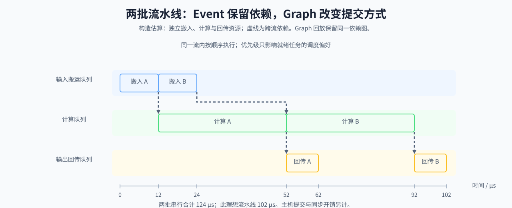

# 29. CUDA Stream Advanced Scheduling | CUDA Stream 高级调度

**难度：** Hard | **环境：** CPU-first | **标签：** `算子编程`, `CUDA Stream`, `异步调度` | **目标人群：** 编译与系统入门者

> 🚀 **云端运行环境**
>
> 本章节的实战代码可以点击以下链接在免费 GPU 算力平台上直接运行：
>
> [](https://colab.research.google.com/github/datawhalechina/llm-algo-leetcode/blob/main/01_Hardware_Math_and_Systems/29_CUDA_Stream_Advanced_Scheduling.ipynb)
> [](https://modelscope.cn/my/mynotebook) *(国内推荐：魔搭社区免费实例)*


---

## 本节导读

数据搬入后才能计算，计算结束后才能回传；不同批次之间又可能存在独立工作。把这些依赖与同一队列中的提交顺序放到一起，才能判断多队列调度留下了多少重叠空间。

本节先计算依赖约束下的起止时间，再比较单批次依赖链与多批次流水线，区分队列优先级和 Graph 回放各自改变的对象。计算器在 CPU 上运行，结果依赖于阶段耗时和资源可并行的假设；真实执行可继续进入性能分析专题核对时间线。

**关键词：** `stream`, `event`, `graph`



---
## 前置阅读

**导语：** 先掌握阶段放置和 Stream 基础，再用 Event、优先级与 Graph 组织更复杂的依赖。

- [07. CPU and GPU Heterogeneous Scheduling | CPU 与 GPU 异构调度](./07_CPU_GPU_Heterogeneous_Scheduling.md)
- [17. CUDA Stream and Asynchrony | CUDA Stream 与异步执行](./17_CUDA_Stream_and_Asynchrony.md)

## Q1：怎样把任务依赖转换成可调度的 Stream 时间线？

同一 Stream 中的任务按给定列表顺序执行；跨 Stream 的任务还必须等待显式前驱。对每个任务，取所有前驱的最晚结束时间作为最早开始时间，再加自身耗时得到结束时间。反复推进已满足前驱的任务，就能得到一条满足依赖的时间线。

下面假设不同 Stream 有独立执行资源、任务耗时固定、没有提交开销或资源争用。因而结果是理想调度估算，而非实测 CUDA 时间。若忽略跨队列依赖，只取各队列累计耗时的最大值，会把仍需等待的工作误算成可重叠工作。

### Q1小验证：计算带依赖的起止时间

保持任务耗时不变，比较不同 Stream 中独立任务与串行依赖链的完成时间。


```python
import math
from dataclasses import dataclass
from typing import List, Dict, Tuple


@dataclass
class TaskStage:
    name: str
    duration_us: float
    stream: str
    depends_on: Tuple[str, ...] = ()


def schedule_stages(stages: List[TaskStage]) -> Dict[str, dict]:
    """计算理想时间线；同队列顺序与跨队列前驱必须同时满足。"""
    by_name = {}
    predecessors = {}
    previous_on_stream = {}
    for stage in stages:
        if not isinstance(stage.name, str) or not stage.name.strip():
            raise ValueError('任务名称必须是非空字符串')
        if stage.name in by_name:
            raise ValueError('任务名称不能重复')
        if not isinstance(stage.stream, str) or not stage.stream.strip():
            raise ValueError('队列名称必须是非空字符串')
        if not math.isfinite(stage.duration_us) or stage.duration_us < 0:
            raise ValueError('阶段耗时必须是有限非负数')
        if not isinstance(stage.depends_on, (tuple, list)) or any(
            not isinstance(name, str) or not name.strip()
            for name in stage.depends_on
        ):
            raise ValueError('前驱必须由任务名称组成')
        by_name[stage.name] = stage
        dependencies = set(stage.depends_on)
        if stage.stream in previous_on_stream:
            dependencies.add(previous_on_stream[stage.stream])
        predecessors[stage.name] = dependencies
        previous_on_stream[stage.stream] = stage.name
    if any(dep not in by_name for deps in predecessors.values() for dep in deps):
        raise ValueError('存在未知前驱')

    timeline = {}
    while len(timeline) < len(stages):
        progressed = False
        for name, stage in by_name.items():
            if name in timeline or not predecessors[name].issubset(timeline):
                continue
            start = max(
                (timeline[dep]['end_us'] for dep in predecessors[name]), default=0.0
            )
            timeline[name] = {
                'start_us': start, 'end_us': start + stage.duration_us,
                'stream': stage.stream,
            }
            progressed = True
        if not progressed:
            raise ValueError('显式依赖与同队列顺序形成了环')
    return timeline


def sequential_time_us(stages: List[TaskStage]) -> float:
    """计算合法任务集合全部串行执行时的总耗时。"""
    schedule_stages(stages)
    return sum(stage.duration_us for stage in stages)


def pipelined_time_us(stages: List[TaskStage]) -> float:
    """取满足全部依赖的最晚完成时间，不忽略跨队列等待。"""
    timeline = schedule_stages(stages)
    return max((event['end_us'] for event in timeline.values()), default=0.0)


def overlap_ratio(sequential_us: float, pipelined_us: float) -> float:
    """理想隐藏时间占串行总时间的比例，不表示设备利用率。"""
    if not all(math.isfinite(value) for value in (sequential_us, pipelined_us)):
        raise ValueError('时间必须为有限数')
    if not 0 <= pipelined_us <= sequential_us:
        raise ValueError('理想流水线时间必须位于零与串行时间之间')
    return 1 - pipelined_us / sequential_us if sequential_us else 0.0

```

## Q2：跨 Stream 的等待怎样进入完成时间？

生产者完成工作后记录 Event，消费者等待该事件，再使用结果。依赖边只约束真正相关的任务；同一队列内的顺序则隐含存在。单批次的搬入、计算、回传如果首尾相依，拆成多个 Stream 后仍然需要串行完成。

下面保留四个阶段的依赖链。最后的主机后处理也作为独立逻辑队列建模；它不是 CUDA Stream 上的设备操作。对比各阶段起止时间，检查是否出现“生产者尚未结束，消费者已开始”的错误。

### Q2小验证：依赖链不能被队列拆分缩短


```python
def build_dependency_edges(stages: List[TaskStage]) -> List[Tuple[str, str]]:
    """返回显式依赖边；同队列顺序由时间线计算器另行加入。"""
    schedule_stages(stages)
    return [(dep, stage.name) for stage in stages for dep in stage.depends_on]


def has_cross_stream_dependency(stages: List[TaskStage]) -> bool:
    schedule_stages(stages)
    name_to_stage = {stage.name: stage for stage in stages}
    return any(
        name_to_stage[dep].stream != stage.stream
        for stage in stages for dep in stage.depends_on
    )

```


```python
def test_event_dependencies():
    stages = [
        TaskStage('H2D', 12, 'copy'),
        TaskStage('Kernel', 40, 'compute', depends_on=('H2D',)),
        TaskStage('D2H', 10, 'copy', depends_on=('Kernel',)),
        TaskStage('Post', 8, 'host', depends_on=('D2H',)),
    ]
    assert build_dependency_edges(stages) == [
        ('H2D', 'Kernel'), ('Kernel', 'D2H'), ('D2H', 'Post')
    ]
    assert has_cross_stream_dependency(stages)
    timeline = schedule_stages(stages)
    assert timeline['Kernel']['start_us'] == 12
    assert timeline['D2H']['start_us'] == 52
    assert timeline['Post']['end_us'] == 70
    assert pipelined_time_us(stages) == sequential_time_us(stages) == 70
    print('依赖链时间线：', timeline)


test_event_dependencies()

```

## Q3：Graph 回放改变了依赖，还是提交成本？

CUDA Graph 复用一段已捕获的执行结构，主要针对重复提交开销；原有数据依赖仍然成立。上一问的依赖链即使被捕获，也不能让消费者在生产者完成前执行。

先选择形状和执行路径稳定、重复运行的子图，再检查捕获支持、内存地址与资源生命周期等条件。下面只筛选最简单的固定子图候选；返回真还不代表捕获成功，也不表示已有加速。变长服务可以按形状分桶或只捕获稳定子图，不能仅凭“变长”就判定整个服务无法使用 Graph。

### Q3小验证：筛选固定子图回放候选


```python
def graph_suitability(is_fixed_shape: bool, is_repeated_path: bool, has_many_branches: bool) -> bool:
    """筛选简单固定子图候选，不验证实际捕获支持或性能。"""
    return is_fixed_shape and is_repeated_path and not has_many_branches

assert graph_suitability(True, True, False) is True
assert graph_suitability(True, False, False) is False
assert graph_suitability(False, True, False) is False
assert graph_suitability(True, True, True) is False
print('✅ Graph 适用性测试通过')

```


```python
cases = [
    ('离线批处理推理', True, True, False),
    ('变长在线推理', False, True, False),
    ('动态分支很多的控制流', True, True, True),
]

for name, fixed_shape, repeated_path, many_branches in cases:
    print(f'{name:<18s}:', '可继续检查捕获条件' if graph_suitability(fixed_shape, repeated_path, many_branches) else '需先整理稳定子图')

```

## Q4：多批次流水线怎样产生重叠空间？

单批次存在搬入、计算和回传的依赖，但下一批输入搬运可能与当前批计算独立。下面固定两批相同任务，假设输入搬运、计算、输出回传各有独立资源，检查批次之间的重叠窗口。实际设备若共享拷贝资源，或这些阶段争用带宽，完成时间会比这个模型更长。

Stream 优先级影响就绪工作的调度偏好，不取消依赖，也不是对已运行工作立即抢占的保证。因此，计算器不按优先级生成固定收益；先从依赖时间线得到理想节省，再单独加入假设的暴露调度开销。

### Q4小验证：比较单批依赖链与两批流水线


```python
def pipeline_comparison(stages: List[TaskStage], exposed_overhead_us=0.0) -> dict:
    """分别记录理想重叠与给定暴露开销，不按阶段比例推荐拆队列。"""
    if not math.isfinite(exposed_overhead_us) or exposed_overhead_us < 0:
        raise ValueError('暴露开销必须是有限非负数')
    serial = sequential_time_us(stages)
    ideal = pipelined_time_us(stages)
    return {
        'serial_us': serial,
        'ideal_pipeline_us': ideal,
        'ideal_saved_us': serial - ideal,
        'exposed_overhead_us': exposed_overhead_us,
        'estimated_elapsed_us': ideal + exposed_overhead_us,
        'net_saved_us': serial - ideal - exposed_overhead_us,
    }


stages = []
for batch in range(2):
    stages.extend([
        TaskStage(f'in{batch}', 12, 'copy_in'),
        TaskStage(f'compute{batch}', 40, 'compute', (f'in{batch}',)),
        TaskStage(f'out{batch}', 10, 'copy_out', (f'compute{batch}',)),
    ])
report = pipeline_comparison(stages, exposed_overhead_us=3)
assert report['serial_us'] == 124
assert report['ideal_pipeline_us'] == 102
assert report['net_saved_us'] == 19
assert pipeline_comparison(stages, exposed_overhead_us=25)['net_saved_us'] == -3
print('两批流水线：', schedule_stages(stages))
print('时间比较：', report)

```

## Q5：哪些条件会消除理想重叠收益？

验证时先检查依赖是否允许重叠，再检查执行资源是否独立，最后比较实际端到端时间；这样可以把“必须等待”与“本可重叠但未发生”区分开。

| 条件 | 对模型结果的影响 | 实际执行时要核对 |
|:---|:---|:---|
| 消费者等待生产者 | 跨队列任务仍串行 | Event 与输入可用时刻 |
| 同队列提交顺序 | 后续任务不能越过前项 | 队头等待是否阻塞独立工作 |
| 多队列共用执行资源 | 理想并行时间偏乐观 | 拷贝引擎、计算资源与带宽争用 |
| 提交或同步开销暴露 | 抵消部分甚至全部隐藏时间 | 主机提交与设备完成时间 |
| Graph 捕获条件不满足 | 需要调整捕获子图或执行路径 | 形状、地址与操作支持 |

## 相关阅读

**导语：** 将 stream 与 event 的依赖判断继续接到真实 collective 和通信重叠实验。

- [Part 02 · 47 NCCL 通信剖析](../02_PyTorch_Algorithms/47_Communication_Profiling_with_NCCL.md)
- [Part 02 · 48 通信热点与缓解](../02_PyTorch_Algorithms/48_Communication_Hotspots_and_Mitigation.md)
- [CUDA C Programming Guide](https://docs.nvidia.com/cuda/cuda-c-programming-guide/)
---
