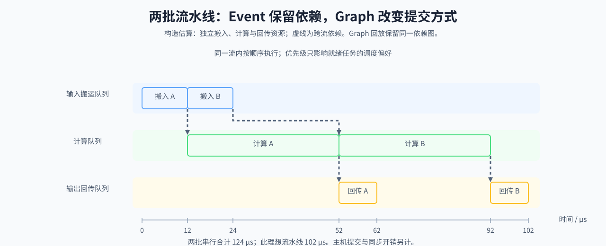

# 29. CUDA Stream Advanced Scheduling | CUDA Stream 高级调度

**难度：** Hard | **环境：** CPU-first | **标签：** `算子编程`, `CUDA Stream`, `异步调度` | **目标人群：** 编译与系统入门者

> 🚀 **云端运行环境**
>
> 本章节的实战代码可以点击以下链接在免费 GPU 算力平台上直接运行：
>
> [](https://colab.research.google.com/github/datawhalechina/llm-algo-leetcode/blob/main/01_Hardware_Math_and_Systems/29_CUDA_Stream_Advanced_Scheduling.ipynb)
> [](https://modelscope.cn/my/mynotebook) *(国内推荐：魔搭社区免费实例)*


---

## 本节导读

数据搬入后才能计算，计算结束后才能回传；不同批次之间又可能存在独立工作。把这些依赖与同一队列中的提交顺序放到一起，才能判断多队列调度留下了多少重叠空间。

本节先计算依赖约束下的起止时间，再比较单批次依赖链与多批次流水线，区分队列优先级和 Graph 回放各自改变的对象。计算器在CPU上运行，结果依赖于给定耗时和独立资源假设；它支撑算子优化的运行时安排，实际传输与Graph重放分别进入Part04·10／11验证。

**关键词：** 队列顺序、事件、依赖图、流水线、Graph重放



---
## 前置阅读

先比较阶段成本，再掌握队列与事件表达的等待关系。

- [07 CPU与GPU异构调度](./07_CPU_GPU_Heterogeneous_Scheduling.md)：搬运量、依赖前缀与完整路径。
- [17 CUDA Stream与异步执行](./17_CUDA_Stream_and_Asynchrony.md)：异步提交、事件等待与锁页缓冲条件。

## Q1：怎样把任务依赖转换成可调度的 Stream 时间线？

将每个阶段作为依赖图的节点，将“必须等待”的关系作为边。没有循环依赖的图称为有向无环图（DAG）。同一Stream中的任务按给定列表顺序执行；跨Stream的任务还必须等待显式前驱。对每个任务，取所有前驱的最晚结束时间作为最早开始时间，再加自身耗时得到结束时间。反复推进已满足前驱的任务，就能得到一条满足依赖的时间线。

下面用CPU调度器计算最早时间，假设不同逻辑队列有独立执行资源、任务耗时固定、没有提交开销或资源争用。因而结果是理想调度估算，而非实测 CUDA 时间。若忽略跨队列依赖，只取各队列累计耗时的最大值，会把仍需等待的工作误算成可重叠工作。

### Q1 机制计算器：同时加入队列顺序和显式依赖

先用同队列10、20 us与另一队列25 us的任务验证：前者共30 us，后者可独立执行，最晚完成于30 us。


```python
import math
from dataclasses import dataclass
from typing import List, Dict, Tuple


@dataclass
class TaskStage:
    """一个逻辑队列中的阶段；duration_us为给定微秒数，依赖用阶段名称表示。"""
    name: str
    duration_us: float
    stream: str
    depends_on: Tuple[str, ...] = ()


def schedule_stages(stages: List[TaskStage]) -> Dict[str, dict]:
    """计算理想时间线；同队列顺序与跨队列前驱必须同时满足。"""
    if not isinstance(stages, (list, tuple)):
        raise ValueError('stages须为阶段序列')
    by_name = {}
    predecessors = {}
    previous_on_stream = {}
    for stage in stages:
        if not isinstance(stage.name, str) or not stage.name.strip():
            raise ValueError('任务名称必须是非空字符串')
        if stage.name in by_name:
            raise ValueError('任务名称不能重复')
        if not isinstance(stage.stream, str) or not stage.stream.strip():
            raise ValueError('队列名称必须是非空字符串')
        if (type(stage.duration_us) not in (int, float)
                or not math.isfinite(stage.duration_us) or stage.duration_us < 0):
            raise ValueError('阶段耗时必须是有限非负数')
        if not isinstance(stage.depends_on, (tuple, list)) or any(
            not isinstance(name, str) or not name.strip()
            for name in stage.depends_on
        ):
            raise ValueError('前驱必须由任务名称组成')
        by_name[stage.name] = stage
        dependencies = set(stage.depends_on)
        if stage.stream in previous_on_stream:
            dependencies.add(previous_on_stream[stage.stream])
        predecessors[stage.name] = dependencies
        previous_on_stream[stage.stream] = stage.name
    if any(dep not in by_name for deps in predecessors.values() for dep in deps):
        raise ValueError('存在未知前驱')

    timeline = {}
    while len(timeline) < len(stages):
        progressed = False
        for name, stage in by_name.items():
            if name in timeline or not predecessors[name].issubset(timeline):
                continue
            start = max(
                (timeline[dep]['end_us'] for dep in predecessors[name]), default=0.0
            )
            timeline[name] = {
                'start_us': start, 'end_us': start + stage.duration_us,
                'stream': stage.stream,
            }
            progressed = True
        if not progressed:
            raise ValueError('显式依赖与同队列顺序形成了环')
    return timeline


def sequential_time_us(stages: List[TaskStage]) -> float:
    """计算合法任务集合全部串行执行时的总耗时。"""
    schedule_stages(stages)
    return sum(stage.duration_us for stage in stages)


def pipelined_time_us(stages: List[TaskStage]) -> float:
    """取满足全部依赖的最晚完成时间，不忽略跨队列等待。"""
    timeline = schedule_stages(stages)
    return max((event['end_us'] for event in timeline.values()), default=0.0)


def overlap_ratio(sequential_us: float, pipelined_us: float) -> float:
    """理想隐藏时间占串行总时间的比例，不表示设备利用率。"""
    if not all(type(value) in (int, float) and math.isfinite(value)
               for value in (sequential_us, pipelined_us)):
        raise ValueError('时间必须为有限数')
    if not 0 <= pipelined_us <= sequential_us:
        raise ValueError('理想流水线时间必须位于零与串行时间之间')
    return 1 - pipelined_us / sequential_us if sequential_us else 0.0

# 同队列的b等待a；独立队列的c可从0开始。
example = [
    TaskStage(name="a", duration_us=10, stream="one"),
    TaskStage(name="b", duration_us=20, stream="one"),
    TaskStage(name="c", duration_us=25, stream="two"),
]
timeline = schedule_stages(stages=example)
assert timeline["b"]["start_us"] == 10 and timeline["c"]["start_us"] == 0
assert pipelined_time_us(stages=example) == 30
assert sequential_time_us(stages=example) == 55
print("独立队列的理想时间：30 us；全部串行：55 us")

```

## Q2：跨 Stream 的等待怎样进入完成时间？

生产者队列在相应工作之后记录事件（Event），消费者队列等待该事件所代表的进度，再使用结果。依赖边只约束真正相关的任务；同一队列内的顺序则隐含存在。单批次的搬入、计算、回传如果首尾相依，拆成多个 Stream 后仍然需要串行完成。

下面保留四个阶段的依赖链：H2D是主机到设备的搬入，D2H是设备到主机的回传。最后的主机后处理也作为独立逻辑队列建模；它不是 CUDA Stream 上的设备操作。对比各阶段起止时间，检查是否出现“生产者尚未结束，消费者已开始”的错误。

### Q2 对照验证：依赖链不能被队列拆分缩短

固定搬入12 us、计算40 us、回传10 us、主机后处理8 us，逐项检查开始时刻与70 us的完成时间。


```python
def build_dependency_edges(stages: List[TaskStage]) -> List[Tuple[str, str]]:
    """返回显式依赖边；同队列顺序由时间线计算器另行加入。"""
    schedule_stages(stages)
    return [(dep, stage.name) for stage in stages for dep in stage.depends_on]


def has_cross_stream_dependency(stages: List[TaskStage]) -> bool:
    schedule_stages(stages)
    name_to_stage = {stage.name: stage for stage in stages}
    return any(
        name_to_stage[dep].stream != stage.stream
        for stage in stages for dep in stage.depends_on
    )

```


```python
stages = [
    TaskStage(name="H2D", duration_us=12, stream="copy"),
    TaskStage(name="Kernel", duration_us=40, stream="compute", depends_on=("H2D",)),
    TaskStage(name="D2H", duration_us=10, stream="copy", depends_on=("Kernel",)),
    TaskStage(name="Post", duration_us=8, stream="host", depends_on=("D2H",)),
]
assert build_dependency_edges(stages=stages) == [
    ("H2D", "Kernel"), ("Kernel", "D2H"), ("D2H", "Post"),
]
assert has_cross_stream_dependency(stages=stages)
timeline = schedule_stages(stages=stages)
assert timeline == {
    "H2D": {"start_us": 0.0, "end_us": 12.0, "stream": "copy"},
    "Kernel": {"start_us": 12.0, "end_us": 52.0, "stream": "compute"},
    "D2H": {"start_us": 52.0, "end_us": 62.0, "stream": "copy"},
    "Post": {"start_us": 62.0, "end_us": 70.0, "stream": "host"},
}
assert pipelined_time_us(stages=stages) == sequential_time_us(stages=stages) == 70
for name, event in timeline.items():
    print(f"{name}: {event['start_us']:g}–{event['end_us']:g} us")

```

## Q3：Graph 回放改变了依赖，还是提交成本？

CUDA Graph 复用一段已捕获的执行结构，主要针对重复提交开销；原有数据依赖仍然成立。上一问的依赖链即使被捕获，也不能让消费者在生产者完成前执行。

先选择形状和执行路径稳定、重复运行的子图，再检查捕获支持、内存地址与资源生命周期等条件。下面只筛选最简单的固定子图候选；返回真还不代表捕获成功，也不表示已有加速。变长服务可以按形状分桶或只捕获稳定子图，不能仅凭“变长”就判定整个服务无法使用 Graph。

### Q3 条件筛选：选择可以继续检查捕获的固定子图

三个布尔值表示给定子图的形状、路径重复性和分支情况。完整的捕获与重放测试留给对应运行时实验。


```python
def graph_suitability(
    is_fixed_shape: bool, is_repeated_path: bool, has_many_branches: bool,
) -> bool:
    """检查给定固定子图的保守候选条件，返回是否继续检查捕获支持。"""
    if any(type(value) is not bool
           for value in (is_fixed_shape, is_repeated_path, has_many_branches)):
        raise ValueError("子图条件须为布尔值")
    return is_fixed_shape and is_repeated_path and not has_many_branches

```


```python
base = dict(is_fixed_shape=True, is_repeated_path=True, has_many_branches=False)
changes = {
    "fixed_repeated": {},
    "unbucketed_variable_subgraph": {"is_fixed_shape": False},
    "one_time_path": {"is_repeated_path": False},
    "branching_subgraph": {"has_many_branches": True},
}
reports = {name: graph_suitability(**(base | change)) for name, change in changes.items()}
assert reports == {
    "fixed_repeated": True, "unbucketed_variable_subgraph": False,
    "one_time_path": False, "branching_subgraph": False,
}
for name, proceed in reports.items():
    print(name, "：", "继续检查捕获条件" if proceed else "先整理稳定子图或考虑普通提交")

```

## Q4：多批次流水线怎样产生重叠空间？

单批次存在搬入、计算和回传的依赖，但下一批输入搬运可能与当前批计算独立。下面固定两批相同任务，假设输入搬运、计算、输出回传各有独立资源，检查批次之间的重叠窗口。若将输入和回传放到同一个队列，并按本例的任务列表提交，下一批搬入会被前一批回传挡住；下面同时计算这一对照。真实设备的拷贝资源和带宽争用还需单独测量：若两批计算各从40 us变为52 us，流水总长变为126 us，反而比原串行路径的124 us多2 us。比较同一批工作时，应保留原路径的耗时，而不是用争用后的阶段时间重新定义基线。

Stream优先级主要为内核调度提供偏好，不保证内存传输顺序，也不保证抢占已执行工作。因此，计算器不按优先级生成固定收益；先从依赖时间线得到理想节省，再单独加入假设的暴露调度开销。

### Q4 对照验证：比较独立资源与同队列提交，再加入开销

先核对主图两批流水线的每个起止时刻。理想节省22 us，暴露开销为22 us时恰好抵消，更大时保留负节省量。最后只把候选中每批计算改为52 us，仍与原串行的124 us比较，观察资源争用如何抵消重叠收益。


```python
def pipeline_comparison(stages: List[TaskStage], exposed_overhead_us: float = 0.0) -> dict:
    """返回串行与理想依赖调度的微秒数，再单列给定暴露开销和净节省。"""
    if (type(exposed_overhead_us) not in (int, float)
            or not math.isfinite(exposed_overhead_us) or exposed_overhead_us < 0):
        raise ValueError("暴露开销须为有限非负实数")
    serial = sequential_time_us(stages)
    ideal = pipelined_time_us(stages)
    return {
        "serial_us": serial, "ideal_pipeline_us": ideal,
        "ideal_saved_us": serial - ideal, "exposed_overhead_us": exposed_overhead_us,
        "estimated_elapsed_us": ideal + exposed_overhead_us,
        "net_saved_us": serial - ideal - exposed_overhead_us,
    }


stages = []
for batch in range(2):
    stages.extend([
        TaskStage(name=f"in{batch}", duration_us=12, stream="copy_in"),
        TaskStage(name=f"compute{batch}", duration_us=40, stream="compute",
                  depends_on=(f"in{batch}",)),
        TaskStage(name=f"out{batch}", duration_us=10, stream="copy_out",
                  depends_on=(f"compute{batch}",)),
    ])
timeline = schedule_stages(stages=stages)
assert [(timeline[name]["start_us"], timeline[name]["end_us"])
        for name in ("in0", "in1", "compute0", "compute1", "out0", "out1")] == [
    (0, 12), (12, 24), (12, 52), (52, 92), (52, 62), (92, 102),
]
report = pipeline_comparison(stages=stages, exposed_overhead_us=3)
assert report["serial_us"] == 124 and report["ideal_pipeline_us"] == 102
assert report["ideal_saved_us"] == 22 and report["net_saved_us"] == 19
assert pipeline_comparison(stages=stages, exposed_overhead_us=22)["net_saved_us"] == 0
assert pipeline_comparison(stages=stages, exposed_overhead_us=25)["net_saved_us"] == -3
same_copy_queue = [
    TaskStage(name=stage.name, duration_us=stage.duration_us,
              stream="copy" if stage.stream in ("copy_in", "copy_out") else stage.stream,
              depends_on=stage.depends_on)
    for stage in stages
]
assert pipelined_time_us(stages=same_copy_queue) == 124
for name, event in timeline.items():
    print(f"{name}: {event['start_us']:g}–{event['end_us']:g} us")
print(f"独立队列理想完成 {report['ideal_pipeline_us']:g} us，"
      f"计入开销后 {report['estimated_elapsed_us']:g} us")
print("按本例顺序合用搬运队列：124 us")

# 保持相同两批工作，候选的计算阶段因资源争用而变慢。
contended_stages = [
    TaskStage(name=stage.name,
              duration_us=52 if stage.stream == "compute" else stage.duration_us,
              stream=stage.stream, depends_on=stage.depends_on)
    for stage in stages
]
contended_elapsed_us = pipelined_time_us(stages=contended_stages)
assert contended_elapsed_us == 126
assert report["serial_us"] - contended_elapsed_us == -2
print(f"候选计算变慢：完成于 {contended_elapsed_us:g} us，"
      f"相对原串行路径节省 {report['serial_us'] - contended_elapsed_us:g} us")

```

## Q5：哪些条件会消除理想重叠收益？

验证时先检查依赖是否允许重叠，再检查执行资源是否独立，最后比较实际端到端时间；这样可以把“必须等待”与“本可重叠但未发生”区分开。

| 条件 | 对模型结果的影响 | 实际执行时要核对 |
|:---|:---|:---|
| 消费者等待生产者 | 跨队列任务仍串行 | Event 与输入可用时刻 |
| 同队列提交顺序 | 后续任务不能越过前项 | 队头等待是否阻塞独立工作 |
| 多队列共用执行资源 | 理想并行时间偏乐观 | 拷贝引擎、计算资源与带宽争用 |
| 提交或同步开销暴露 | 抵消部分甚至全部隐藏时间 | 主机提交与设备完成时间 |
| Graph 捕获条件不满足 | 需要调整捕获子图或执行路径 | 形状、地址与操作支持 |

## 相关阅读

将依赖估算接到真实传输、重放与执行轨迹，分别核对是否正确、是否减少完整调用时间。

- [Part04·10 Stream与传输](../04_CUDA_and_System_Optimization/10_PyTorch_CUDA_Streams_and_Transfer.md)：跨流事件与缓冲区生命周期。
- [Part04·11 CUDA Graph重放](../04_CUDA_and_System_Optimization/11_CUDA_Graph_and_JIT_Compile.md)：依赖保留、准备成本与稳态调用。
- [CUDA官方异步执行说明](https://docs.nvidia.com/cuda/cuda-programming-guide/02-basics/asynchronous-execution.html)：重点看Events、Stream Prioritization与CUDA Graphs的不同作用。
