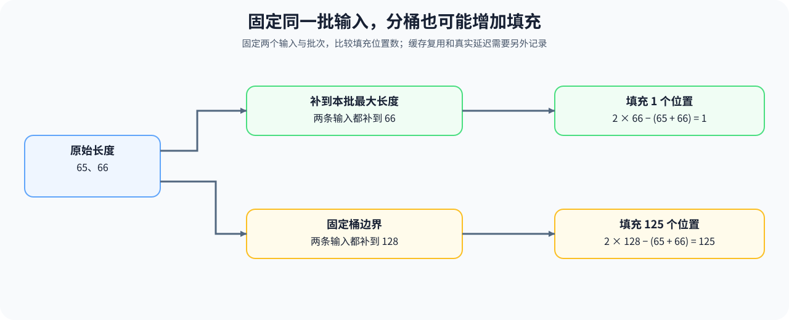

# 30. Dynamic Shape Handling | 动态 Shape 处理

**难度：** Medium-Hard | **环境：** CPU-first | **标签：** `系统工程`, `动态 Shape`, `推理服务` | **目标人群：** 编译与系统入门者

> 🚀 **云端运行环境**
>
> 本章节的实战代码可以点击以下链接在免费 GPU 算力平台上直接运行：
>
> [](https://colab.research.google.com/github/datawhalechina/llm-algo-leetcode/blob/main/01_Hardware_Math_and_Systems/30_Dynamic_Shape_Handling.ipynb)
> [](https://modelscope.cn/my/mynotebook) *(国内推荐：魔搭社区免费实例)*


---

## 本节导读

计算内容没有改变，输入批次或序列长度变化，也可能让原来的执行路径无法复用。把输入补到固定形状能够减少形状种类，却会引入无效计算；桶边界过宽时，填充甚至比直接补到本批最大长度更多。

本节用形状和长度序列比较缓存键、填充数量与路径切换，再区分守卫失败、重新编译和图中断。算子优化利用这些区别检查实现的复用条件；推理优化再把填充和路径选择放回实际请求的组批与等待。

**关键词：** 动态形状、守卫、重新编译、图中断、分桶



---
## 前置阅读

先区分图捕获、图变换和目标实现，再检查输入变化怎样影响已有版本。

- [09 AI编译器与计算图优化](./09_AI_Compilers_and_Graph_Optimization.md)：程序、计算图与执行路径。

## Q1：输入变化后，哪些编译版本仍能复用

先考虑最简单的缓存模型：键只由完整形状组成，每种形状首次出现时不命中，之后出现时命中，而且缓存不会淘汰。输入的不同形状越多，这个模型的命中比例可能越低。下面的计算器只统计这种精确形状键，不调用编译器。

真实编译版本通常还有守卫（guard），用于检查形状、步长、类型以及相关程序状态等适用条件。形状可以按符号与约束表达，不必每个长度都生成一个版本。例如，假设某个版本允许连续FP32输入的序列长度在128至256之间，那么128和192都可满足这组条件；改成非连续布局，即使长度仍为128，也可能不再适用。这里的范围是构造假设，不是本机编译器采集的实际守卫。

守卫失败说明当前版本不适用，不说明一定要重新生成设备代码：系统还可能找到另一个已缓存的适用版本。没有可用版本时，才可能重新捕获或编译，底层编译仍可能利用已有缓存；超过限制或不支持的情况还可能回退或报错，取决于配置。图中断则发生在捕获过程中，表示当前配置无法将某段程序继续纳入同一捕获区域，与一次输入未满足旧版本条件是不同问题。

| 观察 | 发生了什么 | 还不能据此判断什么 |
| --- | --- | --- |
| 守卫失败 | 一个已有版本的适用条件不满足 | 不代表所有缓存版本都不可用，或一定重新生成代码 |
| 重新编译 | 为变化后的程序或输入条件准备另一版本 | 不等于所有底层产物都冷编译，也不保证更快 |
| 图中断 | 捕获无法继续跨越某段程序 | 不等于形状缓存未命中；允许分段与要求整图的模式处理不同 |

### Q1 机制计算器：统计精确形状键的重复比例


```python
def shape_reuse_report(shapes):
    """模拟仅以形状为键且不淘汰的冷缓存，不调用编译器。"""
    if not shapes or any(
        not isinstance(shape, (tuple, list)) or not shape
        or any(type(dim) is not int or dim <= 0 for dim in shape)
        for shape in shapes
    ):
        raise ValueError('形状必须是非空的正整数维度序列')
    normalized = [tuple(shape) for shape in shapes]
    keys = len(set(normalized))
    hits = len(normalized) - keys
    return {
        'requests': len(normalized),
        'distinct_shape_keys': keys,
        'assumed_exact_shape_hits': hits,
        'exact_shape_hit_ratio': hits / len(normalized),
    }


fixed = shape_reuse_report([(8, 512)] * 4)
dynamic = shape_reuse_report([(8, 128), (8, 512), (8, 128), (8, 2048)])
assert fixed['exact_shape_hit_ratio'] == 0.75
assert dynamic['exact_shape_hit_ratio'] == 0.25
print('固定形状：', fixed)
print('变化形状：', dynamic)

```

## Q2：分桶能减少哪些填充，什么时候反而增加？

填充把不同长度的输入变成规则张量；分桶把相近长度放在一起，按指定边界补齐。桶边界接近输入时可能减少无效 Token，但边界过宽时，也可能比直接补到本批最大长度更浪费。

下面固定请求集合，只计算补齐的 Token；它不模拟请求到达、等待组批或批量上限，也不把填充比例当作吞吐收益。

### Q2 对照验证：同时检查分桶有利与不利的输入


```python
def padding_overhead(lengths, bucket_boundaries=None):
    """计算单一大 Batch 或按长度边界分桶后的填充 Token 数。"""
    if not lengths or any(type(length) is not int or length <= 0 for length in lengths):
        raise ValueError('lengths must be positive and non-empty')
    if bucket_boundaries is None:
        targets = [max(lengths)] * len(lengths)
    else:
        if any(type(boundary) is not int or boundary <= 0
               for boundary in bucket_boundaries):
            raise ValueError('桶边界必须是正整数')
        boundaries = sorted(set(bucket_boundaries))
        if not boundaries or boundaries[-1] < max(lengths) or any(boundary <= 0 for boundary in boundaries):
            raise ValueError('bucket boundaries must cover every length')
        targets = [next(boundary for boundary in boundaries if length <= boundary) for length in lengths]
    wasted_tokens = sum(target - length for target, length in zip(targets, lengths))
    return {'useful_tokens': sum(lengths), 'wasted_tokens': wasted_tokens, 'total_tokens': sum(targets), 'padding_ratio': wasted_tokens / sum(targets)}

lengths = [64, 128, 256, 520, 800]
single_batch = padding_overhead(lengths)
bucketed = padding_overhead(lengths, [128, 256, 512, 1024])
assert bucketed['wasted_tokens'] < single_batch['wasted_tokens']
assert padding_overhead([65, 66], [128])['wasted_tokens'] > padding_overhead([65, 66])['wasted_tokens']
print('single batch:', single_batch)
print('bucketed:', bucketed)

```

## Q3：路径切换次数能否解释延迟波动

给定长度阈值后，可以统计请求进入哪些分支，以及相邻请求切换分支的次数。但运行时选分支与编译时生成版本是两项动作：两个分支若都已有可用实现，频繁切换也无需重新编译；一直进入同一分支，仍可能因类型或步长变化触发新的适用条件检查。

图中断也不能从分支次数推断。允许分段时，可捕获区域可能分别编译，其他部分继续普通执行；`fullgraph=True` 要求本次捕获不发生图中断，遇到不支持的捕获会报错，但成功捕获的图仍可包含多个设备内核与库调用。它不是“一个GPU kernel”的保证。

下面仅统计给定阈值下的路径变化。解释真实波动时，需要把同一次调用的输入元信息、守卫／重编译诊断、实际执行与时间样本对应起来；首次准备和预热也应与稳态耗时分开。

### Q3 机制计算器：统计给定阈值下的分支变化


```python
def path_stability(lengths, boundaries=(256, 1024)):
    """统计运行时路径种类和相邻请求的路径切换次数。"""
    if not lengths or any(type(length) is not int or length <= 0 for length in lengths):
        raise ValueError('lengths must be positive and non-empty')
    if (len(boundaries) != 2
            or any(type(value) is not int for value in boundaries)
            or not 0 < boundaries[0] < boundaries[1]):
        raise ValueError('boundaries must be two increasing positive values')
    def route(length):
        return 'short' if length < boundaries[0] else 'long' if length < boundaries[1] else 'very_long'
    paths = [route(length) for length in lengths]
    transitions = sum(left != right for left, right in zip(paths, paths[1:]))
    return {'paths': paths, 'unique_paths': len(set(paths)), 'path_transitions': transitions, 'stable': transitions == 0}

stable = path_stability([128, 128, 128])
mixed = path_stability([128, 512, 128, 2048])
assert stable['stable'] is True
assert mixed['unique_paths'] == 3 and mixed['path_transitions'] == 3
print('stable:', stable)
print('mixed:', mixed)

```

## 相关阅读

需要追踪具体特化实现或固定形状重放时，分别查看生成产物和运行时约束。

- [Part 03 · 18 编译产物与实际执行](../03_Triton_Kernels/18_Triton_Compilation_Artifacts_and_Execution.md)：编译期常量、运行时参数与产物复用。
- [Part 04 · 11 CUDA Graph与JIT编译](../04_CUDA_and_System_Optimization/11_CUDA_Graph_and_JIT_Compile.md)：固定工作流的地址、依赖与输入更新。
