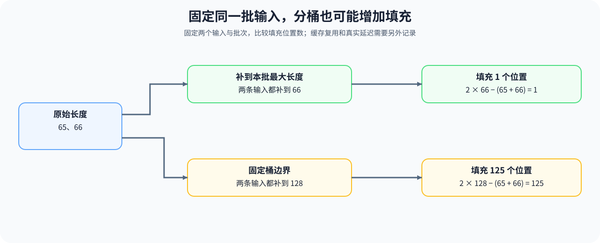

# 30. Dynamic Shape Handling | 动态 Shape 处理

**难度：** Medium-Hard | **环境：** CPU-first | **标签：** `系统工程`, `动态 Shape`, `推理服务` | **目标人群：** 编译与系统入门者

> 🚀 **云端运行环境**
>
> 本章节的实战代码可以点击以下链接在免费 GPU 算力平台上直接运行：
>
> [](https://colab.research.google.com/github/datawhalechina/llm-algo-leetcode/blob/main/01_Hardware_Math_and_Systems/30_Dynamic_Shape_Handling.ipynb)
> [](https://modelscope.cn/my/mynotebook) *(国内推荐：魔搭社区免费实例)*


---

## 本节导读

计算内容没有改变，输入批次或序列长度变化，也可能让原来的执行路径无法复用。把输入补到固定形状能够减少形状种类，却会引入无效计算。分桶把输入归入预设的长度范围；桶边界过宽时，填充甚至比直接补到本批最大长度更多。

本节先统计输入形状的重复，再比较分桶前后的填充，最后检查按长度选择的运行分支；同时区分版本适用条件不满足、重新编译和图中断。算子优化利用这些区别检查实现的复用条件；推理优化再把填充和路径选择放回实际请求的组批与等待。

**关键词：** 动态形状、版本适用条件、重新编译、图中断、分桶



---
## 前置阅读

先区分图捕获、图变换和目标实现，再检查输入变化怎样影响已有版本。

- [09 AI编译器与计算图优化](./09_AI_Compilers_and_Graph_Optimization.md)：程序、计算图与执行路径。

## Q1：精确形状缓存怎样统计重复输入？

先考虑最简单的缓存模型：键只由完整形状组成，每种形状首次出现时不命中，之后出现时命中，而且缓存不会淘汰。输入的不同形状越多，这个模型的命中比例可能越低。下面的计算器只统计这种精确形状键，不调用编译器。

复用真实编译版本前，会进行编译版本适用条件检查（guard），核对形状、步长、类型以及相关程序状态等要求。形状可以按符号与约束表达，不必每个长度都生成一个版本。例如，假设某个版本允许连续FP32输入的序列长度在128至256之间，那么128和192都可满足这组条件；改成非连续布局，即使长度仍为128，也可能不再适用。这里的范围是构造假设，不是本机编译器采集的实际适用条件。

当前输入不满足某个版本的适用条件时，系统还可以查找其他已缓存版本。没有可用版本时，才可能重新捕获或编译，底层编译仍可能利用已有缓存；超过限制或不支持的情况还可能回退或报错，取决于配置。图中断则发生在捕获过程中，表示当前配置无法将某段程序继续纳入同一捕获区域，与一次输入未满足旧版本条件是不同问题。

| 观察 | 发生了什么 | 还不能据此判断什么 |
| --- | --- | --- |
| 版本适用条件不满足 | 一个已有版本的适用条件不满足 | 不代表所有缓存版本都不可用，或一定重新生成代码 |
| 重新编译 | 为变化后的程序或输入条件准备另一版本 | 不等于所有底层产物都冷编译，也不保证更快 |
| 图中断 | 捕获无法继续跨越某段程序 | 不等于形状缓存未命中；允许分段与要求整图的模式处理不同 |

### Q1 机制计算器：统计精确形状键的重复比例

固定形状键由批量与序列长度组成。四次相同输入只有第一次不命中；四次不同输入全部不命中，再用混合序列核对重复计数。


```python
def shape_reuse_report(shapes: list | tuple) -> dict:
    """按完整形状元组为键，从空缓存开始统计命中；假设缓存始终保留已有键。"""
    if (not isinstance(shapes, (list, tuple)) or not shapes
            or any(not isinstance(shape, (tuple, list)) or not shape
                   or any(type(dim) is not int or dim <= 0 for dim in shape)
                   for shape in shapes)):
        raise ValueError("shapes须为非空形状序列，每个形状含正整数维度")
    normalized = [tuple(shape) for shape in shapes]
    keys = len(set(normalized))
    hits = len(normalized) - keys
    return {
        "requests": len(normalized), "distinct_shape_keys": keys,
        "assumed_exact_shape_hits": hits,
        "exact_shape_hit_ratio": hits / len(normalized),
    }


inputs = {
    "fixed": [(8, 512)] * 4,
    "mixed": [(8, 128), (8, 512), (8, 128), (8, 2048)],
    "unique": [(8, 128), (8, 256), (8, 512), (8, 1024)],
}
reports = {name: shape_reuse_report(shapes=shapes) for name, shapes in inputs.items()}
assert reports["fixed"] == {
    "requests": 4, "distinct_shape_keys": 1,
    "assumed_exact_shape_hits": 3, "exact_shape_hit_ratio": 0.75,
}
assert reports["mixed"]["distinct_shape_keys"] == 3
assert reports["mixed"]["assumed_exact_shape_hits"] == 1
assert reports["unique"]["assumed_exact_shape_hits"] == 0
assert shape_reuse_report(shapes=[(8, 128)])["exact_shape_hit_ratio"] == 0
assert shape_reuse_report(shapes=[[8, 128], (8, 128)])["assumed_exact_shape_hits"] == 1
for name, result in reports.items():
    print(f"{name}: {result['requests']} 次输入，{result['distinct_shape_keys']} 种键，"
          f"精确键命中 {result['assumed_exact_shape_hits']} 次")

```

## Q2：分桶能减少哪些填充，什么时候反而增加？

分桶（Bucketing）按预设长度边界归类输入。例如桶边界为128、256、512时，长度65和100进入128桶，200进入256桶。填充（Padding）是补上占位位置，组批（Batching）则决定哪些输入一起执行；分桶可以帮助组批，但归入同一桶不必都补到桶上限，也可以在桶内按当前批次最大长度补齐。本例固定采用“提供桶边界时补到所属桶上限”的规则，Token表示模型处理的序列位置。

主图中两条输入长65、66，直接补到本批最大长度66，只填1个位置；都补到桶边界128，则填125个。较少的规则形状有机会复用已有实现或执行配置，但桶过宽会增加无效计算，等待同桶输入也可能增加排队。边界贴近输入时填充又可能减少：长度64、128、256、520、800全补到800产生2232个填充位置，分别补到128、128、256、1024、1024只产生792个。下面只计算位置数；版本复用、等待与耗时分别通过对应运行记录观察。

### Q2 对照验证：核对同一输入集合的两种补齐方式

先复现主图的1个与125个填充位置，再比较有利的桶边界；输入恰好落在边界时应无需填充。


```python
def padding_overhead(
    lengths: list | tuple, bucket_boundaries: list | tuple | None = None,
) -> dict:
    """返回有效、填充和总Token位置数；比例分母是补齐后的总位置数。

    不分桶时补到本批最大长度；提供边界时，逐条补到最小的可容纳边界。
    边界可无序或重复，内部先去重排序。
    """
    if (not isinstance(lengths, (list, tuple)) or not lengths
            or any(type(length) is not int or length <= 0 for length in lengths)):
        raise ValueError("lengths须为非空正整数序列")
    if bucket_boundaries is None:
        targets = [max(lengths)] * len(lengths)
    else:
        if (not isinstance(bucket_boundaries, (list, tuple)) or not bucket_boundaries
                or any(type(boundary) is not int or boundary <= 0
                       for boundary in bucket_boundaries)):
            raise ValueError("桶边界须为非空正整数序列")
        boundaries = sorted(set(bucket_boundaries))
        if boundaries[-1] < max(lengths):
            raise ValueError("最大桶边界须覆盖全部输入长度")
        targets = [next(boundary for boundary in boundaries if length <= boundary)
                   for length in lengths]
    useful_tokens = sum(lengths)
    total_tokens = sum(targets)
    wasted_tokens = total_tokens - useful_tokens
    return {"useful_tokens": useful_tokens, "wasted_tokens": wasted_tokens,
            "total_tokens": total_tokens, "padding_ratio": wasted_tokens / total_tokens}


lengths = [65, 66]
direct = padding_overhead(lengths=lengths)
coarse = padding_overhead(lengths=lengths, bucket_boundaries=[128])
assert direct == {
    "useful_tokens": 131, "wasted_tokens": 1, "total_tokens": 132, "padding_ratio": 1 / 132,
}
assert coarse == {
    "useful_tokens": 131, "wasted_tokens": 125, "total_tokens": 256,
    "padding_ratio": 125 / 256,
}
varied_lengths = [64, 128, 256, 520, 800]
unbucketed = padding_overhead(lengths=varied_lengths)
bucketed = padding_overhead(lengths=varied_lengths, bucket_boundaries=[128, 256, 512, 1024])
assert unbucketed["wasted_tokens"] == 2232
assert bucketed["wasted_tokens"] == 792
assert bucketed["useful_tokens"] == unbucketed["useful_tokens"] == 1768
assert padding_overhead(lengths=[128], bucket_boundaries=[128])["wasted_tokens"] == 0
assert padding_overhead(lengths=[65, 66], bucket_boundaries=[256, 128, 128]) == coarse
for name, result in (("直接补齐", direct), ("过宽桶", coarse),
                     ("多长度直接补齐", unbucketed), ("多长度分桶", bucketed)):
    print(f"{name}: 有效 {result['useful_tokens']}，填充 {result['wasted_tokens']}，"
          f"总位置 {result['total_tokens']}，填充比例 {result['padding_ratio']:.2%}")

```

## Q3：输入长度怎样改变运行分支？

给定长度阈值256和1024后，将小于256的输入放入短分支，256至1023放入中分支，1024及以上放入长分支。统计相邻输入选择是否变化，可以看到运行路径的切换。但运行时选分支与编译时生成版本是两项动作：两个分支若都已有可用实现，频繁切换也无需重新编译；一直进入同一分支，仍可能因类型或步长变化触发新的适用条件检查。

图中断也不能从分支次数推断。允许分段时，可捕获区域可能分别编译，其他部分继续普通执行；`fullgraph=True` 要求本次捕获不发生图中断，遇到不支持的捕获会报错，但成功捕获的图仍可包含多个设备内核与库调用。它不是“一个GPU kernel”的保证。

下面核对这两个阈值前后各一个长度，再统计相邻路径变化。解释真实波动时，需要把同一次调用的输入元信息、版本适用条件／重编译诊断、实际执行与时间样本对应起来；首次准备和预热也应与稳态耗时分开。

### Q3 机制计算器：检查分支边界与切换次数

分别核对255／256、1023／1024的去向。路径始终相同只表示本例的分支未变，时间与编译版本需用各自记录判断。


```python
def path_stability(lengths: list | tuple, boundaries: tuple = (256, 1024)) -> dict:
    """返回按给定阈值路由的分支序列、种类与相邻切换次数。"""
    if (not isinstance(lengths, (list, tuple)) or not lengths
            or any(type(length) is not int or length <= 0 for length in lengths)):
        raise ValueError("lengths须为非空正整数序列")
    if (not isinstance(boundaries, (list, tuple)) or len(boundaries) != 2
            or any(type(value) is not int for value in boundaries)
            or not 0 < boundaries[0] < boundaries[1]):
        raise ValueError("boundaries须为两个递增正整数")

    def route(length):
        if length < boundaries[0]:
            return "short"
        if length < boundaries[1]:
            return "medium"
        return "long"

    paths = [route(length) for length in lengths]
    transitions = sum(left != right for left, right in zip(paths, paths[1:]))
    return {"paths": paths, "unique_paths": len(set(paths)),
            "path_transitions": transitions, "same_runtime_branch": transitions == 0}


same = path_stability(lengths=[128, 128, 128])
mixed = path_stability(lengths=[128, 512, 128, 2048])
edges = path_stability(lengths=[255, 256, 1023, 1024])
assert same["same_runtime_branch"] and same["path_transitions"] == 0
assert mixed["paths"] == ["short", "medium", "short", "long"]
assert mixed["unique_paths"] == 3 and mixed["path_transitions"] == 3
assert edges["paths"] == ["short", "medium", "medium", "long"]
assert edges["path_transitions"] == 2
assert path_stability(lengths=[256])["path_transitions"] == 0
for name, result in (("同分支", same), ("混合", mixed), ("边界", edges)):
    print(f"{name}: {result['paths']}，相邻切换 {result['path_transitions']} 次")

```

## 相关阅读

从本节的形状统计进入真实捕获观察，再按问题检查设备产物或固定工作流重放。

- [Part 03 · 21 图捕获与版本复用](../03_Triton_Kernels/21_Torch_Compile_Graph_Reuse.md)：观察形状、步长和类型改变后的真实后端回调与图调用体执行。
- [Part 03 · 18 编译产物与实际执行](../03_Triton_Kernels/18_Triton_Compilation_Artifacts_and_Execution.md)：编译期常量、运行时参数与产物复用。
- [Part 04 · 11 CUDA Graph与JIT编译](../04_CUDA_and_System_Optimization/11_CUDA_Graph_and_JIT_Compile.md)：固定工作流的地址、依赖与输入更新。
