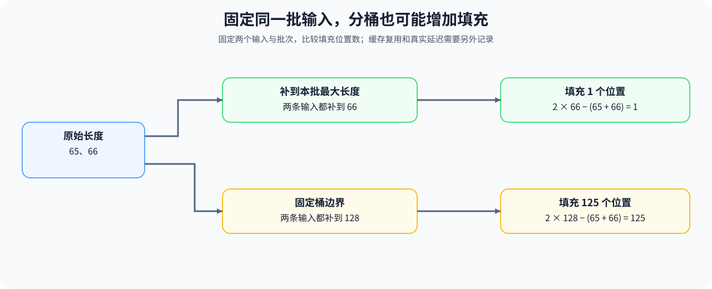

# 30. Dynamic Shape Handling | 动态 Shape 处理

**难度：** Medium-Hard | **环境：** CPU-first | **标签：** `系统工程`, `动态 Shape`, `推理服务` | **目标人群：** 编译与系统入门者

> 🚀 **云端运行环境**
>
> 本章节的实战代码可以点击以下链接在免费 GPU 算力平台上直接运行：
>
> [](https://colab.research.google.com/github/datawhalechina/llm-algo-leetcode/blob/main/01_Hardware_Math_and_Systems/30_Dynamic_Shape_Handling.ipynb)
> [](https://modelscope.cn/my/mynotebook) *(国内推荐：魔搭社区免费实例)*


---

## 本节导读

计算内容没有改变，输入批次或序列长度变化，也可能让原来的执行路径无法复用。把输入补到固定形状能够减少形状种类，却会引入无效计算；桶边界过宽时，填充甚至比直接补到本批最大长度更多。

本节用形状和长度序列比较缓存键、填充数量与路径切换。完成后，你应能判断哪些变化需要进一步检查编译缓存和执行记录；组批与服务延迟进入推理优化，具体计算内核的适配进入算子优化。

**关键词：** 动态形状、形状缓存、分桶、填充



---
## 前置阅读

**导语：** 先理解图优化依赖哪些形状假设，再检查输入变化怎样影响路径复用。

- [09. AI Compilers and Graph Optimization | AI 编译器与计算图优化](./09_AI_Compilers_and_Graph_Optimization.md)

## Q1：形状变化怎样影响按形状复用？

先考虑最简单的缓存模型：键只由完整形状组成，每种形状首次出现时不命中，之后出现时命中，而且缓存不会淘汰。输入的不同形状越多，这个模型的命中比例可能越低。

实际编译器还可能使用符号形状、范围约束与其他守卫条件，多个形状可以复用同一份产物；相同形状也可能因数据类型、布局或其他条件改变而走不同路径。下面只统计形状序列，不能据此得出真实编译次数。

### Q1 机制计算器：统计精确形状键的重复比例


```python
def shape_reuse_report(shapes):
    """模拟仅以形状为键且不淘汰的冷缓存，不调用编译器。"""
    if not shapes or any(
        not isinstance(shape, (tuple, list)) or not shape
        or any(type(dim) is not int or dim <= 0 for dim in shape)
        for shape in shapes
    ):
        raise ValueError('形状必须是非空的正整数维度序列')
    normalized = [tuple(shape) for shape in shapes]
    keys = len(set(normalized))
    hits = len(normalized) - keys
    return {
        'requests': len(normalized),
        'distinct_shape_keys': keys,
        'assumed_exact_shape_hits': hits,
        'exact_shape_hit_ratio': hits / len(normalized),
    }


fixed = shape_reuse_report([(8, 512)] * 4)
dynamic = shape_reuse_report([(8, 128), (8, 512), (8, 128), (8, 2048)])
assert fixed['exact_shape_hit_ratio'] == 0.75
assert dynamic['exact_shape_hit_ratio'] == 0.25
print('固定形状：', fixed)
print('变化形状：', dynamic)

```

## Q2：分桶能减少哪些填充，什么时候反而增加？

填充把不同长度的输入变成规则张量；分桶把相近长度放在一起，按指定边界补齐。桶边界接近输入时可能减少无效 Token，但边界过宽时，也可能比直接补到本批最大长度更浪费。

下面固定请求集合，只计算补齐的 Token；它不模拟请求到达、等待组批或批量上限，也不把填充比例当作吞吐收益。

### Q2 对照验证：同时检查分桶有利与不利的输入


```python
def padding_overhead(lengths, bucket_boundaries=None):
    """计算单一大 Batch 或按长度边界分桶后的填充 Token 数。"""
    if not lengths or any(type(length) is not int or length <= 0 for length in lengths):
        raise ValueError('lengths must be positive and non-empty')
    if bucket_boundaries is None:
        targets = [max(lengths)] * len(lengths)
    else:
        if any(type(boundary) is not int or boundary <= 0
               for boundary in bucket_boundaries):
            raise ValueError('桶边界必须是正整数')
        boundaries = sorted(set(bucket_boundaries))
        if not boundaries or boundaries[-1] < max(lengths) or any(boundary <= 0 for boundary in boundaries):
            raise ValueError('bucket boundaries must cover every length')
        targets = [next(boundary for boundary in boundaries if length <= boundary) for length in lengths]
    wasted_tokens = sum(target - length for target, length in zip(targets, lengths))
    return {'useful_tokens': sum(lengths), 'wasted_tokens': wasted_tokens, 'total_tokens': sum(targets), 'padding_ratio': wasted_tokens / sum(targets)}

lengths = [64, 128, 256, 520, 800]
single_batch = padding_overhead(lengths)
bucketed = padding_overhead(lengths, [128, 256, 512, 1024])
assert bucketed['wasted_tokens'] < single_batch['wasted_tokens']
assert padding_overhead([65, 66], [128])['wasted_tokens'] > padding_overhead([65, 66])['wasted_tokens']
print('single batch:', single_batch)
print('bucketed:', bucketed)

```

## Q3：路径切换次数能否解释延迟波动？

给定长度阈值后，可以统计请求进入哪些分支，以及相邻请求切换分支的次数。频繁切换提示需要检查编译产物、缓存和调度路径，但切换本身不等于发生重编译，也不证明延迟升高。

下面只统计按给定阈值划分的路径。要解释真实波动，还要为同一请求关联执行路径、缓存事件与计时样本。

### Q3 机制计算器：统计给定阈值下的分支变化


```python
def path_stability(lengths, boundaries=(256, 1024)):
    """统计运行时路径种类和相邻请求的路径切换次数。"""
    if not lengths or any(type(length) is not int or length <= 0 for length in lengths):
        raise ValueError('lengths must be positive and non-empty')
    if (len(boundaries) != 2
            or any(type(value) is not int for value in boundaries)
            or not 0 < boundaries[0] < boundaries[1]):
        raise ValueError('boundaries must be two increasing positive values')
    def route(length):
        return 'short' if length < boundaries[0] else 'long' if length < boundaries[1] else 'very_long'
    paths = [route(length) for length in lengths]
    transitions = sum(left != right for left, right in zip(paths, paths[1:]))
    return {'paths': paths, 'unique_paths': len(set(paths)), 'path_transitions': transitions, 'stable': transitions == 0}

stable = path_stability([128, 128, 128])
mixed = path_stability([128, 512, 128, 2048])
assert stable['stable'] is True
assert mixed['unique_paths'] == 3 and mixed['path_transitions'] == 3
print('stable:', stable)
print('mixed:', mixed)

```

## 相关阅读

**导语：** 如果想继续把动态输入和后续的调度、虚拟化、成本判断串起来，可以接着看这些页。

- [19. Operator Fusion Introduction | 算子融合导论](./19_Operator_Fusion_Introduction.md)
- [15. CUDA Custom Kernel Intro | CUDA 自定义算子入门](../04_CUDA_and_System_Optimization/15_CUDA_Custom_Kernel_Intro.md)
- [18. CUDA Graph and JIT Compile | CUDA Graph 与 JIT 编译](../04_CUDA_and_System_Optimization/18_CUDA_Graph_and_JIT_Compile.md)
---
