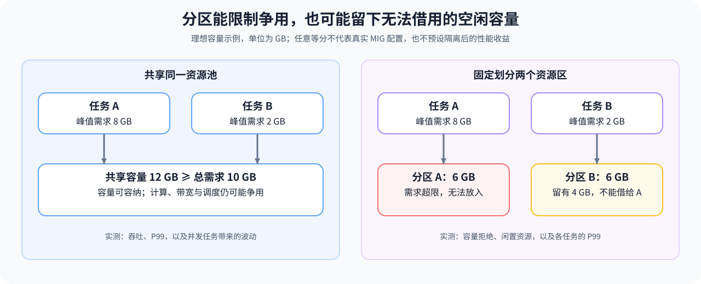

# 31. GPU Virtualization and MIG | GPU 虚拟化与 MIG

**难度：** Medium | **环境：** CPU-first | **标签：** `硬件系统`, `GPU 虚拟化`, `MIG` | **目标人群：** 硬件约束学习者

> 🚀 **云端运行环境**
>
> 本章节的实战代码可以点击以下链接在免费 GPU 算力平台上直接运行：
>
> [](https://colab.research.google.com/github/datawhalechina/llm-algo-leetcode/blob/main/01_Hardware_Math_and_Systems/31_GPU_Virtualization_and_MIG.ipynb)
> [](https://modelscope.cn/my/mynotebook) *(国内推荐：魔搭社区免费实例)*


---

## 本节导读

同一个模型独占设备时延迟稳定，与其他任务共享后，尾延迟却可能升高。为任务划出独立资源可以减少部分争用，但也可能让一个分区空闲、另一个分区容量不足，并降低总体吞吐。

本节先用理想等分计算每片资源和未分配余量，再用构造的服务指标比较吞吐、P99 与波动。完成后，你应能同时指出隔离带来的改善和损失，再到性能分析与部署专题核对真实设备上的资源边界和服务表现。

**关键词：** `MIG`、`MPS`、多租户



---
## 前置阅读

**导语：** 本页只处理多租户场景；先确认候选已经满足基本运行时约束。

- [34. Heterogeneous Accelerators and Runtime Constraints | 异构加速器与运行时约束](./34_Heterogeneous_Accelerators_and_Runtime_Constraints.md)

## Q1：GPU 虚拟化为什么首先是资源隔离问题？


多租户场景里，GPU 不只是“给谁用”，而是“怎么让很多任务共用同一块卡，同时还不互相干扰”。

如果没有隔离，某个任务可能会抢占过多算力、缓存、显存或调度窗口，导致别的任务延迟飙升、尾延迟变差。

所以 GPU 虚拟化的第一目标，不是简单提高利用率，而是先把共享资源的干扰边界定义清楚，让性能更可控。

### Q1 资源计算：理想等分会留下多少整数资源

假设内存可以连续等分，计算单元只能按整数分配，每片至少获得一个单元。这里不生成 MIG 配置，也不表示示例中的任意分法受真实硬件支持；GB 使用十进制单位。


```python
import math


def partition_resources(total_memory_gb, total_compute_units, slices, reserved_memory_gb=0.0):
    """计算等分切片后的每片资源与整数计算单元碎片。"""
    if (not math.isfinite(total_memory_gb) or total_memory_gb <= 0
            or type(total_compute_units) is not int or total_compute_units <= 0
            or type(slices) is not int or not 0 < slices <= total_compute_units):
        raise ValueError('resource totals and slices must be positive')
    if not math.isfinite(reserved_memory_gb) or not 0 <= reserved_memory_gb < total_memory_gb:
        raise ValueError('reserved memory must be in [0, total_memory)')
    usable_memory_gb = total_memory_gb - reserved_memory_gb
    compute_units_per_slice = total_compute_units // slices
    return {
        'memory_gb_per_slice': usable_memory_gb / slices,
        'compute_units_per_slice': compute_units_per_slice,
        'unused_compute_units': total_compute_units - compute_units_per_slice * slices,
    }

for slices in [2, 3, 7]:
    print(slices, 'slices ->', partition_resources(80, 108, slices, reserved_memory_gb=2))
assert partition_resources(80, 108, 7, 2)['unused_compute_units'] == 3

```

## Q2：MIG 的本质是在切什么边界？


MIG 的核心，不是“把一块 GPU 拆成几块”这么简单，而是把算力、显存和部分调度边界切开，让不同租户在更稳定的资源切片里运行。

这样做的直接收益，是减少缓存和算力争用带来的抖动；间接收益，是让推理服务更容易做容量规划和 QoS 控制。

### Q2 对照计算：构造指标中的吞吐和尾延迟变化

假设两份记录来自相同请求集合与计时方法，比较吞吐与 P99。示例不在本机测量隔离效果；同时检查百分位顺序，避免把 P99 小于 P50 的无效记录带入判断。


```python
def isolation_delta(shared, isolated):
    """比较共享与隔离方案的吞吐、P99 和尾延迟放大。"""
    for record in (shared, isolated):
        if any(not math.isfinite(record[key]) or record[key] <= 0
               for key in ('throughput_rps', 'p50_ms', 'p99_ms')):
            raise ValueError('指标必须是有限正数')
        if record['p99_ms'] < record['p50_ms']:
            raise ValueError('P99 不能小于 P50')
    return {
        'throughput_change_ratio': isolated['throughput_rps'] / shared['throughput_rps'] - 1,
        'p99_reduction_ratio': 1 - isolated['p99_ms'] / shared['p99_ms'],
        'shared_tail_amplification': shared['p99_ms'] / shared['p50_ms'],
        'isolated_tail_amplification': isolated['p99_ms'] / isolated['p50_ms'],
    }

shared = {'throughput_rps': 120, 'p50_ms': 30, 'p99_ms': 150}
isolated = {'throughput_rps': 108, 'p50_ms': 32, 'p99_ms': 80}
delta = isolation_delta(shared, isolated)
assert delta['p99_reduction_ratio'] > 0
assert delta['throughput_change_ratio'] < 0
print(delta)

```

## Q3：为什么隔离更强，吞吐未必更高？


隔离做得越强，任务之间越不容易互相干扰，但共享的效率通常也会下降；共享做得越激进，利用率可能更高，但延迟和抖动也更容易恶化。

所以虚拟化问题的核心，不是追求“切得更细”本身，而是在隔离、吞吐和尾延迟之间找到能接受的折中。

### Q3 门槛筛选：给定指标能否同时满足要求

以下指标是构造数据；`jitter_ms` 定义为多次运行 P99 的最大值与最小值之差，需在同一重复次数和工作负载下比较。门槛来自本例目标，不是通用合格线。


```python
def select_isolation_plan(plans, max_p99_ms, min_throughput_rps, max_jitter_ms):
    """先应用延迟、吞吐与抖动硬门槛，再选吞吐最高的方案。"""
    if any(not math.isfinite(value) or value < 0
           for value in (max_p99_ms, min_throughput_rps, max_jitter_ms)):
        raise ValueError('门槛必须是有限非负数')
    eligible = {}
    rejected = {}
    for name, metrics in plans.items():
        if any(not math.isfinite(metrics[key]) or metrics[key] < 0
               for key in ('p99_ms', 'throughput_rps', 'jitter_ms')):
            raise ValueError('候选指标必须是有限非负数')
        if metrics['p99_ms'] == 0:
            raise ValueError('P99 必须大于零')
        reasons = []
        if metrics['p99_ms'] > max_p99_ms:
            reasons.append('p99_slo')
        if metrics['throughput_rps'] < min_throughput_rps:
            reasons.append('throughput')
        if metrics['jitter_ms'] > max_jitter_ms:
            reasons.append('jitter')
        (rejected if reasons else eligible)[name] = reasons if reasons else metrics
    selected = max(eligible, key=lambda name: eligible[name]['throughput_rps']) if eligible else None
    return {'selected': selected, 'eligible': list(eligible), 'rejected': rejected}

plans = {
    'shared': {'throughput_rps': 120, 'p99_ms': 150, 'jitter_ms': 35},
    'isolated_a': {'throughput_rps': 108, 'p99_ms': 80, 'jitter_ms': 12},
    'isolated_b': {'throughput_rps': 70, 'p99_ms': 55, 'jitter_ms': 8},
}
decision = select_isolation_plan(plans, max_p99_ms=100, min_throughput_rps=90, max_jitter_ms=20)
assert decision['selected'] == 'isolated_a'
assert set(decision['rejected']) == {'shared', 'isolated_b'}
print(decision)

```

## 相关阅读

**导语：** 隔离方案需要继续核对服务性能和长期成本。

- [33. TCO and Cost Model | 算力评估与 TCO 模型](./33_TCO_and_Cost_Model.md)
- [性能分析专题](../topic_discussion/performance_analysis/intro.md)
- [部署与异构系统专题](../topic_discussion/deployment_heterogeneous/intro.md)
---
