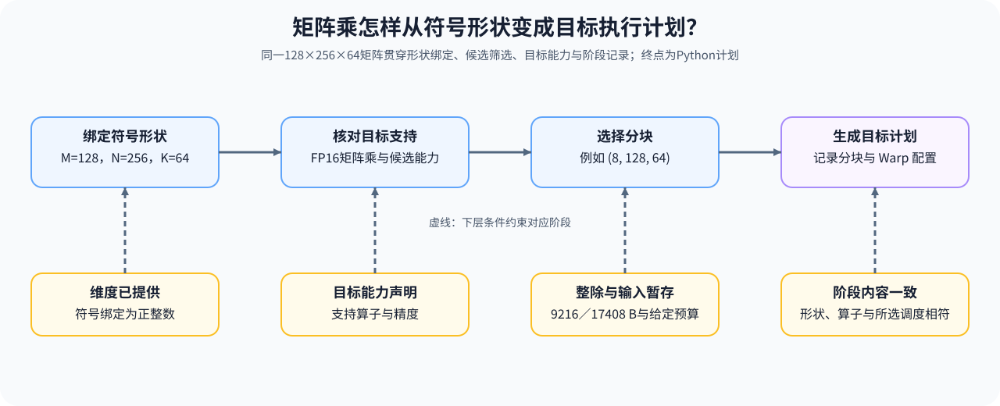

# 32. TVM MLIR Deep Practice | 编译阶段与目标计划

**难度：** Hard | **环境：** CPU-first | **标签：** `编译系统`, `目标计划`, `编译阶段` | **目标人群：** 编译与系统入门者

> 🚀 **云端运行环境**
>
> 本章节的实战代码可以点击以下链接在免费 GPU 算力平台上直接运行：
>
> [](https://colab.research.google.com/github/datawhalechina/llm-algo-leetcode/blob/main/01_Hardware_Math_and_Systems/32_TVM_MLIR_Deep_Practice.ipynb)
> [](https://modelscope.cn/my/mynotebook) *(国内推荐：魔搭社区免费实例)*


---

## 本节导读

一条矩阵乘计算即使形状正确，也可能因目标不支持所需精度，或分块超出资源预算而无法执行。编译过程需要把符号维度、算子支持和分块计划逐项落实，前一步留下的信息决定后一步能检查什么。

TVM是机器学习编译器框架，MLIR是组织多层中间表示与变换的编译基础设施；两者是不同项目。本节沿同一个矩阵乘，用Python数据结构记录形状绑定、分块候选、目标能力与最终计划，观察前一阶段留下的内容如何约束下一阶段。完成后，你应能定位计划在哪一步失败，并区分计划生成与实际代码执行；真实实现进入算子优化，运行时兼容性继续在硬件适配组核对。

**关键词：** 中间表示、形状绑定、算子合法化、分块调度



---
## 前置阅读

先区分计算图与目标实现，再看输入变化怎样影响已有版本。

- [09 AI编译器与计算图优化](./09_AI_Compilers_and_Graph_Optimization.md)：捕获、图变换、后端与实际调用。
- [30 动态形状处理](./30_Dynamic_Shape_Handling.md)：形状键、版本适用条件与运行分支。

## Q1：一个最小矩阵计划怎样逐步形成？

矩阵乘的左输入形状为M×K，右输入为K×N，输出为M×N；这里用三元组(M,N,K)记录问题维度，而不是输入张量的三个轴。沿主图先把M绑定为128，N和K分别为256和64，再检查目标支持FP16矩阵乘，按(8,128,64)分块。M、N、K均能整除对应块大小时，可以使用本例无尾块掩码的计划。

中间表示（IR）保存这些运算和属性，程序变换或检查步骤称为编译遍（Pass）。形状特化绑定符号；算子合法化将运算改写为目标支持的形式；调度安排分块、循环与线程；逐层降低（Lowering）将抽象运算逐步落实为更具体的操作。下面仅用字典记录一种FP16目标及其整除规则，最终返回Python计划；真实TVM／MLIR的变换与代码生成需运行相应工具链。

本例参考NVIDIA的线程组织：线程束（Warp）由32个线程组成，`warps=4`为一个分块记录4个线程束的配置。分块大小描述处理多少数据，Warp数描述线程组织；下面先用固定分块形成计划，Q2再保持相同FP16矩阵选择候选。

| 阶段 | 本例保留的内容 | 这一步新增或检查什么 |
| --- | --- | --- |
| 输入表示 | 矩阵乘、FP16、形状(M,256,64) | M仍是待绑定的符号 |
| 形状绑定 | 矩阵乘、FP16、形状(128,256,64) | 以M=128得到完整正整数维度 |
| 算子合法化 | 相同精度与形状 | 把操作改为本例目标提供的矩阵乘 |
| 分块调度 | 已合法化的矩阵 | 加入(8,128,64)与4个Warp，核对整除规则 |
| 目标计划 | 相同操作、精度、形状与调度 | 返回可继续核对的Python计划 |

### Q1 对照验证：运行固定分块的最小计划

代码依次返回绑定后的形状、目标算子和分块，再展示这三项。输入表示保留不变；缺少M绑定、不支持的精度和不整除分块分别用反例核对。这一问先使用固定分块，下一问再按资源与给定耗时选候选。


```python
def specialize_shape(graph: dict, bindings: dict | None = None) -> dict:
    """复制IR并将(M,N,K)的符号维度绑定为正整数；bindings由调用处提供。"""
    bindings = {} if bindings is None else bindings
    if (not isinstance(bindings, dict)
            or not isinstance(graph["shape"], (tuple, list)) or len(graph["shape"]) != 3):
        raise ValueError("须提供绑定字典和三元组(M,N,K)")
    shape = tuple(bindings.get(dim, dim) if type(dim) is str else dim for dim in graph["shape"])
    if any(type(dim) is not int or dim <= 0 for dim in shape):
        raise ValueError("全部M、N、K维度须绑定为正整数")
    return {**graph, "shape": shape, "shape_specialized": True}


def legalize_ops(graph: dict) -> dict:
    """将已绑定的FP16 matmul映射到本例目标算子，返回新的IR字典。"""
    if graph.get("shape_specialized") is not True:
        raise ValueError("先完成形状绑定")
    checked = specialize_shape(graph=graph)
    if graph["op"] != "matmul" or graph["dtype"] != "fp16":
        raise ValueError("本例目标声明支持FP16 matmul")
    return {**checked, "op": "example.matmul", "legalized": True}


def select_schedule(graph: dict, schedule: dict | None = None) -> dict:
    """检查给定矩阵分块的整除与Warp数，返回新计划；默认采用(8,128,64)。"""
    if (graph.get("legalized") is not True
            or graph["op"] != "example.matmul" or graph["dtype"] != "fp16"):
        raise ValueError("先完成本例目标算子合法化")
    shape = graph["shape"]
    schedule = {"tiles_mnk": (8, 128, 64), "warps": 4} if schedule is None else dict(schedule)
    tiles = schedule["tiles_mnk"]
    if (not isinstance(tiles, (tuple, list)) or len(tiles) != 3
            or any(type(tile) is not int or tile <= 0 for tile in tiles)
            or type(schedule["warps"]) is not int or not 1 <= schedule["warps"] <= 8):
        raise ValueError("本例分块须为三个正整数，Warp数须在1至8之间")
    if (not isinstance(shape, (tuple, list)) or len(shape) != 3
            or any(type(dim) is not int or dim <= 0 or dim % tile != 0
                   for dim, tile in zip(shape, tiles))):
        raise ValueError("形状须满足本例M、N、K整除分块规则")
    return {**graph, "schedule": {"tiles_mnk": tuple(tiles), "warps": schedule["warps"]}, "schedule_valid": True}


def build_backend_plan(graph: dict) -> dict:
    """重新核对形状、目标算子和调度，返回标记为python_plan的目标计划。"""
    if not all(graph.get(key) is True for key in
               ("shape_specialized", "legalized", "schedule_valid")):
        raise ValueError("缺少形状、合法化或调度前提")
    checked = select_schedule(graph=graph, schedule=graph["schedule"])
    if graph.get("schedule") != checked["schedule"]:
        raise ValueError("计划中的调度与本例规则不一致")
    return {**graph, "backend": "example_target", "representation": "python_plan"}


source_ir = {"op": "matmul", "dtype": "fp16", "shape": ("M", 256, 64)}
bound = specialize_shape(graph=source_ir, bindings={"M": 128})
legal = legalize_ops(graph=bound)
scheduled = select_schedule(graph=legal)
plan = build_backend_plan(graph=scheduled)
assert source_ir == {"op": "matmul", "dtype": "fp16", "shape": ("M", 256, 64)}
assert bound["shape"] == (128, 256, 64)
assert legal["op"] == "example.matmul"
assert scheduled["schedule"] == {"tiles_mnk": (8, 128, 64), "warps": 4}
assert plan["representation"] == "python_plan"
invalid_steps = [
    (specialize_shape, {"graph": source_ir, "bindings": {}}),
    (legalize_ops, {"graph": bound | {"dtype": "bf16"}}),
    (select_schedule, {"graph": legal | {"shape": (128, 256, 65)}}),
    (build_backend_plan, {"graph": scheduled | {"schedule": {"tiles_mnk": (7, 64, 64), "warps": 4}}}),
]
for step, inputs in invalid_steps:
    try:
        step(**inputs)
    except ValueError:
        pass
    else:
        raise AssertionError(f"{step.__name__}应拒绝未满足前提的输入")
print("问题维度(M,N,K)：", bound["shape"])
print("目标算子：", legal["op"], "；分块计划：", plan["schedule"])
print("返回表示：", plan["representation"])

```

## Q2：同一矩阵的分块候选怎样通过资源检查？

沿用Q1绑定后的128×256×64矩阵和FP16输入，把固定分块换成一组候选；每条候选按输出行块、输出列块、归约块三个维度记录。程序实例（Program）沿用Triton的概念，指执行一块计算的一次实例；本例每个实例处理 $B_M\times B_N$ 个输出，每轮装载 $B_M\times B_K$ 的左输入与 $B_K\times B_N$ 的右输入。例如(8,128,64)分块覆盖1024个输出，归约维每轮处理64个位置。假设两个输入块各在共享内存保存一份，输入暂存需要 $2B_K(B_M+B_N)$ 字节；这里只计算输入暂存，累加器等资源另行检查。

8×64×64与8×128×64分别需要9216 B、17408 B；64×256×64需要40960 B，超过给定32768 B预算。先检查M、N、K整除、暂存和Warp上限，再比较可行候选的构造耗时。这里的整除要求对应无尾块掩码的示例计划，构造耗时用于说明选择规则。

### Q2 对照验证：保留同一矩阵，只筛分块候选

读取Q1的已绑定形状，对8×64×64与8×128×64分别核对9216 B与17408 B暂存。更快但暂存超限、不能整除或Warp过多的候选先排除；原预算32768 B下，再从可行项中按构造耗时选择8×128×64。恰好足够、少一个字节及没有候选的情况分别检查。


```python
import math


def select_tuning_candidate(
    candidates: list, problem_shape: tuple, shared_memory_limit: int,
    max_warps: int = 8, target_capabilities: set | None = None,
) -> dict:
    """筛选FP16矩阵分块；暂存按两输入块各一份计，耗时单位为构造微秒。

    problem_shape和tiles_mnk均按(M,N,K)排列；能力集合给定时另查声明要求。
    返回可行候选、按给定耗时入选的候选，以及每个被排除项的原因。
    """
    if (not isinstance(problem_shape, (tuple, list)) or len(problem_shape) != 3
            or any(type(dim) is not int or dim <= 0 for dim in problem_shape)
            or any(type(value) is not int or value <= 0
                   for value in (shared_memory_limit, max_warps))):
        raise ValueError("矩阵形状与资源上限须为正整数")
    if target_capabilities is not None and type(target_capabilities) is not set:
        raise ValueError("目标能力须为集合")
    feasible, rejected = [], []
    for row in candidates:
        tiles = row["tiles_mnk"]
        if (not isinstance(tiles, (tuple, list)) or len(tiles) != 3
                or any(type(tile) is not int or tile <= 0 for tile in tiles)
                or type(row["warps"]) is not int or row["warps"] <= 0
                or type(row["required_capabilities"]) is not set):
            raise ValueError("候选须提供三维正整数分块、正整数Warp数与能力集合")
        if (type(row["latency_us"]) not in (int, float)
                or not math.isfinite(row["latency_us"]) or row["latency_us"] <= 0):
            raise ValueError("构造耗时须为有限正实数")
        bm, bn, bk = tiles
        shared_bytes = 2 * bk * (bm + bn)
        reasons = []
        if any(dim % tile != 0 for dim, tile in zip(problem_shape, tiles)):
            reasons.append("tile_divisibility")
        if shared_bytes > shared_memory_limit:
            reasons.append("shared_memory")
        if row["warps"] > max_warps:
            reasons.append("warps")
        if (target_capabilities is not None
                and not row["required_capabilities"].issubset(target_capabilities)):
            reasons.append("target_capabilities")
        checked = {**row, "shared_memory_bytes": shared_bytes}
        if reasons:
            rejected.append({"candidate": checked, "reasons": reasons})
        else:
            feasible.append(checked)
    selected = min(feasible, key=lambda row: row["latency_us"], default=None)
    return {"feasible": feasible, "selected": selected, "rejected": rejected}


shared_requirements = {"shared_memory", "block_barrier"}
rows = {
    "regular": dict(tiles_mnk=(8, 64, 64), warps=4, latency_us=80,
                    required_capabilities=shared_requirements),
    "matrix": dict(tiles_mnk=(8, 128, 64), warps=4, latency_us=54.7,
                   required_capabilities=shared_requirements | {"mma_fp16"}),
    "over_shared": dict(tiles_mnk=(64, 256, 64), warps=4, latency_us=40,
                        required_capabilities=shared_requirements),
    "not_divisible": dict(tiles_mnk=(7, 64, 64), warps=4, latency_us=30,
                          required_capabilities=shared_requirements),
    "over_warps": dict(tiles_mnk=(8, 64, 64), warps=9, latency_us=20,
                       required_capabilities=shared_requirements),
}
report = select_tuning_candidate(
    candidates=list(rows.values()), problem_shape=bound["shape"],
    shared_memory_limit=32768)
assert [row["shared_memory_bytes"] for row in report["feasible"]] == [9216, 17408]
assert report["selected"]["tiles_mnk"] == (8, 128, 64)
assert [row["reasons"] for row in report["rejected"]] == [
    ["shared_memory"], ["tile_divisibility"], ["warps"]]
assert select_tuning_candidate(
    candidates=[rows["regular"]], problem_shape=bound["shape"],
    shared_memory_limit=9216)["selected"] is not None
assert select_tuning_candidate(
    candidates=[rows["regular"]], problem_shape=bound["shape"],
    shared_memory_limit=9215)["selected"] is None
assert select_tuning_candidate(
    candidates=[], problem_shape=bound["shape"], shared_memory_limit=32768)["selected"] is None
for row in report["feasible"]:
    print("分块：", row["tiles_mnk"], "；输入暂存：", row["shared_memory_bytes"], "B")
print("按构造耗时入选：", report["selected"]["tiles_mnk"])

```

## Q3：目标缺少矩阵指令能力时，计划怎样变化？

沿用Q2的两种可行分块。普通候选声明需要共享内存与块内同步，矩阵指令候选还需要本例FP16矩阵乘加能力。先固定目标只有前两项能力，则暂存和形状都合格的矩阵指令候选仍应被排除；补上矩阵指令能力后，它才进入比较集合。

这些能力是具名候选的给定前提，不代表所有FP16矩阵乘都必须使用矩阵指令。把本次入选候选的分块与Warp数接回Q1同一份合法化结果，形成新调度。仅有共享内存与同步能力时选择8×64×64；增加所需矩阵指令能力后选择8×128×64。变化的是给定目标能力及其允许的候选，矩阵问题与FP16输入保持不变。

### Q3 对照验证：改变目标能力，重新形成同一矩阵的计划

先得到普通候选的8×64×64计划，再添加矩阵指令能力，得到8×128×64计划。比较两次结果，并核对Q1的输入表示保持不变。


```python
target_capabilities = set(shared_requirements)
limited = select_tuning_candidate(
    candidates=list(rows.values()), problem_shape=bound["shape"],
    shared_memory_limit=32768, target_capabilities=target_capabilities)
limited_row = limited["selected"]
limited_schedule = select_schedule(
    graph=legal, schedule={"tiles_mnk": limited_row["tiles_mnk"], "warps": limited_row["warps"]})
limited_plan = build_backend_plan(graph=limited_schedule)
assert limited_plan["schedule"]["tiles_mnk"] == (8, 64, 64)
assert "target_capabilities" in next(
    row["reasons"] for row in limited["rejected"]
    if row["candidate"]["tiles_mnk"] == (8, 128, 64))

expanded = select_tuning_candidate(
    candidates=list(rows.values()), problem_shape=bound["shape"],
    shared_memory_limit=32768,
    target_capabilities=target_capabilities | {"mma_fp16"})
selected_row = expanded["selected"]
selected_schedule = select_schedule(
    graph=legal, schedule={"tiles_mnk": selected_row["tiles_mnk"], "warps": selected_row["warps"]})
selected_plan = build_backend_plan(graph=selected_schedule)
assert selected_plan["schedule"]["tiles_mnk"] == (8, 128, 64)
assert source_ir == {"op": "matmul", "dtype": "fp16", "shape": ("M", 256, 64)}
print("原目标计划：", limited_plan["schedule"])
print("增加矩阵指令能力后的计划：", selected_plan["schedule"])

```

## Q4：各阶段记录是否与同一份输入和计划一致？

阶段名称按顺序排列，还不足以说明每步留下了正确内容。形状绑定后要保留算子与精度，合法化后要保留已绑定形状，调度必须匹配这一矩阵，最终计划则要保留选中的分块。若形状或调度被改写，旧的“已完成”标记也不能让它通过检查。

下面检查Q1和Q3实际返回的阶段快照：从源表示开始，依次重算本例的形状绑定、合法化、调度和计划内容，比较记录是否一致。终点是Python目标计划；真正的代码生成还需由具体编译工具链完成。

### Q4 对照验证：沿阶段快照定位首个内容错误

检查Q1与Q3实际生成的记录，而不是另造一份成功标记。原目标与扩展目标的完整记录都应通过；改错形状、目标操作、分块或阶段顺序时，应返回对应失败原因。核对的是各步内容是否相互一致，终点仍是Python计划。


```python
def validate_pipeline(source: dict, records: list) -> tuple:
    """核对本例四个阶段的名称与实际快照，返回通过标志及失败原因。

    records按顺序保存(stage, graph)；源表示是给定算子、类型与符号形状。
    这里重算Python计划以核对记录内容，不读取或生成设备代码。
    """
    stages = ["shape_specialize", "legalize_ops", "scheduling", "backend_plan"]
    if len(records) != len(stages):
        return False, {"reason": "incomplete_pipeline"}
    previous = source
    for stage, (recorded_stage, current) in zip(stages, records):
        if stage != recorded_stage:
            return False, {"stage": recorded_stage, "reason": "stage_order"}
        try:
            if stage == "shape_specialize":
                if len(current["shape"]) != 3:
                    raise ValueError("矩阵形状须为三元组")
                bindings = {dim: value for dim, value in zip(source["shape"], current["shape"])
                            if type(dim) is str}
                expected = specialize_shape(graph=source, bindings=bindings)
            elif stage == "legalize_ops":
                expected = legalize_ops(graph=previous)
            elif stage == "scheduling":
                expected = select_schedule(graph=previous, schedule=current["schedule"])
            else:
                expected = build_backend_plan(graph=previous)
        except (KeyError, TypeError, ValueError):
            return False, {"stage": stage, "reason": "invalid_content"}
        if current != expected:
            return False, {"stage": stage, "reason": "content_mismatch"}
        previous = current
    return True, {"representation": previous["representation"],
                  "shape": previous["shape"], "schedule": previous["schedule"]}


records = [("shape_specialize", bound), ("legalize_ops", legal),
           ("scheduling", selected_schedule), ("backend_plan", selected_plan)]
ok, summary = validate_pipeline(source=source_ir, records=records)
assert ok and summary["shape"] == (128, 256, 64)
limited_records = records[:2] + [
    ("scheduling", limited_schedule), ("backend_plan", limited_plan)]
assert validate_pipeline(source=source_ir, records=limited_records)[0]
for index, change in [
    (1, {"shape": (64, 256, 64)}),
    (1, {"op": "wrong.matmul"}),
    (2, {"schedule": {"tiles_mnk": (7, 64, 64), "warps": 4}}),
    (3, {"schedule": limited_plan["schedule"]}),
]:
    broken = list(records)
    stage, content = broken[index]
    broken[index] = (stage, content | change)
    assert not validate_pipeline(source=source_ir, records=broken)[0]
assert not validate_pipeline(source=source_ir, records=records[:-1])[0]
assert not validate_pipeline(source=source_ir, records=[records[1], records[0], *records[2:]])[0]
print("阶段内容核对通过：", summary)

```

## 相关阅读

先把计划与实际编译产物对应；需要深入工具链时，再看多层表示如何逐步变换。

- [Part03·18 编译产物与实际执行](../03_Triton_Kernels/18_Triton_Compilation_Artifacts_and_Execution.md)：核对特化条件、编译产物与实际启动对象。
- [Part03·09 自动调优与基准测量](../03_Triton_Kernels/09_Triton_Autotune_and_Profiling.md)：用数值验证与重复计时替换本例的构造延迟。
- [MLIR官方概览](https://mlir.llvm.org/)：对照多层中间表示与变换的职责，区分编译基础设施和本页的Python计划。
