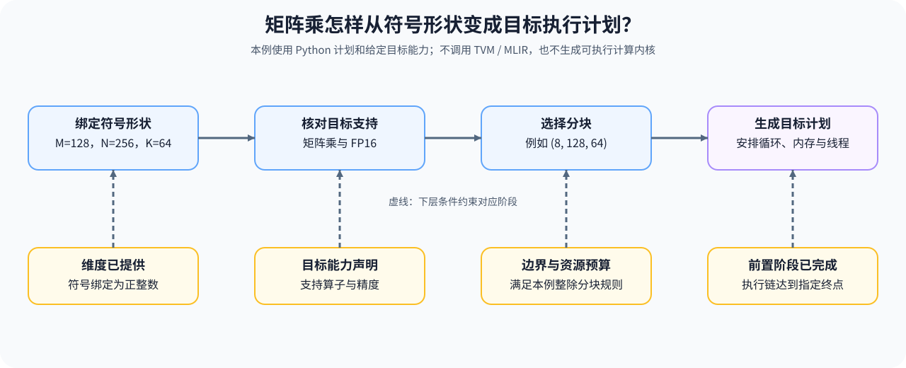

# 32. TVM MLIR Deep Practice | TVM / MLIR 编译链路

**难度：** Hard | **环境：** CPU-first | **标签：** `编译系统`, `TVM/MLIR`, `逐层降级` | **目标人群：** 编译与系统入门者

> 🚀 **云端运行环境**
>
> 本章节的实战代码可以点击以下链接在免费 GPU 算力平台上直接运行：
>
> [](https://colab.research.google.com/github/datawhalechina/llm-algo-leetcode/blob/main/01_Hardware_Math_and_Systems/32_TVM_MLIR_Deep_Practice.ipynb)
> [](https://modelscope.cn/my/mynotebook) *(国内推荐：魔搭社区免费实例)*


---

## 本节导读

一条矩阵乘计算即使形状正确，也可能因目标不支持所需精度，或分块超出资源预算而无法执行。编译过程需要把符号维度、算子支持和分块计划逐项落实，前一步留下的信息决定后一步能检查什么。

本节用 Python 数据结构表示这些阶段，核对形状绑定、目标支持、调度预算与最终计划，不调用 TVM 或 MLIR。完成后，你应能定位计划在哪一步失败，并区分计划生成与实际代码执行；真实实现进入算子优化，运行时兼容性继续在硬件适配组核对。

**关键词：** 中间表示、形状绑定、算子合法化、分块调度



---
## 前置阅读

**导语：** 先准备图级优化、融合和动态形状约束，再把它们放入完整编译链。

- [09. AI Compilers and Graph Optimization | AI 编译器与计算图优化](./09_AI_Compilers_and_Graph_Optimization.md)
- [19. Operator Fusion Introduction | 算子融合导论](./19_Operator_Fusion_Introduction.md)
- [30. Dynamic Shape Handling | 动态 Shape 处理](./30_Dynamic_Shape_Handling.md)

## Q1：每次中间表示变换需要检查什么？

形状特化把符号维度绑定为具体大小；合法化检查当前算子和数据类型能否进入给定目标；调度选择分块并检查边界；最后生成目标计划。任一阶段的前提不满足，都应停止，而不是只写入一个“成功”标记。

下面只建模一种三维矩阵乘法表示，形状按 $(M,N,K)$ 记录。假定目标支持 FP16，并采用无需尾块屏蔽的整除分块；这是一组教学规则，不代表 TVM、MLIR 或 CUDA 的通用限制。

### Q1 对照验证：完成形状绑定后再建立目标计划


```python
source_ir = {'op': 'matmul', 'dtype': 'fp16', 'shape': ('B', 4096, 4096)}


def specialize_shape(graph, bindings=None):
    """复制输入并绑定全部符号维度；本例只接收正整数维度。"""
    bindings = {'B': 8} if bindings is None else bindings
    shape = tuple(bindings.get(dim, dim) for dim in graph['shape'])
    if len(shape) != 3 or any(type(dim) is not int or dim <= 0 for dim in shape):
        raise ValueError('全部 M、N、K 维度必须绑定为正整数')
    return {**graph, 'shape': shape, 'shape_specialized': True}


def legalize_ops(graph):
    """检查示例目标的一种算子和数据类型，不调用真实后端。"""
    if not graph.get('shape_specialized'):
        raise ValueError('先完成形状绑定')
    if graph['op'] != 'matmul' or graph['dtype'] != 'fp16':
        raise ValueError('本例目标只声明支持 FP16 matmul')
    return {**graph, 'op': 'example.matmul', 'legalized': True}


def select_schedule(graph):
    """检查本例整除分块，明确覆盖 M、N、K 三个维度。"""
    if not graph.get('legalized'):
        raise ValueError('先完成算子合法化')
    shape = graph['shape']
    tiles = (8, 128, 128)
    valid = len(shape) == 3 and all(
        type(dim) is int and dim > 0 and dim % tile == 0
        for dim, tile in zip(shape, tiles)
    )
    if not valid:
        raise ValueError('形状不满足本例无尾块屏蔽的分块规则')
    return {**graph, 'schedule': {'tiles_mnk': tiles, 'warps': 4},
            'schedule_valid': True}


def build_backend_plan(graph):
    """生成 Python 目标计划；不产生可执行代码或编译成功证据。"""
    if not all(graph.get(key) is True for key in
               ('shape_specialized', 'legalized', 'schedule_valid')):
        raise ValueError('缺少形状、合法化或调度前提')
    if graph['op'] != 'example.matmul' or graph['dtype'] != 'fp16':
        raise ValueError('目标算子或数据类型不匹配')
    # 再检查调度，避免修改形状后沿用旧的成功标记。
    checked = select_schedule(graph)
    if graph.get('schedule') != checked['schedule']:
        raise ValueError('计划中的调度与本例规则不一致')
    return {**graph, 'backend': 'example_target', 'representation': 'python_plan'}


pipeline = [specialize_shape, legalize_ops, select_schedule, build_backend_plan]
ir = source_ir
for step in pipeline:
    ir = step(ir)
    print(step.__name__, '->', ir)
assert source_ir == {'op': 'matmul', 'dtype': 'fp16', 'shape': ('B', 4096, 4096)}
assert ir['representation'] == 'python_plan'
assert ir['shape'] == (8, 4096, 4096)

```

## Q2：怎样先排除不可行调度，再比较时间？

分块影响数据复用与资源用量。先按当前问题的形状、共享内存和 Warp 预算排除不可行项，再比较剩余候选的时间；如果没有可行项，应报告空结果，而不是强行选出一个方案。

下面的延迟是构造数据，没有运行自动调优。实际测量还需固定输入、预热、重复次数与正确性条件；不能把此处的排序当作真实 GPU 结论。

### Q2 对照验证：最快记录不一定满足资源条件


```python
import math


def select_tuning_candidate(candidates, problem_size, shared_memory_limit,
                            max_warps=8):
    """按给定约束筛选构造记录；空可行集返回 None。"""
    if any(type(value) is not int or value <= 0
           for value in (problem_size, shared_memory_limit, max_warps)):
        raise ValueError('问题规模与预算必须是正整数')
    feasible = []
    for row in candidates:
        if any(type(row[key]) is not int or row[key] <= 0
               for key in ('tile', 'warps', 'shared_memory_bytes')):
            raise ValueError('分块、Warp 数与共享内存字节数必须是正整数')
        if not math.isfinite(row['latency_us']) or row['latency_us'] <= 0:
            raise ValueError('延迟必须是有限正数')
        if (problem_size % row['tile'] == 0
                and row['shared_memory_bytes'] <= shared_memory_limit
                and row['warps'] <= max_warps):
            feasible.append(row)
    best = min(feasible, key=lambda row: row['latency_us']) if feasible else None
    return {'feasible': feasible, 'selected': best}


candidates = [
    {'tile': 64, 'warps': 4, 'shared_memory_bytes': 32768, 'latency_us': 82.4},
    {'tile': 128, 'warps': 4, 'shared_memory_bytes': 65536, 'latency_us': 54.7},
    {'tile': 256, 'warps': 8, 'shared_memory_bytes': 131072, 'latency_us': 49.1},
]
report = select_tuning_candidate(candidates, 4096, 99000)
assert report['selected']['tile'] == 128
assert select_tuning_candidate(candidates, 4096, 1024)['selected'] is None
print('构造数据筛选：', report)

```

## Q3：硬件能力检查怎样限制变换？

调度与代码生成需要目标具备相应指令、存储和访问能力。下面为每个示例变换声明一组前提，列出目标能力集合中缺少的项目；声明满足也只是局部必要条件，还要检查算子语义、布局、资源与编译支持。

这些前提是本例的规则，不是通用结论。例如融合未必使用共享内存，布局优化也不总要求连续加载；真实前提由具体变换决定。

### Q3 对照验证：列出示例变换缺少的目标能力


```python
compiler_passes = [
    ('fusion', {'shared_memory'}),
    ('tensor_core_vectorize', {'mma_fp16'}),
    ('layout_opt', {'contiguous_load'}),
]

hardware_capabilities = {'shared_memory', 'contiguous_load'}
decisions = []

for name, required in compiler_passes:
    missing = sorted(required - hardware_capabilities)
    decisions.append({'pass': name, 'declared_capabilities_met': not missing, 'missing': missing})

for row in decisions:
    print(row)

assert next(row for row in decisions if row['pass'] == 'fusion')['declared_capabilities_met']
assert next(row for row in decisions if row['pass'] == 'tensor_core_vectorize')['missing'] == ['mma_fp16']
```

## Q4：怎样检查阶段顺序与最终目标？

阶段检查需要同时回答：前置阶段是否完成、名称是否已知，以及执行链是否达到要求的终点。一个顺序合法但停在形状特化的前缀，不是完整的目标生成流程。

下面为示例指定一条依赖链，默认要求完成代码生成阶段；只检查前缀时需显式关闭终点要求。示例将重复阶段视为错误，真实编译器可以按设计重复运行某些变换，不能把这项规则推广到所有 Pass 管线。

### Q4 对照验证：区分完整流程、合法前缀与错误顺序


```python
def validate_pipeline(pipeline, require_codegen=True):
    """检查本例阶段依赖与终点，不代表实际编译已经执行。"""
    dependencies = {
        'shape_specialize': set(),
        'legalize_ops': {'shape_specialize'},
        'layout_transform': {'legalize_ops'},
        'scheduling': {'layout_transform'},
        'codegen': {'scheduling'},
    }
    if type(require_codegen) is not bool:
        raise ValueError('终点要求必须是布尔值')
    completed = set()
    for name in pipeline:
        if name not in dependencies:
            return False, {'pass': name, 'reason': 'unknown_stage'}
        if name in completed:
            return False, {'pass': name, 'reason': 'duplicate_stage'}
        missing = dependencies[name] - completed
        if missing:
            return False, {'pass': name, 'missing': sorted(missing)}
        completed.add(name)
    if require_codegen and 'codegen' not in completed:
        return False, {'reason': 'incomplete_pipeline', 'missing': ['codegen']}
    return True, {'completed': list(pipeline)}


valid_pipeline = ['shape_specialize', 'legalize_ops', 'layout_transform',
                  'scheduling', 'codegen']
invalid_pipeline = ['shape_specialize', 'scheduling', 'legalize_ops',
                    'layout_transform', 'codegen']
assert validate_pipeline(valid_pipeline)[0]
assert not validate_pipeline(invalid_pipeline)[0]
assert not validate_pipeline([])[0]
assert not validate_pipeline(['shape_specialize'])[0]
assert validate_pipeline(['shape_specialize'], require_codegen=False)[0]
print('完整流程：', validate_pipeline(valid_pipeline))
print('错误顺序：', validate_pipeline(invalid_pipeline))

```

## 相关阅读

**导语：** 继续把生成路径交给具体内核和运行时验证。

- [04. Triton 矩阵乘法与自动调优](../03_Triton_Kernels/04_Triton_GEMM_Tutorial.md)
- [05. Triton 性能调优与基准测试](../03_Triton_Kernels/05_Triton_Autotune_and_Profiling.md)
- [34. Heterogeneous Accelerators and Runtime Constraints | 异构加速器与运行时约束](./34_Heterogeneous_Accelerators_and_Runtime_Constraints.md)
---
