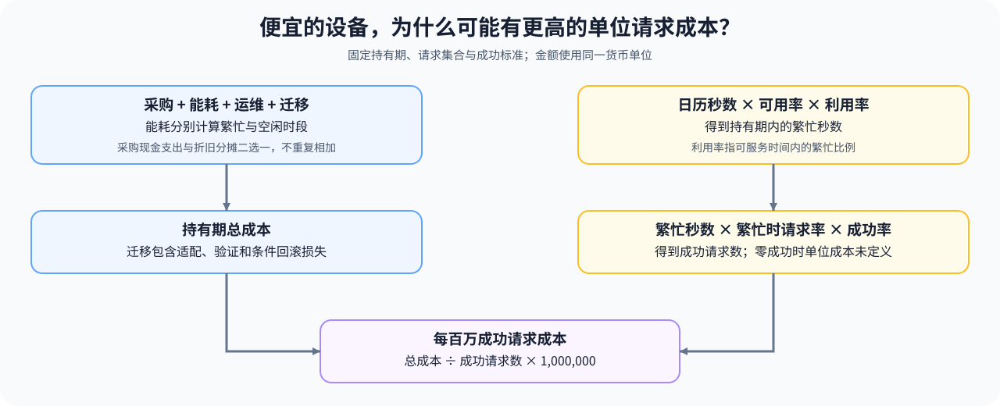

# 33. TCO and Cost Model | 算力评估与 TCO 模型

**难度：** Medium | **环境：** CPU-first | **标签：** `系统工程`, `成本评估`, `TCO` | **目标人群：** 硬件约束学习者

> 🚀 **云端运行环境**
>
> 本章节的实战代码可以点击以下链接在免费 GPU 算力平台上直接运行：
>
> [](https://colab.research.google.com/github/datawhalechina/llm-algo-leetcode/blob/main/01_Hardware_Math_and_Systems/33_TCO_and_Cost_Model.ipynb)
> [](https://modelscope.cn/my/mynotebook) *(国内推荐：魔搭社区免费实例)*


---

## 本节导读

两台设备都能运行同一个模型时，采购价更低的一台，未必能以更低成本完成请求。空闲耗电、适配工时、停机与较低的成功处理量，都可能改变最终比较结果。

本节在同一持有期内分别计算采购、繁忙与空闲能耗、运维和迁移成本，再除以成功请求数量。完成后，你应能解释利用率与成功率如何改变单位成本，并区分全额采购支出和折旧分摊；部署与性能比较还需使用对应工作负载的实际数据。

**关键词：** 总拥有成本（TCO）、单位成本、能耗



---
## 前置阅读

**导语：** 先保留通过可执行性检查的候选，再比较持有期内的完整成本。

- [10. AI Chips Overview and Alternatives | 算力现状与替代方案](./10_Domestic_AI_Chips_Overview.md)
- [34. Heterogeneous Accelerators and Runtime Constraints | 异构加速器与运行时约束](./34_Heterogeneous_Accelerators_and_Runtime_Constraints.md)

## Q1：TCO 为什么比单卡报价更重要？


TCO 看的是总拥有成本，不只是买卡的钱。

它会把采购、能耗、运维、迁移、停机风险和替换成本都放进来。对于长期运行的系统来说，单卡便宜不一定代表整体便宜，因为后续的电费、维护和迁移可能更贵。

所以真正要比较的是一段时间内谁更能稳定地把业务跑起来。

### Q1 成本计算：分别计算繁忙与空闲能耗

统一货币单位，以每月 30 天、设备整段持有期通电为假设。利用率表示繁忙时间比例；空闲时仍按空闲功率计电费。示例价格、功率与利用率均为构造输入，不是设备报价或实测结果。


```python
import math


def tco_ledger(purchase_cost, power_kw, electricity_per_kwh,
               ops_cost_per_month, migration_cost, months, utilization,
               idle_power_kw=0.0):
    """按全额采购现金支出与繁忙/空闲能耗建立简化持有期成本。"""
    values = (purchase_cost, power_kw, electricity_per_kwh, ops_cost_per_month,
              migration_cost, months, utilization, idle_power_kw)
    if any(not math.isfinite(value) or value < 0 for value in values):
        raise ValueError('成本与资源输入必须是有限非负数')
    if months <= 0 or utilization > 1 or idle_power_kw > power_kw:
        raise ValueError('月份须为正，利用率不得超过一，空闲功率不得高于繁忙功率')
    powered_hours = months * 30 * 24
    busy_hours = powered_hours * utilization
    idle_hours = powered_hours - busy_hours
    energy_kwh = power_kw * busy_hours + idle_power_kw * idle_hours
    components = {
        'purchase_cost': purchase_cost,
        'energy_cost': energy_kwh * electricity_per_kwh,
        'operations_cost': ops_cost_per_month * months,
        'migration_cost': migration_cost,
    }
    return {
        'components': components, 'total_cost': sum(components.values()),
        'powered_hours': powered_hours, 'busy_hours': busy_hours,
        'idle_hours': idle_hours, 'energy_kwh': energy_kwh,
    }


gpu_a = tco_ledger(30000, 0.7, 0.8, 200, 2000, 24, 0.7, idle_power_kw=0.1)
gpu_b = tco_ledger(22000, 0.9, 0.8, 350, 8000, 24, 0.7, idle_power_kw=0.15)
assert gpu_a['total_cost'] == sum(gpu_a['components'].values())
assert tco_ledger(0, 1, 1, 0, 0, 1, 0, idle_power_kw=0.1)['energy_kwh'] == 72
print('A 构造成本：', gpu_a)
print('B 构造成本：', gpu_b)

```

## Q2：为什么迁移成本和风险要算进模型里？


硬件切换不只是换设备，还会带来软件适配、调试、重构和性能回归风险。

如果迁移需要重新适配编译器、kernel、通信库或部署流程，那这些工作本身就是成本的一部分。

所以 TCO 不是财务问题和技术问题的二选一，而是把两者放进同一个判断框架。

### Q2 风险计算：工时成本与条件回滚损失

工程与验证工时按同一费率计费；停机时长在本例中仅指发生回滚时的额外停机，因此乘以回滚概率。计划内停机或其他损失需另列，不能也乘以该概率而漏算。


```python
def migration_cost(engineering_hours, hourly_rate, validation_hours, downtime_hours, downtime_cost_per_hour, rollback_probability):
    """计算迁移工程成本和按回滚概率加权的停机风险成本。"""
    if any(not math.isfinite(value) or value < 0 for value in
           (engineering_hours, hourly_rate, validation_hours, downtime_hours,
            downtime_cost_per_hour)):
        raise ValueError('migration inputs must be non-negative')
    if not math.isfinite(rollback_probability) or not 0 <= rollback_probability <= 1:
        raise ValueError('rollback_probability must be in [0, 1]')
    labor_cost = (engineering_hours + validation_hours) * hourly_rate
    expected_rollback_cost = downtime_hours * downtime_cost_per_hour * rollback_probability
    return {'labor_cost': labor_cost, 'expected_rollback_cost': expected_rollback_cost, 'total_cost': labor_cost + expected_rollback_cost}

low_risk = migration_cost(120, 100, 40, 2, 5_000, 0.05)
high_risk = migration_cost(120, 100, 40, 2, 5_000, 0.5)
assert high_risk['total_cost'] > low_risk['total_cost']
print('low risk:', low_risk)
print('high risk:', high_risk)
```

## Q3：每百万成功请求的分母怎样计算？

先固定成本持有期，再估算期间完成的成功请求数。下面的请求率是服务可用且繁忙时的处理速率，可用率表示可服务时间占比，利用率表示可服务时间内的繁忙比例，成功率表示尝试中完成质量与功能要求的比例；四项相乘得到成功请求总量。

如果输入请求率已经按完整日历时间平均，就不能再乘一次可用率与利用率。成功请求数为零时，单位成本未定义，不能报告为零。

### Q3 单位成本：分开记录可用率、利用率和成功率


```python
def cost_per_million_successful_requests(total_cost, requests_per_second,
                                          availability, months,
                                          utilization=1.0, success_rate=1.0):
    """请求率按可用且繁忙时间计；分母另计可用率、利用率与成功率。"""
    values = (total_cost, requests_per_second, availability, months,
              utilization, success_rate)
    if any(not math.isfinite(value) or value < 0 for value in values):
        raise ValueError('输入必须是有限非负数')
    if months <= 0 or any(value > 1 for value in
                          (availability, utilization, success_rate)):
        raise ValueError('月份须为正，各比例须位于 [0, 1]')
    successful_requests = (requests_per_second * availability * utilization
                           * success_rate * months * 30 * 24 * 3600)
    if successful_requests <= 0:
        raise ValueError('没有成功请求，单位成本未定义')
    return total_cost / successful_requests * 1_000_000


options = {
    'stable_example': cost_per_million_successful_requests(
        gpu_a['total_cost'], 20, 0.99, 24, utilization=0.7, success_rate=0.98),
    'alternative_example': cost_per_million_successful_requests(
        gpu_b['total_cost'], 18, 0.96, 24, utilization=0.7, success_rate=0.95),
}
assert all(value > 0 for value in options.values())
print('每百万成功请求的构造成本：', options)

```

## Q4：为什么扩容节奏和折旧周期也会改变 TCO 结论？


TCO 不只是“买得起还是用得起”，还取决于你要在多长时间内把这套系统跑满。

如果扩容太慢，前期买来的算力可能闲置，单位产出成本会被拉高；如果折旧周期太短，硬件还没充分发挥就要更新，账面成本也会迅速上升。

因此真正的成本模型，往往要同时考虑：
- 初始采购成本；
- 运行成本；
- 迁移和切换成本；
- 扩容与折旧节奏。

把这些变量放在一起看，才更接近真实的技术选型决策。

### Q4 利用率对照：区分折旧分摊与采购现金支出

本例按折旧期分摊采购成本，再除以使用小时；运维与迁移成本输入为同一观察期的合计。它与 Q1 的全额采购现金支出是不同口径，不能把两项采购成本相加；示例同样假设每月 30 天。


```python
def effective_cost_per_used_hour(purchase_cost, operations_cost, migration_cost, horizon_months, depreciation_months, utilization):
    """按折旧期分摊采购成本，并以实际使用小时归一化。"""
    if any(not math.isfinite(value) or value < 0
           for value in (purchase_cost, operations_cost, migration_cost)):
        raise ValueError('costs must be non-negative')
    if (any(not math.isfinite(value) for value in
            (horizon_months, depreciation_months, utilization))
            or horizon_months <= 0 or depreciation_months <= 0
            or not 0 < utilization <= 1):
        raise ValueError('invalid horizon, depreciation or utilization')
    allocated_purchase = purchase_cost * min(horizon_months / depreciation_months, 1.0)
    used_hours = horizon_months * 30 * 24 * utilization
    total_allocated_cost = allocated_purchase + operations_cost + migration_cost
    return {'allocated_purchase': allocated_purchase, 'used_hours': used_hours, 'cost_per_used_hour': total_allocated_cost / used_hours}

scenarios = {
    'high_utilization': effective_cost_per_used_hour(30_000, 5_000, 2_000, 24, 36, 0.8),
    'low_utilization': effective_cost_per_used_hour(30_000, 5_000, 2_000, 24, 36, 0.3),
}
assert scenarios['high_utilization']['cost_per_used_hour'] < scenarios['low_utilization']['cost_per_used_hour']
print(scenarios)

```

## 相关阅读

**导语：** 把成本结果交给部署与性能专题，与真实工作负载证据一起判断。

- [31. GPU Virtualization and MIG | GPU 虚拟化与 MIG](./31_GPU_Virtualization_and_MIG.md)
- [性能优化专题](../topic_discussion/performance_optimization/intro.md)
- [部署与异构系统专题](../topic_discussion/deployment_heterogeneous/intro.md)
---
