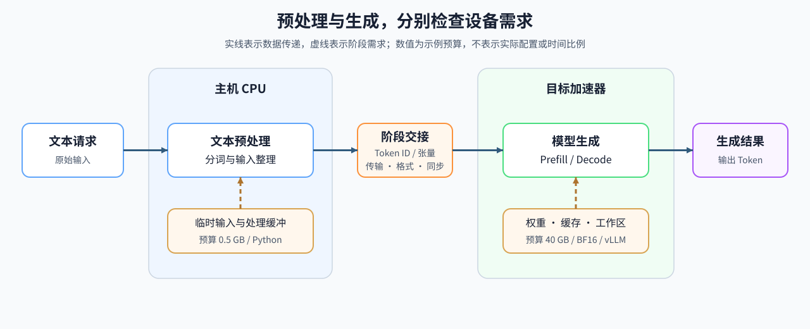

# 34. Heterogeneous Accelerators and Runtime Constraints | 异构加速器与运行时约束

**难度：** Medium | **环境：** CPU-first | **标签：** `异构系统`, `运行时`, `部署约束` | **目标人群：** 需要比较不同加速器执行条件的学习者

> 🚀 **云端运行环境**
>
> 本章节的实战代码可以点击以下链接在免费 GPU 算力平台上直接运行：
>
> [](https://colab.research.google.com/github/datawhalechina/llm-algo-leetcode/blob/main/01_Hardware_Math_and_Systems/34_Heterogeneous_Accelerators_and_Runtime_Constraints.ipynb)
> [](https://modelscope.cn/my/mynotebook) *(国内推荐：魔搭社区免费实例)*


---

## 本节导读

模型迁移不要求所有阶段都使用同一种设备。文本预处理可能只需少量主机内存，生成阶段却要容纳权重、缓存和工作区；若把生成阶段的需求套给预处理，就可能错误排除本来可用的 CPU。

本节把任务拆成阶段，分别比较容量、精度、操作和运行时要求，再检查阶段之间的数据交接。完成后，你应能区分“声明匹配”“真实路径能够执行”和“性能满足要求”；这些判断接到部署与异构系统专题中的加载与执行验证。

**关键词：** 异构加速器、模型产物、运行时、可执行契约


## 前置阅读

- [10 算力现状与替代方案](./10_Domestic_AI_Chips_Overview.md)
- [1E 编译与后端](./1E.md)
- [07 CPU 与 GPU 异构调度](./07_CPU_GPU_Heterogeneous_Scheduling.md)
## Q1：声明的设备能力能排除哪些候选？

先记录目标阶段的容量、精度、算子和运行时需求，再与设备声明比较。下面的 CPU、GPU、NPU 参数都是构造配置，不读取本机设备；集合中存在某个名称，不表示当前版本已经支持或实际执行了它。

| 判断维度 | 声明中要记录什么 | 实际运行仍需检查 |
|:---|:---|:---|
| 内存 | 对象峰值预算与设备可用容量 | 状态、工作区与其他进程的实际驻留 |
| 精度 | 阶段所需的数据类型 | 产物格式与执行数据类型 |
| 算子 | 阶段需要的操作集合 | 对应形状下的编译、执行与回退 |
| 运行时与通信 | 执行框架及按需使用的集合通信 | 版本兼容、加载日志与功能测试 |


```python
import math


DEVICE_PROFILES = {
    "cpu": {"memory_gb": 128, "precisions": {"fp32", "bf16"}, "ops": {"tokenize", "route", "postprocess"}, "runtimes": {"python"}, "collective": False},
    "gpu": {"memory_gb": 48, "precisions": {"fp16", "bf16", "int8"}, "ops": {"prefill", "decode", "rope", "attention"}, "runtimes": {"torch", "vllm"}, "collective": True},
    "npu": {"memory_gb": 64, "precisions": {"bf16", "int8"}, "ops": {"prefill", "decode", "attention"}, "runtimes": {"vendor-runtime"}, "collective": True},
}


def summarize_device_profile(profile):
    """把设备 profile 转成便于比较的基础账本。"""
    return {
        "memory_gb": profile["memory_gb"],
        "precision_count": len(profile["precisions"]),
        "operator_count": len(profile["ops"]),
        "runtime_count": len(profile["runtimes"]),
        "collective": profile["collective"],
    }


assert summarize_device_profile(DEVICE_PROFILES["gpu"])["operator_count"] == 4
```

## Q2：能力声明与实际加载有什么不同？

候选身份来自模型版本、产物格式、分词器和模板；运行时检查则要确认设备、驱动、执行框架与关键操作能够配合。以下函数仅比较给定声明，不能替代模型加载或真实执行。

容量使用十进制 GB，需求是所比较阶段的预计峰值。预处理阶段不应沿用生成阶段的完整模型容量与精度；各阶段的需求在下一问分别填写。

| 检查 | 本例能做什么 | 需要另外验证什么 |
|:---|:---|:---|
| 容量 | 比较给定峰值预算与声明容量 | 真实分配峰值和安全余量 |
| 数据类型与操作 | 求集合差，列出缺失项 | 目标形状与具体版本的支持情况 |
| 运行时 | 检查名称是否被声明支持 | 环境启动、产物加载与实际路径 |
| 集合通信 | 仅在阶段需要时检查声明 | 多进程执行与数值结果 |


```python
REQUEST_PLAN = {
    "estimated_peak_gb": 40,
    "precision": "bf16",
    "required_ops": {"prefill", "decode", "attention"},
    "runtime": "vllm",
    "requires_collective": False,
    "stages": {
        "prepare": {
            "estimated_peak_gb": 0.5, "precision": "fp32",
            "required_ops": {"tokenize"}, "runtime": "python",
            "requires_collective": False,
        },
        "generate": {
            "estimated_peak_gb": 40, "precision": "bf16",
            "required_ops": {"prefill", "decode", "attention"},
            "runtime": "vllm", "requires_collective": False,
        },
    },
}


def check_device_feasibility(profile, plan):
    """比较一个阶段与给定设备声明，不探测设备或执行模型。"""
    required = ("estimated_peak_gb", "precision", "required_ops",
                "runtime", "requires_collective")
    if any(key not in plan for key in required):
        raise ValueError('阶段需求缺少必要字段')
    if (not math.isfinite(profile["memory_gb"]) or profile["memory_gb"] <= 0
            or not math.isfinite(plan["estimated_peak_gb"])
            or plan["estimated_peak_gb"] < 0):
        raise ValueError('设备容量须为有限正数，阶段预算须为有限非负数')
    if (type(plan["requires_collective"]) is not bool
            or type(profile["collective"]) is not bool):
        raise ValueError('集合通信需求和支持状态必须是布尔值')
    memory_ok = profile["memory_gb"] >= plan["estimated_peak_gb"]
    precision_ok = plan["precision"] in profile["precisions"]
    missing_ops = sorted(set(plan["required_ops"]) - set(profile["ops"]))
    runtime_ok = plan["runtime"] in profile["runtimes"]
    collective_ok = not plan["requires_collective"] or profile["collective"]
    return {
        "declared_requirements_met": bool(
            memory_ok and precision_ok and not missing_ops
            and runtime_ok and collective_ok),
        "memory_ok": memory_ok, "precision_ok": precision_ok,
        "missing_ops": missing_ops, "runtime_ok": runtime_ok,
        "collective_ok": collective_ok,
    }


assert check_device_feasibility(DEVICE_PROFILES["gpu"], REQUEST_PLAN)["declared_requirements_met"]
assert not check_device_feasibility(DEVICE_PROFILES["npu"], REQUEST_PLAN)["runtime_ok"]

```

## Q3：各阶段怎样使用自己的资源与运行时需求？

预处理、生成和输出具有不同的工作集与操作。计划中直接列出每个阶段的峰值预算、精度、运行时和通信需求，不从阶段名称猜测运行时，也不把整模型需求复制给全部阶段。这里的 FP32、BF16 是相应阶段的数值类型条件。

逐阶段有候选仍不代表整条路径可以执行：阶段之间还要传输数据、转换格式并同步，合并放在同一设备上的对象也可能同时驻留。CPU 计算器只筛选声明匹配的设备，实际放置要进一步验证交接与联合资源预算。

| 阶段 | 示例要求 | 需要继续检查 |
|:---|:---|:---|
| 预处理 | 0.5 GB、Python、tokenize | 主机内存、输入协议与准备时间 |
| 生成 | 40 GB、BF16、vLLM、prefill/decode/attention | 加载、状态容量与实际执行路径 |
| 阶段交接 | 由所选设备组合决定 | 数据格式、传输、同步与联合驻留 |


```python
def assign_stages(profiles, plan):
    """按显式阶段配置逐项筛选声明，不决定实际放置或验证交接。"""
    if not isinstance(plan.get("stages"), dict) or not plan["stages"]:
        raise ValueError('必须提供非空阶段需求')
    stage_trace = {}
    for stage, stage_plan in plan["stages"].items():
        checks = {
            name: check_device_feasibility(profile, stage_plan)
            for name, profile in profiles.items()
        }
        stage_trace[stage] = {
            "candidate_devices": [
                name for name, check in checks.items()
                if check["declared_requirements_met"]
            ],
            "checks": checks,
        }
    return stage_trace


STAGE_TRACE = assign_stages(DEVICE_PROFILES, REQUEST_PLAN)
assert "cpu" in STAGE_TRACE["prepare"]["candidate_devices"]
assert STAGE_TRACE["generate"]["candidate_devices"] == ["gpu"]

```

## Q4：进入性能测量前还缺哪些检查？

先检查必需阶段是否齐全、有无声明匹配的设备，再确认质量和整条执行路径的功能测试。路径测试应覆盖加载、阶段交接与输出，不能要求“已有性能基准”才允许开始性能测量，否则会形成循环前提。

下面的布尔值表示外部已经完成的检查；示例调用只是构造状态，不会生成真实运行证据。满足前提后才进入固定工作负载下的计时、吞吐与稳定性比较。

| 条件 | 本例状态 | 下一步 |
|:---|:---|:---|
| 阶段缺失或没有声明匹配的设备 | blocked | 修正需求与设备声明 |
| 质量检查未通过 | blocked | 检查模型、模板与数值结果 |
| 整条路径尚未完成真实功能测试 | needs_runtime_check | 核对加载、交接和输出 |
| 必要检查已声明通过 | benchmark_ready | 开始性能测量，不直接作部署采用判断 |


```python
def benchmark_admission(stage_trace, required_stages, quality_gate_passed,
                        runtime_smoke_passed):
    """根据给定检查结果判断是否可进入计时，不验证证据真实性。"""
    if (type(quality_gate_passed) is not bool
            or type(runtime_smoke_passed) is not bool):
        raise ValueError('质量与路径检查结果必须是布尔值')
    if (not isinstance(required_stages, (list, tuple, set)) or not required_stages
            or any(not isinstance(name, str) or not name for name in required_stages)):
        raise ValueError('必须显式给出非空的必需阶段名称集合')
    missing = sorted(set(required_stages) - set(stage_trace))
    if missing:
        return {"status": "blocked", "reason": "缺少必需阶段", "missing": missing}
    if any(not stage_trace[name].get("candidate_devices")
           for name in required_stages):
        return {"status": "blocked", "reason": "必需阶段没有声明匹配的设备"}
    if not quality_gate_passed:
        return {"status": "blocked", "reason": "质量检查未通过"}
    if not runtime_smoke_passed:
        return {"status": "needs_runtime_check", "reason": "需要整条路径的真实功能测试"}
    return {"status": "benchmark_ready", "reason": "已声明必要检查通过，可进入性能测量"}


required_stages = list(REQUEST_PLAN["stages"])
assert benchmark_admission(STAGE_TRACE, required_stages, True, False)["status"] == "needs_runtime_check"
assert benchmark_admission(STAGE_TRACE, required_stages, True, True)["status"] == "benchmark_ready"
assert benchmark_admission({}, required_stages, True, True)["status"] == "blocked"

```

## 相关阅读

- [部署与异构系统专题](../topic_discussion/deployment_heterogeneous/intro.md)
- [通信与并行专题](../topic_discussion/communication_parallelism/intro.md)
- [Part 02 · 72 多模型部署比较](../02_PyTorch_Algorithms/72_Multi_Model_Deployment_Comparison.md)
