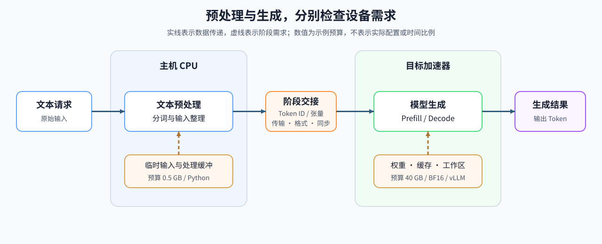
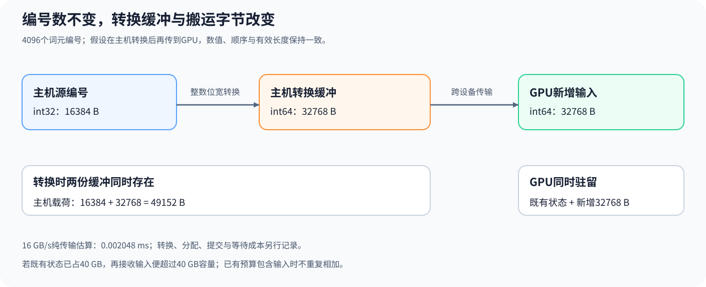

# 34. Heterogeneous Accelerators and Runtime Constraints | 异构加速器与运行时约束

**难度：** Medium | **环境：** CPU-first | **标签：** `异构系统`, `运行时`, `部署约束` | **目标人群：** 需要比较不同加速器执行条件的学习者

> 🚀 **云端运行环境**
>
> 本章节的实战代码可以点击以下链接在免费 GPU 算力平台上直接运行：
>
> [](https://colab.research.google.com/github/datawhalechina/llm-algo-leetcode/blob/main/01_Hardware_Math_and_Systems/34_Heterogeneous_Accelerators_and_Runtime_Constraints.ipynb)
> [](https://modelscope.cn/my/mynotebook) *(国内推荐：魔搭社区免费实例)*


---

## 本节导读

模型迁移不要求所有阶段都使用同一种设备。文本预处理可能只需少量主机内存，生成阶段却要容纳权重、缓存和工作区；若把生成阶段的需求套给预处理，就可能错误排除本来可用的 CPU。

本节把任务拆成阶段，分别比较容量、精度、操作和运行时要求，再计算输入转换、跨设备搬运与同时驻留。完成后，你应能区分“声明匹配”“真实路径能够执行”和“性能满足要求”；这些判断接到部署与异构系统专题中的加载与执行验证。

**关键词：** 阶段需求、数据交接、格式转换、同时驻留、运行时



## 前置阅读

先按任务筛选候选，再用搬运量与带宽估算阶段交接。

- [10 加速器选型与软件栈适配](./10_Domestic_AI_Chips_Overview.md)：任务需求与软件支持。
- [07 CPU与GPU异构调度](./07_CPU_GPU_Heterogeneous_Scheduling.md)：数据位置、带宽与完整路径时间。

## Q1：各阶段需要记录哪些资源与操作？

以“主机分词 → 加速器生成”为例，前者需要词元编号与少量处理缓冲，后者需要权重、KV缓存和工作区。将整模型40 GB预算套给预处理，会错误排除小内存设备；只检查总容量，又可能遗漏生成阶段所需的精度、操作或执行框架。运行时是加载产物、组织操作执行的软件环境，名称相同也还需核对具体版本与路径。

下面给出构造的CPU、GPU、NPU能力和两阶段需求。每阶段分别记录预计峰值、数值类型、所需操作、运行时及是否使用集合通信，再从同一份声明中读取字段。实际设备支持情况由目标规格与功能验证补充。


```python
import math


DEVICE_PROFILES = {
    "cpu": {"memory_gb": 128, "precisions": {"fp32", "bf16"}, "ops": {"tokenize", "route", "postprocess"}, "runtimes": {"python"}, "collective": False},
    "gpu": {"memory_gb": 48, "precisions": {"fp16", "bf16", "int8"}, "ops": {"prefill", "decode", "rope", "attention"}, "runtimes": {"torch", "vllm"}, "collective": True},
    "npu": {"memory_gb": 64, "precisions": {"bf16", "int8"}, "ops": {"prefill", "decode", "attention"}, "runtimes": {"vendor-runtime"}, "collective": True},
}


def summarize_device_profile(profile):
    """把设备 profile 转成便于比较的基础账本。"""
    return {
        "memory_gb": profile["memory_gb"],
        "precision_count": len(profile["precisions"]),
        "operator_count": len(profile["ops"]),
        "runtime_count": len(profile["runtimes"]),
        "collective": profile["collective"],
        "operators": sorted(profile["ops"]), "runtimes": sorted(profile["runtimes"]),
    }


assert summarize_device_profile(DEVICE_PROFILES["gpu"])["operator_count"] == 4

REQUEST_PLAN = {
    "estimated_peak_gb": 40,
    "precision": "bf16",
    "required_ops": {"prefill", "decode", "attention"},
    "runtime": "vllm",
    "requires_collective": False,
    "stages": {
        "prepare": {
            "estimated_peak_gb": 0.5, "precision": "fp32",
            "required_ops": {"tokenize"}, "runtime": "python",
            "requires_collective": False,
        },
        "generate": {
            "estimated_peak_gb": 40, "precision": "bf16",
            "required_ops": {"prefill", "decode", "attention"},
            "runtime": "vllm", "requires_collective": False,
        },
    },
}

assert REQUEST_PLAN["stages"]["prepare"]["estimated_peak_gb"] == 0.5
assert REQUEST_PLAN["stages"]["generate"]["estimated_peak_gb"] == 40
print("GPU声明中的操作：", summarize_device_profile(DEVICE_PROFILES["gpu"])["operators"])
print("预处理与生成预算：", [
    stage["estimated_peak_gb"] for stage in REQUEST_PLAN["stages"].values()])

```

## Q2：哪些设备声明满足生成阶段的需求？

生成要求BF16、40 GB预计峰值、预填充／解码／注意力操作及vLLM运行时。给定GPU声明全部满足；NPU虽有64 GB和BF16，却没有声明vLLM，因而不能直接采用同一执行路径。若改用它支持的运行时，还需重新准备匹配产物并验证结果，不能仅替换一个名称便视为已经迁移。

下面逐项比较需求与声明，容量按十进制GB计。集合通信只在当前阶段需要时检查；阶段候选确定后，再计算它与相邻阶段之间新增的工作。


```python
def check_device_feasibility(profile, plan):
    """比较一个阶段与给定设备声明，不探测设备或执行模型。"""
    required = ("estimated_peak_gb", "precision", "required_ops",
                "runtime", "requires_collective")
    if any(key not in plan for key in required):
        raise ValueError('阶段需求缺少必要字段')
    if (type(profile["memory_gb"]) not in (int, float)
            or not math.isfinite(profile["memory_gb"]) or profile["memory_gb"] <= 0
            or type(plan["estimated_peak_gb"]) not in (int, float)
            or not math.isfinite(plan["estimated_peak_gb"])
            or plan["estimated_peak_gb"] < 0):
        raise ValueError('设备容量须为有限正数，阶段预算须为有限非负数')
    if (type(plan["requires_collective"]) is not bool
            or type(profile["collective"]) is not bool):
        raise ValueError('集合通信需求和支持状态必须是布尔值')
    memory_ok = profile["memory_gb"] >= plan["estimated_peak_gb"]
    precision_ok = plan["precision"] in profile["precisions"]
    missing_ops = sorted(set(plan["required_ops"]) - set(profile["ops"]))
    runtime_ok = plan["runtime"] in profile["runtimes"]
    collective_ok = not plan["requires_collective"] or profile["collective"]
    return {
        "declared_requirements_met": bool(
            memory_ok and precision_ok and not missing_ops
            and runtime_ok and collective_ok),
        "memory_ok": memory_ok, "precision_ok": precision_ok,
        "missing_ops": missing_ops, "runtime_ok": runtime_ok,
        "collective_ok": collective_ok,
    }


assert check_device_feasibility(DEVICE_PROFILES["gpu"], REQUEST_PLAN)["declared_requirements_met"]
assert not check_device_feasibility(DEVICE_PROFILES["npu"], REQUEST_PLAN)["runtime_ok"]

```

## Q3：阶段都能执行，交接还增加哪些搬运与内存？

沿用主机分词到GPU生成的路径，假设4096个词元编号由32位整数存储，消费端要求64位整数。转换前为16384 B，转换后为32768 B；先在主机产生转换缓冲、再传输时，两份编号暂时同时存在，主机载荷为49152 B。带宽按16 GB/s计算，32768 B的纯传输估算为0.002048 ms；类型转换、固定提交和等待时间另计。

这里转换改变存储位宽，编号数值、顺序和有效长度仍应保持。加速器若已有40000000000 B状态，同时还要接收32768 B输入，容量恰好40 GB便不足，48 GB则允许这两项共同驻留。共同驻留只对本例明确同时存活的对象求和；已有阶段峰值若包含该输入，就不再重复加入。下面先筛选阶段，再复现这组交接账目。




```python
def assign_stages(profiles, plan):
    """按显式阶段配置逐项筛选声明，不决定实际放置或验证交接。"""
    if not isinstance(plan.get("stages"), dict) or not plan["stages"]:
        raise ValueError('必须提供非空阶段需求')
    stage_trace = {}
    for stage, stage_plan in plan["stages"].items():
        checks = {
            name: check_device_feasibility(profile, stage_plan)
            for name, profile in profiles.items()
        }
        stage_trace[stage] = {
            "candidate_devices": [
                name for name, check in checks.items()
                if check["declared_requirements_met"]
            ],
            "checks": checks,
        }
    return stage_trace


STAGE_TRACE = assign_stages(DEVICE_PROFILES, REQUEST_PLAN)
assert "cpu" in STAGE_TRACE["prepare"]["candidate_devices"]
assert STAGE_TRACE["generate"]["candidate_devices"] == ["gpu"]


def handoff_ledger(num_tokens: int, source_dtype: str, target_dtype: str,
                   bandwidth_gb_s: float) -> dict:
    """估算CPU整数编号转换后传到GPU的载荷；GB/s按十进制计，时间为ms。

    假设转换缓冲与源编号同时存在；传输窗口不包含转换、分配和提交。
    """
    sizes = {"int32": 4, "int64": 8}
    if type(num_tokens) is not int or num_tokens <= 0:
        raise ValueError("词元数须为正整数")
    if (source_dtype, target_dtype) not in {("int32", "int32"), ("int64", "int64"),
                                            ("int32", "int64")}:
        raise ValueError("本例支持整数编号原类型传输或int32转int64")
    if (type(bandwidth_gb_s) not in (int, float)
            or not math.isfinite(bandwidth_gb_s) or bandwidth_gb_s <= 0):
        raise ValueError("带宽须为有限正数，单位GB/s")
    source_bytes = num_tokens * sizes[source_dtype]
    target_bytes = num_tokens * sizes[target_dtype]
    conversion_bytes = target_bytes if source_dtype != target_dtype else 0
    return {"source_bytes": source_bytes, "target_bytes": target_bytes,
            "host_live_bytes": source_bytes + conversion_bytes,
            "transfer_ms": target_bytes / (bandwidth_gb_s * 1e9) * 1000}


def placement_memory_check(resident_bytes: int, incoming_bytes: int,
                           capacity_bytes: int) -> dict:
    """将明确同时存活的既有状态与新增输入相加，单位B；输入未计入既有预算。"""
    if any(type(value) is not int or value < 0
           for value in (resident_bytes, incoming_bytes, capacity_bytes)):
        raise ValueError("同时驻留载荷与容量须为非负整数字节数")
    peak_bytes = resident_bytes + incoming_bytes
    return {"peak_bytes": peak_bytes, "fits": peak_bytes <= capacity_bytes,
            "shortfall_bytes": max(peak_bytes - capacity_bytes, 0)}


handoff = handoff_ledger(num_tokens=4096, source_dtype="int32",
                         target_dtype="int64", bandwidth_gb_s=16)
assert handoff["source_bytes"] == 16384
assert handoff["target_bytes"] == 32768 and handoff["host_live_bytes"] == 49152
assert math.isclose(handoff["transfer_ms"], 0.002048)
unchanged = handoff_ledger(4096, "int64", "int64", 16)
assert unchanged["host_live_bytes"] == 32768
capacity_miss = placement_memory_check(40_000_000_000, handoff["target_bytes"], 40_000_000_000)
capacity_ok = placement_memory_check(40_000_000_000, handoff["target_bytes"], 48_000_000_000)
assert capacity_miss["shortfall_bytes"] == 32768 and not capacity_miss["fits"]
assert capacity_ok["fits"]
assert placement_memory_check(40_000_000_000, 32768, 40_000_032_768)["fits"]
print("主机转换与传输账目：", handoff)
print("同时驻留检查：", capacity_miss, capacity_ok)

```

## Q4：完成估算后，运行时还要核对什么？

前面已筛选阶段候选、计算转换后的传输载荷，并核对给定同时驻留量。实际路径还要验证模型与分词器匹配、编号类型与顺序、输入就绪依赖、模型加载以及最终输出。设备异步执行时，消费端必须等输入搬运完成；源缓冲也要保留到搬运结束，容量估算不能替代这些执行条件。

下面用明确的外部检查结果演示下一动作：缺少阶段或候选时先补齐需求；功能与质量未通过时继续修复；功能路径完成后进入性能测量。示例中的状态是构造输入，不登记为真实加载或部署结果。


```python
def benchmark_admission(stage_trace, required_stages, quality_gate_passed,
                        runtime_smoke_passed):
    """根据给定检查结果判断是否可进入计时，不验证证据真实性。"""
    if (type(quality_gate_passed) is not bool
            or type(runtime_smoke_passed) is not bool):
        raise ValueError('质量与路径检查结果必须是布尔值')
    if (not isinstance(required_stages, (list, tuple, set)) or not required_stages
            or any(not isinstance(name, str) or not name for name in required_stages)):
        raise ValueError('必须显式给出非空的必需阶段名称集合')
    missing = sorted(set(required_stages) - set(stage_trace))
    if missing:
        return {"status": "blocked", "reason": "缺少必需阶段", "missing": missing}
    if any(not stage_trace[name].get("candidate_devices")
           for name in required_stages):
        return {"status": "blocked", "reason": "必需阶段没有声明匹配的设备"}
    if not quality_gate_passed:
        return {"status": "blocked", "reason": "质量检查未通过"}
    if not runtime_smoke_passed:
        return {"status": "needs_runtime_check", "reason": "需要整条路径的真实功能测试"}
    return {"status": "benchmark_ready", "reason": "已声明必要检查通过，可进入性能测量"}


required_stages = list(REQUEST_PLAN["stages"])
assert benchmark_admission(STAGE_TRACE, required_stages, True, False)["status"] == "needs_runtime_check"
assert benchmark_admission(STAGE_TRACE, required_stages, True, True)["status"] == "benchmark_ready"
assert benchmark_admission({}, required_stages, True, True)["status"] == "blocked"

```

## 相关阅读

把阶段账目用于真实加载与请求执行，再比较完整方案。

- [部署与异构系统专题](../topic_discussion/deployment_heterogeneous/intro.md)：检查目标设备、产物、交接与回退路径。
- [Part02·72 多模型部署比较](../02_PyTorch_Algorithms/72_Multi_Model_Deployment_Comparison.md)：在共同负载下比较运行方案。
- [33 TCO与成本](./33_TCO_and_Cost_Model.md)：使用实际吞吐、可用时间与共同成功标准计算成本。
