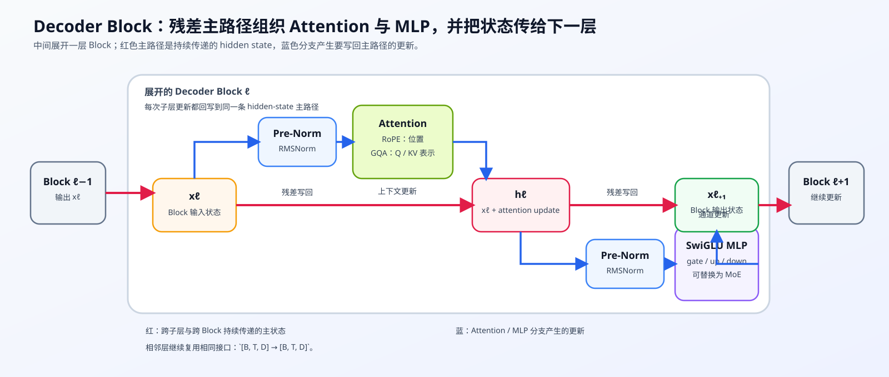
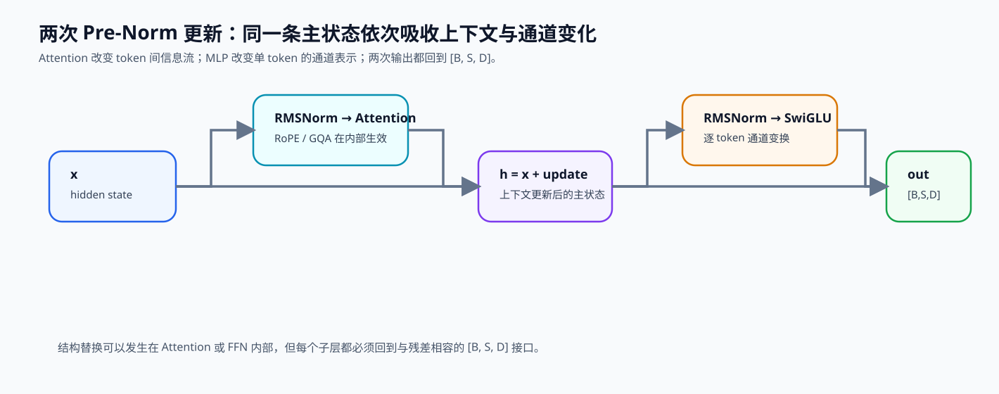

# 05. LLaMA3 Block Tutorial | LLaMA3 Block 教程

**难度：** Medium | **环境：** [CPU 主线](#runtime-environment) | **标签：** `模型结构`, `Transformer`, `LLaMA Block` | **目标人群：** 熟悉注意力与前馈网络的学习者

> 🚀 **云端运行环境**
>
> 本章节的实战代码可以点击以下链接在免费 GPU 算力平台上直接运行：
>
> [](https://colab.research.google.com/github/datawhalechina/llm-algo-leetcode/blob/main/02_PyTorch_Algorithms/05_LLaMA3_Block_Tutorial.ipynb)
> [](https://modelscope.cn/my/mynotebook) *(国内推荐：魔搭社区免费实例)*


---

## 本节导读

前面的 RMSNorm、SwiGLU、RoPE 和 GQA 分别处理尺度、非线性、位置和上下文；进入模型结构后，它们需要在同一个解码器层中协同工作。理解这个组合顺序，才能读懂现代仅解码器模型如何逐层更新主状态。

本节沿着 LLaMA 类解码器层跟踪组件的组合顺序：两次前置归一化（Pre-Norm）、两条变换分支和两次残差更新。学习后应能沿着“主状态 → 注意力更新 → MLP 更新”追踪每一步的输入、输出与形状，并判断改动某个组件会影响哪条路径。

**关键词：** `LLaMA3`, `Transformer Block`, `Decoder Layer`

---
<a id="runtime-environment"></a>

## 运行环境

基础练习使用 [BASE-CPU](../guide.md#base-cpu)，不需要 GPU。

## 前置阅读

进入本节前，先能指出 RMSNorm、RoPE、GQA 和 SwiGLU 在解码器层中分别承担什么作用，再把它们按执行顺序组合起来。

- [01. RMSNorm Tutorial | RMSNorm 教程](../02_PyTorch_Algorithms/01_RMSNorm_Tutorial.md)
- [02. SwiGLU Activation | SwiGLU 激活](../02_PyTorch_Algorithms/02_SwiGLU_Activation.md)
- [04. Attention MHA GQA | 多头注意力](../02_PyTorch_Algorithms/04_Attention_MHA_GQA.md)


---
## Step 1：解码器块的组成、状态流与层堆叠

主状态是每个词元当前的隐藏向量；残差流是它在各层间持续传递并接收增量的路径。仅解码器模型先把 token（词元）转成主状态，再让多个解码器块依次更新同一条残差流。单个块包含两类变换：注意力在 token 之间交换信息，前馈网络（MLP）在每个 token 内重组通道；归一化控制子层输入尺度，残差连接保留主状态并接收增量更新。

| 组件 | 读取什么 | 写回什么 | 跨多个块的意义 |
|---|---|---|---|
| 前置归一化 | 当前主状态 | 尺度受控的子层输入 | 防止每层直接接收失控尺度 |
| 注意力 | 当前 token 与可见上下文 | 上下文更新量 | 逐层扩大和重组 token 间信息 |
| MLP / SwiGLU | 单个 token 的通道 | 通道更新量 | 增加逐 token 的非线性容量 |
| 残差主干 | 块输入与两个更新量 | 下一块的主状态 | 为深层网络保留连续的信息与梯度路径 |



## Step 2：两次前置归一化残差更新

设块输入 $h$ 的形状为 $[B,S,C]$，其中 $B$ 是批量大小、$S$ 是词元数、$C$ 是隐藏宽度；$h'$ 是第一次残差更新后的状态，$h_{next}$ 是块输出。一个块依次执行两次“归一化 → 子层变换 → 残差相加”。注意力和 MLP 解决的问题不同，因此不能把两条更新合并成一次无序求和；第二次前置归一化必须读取已经包含注意力更新的状态。

$$
h' = h + \operatorname{Attention}(\operatorname{Norm}_1(h)),\qquad
h_{next}=h' + \operatorname{MLP}(\operatorname{Norm}_2(h')).
$$

| 路径 | 输入状态 | 更新来源 | 需要保持的不变量 |
|---|---|---|---|
| 注意力更新 | `h` | token 间上下文 | 输出形状与 `h` 一致 |
| MLP 更新 | `h'` | token 内通道变换 | 必须读取第一次残差后的状态 |
| 块输出 | 两次残差后的状态 | 主干与增量共同构成 | 可直接作为下一块输入 |



## Step 3：组件替换如何保持输入输出与残差接口

多头注意力（MHA）、分组查询注意力（GQA）和潜在注意力（MLA）采用不同的头组织或历史状态表示；混合专家（MoE）则按词元选择前馈分支。架构演进经常替换注意力、归一化或 MLP，但块外部仍要维持主状态的形状、数据类型和残差接口。局部组件能够产生同形状输出，只说明接口可连接；深度增加还会放大初始化、残差尺度、归一化位置和梯度传播之间的相互作用。

| 结构改动 | 块内必须保持 | 堆叠后需要观察 |
|---|---|---|
| MHA → GQA / MLA | 注意力输出仍回到隐藏宽度 | 状态容量、质量和执行后端路径 |
| 稠密 MLP → MoE | token 输出仍回到原位置与通道 | 路由集中、容量溢出与通信 |
| LayerNorm → RMSNorm | 归一化输入输出形状不变 | 激活尺度、梯度尺度与收敛 |
| 残差缩放或初始化变化 | 两次更新顺序不变 | 深层激活增长、梯度衰减或爆炸 |

## Step 4：代码设计与解码器块组装

本题用 `StructureNormStub` 的逐通道缩放和 `AttentionUpdateStub` 的线性映射作为结构替身，分别提供同形状输出；它们不是 RMSNorm 或真实注意力。SwiGLU 保留门控前馈计算。题目关注解码器块的组合责任：依次写回两次残差更新，并让多个块顺序更新同一条主状态。

| TODO / 函数 | 学习者完成的机制 | 必须满足的约束 | 测试证据 |
|---|---|---|---|
| TODO 1 · `LlamaDecoderLayer.forward` | 写回注意力残差更新 | 先前置归一化，再把上下文增量加回主状态 | MLP 接收第一次更新后的状态 |
| TODO 2 · `LlamaDecoderLayer.forward` | 写回 MLP 残差更新 | 必须读取第一次更新后的状态 | 输出形状、调用顺序与梯度连通性正确 |
| TODO 3 · `DecoderStack.forward` | 让多个块顺序更新主状态 | 后一层读取前一层输出，不得并行覆盖 | 固定增量按层累积，最终形状不变 |

```python
import torch
import torch.nn as nn
import torch.nn.functional as F
```


```python
class StructureNormStub(nn.Module):
    """记录 Pre-Norm 调用位置的结构替身。

    它只保留形状与可训练缩放接口，不实现 RMSNorm 的均方根统计；
    RMSNorm 的数值机制由第 01 节验证。
    """

    def __init__(self, dim: int):
        super().__init__()
        self.scale = nn.Parameter(torch.ones(dim))
        self.calls = 0

    def forward(self, x: torch.Tensor) -> torch.Tensor:
        self.calls += 1
        return x * self.scale


class AttentionUpdateStub(nn.Module):
    """产生同形状的上下文更新，用于验证 Block 组装。

    不实现 causal mask、RoPE、MHA 或 GQA；这些机制分别由第 03、04 节验证。
    """

    def __init__(self, dim: int):
        super().__init__()
        self.proj = nn.Linear(dim, dim, bias=False)
        self.calls = 0

    def forward(self, x: torch.Tensor) -> torch.Tensor:
        self.calls += 1
        return self.proj(x)


class LlamaMLP(nn.Module):
    """作为固定依赖提供最小 SwiGLU 通道更新。"""

    def __init__(self, hidden_size: int, intermediate_size: int):
        super().__init__()
        self.gate_proj = nn.Linear(hidden_size, intermediate_size, bias=False)
        self.up_proj = nn.Linear(hidden_size, intermediate_size, bias=False)
        self.down_proj = nn.Linear(intermediate_size, hidden_size, bias=False)

    def forward(self, x: torch.Tensor) -> torch.Tensor:
        gate = F.silu(self.gate_proj(x))
        up = self.up_proj(x)
        return self.down_proj(gate * up)


class LlamaDecoderLayer(nn.Module):
    """组装最小 Pre-Norm Decoder Block，验证两次残差更新顺序。"""

    def __init__(self, hidden_size: int, intermediate_size: int):
        super().__init__()
        self.norm_1 = StructureNormStub(hidden_size)
        self.attention_update = AttentionUpdateStub(hidden_size)
        self.norm_2 = StructureNormStub(hidden_size)
        self.mlp = LlamaMLP(hidden_size, intermediate_size)

    def forward(self, hidden_states: torch.Tensor) -> torch.Tensor:
        """返回与输入同形状的 Decoder Block 输出。

        Args:
            hidden_states: `[batch, seq_len, hidden_size]` 的主状态。
        """
        # ==========================================
        # TODO 1：写回 Attention 残差更新。
        # ==========================================
        # attention_delta = ???  # 归一化后产生的同形状上下文更新
        # hidden_states = ???     # 原主状态加上上下文更新
        raise NotImplementedError("请先完成 TODO 1：Attention 残差更新。")

        # ==========================================
        # TODO 2：写回 MLP 残差更新。
        # ==========================================
        # mlp_delta = ???       # 基于第一次更新后的状态产生通道更新
        # hidden_states = ???   # 当前主状态加上通道更新
        # return ???


class DecoderStack(nn.Module):
    """让多个 Decoder Block 顺序更新同一条隐藏状态。"""

    def __init__(self, hidden_size: int, intermediate_size: int, num_layers: int):
        super().__init__()
        if num_layers <= 0:
            raise ValueError("num_layers 必须为正整数")
        self.layers = nn.ModuleList(
            [LlamaDecoderLayer(hidden_size, intermediate_size) for _ in range(num_layers)]
        )

    def forward(self, hidden_states: torch.Tensor) -> torch.Tensor:
        """按层顺序返回最终隐藏状态。"""
        # ==========================================
        # TODO 3：让每层读取上一层的输出。
        # ==========================================
        # for layer in ???:
        #     hidden_states = ???  # 当前层读取上一层输出
        # return hidden_states
        raise NotImplementedError("请先完成 TODO 3：Decoder Block 顺序堆叠。")

```

## 测试

用记录输入的结构替身核对两次残差的读取顺序，再检查梯度连通性和多层累积。

```python
# 测试设计：分别验证两次残差顺序、梯度连通性与多层堆叠。


class ConstantUpdate(nn.Module):
    """为残差顺序测试提供可辨识、同形状的固定更新。"""

    def __init__(self, value: float):
        super().__init__()
        self.value = value
        self.seen_input = None

    def forward(self, x: torch.Tensor) -> torch.Tensor:
        self.seen_input = x.detach().clone()
        return torch.full_like(x, self.value)


def test_residual_update_order():
    """验证 MLP 读取 Attention 更新后的状态，并按顺序累加两次更新。"""
    layer = LlamaDecoderLayer(hidden_size=4, intermediate_size=6)
    layer.norm_1 = nn.Identity()
    layer.attention_update = ConstantUpdate(2.0)
    layer.norm_2 = nn.Identity()
    layer.mlp = ConstantUpdate(3.0)
    x = torch.ones(1, 2, 4)

    out = layer(x)
    first_update = x + 2.0
    assert torch.allclose(layer.mlp.seen_input, first_update), "MLP 必须接收第一次残差更新后的状态"
    assert torch.allclose(out, x + 5.0), "两次残差更新必须按 Attention → MLP 的顺序累加"


def test_block_shape_calls_and_gradients():
    """验证单个 Block 的形状、组件调用次数和参数梯度。"""
    torch.manual_seed(1)
    layer = LlamaDecoderLayer(hidden_size=8, intermediate_size=12)
    x = torch.randn(2, 3, 8, requires_grad=True)
    out = layer(x)
    assert out.shape == x.shape
    assert layer.norm_1.calls == 1 and layer.attention_update.calls == 1 and layer.norm_2.calls == 1
    out.sum().backward()
    assert all(param.grad is not None for param in layer.parameters())


class AdditiveBlock(nn.Module):
    """为层堆叠测试提供可辨识的固定增量。"""

    def __init__(self, value: float):
        super().__init__()
        self.value = value

    def forward(self, hidden_states: torch.Tensor) -> torch.Tensor:
        return hidden_states + self.value


def test_decoder_stack_order():
    """验证多个 Block 的输出按层传递，而不是并行覆盖。"""
    stack = DecoderStack(hidden_size=4, intermediate_size=6, num_layers=3)
    stack.layers = nn.ModuleList([AdditiveBlock(1.0), AdditiveBlock(2.0), AdditiveBlock(3.0)])
    x = torch.zeros(1, 2, 4)
    assert torch.allclose(stack(x), torch.full_like(x, 6.0))


def run_tests():
    """运行 Decoder Block 组装与层堆叠测试。"""
    test_residual_update_order()
    test_block_shape_calls_and_gradients()
    test_decoder_stack_order()
    print("✅ Decoder Block：残差顺序、梯度连通与层堆叠测试通过")


try:
    run_tests()
except NotImplementedError:
    print("请先按 TODO 1–3 完成 Block 组装，再运行测试。")
    raise

```

🛑 **STOP HERE** 🛑

请先完成题目区并通过测试，再继续查看参考代码与解析。
## 参考代码与解析

### 代码

```python
class StructureNormStub(nn.Module):
    """记录 Pre-Norm 调用位置的结构替身。

    它只保留形状与可训练缩放接口，不实现 RMSNorm 的均方根统计；
    RMSNorm 的数值机制由第 01 节验证。
    """

    def __init__(self, dim: int):
        super().__init__()
        self.scale = nn.Parameter(torch.ones(dim))
        self.calls = 0

    def forward(self, x: torch.Tensor) -> torch.Tensor:
        self.calls += 1
        return x * self.scale


class AttentionUpdateStub(nn.Module):
    """产生同形状的上下文更新，用于验证 Block 组装。

    不实现 causal mask、RoPE、MHA 或 GQA；这些机制分别由第 03、04 节验证。
    """

    def __init__(self, dim: int):
        super().__init__()
        self.proj = nn.Linear(dim, dim, bias=False)
        self.calls = 0

    def forward(self, x: torch.Tensor) -> torch.Tensor:
        self.calls += 1
        return self.proj(x)


class LlamaMLP(nn.Module):
    """保留真实 SwiGLU 门控计算的最小 MLP。"""

    def __init__(self, hidden_size: int, intermediate_size: int):
        super().__init__()
        # 固定依赖：SwiGLU 的三个无 bias 投影。
        self.gate_proj = nn.Linear(hidden_size, intermediate_size, bias=False)
        self.up_proj = nn.Linear(hidden_size, intermediate_size, bias=False)
        self.down_proj = nn.Linear(intermediate_size, hidden_size, bias=False)

    def forward(self, x: torch.Tensor) -> torch.Tensor:
        # 固定依赖：先计算门控通道更新，再回到 hidden_size。
        gate = F.silu(self.gate_proj(x))
        up = self.up_proj(x)
        return self.down_proj(gate * up)


class LlamaDecoderLayer(nn.Module):
    """组装最小 Pre-Norm Decoder Block，验证两次残差更新顺序。"""

    def __init__(self, hidden_size: int, intermediate_size: int):
        super().__init__()
        self.norm_1 = StructureNormStub(hidden_size)
        self.attention_update = AttentionUpdateStub(hidden_size)
        self.norm_2 = StructureNormStub(hidden_size)
        self.mlp = LlamaMLP(hidden_size, intermediate_size)

    def forward(self, hidden_states: torch.Tensor) -> torch.Tensor:
        """返回与输入同形状的 Decoder Block 输出。

        Args:
            hidden_states: `[batch, seq_len, hidden_size]` 的主状态。
        """
        # TODO 1：先计算 Attention 更新，并将其写回原始 hidden_states。
        attention_delta = self.attention_update(self.norm_1(hidden_states))
        hidden_states = hidden_states + attention_delta

        # TODO 2：基于第一次更新后的 hidden_states 计算 MLP 更新并写回。
        mlp_delta = self.mlp(self.norm_2(hidden_states))
        hidden_states = hidden_states + mlp_delta
        return hidden_states


class DecoderStack(nn.Module):
    """让多个 Decoder Block 顺序更新同一条隐藏状态。"""

    def __init__(self, hidden_size: int, intermediate_size: int, num_layers: int):
        super().__init__()
        if num_layers <= 0:
            raise ValueError("num_layers 必须为正整数")
        self.layers = nn.ModuleList(
            [LlamaDecoderLayer(hidden_size, intermediate_size) for _ in range(num_layers)]
        )

    def forward(self, hidden_states: torch.Tensor) -> torch.Tensor:
        """按层顺序返回最终隐藏状态。"""
        # TODO 3：让每层读取上一层的输出。
        for layer in self.layers:
            hidden_states = layer(hidden_states)
        return hidden_states

```

### 解析

#### TODO 1：写回注意力残差更新

- 上下文分支读取归一化后的输入，但更新必须加回原始主状态。
- 生成同形状注意力增量并完成第一次相加；顺序测试记录 MLP 实际看到的输入。

#### TODO 2：写回 MLP 残差更新

- 第二次前置归一化必须读取已包含注意力更新的中间状态。
- 生成通道增量并完成第二次相加；测试核对输出形状、调用次数和梯度连通性。

#### TODO 3：顺序堆叠多个块

- 第 $l+1$ 层的输入必须是第 $l$ 层的完整输出。
- 逐层覆盖当前隐藏状态；固定增量测试检查所有层按顺序累积。
## 可选 CPU 延伸：把一个块接到最小语言模型

词元编号先经嵌入层（Embedding）变成隐藏向量，经过解码器块后，语言模型输出层（LM Head）为词表中每个词元生成分数（logits），再与目标词元计算损失（loss）。下面用随机权重在 CPU 上检查这条数据流和梯度是否连通。

```python
from typing import Optional
class TinyLlamaLM(nn.Module):
    """
        最小 LLaMA 语言模型，仅用于验证 DecoderLayer 结构正确性。

        结构：Embedding → 1 × DecoderLayer → LM Head
        注意：此实现仅为教学验证用途，非生产级模型。
    """
    def __init__(self, vocab_size: int, hidden_size: int, intermediate_size: int):
        super().__init__()
        # 最小 LM 只保留三层：Embedding -> Decoder Layer -> LM Head
        self.embed_tokens = nn.Embedding(vocab_size, hidden_size)
        self.decoder = LlamaDecoderLayer(hidden_size, intermediate_size)
        self.lm_head = nn.Linear(hidden_size, vocab_size, bias=False)

    def forward(self, input_ids: torch.Tensor) -> torch.Tensor:
        # 1) 把 token id 映射成 hidden states
        hidden_states = self.embed_tokens(input_ids)
        # 2) 经过前面已经组装好的 LLaMA-3 Decoder Layer
        hidden_states = self.decoder(hidden_states)
        # 3) 投影到词表维度，得到 next-token logits
        logits = self.lm_head(hidden_states)
        return logits


def build_toy_batch(
    batch_size: int = 2,
    seq_len: int = 4,
    vocab_size: int = 16,
    device: torch.device = None,
    ):
    """
    构造一个 toy batch，用于最小训练闭环验证。

    Args:
        batch_size: 批次大小
        seq_len: 序列长度
        vocab_size: 词表大小，生成的 token id 在 [0, vocab_size-1] 范围内
        device: 张量所在设备

    Returns:
        input_ids: [batch_size, seq_len]
        labels: [batch_size, seq_len]
    """
    # 一个极小的 next-token toy batch，用来演示最小训练闭环。
    # input_ids 是模型输入
    input_ids = torch.randint(0, vocab_size, (batch_size, seq_len), device=device)
    # labels 是 input_ids 的简单右移版本
    labels = torch.roll(input_ids, shifts=-1, dims=1)
    # 将最后一个位置的标签设为 0（避免越界，实际训练中会 mask 掉）
    labels[:, -1] = 0
    return input_ids, labels


def train_one_step(
    model: nn.Module,
    batch: tuple[torch.Tensor, torch.Tensor],
    optimizer: torch.optim.Optimizer,
    )-> tuple[torch.Tensor, torch.Tensor]:
    """
    执行一步训练。

    Args:
        model: 要训练的模型
        batch: (input_ids, labels)
        optimizer: 优化器

    Returns:
        loss: 当前步的 loss
        logits: 模型输出 logits
    """
    input_ids, labels = batch
    # 前向：得到每个位置上的 next-token logits
    logits = model(input_ids)

    # 预测 t+1 token（因果语言建模）
    shift_logits = logits[:, :-1].reshape(-1, logits.size(-1))
    shift_labels = labels[:, 1:].reshape(-1)

    # 只保留 next-token 监督关系：预测 t+1 的 token
    loss = F.cross_entropy(shift_logits, shift_labels)

    # 标准训练三连：清梯度 -> 反传 -> 更新参数
    optimizer.zero_grad()
    loss.backward()
    optimizer.step()
    return loss, logits


def run_minimal_validation(
    vocab_size: int = 16,
    hidden_size: int = 32,
    intermediate_size: int = 80,
    batch_size: int = 2,
    seq_len: int = 4,
    num_steps: int = 10,
    lr: float = 1e-3,
    device: Optional[torch.device] = None,
) -> None:
    """
    运行最小训练闭环验证。

    Args:
        vocab_size: 词表大小
        hidden_size: 隐藏层维度
        intermediate_size: SwiGLU 中间层维度
        batch_size: 批次大小
        seq_len: 序列长度
        num_steps: 训练步数
        lr: 学习率
        device: 张量所在设备
    """
    print("=== 最小训练闭环验证 ===")
    print(f"配置: vocab_size={vocab_size}, hidden_size={hidden_size}, "
          f"intermediate_size={intermediate_size}, batch_size={batch_size}, "
          f"seq_len={seq_len}, num_steps={num_steps}")

    torch.manual_seed(42)

    model = TinyLlamaLM(vocab_size, hidden_size, intermediate_size)
    optimizer = torch.optim.AdamW(model.parameters(), lr=lr)
    batch = build_toy_batch(batch_size, seq_len, vocab_size)

    losses = []

    for step in range(num_steps):
        loss, logits = train_one_step(model, batch, optimizer)
        losses.append(float(loss))
        if step % 2 == 0 or step == num_steps - 1:
            print(f"  Step {step+1:2d}: loss = {loss.item():.6f}")

    # 验证
    assert logits.shape == (batch_size, seq_len, vocab_size), \
        f"Expected logits shape {(batch_size, seq_len, vocab_size)}, got {logits.shape}"
    assert torch.isfinite(loss), f"Loss is not finite: {loss.item()}"

    # 验证 loss 在下降
    if losses[0] > losses[-1]:
        print(f"✅ Loss 下降: {losses[0]:.6f} → {losses[-1]:.6f}")
    else:
        print(f"⚠️ Loss 未明显下降: {losses[0]:.6f} → {losses[-1]:.6f}")

    print("✅ 最小数据逻辑与训练循环通过\n")

if __name__ == "__main__":
    # 运行验证
    run_minimal_validation()
```

## 相关阅读

完成最小块组装后，可先对照真实模型实现，再沿着残差主路径与 MoE 扩展理解哪些组件会被替换、哪些接口保持不变。

- [Transformers 中的 LLaMA 模型实现](https://github.com/huggingface/transformers/blob/main/src/transformers/models/llama/modeling_llama.py)
- [LLaMA 原论文：LLaMA](https://arxiv.org/abs/2302.13971)
- [Block 与残差路径：架构专题](../topic_discussion/llm_architecture_evolution/06_block_residual_path.md)
- [06. MoE 路由器](../02_PyTorch_Algorithms/06_MoE_Router.md)
- [08. 架构技巧](../02_PyTorch_Algorithms/08_Architecture_Tricks.md)
