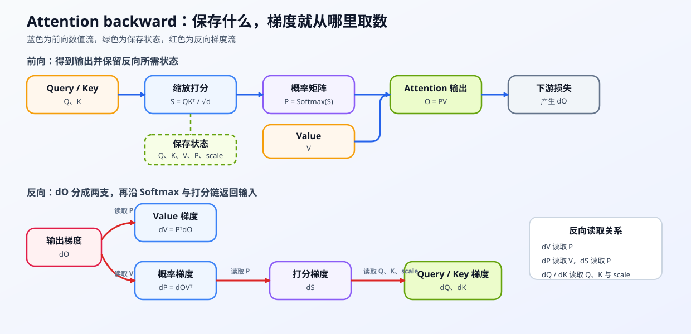

# 10. Attention Backward and Custom Autograd | Attention 反向传播与自定义 Autograd

**难度：** Medium | **环境：** [CPU 主线](#runtime-environment) | **标签：** `训练机制`, `Attention`, `Autograd`, `反向传播` | **目标人群：** 训练机制学习者

> 🚀 **云端运行环境**
>
> 本章节的实战代码可以点击以下链接在免费 GPU 算力平台上直接运行：
>
> [](https://colab.research.google.com/github/datawhalechina/llm-algo-leetcode/blob/main/02_PyTorch_Algorithms/10_Attention_Backward_and_Custom_Autograd.ipynb)
> [](https://modelscope.cn/my/mynotebook) *(国内推荐：魔搭社区免费实例)*


---

## 本节导读

Attention 的前向计算把 $Q$、$K$、$V$ 组合成输出；反向传播沿相反的依赖关系，把输出梯度分配给 Value、概率、打分矩阵以及 Query/Key。每条分支依赖不同的前向状态，因此梯度公式和状态保存需要一起分析。

本节先建立完整梯度链，再拆解矩阵乘法、Softmax 和缩放点积的局部反向，最后核对保存状态的容量代价。完成后，你将能用自动求导与数值梯度验证手写 backward，并判断融合实现减少了哪些中间状态。

**关键词：** `Autograd`, `backward`, `gradcheck`

---
<a id="runtime-environment"></a>

## 运行环境

- **基础练习：** 默认使用 [`BASE-CPU`](../guide.md#base-cpu)，运行 [Step 4 的题目与测试](#mechanism-practice)。
- **框架核对：** 使用 [`TRAIN-CPU`](../topic_discussion/backpropagation_training_mechanism/quickstart.md#train-cpu-quickstart)，完成 Step 4 后运行 [框架一致性核对](#framework-check)。

---
## 前置阅读

**导语：** 先理解 PyTorch 如何记录计算图，并复习 Attention 的 Q/K/V 前向依赖，再进入反向梯度链。

- [P0: 07. PyTorch Autograd and Backward | PyTorch 自动求导与反向传播](../00_Prerequisites/07_PyTorch_Autograd_and_Backward.md)
- [04. Attention MHA/GQA | 多头注意力与 KV Cache](../02_PyTorch_Algorithms/04_Attention_MHA_GQA.md)

---

## Step 1：dO 如何分解为 dV、dP、dS、dQ 与 dK

把 Attention 看成一条依赖链：前向阶段由 $Q、K、V$ 形成 $S$、$P$ 和 $O$；反向阶段从输出梯度 $dO$ 出发，先分成 $dV$ 与 $dP$，再经过 $dS$ 回到 $dQ$ 和 $dK$。其中 $dO$ 是这条反向链的起点。

先把每个量的形状和流向对齐，再把梯度依赖、保存状态和显存账本放到同一条链上观察。

> **张量形状说明：**
> - $Q, K, V \in \mathbb{R}^{B \times N \times d}$（batch $B$、序列长度 $N$、特征维数 $d$）
> - $S, P \in \mathbb{R}^{B \times N \times N}$
> - $O \in \mathbb{R}^{B \times N \times d}$


## Step 2：Softmax、缩放与分支梯度如何回传

先把图中的 $dO$ 理解成损失函数传给 Attention 输出 $O$ 的梯度。因为 $O = P V$，它会分成两条支路：一条直接求 $dV$；另一条先求 $dP$，再穿过 Softmax 得到 $dS$，最后回传到 $Q$ 和 $K$。

沿着图中的两条支路，依次推导下面四个结果。

**1. 求 $dV$**
因为 $O = P V$，根据矩阵乘法求导法则：
$$ dV = P^T \cdot dO $$

**2. 求 $dP$（关键衔接）**
同样因为 $O = P V$，对 $P$ 求导可得：
$$ dP = dO \cdot V^T $$

**3. 计算 Softmax 的梯度**
Softmax 的雅可比不需要显式展开。对每一行 $i$，链式法则可以写成：
$$ dS_{ij} = P_{ij}\left(dP_{ij} - \sum_k P_{ik}dP_{ik}\right) $$
行内加权和负责去除概率归一化方向上的公共分量。

**4. 求 $dQ$ 和 $dK$**
此时我们已经拿到了 $dS$。本节统一使用缩放点积定义 $S = \frac{Q K^T}{\sqrt{d}}$，因此：
$$ dQ = dS \cdot K \cdot \frac{1}{\sqrt{d}} $$
$$ dK = dS^T \cdot Q \cdot \frac{1}{\sqrt{d}} $$


## Step 3：saved tensors 与反向显存代价

反向计算需要前向阶段留下部分中间状态。若 $Q、K、V\in\mathbb R^{B\times N\times d}$、$P\in\mathbb R^{B\times N\times N}$，每个元素占 $b$ 字节，则教学版显式路径的保存容量可估为：

$$
C_{saved}=b\left(3BNd+BN^2\right).
$$

其中 $B$ 是 batch，$N$ 是序列长度，$d$ 是 head 维度；$BN^2$ 项说明完整概率矩阵会随序列长度二次增长。再用 `numel × element_size` 可在代码中复核这一理论容量。这个账本用于解释压力来源，不等同于 CUDA 峰值。若反向仍需要归一化结果，就要思考能否不保存完整的 $P$，而是在分块计算中保留足够的统计量。FlashAttention 通过分块计算、online softmax 和片上数据复用，改变了中间状态的保存与搬运方式；实际显存和速度收益仍需结合 GPU、序列长度、dtype 和 workload 测量。

| 前向状态或策略 | 反向用途 | 需要关注的代价 | 后续机制 |
| --- | --- | --- | --- |
| $Q / K / V$ | 回到输入投影的梯度 | 保存量随 batch、序列长度和 head 维度变化 | checkpoint 可选择重算部分状态 |
| $P$ | 计算 $dV$、$dP$ 并穿过 Softmax | 形状含 $N×N$，可能增加激活显存和 HBM 读写 | FlashAttention 避免显式保存完整 $P$ |
| 只保存边界或重算 | 在反向阶段恢复中间结果 | 用额外计算换保存空间 | activation checkpointing / online softmax |
| 理论账本 | 统计各状态的 numel 与 dtype 字节数 | 只能说明保存对象的容量下界 | [43 统一训练内存账本](./43_Unified_Training_Memory_Ledger.md) 将其映射到完整 step 生命周期 |

<a id="mechanism-practice"></a>

## Step 4：实现 Attention 局部梯度与自定义 backward

题目区提供缩放点积 Attention 的前向、保存状态和自定义 Autograd 调用骨架。学习者分别完成矩阵乘法的两条梯度分支、Softmax 反向以及缩放点积回传；测试先逐段对照自动求导，再用 `gradcheck` 验证组合后的 backward。

| TODO / 函数 | 学习者完成的机制 | 必须满足的约束 | 测试证据 |
| --- | --- | --- | --- |
| TODO 1：回传 Value 分支<br>`value_gradient` | 从输出梯度和概率得到 `dV` | batch、序列和特征维保持对齐 | `test_value_gradient` 对照局部自动求导 |
| TODO 2：回传概率分支<br>`probability_gradient` | 从输出梯度和 Value 得到 `dP` | 输出形状必须与概率矩阵一致 | `test_probability_gradient` 对照局部自动求导 |
| TODO 3：穿过 Softmax<br>`softmax_backward` | 用行内加权和把 `dP` 转成 `dS` | 每行梯度和接近零，结果保持有限 | `test_softmax_backward` 对照原生 Softmax |
| TODO 4：回传 Query/Key<br>`query_key_gradients` | 把 `dS` 和缩放因子传回 Q/K | 两条输入支路均包含相同 scale | `test_query_key_gradients` 对照缩放点积自动求导 |


```python
import torch
import torch.nn.functional as F
import math
```


```python
def value_gradient(p, dout):
    """由概率矩阵和输出梯度计算 Value 梯度。"""
    # ==========================================
    # TODO 1: 回传 Value 分支
    # ==========================================
    # dv = ???  # 与 Value 同形状
    raise NotImplementedError("TODO 1: 请计算 Value 梯度")
    return dv


def probability_gradient(dout, v):
    """由输出梯度和 Value 计算概率矩阵梯度。"""
    # ==========================================
    # TODO 2: 回传概率分支
    # ==========================================
    # dp = ???  # 与 Attention 概率矩阵同形状
    raise NotImplementedError("TODO 2: 请计算概率梯度")
    return dp


def softmax_backward(p, dp):
    """沿最后一维把概率梯度回传到打分矩阵。"""
    # ==========================================
    # TODO 3: 穿过 Softmax
    # ==========================================
    # weighted_sum = ???  # 每行一个加权和，保留最后一维
    # ds = ???  # 与 p、dp 同形状
    raise NotImplementedError("TODO 3: 请计算 Softmax 输入梯度")
    return ds


def query_key_gradients(ds, q, k, scale):
    """把打分矩阵梯度回传到 Query 和 Key。"""
    # ==========================================
    # TODO 4: 回传缩放点积的两条输入支路
    # ==========================================
    # dq = ???  # 与 q 同形状，并包含 scale
    # dk = ???  # 与 k 同形状，并包含 scale
    raise NotImplementedError("TODO 4: 请计算 Query/Key 梯度")
    return dq, dk


class CustomAttention(torch.autograd.Function):
    """无 mask、无 dropout 的教学版缩放点积 Attention。

    输入和输出均使用 [B, N, d]；本题只实现单头、等长 Q/K/V 的路径。
    """
    @staticmethod
    def forward(ctx, q, k, v):
        """计算缩放点积 Attention。

        Args:
            q, k, v: [B, N, d] 张量，device 和 dtype 必须一致。

        Returns:
            [B, N, d] 的 attention 输出。
        """
        if q.ndim != 3 or k.ndim != 3 or v.ndim != 3:
            raise ValueError('q、k、v 必须是 [batch, seq_len, head_dim] 三维张量')
        if q.shape[:2] != k.shape[:2] or k.shape[:2] != v.shape[:2]:
            raise ValueError('q、k、v 的 batch 和序列长度必须一致')
        if q.size(-1) != k.size(-1) or v.size(-1) != q.size(-1):
            raise ValueError('q、k、v 的 head_dim 必须一致')
        if q.device != k.device or k.device != v.device:
            raise ValueError('q、k、v 必须位于同一 device')
        if q.dtype != k.dtype or k.dtype != v.dtype:
            raise TypeError('q、k、v 必须使用相同 dtype')
        # 1. 缩放点积
        d_k = q.size(-1)
        scale = 1.0 / math.sqrt(d_k)

        scores = torch.matmul(q, k.transpose(-2, -1)) * scale

        # 2. Softmax 获取概率 P
        p = F.softmax(scores, dim=-1)

        # 3. 乘上 V 得到输出
        out = torch.matmul(p, v)

        # 保存反向传播需要用到的张量
        ctx.save_for_backward(q, k, v, p)
        ctx.scale = scale

        return out

    @staticmethod
    def backward(ctx, dout):
        """根据上游输出梯度返回 q、k、v 的梯度。

        Args:
            dout: 与 forward 输出同形状的上游梯度。

        Returns:
            dq、dk、dv，形状分别与 q、k、v 相同。
        """
        # 这些张量在 forward 中由 ctx.save_for_backward 保存，backward 会重新读取它们。
        q, k, v, p = ctx.saved_tensors
        scale = ctx.scale
        if dout.shape != q.shape:
            raise ValueError('dout 必须与 Attention 输出具有相同形状')

        dv = value_gradient(p, dout)
        dp = probability_gradient(dout, v)
        ds = softmax_backward(p, dp)
        dq, dk = query_key_gradients(ds, q, k, scale)

        return dq, dk, dv

```

## 测试

运行下方 CPU 机制测试，依次检查 Attention 前向、$dQ/dK/dV$、Softmax 反向的数值梯度，以及输入形状契约。

```python
# 每个测试函数对应一段局部梯度，组合测试再检查完整自定义 backward。

def test_value_gradient():
    """验证 TODO 1：Value 分支匹配局部自动求导。"""
    torch.manual_seed(1)
    p = torch.softmax(torch.randn(2, 4, 4, dtype=torch.double), dim=-1)
    v = torch.randn(2, 4, 6, dtype=torch.double, requires_grad=True)
    dout = torch.randn(2, 4, 6, dtype=torch.double)
    (p @ v).backward(dout)
    assert torch.allclose(value_gradient(p, dout), v.grad, atol=1e-8)

def test_probability_gradient():
    """验证 TODO 2：概率分支匹配局部自动求导。"""
    torch.manual_seed(2)
    p = torch.randn(2, 4, 4, dtype=torch.double, requires_grad=True)
    v = torch.randn(2, 4, 6, dtype=torch.double)
    dout = torch.randn(2, 4, 6, dtype=torch.double)
    (p @ v).backward(dout)
    assert torch.allclose(probability_gradient(dout, v), p.grad, atol=1e-8)

def test_softmax_backward():
    """验证 TODO 3：Softmax 反向匹配原生算子且每行梯度和为零。"""
    torch.manual_seed(3)
    scores = torch.randn(2, 4, 4, dtype=torch.double, requires_grad=True)
    dp = torch.randn_like(scores)
    p = torch.softmax(scores, dim=-1)
    p.backward(dp)
    manual = softmax_backward(p.detach(), dp)
    assert torch.allclose(manual, scores.grad, atol=1e-8)
    assert torch.allclose(manual.sum(dim=-1), torch.zeros_like(manual.sum(dim=-1)), atol=1e-8)

def test_query_key_gradients():
    """验证 TODO 4：Query/Key 两条支路包含相同缩放因子。"""
    torch.manual_seed(4)
    q = torch.randn(2, 4, 6, dtype=torch.double, requires_grad=True)
    k = torch.randn(2, 4, 6, dtype=torch.double, requires_grad=True)
    ds = torch.randn(2, 4, 4, dtype=torch.double)
    scale = q.shape[-1] ** -0.5
    (q @ k.transpose(-2, -1) * scale).backward(ds)
    dq, dk = query_key_gradients(ds, q.detach(), k.detach(), scale)
    assert torch.allclose(dq, q.grad, atol=1e-8)
    assert torch.allclose(dk, k.grad, atol=1e-8)

def test_custom_attention_integration():
    """验证四段局部机制组合后通过前向对照与数值梯度检查。"""
    torch.manual_seed(7)
    q = torch.randn(1, 3, 4, dtype=torch.double, requires_grad=True)
    k = torch.randn(1, 3, 4, dtype=torch.double, requires_grad=True)
    v = torch.randn(1, 3, 4, dtype=torch.double, requires_grad=True)
    output = CustomAttention.apply(q, k, v)
    expected = torch.softmax((q @ k.transpose(-2, -1)) / (q.shape[-1] ** 0.5), dim=-1) @ v
    assert torch.allclose(output, expected, atol=1e-8)
    assert torch.autograd.gradcheck(CustomAttention.apply, (q, k, v), eps=1e-6, atol=1e-4)

def test_attention_input_contract():
    """验证不匹配的序列长度会被前向契约拒绝。"""
    q = torch.randn(2, 3, 4)
    try:
        CustomAttention.apply(q, q[:, :2], q)
    except ValueError:
        return
    raise AssertionError("不匹配的序列长度应该触发 ValueError")

test_value_gradient()
test_probability_gradient()
test_softmax_backward()
test_query_key_gradients()
test_custom_attention_integration()
test_attention_input_contract()
print("✅ Attention 反向传播的局部梯度、组合 backward 与输入契约测试通过。")

```

---

🛑 **STOP HERE** 🛑
<br><br><br><br><br><br><br><br><br><br>
> 请先尝试自己完成代码并跑通测试。<br>
> 如果你正在 Colab 中运行，并且遇到困难没有思路，可以向下滚动查看参考答案。
<br><br><br><br><br><br><br><br><br><br>

---
## 参考代码与解析

### 代码

```python
def value_gradient(p, dout):
    """由概率矩阵和输出梯度计算 Value 梯度。"""
    # TODO 1: 回传 Value 分支
    dv = torch.matmul(p.transpose(-2, -1), dout)
    return dv


def probability_gradient(dout, v):
    """由输出梯度和 Value 计算概率矩阵梯度。"""
    # TODO 2: 回传概率分支
    dp = torch.matmul(dout, v.transpose(-2, -1))
    return dp


def softmax_backward(p, dp):
    """沿最后一维把概率梯度回传到打分矩阵。"""
    # TODO 3: 穿过 Softmax
    weighted_sum = (dp * p).sum(dim=-1, keepdim=True)
    ds = p * (dp - weighted_sum)
    return ds


def query_key_gradients(ds, q, k, scale):
    """把打分矩阵梯度回传到 Query 和 Key。"""
    # TODO 4: 回传缩放点积的两条输入支路
    dq = torch.matmul(ds, k) * scale
    dk = torch.matmul(ds.transpose(-2, -1), q) * scale
    return dq, dk


class CustomAttention(torch.autograd.Function):
    """无 mask、无 dropout 的教学版缩放点积 Attention。

    输入和输出均使用 [B, N, d]；本题只实现单头、等长 Q/K/V 的路径。
    """
    @staticmethod
    def forward(ctx, q, k, v):
        """计算缩放点积 Attention。

        Args:
            q, k, v: [B, N, d] 张量，device 和 dtype 必须一致。

        Returns:
            [B, N, d] 的 attention 输出。
        """
        if q.ndim != 3 or k.ndim != 3 or v.ndim != 3:
            raise ValueError('q、k、v 必须是 [batch, seq_len, head_dim] 三维张量')
        if q.shape[:2] != k.shape[:2] or k.shape[:2] != v.shape[:2]:
            raise ValueError('q、k、v 的 batch 和序列长度必须一致')
        if q.size(-1) != k.size(-1) or v.size(-1) != q.size(-1):
            raise ValueError('q、k、v 的 head_dim 必须一致')
        if q.device != k.device or k.device != v.device:
            raise ValueError('q、k、v 必须位于同一 device')
        if q.dtype != k.dtype or k.dtype != v.dtype:
            raise TypeError('q、k、v 必须使用相同 dtype')
        d_k = q.size(-1)
        scale = 1.0 / math.sqrt(d_k)

        scores = torch.matmul(q, k.transpose(-2, -1)) * scale
        p = F.softmax(scores, dim=-1)
        out = torch.matmul(p, v)

        ctx.save_for_backward(q, k, v, p)
        ctx.scale = scale

        return out

    @staticmethod
    def backward(ctx, dout):
        """根据上游输出梯度返回 q、k、v 的梯度。

        Args:
            dout: 与 forward 输出同形状的上游梯度。

        Returns:
            dq、dk、dv，形状分别与 q、k、v 相同。
        """
        q, k, v, p = ctx.saved_tensors
        scale = ctx.scale
        if dout.shape != q.shape:
            raise ValueError('dout 必须与 Attention 输出具有相同形状')

        dv = value_gradient(p, dout)
        dp = probability_gradient(dout, v)
        ds = softmax_backward(p, dp)
        dq, dk = query_key_gradients(ds, q, k, scale)

        return dq, dk, dv

```

### 解析

**TODO 1：回传 Value 分支**

- `O = PV` 对 Value 的局部梯度由概率矩阵转置把 `dO` 聚合回各 Value 位置。
- `test_value_gradient` 将该结果与局部自动求导逐元素对照。

**TODO 2：回传概率分支**

- 同一矩阵乘法对概率矩阵的梯度需要把输出特征投影回 Key 位置，结果形状必须与概率矩阵一致。
- `test_probability_gradient` 独立验证这条支路，避免组合 backward 掩盖局部错误。

**TODO 3：穿过 Softmax**

- Softmax 反向先扣除每行的概率加权公共分量，因此 `dS` 的行和应接近零。
- `test_softmax_backward` 同时核对原生算子结果与行和不变量。

**TODO 4：回传 Query/Key**

- `QK^T` 的两条输入支路都必须带上同一个缩放因子，且分别保持 Q、K 的原始形状。
- `test_query_key_gradients` 检查两条局部梯度，`test_custom_attention_integration` 再用数值梯度验证完整组合。

<a id="framework-check"></a>

## 框架一致性核对（可选）

下面把教学版自定义 Autograd 与 PyTorch `scaled_dot_product_attention` 放在同一输入和上游梯度下比较。

| 核对对象 | 本节实现 | 成熟框架入口 | 通过条件 |
| --- | --- | --- | --- |
| Attention 输出 | `CustomAttention.apply` | `scaled_dot_product_attention` | 无 mask、无 dropout 时输出一致 |
| Q/K/V 梯度 | 自定义 `backward` | PyTorch Autograd | 同一上游梯度下三组输入梯度均在双精度容差内一致 |

```python
from importlib.metadata import version


def check_attention_framework_conformance():
    """核对自定义 Attention 的输出和 Q/K/V 梯度是否符合 PyTorch SDPA。"""
    torch.manual_seed(42)
    base = [torch.randn(2, 4, 3, dtype=torch.float64) for _ in range(3)]
    q1, k1, v1 = [tensor.clone().requires_grad_(True) for tensor in base]
    q2, k2, v2 = [tensor.clone().requires_grad_(True) for tensor in base]
    local_out = CustomAttention.apply(q1, k1, v1)
    framework_out = F.scaled_dot_product_attention(q2, k2, v2, dropout_p=0.0)
    grad_out = torch.randn_like(local_out)
    local_grads = torch.autograd.grad(local_out, (q1, k1, v1), grad_out)
    framework_grads = torch.autograd.grad(framework_out, (q2, k2, v2), grad_out)
    checks = {
        'output_match': bool(torch.allclose(local_out, framework_out, atol=1e-10, rtol=1e-10)),
        'query_gradient_match': bool(torch.allclose(local_grads[0], framework_grads[0], atol=1e-9, rtol=1e-9)),
        'key_gradient_match': bool(torch.allclose(local_grads[1], framework_grads[1], atol=1e-9, rtol=1e-9)),
        'value_gradient_match': bool(torch.allclose(local_grads[2], framework_grads[2], atol=1e-9, rtol=1e-9)),
    }
    failed = [name for name, passed in checks.items() if not passed]
    if failed:
        raise AssertionError(f'框架一致性核对失败：{failed}')
    return {
        'status': 'passed',
        'check_kind': 'framework_conformance',
        'versions': {'torch': version('torch')},
        'checks': checks,
    }


framework_check = check_attention_framework_conformance()
framework_check
```

---

## 相关阅读

**导语：** 完成局部梯度链后，可以继续查看自定义自动求导接口，以及分块 Attention 如何改变中间状态保存。

- [PyTorch Autograd 官方文档](https://pytorch.org/docs/stable/autograd.html)
- [PyTorch 自定义 `autograd.Function` 文档](https://pytorch.org/docs/stable/notes/extending.html)
- [09. 激活函数与损失反向传播](../02_PyTorch_Algorithms/09_Activation_and_Loss_Backward.md)
- [20. FlashAttention 模拟](../02_PyTorch_Algorithms/20_FlashAttention_Sim.md)

---
