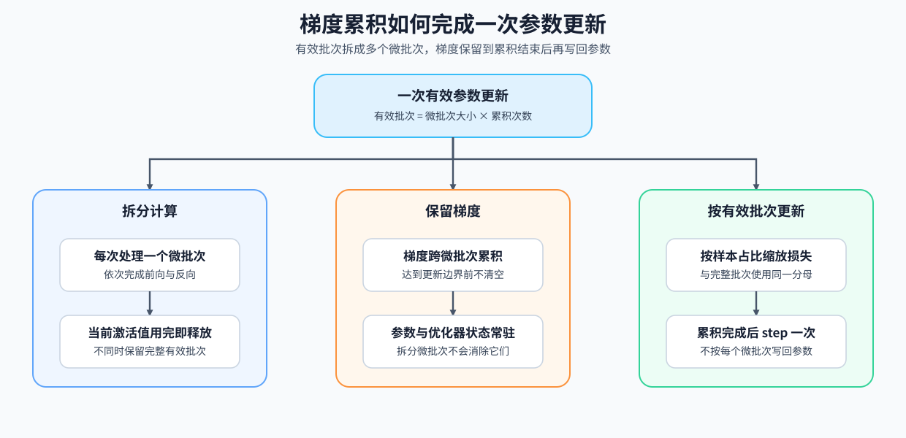

# 11. Gradient Accumulation | 梯度累积

**难度：** Medium | **环境：** [CPU 主线，GPU 可选](#runtime-environment) | **标签：** `训练控制`, `梯度累积`, `有效 batch` | **目标人群：** 训练机制学习者

> 🚀 **云端运行环境**
>
> 本章节的实战代码可以点击以下链接在免费 GPU 算力平台上直接运行：
>
> [](https://colab.research.google.com/github/datawhalechina/llm-algo-leetcode/blob/main/02_PyTorch_Algorithms/11_Gradient_Accumulation.ipynb)
> [](https://modelscope.cn/my/mynotebook) *(国内推荐：魔搭社区免费实例)*


---

## 本节导读

显存不足时，不一定要缩小一次参数更新看到的数据量。梯度累积把一个逻辑批次拆成多个微批次（micro-batch）：每个微批次完成前向和反向，梯度暂时保留；累积完成后再进行一次参数更新。这样降低的是单次计算的激活值峰值，而不是参数、梯度或优化器状态的长期驻留。

本节说明微批次、有效批次（effective batch）和一次参数更新的关系，并验证累积更新何时能与完整批次对齐。完成后，你将能区分计算批次与更新批次，并为后续学习率调度和端到端训练建立统一的更新口径。
<a id="runtime-environment"></a>

## 运行环境

- **基础练习：** 默认使用 [`BASE-CPU`](../guide.md#base-cpu)，运行 [Step 4 的题目与测试](#mechanism-practice)。
- **框架核对：** 使用 [`TRAIN-CPU`](../topic_discussion/backpropagation_training_mechanism/quickstart.md#train-cpu-quickstart)，完成 Step 4 后运行 [框架一致性核对](#framework-check)。
- **GPU 实测：** 使用 `TRAIN-CUDA-MECHANISM`，按 [Step 5](#gpu-experiment) 的说明配置并运行。

---
## 前置阅读

**导语：** 先理解优化器如何读取梯度并写回参数，再看多个微批次如何合成一次有效更新。
- [P0: 11. PyTorch Optimizers and Loss | 优化器与损失](../00_Prerequisites/11_PyTorch_Optimizers_and_Loss.md)
- [P0: 12. PyTorch Data Interface and Training Lifecycle | 数据接口与训练生命周期](../00_Prerequisites/12_PyTorch_Minimal_Training_Interface.md)

---
## Step 1：多个微批次何时形成一次参数更新

一个逻辑批次可以被拆成多个微批次。微批次是单次前向和反向的计算单位；有效批次是一次参数更新累计看到的全部样本；只有本轮所需的微批次都贡献梯度后，才形成一次有效更新。

| 对象 | 它表示什么 | 梯度累积下的关系 |
|:---|:---|:---|
| 微批次 | 单次前向与反向处理的样本 | 决定单次激活值峰值 |
| 累积次数 | 一个逻辑更新包含多少次微批次计算 | 决定梯度汇总次数 |
| 有效批次 | 一次参数更新看到的样本总量 | 微批次大小 × 累积次数 |
| 参数更新 | 梯度写回参数的一次事件 | 每个有效批次恰好一次 |


## Step 2：梯度累积改变哪一部分显存

把一个逻辑批次拆开后，每次只为一个微批次建立激活值，因此单次计算的峰值通常下降。参数、梯度和优化器状态仍跨所有微批次驻留；累积梯度也会一直保留到这次有效更新完成。

| 状态对象 | 在微批次间的行为 | 观察重点 |
|:---|:---|:---|
| 激活值 | 当前微批次反向完成后可以释放 | 单次计算的激活值峰值 |
| 参数与优化器状态 | 整次训练持续驻留 | 长期显存占用 |
| 梯度缓冲区 | 多个微批次间持续累积 | 有效更新前不能提前清空 |
| 输入与监督目标 | 分批进入模型 | 所有字段必须同步切分 |
## Step 3：怎样保持与完整批次相同的更新语义

设完整批次被均分为 $K$ 个微批次，并且每个微批次都计算样本平均损失。为了让累计梯度与完整批次的平均梯度对齐，第 $i$ 个微批次的梯度权重应为 $1/K$。若微批次大小不相等，则权重应改为 $n_i/N$，其中 $n_i$ 是当前微批次样本数，$N$ 是有效批次总样本数。

$$
\nabla L = \sum_{i=1}^{K} \frac{n_i}{N}\nabla L_i,\qquad N=\sum_{i=1}^{K}n_i.
$$

当所有微批次等长，即 $n_i=N/K$ 时，上式化为 $\nabla L=\frac{1}{K}\sum_{i=1}^{K}\nabla L_i$。这里 $L_i$ 是第 $i$ 个微批次的样本平均损失，$n_i/N$ 才是它在完整批次平均梯度中的权重。

| 对齐条件 | 做法 | 不满足时的结果 |
|:---|:---|:---|
| 样本与顺序 | 两条路径使用同一组样本和顺序 | 梯度来源不同，不能比较 |
| 输入字段 | 输入、掩码与监督目标使用同一切片范围 | 样本与监督目标错位 |
| 损失口径 | 两条路径都使用相同的求和或平均口径 | 梯度尺度不同 |
| 梯度权重 | 等长微批次使用 $1/K$；不等长时使用 $n_i/N$ | 累积梯度不能代表完整批次平均梯度 |
| 更新边界 | 全部微批次贡献梯度后只更新一次 | 参数更新次数发生变化 |
| 随机与批统计状态 | 两条路径保持可比较的随机状态和批统计语义 | 即使样本相同也可能无法严格等价 |


<a id="mechanism-practice"></a>

## Step 4：实现累积边界与等价梯度更新

题目区用固定大小的逻辑批次复现一次累积更新。骨架提供模型、损失计算、反向调用、参数更新和日志聚合；学习者只完成同步切片边界、平均损失缩放和有效更新边界。测试分别检查字段对齐、更新等价、边界判断与非法输入。

| TODO / 函数 | 学习者完成的机制 | 必须满足的约束 | 测试证据 |
|:---|:---|:---|:---|
| TODO 1：同步切分微批次<br>`slice_micro_batch` | 计算当前切片边界并同步切分所有字段 | 切片连续、无重叠，所有字段使用同一范围 | `test_micro_batch_slicing` 检查内容与形状 |
| TODO 2：缩放平均损失<br>`train_step_with_accumulation` | 将当前微批次损失换算为有效批次中的梯度权重 | 等长微批次使用 $1/K$，记录值仍保持原始损失口径 | `test_accumulated_update_equivalence` 对照完整批次 |
| TODO 3：识别有效更新边界<br>`is_update_boundary` | 判断已完成的微批次数是否构成一次有效更新 | 只有累积次数的整数倍返回真 | `test_update_boundary` 检查边界与参数更新次数 |

```python
import copy
import torch
import torch.nn as nn

```


```python
class TinyRegressor(nn.Module):
    """用于比较 full batch 与梯度累积更新结果的最小回归模型。"""
    def __init__(self, in_dim=4, out_dim=2):
        super().__init__()
        self.net = nn.Sequential(
            nn.Linear(in_dim, 16),
            nn.ReLU(),
            nn.Linear(16, out_dim),
        )

    def forward(self, x):
        """接收形状为 `[batch, in_dim]` 的输入并返回预测值。"""
        return self.net(x)


def slice_micro_batch(batch: dict[str, torch.Tensor], idx: int, accum_steps: int):
    """按 micro-batch 同步切分任意第一维对齐的张量字典。"""
    if accum_steps <= 0:
        raise ValueError("accum_steps 必须为正数")
    if idx < 0 or idx >= accum_steps:
        raise IndexError("micro-batch idx 超出范围")
    batch_size = next(iter(batch.values())).size(0)
    if any(value.size(0) != batch_size for value in batch.values()):
        raise ValueError("batch 字典中的 tensor 第一维必须一致")
    if batch_size % accum_steps != 0:
        raise ValueError("batch size 必须能被 accum_steps 整除")
    micro_size = batch_size // accum_steps
    # ==========================================
    # TODO 1: 同步切分微批次
    # ==========================================
    # start = ???  # 当前微批次在逻辑批次中的起始位置
    # end = ???  # 当前微批次的结束位置，不包含该位置
    # micro_batch = ???  # 所有字段使用同一 [start:end] 范围
    raise NotImplementedError("TODO 1: 请同步切分当前微批次")
    return micro_batch


def train_step_full_batch(model, optimizer, x, y):
    """使用完整 batch 完成一次参数更新，作为梯度累积的对照基线。

    `x` 与 `y` 的第一维必须相同；返回未缩放的 mean loss。
    """
    model.train()
    criterion = nn.MSELoss(reduction='mean')
    optimizer.zero_grad()
    pred = model(x)
    loss = criterion(pred, y)
    loss.backward()
    optimizer.step()
    return loss.detach().item()


def train_step_with_accumulation(model, optimizer, x, y, accum_steps=4):
    """使用多个 micro-batch 完成一次逻辑更新。

    `x` 与 `y` 的第一维必须一致，且 batch size 可被 `accum_steps` 整除。
    返回未缩放的 mean loss，便于与 full batch 对照；scheduler 应在本函数外、
    紧随本次 `optimizer.step()` 推进。
    """
    if x.size(0) != y.size(0):
        raise ValueError("x 和 y 的 batch 维度必须一致")
    if accum_steps <= 0 or x.size(0) % accum_steps != 0:
        raise ValueError("accum_steps 必须为正数，且 batch size 必须能被整除")

    model.train()
    criterion = nn.MSELoss(reduction="mean")
    optimizer.zero_grad()
    batch = {"x": x, "y": y}
    total_loss = 0.0

    for idx in range(accum_steps):
        micro_batch = slice_micro_batch(batch, idx, accum_steps)
        xb, yb = micro_batch["x"], micro_batch["y"]
        micro_loss = criterion(model(xb), yb)
        # ==========================================
        # TODO 2: 缩放平均损失
        # ==========================================
        # scaled_loss = ???  # 当前损失在有效批次平均梯度中的权重为 1 / accum_steps
        raise NotImplementedError("TODO 2: 请缩放当前微批次损失")
        scaled_loss.backward()
        total_loss += micro_loss.detach().item() / accum_steps

        if is_update_boundary(idx + 1, accum_steps):
            optimizer.step()
            optimizer.zero_grad()

    return total_loss


def is_update_boundary(completed_micro_steps: int, accum_steps: int):
    """判断已完成的微批次数是否构成一次有效更新。"""
    if completed_micro_steps <= 0 or accum_steps <= 0:
        raise ValueError("completed_micro_steps 和 accum_steps 必须为正数")
    # ==========================================
    # TODO 3: 识别有效更新边界
    # ==========================================
    # update_now = ???  # 仅在已完成次数达到累积边界时为 True
    raise NotImplementedError("TODO 3: 请判断有效更新边界")
    return update_now

```

## 测试

```python
# 每个测试函数对应 Step 4 的一项机制或输入边界。
def _build_accumulation_case():
    """构造固定随机种子的 full-batch / accumulation 对照输入。"""
    torch.manual_seed(42)
    return torch.randn(8, 4), torch.randn(8, 2), TinyRegressor()


def test_micro_batch_slicing():
    """验证 TODO 1：所有字段使用同一连续切片范围。"""
    batch = {
        "input_ids": torch.arange(24).view(8, 3),
        "attention_mask": torch.ones(8, 3, dtype=torch.long),
        "labels": torch.arange(24).view(8, 3),
    }
    micro = slice_micro_batch(batch, idx=1, accum_steps=4)
    for name, value in batch.items():
        assert torch.equal(micro[name], value[2:4]), f"{name} 未同步切分"


def test_update_boundary():
    """验证 TODO 3：只有累积次数的整数倍构成有效更新边界。"""
    observed = [is_update_boundary(step, 4) for step in range(1, 9)]
    assert observed == [False, False, False, True, False, False, False, True]


def test_accumulated_update_equivalence():
    """验证 TODO 2/3：缩放后的累积更新匹配完整批次且只更新一次。"""
    x, y, base_model = _build_accumulation_case()
    full_model, accum_model = copy.deepcopy(base_model), copy.deepcopy(base_model)
    full_opt = torch.optim.SGD(full_model.parameters(), lr=0.1)
    accum_opt = torch.optim.SGD(accum_model.parameters(), lr=0.1)
    accum_calls = [0]
    accum_step = accum_opt.step

    def counted_accum_step(*args, **kwargs):
        accum_calls[0] += 1
        return accum_step(*args, **kwargs)

    accum_opt.step = counted_accum_step
    loss_full = train_step_full_batch(full_model, full_opt, x, y)
    loss_accum = train_step_with_accumulation(accum_model, accum_opt, x, y, accum_steps=4)
    assert abs(loss_full - loss_accum) < 1e-6, "loss 记录口径不一致"
    assert accum_calls[0] == 1, "一次逻辑批次必须只更新一次"
    with torch.no_grad():
        assert torch.allclose(full_model(x), accum_model(x), atol=1e-6), "更新后的输出不一致"
    for full_param, accum_param in zip(full_model.parameters(), accum_model.parameters()):
        assert torch.allclose(full_param, accum_param, atol=1e-6), "参数更新不一致"


def test_gradient_accumulation_input_contract():
    """验证非法累积次数、错位批次和非法边界会被明确拒绝。"""
    x, y, base_model = _build_accumulation_case()
    for bad_steps in (0, 3):
        model = copy.deepcopy(base_model)
        optimizer = torch.optim.SGD(model.parameters(), lr=0.1)
        try:
            train_step_with_accumulation(model, optimizer, x, y, bad_steps)
        except ValueError:
            continue
        raise AssertionError(f"accum_steps={bad_steps} 应被拒绝")
    model = copy.deepcopy(base_model)
    optimizer = torch.optim.SGD(model.parameters(), lr=0.1)
    try:
        train_step_with_accumulation(model, optimizer, x, y[:-1], 4)
    except ValueError:
        pass
    else:
        raise AssertionError("x 和 y 的 batch 维度不一致时应被拒绝")
    for args in ((0, 4), (1, 0)):
        try:
            is_update_boundary(*args)
        except ValueError:
            continue
        raise AssertionError("非正更新计数必须被拒绝")


test_micro_batch_slicing()
test_accumulated_update_equivalence()
test_update_boundary()
test_gradient_accumulation_input_contract()
print("✅ 微批次切分、梯度尺度和有效更新边界测试通过。")
```

---

🛑 **STOP HERE** 🛑
<br><br><br><br><br><br><br><br><br><br>
> 请先尝试自己完成代码并跑通测试。<br>
> 如果你正在 Colab 中运行，并且遇到困难没有思路，可以向下滚动查看参考答案。
<br><br><br><br><br><br><br><br><br><br>

---
## 参考代码与解析

### 代码


```python
import copy
import torch
import torch.nn as nn

class TinyRegressor(nn.Module):
    def __init__(self, in_dim=4, out_dim=2):
        super().__init__()
        self.net = nn.Sequential(
            nn.Linear(in_dim, 16),
            nn.ReLU(),
            nn.Linear(16, out_dim),
        )

    def forward(self, x):
        return self.net(x)


def slice_micro_batch(batch: dict[str, torch.Tensor], idx: int, accum_steps: int):
    """按 micro-batch 同步切分任意第一维对齐的张量字典。"""
    if accum_steps <= 0:
        raise ValueError("accum_steps 必须为正数")
    if idx < 0 or idx >= accum_steps:
        raise IndexError("micro-batch idx 超出范围")
    batch_size = next(iter(batch.values())).size(0)
    if any(value.size(0) != batch_size for value in batch.values()):
        raise ValueError("batch 字典中的 tensor 第一维必须一致")
    if batch_size % accum_steps != 0:
        raise ValueError("batch size 必须能被 accum_steps 整除")
    micro_size = batch_size // accum_steps
    # TODO 1: 同步切分微批次
    start = idx * micro_size
    end = (idx + 1) * micro_size
    micro_batch = {key: value[start:end] for key, value in batch.items()}
    return micro_batch


def train_step_full_batch(model, optimizer, x, y):
    """使用完整 batch 完成一次参数更新。

    Args:
        model: 待训练模型。
        optimizer: 与 model 参数绑定的优化器。
        x, y: 第一维为 batch 的输入和目标张量。

    Returns:
        未缩放的当前 batch loss。
    """
    model.train()
    criterion = nn.MSELoss(reduction='mean')
    optimizer.zero_grad()
    pred = model(x)
    loss = criterion(pred, y)
    loss.backward()
    optimizer.step()
    return loss.detach().item()


def train_step_with_accumulation(model, optimizer, x, y, accum_steps=4):
    """使用多个 micro-batch 完成一次逻辑更新并返回未缩放 mean loss。"""
    if x.size(0) != y.size(0):
        raise ValueError("x 和 y 的 batch 维度必须一致")
    if accum_steps <= 0 or x.size(0) % accum_steps != 0:
        raise ValueError("accum_steps 必须为正数，且 batch size 必须能被整除")

    model.train()
    criterion = nn.MSELoss(reduction="mean")
    optimizer.zero_grad()
    batch = {"x": x, "y": y}
    total_loss = 0.0

    for idx in range(accum_steps):
        micro_batch = slice_micro_batch(batch, idx, accum_steps)
        xb, yb = micro_batch["x"], micro_batch["y"]
        micro_loss = criterion(model(xb), yb)

        # TODO 2: 缩放平均损失
        scaled_loss = micro_loss / accum_steps
        scaled_loss.backward()
        total_loss += micro_loss.detach().item() / accum_steps

        if is_update_boundary(idx + 1, accum_steps):
            optimizer.step()
            optimizer.zero_grad()
    return total_loss


def is_update_boundary(completed_micro_steps: int, accum_steps: int):
    """判断已完成的微批次数是否构成一次有效更新。"""
    if completed_micro_steps <= 0 or accum_steps <= 0:
        raise ValueError("completed_micro_steps 和 accum_steps 必须为正数")
    # TODO 3: 识别有效更新边界
    update_now = completed_micro_steps % accum_steps == 0
    return update_now

```

### 解析

**TODO 1：同步切分微批次**

- 每个字段必须使用同一半开区间，才能保持样本、掩码和监督目标对齐。
- `test_micro_batch_slicing` 核对所有字段的形状与内容是否来自相同范围。

**TODO 2：缩放平均损失**

- 等长微批次的平均损失需要乘以 $1/K$，累计梯度才与完整批次平均梯度同尺度。
- `test_accumulated_update_equivalence` 对照两条路径的损失、参数和更新后输出。

**TODO 3：识别有效更新边界**

- 已完成次数只有达到累积次数的整数倍时，才构成一次有效更新。
- `test_update_boundary` 检查连续边界序列，等价测试再确认一次逻辑批次只更新一次。

<a id="framework-check"></a>

## 框架一致性核对（可选）

下面使用 Accelerate 的梯度累积上下文核对更新边界和参数等价性；比较只使用 CPU 上的微型线性层。

| 核对对象 | 本节实现 | 成熟框架入口 | 通过条件 |
| --- | --- | --- | --- |
| 有效更新边界 | `is_update_boundary` | `Accelerator.accumulate` 的 `sync_gradients` | 两个微批次只在末次形成有效更新 |
| 更新后参数 | 完整批次更新 | Accelerate 累积更新 | 相同初始化、样本和学习率下参数一致 |

```python
from importlib.metadata import version

try:
    from accelerate import Accelerator
except ImportError:
    framework_check = {
        'status': 'skipped',
        'reason': '请使用 TRAIN-CPU 环境运行本单元',
    }
else:
    def check_gradient_accumulation_framework_conformance():
        """核对 Accelerate 的累积边界与完整批次参数更新是否一致。"""
        torch.manual_seed(42)
        x = torch.randn(4, 3)
        y = torch.randn(4, 2)
        full_model = nn.Linear(3, 2)
        accum_model = copy.deepcopy(full_model)
        full_optimizer = torch.optim.SGD(full_model.parameters(), lr=0.1)
        full_optimizer.zero_grad()
        nn.functional.mse_loss(full_model(x), y, reduction='mean').backward()
        full_optimizer.step()

        accelerator = Accelerator(cpu=True, gradient_accumulation_steps=2)
        accum_optimizer = torch.optim.SGD(accum_model.parameters(), lr=0.1)
        accum_model, accum_optimizer = accelerator.prepare(accum_model, accum_optimizer)
        sync_pattern = []
        for start in (0, 2):
            with accelerator.accumulate(accum_model):
                loss = nn.functional.mse_loss(
                    accum_model(x[start:start + 2]), y[start:start + 2], reduction='mean'
                )
                accelerator.backward(loss)
                sync_pattern.append(bool(accelerator.sync_gradients))
                accum_optimizer.step()
                accum_optimizer.zero_grad()

        unwrapped = accelerator.unwrap_model(accum_model)
        checks = {
            'sync_boundary_match': sync_pattern == [False, True],
            'parameter_update_match': all(
                torch.allclose(left, right, atol=1e-6, rtol=1e-6)
                for left, right in zip(full_model.parameters(), unwrapped.parameters())
            ),
        }
        failed = [name for name, passed in checks.items() if not passed]
        if failed:
            raise AssertionError(f'框架一致性核对失败：{failed}')
        return {
            'status': 'passed',
            'check_kind': 'framework_conformance',
            'versions': {'torch': version('torch'), 'accelerate': version('accelerate')},
            'checks': checks,
            'sync_gradients': sync_pattern,
        }

    framework_check = check_gradient_accumulation_framework_conformance()

framework_check
```

<a id="gpu-experiment"></a>

## Step 5：可选 GPU 实验——有效批次、显存与时间对照

CPU 题目确认微批次切分、损失缩放和更新边界；GPU 实验进一步比较同一有效批次下的更新一致性、增量峰值显存和训练 step 时间。

| 学习问题 | CPU 已确认 | GPU 要确认与后续使用 |
| --- | --- | --- |
| 梯度累积能否在保持同一次有效更新的同时降低训练峰值 | 切片顺序、损失缩放和一次更新的边界 | 参数与输出是否一致，以及 1 / 2 / 4 次累积的显存—时间交换；结果可进入训练策略复测 |

#### 5.1 环境与固定工作负载

本实验使用 `TRAIN-CUDA-MECHANISM`。首次运行先完成[专题 Quickstart](../topic_discussion/backpropagation_training_mechanism/quickstart.md#train-cuda-mechanism-quickstart)，已有环境需先通过同名 Profile 预检。本页下载固定的 Qwen2.5-0.5B checkpoint，以固定文本构造训练批次，不下载外部数据集。

| 配置层 | 本节固定口径 | 修改规则 |
| --- | --- | --- |
| 运行环境 | 单张 CUDA GPU；`TRAIN-CUDA-MECHANISM` | Profile 预检未返回 `status=ok` 时停止实验 |
| 资源档位 | 默认矩阵推荐至少 8 GiB；RTX 5070 Ti 的序列 128 / 256 对照实测最高 `max_memory_allocated` 约 6.48 GB | 显存不足时先将序列长度降为 64；仍不足时缩小有效批次并同步调整累积候选 |
| 工作负载 | `Qwen/Qwen2.5-0.5B`；有效批次 4；序列长度 128 | 改变模型、commit、有效批次或长度后使用新的运行标签 |
| 配对变量 | 每次更新使用 1 / 2 / 4 个微批次 | 共用模型初值、样本顺序、学习率、有效批次和更新次数 |
| 测量方法 | 参数/输出差异、step median/P95、增量峰值显存 | 先过更新一致性，再解释容量与时间 |
| 结果资产 | `benchmarks/results/train_gradient_accumulation/<semantic_id>_<run_label>.json` | 正式复测使用唯一标签并保留旧结果 |

```python
RUN_MODE = "dry_run"  # 默认值 dry_run：只核对配置；改为 real_gpu 执行真实 GPU 矩阵。
RUN_LABEL = "default"  # 默认值 default；正式复测改为唯一标签，避免覆盖旧结果。
PROFILE_ID = "TRAIN-CUDA-MECHANISM"  # 默认环境 Profile；本节不支持与其他专题环境混装。
SEMANTIC_ID = "TRAIN-GRADIENT-ACCUMULATION"  # 默认稳定机制 ID；结果聚合与跨页引用均使用该值。
MODEL_ID = "Qwen/Qwen2.5-0.5B"  # 默认真实模型；四节共用同一 checkpoint。
MODEL_REVISION = "main"  # 默认请求主分支；5.2 会解析并记录不可变 commit。
LOCAL_FILES_ONLY = False  # 默认允许首次下载；完成缓存后可改为 True 做离线复测。
GPU_CONFIG = {
    "parameter_dtype": "float32",  # 默认 FP32 参数；隔离微批次切分造成的差异。
    "effective_batch": 4,        # 默认 4；所有候选一次更新看到的样本数保持不变。
    "micro_batch_counts": [1, 2, 4],  # 默认比较完整批次、2 次累积和 4 次累积。
    "seq_len": 128,              # 默认 128 Token；增大会提高激活显存。
    "warmup_steps": 1,           # 默认 1；预热结果不计入统计。
    "repeat_steps": 20,          # 默认 20；用于稳定比较 median 与 P95。
    "learning_rate": 1e-4,       # 默认 1e-4；所有路径共用，并确保参数更新可观测。
    "seed": 42,                  # 默认 42；固定模型初值与输入。
    "prompts": ["Explain gradient accumulation.", "Compare micro-batch and effective batch."],  # 固定文本循环填充有效批次。
}
RESULTS_RELATIVE_DIR = "benchmarks/results/train_gradient_accumulation"  # 默认结果目录；正式结果按 RUN_LABEL 分文件保存。
```

#### 5.2 执行并保存 JSON

下方单元将模型 revision 解析为同一不可变 commit，再分别执行 1、2、4 次微批次累积。不同长度样本按有效监督 Token 数还原同一个全局损失分母；每条路径重新加载相同 checkpoint，并完成相同次数的有效更新。

```python
from pathlib import Path
import gc
import json
import torch
from tools.project_runtime import resolve_project_root
from tools.training_mechanism_runtime import (
    cuda_hardware_snapshot, load_causal_lm, median_and_p95, move_batch, prepare_causal_lm_batch,
)

REPO_ROOT = resolve_project_root()
RESULTS_DIR = REPO_ROOT / RESULTS_RELATIVE_DIR

if RUN_MODE == "real_gpu":
    if not torch.cuda.is_available():
        raise RuntimeError('需要 CUDA GPU；无 GPU 时保持 RUN_MODE="dry_run"。')
    device = torch.device("cuda")
    dtype_map = {"float32": torch.float32, "float16": torch.float16, "bfloat16": torch.bfloat16}
    parameter_dtype = dtype_map[GPU_CONFIG["parameter_dtype"]]
    effective_batch = GPU_CONFIG["effective_batch"]
    if any(effective_batch % count != 0 for count in GPU_CONFIG["micro_batch_counts"]):
        raise ValueError("effective_batch 必须能被所有 micro_batch_counts 整除")
    torch.manual_seed(GPU_CONFIG["seed"])
    torch.cuda.manual_seed_all(GPU_CONFIG["seed"])
    prepared = prepare_causal_lm_batch(
        MODEL_ID, MODEL_REVISION, GPU_CONFIG["prompts"], effective_batch, GPU_CONFIG["seq_len"],
        local_files_only=LOCAL_FILES_ONLY,
    )
    resolved_commit = prepared.pop("resolved_model_commit")
    resolution_source = prepared.pop("revision_resolution_source")
    tokenizer_class = prepared.pop("tokenizer_class")

    def run_effective_update(model, optimizer, batch, accumulation_count):
        optimizer.zero_grad(set_to_none=True)
        chunked = {key: value.chunk(accumulation_count, dim=0) for key, value in batch.items()}
        valid_target_count = (batch["labels"][:, 1:] != -100).sum()
        effective_loss = torch.zeros((), device=batch["labels"].device)
        for chunk_index in range(accumulation_count):
            micro_batch = {key: chunks[chunk_index] for key, chunks in chunked.items()}
            micro_target_count = (micro_batch["labels"][:, 1:] != -100).sum()
            micro_loss = model(**micro_batch).loss
            loss_weight = micro_target_count / valid_target_count
            (micro_loss * loss_weight).backward()
            effective_loss += micro_loss.detach() * loss_weight
        optimizer.step()
        return float(effective_loss)

    def measure_path(accumulation_count):
        model = load_causal_lm(
            MODEL_ID, resolved_commit, device, parameter_dtype=parameter_dtype, local_files_only=LOCAL_FILES_ONLY,
        )
        model.train()
        batch = move_batch(prepared, device)
        optimizer = torch.optim.SGD(model.parameters(), lr=GPU_CONFIG["learning_rate"])
        probe_name, probe_parameter = next(
            (name, parameter)
            for name, parameter in model.named_parameters()
            if name.endswith("self_attn.q_proj.weight") and parameter.requires_grad
        )
        initial_probe = probe_parameter.detach().float().reshape(-1)[:4096].cpu().clone()
        correctness_loss = run_effective_update(model, optimizer, batch, accumulation_count)
        correctness_probe = probe_parameter.detach().float().cpu().clone()
        for _ in range(GPU_CONFIG["warmup_steps"]):
            run_effective_update(model, optimizer, batch, accumulation_count)
        step_ms = []
        peak_allocated_mb = []
        peak_incremental_mb = []
        losses = []
        for _ in range(GPU_CONFIG["repeat_steps"]):
            optimizer.zero_grad(set_to_none=True)
            torch.cuda.empty_cache()
            torch.cuda.synchronize(device)
            allocated_before = torch.cuda.memory_allocated(device)
            torch.cuda.reset_peak_memory_stats(device)
            start_event = torch.cuda.Event(enable_timing=True)
            end_event = torch.cuda.Event(enable_timing=True)
            start_event.record()
            losses.append(run_effective_update(model, optimizer, batch, accumulation_count))
            end_event.record()
            torch.cuda.synchronize(device)
            step_ms.append(start_event.elapsed_time(end_event))
            peak_bytes = torch.cuda.max_memory_allocated(device)
            peak_allocated_mb.append(peak_bytes / 2**20)
            peak_incremental_mb.append((peak_bytes - allocated_before) / 2**20)
        median_ms, p95_ms = median_and_p95(step_ms)
        final_probe = probe_parameter.detach().float().reshape(-1)[:4096].cpu()
        result = {
            "accumulation_count": accumulation_count,
            "micro_batch_size": effective_batch // accumulation_count,
            "median_step_ms": median_ms,
            "p95_step_ms": p95_ms,
            "peak_allocated_mb": max(peak_allocated_mb),
            "peak_incremental_mb": max(peak_incremental_mb),
            "correctness_loss": correctness_loss,
            "final_loss": losses[-1],
            "probe_parameter": probe_name,
            "update_delta_max": (final_probe - initial_probe).abs().max().item(),
            "parameter_probe": correctness_probe,
        }
        del optimizer, model, batch
        gc.collect()
        torch.cuda.empty_cache()
        return result

    measured = [measure_path(count) for count in GPU_CONFIG["micro_batch_counts"]]
    baseline = measured[0]
    for candidate in measured:
        candidate["parameter_max_abs_diff"] = (candidate["parameter_probe"] - baseline["parameter_probe"]).abs().max().item()
        candidate["loss_abs_diff"] = abs(candidate["correctness_loss"] - baseline["correctness_loss"])

    tolerance = 2e-4 if parameter_dtype == torch.float32 else 5e-3
    correctness_passed = all(
        item["update_delta_max"] > 0.0
        and item["parameter_max_abs_diff"] <= tolerance
        and item["loss_abs_diff"] <= tolerance
        for item in measured
    )
    capacity_improved = measured[-1]["peak_allocated_mb"] < baseline["peak_allocated_mb"]
    serializable_metrics = []
    for item in measured:
        serializable_metrics.append({
            key: round(float(value), 6) if isinstance(value, float) else value
            for key, value in item.items() if key != "parameter_probe"
        })
    record = {
        "schema_version": "training-mechanism-gpu/v4",
        "semantic_id": SEMANTIC_ID,
        "profile_id": PROFILE_ID,
        "run_label": RUN_LABEL,
        "model": {"id": MODEL_ID, "requested_revision": MODEL_REVISION, "resolved_commit": resolved_commit, "resolution_source": resolution_source, "tokenizer_class": tokenizer_class},
        "workload": GPU_CONFIG,
        "hardware": cuda_hardware_snapshot(),
        "metrics": serializable_metrics,
        "correctness": {"tolerance": tolerance, "passed": correctness_passed},
        "failure": None,
        "evidence_level": "real_model_mechanism_benchmark",
        "decision": "accept" if correctness_passed and capacity_improved else ("tune" if correctness_passed else "reject"),
    }
    RESULTS_DIR.mkdir(parents=True, exist_ok=True)
    RESULT_PATH = RESULTS_DIR / f"{SEMANTIC_ID.lower()}_{RUN_LABEL}.json"
    RESULT_PATH.write_text(json.dumps(record, ensure_ascii=False, indent=2, allow_nan=False), encoding="utf-8")
    print(f"结果已保存：{RESULT_PATH}")
else:
    print('GPU 实验默认关闭；完成 Profile 预检后设置 RUN_MODE="real_gpu"。')
```

#### 5.3 读取结果

读取同一 `RUN_LABEL` 的结果文件，不重新执行训练。先核对更新一致性，再比较累积次数增加后峰值显存是否下降、step 时间是否上升。

```python
if RUN_MODE == "real_gpu":
    result_path = RESULTS_DIR / f"{SEMANTIC_ID.lower()}_{RUN_LABEL}.json"
    if not Path(result_path).is_file():
        raise FileNotFoundError(f"未找到结果，请先运行 5.2：{result_path}")
    record = json.loads(Path(result_path).read_text(encoding="utf-8"))
    for item in record["metrics"]:
        print(
            f"accum={item['accumulation_count']} | micro_batch={item['micro_batch_size']} | "
            f"median={item['median_step_ms']:.2f} ms | p95={item['p95_step_ms']:.2f} ms | "
            f"peak={item['peak_allocated_mb']:.1f} MB | incremental={item['peak_incremental_mb']:.1f} MB | "
            f"update_delta={item['update_delta_max']:.2e} | parameter_diff={item['parameter_max_abs_diff']:.2e}"
        )
    print(f"correctness={record['correctness']} | decision={record['decision']} | evidence={record['evidence_level']}")
else:
    print("dry_run：没有读取 GPU 结果。")
```

#### 5.4 解释证据与决策

先检查 `failure`、Profile 和有效批次口径，再确认不同累积次数得到同一次更新，最后比较绝对峰值、增量峰值与 step 时间。

RTX 5070 Ti 上的两组结果均通过更新一致性：序列 128 时梯度驻留重叠高于 activation 节省，峰值没有下降；序列 256 时 2 / 4 次累积分别降低约 6.7% / 17.3% 峰值，但 median 增加约 21.4% / 33.5%。因此梯度累积是受序列长度与状态占比约束的容量—时间交换，不是无条件显存优化。

| 观察项 | 读取字段 | 当前结果 | 解释与动作 |
| --- | --- | --- | --- |
| 运行与口径 | `failure`、`profile_id`、`workload` | `default12` / `seq256_default1`；有效批次 4；20 次复测 | 两组只改变序列长度，模型、commit、样本和更新次数保持一致 |
| 机制与路径 | `accumulation_count`、`micro_batch_size` | 1 / 2 / 4 次累积，对应微批次 4 / 2 / 1 | 三条路径均完成同一次逻辑更新 |
| 正确性 | `parameter_max_abs_diff`、`loss_abs_diff` | 两组参数探针差异均为 0；loss 最大差异 `6e-6` | 远低于 `2e-4` 容差，机制一致性通过 |
| 资源与性能 | `peak_allocated_mb`、`median_step_ms`、`p95_step_ms` | 序列 128：峰值不降；序列 256：峰值最多降 17.3%，median 最多增 33.5% | activation 压力上升后出现容量收益，同时保留串行执行代价 |
| 证据与决策 | `evidence_level`、`decision` | 序列 128 为 `tune`；序列 256 为 `accept` | 按目标序列长度选择最小必要累积次数，并在项目 workload 中复测 |
## 相关阅读

完成本节后，可以继续学习调度时钟，或在端到端微调中复用相同的有效批次口径。

- [12. Optimizer Updates and Learning Rate Scheduling | 优化器更新与学习率调度](../02_PyTorch_Algorithms/12_Optimizer_Updates_and_Learning_Rate_Scheduling.md)
- [Hugging Face Accelerate：梯度累积指南](https://huggingface.co/docs/accelerate/usage_guides/gradient_accumulation)
- [15. End-to-End Fine-Tuning Experiment | 端到端微调实验](../02_PyTorch_Algorithms/15_End_to_End_Fine_Tuning_Experiment.md)
