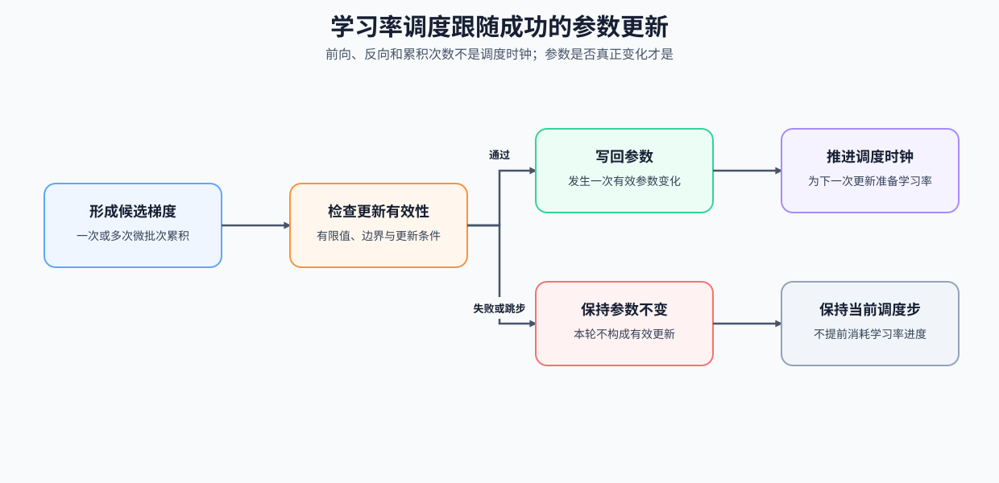

# 12. Optimizer Updates and Learning Rate Scheduling | 优化器更新与学习率调度

**难度：** Medium | **环境：** [CPU 主线](#runtime-environment) | **标签：** `训练控制`, `优化器更新`, `学习率调度` | **目标人群：** 训练与微调学习者

> 🚀 **云端运行环境**
>
> 本章节的实战代码可以点击以下链接在免费 GPU 算力平台上直接运行：
>
> [](https://colab.research.google.com/github/datawhalechina/llm-algo-leetcode/blob/main/02_PyTorch_Algorithms/12_Optimizer_Updates_and_Learning_Rate_Scheduling.ipynb)
> [](https://modelscope.cn/my/mynotebook) *(国内推荐：魔搭社区免费实例)*


---

## 本节导读

优化器决定“怎样沿梯度更新参数”，学习率调度决定“每次更新走多大一步”。训练初期的统计量和参数方向尚不稳定；主训练阶段需要保持足够的更新幅度；接近训练终点时，又要逐步降低步幅以便收敛。WSD（Warmup–Stable–Decay）把这三个需求组织成同一条学习率曲线。

本节聚焦有效参数更新的节奏：学习率阶段只随成功的参数更新推进。梯度累积负责把多个微批次合成一次有效更新；监督微调训练循环再把数据、损失、优化器和评估连接起来。
<a id="runtime-environment"></a>

## 运行环境

- **基础练习：** 默认使用 [`BASE-CPU`](../guide.md#base-cpu)，运行 [Step 4 的题目与测试](#mechanism-practice)。
- **框架核对：** 使用 [`TRAIN-CPU`](../topic_discussion/backpropagation_training_mechanism/quickstart.md#train-cpu-quickstart)，完成 Step 4 后运行 [框架一致性核对](#framework-check)。

---
## 前置阅读

**导语：** 如果已经理解损失如何产生梯度，但不清楚参数何时真正更新，可先回看优化器和最小训练循环；随后再把更新次数与学习率阶段对应起来。

- [P0: 11. PyTorch Optimizers and Loss | 优化器与损失](../00_Prerequisites/11_PyTorch_Optimizers_and_Loss.md)
- [P0: 12. PyTorch Data Interface and Training Lifecycle | 数据接口与训练生命周期](../00_Prerequisites/12_PyTorch_Minimal_Training_Interface.md)

---
## Step 1：参数更新如何形成调度时钟

一次训练更新包含梯度形成、有效性判断、参数写回和下一步学习率准备。调度时钟不按前向或反向次数推进，而按成功的参数变化事件推进；这样梯度累积和跳步都不会让学习率提前消耗。

| 事件 | 参数是否变化 | 调度时钟 | 作用 |
|:---|:---|:---|:---|
| 梯度形成 | 否 | 不推进 | 为一次候选更新汇总方向 |
| 有效性判断 | 否 | 不推进 | 决定本轮是否允许写回参数 |
| 成功参数更新 | 是 | 推进一步 | 消耗当前学习率并进入下一更新步 |
| 跳过更新 | 否 | 保持不变 | 避免学习率进度领先于真实参数状态 |


## Step 2：Warmup、Stable 与 Decay 如何组成 WSD 曲线

WSD 的阶段长度以有效参数更新计数。设基础学习率为 $\eta_{max}$，最小比例为 $r$，Warmup、Stable、Decay 的更新数分别为 $T_w,T_s,T_d$，当前成功更新编号为 $t$。一种端点对齐的离散 WSD 写法是：

$$
\eta_t=
\begin{cases}
\eta_{max}\dfrac{t}{T_w-1}, & 0\le t<T_w,\\
\eta_{max}, & T_w\le t<T_w+T_s,\\
r\eta_{max}+(1-r)\eta_{max}\dfrac{1+\cos(\pi u_t)}{2}, & T_w+T_s\le t<T_w+T_s+T_d,
\end{cases}
$$

其中 $u_t=\dfrac{t-T_w-T_s}{T_d-1}$ 是 Decay 阶段进度；单步阶段需单独定义端点，避免分母为零。该公式把起步、稳定训练和收敛阶段映射到同一条只由成功更新驱动的曲线。

| 阶段 | 输入 | 学习率行为 | 需要验证的边界 |
|:---|:---|:---|:---|
| Warmup | 当前有效更新步 | 线性从 0 升至基础学习率 | 起点为 0，末步达到基础学习率 |
| Stable | 当前有效更新步 | 保持基础学习率 | 每一步均不改变学习率 |
| Cosine Decay | 衰减阶段内进度 | 余弦下降至最小比例 | 首步衔接基础学习率，末步达到最小学习率 |


## Step 3：为什么只有成功更新才能推进调度

令 $u$ 表示尝试更新次数，$s(u)=\sum_{j=1}^{u}\mathbf 1[\text{第 }j\text{ 次更新成功}]$ 表示成功更新计数。调度器读取的是 $s(u)$，而不是 $u$。一个微批次只贡献一次前向、损失和反向；只有累积完成且梯度通过有效性检查，参数才真正改变。调度器应与成功的参数变化事件绑定，否则梯度累积或混合精度溢出会让学习率曲线比实际参数更新更快走完。混合精度下的缩放、有限值检查和跳步顺序可继续阅读 [TRAIN-MIXED-PRECISION-BACKWARD](./TRAIN-MIXED-PRECISION-BACKWARD_Mixed_Precision_Backward.md)。

| 对象 | 发生频率 | 作用 | 是否推进 WSD 阶段 |
|:---|:---|:---|:---|
| 微批次 | 每个计算批次 | 前向、损失、反向并累积梯度 | 否 |
| 有效批次完成 | 若干微批次后 | 形成一次候选更新所需的梯度 | 否 |
| 成功参数更新 | 梯度有效且允许写回时 | 改变参数，并为下一步准备学习率 | 是 |
| 溢出或跳步 | 梯度无效时 | 保持参数与学习率阶段不变 | 否 |
<a id="mechanism-practice"></a>

## Step 4：实现 WSD Scheduler 并验证更新语义

题目区提供 WSD 的配置校验、阶段判断和稳定阶段路径。学习者只计算 Warmup 的线性进度与 Decay 的余弦系数；测试覆盖阶段边界、单步阶段、配置契约，以及调度时钟是否只随有效更新推进。

| TODO / 函数 | 学习者完成的机制 | 必须满足的约束 | 测试证据 |
|:---|:---|:---|:---|
| TODO 1：计算 Warmup 进度<br>`WSD_Scheduler._lr_for_step` | 将阶段内更新步映射到线性进度 | 多步阶段从 0 到 1；单步阶段直接使用基础学习率 | `test_warmup_and_stable` 检查起点、终点和稳定阶段 |
| TODO 2：计算余弦衰减<br>`WSD_Scheduler._lr_for_step` | 将衰减阶段进度转换为学习率系数 | 多步阶段从基础学习率到最小比例；单步阶段直接到最小值 | `test_cosine_decay` 检查边界、单调性和单步阶段 |

```python
import math
import torch
from torch.optim.lr_scheduler import LRScheduler
```


```python
# 题目设计：在给定配置契约和阶段骨架中补全 WSD 的两段变化曲线。
# step 始终表示成功的参数更新次数，不表示微批次次数。
class WSD_Scheduler(LRScheduler):
    """按有效参数更新执行 Warmup-Stable-Decay 学习率调度。

    Args:
        optimizer: 承载参数和基础学习率的优化器。
        num_warmup_steps: Warmup 的有效更新次数，可以为 0。
        num_stable_steps: Stable 的有效更新次数，可以为 0。
        num_decay_steps: Cosine Decay 的有效更新次数，可以为 0。
        min_lr_ratio: 最后学习率相对基础学习率的比例，取值在 [0, 1]。

    Note:
        外部训练循环应在一次有效更新后依次调用
        `optimizer.step()` 与 `scheduler.step()`；梯度累积的 micro-batch 不单独推进调度器。
    """
    def __init__(
        self,
        optimizer,
        num_warmup_steps,
        num_stable_steps,
        num_decay_steps,
        min_lr_ratio=0.1,
        last_epoch=-1,
    ):
        self.num_warmup_steps = num_warmup_steps
        self.num_stable_steps = num_stable_steps
        self.num_decay_steps = num_decay_steps
        self.min_lr_ratio = min_lr_ratio
        self.total_steps = num_warmup_steps + num_stable_steps + num_decay_steps

        invalid_lengths = any(
            not isinstance(value, int) or isinstance(value, bool) or value < 0
            for value in (num_warmup_steps, num_stable_steps, num_decay_steps)
        )
        invalid_ratio = not isinstance(min_lr_ratio, (int, float)) or not 0.0 <= min_lr_ratio <= 1.0
        if invalid_lengths or self.total_steps == 0 or invalid_ratio:
            raise ValueError("invalid WSD schedule configuration")
        super().__init__(optimizer, last_epoch)

    def _lr_for_step(self, base_lr, step):
        """返回一个基础学习率在指定有效更新步上的 WSD 值。"""
        if step < self.num_warmup_steps:
            if self.num_warmup_steps == 1:
                return base_lr
            # ==========================================
            # TODO 1: 计算 Warmup 进度
            # ==========================================
            # warmup_progress = ???  # 阶段首步为 0，末步为 1
            raise NotImplementedError("TODO 1: 请计算 Warmup 进度")
            return base_lr * warmup_progress

        stable_end = self.num_warmup_steps + self.num_stable_steps
        if step < stable_end:
            return base_lr

        if self.num_decay_steps == 0:
            return base_lr * self.min_lr_ratio

        min_lr = base_lr * self.min_lr_ratio
        if self.num_decay_steps == 1:
            return min_lr
        decay_step = min(step - stable_end, self.num_decay_steps - 1)
        # ==========================================
        # TODO 2: 计算余弦衰减
        # ==========================================
        # decay_progress = ???  # 衰减阶段首步为 0，末步为 1
        # cosine_factor = ???  # 从 1 单调下降到 0
        raise NotImplementedError("TODO 2: 请计算余弦衰减系数")
        return min_lr + (base_lr - min_lr) * cosine_factor

    def get_lr(self):
        step = self._step_count - 1
        return [self._lr_for_step(base_lr, step) for base_lr in self.base_lrs]
```

## 测试

```python
# 每个测试函数分别验证 WSD 数值机制、配置边界或调度时钟。
def _collect_wsd_lrs(warmup, stable, decay, max_lr=3e-4, min_lr_ratio=0.1):
    """按有效 optimizer update 推进 scheduler，并收集每次更新前使用的学习率。"""
    model = torch.nn.Linear(2, 2)
    optimizer = torch.optim.AdamW(model.parameters(), lr=max_lr)
    scheduler = WSD_Scheduler(
        optimizer,
        num_warmup_steps=warmup,
        num_stable_steps=stable,
        num_decay_steps=decay,
        min_lr_ratio=min_lr_ratio,
    )
    lrs = []
    for _ in range(warmup + stable + decay):
        lrs.append(optimizer.param_groups[0]["lr"])
        optimizer.step()
        scheduler.step()
    return lrs


def test_wsd_input_contract():
    """非法阶段长度、空 schedule 和非法最小比例必须被拒绝。"""
    model = torch.nn.Linear(2, 2)
    optimizer = torch.optim.SGD(model.parameters(), lr=1e-3)
    invalid_configs = [(-1, 1, 1, 0.1), (0, 0, 0, 0.1), (1, 1, 1, 1.2)]
    for warmup, stable, decay, ratio in invalid_configs:
        try:
            WSD_Scheduler(optimizer, warmup, stable, decay, ratio)
        except ValueError:
            continue
        raise AssertionError("非法 WSD 配置必须抛出 ValueError")


def test_warmup_and_stable():
    """验证 TODO 1：多步和单步 Warmup，以及 Stable 保持基础学习率。"""
    warmup, stable, max_lr = 3, 4, 3e-4
    lrs = _collect_wsd_lrs(warmup, stable, 0, max_lr=max_lr)
    assert lrs[0] == 0.0, "warmup 的第一个 update 应从 0 开始"
    assert abs(lrs[warmup - 1] - max_lr) < 1e-8, "warmup 末步应达到基础学习率"
    assert all(abs(lr - max_lr) < 1e-8 for lr in lrs[warmup:warmup + stable]), "stable 应保持基础学习率"
    single = _collect_wsd_lrs(1, 0, 0, max_lr=2e-4, min_lr_ratio=0.2)
    assert abs(single[0] - 2e-4) < 1e-8, "单步 Warmup 应直接使用基础学习率"


def test_cosine_decay():
    """验证 TODO 2：余弦衰减的首尾、单调性和单步边界。"""
    warmup, stable, decay = 2, 2, 3
    max_lr, min_lr_ratio = 3e-4, 0.1
    lrs = _collect_wsd_lrs(warmup, stable, decay, max_lr, min_lr_ratio)
    decay_lrs = lrs[warmup + stable:warmup + stable + decay]
    assert abs(decay_lrs[0] - max_lr) < 1e-8, "decay 首步应衔接基础学习率"
    assert abs(decay_lrs[-1] - max_lr * min_lr_ratio) < 1e-8, "decay 末步应达到最小学习率"
    assert all(left >= right for left, right in zip(decay_lrs, decay_lrs[1:])), "decay 阶段不应升高"
    decay_only = _collect_wsd_lrs(0, 0, 1, max_lr=2e-4, min_lr_ratio=0.2)
    assert abs(decay_only[0] - 4e-5) < 1e-8, "单步 Decay 应直接使用最小学习率"


def test_scheduler_update_clock():
    """验证微批次反向不推进调度器，成功参数更新才推进一次。"""
    model = torch.nn.Linear(2, 1)
    optimizer = torch.optim.SGD(model.parameters(), lr=1.0)
    scheduler = WSD_Scheduler(optimizer, 2, 1, 1, min_lr_ratio=0.1)
    initial_lr = optimizer.param_groups[0]["lr"]
    for _ in range(2):
        loss = model(torch.ones(1, 2)).sum()
        loss.backward()
    assert optimizer.param_groups[0]["lr"] == initial_lr, "微批次反向不应推进调度器"
    optimizer.step()
    scheduler.step()
    assert abs(optimizer.param_groups[0]["lr"] - 1.0) < 1e-8, "一次有效更新后应推进到下一 WSD 阶段位置"


test_wsd_input_contract()
test_warmup_and_stable()
test_cosine_decay()
test_scheduler_update_clock()
print("✅ WSD 配置、阶段边界和有效更新计数通过。")
```

---

🛑 **STOP HERE** 🛑
<br><br><br><br><br><br><br><br><br><br>
> 请先尝试自己完成代码并跑通测试。<br>
> 如果你正在 Colab 中运行，并且遇到困难没有思路，可以向下滚动查看参考答案。
<br><br><br><br><br><br><br><br><br><br>

---
## 参考代码与解析

### 代码


```python
# 参考实现：与题目区保持同一类、参数、方法和 TODO 位置，只补全机制规则。
class WSD_Scheduler(LRScheduler):
    """按有效参数更新执行 Warmup-Stable-Decay 学习率调度。"""
    def __init__(
        self,
        optimizer,
        num_warmup_steps,
        num_stable_steps,
        num_decay_steps,
        min_lr_ratio=0.1,
        last_epoch=-1,
    ):
        self.num_warmup_steps = num_warmup_steps
        self.num_stable_steps = num_stable_steps
        self.num_decay_steps = num_decay_steps
        self.min_lr_ratio = min_lr_ratio
        self.total_steps = num_warmup_steps + num_stable_steps + num_decay_steps

        # 配置契约由骨架提供，确保阶段长度和最小学习率比例可解释。
        invalid_lengths = any(
            not isinstance(value, int) or isinstance(value, bool) or value < 0
            for value in (num_warmup_steps, num_stable_steps, num_decay_steps)
        )
        invalid_ratio = not isinstance(min_lr_ratio, (int, float)) or not 0.0 <= min_lr_ratio <= 1.0
        if invalid_lengths or self.total_steps == 0 or invalid_ratio:
            raise ValueError("invalid WSD schedule configuration")
        super().__init__(optimizer, last_epoch)

    def _lr_for_step(self, base_lr, step):
        """返回一个基础学习率在指定有效更新步上的 WSD 值。"""
        if step < self.num_warmup_steps:
            # TODO 1: 计算 Warmup 进度
            if self.num_warmup_steps == 1:
                return base_lr
            warmup_progress = step / (self.num_warmup_steps - 1)
            return base_lr * warmup_progress

        stable_end = self.num_warmup_steps + self.num_stable_steps
        if step < stable_end:
            return base_lr

        if self.num_decay_steps == 0:
            return base_lr * self.min_lr_ratio

        # TODO 2: 计算余弦衰减
        min_lr = base_lr * self.min_lr_ratio
        if self.num_decay_steps == 1:
            return min_lr
        decay_step = min(step - stable_end, self.num_decay_steps - 1)
        decay_progress = decay_step / (self.num_decay_steps - 1)
        cosine_factor = 0.5 * (1.0 + math.cos(math.pi * decay_progress))
        return min_lr + (base_lr - min_lr) * cosine_factor

    def get_lr(self):
        step = self._step_count - 1
        return [self._lr_for_step(base_lr, step) for base_lr in self.base_lrs]
```

### 解析

**TODO 1：计算 Warmup 进度**

- 多步 Warmup 将阶段首尾映射到 0 和 1；单步阶段没有中间进度，直接使用基础学习率。
- `test_warmup_and_stable` 同时检查多步边界、单步边界和稳定阶段。

**TODO 2：计算余弦衰减**

- 衰减进度先从全局更新步转换为阶段内比例，再用余弦系数从 1 平滑降到 0。
- `test_cosine_decay` 检查首尾、单调性和单步直接到最小学习率的约定。
<a id="framework-check"></a>

## 框架一致性核对（可选）

下面用 PyTorch `LambdaLR` 表达同一条 WSD 曲线，并只在成功参数更新后推进两个调度器。

| 核对对象 | 本节实现 | 成熟框架入口 | 通过条件 |
| --- | --- | --- | --- |
| WSD 学习率序列 | `WSD_Scheduler` | PyTorch `LambdaLR` | 相同阶段配置下每个成功更新步的学习率一致 |
| 调度时钟 | 成功更新计数 | `optimizer.step` 后调用 `scheduler.step` | 跳步保持学习率，时钟只累计成功更新 |

```python
from importlib.metadata import version


def check_scheduler_framework_conformance():
    """核对 WSD 曲线与 PyTorch LambdaLR，并验证跳步不推进调度时钟。"""
    warmup, stable, decay, min_ratio = 2, 2, 3, 0.1

    def factor(step):
        if step < warmup:
            return 1.0 if warmup == 1 else step / (warmup - 1)
        stable_end = warmup + stable
        if step < stable_end:
            return 1.0
        if decay == 1:
            return min_ratio
        progress = min(step - stable_end, decay - 1) / (decay - 1)
        return min_ratio + (1.0 - min_ratio) * 0.5 * (1.0 + math.cos(math.pi * progress))

    parameter_a = torch.nn.Parameter(torch.tensor(1.0))
    parameter_b = torch.nn.Parameter(torch.tensor(1.0))
    optimizer_a = torch.optim.SGD([parameter_a], lr=1.0)
    optimizer_b = torch.optim.SGD([parameter_b], lr=1.0)
    local_scheduler = WSD_Scheduler(optimizer_a, warmup, stable, decay, min_ratio)
    framework_scheduler = torch.optim.lr_scheduler.LambdaLR(optimizer_b, lr_lambda=factor)
    local_curve = [local_scheduler._lr_for_step(1.0, step) for step in range(7)]
    framework_curve = [factor(step) for step in range(7)]

    successful_updates = 0
    lr_during_attempts = []
    for update_succeeded in (True, False, True):
        before_attempt = framework_scheduler.get_last_lr()[0]
        if update_succeeded:
            optimizer_b.step()
            framework_scheduler.step()
            successful_updates += 1
        lr_during_attempts.append((before_attempt, framework_scheduler.get_last_lr()[0]))
    checks = {
        'piecewise_curve_match': all(
            math.isclose(left, right, rel_tol=1e-12, abs_tol=1e-12)
            for left, right in zip(local_curve, framework_curve)
        ),
        'skipped_update_holds_lr': math.isclose(lr_during_attempts[1][0], lr_during_attempts[1][1], rel_tol=0.0, abs_tol=0.0),
        'clock_counts_successful_updates': framework_scheduler.last_epoch == successful_updates,
    }
    failed = [name for name, passed in checks.items() if not passed]
    if failed:
        raise AssertionError(f'框架一致性核对失败：{failed}')
    return {
        'status': 'passed',
        'check_kind': 'framework_conformance',
        'versions': {'torch': version('torch')},
        'checks': checks,
    }


framework_check = check_scheduler_framework_conformance()
framework_check
```

## 相关阅读

- [11. Gradient Accumulation | 梯度累积](./11_Gradient_Accumulation.md)
- [PyTorch LRScheduler 文档](https://pytorch.org/docs/stable/optim.html#how-to-adjust-learning-rate)
- [Hugging Face Transformers Scheduler API](https://huggingface.co/docs/transformers/main_classes/optimizer_schedules)
