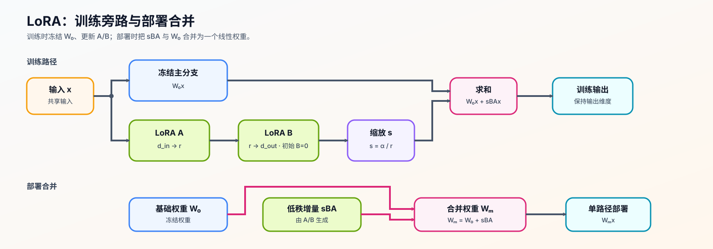
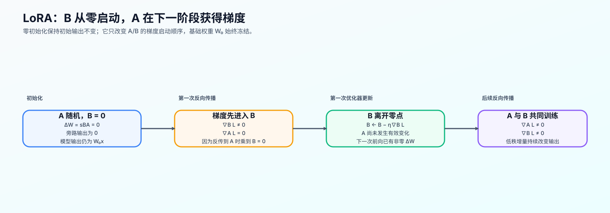

# 14. LoRA Tutorial | 低秩适配教程

**难度：** Medium | **环境：** [CPU 主线，GPU 可选](#runtime-environment) | **标签：** `训练微调`, `LoRA`, `PEFT` | **目标人群：** 训练机制学习者

> 🚀 **云端运行环境**
>
> 本章节的实战代码可以点击以下链接在免费 GPU 算力平台上直接运行：
>
> [](https://colab.research.google.com/github/datawhalechina/llm-algo-leetcode/blob/main/02_PyTorch_Algorithms/14_LoRA_Tutorial.ipynb)
> [](https://modelscope.cn/my/mynotebook) *(国内推荐：魔搭社区免费实例)*


---

## 本节导读

大模型微调最直接的做法是更新全部参数，但这会把显存压力迅速放大：除了模型权重，还要保存梯度和优化器状态。很多场景里，我们真正需要的不是重写整个模型，而是在已有能力上做小幅适配。

LoRA 的思路是冻结原始权重，只增加一条低秩可训练旁路。第 13 节确定 SFT 监督目标，LoRA 决定哪些参数承担更新；两者可以组合成 LoRA SFT，并由第 15 节的有效更新循环推进。本节沿着“挂载位置—低秩增量—权重合并”观察这条旁路，完成后能够判断参数预算、表示路径和部署形态之间的关系。

**关键词：** `LoRA`, `PEFT`, `adapter`, `target modules`

---
<a id="runtime-environment"></a>

## 运行环境

- **基础练习：** 默认使用 [`BASE-CPU`](../guide.md#base-cpu)，运行 [Step 4 的题目与测试](#mechanism-practice)。
- **框架核对：** 如需核对 PEFT 的 LoRA 注入与合并行为，使用 [`PT-CPU`](../topic_discussion/post_training_optimization/quickstart.md#pt-cpu-quickstart)；该环境已包含基础练习依赖，可在完成 Step 4 后直接运行 [框架一致性核对](#framework-check)。
- **GPU 实测：** 如需验证真实模型的目标模块命中、更新资源与合并误差，阅读 [Step 5](#gpu-experiment)；实验环境与固定工作负载见其中 5.1。

---
## 前置阅读

**导语：** 先理解模块参数和 SFT 监督契约，再看 LoRA 如何限制可训练路径。
- [P0: 09. PyTorch nn.Module Basics | nn.Module 基础](../00_Prerequisites/09_PyTorch_nn_Module_Basics.md)
- [13. SFT Supervision and Loss | SFT 监督边界与损失](../02_PyTorch_Algorithms/13_SFT_Training_Loop.md)

---
## Step 1：LoRA 如何选择更新路径并贯穿训练与部署

全参微调会更新模型中的全部可训练权重。LoRA 保持基座线性变换冻结，只在选定表示路径旁增加低秩增量；选择挂载范围决定哪部分表示允许变化，低秩旁路随后承担训练更新，并可在部署前合并回基座权重。

| 位置 | 可适配的投影范围 | 改变的表示路径 | 适合的起点 |
| --- | --- | --- | --- |
| Attention | 查询与值投影 | 查询和内容聚合路径 | 参数预算很紧时的基础选择 |
| Attention | 查询、键、值与输出投影 | 更完整的注意力表示 | 需要提高注意力适配容量时 |
| MLP | 门控、扩展与回投影 | token 级前馈表示 | 需要提高前馈适配容量时 |



## Step 2：低秩参数、缩放与零初始化如何确定训练起点

挂载位置确定后，还需要回答三个问题：低秩旁路能否保持原层的输入输出维度、训练开始时是否扰动冻结基座，以及不同 Rank 下怎样控制增量幅度。下面先由维度确定 A/B 的形状，再引入缩放与零初始化。

设层输入为 $x\in\mathbb{R}^{d_{in}}$，层输出为 $h\in\mathbb{R}^{d_{out}}$，冻结权重为 $W_0\in\mathbb{R}^{d_{out}\times d_{in}}$。LoRA 在主变换旁并联两个小矩阵：$A$ 将输入映射到秩 $r$，$B$ 再映射回输出空间；$\Delta W$ 表示低秩权重增量，$\alpha$ 是控制增量幅度的缩放超参数。标准缩放取 $s=\alpha/r$，因此权重增量与前向输出分别为：

$$\Delta W=sBA, \qquad h=W_0x+\Delta Wx=W_0x+\frac{\alpha}{r}BAx$$

单个线性层新增的可训练参数量为：

$$N_{\mathrm{LoRA}}=r d_{in}+d_{out}r=r(d_{in}+d_{out})$$

训练开始时令 $B=0$，因此 $\Delta W=0$，模块输出与冻结基座一致。此时 $B$ 可以在第一个反向传播步骤获得梯度，而 $A$ 的梯度因乘有 $B$ 暂时为零；当 $B$ 离开零点后，$A$ 才开始接收非零梯度。这是零初始化带来的预期更新顺序，不代表梯度链路断开。

| 对象 | 形状或定义 | 训练时的作用 |
| --- | --- | --- |
| 基座权重 $W_0$ | $d_{out} \times d_{in}$ | 冻结并保留原始能力 |
| 降维矩阵 $A$ | $r \times d_{in}$ | 将输入压到低秩空间 |
| 升维矩阵 $B$ | $d_{out} \times r$ | 恢复输出维度；初始为零 |
| 秩 $r$ | 低秩空间宽度 | 控制旁路容量与参数量 |
| 缩放系数 $s$ | 标准 LoRA 中为 $\alpha/r$ | 控制旁路相对基座的更新幅度 |
| 随机失活 | 只作用于旁路输入 | 减少小数据适配时的过拟合 |



## Step 3：前向增量如何在部署时合并

未合并时，输入同时经过冻结主分支与低秩旁路。部署前可把增量写回主权重：

$$W_{\mathrm{merged}}=W_0+\frac{\alpha}{r}BA, \qquad W_{\mathrm{merged}}x=W_0x+\frac{\alpha}{r}BAx$$

这样部署时不再额外执行两次旁路矩阵乘法。合并等价性应在评估模式或旁路随机失活关闭时核对；训练模式下的随机失活会使逐次输出不同，不能直接作为合并误差。实现还必须保证同一增量只写回一次。

| 路径 | 计算 | 需要验证的事实 |
| --- | --- | --- |
| 训练 / 未合并 | 主分支输出与低秩增量相加 | 更新只发生在低秩旁路 |
| 初始状态 | 升维矩阵为零 | 输出等于冻结基座输出 |
| 合并后推理 | 主权重已经吸收低秩增量 | 输出与未合并推理路径一致 |
| 重复合并 | 不再改变主权重 | 同一增量只能写回一次 |

<a id="mechanism-practice"></a>

## Step 4：实现低秩旁路与合并不变量

题目区实现一个最小 `LoRALinear`：先建立冻结基座与可训练 A/B 参数，再实现主分支与低秩旁路相加，最后把同一增量一次性写回基座。初始化规则由骨架提供，使注意力集中在会改变 LoRA 行为的三个机制。

| TODO / 函数 | 学习者完成的机制 | 必须满足的约束 | 测试证据 |
| --- | --- | --- | --- |
| TODO 1：建立低秩参数路径<br>`LoRALinear.__init__` | 创建冻结基座与可训练 A/B 参数 | 参数形状匹配 rank，$\alpha/r$ 缩放明确，基座冻结且 A/B 可训练 | 检查基座冻结、A/B 形状、可训练参数量以及初始权重增量为零 |
| TODO 2：计算旁路增量<br>`LoRALinear.forward` | 在未合并状态叠加低秩旁路 | 主分支与旁路使用同一输入，缩放规则一致 | 检查旁路公式数值一致，并验证首步梯度沿预期路径进入 A/B |
| TODO 3：生成合并增量<br>`LoRALinear.merge_weights` | 根据 A/B 和缩放得到待写回权重 | 增量形状与基座一致，只在未合并状态写回 | 检查合并增量正确、合并前后输出一致，且重复合并不再改变权重 |


```python
import torch
import torch.nn as nn
import math
```


```python
# 题目设计：冻结主权重，只让 LoRA 旁路承担可训练增量。
# 三个 TODO 分别覆盖低秩参数契约、旁路前向和幂等 merge；初始化细节由骨架提供。
def count_trainable_parameters(module: nn.Module) -> int:
    """统计模块中 requires_grad=True 的参数数量。"""
    return sum(p.numel() for p in module.parameters() if p.requires_grad)


class LoRALinear(nn.Module):
    """在线性层旁路中加入可训练低秩增量的 LoRA 模块。

    主线性层被冻结；`lora_A` 和 `lora_B` 学习增量，`merged` 记录增量是否已经写回主权重。

    Args:
        in_features: 输入特征维度。
        out_features: 输出特征维度。
        r: LoRA 低秩维度，必须为正数。
        lora_alpha: 控制旁路增量的缩放系数。
        lora_dropout: 仅作用于未合并 LoRA 分支输入的 dropout 概率。

    Note:
        `merged=False` 时执行主分支与 LoRA 旁路；`merged=True` 时只执行已更新的主分支。
    """
    def __init__(self, in_features: int, out_features: int, r: int = 8, lora_alpha: int = 16, lora_dropout: float = 0.0):
        """冻结基础线性层，只训练低秩 LoRA 旁路。"""
        super().__init__()
        if in_features <= 0 or out_features <= 0:
            raise ValueError('in_features 和 out_features 必须为正数')
        if r <= 0:
            raise ValueError('r 必须为正数')
        if lora_alpha <= 0:
            raise ValueError('lora_alpha 必须为正数')
        if lora_dropout < 0.0 or lora_dropout > 1.0:
            raise ValueError('lora_dropout 必须位于 [0, 1]')
        self.r = r
        self.lora_alpha = lora_alpha
        self.scaling = self.lora_alpha / self.r
        self.lora_dropout = nn.Dropout(lora_dropout)
        self.merged = False  # 记录 LoRA 增量是否已合并到主权重

        # ==========================================
        # TODO 1：建立冻结基座与可训练低秩旁路
        # ==========================================
        # self.linear = ???  # 无 bias 的基础线性层
        # self.linear.weight.requires_grad = ???  # 是否允许基座权重接收梯度
        # self.lora_A = ???  # [r, in_features]，先降维
        # self.lora_B = ???  # [out_features, r]，再升维
        raise NotImplementedError("TODO 1：建立冻结基座与 LoRA 低秩参数")
        self.reset_parameters()

    def reset_parameters(self):
        """按基础层和 LoRA 旁路各自的规则初始化参数。"""
        # 骨架初始化：B 为零，保证训练开始时 ΔW = BA = 0。
        nn.init.kaiming_uniform_(self.linear.weight, a=math.sqrt(5))
        nn.init.kaiming_uniform_(self.lora_A, a=math.sqrt(5))
        nn.init.zeros_(self.lora_B)


    def forward(self, x: torch.Tensor) -> torch.Tensor:
        """计算基础线性层输出，并在未 merge 时叠加 LoRA 增量。"""
        result = self.linear(x)
        if self.merged:
            return result

        # ==========================================
        # TODO 2：计算未合并状态的低秩旁路增量
        # ==========================================
        # adapter_input = ???  # 只对旁路输入应用 dropout。
        # adapter_delta = ???  # 经过 A/B 并应用 scaling 的输出增量。
        raise NotImplementedError("TODO 2：实现 LoRA 旁路前向")
        return result + adapter_delta

    def merge_weights(self):
        """将 LoRA 增量合并到基础权重，并保证重复调用安全。"""
        if self.merged:
            return

        # ==========================================
        # TODO 3：生成与基座同形状的合并增量
        # ==========================================
        # delta_weight = ???  # 由 A/B 与 scaling 得到，不修改 A/B。
        raise NotImplementedError("TODO 3：生成 LoRA 合并增量")
        with torch.no_grad():
            self.linear.weight.add_(delta_weight)
        self.merged = True

```

## 测试

运行下方 CPU 机制测试，检查参数冻结、低秩矩阵形状、梯度路径、旁路前向公式和合并不变量。

```python
# 测试设计：验证冻结参数、LoRA 形状、梯度路径、前向公式和 merge 不变量。
# baseline 是冻结主线性层；candidate 是 LoRA 旁路或 merge 后的等价路径。
def _build_lora_test_case():
    """构造固定尺寸的 CPU-first LoRA 测试样本。"""
    torch.manual_seed(42)
    in_dim, out_dim = 128, 256
    layer = LoRALinear(in_dim, out_dim, r=8, lora_alpha=16, lora_dropout=0.0)
    x = torch.randn(32, 10, in_dim)
    return layer, x, in_dim, out_dim

def _assert_parameter_contract(layer, in_dim, out_dim):
    """验证冻结主权重、LoRA 形状和可训练参数量。"""
    assert not layer.linear.weight.requires_grad, "主权重应该被冻结"
    assert count_trainable_parameters(layer) == 8 * (in_dim + out_dim), "LoRA 可训练参数量统计错误"
    assert layer.lora_A.shape == (8, in_dim), "lora_A 形状错误"
    assert layer.lora_B.shape == (out_dim, 8), "lora_B 形状错误"

def _assert_gradient_route(layer, x):
    """验证零初始化时的梯度顺序，以及基座始终冻结。"""
    layer(x).sum().backward()
    assert layer.lora_B.grad is not None and torch.any(layer.lora_B.grad != 0), "零初始化时 B 应先获得非零梯度"
    assert layer.lora_A.grad is not None and torch.all(layer.lora_A.grad == 0), "B 为零时 A 的首步梯度应为零"
    assert layer.linear.weight.grad is None, "冻结主权重不应该获得梯度"

    layer.zero_grad(set_to_none=True)
    with torch.no_grad():
        layer.lora_B.normal_(0, 0.02)
    layer(x).sum().backward()
    assert layer.lora_A.grad is not None and torch.any(layer.lora_A.grad != 0), "B 离开零点后 A 应获得非零梯度"
    assert layer.lora_B.grad is not None and torch.any(layer.lora_B.grad != 0), "B 应持续获得非零梯度"
    layer.zero_grad(set_to_none=True)
    with torch.no_grad():
        layer.lora_B.zero_()

def _assert_forward_and_merge(layer, x):
    """验证 LoRA 前向公式以及 merge 前后的等价性。"""
    with torch.no_grad():
        out_base = layer.linear(x)
        out_initial = layer(x)
        assert torch.allclose(out_initial, out_base), "初始化错误：lora_B 应为零"
        layer.lora_B.normal_(0, 0.02)
        out_separate = layer(x)
        manual = layer.linear(x) + (x @ layer.lora_A.T) @ layer.lora_B.T * layer.scaling
        assert torch.allclose(out_separate, manual, atol=1e-6), "LoRA 前向公式或缩放实现错误"
        layer.eval()
        layer.merge_weights()
        out_merged = layer(x)
        assert layer.merged, "merge 后应记录 merged 状态"
        assert torch.allclose(out_separate, out_merged, atol=1e-5), "merge 后输出与分离路径不一致"
        merged_weight = layer.linear.weight.detach().clone()
        layer.merge_weights()
        assert torch.allclose(layer.linear.weight, merged_weight), "重复 merge 改变了主权重"

def _assert_lora_boundaries(in_dim, out_dim, x):
    """验证非法参数和 dropout 的训练/评估行为。"""
    for kwargs in ({'r': 0}, {'lora_alpha': 0}, {'lora_dropout': 1.1}):
        try:
            LoRALinear(in_dim, out_dim, **kwargs)
        except ValueError:
            continue
        raise AssertionError("非法参数没有触发 ValueError")

    dropout_layer = LoRALinear(in_dim, out_dim, r=4, lora_dropout=0.5)
    with torch.no_grad():
        dropout_layer.lora_B.normal_(0, 0.02)
    dropout_layer.eval()
    assert torch.allclose(dropout_layer(x), dropout_layer(x)), "eval 模式输出应保持稳定"
    dropout_layer.train()
    assert not torch.allclose(dropout_layer(x), dropout_layer(x)), "train 模式应启用 LoRA dropout"

def test_lora():
    """运行 CPU-first 的 LoRA 机制测试。"""
    try:
        layer, x, in_dim, out_dim = _build_lora_test_case()
        _assert_parameter_contract(layer, in_dim, out_dim)
        _assert_gradient_route(layer, x)
        # 清理上一项梯度，避免影响后续仅比较前向的机制证据。
        layer.zero_grad(set_to_none=True)
        _assert_forward_and_merge(layer, x)
        _assert_lora_boundaries(in_dim, out_dim, x)
        print("✅ LoRA 核心算子、参数统计和 merge 逻辑实现正确。")
        return

    except NotImplementedError:
        print("请先完成 TODO 部分的代码！")
        raise
    except (AttributeError, NameError, TypeError, ValueError) as e:
        print("代码可能未完成，导致变量未定义" if isinstance(e, NameError) else "代码可能未完成，导致了类型错误")
        raise NotImplementedError("请先完成 TODO 部分的代码！") from e
    except AssertionError as e:
        print(f"❌ 测试失败: {e}")
        raise NotImplementedError("请先完成 TODO 部分的代码！") from e
    except Exception as e:
        print(f"❌ 发生异常: {e}")
        raise

test_lora()

```

---

🛑 **STOP HERE** 🛑
<br><br><br><br><br><br><br><br><br><br>
> 请先尝试自己完成代码并跑通测试。<br>
> 如果你正在 Colab 中运行，并且遇到困难没有思路，可以向下滚动查看参考答案。
<br><br><br><br><br><br><br><br><br><br>

---
## 参考代码与解析

### 代码


```python
def count_trainable_parameters(module: nn.Module) -> int:
    """统计模块中 requires_grad=True 的参数数量。"""
    return sum(p.numel() for p in module.parameters() if p.requires_grad)


class LoRALinear(nn.Module):
    """在线性层旁路中加入可训练低秩增量的 LoRA 模块。"""
    def __init__(self, in_features: int, out_features: int, r: int = 8, lora_alpha: int = 16, lora_dropout: float = 0.0):
        super().__init__()
        if in_features <= 0 or out_features <= 0:
            raise ValueError('in_features 和 out_features 必须为正数')
        if r <= 0:
            raise ValueError('r 必须为正数')
        if lora_alpha <= 0:
            raise ValueError('lora_alpha 必须为正数')
        if lora_dropout < 0.0 or lora_dropout > 1.0:
            raise ValueError('lora_dropout 必须位于 [0, 1]')
        self.r = r
        self.lora_alpha = lora_alpha
        self.scaling = self.lora_alpha / self.r
        self.lora_dropout = nn.Dropout(lora_dropout)
        self.merged = False

        # TODO 1：建立冻结基座与可训练低秩旁路。
        self.linear = nn.Linear(in_features, out_features, bias=False)
        self.linear.weight.requires_grad = False

        self.lora_A = nn.Parameter(torch.empty(r, in_features))
        self.lora_B = nn.Parameter(torch.empty(out_features, r))

        self.reset_parameters()

    def reset_parameters(self):
        """按基础层和 LoRA 旁路各自的规则初始化参数。"""
        # 骨架初始化：B 为零，保证训练开始时 ΔW = BA = 0。
        nn.init.kaiming_uniform_(self.linear.weight, a=math.sqrt(5))
        nn.init.kaiming_uniform_(self.lora_A, a=math.sqrt(5))
        nn.init.zeros_(self.lora_B)

    def forward(self, x: torch.Tensor) -> torch.Tensor:
        """计算基础线性层输出，并在未 merge 时叠加 LoRA 增量。"""
        # TODO 2：计算未合并状态的低秩旁路增量。
        result = self.linear(x)
        if self.merged:
            return result
        adapter_input = self.lora_dropout(x)
        adapter_delta = (adapter_input @ self.lora_A.T) @ self.lora_B.T * self.scaling
        return result + adapter_delta

    def merge_weights(self):
        """将 LoRA 增量合并到基础权重，并保证重复调用安全。"""
        if self.merged:
            return
        # TODO 3：生成与基座同形状的合并增量。
        delta_weight = (self.lora_B @ self.lora_A) * self.scaling
        with torch.no_grad():
            self.linear.weight.add_(delta_weight)
        self.merged = True

```

### 解析

#### TODO 1：建立冻结基座与低秩参数

- 基座权重冻结，`lora_A` 与 `lora_B` 保持可训练。
- A/B 形状分别为 `[r, in_features]` 与 `[out_features, r]`，可训练参数量为 `r × (in_features + out_features)`。
- B 初始化为零，使初始增量为零；首步 B 获得非零梯度，B 离开零点后 A 才获得非零梯度。

#### TODO 2：计算低秩旁路

- LoRA 分支按 `(x @ A.T) @ B.T × alpha / r` 计算，并与冻结主分支相加。
- dropout 只作用于 LoRA 分支；测试检查基座梯度为空而 A/B 获得梯度。

#### TODO 3：合并权重

- 将 `(B @ A) × alpha / r` 一次性写回基座权重。
- 测试检查合并前后输出一致，并确认重复调用不会再次修改权重。
<a id="framework-check"></a>

## 框架一致性核对（可选）

下面在一个最小线性模块上注入 PEFT LoRA，不下载模型。两条路径共享基座权重、A/B 参数、秩和缩放，用来核对参数契约、旁路输出与合并结果。

| 核对项 | 本节实现 | PEFT 路径 | 通过条件 |
| --- | --- | --- | --- |
| 注入与冻结 | 冻结 `linear.weight`，训练 A/B | `get_peft_model` 注入目标线性层 | 基座冻结，A/B 形状、缩放与可训练参数量一致 |
| 旁路计算 | $W_0x+(\alpha/r)BAx$ | 相同 rank、alpha 与 A/B 权重 | 初始输出和受控 A/B 下的旁路输出分别一致 |
| 部署合并 | 一次写回 $(\alpha/r)BA$ | `merge_and_unload` | 合并输出与合并后的主权重均符合本节公式 |


```python
from importlib.metadata import version

try:
    from peft import LoraConfig, get_peft_model
except ImportError:
    framework_check = {
        "status": "skipped",
        "reason": "请使用 PT-CPU 环境运行本单元",
    }
else:
    class _TinyProjectionModel(nn.Module):
        def __init__(self):
            super().__init__()
            self.proj = nn.Linear(4, 3, bias=False)

        def forward(self, x):
            return self.proj(x)

    def check_lora_framework_conformance():
        """核对最小 LoRA 实现与 PEFT 的参数、旁路和合并契约。"""
        torch.manual_seed(42)
        rank, alpha = 2, 4
        local_layer = LoRALinear(4, 3, r=rank, lora_alpha=alpha, lora_dropout=0.0).eval()
        base_model = _TinyProjectionModel()
        with torch.no_grad():
            base_model.proj.weight.copy_(local_layer.linear.weight)
        peft_model = get_peft_model(base_model, LoraConfig(
            r=rank, lora_alpha=alpha, lora_dropout=0.0,
            target_modules=["proj"], bias="none",
        )).eval()
        # 直接读取已注入层，才能比较 PEFT 为默认 adapter 保存的 A/B 与缩放。
        peft_layer = peft_model.base_model.model.proj
        inputs = torch.randn(5, 4)

        with torch.no_grad():
            initial_local = local_layer(inputs)
            initial_framework = peft_model(inputs)
            controlled_A = torch.tensor([
                [0.1, -0.2, 0.3, -0.4],
                [-0.3, 0.2, 0.1, 0.5],
            ])
            controlled_B = torch.tensor([
                [0.2, -0.1], [-0.4, 0.3], [0.1, 0.25],
            ])
            # 两条路径写入同一组受控参数，避免随机初始化掩盖前向公式差异。
            local_layer.lora_A.copy_(controlled_A)
            local_layer.lora_B.copy_(controlled_B)
            peft_layer.lora_A["default"].weight.copy_(controlled_A)
            peft_layer.lora_B["default"].weight.copy_(controlled_B)
            local_output = local_layer(inputs)
            framework_output = peft_model(inputs)

        local_trainable = count_trainable_parameters(local_layer)
        framework_trainable = sum(
            parameter.numel() for parameter in peft_model.parameters() if parameter.requires_grad
        )
        merged_model = peft_model.merge_and_unload().eval()
        with torch.no_grad():
            merged_output = merged_model(inputs)
            expected_weight = (
                local_layer.linear.weight
                + (local_layer.lora_B @ local_layer.lora_A) * local_layer.scaling
            )

        checks = {
            "base_weight_frozen": not peft_layer.base_layer.weight.requires_grad,
            "adapter_shapes_match": (
                tuple(peft_layer.lora_A["default"].weight.shape) == tuple(local_layer.lora_A.shape)
                and tuple(peft_layer.lora_B["default"].weight.shape) == tuple(local_layer.lora_B.shape)
            ),
            "scaling_match": math.isclose(
                float(peft_layer.scaling["default"]), float(local_layer.scaling)
            ),
            "trainable_parameter_count_match": local_trainable == framework_trainable,
            "initial_output_match": bool(torch.allclose(
                initial_local, initial_framework, atol=1e-6, rtol=1e-6
            )),
            "adapter_output_match": bool(torch.allclose(
                local_output, framework_output, atol=1e-6, rtol=1e-6
            )),
            "merge_output_match": bool(torch.allclose(
                framework_output, merged_output, atol=1e-6, rtol=1e-6
            )),
            "merged_weight_match": bool(torch.allclose(
                merged_model.proj.weight, expected_weight, atol=1e-6, rtol=1e-6
            )),
        }
        failed_checks = [name for name, passed in checks.items() if not passed]
        if failed_checks:
            raise AssertionError(f"框架一致性核对失败：{failed_checks}")

        return {
            "status": "passed",
            "versions": {"peft": version("peft")},
            "framework_path": "get_peft_model + merge_and_unload",
            "checks": checks,
            "rank": rank,
            "alpha": alpha,
            "scaling": local_layer.scaling,
            "trainable_parameters": local_trainable,
            "merge_max_abs_error": float((framework_output - merged_output).abs().max().item()),
        }

    framework_check = check_lora_framework_conformance()

framework_check
```

<a id="gpu-experiment"></a>

## Step 5：可选 GPU 实验——真实模型 LoRA 注入与合并

CPU 题目确认低秩旁路的公式、梯度路径和合并不变量；GPU 实验使用 PEFT 在真实模型上扫描三种目标模块集合，检查实际匹配范围、可训练参数、更新资源和合并等价性。

| 学习问题 | CPU 已确认 | GPU 要确认与后续使用 |
| --- | --- | --- |
| 扩大 LoRA 挂载范围会改变什么 | 单个线性层的低秩增量、冻结与 merge | 真实模块是否命中、可训练参数和资源如何变化、PEFT merge 是否保持输出；结果交给 LoRA 变体项目复测 |

<a id="gpu-experiment-setup"></a>

### 5.1 环境与固定工作负载

本实验使用 [`PT-SFT-CUDA`](../gpu_environment_assets.md#pt-sft-cuda)。首次运行先完成[后训练实验 Quickstart](../topic_discussion/post_training_optimization/quickstart.md#pt-sft-cuda-quickstart)；已有环境只需通过 Profile 预检，并从同一解释器启动 JupyterLab。页面、工作负载和结果状态见[后训练优化实验资产表](../topic_discussion/post_training_optimization/experiment_assets.md)。

| 配置层 | 本节固定口径 | 修改规则 |
| --- | --- | --- |
| 运行环境 | `PT-SFT-CUDA`；单张 NVIDIA GPU；参考显存 8 GiB | 预检失败时停止实验，不向环境追加量化或 Serving 依赖 |
| 模型 / 数据来源 | `Qwen/Qwen2.5-0.5B`；两条内置指令样本 | 5.2 自动固定模型 commit；本实验不下载数据集 |
| 工作负载 | 长度 128；rank 8；3 次更新；三种目标模块集合 | 改变候选、rank、长度或更新次数后递增 workload version |
| 配对变量 | 查询 / 值投影 → 全注意力投影 → 注意力与 MLP 投影 | 模型、输入、dtype、随机种子和测量方法保持一致 |
| 测量方法 | 模块命中、可训练参数、初始等价、梯度、更新时间、峰值显存与 merge 误差 | 不用单步损失下降代替独立任务质量 |
| 结果资产 | `benchmarks/results/pt_lora_targets/pt-lora-targets_<run_label>.json` | 正式复测使用唯一标签并保留旧结果 |

```python
RUN_MODE = "dry_run"  # 默认值 dry_run：只登记计划；改为 real_gpu 执行真实 LoRA 候选矩阵。
RUN_LABEL = "default"  # 默认值 default；正式复测改为唯一标签，避免覆盖旧结果。
ENVIRONMENT_PROFILE = "PT-SFT-CUDA"  # 默认值 PT-SFT-CUDA；运行前必须通过同名 Profile 预检。
MODEL_ID = "Qwen/Qwen2.5-0.5B"  # 默认基础模型；更换模型后不得与旧结果直接合并。
MODEL_REVISION = "main"  # 默认 main；5.2 自动解析并记录实际模型 commit。
WORKLOAD_ID = "pt-lora-targets"  # 稳定工作负载身份；不随运行标签变化。
WORKLOAD_VERSION = "v3"  # v3 分离训练机制准入、BF16 合并准入及两类峰值显存。
MAX_LENGTH = 128  # 默认值 128 token；增大会提高激活占用和更新时间。
LORA_RANK = 8  # 默认值 8；增大会提高适配容量与可训练参数量。
LORA_ALPHA = 16  # 默认值 16；与 rank 共同决定旁路缩放。
UPDATE_STEPS = 3  # 默认值 3 次；只用于形成可观测 adapter 增量，不代表模型收敛。
LEARNING_RATE = 1e-3  # 默认值 1e-3；用于短程机制更新，不作为正式训练配方。
MIN_MERGE_COSINE = 0.999  # 默认值 0.999；约束合并前后完整 logits 的方向一致性。
MIN_MERGE_TOP1_AGREEMENT = 0.98  # 默认值 0.98；约束合并前后的逐位置贪心预测一致率。
MAX_MERGE_LOSS_DIFF = 0.02  # 默认值 0.02；约束同一监督批次上的 loss 绝对差。
SEED = 42  # 默认值 42；固定初始化、输入顺序和候选对照。
LOCAL_FILES_ONLY = False  # 默认值 False；已缓存相同 commit 且离线运行时改为 True。
TARGET_MODULE_SETS = {
    "attention_qv": ["q_proj", "v_proj"],
    "attention_all": ["q_proj", "k_proj", "v_proj", "o_proj"],
    "attention_mlp": ["q_proj", "k_proj", "v_proj", "o_proj", "gate_proj", "up_proj", "down_proj"],
}  # 默认三档挂载范围；修改键或模块集合后递增 WORKLOAD_VERSION。
OUTPUT_RELATIVE_PATH = f"benchmarks/results/pt_lora_targets/{WORKLOAD_ID}_{RUN_LABEL}.json"  # 由运行标签派生的仓库相对路径。
```

### 5.2 执行并保存 JSON

5.2 只消费 5.1 的配置。三种候选分别从同一模型 commit 重新加载，在同一批监督输入上完成短程更新，再比较 PEFT 注入前后与 merge 前后的输出。

```python
import gc
import math
import platform
import time

import torch
from tools.notebook_runtime import failure_record, package_version, resolve_model_commit, save_json
from tools.project_runtime import resolve_project_root
from tools.training_mechanism_runtime import cuda_hardware_snapshot, gradient_l2_norm, logit_agreement, median_and_p95

REPO_ROOT = resolve_project_root()
OUTPUT_PATH = REPO_ROOT / OUTPUT_RELATIVE_PATH
result = {
    "schema_version": "post-training-mechanism-gpu/v1",
    "semantic_id": "PT-LORA-TARGETS",
    "environment_profile": ENVIRONMENT_PROFILE,
    "run_mode": RUN_MODE,
    "run_label": RUN_LABEL,
    "framework": {"python": platform.python_version(), "torch": torch.__version__, "transformers": package_version("transformers"), "peft": package_version("peft")},
    "hardware": {"cuda_available": torch.cuda.is_available(), "cuda": torch.version.cuda},
    "model": {"id": MODEL_ID, "requested_revision": MODEL_REVISION, "resolved_commit": None},
    "workload": {"id": WORKLOAD_ID, "version": WORKLOAD_VERSION, "max_length": MAX_LENGTH, "rank": LORA_RANK, "alpha": LORA_ALPHA, "update_steps": UPDATE_STEPS, "learning_rate": LEARNING_RATE, "target_module_sets": TARGET_MODULE_SETS, "merge_thresholds": {"min_cosine": MIN_MERGE_COSINE, "min_top1_agreement": MIN_MERGE_TOP1_AGREEMENT, "max_loss_diff": MAX_MERGE_LOSS_DIFF}, "seed": SEED},
    "baseline": "attention_qv", "candidates": [], "failure": None,
    "evidence_level": "dry_run", "decision": "not_measured", "merge_decision": "not_measured",
}

execution_stage = "environment_preflight"
if RUN_MODE == "real_gpu":
    model = merged_model = optimizer = None
    try:
        if not torch.cuda.is_available():
            raise RuntimeError("RUN_MODE=real_gpu，但 CUDA 不可用")
        from peft import LoraConfig, TaskType, get_peft_model
        from transformers import AutoModelForCausalLM, AutoTokenizer

        torch.manual_seed(SEED)
        torch.cuda.manual_seed_all(SEED)
        device = torch.device("cuda")
        dtype = torch.bfloat16 if torch.cuda.is_bf16_supported() else torch.float16
        execution_stage = "revision_and_workload"
        model_commit, revision_source = resolve_model_commit(MODEL_ID, MODEL_REVISION, local_files_only=LOCAL_FILES_ONLY)
        result["model"].update({"resolved_commit": model_commit, "resolution_source": revision_source})
        tokenizer = AutoTokenizer.from_pretrained(MODEL_ID, revision=model_commit, local_files_only=LOCAL_FILES_ONLY)
        if tokenizer.pad_token_id is None:
            tokenizer.pad_token = tokenizer.eos_token
        prompts = ["Instruction: Summarize why gradients accumulate.\nResponse:", "Instruction: Explain low-rank adaptation briefly.\nResponse:"]
        responses = [" Gradients add before one optimizer update.", " It learns a small low-rank weight update."]
        full_texts = [prompt + response + tokenizer.eos_token for prompt, response in zip(prompts, responses)]
        encoded = tokenizer(full_texts, add_special_tokens=False, padding="max_length", truncation=True, max_length=MAX_LENGTH, return_tensors="pt")
        labels = encoded["input_ids"].clone()
        for row, prompt in enumerate(prompts):
            prompt_len = min(len(tokenizer(prompt, add_special_tokens=False)["input_ids"]), MAX_LENGTH)
            labels[row, :prompt_len] = -100
        labels[encoded["attention_mask"] == 0] = -100
        batch = {"input_ids": encoded["input_ids"].to(device), "attention_mask": encoded["attention_mask"].to(device), "labels": labels.to(device)}

        for candidate_name, target_modules in TARGET_MODULE_SETS.items():
            execution_stage = f"candidate:{candidate_name}"
            gc.collect()
            torch.cuda.empty_cache()
            torch.cuda.reset_peak_memory_stats()
            torch.manual_seed(SEED)
            model = AutoModelForCausalLM.from_pretrained(MODEL_ID, revision=model_commit, local_files_only=LOCAL_FILES_ONLY, dtype=dtype).to(device)
            model.config.use_cache = False
            matched_modules = [name for name, module in model.named_modules() if isinstance(module, torch.nn.Linear) and name.rsplit(".", 1)[-1] in target_modules]
            model.eval()
            with torch.no_grad(), torch.autocast("cuda", dtype=dtype):
                base_logits = model(input_ids=batch["input_ids"], attention_mask=batch["attention_mask"]).logits
            config = LoraConfig(r=LORA_RANK, lora_alpha=LORA_ALPHA, lora_dropout=0.0, target_modules=target_modules, bias="none", task_type=TaskType.CAUSAL_LM)
            model = get_peft_model(model, config)
            trainable = [parameter for parameter in model.parameters() if parameter.requires_grad]
            trainable_params = sum(parameter.numel() for parameter in trainable)
            total_params = sum(parameter.numel() for parameter in model.parameters())
            base_frozen = all(("lora_" in name) or (not parameter.requires_grad) for name, parameter in model.named_parameters())
            model.eval()
            with torch.no_grad(), torch.autocast("cuda", dtype=dtype):
                initial_logits = model(input_ids=batch["input_ids"], attention_mask=batch["attention_mask"]).logits
            initial_max_abs_diff = float((initial_logits - base_logits).abs().max().item())
            del initial_logits, base_logits

            optimizer = torch.optim.AdamW(trainable, lr=LEARNING_RATE)
            update_times_ms, losses, gradient_norms = [], [], []
            model.train()
            for _ in range(UPDATE_STEPS):
                optimizer.zero_grad(set_to_none=True)
                torch.cuda.synchronize()
                started = time.perf_counter()
                with torch.autocast("cuda", dtype=dtype):
                    loss = model(**batch).loss
                loss.backward()
                gradient_norms.append(gradient_l2_norm(trainable))
                optimizer.step()
                torch.cuda.synchronize()
                update_times_ms.append((time.perf_counter() - started) * 1000)
                losses.append(float(loss.detach().item()))
            training_peak_allocated_bytes = int(torch.cuda.max_memory_allocated())
            training_peak_reserved_bytes = int(torch.cuda.max_memory_reserved())
            training_check_passed = len(matched_modules) > 0 and base_frozen and initial_max_abs_diff <= 1e-3 and trainable_params > 0 and all(math.isfinite(value) for value in losses + gradient_norms)
            torch.cuda.reset_peak_memory_stats()
            model.eval()
            with torch.no_grad(), torch.autocast("cuda", dtype=dtype):
                adapter_output = model(**batch)
                adapter_logits = adapter_output.logits
            merged_model = model.merge_and_unload().eval()
            with torch.no_grad(), torch.autocast("cuda", dtype=dtype):
                merged_output = merged_model(**batch)
                merged_logits = merged_output.logits
            merge_agreement = logit_agreement(adapter_logits, merged_logits)
            merge_loss_abs_diff = abs(float(adapter_output.loss.item()) - float(merged_output.loss.item()))
            merge_peak_allocated_bytes = int(torch.cuda.max_memory_allocated())
            merge_peak_reserved_bytes = int(torch.cuda.max_memory_reserved())
            merge_check_passed = merge_agreement["cosine_similarity"] >= MIN_MERGE_COSINE and merge_agreement["top1_agreement"] >= MIN_MERGE_TOP1_AGREEMENT and merge_loss_abs_diff <= MAX_MERGE_LOSS_DIFF
            median_update_ms, p95_update_ms = median_and_p95(update_times_ms)
            result["candidates"].append({"name": candidate_name, "target_modules": target_modules, "matched_module_count": len(matched_modules), "trainable_params": trainable_params, "trainable_ratio": trainable_params / total_params, "base_frozen": base_frozen, "initial_max_abs_diff": initial_max_abs_diff, "losses": losses, "gradient_norms": gradient_norms, "median_update_ms": median_update_ms, "p95_update_ms": p95_update_ms, "training_peak_allocated_bytes": training_peak_allocated_bytes, "training_peak_reserved_bytes": training_peak_reserved_bytes, "training_check_passed": training_check_passed, "merge_agreement": merge_agreement, "merge_loss_abs_diff": merge_loss_abs_diff, "merge_peak_allocated_bytes": merge_peak_allocated_bytes, "merge_peak_reserved_bytes": merge_peak_reserved_bytes, "merge_check_passed": merge_check_passed})
            del optimizer, merged_model, model, adapter_output, merged_output, adapter_logits, merged_logits
            optimizer = merged_model = model = None

        mechanism_passed = all(item["training_check_passed"] for item in result["candidates"])
        merge_passed = all(item["merge_check_passed"] for item in result["candidates"])
        result.update({"hardware": cuda_hardware_snapshot(), "evidence_level": "real_model_lora_mechanism_benchmark", "decision": "accept_mechanism" if mechanism_passed else "tune", "merge_decision": "accept_merge" if merge_passed else "tune"})
    except Exception as error:
        result["failure"] = failure_record(execution_stage, error)
        result["evidence_level"] = "failed_real_gpu_attempt"
        result["decision"] = "reject_until_fixed"
        result["merge_decision"] = "reject_until_fixed"
    finally:
        del optimizer, merged_model, model
        gc.collect()
        torch.cuda.empty_cache()
elif RUN_MODE != "dry_run":
    raise ValueError("RUN_MODE 只能是 dry_run 或 real_gpu")

save_json(OUTPUT_PATH, result)
print(OUTPUT_PATH)
print(result["decision"], result["merge_decision"], result["failure"])
```

### 5.3 读取候选矩阵

先检查失败阶段和模型 commit，再比较三种候选的训练机制决策、合并产物决策、更新时间，以及训练与合并两类峰值显存。

```python
import json

if not OUTPUT_PATH.exists():
    print(f"尚未找到结果文件：{OUTPUT_PATH}")
else:
    record = json.loads(OUTPUT_PATH.read_text(encoding="utf-8"))
    print(json.dumps({key: record.get(key) for key in ("run_label", "model", "failure", "evidence_level", "decision", "merge_decision")}, ensure_ascii=False, indent=2))
    for candidate in record.get("candidates", []):
        print({key: candidate.get(key) for key in ("name", "matched_module_count", "trainable_params", "trainable_ratio", "base_frozen", "initial_max_abs_diff", "median_update_ms", "p95_update_ms", "training_peak_allocated_bytes", "training_check_passed", "merge_agreement", "merge_loss_abs_diff", "merge_peak_allocated_bytes", "merge_check_passed")})
```

### 5.4 解释注入、更新与合并证据

先检查 `failure` 与模型 commit；口径可比后，分别读取训练机制和合并产物两层决策。RTX 5070 Ti 的 `rtx5070ti_lora_targets_v3` 实测已完成：三条训练路径通过，`attention_qv` 的 BF16 合并仍保留为待调候选。

| 观察项 | 读取字段 | 当前结果 | 解释与动作 |
| --- | --- | --- | --- |
| 运行与口径 | `failure`、model commit、target module sets | 无失败；三候选复用固定 commit 与输入 | 当前候选矩阵可配对比较 |
| 机制与路径 | `matched_module_count`、`base_frozen`、`training_check_passed` | 命中 48 / 96 / 168 层；基座均冻结；三候选全部通过 | LoRA 注入、更新和初始等价机制成立 |
| 正确性或质量 | `merge_agreement`、`merge_loss_abs_diff`、`merge_check_passed` | `attention_all` 与 `attention_mlp` 通过；`attention_qv` loss 差 0.0228，未过 0.02 门槛 | 不放宽门槛；`attention_qv` 保留未合并 adapter，交付前再复测合并精度 |
| 资源与性能 | 两类峰值显存、更新时间 | 训练峰值约 1.67 / 1.70 / 1.82 GiB；合并峰值约 1.97 / 1.98 / 2.02 GiB；中位更新 35.2 / 39.2 / 58.7 ms | 挂载范围扩大增加训练参数和时间；三次更新时间只作方向性证据 |
| 证据与决策 | `decision`、`merge_decision` | `accept_mechanism`；`tune` | 接受训练机制证据，同时保留独立的合并风险 |
## 相关阅读

- [15. SFT Training Lifecycle | SFT 有效更新与训练闭环](../02_PyTorch_Algorithms/15_End_to_End_Fine_Tuning_Experiment.md)
- [26. QLoRA and 4bit Quantization | QLoRA 与 4-bit 量化](../02_PyTorch_Algorithms/26_QLoRA_and_4bit_Quantization.md)
- [62. Instruction Fine-Tuning Project | 指令微调项目](../02_PyTorch_Algorithms/62_Instruction_Fine_Tuning_Project.md)
- [63. LoRA Variants Benchmark | LoRA 变体基准对比](../02_PyTorch_Algorithms/63_LoRA_Variants_Benchmark.md)
- [LoRA: Low-Rank Adaptation of Large Language Models](https://arxiv.org/abs/2106.09685)
- [Hugging Face PEFT LoRA guide](https://huggingface.co/docs/peft/en/developer_guides/lora)
