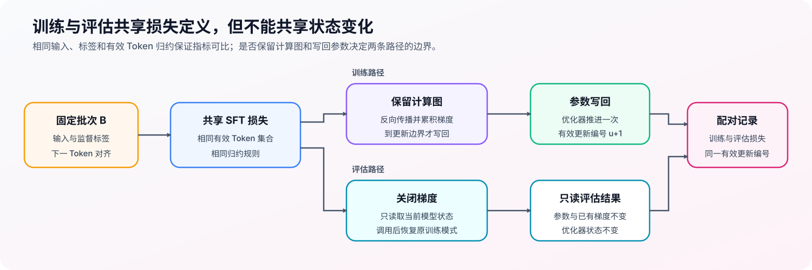
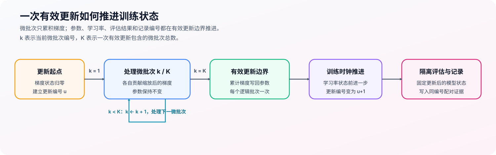

# 15. End to End Fine Tuning Experiment | SFT 有效更新与训练闭环

**难度：** Medium | **环境：** [CPU 主线，GPU 可选](#runtime-environment) | **标签：** `SFT`, `训练闭环`, `训练控制` | **目标人群：** 已完成训练组件学习的实践者

> 🚀 **云端运行环境**
>
> 本章节的实战代码可以点击以下链接在免费 GPU 算力平台上直接运行：
>
> [](https://colab.research.google.com/github/datawhalechina/llm-algo-leetcode/blob/main/02_PyTorch_Algorithms/15_End_to_End_Fine_Tuning_Experiment.ipynb)
> [](https://modelscope.cn/my/mynotebook) *(国内推荐：魔搭社区免费实例)*


---

## 本节导读

SFT 损失要真正改变模型，还需要让梯度累积、参数更新、学习率调度和评估记录共享同一个有效更新时钟。时钟一旦错位，参数、学习率与训练记录就会互相矛盾。

本节围绕一次有效更新展开：多个微批次先形成累计梯度，参数随后写回，调度器、评估与记录再按同一更新编号推进。

---
<a id="runtime-environment"></a>
## 运行环境

- **基础练习：** 默认使用 [`BASE-CPU`](../guide.md#base-cpu)，运行 [Step 4 的题目与测试](#mechanism-practice)。
- **框架核对：** 如需核对 Accelerate 的梯度累积与更新时钟，使用 [`PT-CPU`](../topic_discussion/post_training_optimization/quickstart.md#pt-cpu-quickstart)；该环境已包含基础练习依赖，可在完成 Step 4 后直接运行 [训练控制一致性核对](#framework-check)。
- **GPU 实测：** 如需验证真实模型的有效更新与资源记录，阅读 [Step 5](#gpu-experiment)；实验环境与固定工作负载见其中 5.1。

---
## 前置阅读

**导语：** 先确定 SFT 损失、梯度累积和优化器更新时钟，再把这些接口接入训练闭环。

- [13. SFT Supervision and Loss | SFT 监督边界与损失](../02_PyTorch_Algorithms/13_SFT_Training_Loop.md)
- [12. Optimizer Updates and Learning Rate Scheduling | 优化器更新与学习率调度](../02_PyTorch_Algorithms/12_Optimizer_Updates_and_Learning_Rate_Scheduling.md)
- [11. Gradient Accumulation | 梯度累积](../02_PyTorch_Algorithms/11_Gradient_Accumulation.md)

---
## Step 1：SFT 训练闭环如何连接训练、更新与评估

SFT 训练闭环从共享损失契约开始，并把梯度累积、参数写回、学习率推进和隔离评估组织到同一个有效更新时钟。对固定批次 $B$，训练与评估应使用相同的输入、监督标签、下一 Token 对齐和有效 Token 归约；两条路径的差别只在于是否保留计算图并更新可训练参数 $\theta$。

记 $\mathcal{L}_{\mathrm{SFT}}$ 为有效监督 Token 上的平均损失，则同一批次在两条路径中的目标函数应满足

$$
\mathcal{L}_{\mathrm{train}}(B;\theta)=\mathcal{L}_{\mathrm{eval}}(B;\theta)=\mathcal{L}_{\mathrm{SFT}}(B;\theta).
$$

训练路径由该损失产生梯度并更新 $\theta$；评估路径只读取当前模型状态，不改变模型模式、已有梯度或优化状态。

| 路径 | 输入与输出 | 必须保持的语义 |
|:---|:---|:---|
| 共享损失契约 | 固定批次 → SFT 损失 | 监督位置、预测与标签对齐、有效 Token 归约一致 |
| 训练路径 | SFT 损失 → 梯度 → 参数 | 保留计算图，只在有效更新边界写回参数 |
| 评估路径 | 当前参数与固定数据 → 评估损失 | 不建立梯度，不污染训练状态 |


## Step 2：一次有效更新会推进哪些状态

一次有效更新不是单独的参数变化，而是一组同步状态转换。累计梯度触发参数写回后，优化器、学习率调度器和过程记录都应只推进一次。

| 状态对象 | 正常变化 | 异常信号 |
|:---|:---|:---|
| 累计梯度 | 在更新边界前由多个微批次共同形成 | 中途被清零、出现非有限值或提前触发参数变化 |
| 模型参数 | 每次有效更新只写回一次 | 有梯度但参数不变，或一个逻辑批次写回多次 |
| 优化器状态 | 与参数写回同步推进一次 | 状态未建立，或按微批次错误推进 |
| 学习率状态 | 与有效更新编号保持一致 | 比参数更新少一步或多一步 |
| 评估与记录 | 在更新后的固定状态上生成配对证据 | 评估污染训练状态，或记录编号使用微批次计数 |
## Step 3：梯度累积如何形成一次有效更新

一次有效更新从空的梯度状态开始。每个微批次贡献一部分梯度，达到累积边界后才写回参数；学习率状态、评估结果和过程记录随后使用同一个有效更新编号。

若一个逻辑批次由 $K$ 个等大微批次组成，$\mathcal{L}_{u,k}$ 表示第 $u$ 次有效更新中第 $k$ 个微批次的损失，$g_u$ 表示该次更新使用的累计梯度，$\theta_u$ 表示更新前的模型参数，则有效更新使用

$$
g_u=\sum_{k=1}^{K}\nabla_\theta\frac{\mathcal{L}_{u,k}}{K},\qquad
\theta_{u+1}=\operatorname{OptimizerStep}(\theta_u,g_u).
$$

这里的 $u$ 是有效更新编号，$K$ 是参与该次更新的微批次数，$\operatorname{OptimizerStep}$ 表示根据累计梯度完成一次参数写回。等大微批次可以按 $1/K$ 缩放；微批次包含的有效监督 Token 数不同时，各项贡献应按有效 Token 数加权。



| 阶段 | 状态变化 | 必须满足的不变量 |
|:---|:---|:---|
| 更新开始 | 梯度状态归零 | 不携带上一轮的累计梯度 |
| 微批次累积 | 各微批次贡献缩放后的梯度 | 累积期间参数保持不变 |
| 有效更新 | 参数与学习率状态各推进一次 | 一个逻辑批次只产生一次参数写回 |
| 配对评估 | 无梯度计算训练与验证损失 | 复用训练损失并恢复调用前模式 |
| 过程记录 | 写入有效更新编号和配对指标 | 不按微批次错误推进记录 |
<a id="mechanism-practice"></a>
## Step 4：实现评估隔离与有效更新闭环

代码使用同一监督标签与下一 Token 预测损失完成训练和评估。学习者需要保持评估状态隔离，并在一次有效更新中正确缩放微批次损失、累积梯度和推进训练状态。本练习使用等大的微批次。

| TODO / 函数 | 学习者完成的机制 | 必须满足的约束 | 测试证据 |
|:---|:---|:---|:---|
| TODO 1：保持评估状态隔离<br>`evaluate_loss` | 无梯度评估并恢复调用前模式 | 复用训练损失，返回后不污染模型模式和参数梯度 | 检查训练模式、评估模式和异常退出后均恢复原模式，且参数与已有梯度不被修改 |
| TODO 2：形成一次有效更新<br>`run_finetuning_experiment` | 按累积步数缩放微批次损失并反向传播 | 每个逻辑批次只更新一次，调度器和记录按有效更新推进 | 检查梯度累积与完整批次更新近似一致，并验证参数、优化器、调度器和记录按有效更新次数推进 |

```python
import torch
import torch.nn as nn
```


```python
def build_sft_batch(prompt_ids, response_ids, pad_id=0, eos_id=2, max_len=10):
    """拼接一条 SFT 样本，并返回定长的输入、掩码和监督标签。

    提示只提供上下文，回答与结束标记提供监督目标；填充位置不产生损失。
    """
    response_with_eos = response_ids + [eos_id]
    input_ids = prompt_ids + response_with_eos
    labels = [-100] * len(prompt_ids) + response_with_eos

    if len(input_ids) > max_len:
        input_ids = input_ids[:max_len]
        labels = labels[:max_len]
    if not any(label != -100 for label in labels):
        raise ValueError("截断后没有有效监督 token")

    attention_mask = [1] * len(input_ids)
    pad_len = max_len - len(input_ids)
    input_ids = input_ids + [pad_id] * pad_len
    attention_mask = attention_mask + [0] * pad_len
    labels = labels + [-100] * pad_len

    return {
        "input_ids": torch.tensor(input_ids, dtype=torch.long),
        "attention_mask": torch.tensor(attention_mask, dtype=torch.long),
        "labels": torch.tensor(labels, dtype=torch.long),
    }


def collate_sft_batch(samples, pad_id=0, eos_id=2, max_len=10):
    """将多条定长 SFT 样本堆叠成批次。"""
    items = [build_sft_batch(prompt, response, pad_id=pad_id, eos_id=eos_id, max_len=max_len) for prompt, response in samples]
    return {key: torch.stack([item[key] for item in items], dim=0) for key in items[0]}


class TinyCausalLM(nn.Module):
    """用于验证训练接口的最小语言模型。"""
    def __init__(self, vocab_size=64, hidden_size=32):
        super().__init__()
        self.embedding = nn.Embedding(vocab_size, hidden_size)
        self.rnn = nn.GRU(hidden_size, hidden_size, batch_first=True)
        self.lm_head = nn.Linear(hidden_size, vocab_size)

    def forward(self, input_ids, attention_mask=None):
        x = self.embedding(input_ids)
        hidden, _ = self.rnn(x)
        logits = self.lm_head(hidden)
        return logits


def compute_sft_loss(logits, labels, attention_mask=None):
    """按因果语言模型的下一 Token 对齐规则计算 SFT 损失。"""
    aligned_logits = logits[..., :-1, :].contiguous()
    aligned_targets = labels[..., 1:].contiguous()
    if attention_mask is not None:
        target_mask = attention_mask[..., 1:].contiguous()
        aligned_targets = aligned_targets.masked_fill(target_mask == 0, -100)
    if not torch.any(aligned_targets != -100):
        raise ValueError("当前 batch 没有有效监督 token")
    return nn.CrossEntropyLoss(ignore_index=-100)(
        aligned_logits.view(-1, aligned_logits.size(-1)), aligned_targets.view(-1)
    )


def evaluate_loss(model, batch):
    """在不记录梯度的条件下，复用训练损失计算一个批次。"""
    # ==========================================
    # TODO 1：在无梯度评估后恢复调用前模式
    # ==========================================
    # was_training = ???  # 调用前的 model.training 状态。
    try:
        model.eval()
        with torch.no_grad():
            # logits = ???  # 当前批次的真实模型输出。
            # loss = ???  # 复用 compute_sft_loss 得到的标量张量。
            raise NotImplementedError("TODO 1：在无梯度模式下复用 SFT 损失")
    finally:
        model.train(was_training)
    return float(loss.item())


def run_finetuning_experiment(model, optimizer, train_batch, val_batch=None, accum_steps=2, num_updates=40, eval_every=10, scheduler=None):
    """
    在小批样本上训练，验证梯度累积、参数更新、可选学习率调度和 train / val 报告。

    每次 optimizer.step() 前处理 accum_steps 个等大的 micro-batch。
    """
    if train_batch["input_ids"].size(0) % accum_steps != 0:
        raise ValueError("批次大小必须能被累积步数整除")

    report = {
        "initial_train_loss": evaluate_loss(model, train_batch),
        "initial_val_loss": evaluate_loss(model, val_batch) if val_batch is not None else None,
        "final_train_loss": None,
        "final_val_loss": None,
        "history": [],
    }
    micro_size = train_batch["input_ids"].size(0) // accum_steps
    for step in range(1, num_updates + 1):
        model.train()
        optimizer.zero_grad()
        for idx in range(accum_steps):
            start, end = idx * micro_size, (idx + 1) * micro_size
            mb = {key: value[start:end] for key, value in train_batch.items()}
            logits = model(mb["input_ids"], mb.get("attention_mask"))
            # ==========================================
            # TODO 2：缩放微批次损失并反向传播
            # ==========================================
            # scaled_loss = ???  # 当前微批次损失除以累积步数。
            raise NotImplementedError("TODO 2：完成有效更新中的缩放反传")
            scaled_loss.backward()
        optimizer.step()
        if scheduler is not None:
            scheduler.step()
        if step == 1 or step % eval_every == 0 or step == num_updates:
            record = {"step": step, "train_loss": evaluate_loss(model, train_batch)}
            if val_batch is not None:
                record["val_loss"] = evaluate_loss(model, val_batch)
            report["history"].append(record)
    report["final_train_loss"] = evaluate_loss(model, train_batch)
    report["final_val_loss"] = evaluate_loss(model, val_batch) if val_batch is not None else None
    return report

```

## 测试

运行下方 CPU 机制测试。SFT 批次与损失检查用于确认上游接口已经接通；本节的主要检查是评估状态隔离、梯度累积、有效更新和训练记录。

```python
# 先检查上游 SFT 接口，再验证评估隔离、有效更新与报告契约。
def _build_sft_case():
    """构造固定的重复训练样本和独立的验证批次。"""
    train_samples = [([1, 2, 3], [4, 5, 6, 7])] * 4
    val_samples = [([1, 2, 3], [4, 5, 6, 7])] * 2
    return (
        collate_sft_batch(train_samples, pad_id=0, eos_id=2, max_len=9),
        collate_sft_batch(val_samples, pad_id=0, eos_id=2, max_len=9),
    )


def _assert_sft_batch_contract(train_batch):
    """监督标签、padding 和截断必须遵守同一 SFT batch 契约。"""
    assert train_batch["input_ids"].shape == (4, 9), "train batch shape 错误"
    assert torch.all(train_batch["labels"][:, :3] == -100), "prompt token 不应参与监督"
    assert torch.all(train_batch["attention_mask"][:, 8] == 0), "padding 的 attention_mask 应为 0"
    assert torch.all(train_batch["labels"][:, 8] == -100), "padding 不应参与 loss"
    truncated = build_sft_batch([1, 2, 3, 4], [5, 6], max_len=5)
    assert truncated["labels"].tolist() == [-100, -100, -100, -100, 5], "截断后监督标签错误"


def _assert_next_token_loss():
    """next-token shift 和 padding mask 必须与手工交叉熵一致。"""
    torch.manual_seed(9)
    logits = torch.randn(1, 4, 8)
    labels = torch.tensor([[-100, 2, 3, -100]])
    mask = torch.tensor([[1, 1, 1, 0]])
    actual = compute_sft_loss(logits, labels, mask)
    expected_labels = labels[:, 1:].masked_fill(mask[:, 1:] == 0, -100)
    expected = nn.CrossEntropyLoss(ignore_index=-100)(logits[:, :-1, :].reshape(-1, 8), expected_labels.reshape(-1))
    assert torch.allclose(actual, expected), "next-token shift 或 padding mask 错误"


def _assert_evaluation_state(train_batch):
    """评估必须恢复调用前模式，并保持已有参数梯度不变。"""
    model = TinyCausalLM(vocab_size=64, hidden_size=32)
    model.train()
    training_logits = model(train_batch["input_ids"], train_batch.get("attention_mask"))
    compute_sft_loss(training_logits, train_batch["labels"], train_batch.get("attention_mask")).backward()
    gradients_before = [parameter.grad.detach().clone() for parameter in model.parameters()]
    loss = evaluate_loss(model, train_batch)
    assert isinstance(loss, float), "evaluate_loss 应返回 Python float"
    assert model.training, "evaluate_loss 不应污染调用前的训练模式"
    assert all(torch.equal(before, parameter.grad) for before, parameter in zip(gradients_before, model.parameters())), "评估不应修改已有梯度"
    model.eval()
    evaluate_loss(model, train_batch)
    assert not model.training, "评估模式调用后仍应保持评估模式"
    model.train()
    invalid_batch = {**train_batch, "labels": torch.full_like(train_batch["labels"], -100)}
    try:
        evaluate_loss(model, invalid_batch)
    except ValueError:
        pass
    else:
        raise AssertionError("无有效监督的评估批次应失败")
    assert model.training, "评估失败后也必须恢复调用前模式"


def _assert_gradient_accumulation_equivalence(train_batch):
    """等大微批次累积应与同一有效批次的一次性更新近似等价。"""
    accumulated_model = TinyCausalLM(vocab_size=64, hidden_size=32)
    full_batch_model = TinyCausalLM(vocab_size=64, hidden_size=32)
    full_batch_model.load_state_dict(accumulated_model.state_dict())
    accumulated_optimizer = torch.optim.SGD(accumulated_model.parameters(), lr=0.01)
    full_batch_optimizer = torch.optim.SGD(full_batch_model.parameters(), lr=0.01)
    run_finetuning_experiment(accumulated_model, accumulated_optimizer, train_batch, accum_steps=2, num_updates=1, eval_every=1)
    full_batch_optimizer.zero_grad()
    logits = full_batch_model(train_batch["input_ids"], train_batch.get("attention_mask"))
    compute_sft_loss(logits, train_batch["labels"], train_batch.get("attention_mask")).backward()
    full_batch_optimizer.step()
    for accumulated, full_batch in zip(accumulated_model.parameters(), full_batch_model.parameters()):
        assert torch.allclose(accumulated, full_batch, atol=1e-6, rtol=1e-5), "梯度累积与完整批次更新不等价"


def _assert_training_update_and_report(train_batch, val_batch):
    """重复样本上应发生有效更新，scheduler 与 history 只按 update 记录。"""
    model = TinyCausalLM(vocab_size=64, hidden_size=32)
    optimizer = torch.optim.AdamW(model.parameters(), lr=0.05)
    scheduler = torch.optim.lr_scheduler.LambdaLR(optimizer, lr_lambda=lambda update: 1.0 / (1.0 + 0.01 * update))
    before = {name: parameter.detach().clone() for name, parameter in model.named_parameters()}
    report = run_finetuning_experiment(model, optimizer, train_batch, val_batch, accum_steps=2, num_updates=30, eval_every=10, scheduler=scheduler)
    assert any(not torch.equal(before[name], parameter.detach()) for name, parameter in model.named_parameters()), "参数没有更新"
    assert len(optimizer.state) > 0, "完成有效 update 后应建立 optimizer state"
    assert scheduler.last_epoch == 30, "scheduler 应按有效 update 推进"
    assert len(report["history"]) >= 3, "训练过程应记录评估 history"
    assert report["final_train_loss"] < report["initial_train_loss"], "train loss 没有下降"
    assert report["final_val_loss"] < report["initial_val_loss"], "val loss 没有下降"


def test_end_to_end_finetuning():
    """运行 CPU 上的 SFT 接线、有效更新和报告闭环测试。"""
    try:
        torch.manual_seed(7)
        train_batch, val_batch = _build_sft_case()
        _assert_sft_batch_contract(train_batch)
        _assert_next_token_loss()
        _assert_evaluation_state(train_batch)
        _assert_gradient_accumulation_equivalence(train_batch)
        _assert_training_update_and_report(train_batch, val_batch)
        print("✅ SFT 损失已接入有效更新、评估隔离和训练记录。")
    except (AttributeError, NameError, TypeError, ValueError, AssertionError) as error:
        raise NotImplementedError("请先完成机制 TODO，再运行端到端 SFT 测试。") from error


test_end_to_end_finetuning()
```

## CPU 运行记录

`report` 是 `run_finetuning_experiment(...)` 返回的 Python 字典，包含训练集与验证集的初始损失、最终损失和过程记录 `history`。运行题目区与测试区后，用它核对有效更新编号与训练状态。

运行题目区 → 运行测试区 → 复制结果 → 填写报告 → 写出结论

| 检查项 | 来源 | 记录内容 | CPU 实验说明 |
|:---|:---|:---|:---|
| 训练损失 | `report` | `initial_train_loss` → `final_train_loss` | 最终训练损失应低于初始训练损失；本实验不判断每一步都单调下降 |
| 验证一致性 | `report` | `initial_val_loss` → `final_val_loss` | 验证阶段复用训练阶段的标签与损失计算 |
| 评估记录 | `report["history"]` | 第 1 步、间隔步和最后一步的训练 / 验证损失 | 更新编号与训练、验证损失一一对应 |
| 参数更新 | 测试输出 | `Optimizer updated parameters` | 为 `True`，证明 `optimizer.step()` 生效 |
| 优化器状态 | 测试输出 | `state entries` | 大于 `0`，证明优化器状态已建立 |
| 测试状态 | 测试区提示 | 端到端闭环测试结果 | 应为通过 |

可直接使用下面的简短格式记录：

```text
实验环境：CPU；模型：TinyCausalLM；数据：重复样本
训练结果：训练损失 ______ → ______；验证损失 ______ → ______
闭环检查：参数更新 ______；优化器状态条目数 ______；测试 ______
结论：CPU 训练闭环 ______，依据是 ____________________。
证据边界：本报告不说明真实 GPU 显存、吞吐或任务泛化能力。
```
---

🛑 **STOP HERE** 🛑
<br><br><br><br><br><br><br><br><br><br>
> 请先尝试自己完成代码并跑通测试、填写 CPU 运行记录。<br>
> 如果你正在 Colab 中运行，并且遇到困难没有思路，可以向下滚动查看参考答案。
<br><br><br><br><br><br><br><br><br><br>

---
## 参考代码与解析

### 代码


```python
import torch
import torch.nn as nn


def build_sft_batch(prompt_ids, response_ids, pad_id=0, eos_id=2, max_len=10):
    """拼接一条 SFT 样本，并返回定长的输入、掩码和监督标签。"""
    response_with_eos = response_ids + [eos_id]
    input_ids = prompt_ids + response_with_eos
    labels = [-100] * len(prompt_ids) + response_with_eos

    if len(input_ids) > max_len:
        input_ids = input_ids[:max_len]
        labels = labels[:max_len]
    if not any(label != -100 for label in labels):
        raise ValueError("截断后没有有效监督 token")

    attention_mask = [1] * len(input_ids)
    pad_len = max_len - len(input_ids)
    if pad_len > 0:
        input_ids = input_ids + [pad_id] * pad_len
        attention_mask = attention_mask + [0] * pad_len
        labels = labels + [-100] * pad_len

    return {
        "input_ids": torch.tensor(input_ids, dtype=torch.long),
        "attention_mask": torch.tensor(attention_mask, dtype=torch.long),
        "labels": torch.tensor(labels, dtype=torch.long),
    }


def collate_sft_batch(samples, pad_id=0, eos_id=2, max_len=10):
    """将多条定长 SFT 样本堆叠成 batch。"""
    items = [build_sft_batch(prompt, response, pad_id=pad_id, eos_id=eos_id, max_len=max_len) for prompt, response in samples]
    return {key: torch.stack([item[key] for item in items], dim=0) for key in items[0]}


class TinyCausalLM(nn.Module):
    """用于验证训练接口与更新语义的最小语言模型。"""
    def __init__(self, vocab_size=64, hidden_size=32):
        super().__init__()
        self.embedding = nn.Embedding(vocab_size, hidden_size)
        self.rnn = nn.GRU(hidden_size, hidden_size, batch_first=True)
        self.lm_head = nn.Linear(hidden_size, vocab_size)

    def forward(self, input_ids, attention_mask=None):
        x = self.embedding(input_ids)
        hidden, _ = self.rnn(x)
        logits = self.lm_head(hidden)
        return logits


def compute_sft_loss(logits, labels, attention_mask=None):
    """按因果语言模型的下一 Token 对齐规则计算 SFT 损失。"""
    aligned_logits = logits[..., :-1, :].contiguous()
    aligned_targets = labels[..., 1:].contiguous()
    if attention_mask is not None:
        target_mask = attention_mask[..., 1:].contiguous()
        aligned_targets = aligned_targets.masked_fill(target_mask == 0, -100)
    if not torch.any(aligned_targets != -100):
        raise ValueError("当前 batch 没有有效监督 token")

    loss_fct = nn.CrossEntropyLoss(ignore_index=-100)
    loss = loss_fct(aligned_logits.view(-1, aligned_logits.size(-1)), aligned_targets.view(-1))
    return loss


def evaluate_loss(model, batch):
    """在不记录梯度的条件下，复用训练损失计算一个批次。"""
    # TODO 1：保持评估状态隔离。
    was_training = model.training
    try:
        model.eval()
        with torch.no_grad():
            logits = model(batch["input_ids"], batch.get("attention_mask"))
            loss = compute_sft_loss(logits, batch["labels"], batch.get("attention_mask"))
    finally:
        model.train(was_training)
    return float(loss.item())


def run_finetuning_experiment(model, optimizer, train_batch, val_batch=None, accum_steps=2, num_updates=40, eval_every=10, scheduler=None):
    """在小批样本上训练，记录梯度累积、参数更新和 train / val 报告。"""
    if train_batch["input_ids"].size(0) % accum_steps != 0:
        raise ValueError("批次大小必须能被累积步数整除")

    report = {
        "initial_train_loss": evaluate_loss(model, train_batch),
        "initial_val_loss": evaluate_loss(model, val_batch) if val_batch is not None else None,
        "final_train_loss": None,
        "final_val_loss": None,
        "history": [],
    }
    micro_size = train_batch["input_ids"].size(0) // accum_steps

    for step in range(1, num_updates + 1):
        model.train()
        optimizer.zero_grad()

        for idx in range(accum_steps):
            start = idx * micro_size
            end = (idx + 1) * micro_size
            mb = {key: value[start:end] for key, value in train_batch.items()}
            logits = model(mb["input_ids"], mb.get("attention_mask"))
            # TODO 2：形成一次有效更新。
            scaled_loss = compute_sft_loss(logits, mb["labels"], mb.get("attention_mask")) / accum_steps
            scaled_loss.backward()

        optimizer.step()
        if scheduler is not None:
            scheduler.step()

        if step == 1 or step % eval_every == 0 or step == num_updates:
            record = {"step": step, "train_loss": evaluate_loss(model, train_batch)}
            if val_batch is not None:
                record["val_loss"] = evaluate_loss(model, val_batch)
            report["history"].append(record)

    report["final_train_loss"] = evaluate_loss(model, train_batch)
    report["final_val_loss"] = evaluate_loss(model, val_batch) if val_batch is not None else None
    return report

```

### 解析

#### TODO 1：保持评估状态隔离

- 机制：评估关闭梯度记录并复用训练损失，通过 `finally` 保证正常返回或异常退出后都恢复调用前模式。
- 不变量：评估前已有梯度的内容保持不变；测试同时覆盖训练模式、评估模式和异常路径。

#### TODO 2：形成一次有效更新

- 机制：每个等大微批次的损失除以累积步数后再反向传播，使一次逻辑更新保持统一梯度尺度。
- 不变量：累积更新应与同一有效批次的一次性更新近似等价；参数、优化器、调度器与评估记录都按有效更新推进。
<a id="framework-check"></a>

## 框架一致性核对（可选）

本核对分成两部分：先让本节循环与 Accelerate 在相同条件下完成一次有效更新，再让 TRL `SFTTrainer` 处理内存中的微型文本数据。前者核对梯度累积与更新时钟，后者核对 SFT 数据处理、Token 损失和 Trainer 更新；全程不下载模型或数据。

| 核对项 | 本节实现 | 框架路径 | 通过条件 |
| --- | --- | --- | --- |
| 累积边界 | 两个微批次后调用一次 `optimizer.step()` | `accumulate` 与 `sync_gradients` 控制写回 | 第一个微批次后参数不变，第二个微批次后参数改变 |
| 最终参数 | 等大微批次损失除以累积步数 | Accelerate 自动缩放累积损失 | 两条路径完成一次有效更新后的参数一致 |
| 更新时钟 | 调度器按有效更新推进 | Accelerate 仅在 `sync_gradients=True` 时推进调度器 | 两条路径的调度器都只推进一次 |
| SFT 数据与损失 | 已编码批次、右移标签与有效 Token 平均 | `SFTTrainer` 完成 EOS、分词、标签和损失计算 | 标签形状完整，Trainer 损失与显式交叉熵一致 |
| Trainer 更新 | 本节循环完成一次有效更新 | `SFTTrainer.train()` 执行一个 step | `global_step=1` 且参数发生变化 |

```python
import copy
import tempfile
from importlib.metadata import version

try:
    from accelerate import Accelerator
    from datasets import Dataset
    from tokenizers import Tokenizer
    from tokenizers.models import WordLevel
    from tokenizers.pre_tokenizers import Whitespace
    from transformers import GPT2Config, GPT2LMHeadModel, PreTrainedTokenizerFast
    from trl import SFTConfig, SFTTrainer
except ImportError:
    framework_check = {
        "status": "skipped",
        "reason": "请使用 PT-CPU 环境运行本单元",
        "check_kind": "framework_conformance",
    }
else:
    def check_accelerate_training_control():
        """比较本节循环与 Accelerate 的累积边界和有效更新。"""
        torch.manual_seed(23)
        train_samples = [([1, 2, 3], [4, 5, 6, 7])] * 4
        train_batch = collate_sft_batch(train_samples, pad_id=0, eos_id=2, max_len=9)
        reference_model = TinyCausalLM(vocab_size=64, hidden_size=32)
        accelerated_model = copy.deepcopy(reference_model)

        reference_optimizer = torch.optim.SGD(reference_model.parameters(), lr=0.01)
        reference_scheduler = torch.optim.lr_scheduler.LambdaLR(reference_optimizer, lr_lambda=lambda _: 1.0)
        run_finetuning_experiment(
            reference_model, reference_optimizer, train_batch,
            accum_steps=2, num_updates=1, eval_every=1, scheduler=reference_scheduler,
        )

        accelerator = Accelerator(cpu=True, gradient_accumulation_steps=2)
        accelerated_optimizer = torch.optim.SGD(accelerated_model.parameters(), lr=0.01)
        accelerated_model, accelerated_optimizer = accelerator.prepare(
            accelerated_model, accelerated_optimizer
        )
        accelerated_scheduler = torch.optim.lr_scheduler.LambdaLR(
            accelerated_optimizer, lr_lambda=lambda _: 1.0
        )
        initial_parameters = [parameter.detach().clone() for parameter in accelerated_model.parameters()]
        parameter_snapshots = []
        sync_flags = []
        micro_size = train_batch["input_ids"].size(0) // 2
        accelerated_optimizer.zero_grad()

        for index in range(2):
            start, end = index * micro_size, (index + 1) * micro_size
            micro_batch = {key: value[start:end] for key, value in train_batch.items()}
            with accelerator.accumulate(accelerated_model):
                logits = accelerated_model(
                    micro_batch["input_ids"], micro_batch.get("attention_mask")
                )
                loss = compute_sft_loss(
                    logits, micro_batch["labels"], micro_batch.get("attention_mask")
                )
                accelerator.backward(loss)
                # Accelerate 在非同步微批次拦截参数写回，因此两条路径仍共享同一有效更新边界。
                accelerated_optimizer.step()
                if accelerator.sync_gradients:
                    accelerated_scheduler.step()
                accelerated_optimizer.zero_grad()
                sync_flags.append(bool(accelerator.sync_gradients))
            parameter_snapshots.append(
                [parameter.detach().clone() for parameter in accelerated_model.parameters()]
            )

        unwrapped_model = accelerator.unwrap_model(accelerated_model)
        reference_parameters = list(reference_model.parameters())
        accelerated_parameters = list(unwrapped_model.parameters())
        checks = {
            "sync_boundary_match": sync_flags == [False, True],
            "no_early_parameter_update": all(
                torch.equal(before, after)
                for before, after in zip(initial_parameters, parameter_snapshots[0])
            ),
            "parameter_updated_after_accumulation": any(
                not torch.equal(before, after)
                for before, after in zip(initial_parameters, parameter_snapshots[1])
            ),
            "final_parameters_match": all(
                torch.allclose(reference, accelerated, atol=1e-6, rtol=1e-5)
                for reference, accelerated in zip(reference_parameters, accelerated_parameters)
            ),
            "scheduler_update_count_match": (
                reference_scheduler.last_epoch == accelerated_scheduler.last_epoch == 1
            ),
        }
        accelerator.free_memory()
        return {
            "status": "passed" if all(checks.values()) else "failed",
            "check_kind": "framework_conformance",
            "versions": {"torch": torch.__version__, "accelerate": version("accelerate")},
            "checks": checks,
        }


    def check_sft_trainer_path():
        """用内存数据核对 SFTTrainer 的监督标签、损失和单步更新。"""
        tokenizer_backend = Tokenizer(
            WordLevel(
                {"<pad>": 0, "<eos>": 1, "<unk>": 2, "hello": 3, "world": 4, "answer": 5},
                unk_token="<unk>",
            )
        )
        tokenizer_backend.pre_tokenizer = Whitespace()
        tokenizer = PreTrainedTokenizerFast(
            tokenizer_object=tokenizer_backend,
            pad_token="<pad>", eos_token="<eos>", unk_token="<unk>",
        )
        torch.manual_seed(29)
        model = GPT2LMHeadModel(GPT2Config(
            vocab_size=len(tokenizer), n_layer=1, n_head=1, n_embd=16, n_positions=32,
            bos_token_id=1, eos_token_id=1, pad_token_id=0,
        ))
        dataset = Dataset.from_dict({"text": ["hello world answer", "hello answer world"]})
        initial_parameters = [parameter.detach().clone() for parameter in model.parameters()]

        with tempfile.TemporaryDirectory(prefix="sft-conformance-") as output_dir:
            args = SFTConfig(
                output_dir=output_dir, use_cpu=True, report_to="none",
                dataset_text_field="text", max_length=16,
                per_device_train_batch_size=2, max_steps=1, learning_rate=0.01,
                logging_strategy="no", save_strategy="no",
            )
            trainer = SFTTrainer(
                model=model, args=args, train_dataset=dataset, processing_class=tokenizer
            )
            batch = next(iter(trainer.get_train_dataloader()))
            model.eval()
            with torch.no_grad():
                logits = model(
                    input_ids=batch["input_ids"],
                    attention_mask=batch["attention_mask"],
                    use_cache=False,
                ).logits
            local_loss = compute_sft_loss(logits, batch["labels"], batch["attention_mask"])
            trainer_loss = trainer.compute_loss(
                model, {key: value.clone() for key, value in batch.items()}
            )
            trainer.train()

        checks = {
            "labels_match_inputs": batch["labels"].shape == batch["input_ids"].shape,
            "loss_match": bool(torch.isclose(local_loss, trainer_loss, atol=1e-6, rtol=1e-6).item()),
            "single_step_completed": trainer.state.global_step == 1,
            "parameters_updated": any(
                not torch.equal(before, after)
                for before, after in zip(initial_parameters, model.parameters())
            ),
        }
        return checks


    accelerate_result = check_accelerate_training_control()
    sft_trainer_checks = check_sft_trainer_path()
    combined_checks = {
        **{f"accelerate_{name}": passed for name, passed in accelerate_result["checks"].items()},
        **{f"sft_trainer_{name}": passed for name, passed in sft_trainer_checks.items()},
    }
    framework_check = {
        "status": "passed" if all(combined_checks.values()) else "failed",
        "check_kind": "framework_conformance",
        "versions": {
            "torch": torch.__version__, "accelerate": version("accelerate"),
            "transformers": version("transformers"), "trl": version("trl"),
        },
        "framework_paths": ["Accelerator.accumulate", "SFTTrainer.compute_loss", "SFTTrainer.train"],
        "checks": combined_checks,
    }
    if framework_check["status"] != "passed":
        failed = [name for name, passed in combined_checks.items() if not passed]
        raise AssertionError(f"SFT 框架一致性核对失败：{failed}")
    print("✅ Accelerate 更新控制与 TRL SFTTrainer 路径一致。")
```

<a id="gpu-experiment"></a>
## Step 5：可选 GPU 实验——真实 SFT 有效更新与训练状态

CPU 实验确认 SFT 损失已经接入评估隔离和有效更新。GPU 实验把同一训练控制迁移到真实模型与指令数据，对比更新前后固定训练集与验证集损失，并记录更新时间、监督 Token 和峰值显存。

| 学习问题 | CPU 已确认 | GPU 要确认 |
|---|---|---|
| SFT 损失能否在真实模型上形成有效更新 | 损失接线、评估隔离与有效更新时钟 | 真实分词器下的有效监督 Token、训练前后配对损失、资源代价与失败状态 |

<a id="gpu-experiment-setup"></a>
### 5.1 环境与固定工作负载

本实验使用 [`PT-SFT-CUDA`](../gpu_environment_assets.md#pt-sft-cuda)。首次运行先完成[后训练实验 Quickstart](../topic_discussion/post_training_optimization/quickstart.md#pt-sft-cuda-quickstart)；已有环境只需激活、通过 Profile 预检，并从同一解释器启动 JupyterLab。页面、工作负载和结果状态见[后训练优化实验资产表](../topic_discussion/post_training_optimization/experiment_assets.md)。参考显存为 8 GiB，默认模型在支持 BF16 的单卡上运行；显存不足时先降低序列长度，不同时修改模型、样本数和更新次数。

| 配置层 | 本节固定条件 | 修改规则 |
|:---|:---|:---|
| 运行环境 | `PT-SFT-CUDA`；单张 NVIDIA GPU | 不与 vLLM、量化 Serving 或分布式环境混装 |
| 模型与数据 | `Qwen/Qwen2.5-0.5B`；`tatsu-lab/alpaca` | 5.2 自动解析并记录模型与数据实际提交版本 |
| 数据切分 | 固定抽样 32 条；24 条训练、8 条验证 | 两个集合按样本 ID 隔离，模型更新前后复用同一批样本 |
| 工作负载 | batch 1；长度 256；8 次有效更新 | 普通复测只改运行标签；压力实验另建工作负载版本 |
| 配对变量 | 同一初始化模型：更新前 → 更新后 | tokenizer、模板、标签、数据、dtype 和评估函数保持不变 |
| 结果资产 | `benchmarks/results/pt_sft_training/pt-sft-training_<run_label>.json` | 记录版本、监督 Token、损失、时间、显存、失败与决策 |

`dry_run` 只登记实验协议，`real_gpu` 才下载固定快照并执行训练；本机制实验只保存结果 JSON，不保存可部署 checkpoint。

```python
# 学习者入口：普通复测通常只修改这两项。
RUN_MODE = "dry_run"  # 默认值 dry_run；改为 real_gpu 才执行真实 SFT 更新。
RUN_LABEL = "default"  # 默认值 default；正式复测改为唯一标签，避免覆盖同名结果。

# 模型与数据来源：main 会在 5.2 自动解析并记录为本次实际使用的 commit。
MODEL_ID = "Qwen/Qwen2.5-0.5B"  # 使用基础模型，避免把既有指令能力混入最小 SFT 证据。
MODEL_REVISION = "main"  # 请求的模型 revision；可填写分支、标签或 commit hash。
DATASET_ID = "tatsu-lab/alpaca"  # 固定 instruction / input / output 字段的数据源。
DATASET_REVISION = "main"  # 请求的数据 revision；5.2 记录解析后的 commit。

# 固定工作负载：普通复测保持不变，改变后递增 WORKLOAD_VERSION。
ENVIRONMENT_PROFILE = "PT-SFT-CUDA"  # 必须先通过同名 Profile 预检。
WORKLOAD_ID = "pt-sft-training"  # 固定工作负载身份。
WORKLOAD_VERSION = "v1"  # v1 固定监督边界、切分和训练前后配对评测。
TOTAL_SAMPLES = 32  # 固定抽样总数；训练集与验证集从中隔离。
TRAIN_SAMPLES = 24  # 用于参数更新和训练集配对评测。
MAX_LENGTH = 256  # prompt 与 response 合并后的最大 Token 数。
BATCH_SIZE = 1  # 单次送入 GPU 的微批次大小。
UPDATES = 8  # 有效 optimizer update 次数。
LEARNING_RATE = 2e-5  # 全参数 SFT 学习率。
SEED = 42  # 固定抽样、数据顺序与模型随机状态。
LOCAL_FILES_ONLY = False  # 默认值 False；模型和数据已缓存且需离线运行时改为 True。

OUTPUT_RELATIVE_PATH = f"benchmarks/results/pt_sft_training/{WORKLOAD_ID}_{RUN_LABEL}.json"  # 由运行标签派生，不需要手填绝对路径。
```

### 5.2 执行训练前后配对实验并写入 JSON

执行单元解析模型与数据的固定提交版本，构造只监督 response / EOS 的 labels，并在同一训练集和验证集上比较更新前后损失。结果同时记录监督 Token、截断、更新时间、峰值显存、失败阶段和决策，不把少量更新外推为任务能力提升。

```python
# 5.2 读取 5.1 的唯一配置，执行真实 SFT 训练前后配对实验并保存 JSON。
import gc
import platform
import random
import time

import torch
from tools.notebook_runtime import failure_record, hash_ids, package_version, resolve_model_commit, save_json, stable_sample
from tools.project_runtime import resolve_project_root
from tools.training_mechanism_runtime import cuda_hardware_snapshot, median_and_p95

REPO_ROOT = resolve_project_root()
OUTPUT_PATH = REPO_ROOT / OUTPUT_RELATIVE_PATH
result = {
    "schema_version": "post-training-mechanism-gpu/v1",
    "semantic_id": "PT-SFT-TRAINING",
    "environment_profile": ENVIRONMENT_PROFILE,
    "run_mode": RUN_MODE,
    "run_label": RUN_LABEL,
    "framework": {"python": platform.python_version(), "torch": torch.__version__, "transformers": package_version("transformers"), "datasets": package_version("datasets")},
    "hardware": {"cuda_available": torch.cuda.is_available(), "cuda": torch.version.cuda},
    "model": {"id": MODEL_ID, "requested_revision": MODEL_REVISION, "resolved_commit": None},
    "dataset": {"id": DATASET_ID, "requested_revision": DATASET_REVISION, "resolved_commit": None, "train_ids_hash": None, "evaluation_ids_hash": None},
    "workload": {"id": WORKLOAD_ID, "version": WORKLOAD_VERSION, "total_samples": TOTAL_SAMPLES, "train_samples": TRAIN_SAMPLES, "evaluation_samples": TOTAL_SAMPLES - TRAIN_SAMPLES, "max_length": MAX_LENGTH, "batch_size": BATCH_SIZE, "updates": UPDATES, "learning_rate": LEARNING_RATE, "seed": SEED},
    "baseline": None, "candidate": None, "mechanism_metrics": None, "failure": None,
    "evidence_level": "dry_run", "decision": "not_measured",
}

execution_stage = "environment_preflight"
if RUN_MODE == "real_gpu":
    model = optimizer = None
    try:
        if not torch.cuda.is_available():
            raise RuntimeError("RUN_MODE=real_gpu，但 CUDA 不可用")
        if TRAIN_SAMPLES <= 0 or TRAIN_SAMPLES >= TOTAL_SAMPLES:
            raise ValueError("TRAIN_SAMPLES 必须位于 0 与 TOTAL_SAMPLES 之间")
        from datasets import load_dataset
        from huggingface_hub import HfApi
        from transformers import AutoModelForCausalLM, AutoTokenizer

        random.seed(SEED)
        torch.manual_seed(SEED)
        torch.cuda.manual_seed_all(SEED)
        device = torch.device("cuda")
        dtype = torch.bfloat16 if torch.cuda.is_bf16_supported() else torch.float16

        execution_stage = "revision_resolution"
        model_commit, model_revision_source = resolve_model_commit(MODEL_ID, MODEL_REVISION, local_files_only=LOCAL_FILES_ONLY)
        if LOCAL_FILES_ONLY:
            dataset_commit, dataset_revision_source = DATASET_REVISION, "local_cache_requested_revision"
        else:
            dataset_commit = HfApi().dataset_info(DATASET_ID, revision=DATASET_REVISION).sha
            dataset_revision_source = "huggingface_hub_api"
        result["model"].update({"resolved_commit": model_commit, "resolution_source": model_revision_source})
        result["dataset"].update({"resolved_commit": dataset_commit, "resolution_source": dataset_revision_source})

        execution_stage = "dataset_and_supervision"
        tokenizer = AutoTokenizer.from_pretrained(MODEL_ID, revision=model_commit, local_files_only=LOCAL_FILES_ONLY)
        if tokenizer.pad_token_id is None:
            tokenizer.pad_token = tokenizer.eos_token
        source = load_dataset(DATASET_ID, split="train", revision=dataset_commit)
        sampled, sampled_ids = stable_sample(source, TOTAL_SAMPLES * 2, SEED, text_column="output")

        def encode_record(record):
            instruction = str(record.get("instruction", "")).strip()
            context = str(record.get("input", "")).strip()
            response = str(record.get("output", "")).strip()
            prompt = f"### Instruction:\n{instruction}\n"
            if context:
                prompt += f"### Input:\n{context}\n"
            prompt += "### Response:\n"
            prompt_ids = tokenizer(prompt, add_special_tokens=False)["input_ids"]
            response_ids = tokenizer(response, add_special_tokens=False)["input_ids"] + [tokenizer.eos_token_id]
            input_ids = (prompt_ids + response_ids)[:MAX_LENGTH]
            labels = ([-100] * len(prompt_ids) + response_ids)[:MAX_LENGTH]
            supervised = sum(token != -100 for token in labels[1:])
            if supervised == 0:
                return None
            pad = MAX_LENGTH - len(input_ids)
            return {"input_ids": input_ids + [tokenizer.pad_token_id] * pad, "attention_mask": [1] * len(input_ids) + [0] * pad, "labels": labels + [-100] * pad, "supervised_tokens": supervised, "truncated": len(prompt_ids) + len(response_ids) > MAX_LENGTH}

        encoded, kept_ids = [], []
        for record, sample_id in zip(sampled, sampled_ids):
            item = encode_record(record)
            if item is not None:
                encoded.append(item)
                kept_ids.append(sample_id)
            if len(encoded) == TOTAL_SAMPLES:
                break
        if len(encoded) < TOTAL_SAMPLES:
            raise ValueError(f"有效监督样本不足：需要 {TOTAL_SAMPLES}，实际 {len(encoded)}")
        train_items, evaluation_items = encoded[:TRAIN_SAMPLES], encoded[TRAIN_SAMPLES:]
        train_ids, evaluation_ids = kept_ids[:TRAIN_SAMPLES], kept_ids[TRAIN_SAMPLES:]
        result["dataset"].update({"train_ids_hash": hash_ids(train_ids), "evaluation_ids_hash": hash_ids(evaluation_ids), "selection_seed": SEED})

        def batches(items):
            for start in range(0, len(items), BATCH_SIZE):
                chunk = items[start:start + BATCH_SIZE]
                yield {key: torch.tensor([item[key] for item in chunk], dtype=torch.long, device=device) for key in ("input_ids", "attention_mask", "labels")}

        def evaluate(items):
            model.eval()
            weighted_loss, token_count = 0.0, 0
            with torch.no_grad():
                for batch in batches(items):
                    count = int((batch["labels"][:, 1:] != -100).sum().item())
                    with torch.autocast("cuda", dtype=dtype):
                        loss = model(**batch).loss
                    weighted_loss += float(loss.item()) * count
                    token_count += count
            return weighted_loss / token_count, token_count

        execution_stage = "model_loading_and_baseline"
        torch.cuda.empty_cache()
        torch.cuda.reset_peak_memory_stats()
        model = AutoModelForCausalLM.from_pretrained(MODEL_ID, revision=model_commit, local_files_only=LOCAL_FILES_ONLY, dtype=dtype).to(device)
        model.config.use_cache = False
        initial_train_loss, train_supervised_tokens = evaluate(train_items)
        initial_evaluation_loss, evaluation_supervised_tokens = evaluate(evaluation_items)
        result["baseline"] = {"name": "initial_model", "train_token_weighted_loss": initial_train_loss, "evaluation_token_weighted_loss": initial_evaluation_loss}

        execution_stage = "effective_updates"
        optimizer = torch.optim.AdamW(model.parameters(), lr=LEARNING_RATE)
        scaler = torch.amp.GradScaler("cuda", enabled=dtype == torch.float16)
        update_losses, update_times_ms = [], []
        train_batches = list(batches(train_items))
        for step in range(UPDATES):
            batch = train_batches[step % len(train_batches)]
            model.train()
            optimizer.zero_grad(set_to_none=True)
            torch.cuda.synchronize()
            started = time.perf_counter()
            with torch.autocast("cuda", dtype=dtype):
                loss = model(**batch).loss
            scaler.scale(loss).backward()
            scaler.step(optimizer)
            scaler.update()
            torch.cuda.synchronize()
            update_times_ms.append((time.perf_counter() - started) * 1000)
            update_losses.append(float(loss.detach().item()))

        execution_stage = "paired_evaluation"
        final_train_loss, _ = evaluate(train_items)
        final_evaluation_loss, _ = evaluate(evaluation_items)
        median_update_ms, p95_update_ms = median_and_p95(update_times_ms)
        truncated_samples = sum(item["truncated"] for item in encoded)
        train_decreased = final_train_loss < initial_train_loss
        evaluation_finite = bool(torch.isfinite(torch.tensor(final_evaluation_loss)))
        result.update({
            "hardware": cuda_hardware_snapshot(),
            "candidate": {"name": "full_parameter_sft_after_updates", "train_token_weighted_loss": final_train_loss, "evaluation_token_weighted_loss": final_evaluation_loss, "update_losses": update_losses},
            "mechanism_metrics": {"train_supervised_tokens": train_supervised_tokens, "evaluation_supervised_tokens": evaluation_supervised_tokens, "truncated_samples": truncated_samples, "median_update_ms": median_update_ms, "p95_update_ms": p95_update_ms, "peak_allocated_bytes": int(torch.cuda.max_memory_allocated()), "peak_reserved_bytes": int(torch.cuda.max_memory_reserved()), "train_loss_decreased": train_decreased, "evaluation_loss_finite": evaluation_finite},
            "evidence_level": "real_model_training_mechanism_benchmark",
            "decision": "accept_mechanism" if train_decreased and evaluation_finite else "tune",
        })
    except Exception as error:
        result["failure"] = failure_record(execution_stage, error)
        result["evidence_level"] = "failed_real_gpu_attempt"
        result["decision"] = "reject_until_fixed"
    finally:
        del optimizer, model
        gc.collect()
        torch.cuda.empty_cache()
elif RUN_MODE != "dry_run":
    raise ValueError("RUN_MODE 只能是 dry_run 或 real_gpu")

save_json(OUTPUT_PATH, result)
print(OUTPUT_PATH)
print(result["decision"], result["failure"])

```

### 5.3 读取训练前后配对结果

先检查 `failure`，再核对模型与数据提交版本、样本身份、监督 Token、训练前后损失、更新时间和显存。`accept_mechanism` 只表示最终训练损失低于初始值且最终验证损失为有限值，不表示验证损失通过回退门槛，也不表示模型能力已经提升。

```python
# 5.3 只读取 5.2 按当前 RUN_LABEL 生成的结果，不回退到其他运行。
import json

if not OUTPUT_PATH.exists():
    print(f"尚未找到结果文件：{OUTPUT_PATH}")
else:
    record = json.loads(OUTPUT_PATH.read_text(encoding="utf-8"))
    summary = {
        "run_label": record.get("run_label"),
        "model_commit": record.get("model", {}).get("resolved_commit"),
        "dataset_commit": record.get("dataset", {}).get("resolved_commit"),
        "baseline": record.get("baseline"),
        "candidate": record.get("candidate"),
        "mechanism_metrics": record.get("mechanism_metrics"),
        "failure": record.get("failure"),
        "evidence_level": record.get("evidence_level"),
        "decision": record.get("decision"),
    }
    print(json.dumps(summary, ensure_ascii=False, indent=2))
```

### 5.4 解释更新、损失与资源证据

先检查 `failure`、模型与数据版本以及样本身份；确认工作负载与比较条件一致后，再读取监督契约、训练前后损失、资源代价和决策。RTX 5070 Ti 的 `rtx5070ti_sft_v1` 实测已接通监督训练链路。

| 观察项 | 读取字段 | 当前结果 | 解释与动作 |
|:---|:---|:---|:---|
| 运行与可比性 | `failure`、model / dataset commit、两组 `ids_hash` | 无失败；模型与数据均解析到固定 commit | 本次结果可作为同一工作负载的机制快照 |
| 机制与路径 | `train_supervised_tokens`、`evaluation_supervised_tokens`、`truncated_samples` | 1445 / 351；截断 1 条 | 回答监督有效，截断数量已进入结果契约 |
| 损失有限性与变化 | baseline / candidate 的两组 `token_weighted_loss` | train 1.552 → 1.340；eval 1.654 → 1.634 | 八次更新后训练损失下降，最终验证损失为有限值；本机制实验未设置验证损失回退门槛 |
| 资源与性能 | `median_update_ms`、`p95_update_ms`、峰值显存 | 98.5 / 173.0 ms；峰值分配约 4.66 GiB | 只适用于 0.5B、长度 256、batch 1 的当前矩阵 |
| 证据与决策 | `failure`、`evidence_level`、`decision` | `accept_mechanism` | 当前监督更新链路通过；项目实验继续设置验证损失回退门槛，并验证 checkpoint 交付与独立任务指标 |

## 相关阅读

- [63. LoRA Variants Benchmark | LoRA 变体基准](../02_PyTorch_Algorithms/63_LoRA_Variants_Benchmark.md)
- [62. Instruction Fine-Tuning Project | 指令微调项目](../02_PyTorch_Algorithms/62_Instruction_Fine_Tuning_Project.md)
- [65. QLoRA Selection Project | QLoRA 选型项目](../02_PyTorch_Algorithms/65_QLoRA_Selection_Project.md)
- [73. Training Performance Analysis | 训练性能分析](../02_PyTorch_Algorithms/73_Training_Performance_Analysis.md)
- [Hugging Face Transformers: causal language modeling](https://huggingface.co/docs/transformers/tasks/language_modeling)
- [TRL SFTTrainer 文档](https://huggingface.co/docs/trl/sft_trainer)
