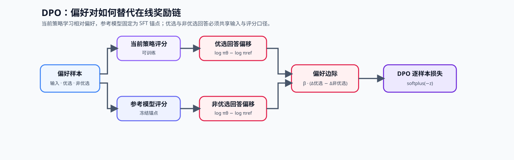
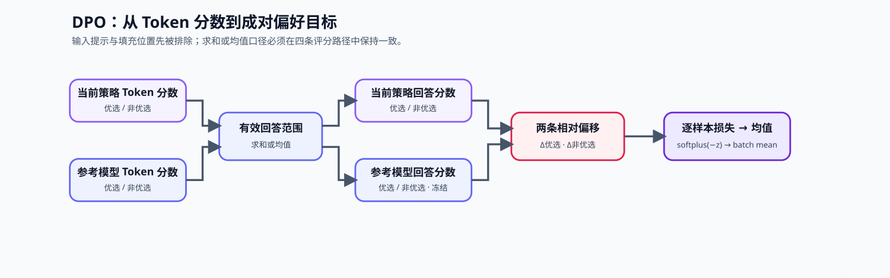

# 17. DPO Loss Tutorial | 直接偏好优化损失

**难度：** Hard | **环境：** [CPU 主线，GPU 可选](#runtime-environment) | **标签：** `后训练对齐`, `DPO`, `偏好优化` | **目标人群：** 训练机制学习者

> 🚀 **云端运行环境**
>
> 本章节的实战代码可以点击以下链接在免费 GPU 算力平台上直接运行：
>
> [](https://colab.research.google.com/github/datawhalechina/llm-algo-leetcode/blob/main/02_PyTorch_Algorithms/17_DPO_Loss_Tutorial.ipynb)
> [](https://modelscope.cn/my/mynotebook) *(国内推荐：魔搭社区免费实例)*


---

## 本节导读

RLHF 能把模型往人类偏好方向拉，但 PPO 训练链路很重：要维护策略模型、参考模型、奖励模型和价值模型，还要处理采样、打分和策略更新的稳定性问题。

DPO 的切入点更直接：偏好数据已经给出同一提示下的优选回答（`chosen`）与非优选回答（`rejected`），因此可以把二者的比较关系写成可优化的损失，让当前策略相对参考策略更偏向优选回答。完成后，你应该能解释偏好比较如何转成对数概率差值，以及 DPO 为什么能简化完整 RLHF 闭环。

**关键词：** `DPO`, `preference`, `loss`

---
<a id="runtime-environment"></a>

## 运行环境

- **基础练习：** 默认使用 [`BASE-CPU`](../guide.md#base-cpu)，运行 [Step 4 的题目与测试](#mechanism-practice)。
- **框架核对：** 如需核对 TRL 的标准 DPO 损失，使用 [`PT-CPU`](../topic_discussion/post_training_optimization/quickstart.md#pt-cpu-quickstart)；该环境已包含基础练习依赖，可在完成 Step 4 后直接运行 [框架一致性核对](#framework-check)。
- **GPU 实测：** 如需验证真实模型的偏好边际与更新资源，阅读 [Step 5](#gpu-experiment)；实验环境与固定工作负载见其中 5.1。

---
## 前置阅读

**导语：** 先理解 SFT 如何给出稳定的初始策略、PPO 为什么需要较重的在线链路，再用偏好数据看 DPO 如何把 chosen / rejected 的比较写成离线损失。

- [15. End-to-End Fine-Tuning Experiment | 端到端微调实验](../02_PyTorch_Algorithms/15_End_to_End_Fine_Tuning_Experiment.md)
- [16. RLHF PPO Memory | RLHF / PPO 资源桥接](../02_PyTorch_Algorithms/16_RLHF_PPO_Memory.md)


---
## Step 1：离线偏好对为什么可以替代 PPO 的一部分链路

DPO 的前提是已经有可信的离线偏好对：同一个输入下，优选回答比非优选回答更符合既定质量、安全或帮助性标准。它不再为每轮更新单独训练奖励模型和价值模型，而是比较当前策略与冻结参考策略对同一对回答的相对偏好。

| 维度 | PPO / RLHF | DPO |
| --- | --- | --- |
| 主要反馈 | 采样后的奖励与优势 | 已标注的优选 / 非优选回答对 |
| 主要模型状态 | 策略、参考、奖励与价值模型 | 当前策略与冻结参考策略 |
| 是否主动探索 | 是，依赖采样与反馈 | 否，依赖离线数据覆盖 |
| 适合的条件 | 环境反馈、探索或可验证奖励 | 偏好对已可靠、需要稳定离线训练 |



## Step 2：偏好对与参考策略构成什么训练契约

一条 DPO 样本必须让当前策略与参考策略比较同一输入下的优选和非优选回答。参考策略通常来自已完成监督微调的固定版本：监督微调先建立格式和基本任务能力，DPO 才能把后续变化解释为偏好调整，而不是重新学习任务格式。

| 契约 | 需要确认的事实 | 不满足时的风险 |
| --- | --- | --- |
| 成对性 | 优选与非优选回答对应同一输入和约束 | 比较到的不是偏好差异 |
| 偏好来源 | 差异来自正确性、帮助性或安全标准 | 模型学习长度、模板或泄漏线索 |
| 参考策略 | 来自固定的监督微调版本 | 无法判断当前策略偏离了什么基线 |
| 回答范围 | 两个策略评价完全相同的回答内容 | 输入提示或长度差异混入比较 |
| 数据切分 | 训练与评测相互隔离 | 训练记忆被误判为偏好质量提升 |

## Step 3：隐式奖励、β 与 DPO 损失如何连接

DPO 先在回答范围聚合 Token 对数概率，再比较当前策略相对参考策略对两种回答的偏移。设 $m_t$ 只在回答 Token 上为 1，则回复得分为：

$$s_{\pi}(y\mid x)=\sum_{t=1}^{T}m_t\log \pi(y_t\mid x,y_{<t})$$

长度归一化形式为 $\bar{s}_{\pi}=s_{\pi}/\sum_t m_t$。总和与均值定义了不同的比较口径；当前策略、参考策略以及优选、非优选回答必须使用同一种口径。

参考策略只提供固定比较锚点。$\operatorname{sg}$ 表示停止梯度：

$$d_y=s_{\pi_\theta}(y\mid x)-\operatorname{sg}\!\left(s_{\pi_{\mathrm{ref}}}(y\mid x)\right), \qquad y\in\{y^+,y^-\}$$

系数 $\beta$ 缩放优选与非优选回答之间的相对偏移。标准 sigmoid DPO 的逐样本损失可写为：

$$z=\beta(d_{y^+}-d_{y^-}), \qquad \ell_{\mathrm{DPO}}=-\log\sigma(z)=\operatorname{softplus}(-z)$$

因为 $\partial \ell/\partial z=\sigma(z)-1<0$，扩大优选回答的相对偏好间隔会降低损失。训练时再对 $B$ 个偏好对取平均：

$$\mathcal{L}_{\mathrm{batch}}=\frac{1}{B}\sum_{i=1}^{B}\ell_{\mathrm{DPO}}^{(i)}$$

| 量 | 计算 | 作用 |
| --- | --- | --- |
| 优选回答偏移 $d_{+}$ | 当前策略相对参考策略的变化 | 衡量优选回答被增强多少 |
| 非优选回答偏移 $d_{-}$ | 当前策略相对参考策略的变化 | 衡量非优选回答被增强或抑制多少 |
| 偏好间隔 $z$ | 两类回答偏移之差乘以 $\beta$ | 希望优选回答获得更大相对偏移 |
| DPO 目标 | 偏好间隔的稳定对数逻辑目标 | 间隔越大，损失越小；batch 再做均值归约 |



<a id="mechanism-practice"></a>

## Step 4：实现 DPO 的成对偏好损失

题目区先把 token log probability 按 response mask 聚合为每条回复的可比得分，再建立 Policy 相对 Reference 的 chosen / rejected 偏移，最后构造数值稳定的成对偏好损失。聚合方式由调用方固定；同一次比较不能混用 sum 与 mean。

| TODO / 函数 | 学习者完成的机制 | 必须满足的约束 | 测试证据 |
| --- | --- | --- | --- |
| TODO 1：聚合回答得分<br>`aggregate_response_logps` | 只聚合 response mask 内的 Token 对数概率 | 每条回复至少一个有效 Token；sum / mean 口径显式固定；屏蔽位置不传播非有限值 | `test_response_logp_aggregation`、`test_response_logp_input_contract` |
| TODO 2：计算相对参考策略偏移<br>`dpo_loss` | 计算 chosen / rejected 相对 Reference 的偏移 | 四组回复得分形状一致，Reference 固定且不接收梯度 | `test_dpo_implicit_rewards`、`test_dpo_gradient_path` |
| TODO 3：构造稳定偏好目标<br>`dpo_loss` | 构造 preference logit 与逐样本稳定损失 | `beta` 为正，chosen / rejected 方向不能颠倒，batch 归约由调用方完成 | `test_dpo_preference_direction_and_stability`、`test_dpo_batch_reduction` |


```python
import torch
import torch.nn.functional as F

```


```python
def aggregate_response_logps(token_logps, response_mask, normalize=False):
    """按 response mask 聚合每条回复的 token log probability。"""
    if token_logps.shape != response_mask.shape or token_logps.ndim != 2:
        raise ValueError("token_logps 与 response_mask 必须是同形二维张量")
    counts = response_mask.bool().sum(dim=-1)
    if torch.any(counts == 0):
        raise ValueError("每条回复至少需要一个有效 token")

    # ==========================================
    # TODO 1：只聚合 response mask 内的 token；normalize=True 时按有效长度归一化。
    # response_logps = ???
    # ==========================================
    raise NotImplementedError("TODO 1：聚合 response token log probability")
    return response_logps


def dpo_loss(
    policy_chosen_logps: torch.Tensor,
    policy_rejected_logps: torch.Tensor,
    reference_chosen_logps: torch.Tensor,
    reference_rejected_logps: torch.Tensor,
    beta: float = 0.1,
) -> tuple[torch.Tensor, torch.Tensor, torch.Tensor]:
    """计算同一 prompt 下 chosen / rejected 的 DPO 损失。

    四组 log probability 必须使用同一 tokenization 和回复范围；Reference 固定为
    SFT 基线，用于度量 Policy 的偏好偏移。
    """
    if not (policy_chosen_logps.shape == policy_rejected_logps.shape == reference_chosen_logps.shape == reference_rejected_logps.shape):
        raise ValueError("policy / reference 的 chosen-rejected logps 形状必须一致")
    if beta <= 0:
        raise ValueError("beta 必须是正数")

    # ==========================================
    # TODO 2：冻结 Reference，分别计算 chosen / rejected 的 Policy—Reference 偏移。
    # chosen_log_ratio = ???
    # rejected_log_ratio = ???
    # ==========================================
    raise NotImplementedError("TODO 2：计算 chosen / rejected 相对 Reference 的偏移")

    chosen_rewards = beta * chosen_log_ratio
    rejected_rewards = beta * rejected_log_ratio

    # ==========================================
    # TODO 3：用两条隐式奖励形成 preference logit，并计算稳定的 DPO loss。
    # preference_logits = ???
    # losses = ???
    # ==========================================
    raise NotImplementedError("TODO 3：构造 preference logit 与 DPO loss")
    return losses, chosen_rewards, rejected_rewards

```


```python
# 测试目标：分别检查 response 聚合、隐式奖励、偏好方向、数值稳定性与输入契约。

def _dpo_fixture():
    """构造 Policy 与 Reference 的成对偏好 log-prob 样例。"""
    return (
        torch.tensor([-1.0, -1.2, -0.8, -1.5], requires_grad=True),
        torch.tensor([-3.0, -2.5, -4.0, -2.8], requires_grad=True),
        torch.tensor([-2.0, -2.0, -2.0, -2.0], requires_grad=True),
        torch.tensor([-2.0, -2.0, -2.0, -2.0], requires_grad=True),
    )

def test_response_logp_aggregation():
    """验证回复掩码下的总和与长度归一化聚合。"""
    token_logps = torch.tensor([[-1.0, -2.0, -9.0], [-0.5, -1.5, -2.5]])
    mask = torch.tensor([[True, True, False], [False, True, True]])
    assert torch.allclose(aggregate_response_logps(token_logps, mask), torch.tensor([-3.0, -4.0]))
    assert torch.allclose(aggregate_response_logps(token_logps, mask, normalize=True), torch.tensor([-1.5, -2.0]))
    non_finite_masked = torch.tensor([[-1.0, -2.0, -float("inf")]])
    assert torch.allclose(
        aggregate_response_logps(non_finite_masked, torch.tensor([[True, True, False]])),
        torch.tensor([-3.0]),
    ), "被屏蔽的非有限值不应污染回答得分"

def test_response_logp_input_contract():
    """验证回答掩码的形状和非空契约。"""
    try:
        aggregate_response_logps(torch.zeros(1, 2), torch.zeros(1, 3, dtype=torch.bool))
    except ValueError:
        pass
    else:
        raise AssertionError("不同形状的 token_logps 与 response_mask 应被拒绝")
    try:
        aggregate_response_logps(torch.zeros(1, 2), torch.zeros(1, 2, dtype=torch.bool))
    except ValueError:
        return
    raise AssertionError("空回答掩码应被拒绝")


def test_dpo_implicit_rewards():
    """验证 chosen 与 rejected 的隐式奖励方向和形状。"""
    values = _dpo_fixture()
    losses, chosen_rewards, rejected_rewards = dpo_loss(*values, beta=0.1)
    assert losses.shape == chosen_rewards.shape == rejected_rewards.shape == (4,)
    assert torch.allclose(chosen_rewards[0], torch.tensor(0.1))
    assert torch.allclose(rejected_rewards[0], torch.tensor(-0.1))

def test_dpo_preference_direction_and_stability():
    """验证偏好方向、数值稳定性和成对顺序反例。"""
    values = _dpo_fixture()
    losses, _, _ = dpo_loss(*values, beta=0.1)
    assert torch.all(torch.isfinite(losses))
    expected = -F.logsigmoid(torch.tensor(0.2))
    assert torch.allclose(losses[0], expected)
    worse = dpo_loss(values[1], values[0], values[2], values[3], beta=0.1)[0]
    assert torch.all(worse > losses), "chosen / rejected 颠倒后 loss 应变大"
    extreme = dpo_loss(
        torch.tensor([1e4]), torch.tensor([-1e4]),
        torch.tensor([0.0]), torch.tensor([0.0]), beta=1.0,
    )[0]
    assert torch.all(torch.isfinite(extreme)), "极端偏好间隔下损失仍应保持有限"

def test_dpo_batch_reduction():
    """验证函数返回逐样本损失，batch 标量由调用方做均值归约。"""
    values = _dpo_fixture()
    losses, _, _ = dpo_loss(*values, beta=0.1)
    batch_loss = losses.mean()
    assert losses.ndim == 1 and losses.shape[0] == values[0].shape[0]
    assert batch_loss.ndim == 0 and torch.isfinite(batch_loss)

def test_dpo_gradient_path():
    """验证 Policy 接收梯度而 Reference 保持冻结。"""
    values = _dpo_fixture()
    losses, _, _ = dpo_loss(*values, beta=0.1)
    losses.mean().backward()
    assert values[0].grad is not None and values[1].grad is not None, "Policy 应接收梯度"
    assert values[2].grad is None and values[3].grad is None, "Reference 必须保持冻结"

def test_dpo_input_contract():
    """验证 log-prob 形状与 beta 的输入契约。"""
    values = _dpo_fixture()
    try:
        dpo_loss(values[0], values[1][:-1], values[2], values[3])
    except ValueError:
        pass
    else:
        raise AssertionError("不一致的 log-prob 形状应被拒绝")
    try:
        dpo_loss(*values, beta=0.0)
    except ValueError:
        return
    raise AssertionError("非正 beta 应被拒绝")

def run_dpo_tests():
    """运行 DPO 题目区的全部具名机制测试。"""
    test_response_logp_aggregation()
    test_response_logp_input_contract()
    test_dpo_implicit_rewards()
    test_dpo_preference_direction_and_stability()
    test_dpo_batch_reduction()
    test_dpo_gradient_path()
    test_dpo_input_contract()
    print("✅ DPO 回复聚合、隐式奖励、偏好方向、梯度隔离、稳定性与输入契约测试通过。")

run_dpo_tests()

```

## 参考代码与解析

### 代码

```python
def aggregate_response_logps(token_logps, response_mask, normalize=False):
    """按 response mask 聚合每条回复的 token log probability。"""
    if token_logps.shape != response_mask.shape or token_logps.ndim != 2:
        raise ValueError("token_logps 与 response_mask 必须是同形二维张量")
    mask = response_mask.bool()
    counts = mask.sum(dim=-1)
    if torch.any(counts == 0):
        raise ValueError("每条回复至少需要一个有效 token")
    # TODO 1：prompt / padding 不进入回复得分；normalize 控制 sum 或 mean 口径。
    response_logps = token_logps.masked_fill(~mask, 0.0).sum(dim=-1)
    if normalize:
        response_logps = response_logps / counts
    return response_logps


def dpo_loss(
    policy_chosen_logps: torch.Tensor,
    policy_rejected_logps: torch.Tensor,
    reference_chosen_logps: torch.Tensor,
    reference_rejected_logps: torch.Tensor,
    beta: float = 0.1,
) -> tuple[torch.Tensor, torch.Tensor, torch.Tensor]:
    """计算同一 prompt 下 chosen / rejected 的 DPO 损失。

    四组 log probability 必须使用同一 tokenization 和回复范围；Reference 固定为
    SFT 基线，用于度量 Policy 的偏好偏移。
    """
    if not (policy_chosen_logps.shape == policy_rejected_logps.shape == reference_chosen_logps.shape == reference_rejected_logps.shape):
        raise ValueError("policy / reference 的 chosen-rejected logps 形状必须一致")
    if beta <= 0:
        raise ValueError("beta 必须是正数")

    # TODO 2：分别计算 chosen / rejected 的 Policy—Reference 偏移。
    chosen_log_ratio = policy_chosen_logps - reference_chosen_logps.detach()

    rejected_log_ratio = policy_rejected_logps - reference_rejected_logps.detach()

    # TODO 3：用两条隐式奖励形成 preference logit，并构造数值稳定的 DPO loss。
    chosen_rewards = beta * chosen_log_ratio
    rejected_rewards = beta * rejected_log_ratio
    preference_logits = chosen_rewards - rejected_rewards
    losses = -F.logsigmoid(preference_logits)
    return losses, chosen_rewards, rejected_rewards

```

### 解析

#### TODO 1：聚合回复 log-prob

- 使用 `masked_fill(~response_mask, 0)` 排除 prompt 与 padding，再沿 token 维求和。
- `normalize=True` 时除以有效 token 数；测试分别核对 sum、mean 与变长 mask。

#### TODO 2：计算相对 Reference 的偏移

- chosen 与 rejected 分别计算 `policy_logp - reference_logp.detach()`。
- Reference 固定为比较锚点，梯度测试确认只有 Policy 两支接收梯度。

#### TODO 3：构造成对偏好损失

- `beta` 缩放两条隐式奖励，`chosen_reward - rejected_reward` 形成 preference logit。
- 使用 `-F.logsigmoid(preference_logits)` 保持数值稳定；方向对调测试确认 loss 增大。

<a id="framework-check"></a>

## 框架一致性核对（可选）

下面使用受控的逐 Token 对数概率调用 TRL 的标准 sigmoid DPO 损失路径，不下载模型。核对只比较回答 Token 求和与 Batch 损失；由于使用 `PT-CPU` 固定版本中的内部损失入口，版本变化时必须重新核对入口语义。

| 核对项 | 本节口径 | TRL 路径 | 通过条件 |
| --- | --- | --- | --- |
| 回答得分 | 有效回答 Token 对数概率求和 | `DPOTrainer._compute_loss` 汇总逐 Token 对数概率 | 受控 Token 分数还原为给定的优选与非优选序列分数 |
| 标准 DPO | reverse KL、sigmoid、固定 Reference | `f_divergence_type='reverse_kl'`、`loss_types=['sigmoid']` | 相同 $\beta$ 和 Reference 分数下，两条路径的 Batch 损失一致 |
| Batch 归约 | 逐样本损失取均值 | Trainer 返回标量均值 | 框架标量等于本节逐样本损失的均值 |


```python
from collections import defaultdict
from importlib.metadata import version
from types import SimpleNamespace

try:
    from trl import DPOTrainer
except ImportError:
    framework_check = {
        "status": "skipped",
        "reason": "请使用 PT-CPU 环境运行本单元",
    }
else:
    # 内部损失入口只需要单进程 gather 语义，不启动完整 Trainer。
    class _LocalAccelerator:
        device = torch.device("cpu")

        @staticmethod
        def gather_for_metrics(value):
            return value

        @staticmethod
        def gather(value):
            return value

    # 受控策略直接返回指定对数概率，避免模型前向引入额外误差。
    class _ControlledPolicy:
        training = True

        def __init__(self, output):
            self.output = output

        def __call__(self, **_kwargs):
            return self.output

    def check_dpo_framework_conformance():
        """核对本节 DPO 序列得分与 TRL 内部损失入口。"""
        beta = 0.1
        policy_chosen = torch.tensor([-1.0, -1.2, -0.8, -1.5])
        policy_rejected = torch.tensor([-3.0, -2.5, -4.0, -2.8])
        reference_chosen = torch.full((4,), -2.0)
        reference_rejected = torch.full((4,), -2.0)
        local_losses, _, _ = dpo_loss(
            policy_chosen, policy_rejected,
            reference_chosen, reference_rejected, beta=beta,
        )

        # TRL 按优选在前、非优选在后的 Batch 排列，并对回答 Token 求和。
        sequence_scores = torch.cat([policy_chosen, policy_rejected])
        per_token_logps = sequence_scores[:, None].repeat(1, 2) / 2
        controlled_output = SimpleNamespace(
            log_probs=per_token_logps,
            entropy=torch.zeros_like(per_token_logps),
            mean_logits=torch.zeros_like(per_token_logps),
            is_top1=torch.zeros_like(per_token_logps, dtype=torch.bool),
            log_sum_sq_probs=torch.zeros_like(per_token_logps),
        )
        model = _ControlledPolicy(controlled_output)
        trainer = SimpleNamespace(
            model=model, accelerator=_LocalAccelerator(), aux_loss_enabled=False,
            ld_alpha=None, precompute_ref_logps=True,
            f_divergence_type="reverse_kl", f_alpha_divergence_coef=0.5,
            loss_types=["sigmoid"], loss_weights=[1.0], beta=beta,
            use_weighting=False,
            _metrics={"train": defaultdict(list), "eval": defaultdict(list)},
            _total_train_tokens=0, _tp_size=1,
        )
        pair_count = policy_chosen.shape[0]
        inputs = {
            "input_ids": torch.zeros(2 * pair_count, 3, dtype=torch.long),
            "attention_mask": torch.ones(2 * pair_count, 3, dtype=torch.long),
            "completion_mask": torch.ones(2 * pair_count, 3, dtype=torch.long),
            "ref_chosen_logps": reference_chosen,
            "ref_rejected_logps": reference_rejected,
        }
        framework_loss = DPOTrainer._compute_loss(trainer, model, inputs, False)
        expected_scores = per_token_logps.sum(dim=1)
        checks = {
            "sequence_sum_match": bool(torch.allclose(expected_scores, sequence_scores)),
            "batch_loss_match": bool(torch.isclose(
                framework_loss, local_losses.mean(), atol=1e-6, rtol=1e-6
            ).item()),
        }
        failed_checks = [name for name, passed in checks.items() if not passed]
        if failed_checks:
            raise AssertionError(f"框架一致性核对失败：{failed_checks}")

        local_loss = float(local_losses.mean().item())
        framework_loss_value = float(framework_loss.item())
        return {
            "status": "passed",
            "versions": {"trl": version("trl")},
            "framework_path": "DPOTrainer._compute_loss",
            "checks": checks,
            "pair_count": pair_count,
            "local_loss": round(local_loss, 6),
            "framework_loss": round(framework_loss_value, 6),
            "absolute_error": abs(local_loss - framework_loss_value),
        }

    framework_check = check_dpo_framework_conformance()

framework_check
```

<a id="gpu-experiment"></a>

## Step 5：可选 GPU 实验——真实模型偏好边际与有限更新

CPU 题目确认 DPO 目标的方向、数值稳定性与梯度隔离；GPU 实验在同一模型快照、同一偏好对和同一 LoRA 配置下扫描 `beta`，观察真实模型的偏好边际、更新代价与显存。

| 学习问题 | CPU 已确认 | GPU 要确认 |
|:---|:---|:---|
| DPO 是否把更新推向 chosen | 张量级 loss 与梯度方向 | 真实回复 log-prob 的 chosen/rejected 边际是否增大 |
| `beta` 改变什么 | 偏好 logit 的缩放 | 同一更新预算下的 loss、边际和梯度变化 |
| 单卡机制证据能说明什么 | Reference 保持冻结 | LoRA 更新可执行、资源可记录；不替代数据集级质量评测 |

<a id="gpu-experiment-setup"></a>

### 5.1 环境与固定工作负载

本实验使用 [`PT-RL-CUDA`](../gpu_environment_assets.md#pt-rl-cuda)。首次运行先完成[后训练优化实验 Quickstart](../topic_discussion/post_training_optimization/quickstart.md#pt-rl-cuda-quickstart)；已有环境通过 Profile 预检后，从同一解释器启动 JupyterLab。页面、工作负载和结果状态见[后训练优化实验资产表](../topic_discussion/post_training_optimization/experiment_assets.md)。普通复测只修改 `RUN_MODE` 与 `RUN_LABEL`；模型、偏好对、LoRA 配置和候选 `beta` 变化时递增 `WORKLOAD_VERSION`。

| 配置项 | 默认值 | 作用 |
|:---|:---|:---|
| Profile | `PT-RL-CUDA` | 单卡 DPO / GRPO 机制环境；参考容量为 12 GB 级单卡 |
| 模型 | `Qwen/Qwen2.5-0.5B-Instruct@main` | 5.2 自动解析并记录不可变 commit |
| 偏好数据 | 4 组固定 prompt/chosen/rejected | 隔离数据变化，只比较 DPO 更新机制 |
| 候选 | `beta = 0.05 / 0.10 / 0.30` | 比较约束缩放对真实偏好边际的影响 |
| 更新预算 | LoRA，4 个 optimizer step | 在 12 GB 级单卡内形成可复查的有限更新证据 |


```python
# 学习者入口：普通复测通常只修改这两项。
RUN_MODE = "dry_run"  # 默认值 dry_run；改为 real_gpu 才执行真实 DPO 更新。
RUN_LABEL = "default"  # 默认值 default；正式复测改为唯一标签，避免覆盖结果。

# 模型快照：main 会在 5.2 自动解析并记录为不可变 commit。
MODEL_ID = "Qwen/Qwen2.5-0.5B-Instruct"
MODEL_REVISION = "main"
LOCAL_FILES_ONLY = False  # 默认值 False；相同快照已缓存且需离线运行时改为 True。

# 固定工作负载：改变以下参数后递增 WORKLOAD_VERSION。
ENVIRONMENT_PROFILE = "PT-RL-CUDA"
WORKLOAD_ID = "pt-dpo-real-model-update"
WORKLOAD_VERSION = "v1"
BETA_CANDIDATES = [0.05, 0.10, 0.30]  # DPO 偏好 logit 的三档缩放候选。
MAX_LENGTH = 128  # prompt 与 response 合并后的最大 Token 数。
LORA_RANK = 8  # 低秩适配器秩；固定可训练参数预算。
LORA_ALPHA = 16  # LoRA 缩放分子，实际缩放为 alpha / rank。
UPDATE_STEPS = 4  # 每个 beta 使用相同的有效 optimizer update 数。
LEARNING_RATE = 2e-4  # 仅更新 LoRA 参数。
SEED = 42
OUTPUT_RELATIVE_PATH = f"benchmarks/results/pt_dpo/{WORKLOAD_ID}_{RUN_LABEL}.json"

```

### 5.2 执行配对实验并保存 JSON

5.2 对每个 `beta` 从同一不可变模型快照重新开始：先关闭 LoRA 得到冻结 Reference 分数，再执行相同次数的 DPO 更新，最后记录真实偏好边际、耗时与峰值显存。


```python
import gc
import platform
import time

import torch
import torch.nn.functional as F
from tools.notebook_runtime import failure_record, hash_ids, package_version, resolve_model_commit, save_json
from tools.post_training_runtime import build_response_batch, move_response_batch, response_sequence_logps
from tools.project_runtime import resolve_project_root
from tools.training_mechanism_runtime import cuda_hardware_snapshot, gradient_l2_norm, median_and_p95

PREFERENCE_PAIRS = [
    {"prompt": "Answer with one sentence: Why do gradients accumulate?", "chosen": "Gradients add across micro-batches before one optimizer update.", "rejected": "Gradients disappear after every backward pass."},
    {"prompt": "Answer with one sentence: What does LoRA train?", "chosen": "LoRA trains small low-rank adapters while keeping the base weights frozen.", "rejected": "LoRA retrains every base-model parameter."},
    {"prompt": "Answer with one sentence: What is a validation split for?", "chosen": "It estimates behavior on examples excluded from parameter updates.", "rejected": "It supplies extra gradients when training loss is high."},
    {"prompt": "Answer with one sentence: Why freeze a DPO reference model?", "chosen": "A fixed reference makes policy preference shifts measurable.", "rejected": "A changing reference guarantees every response is correct."},
]
REPO_ROOT = resolve_project_root()
OUTPUT_PATH = REPO_ROOT / OUTPUT_RELATIVE_PATH
result = {
    "schema_version": "post-training-mechanism-gpu/v1",
    "semantic_id": "PT-DPO-LOSS",
    "environment_profile": ENVIRONMENT_PROFILE,
    "run_mode": RUN_MODE, "run_label": RUN_LABEL,
    "framework": {"python": platform.python_version(), "torch": torch.__version__, "transformers": package_version("transformers"), "peft": package_version("peft")},
    "hardware": {"cuda_available": torch.cuda.is_available(), "cuda": torch.version.cuda},
    "model": {"id": MODEL_ID, "requested_revision": MODEL_REVISION, "resolved_commit": None},
    "dataset": {"source": "embedded_fixed_preference_pairs", "pairs": len(PREFERENCE_PAIRS), "sample_hash": hash_ids([str(item) for item in PREFERENCE_PAIRS])},
    "workload": {"id": WORKLOAD_ID, "version": WORKLOAD_VERSION, "beta_candidates": BETA_CANDIDATES, "max_length": MAX_LENGTH, "lora_rank": LORA_RANK, "lora_alpha": LORA_ALPHA, "update_steps": UPDATE_STEPS, "learning_rate": LEARNING_RATE, "seed": SEED},
    "baseline": {"name": "frozen_reference", "initial_preference_margin": 0.0},
    "candidates": [], "failure": None, "evidence_level": "dry_run", "decision": "not_measured",
}

execution_stage = "environment_preflight"
if RUN_MODE == "real_gpu":
    model = optimizer = None
    try:
        if not torch.cuda.is_available():
            raise RuntimeError("RUN_MODE=real_gpu，但 CUDA 不可用")
        from peft import LoraConfig, TaskType, get_peft_model
        from transformers import AutoModelForCausalLM, AutoTokenizer

        device = torch.device("cuda")
        dtype = torch.bfloat16 if torch.cuda.is_bf16_supported() else torch.float16
        execution_stage = "revision_and_tokenization"
        model_commit, revision_source = resolve_model_commit(MODEL_ID, MODEL_REVISION, local_files_only=LOCAL_FILES_ONLY)
        result["model"].update({"resolved_commit": model_commit, "resolution_source": revision_source})
        tokenizer = AutoTokenizer.from_pretrained(MODEL_ID, revision=model_commit, local_files_only=LOCAL_FILES_ONLY)
        prompts = [item["prompt"] for item in PREFERENCE_PAIRS]
        chosen_batch = build_response_batch(tokenizer, prompts, [item["chosen"] for item in PREFERENCE_PAIRS], max_length=MAX_LENGTH)
        rejected_batch = build_response_batch(tokenizer, prompts, [item["rejected"] for item in PREFERENCE_PAIRS], max_length=MAX_LENGTH)
        chosen_batch = move_response_batch(chosen_batch, device)
        rejected_batch = move_response_batch(rejected_batch, device)

        for beta in BETA_CANDIDATES:
            execution_stage = f"beta_{beta}"
            gc.collect(); torch.cuda.empty_cache(); torch.cuda.reset_peak_memory_stats()
            torch.manual_seed(SEED); torch.cuda.manual_seed_all(SEED)
            base = AutoModelForCausalLM.from_pretrained(MODEL_ID, revision=model_commit, local_files_only=LOCAL_FILES_ONLY, dtype=dtype).to(device)
            base.config.use_cache = False
            model = get_peft_model(base, LoraConfig(r=LORA_RANK, lora_alpha=LORA_ALPHA, lora_dropout=0.0, target_modules=["q_proj", "v_proj"], bias="none", task_type=TaskType.CAUSAL_LM))
            trainable = [parameter for parameter in model.parameters() if parameter.requires_grad]
            optimizer = torch.optim.AdamW(trainable, lr=LEARNING_RATE)
            model.eval()
            with torch.no_grad(), model.disable_adapter(), torch.autocast("cuda", dtype=dtype):
                ref_chosen, _ = response_sequence_logps(model, chosen_batch)
                ref_rejected, _ = response_sequence_logps(model, rejected_batch)
            update_times_ms, losses, gradient_norms = [], [], []
            model.train()
            for _ in range(UPDATE_STEPS):
                optimizer.zero_grad(set_to_none=True)
                torch.cuda.synchronize(); started = time.perf_counter()
                with torch.autocast("cuda", dtype=dtype):
                    policy_chosen, _ = response_sequence_logps(model, chosen_batch)
                    policy_rejected, _ = response_sequence_logps(model, rejected_batch)
                    logits = beta * ((policy_chosen - ref_chosen) - (policy_rejected - ref_rejected))
                    loss = -F.logsigmoid(logits).mean()
                loss.backward(); gradient_norms.append(gradient_l2_norm(trainable)); optimizer.step()
                torch.cuda.synchronize(); update_times_ms.append((time.perf_counter() - started) * 1000); losses.append(float(loss.detach()))
            model.eval()
            with torch.no_grad(), torch.autocast("cuda", dtype=dtype):
                final_chosen, _ = response_sequence_logps(model, chosen_batch)
                final_rejected, _ = response_sequence_logps(model, rejected_batch)
            chosen_shift = final_chosen - ref_chosen
            rejected_shift = final_rejected - ref_rejected
            preference_margin = chosen_shift - rejected_shift
            median_ms, p95_ms = median_and_p95(update_times_ms)
            result["candidates"].append({"beta": beta, "losses": losses, "mean_chosen_shift": float(chosen_shift.mean()), "mean_rejected_shift": float(rejected_shift.mean()), "mean_preference_margin": float(preference_margin.mean()), "preference_accuracy": float((preference_margin > 0).float().mean()), "gradient_norms": gradient_norms, "median_update_ms": median_ms, "p95_update_ms": p95_ms, "peak_allocated_bytes": int(torch.cuda.max_memory_allocated())})
            del optimizer, model, base; optimizer = model = None

        selected = max(result["candidates"], key=lambda item: (item["preference_accuracy"], item["mean_preference_margin"]))
        passed = selected["preference_accuracy"] >= 0.75 and selected["mean_preference_margin"] > 0
        result.update({"hardware": cuda_hardware_snapshot(), "selected_candidate": {"beta": selected["beta"]}, "evidence_level": "real_model_dpo_mechanism_benchmark", "decision": "accept_mechanism" if passed else "tune"})
    except Exception as error:
        result.update({"failure": failure_record(execution_stage, error), "evidence_level": "failed_real_gpu_attempt", "decision": "reject_until_fixed"})
    finally:
        del optimizer, model
        gc.collect(); torch.cuda.empty_cache()
elif RUN_MODE != "dry_run":
    raise ValueError("RUN_MODE 只能是 dry_run 或 real_gpu")

save_json(OUTPUT_PATH, result)
print(OUTPUT_PATH)
print(result["decision"], result["failure"])

```

### 5.3 读取结果

本节只读取当前 `RUN_LABEL` 对应的 JSON，不回退到其他运行。先检查 failure，再比较三档 `beta` 的偏好准确率、平均边际、更新时间与峰值显存。


```python
import json

if not OUTPUT_PATH.exists():
    print(f"尚未找到结果文件：{OUTPUT_PATH}")
else:
    record = json.loads(OUTPUT_PATH.read_text(encoding="utf-8"))
    print(json.dumps({key: record.get(key) for key in ("run_label", "model", "selected_candidate", "failure", "evidence_level", "decision")}, ensure_ascii=False, indent=2))
    for candidate in record.get("candidates", []):
        print({key: candidate.get(key) for key in ("beta", "mean_preference_margin", "preference_accuracy", "median_update_ms", "p95_update_ms", "peak_allocated_bytes")})

```

### 5.4 解释证据与决策

先确认三档候选来自同一模型 commit、偏好对与更新预算，再判断边际方向；速度和显存只用于描述这次有限更新，不据此声称模型整体偏好质量已经改善。RTX 5070 Ti 实测中三档候选均形成正偏好边际，机制链可以接受。

| 观察项 | 读取字段 | 当前结果 | 解释与动作 |
|:---|:---|:---|:---|
| 运行与口径 | `failure`、model commit、偏好对 hash、更新预算 | `rtx5070ti_dpo_v1`；无失败；固定 commit | 任一固定条件变化时整体重跑 |
| 机制与路径 | Reference 冻结状态、`beta`、`losses`、`gradient_norms` | 三档 loss 均下降，梯度有限 | Reference 冻结与更新路径成立 |
| 正确性或质量 | `preference_accuracy`、`mean_preference_margin` | 准确率均为 1.0；平均边际 7.57–8.12 | 仅证明固定偏好对上的更新方向 |
| 资源与性能 | `median_update_ms`、`p95_update_ms`、`peak_allocated_bytes` | 中位更新时间 117.72–122.65 ms；峰值约 3.43 GB | 不外推整体偏好质量或完整训练吞吐 |
| 证据与决策 | `evidence_level`、`decision` | `real_model_dpo_mechanism_benchmark`；`accept_mechanism` | 接受 DPO 机制方向；真实质量仍需独立评测 |

## 相关阅读

- [Part 02 · 18 GRPO：组相对策略优化损失](../02_PyTorch_Algorithms/18_GRPO_Loss_Tutorial.md)
- [Part 02 · 50 偏好数据与评测](../02_PyTorch_Algorithms/50_Preference_Data_and_Evaluation.md)
- [DPO 原论文](https://arxiv.org/abs/2305.18290)
- [TRL DPOTrainer 文档](https://huggingface.co/docs/trl/dpo_trainer)
