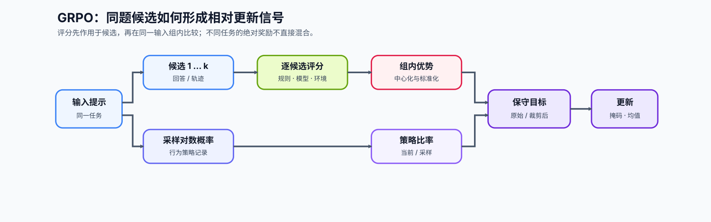
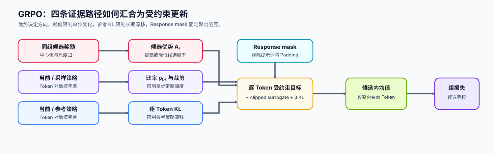

# 18. GRPO Loss Tutorial | 组相对策略优化与可验证奖励

**难度：** Medium-Hard | **环境：** [CPU 主线，GPU 可选](#runtime-environment) | **标签：** `后训练对齐`, `GRPO`, `RLVR` | **目标人群：** 已理解偏好与策略优化基础的学习者

> 🚀 **云端运行环境**
>
> 本章节的实战代码可以点击以下链接在免费 GPU 算力平台上直接运行：
>
> [](https://colab.research.google.com/github/datawhalechina/llm-algo-leetcode/blob/main/02_PyTorch_Algorithms/18_GRPO_Loss_Tutorial.ipynb)
> [](https://modelscope.cn/my/mynotebook) *(国内推荐：魔搭社区免费实例)*


---

## 本节导读

同一个提示往往可以采样出多个候选回答。组相对策略优化（GRPO）先在同组内比较候选奖励，再把相对优势送入受裁剪的策略更新，从而减少对显式价值模型的依赖。

GRPO 规定如何更新策略，可验证奖励强化学习（RLVR）规定奖励如何由答案检查、代码执行或环境终态产生，两者不是同一个概念。本节建立“候选组—验证器奖励—组内优势—受约束更新”的机制链，并检查奖励无差异、验证器覆盖不足和代理指标失真时为什么不能直接采用训练结果。
<a id="runtime-environment"></a>

## 运行环境

- **基础练习：** 默认使用 [`BASE-CPU`](../guide.md#base-cpu)，运行 [Step 4 的题目与测试](#mechanism-practice)。
- **框架核对：** 如需核对 TRL 的标准 GRPO 目标，使用 [`PT-CPU`](../topic_discussion/post_training_optimization/quickstart.md#pt-cpu-quickstart)；该环境已包含基础练习依赖，可在完成 Step 4 后直接运行 [框架一致性核对](#framework-check)。
- **GPU 实测：** 如需验证真实模型的验证器奖励、组内优势与更新资源，阅读 [Step 5](#gpu-experiment)；实验环境与固定工作负载见其中 5.1。

---
## 前置阅读

**导语：** 先理解最小 SFT 闭环以及 PPO 的策略比率与裁剪，再看同一提示的多个候选如何形成组相对训练信号。

- [15. End-to-End Fine-Tuning Experiment | 端到端微调实验](../02_PyTorch_Algorithms/15_End_to_End_Fine_Tuning_Experiment.md)
- [16. RLHF PPO Memory | RLHF / PPO 资源桥接](../02_PyTorch_Algorithms/16_RLHF_PPO_Memory.md)

---
## Step 1：同一输入的候选如何变成相对训练信号

GRPO 为同一个输入或任务采样多个候选回答；在工具场景中，每个候选也可以是一条完整轨迹。奖励可以来自奖励模型、规则验证器或环境反馈，更新方向则由候选在本组中的相对位置决定。PPO 与 GRPO 都可以使用在线奖励，DPO 使用已有的离线偏好对；RLVR 是前两者可接入的奖励来源，而不是第三种策略更新算法。组内归一化能够降低不同任务奖励尺度的影响，但不能证明奖励规则覆盖了真实任务质量。

| 维度 | GRPO 回答什么 | RLVR 回答什么 | 两者共同需要的证据 |
|:---|:---|:---|:---|
| 候选组织 | 同一提示下哪些回答或轨迹进入一组 | 哪些结果可以被规则或环境检查 | 组规模、采样策略与候选身份 |
| 反馈来源 | 接收候选级奖励，不限定奖励提供者 | 由答案、测试或环境终态产生可检查奖励 | 验证器版本、输入输出与失败类型 |
| 相对基线 | 用组内中心和尺度构造优势 | 不规定优势如何计算 | 奖励离散度与零方差组比例 |
| 策略更新 | 用策略比率、裁剪和有效回答范围更新参数 | 可配合 GRPO，也可配合 PPO | 策略版本、裁剪比例与更新稳定性 |
| 质量判断 | 只优化收到的相对信号 | 只验证已经编码的规则 | 独立评测、失败样本与奖励投机检查 |




## Step 2：组内优势、策略裁剪与参考策略如何共同限制更新

每个候选组先以组内平均奖励建立比较基线，再用组内尺度归一化相对差异。组内优势决定“提高还是降低”候选概率，当前策略与采样策略的比率限制单次更新幅度，参考策略 KL 则限制策略长期偏离稳定基线。采样策略和参考策略可能来自同一快照，但承担的职责不同。

对组 $g$ 中候选 $i$，先计算候选级优势：

$$
A_i = \frac{r_i-\mu_g}{\max(\sigma_g, \varepsilon)}.
$$

对候选中的有效 Token $t$，策略比率和裁剪目标为：

$$
\rho_{i,t}=\exp\!\left(\log \pi_\theta(y_{i,t})-\log \pi_{old}(y_{i,t})\right),
$$

$$
s_{i,t}=\min\!\left(\rho_{i,t}A_i,\;\operatorname{clip}(\rho_{i,t},1-\epsilon,1+\epsilon)A_i\right).
$$

本节采用 TRL 标准 GRPO 路径使用的非负逐 Token KL 估计：

$$
d_{i,t}=\log \pi_{ref}(y_{i,t})-\log \pi_\theta(y_{i,t}),\qquad
\widehat D_{KL,i,t}=\exp(d_{i,t})-d_{i,t}-1.
$$

候选先在自己的有效回答 Token 内求均值，再在候选间等权：

$$
\mathcal L_{GRPO}=
\frac{1}{G}\sum_{i=1}^{G}
\frac{1}{\sum_t m_{i,t}}
\sum_t m_{i,t}\left[-s_{i,t}+\beta\widehat D_{KL,i,t}\right].
$$

当 $\beta=0$ 时不使用参考策略惩罚；奖励相同或只有一个候选时，$A_i=0$，组内比较不应凭空制造更新方向。

| 约束 | 比较对象 | 机制作用 | 失效时的风险 |
| --- | --- | --- | --- |
| 组内优势 | 同一提示的候选奖励 | 去除任务间共同基线 | 跨任务奖励尺度主导更新 |
| 策略裁剪 | 当前策略与采样策略 | 限制一次更新的概率比率 | 单步更新过强 |
| Reference KL | 当前策略与参考策略 | 限制长期漂移 | 奖励投机或能力退化 |
| Response mask | 有效回答 Token | 排除提示词与 Padding | 无效位置污染目标 |



## Step 3：把组内排名与真实质量分开验证

组内优势、策略比率、裁剪比例和 KL 只能说明优化过程是否稳定，不能证明候选的真实质量正在提高。RLVR 还要证明每个奖励分量来自可复现的验证过程，并用独立证据排查奖励投机：验证器版本、输入契约、超时和不可判定行为必须固定，正确性、格式、执行结果与约束信号也应分别记录；如果只保留混合总分，就无法区分模型学会了任务还是只学会了通过某条规则。

| 奖励分量 | 常见来源 | 失真表现 | 必须同时检查的证据 |
| --- | --- | --- | --- |
| 正确性 | 答案匹配、单元测试、环境终态 | 利用验证器漏洞 | 隐藏评测与失败样本 |
| 格式 | 标签、JSON、工具调用结构 | 格式通过但任务失败 | 格式通过率与独立正确率 |
| 长度与风格 | 长度惩罚、冗余与风格规则 | 截断推理或模板化 | 输出长度分布与任务质量 |
| 安全与策略约束 | 分类器、规则或人工偏好 | 过度拒答或分布偏差 | 拒答率、帮助性与分组结果 |
| 稳定性约束 | 当前策略与参考策略的差异 | 更新过强或停滞 | KL、策略比率、裁剪比例与失败运行 |
| 验证状态 | 通过、失败、超时或不可判定 | 把系统失败误记为任务失败 | 验证器版本、错误类型与重试记录 |

<a id="mechanism-practice"></a>

## Step 4：实现组内优势、裁剪目标与参考策略约束

题目区使用二维 Token 对数概率、回答掩码、候选奖励和组标识复现 GRPO 目标。骨架提供固定旧策略、参考策略和奖励；学习者补全组内优势、策略比率、裁剪目标、可选参考策略 KL 和候选等权聚合。测试覆盖多组、单元素组、近零方差、变长回答和梯度隔离。

| TODO / 函数 | 学习者完成的机制 | 必须满足的约束 | 测试证据 |
| --- | --- | --- | --- |
| TODO 1 / `compute_group_advantages` | 按 `group_ids` 计算候选级相对优势 | 每组均值为零，单元素组优势为零 | 多组、单元素组与近零方差 |
| TODO 2 / `compute_grpo_loss`：策略比率 | 比较当前策略与采样策略 | 旧策略固定且不接收梯度 | Ratio 与梯度隔离 |
| TODO 3 / `compute_grpo_loss`：受约束 Token 损失 | 组合裁剪目标与可选 Reference KL | 保留优势方向；KL 非负；Reference 固定 | 裁剪边界、KL 与梯度隔离 |
| TODO 4 / `compute_grpo_loss`：候选等权聚合 | 每条 Response 先按有效 Token 求均值 | 每个候选至少一个有效 Token | 变长 Mask 与候选权重 |

```python
import torch

```


```python
def compute_group_advantages(rewards, group_ids, eps=1e-6):
    """在每个 prompt 组内标准化候选 reward。"""
    if rewards.ndim != 1 or rewards.shape != group_ids.shape:
        raise ValueError("rewards 与 group_ids 必须是同形一维张量")
    if eps <= 0:
        raise ValueError("eps 必须为正")
    advantages = torch.zeros_like(rewards)
    for group_id in group_ids.unique(sorted=True):
        group_mask = group_ids == group_id
        group_rewards = rewards[group_mask]
        # ==========================================
        # TODO 1：逐组计算中心化 reward、稳定尺度和相对 advantage。
        # centered = ???
        # scale = ???
        # advantages[group_mask] = ???
        # ==========================================
        raise NotImplementedError("TODO 1：计算组内相对优势")
    return advantages


def compute_grpo_loss(log_probs_new, log_probs_old, rewards, group_ids, response_mask=None, clip_range=0.2, eps=1e-6, log_probs_ref=None, beta=0.0):
    """计算简化 GRPO loss：组内相对优势与 PPO 风格裁剪。

    Args:
        log_probs_new: 当前策略的 token 对数概率，形状 [候选数, 序列长度]。
        log_probs_old: 采样时旧策略的同位置对数概率。
        rewards: 每个候选的外部 reward，形状 [候选数]。
        group_ids: 标记候选属于哪个 prompt 组的整数 ID。
        response_mask: 有效 response token 的布尔掩码。
        clip_range: ratio 的单步允许偏移。
        eps: 组内标准差的数值保护项。
        log_probs_ref: 可选参考策略的同位置对数概率。
        beta: Reference KL 的非负权重；为零时不启用该约束。

    Note:
        reward 只负责形成组内排序；独立质量仍需在 held-out 评测中确认。
    """
    if log_probs_new.ndim != 2 or log_probs_new.shape != log_probs_old.shape:
        raise ValueError("新旧策略 log_probs 必须是同形二维张量")
    if rewards.shape[0] != log_probs_new.shape[0]:
        raise ValueError("rewards / group_ids 必须与候选维一致")
    if clip_range < 0 or beta < 0:
        raise ValueError("clip_range 与 beta 必须非负")
    if log_probs_ref is not None and log_probs_ref.shape != log_probs_new.shape:
        raise ValueError("参考策略 log_probs 必须与当前策略同形")
    if response_mask is None:
        response_mask = torch.ones_like(log_probs_new, dtype=torch.bool)
    if response_mask.shape != log_probs_new.shape or not torch.all(response_mask.bool().any(dim=-1)):
        raise ValueError("response_mask 必须同形且至少包含一个有效位置")

    advantages = compute_group_advantages(rewards, group_ids, eps=eps)

    # ==========================================
    # TODO 2：冻结旧策略记录，计算 token 级策略比率及其裁剪值。
    # ratio = ???
    # clipped_ratio = ???
    # ==========================================

    # ==========================================
    # TODO 3：广播候选优势，构造裁剪目标与可选 Reference KL。
    # token_advantages = ???
    # surrogate = ???
    # clipped_surrogate = ???
    # conservative = ???
    # per_token_loss = ???
    # ==========================================

    # ==========================================
    # TODO 4：每个候选先按有效 token 求均值，再在候选间等权聚合。
    # token_counts = ???
    # per_candidate = ???
    # loss = ???
    # ==========================================
    return loss, advantages
```

## 测试

```python
# 测试目标：分别验证组内归一化、裁剪、Reference KL、梯度和输入契约。

def _grpo_fixture():
    """构造多组、变长掩码和单元素组的 GRPO 样例。"""
    return (
        torch.tensor([[-1.0, -0.5], [-0.5, -0.7], [-1.5, -0.4], [-0.2, -0.9], [-0.8, -1.0]], requires_grad=True),
        torch.tensor([[-1.1, -0.4], [-0.4, -0.8], [-1.6, -0.5], [-0.3, -0.8], [-0.8, -1.1]], requires_grad=True),
        torch.tensor([[-1.2, -0.7], [-0.8, -0.9], [-1.7, -0.8], [-0.6, -1.1], [-0.9, -1.2]], requires_grad=True),
        torch.tensor([1.0, 2.0, 0.5, 1.5, 3.0]),
        torch.tensor([0, 0, 1, 1, 2]),
        torch.tensor([[True, True], [True, False], [True, True], [True, True], [True, False]]),
    )

def test_grpo_group_advantage():
    """验证组内优势中心化与单元素组处理。"""
    new, old, ref, rewards, group_ids, mask = _grpo_fixture()
    _, advantages = compute_grpo_loss(new, old, rewards, group_ids, mask)
    for gid in group_ids.unique(sorted=True):
        group_adv = advantages[group_ids == gid]
        assert torch.allclose(group_adv.mean(), torch.tensor(0.0), atol=1e-6)
    assert advantages[-1].item() == 0.0, "单元素组没有相对排序信号"

def test_grpo_constraints_and_gradient():
    """验证裁剪、Reference KL 和固定目标的梯度隔离。"""
    new, old, ref, rewards, group_ids, mask = _grpo_fixture()
    loss_without_kl, _ = compute_grpo_loss(new, old, rewards, group_ids, mask)
    loss, _ = compute_grpo_loss(
        new, old, rewards, group_ids, mask, log_probs_ref=ref, beta=0.1
    )
    assert loss.ndim == 0 and torch.isfinite(loss)
    assert loss >= loss_without_kl, "非负 KL 项不应降低同一批次损失"
    assert torch.all(torch.exp(new.detach() - old.detach()) > 0)
    loss.backward()
    assert new.grad is not None and torch.isfinite(new.grad).all()
    assert old.grad is None, "采样策略不应接收梯度"
    assert ref.grad is None, "参考策略不应接收梯度"

def test_grpo_candidate_equal_weighting():
    """验证不同回复长度的候选先聚合再等权。"""
    new = torch.zeros(2, 2)
    old = torch.zeros(2, 2)
    rewards = torch.tensor([0.0, 2.0])
    group_ids = torch.tensor([0, 0])
    mask = torch.tensor([[True, True], [True, False]])
    loss, _ = compute_grpo_loss(new, old, rewards, group_ids, mask)
    assert torch.allclose(loss, torch.tensor(0.0)), "长短候选应先各自聚合再等权"

def test_grpo_input_contract():
    """验证张量形状和数值参数的输入契约。"""
    new, old, ref, rewards, group_ids, mask = _grpo_fixture()
    invalid_calls = (
        lambda: compute_grpo_loss(new, old[:-1], rewards, group_ids, mask),
        lambda: compute_grpo_loss(new, old, rewards, group_ids, mask, eps=0.0),
        lambda: compute_grpo_loss(new, old, rewards, group_ids, mask, log_probs_ref=ref[:-1]),
        lambda: compute_grpo_loss(new, old, rewards, group_ids, mask, beta=-0.1),
        lambda: compute_grpo_loss(new, old, rewards, group_ids, mask.float()),
        lambda: compute_grpo_loss(new, old, torch.tensor([float("nan"), 2.0, 0.5, 1.5, 3.0]), group_ids, mask),
        lambda: compute_grpo_loss(new, old, rewards, group_ids, mask, clip_range=float("inf")),
        lambda: compute_grpo_loss(new, old, rewards, group_ids, mask.float()),
        lambda: compute_grpo_loss(new, old, torch.tensor([float("nan"), 2.0, 0.5, 1.5, 3.0]), group_ids, mask),
        lambda: compute_grpo_loss(new, old, rewards, group_ids, mask, clip_range=float("inf")),
        lambda: compute_grpo_loss(new, old, rewards, group_ids, mask.float()),
        lambda: compute_grpo_loss(new, old, torch.tensor([float("nan"), 2.0, 0.5, 1.5, 3.0]), group_ids, mask),
        lambda: compute_grpo_loss(new, old, rewards, group_ids, mask, clip_range=float("inf")),
    )
    for invalid_call in invalid_calls:
        try:
            invalid_call()
        except ValueError:
            continue
        raise AssertionError("非法输入应被拒绝")

def run_grpo_tests():
    """运行 GRPO 题目区的全部具名机制测试。"""
    test_grpo_group_advantage()
    test_grpo_constraints_and_gradient()
    test_grpo_candidate_equal_weighting()
    test_grpo_input_contract()
    print("✅ GRPO 组内优势、裁剪、Reference KL、候选等权与输入契约测试通过。")

run_grpo_tests()

```

---

🛑 **STOP HERE** 🛑
<br><br><br><br><br><br><br><br><br><br>
> 请先尝试自己完成代码并跑通测试。<br>
> 如果你正在 Colab 中运行，并且遇到困难没有思路，可以向下滚动查看参考答案。
<br><br><br><br><br><br><br><br><br><br>

---

## 参考代码与解析

### 代码

```python
import math


import math


import math


def compute_group_advantages(rewards, group_ids, eps=1e-6):
    """在每个 prompt 组内标准化候选 reward。"""
    if rewards.ndim != 1 or rewards.numel() == 0 or rewards.shape != group_ids.shape:
        raise ValueError("rewards 与 group_ids 必须是同形非空一维张量")
    eps = float(eps)
    if not torch.isfinite(rewards).all() or not math.isfinite(eps) or eps <= 0:
        raise ValueError("rewards 必须有限且 eps 必须为正有限数")
    advantages = torch.zeros_like(rewards)
    for group_id in group_ids.unique(sorted=True):
        group_mask = group_ids == group_id
        group_rewards = rewards[group_mask]
        # TODO 1：候选只与同一 prompt 的组内均值和尺度比较。
        centered = group_rewards - group_rewards.mean()
        scale = group_rewards.std(unbiased=False).clamp_min(eps)
        advantages[group_mask] = centered / scale
    return advantages


def compute_grpo_loss(log_probs_new, log_probs_old, rewards, group_ids, response_mask=None, clip_range=0.2, eps=1e-6, log_probs_ref=None, beta=0.0):
    """计算简化 GRPO loss：组内相对优势与 PPO 风格裁剪。"""
    if log_probs_new.ndim != 2 or log_probs_new.numel() == 0 or log_probs_new.shape != log_probs_old.shape:
        raise ValueError("新旧策略 log_probs 必须是同形非空二维张量")
    if rewards.shape[0] != log_probs_new.shape[0] or group_ids.shape != rewards.shape:
        raise ValueError("rewards / group_ids 必须与候选维一致")
    clip_range, beta = float(clip_range), float(beta)
    if any(not math.isfinite(value) or value < 0 for value in (clip_range, beta)):
        raise ValueError("clip_range 与 beta 必须是非负有限数")
    if not torch.isfinite(log_probs_new).all() or not torch.isfinite(log_probs_old).all():
        raise ValueError("新旧策略 log_probs 必须为有限数")
    if log_probs_ref is not None and log_probs_ref.shape != log_probs_new.shape:
        raise ValueError("参考策略 log_probs 必须与当前策略同形")
    if response_mask is None:
        response_mask = torch.ones_like(log_probs_new, dtype=torch.bool)
    if response_mask.shape != log_probs_new.shape or response_mask.dtype != torch.bool or not torch.all(response_mask.any(dim=-1)):
        raise ValueError("response_mask 必须是同形布尔张量，且每条候选至少包含一个有效位置")
    if log_probs_ref is not None and not torch.isfinite(log_probs_ref).all():
        raise ValueError("参考策略 log_probs 必须为有限数")

    advantages = compute_group_advantages(rewards, group_ids, eps=eps)

    # TODO 2：当前策略与采样策略形成 token 级比率。
    ratio = torch.exp(log_probs_new - log_probs_old.detach())
    clipped_ratio = torch.clamp(ratio, 1.0 - clip_range, 1.0 + clip_range)

    # TODO 3：候选优势广播到 Token；可选 Reference KL 限制长期漂移。
    token_advantages = advantages.detach().unsqueeze(-1)
    surrogate = ratio * token_advantages
    clipped_surrogate = clipped_ratio * token_advantages
    conservative = torch.minimum(surrogate, clipped_surrogate)
    per_token_loss = -conservative
    if log_probs_ref is not None and beta > 0:
        ref_delta = log_probs_ref.detach() - log_probs_new
        per_token_kl = torch.exp(ref_delta) - ref_delta - 1.0
        per_token_loss = per_token_loss + beta * per_token_kl

    # TODO 4：先在每个候选内部按有效 Token 求均值，再让候选等权。
    mask = response_mask.bool()
    token_counts = mask.sum(dim=-1)
    per_candidate = (per_token_loss * mask).sum(dim=-1) / token_counts
    loss = per_candidate.mean()
    return loss, advantages
```

### 解析

#### TODO 1：计算候选级组内优势

- 对每个 `group_id` 计算 `centered = reward - group_mean`，再除以 `std.clamp_min(eps)`。
- 单元素组的 centered 为零，测试确认不会凭空制造相对优势。

#### TODO 2：计算策略比率

- 使用 `torch.exp(log_probs_new - log_probs_old.detach())` 形成逐 token ratio。
- `torch.clamp` 给出允许区间，梯度测试确认旧策略不接收梯度。

#### TODO 3：构造受约束的 Token 级损失

- 用 `unsqueeze(-1)` 将候选级 advantage 广播到该候选的 token。
- 原始与裁剪 Surrogate 通过 `torch.minimum` 形成保守目标。
- 提供 Reference 时，加入非负逐 Token KL；`detach()` 保证 Reference 不接收梯度。

#### TODO 4：让候选等权参与更新

- 每条 response 先除以自己的有效 token 数，再在候选维取均值。
- 变长 mask 测试确认长候选不会仅因 token 更多而获得更大权重。

<a id="framework-check"></a>

## 框架一致性核对（可选）

下面先让两项确定性奖励函数经过 `GRPOTrainer` 的奖励入口，再使用受控的逐 Token 对数概率调用标准 `grpo` 损失路径。核对覆盖奖励函数输出、不可评分值、组内优势、Token 级策略比率、双侧裁剪、Reference KL 与回答等权归约；全程不下载模型。

| 核对项 | 本节计算 | TRL 路径 | 通过条件 |
| --- | --- | --- | --- |
| 奖励函数 | 正确性与格式分别返回回答级分数 | `GRPOTrainer._calculate_rewards` | 每项奖励进入独立列，`None` 转为 `NaN` |
| 奖励合并 | 各项分数乘固定权重；所有项缺失的回答不可评分 | `reward_weights` 与 `NaN` 规则 | 可评分回答得到预期总分，不可评分回答保持 `NaN` |
| 组内优势 | 每组 Reward 中心化并按组内标准差缩放 | `scale_rewards='group'` | 两组回答分别得到 $[-1,1]$ 的相对优势 |
| 策略约束 | Token 级比率与双侧裁剪 | `importance_sampling_level='token'`、`loss_type='grpo'` | 配置入口保持 Token 级标准 GRPO 计算 |
| Reference 约束 | $\exp(d)-d-1$，权重为 $\beta$ | `beta > 0` 且关闭 Bias correction | 相同 Reference 分数与 $\beta$ 下目标值一致 |
| 归约 | 每条候选按有效 Token 求均值，再对候选取均值 | 标准 `grpo` 归约 | 框架损失与本节完整目标数值一致 |

```python
from collections import defaultdict
from importlib.metadata import version
from types import SimpleNamespace

try:
    from trl import GRPOConfig, GRPOTrainer
except ImportError:
    framework_check = {
        "status": "skipped",
        "reason": "请使用 PT-CPU 环境运行本单元",
    }
else:
    # 内部损失入口只需要单进程归约与 gather 语义，不启动完整 Trainer。
    class _LocalAccelerator:
        num_processes = 1
        device = torch.device("cpu")
        is_main_process = False

        @staticmethod
        def reduce(value, reduction="sum"):
            return value

        @staticmethod
        def gather(value):
            return value

        @staticmethod
        def gather_for_metrics(value):
            return value

    class _ControlledPolicy:
        training = False

    def check_grpo_framework_conformance():
        """核对本节 GRPO 目标与 TRL 固定配置下的内部损失路径。"""
        new = torch.tensor([[-1.0, -0.5], [-0.5, -0.7], [-1.5, -0.4], [-0.2, -0.9]])
        old = torch.tensor([[-1.1, -0.4], [-0.4, -0.8], [-1.6, -0.5], [-0.3, -0.8]])
        ref = torch.tensor([[-1.2, -0.7], [-0.8, -0.9], [-1.7, -0.8], [-0.6, -1.1]])
        rewards = torch.tensor([1.0, 2.0, 0.5, 1.5])
        group_ids = torch.tensor([0, 0, 1, 1])
        mask = torch.tensor([[True, True], [True, False], [True, True], [True, True]])
        beta, clip_range = 0.1, 0.2
        local_loss, advantages = compute_grpo_loss(
            new, old, rewards, group_ids, mask,
            clip_range=clip_range, log_probs_ref=ref, beta=beta,
        )

        # 绕过真实模型前向，只向 TRL 提供与本节计算相同的受控 Token 对数概率。
        def controlled_logps(_model, *_args, **_kwargs):
            return new, torch.zeros_like(new), None

        config = GRPOConfig(
            output_dir="/tmp/grpo-conformance",
            use_cpu=True, report_to="none",
            loss_type="grpo", scale_rewards="group",
            importance_sampling_level="token",
            epsilon=clip_range, beta=beta,
            use_bias_correction_kl=False,
        )
        model = _ControlledPolicy()
        # 仅补齐内部损失入口读取的配置和状态，以隔离目标函数而非训练生命周期。
        trainer = SimpleNamespace(
            model=model,
            _get_per_token_logps_and_entropies=controlled_logps,
            aux_loss_enabled=False, top_entropy_quantile=1.0,
            off_policy_mask_threshold=None,
            importance_sampling_level=config.importance_sampling_level,
            beta=config.beta, args=config,
            loss_type=config.loss_type,
            epsilon_low=config.epsilon,
            epsilon_high=config.epsilon_high if config.epsilon_high is not None else config.epsilon,
            use_vllm=False,
            vllm_importance_sampling_correction=False,
            current_gradient_accumulation_steps=1,
            _entropy_bonus_enabled=False,
            accelerator=_LocalAccelerator(),
            _metrics={"train": defaultdict(list), "eval": defaultdict(list)},
            state=SimpleNamespace(global_step=0),
            _log_completion_extra=lambda *args, **kwargs: None,
            _log_metric=lambda *args, **kwargs: None,
            environments=None,
        )

        def correctness_reward(prompts, completions, expected_answer, **kwargs):
            """正确答案得 1 分；无法解析的回答交给其他奖励函数处理。"""
            scores = []
            for completion, answer in zip(completions, expected_answer):
                text = completion.strip()
                scores.append(None if text == "?" else float(text == answer))
            return scores

        def integer_format_reward(prompts, completions, **kwargs):
            """只对纯整数字符串给出格式分数，其余返回缺失。"""
            return [1.0 if completion.strip().isdigit() else None for completion in completions]

        reward_inputs = [
            {"prompt": "p0", "completion": "4", "expected_answer": "4"},
            {"prompt": "p0", "completion": "wrong", "expected_answer": "4"},
            {"prompt": "p1", "completion": "9", "expected_answer": "9"},
            {"prompt": "p1", "completion": "?", "expected_answer": "9"},
        ]
        prompts = [item["prompt"] for item in reward_inputs]
        completions = [item["completion"] for item in reward_inputs]
        trainer.reward_funcs = [correctness_reward, integer_format_reward]
        trainer.reward_processing_classes = [None, None]
        trainer.reward_func_names = ["correctness", "integer_format"]
        trainer.reward_weights = torch.tensor([0.9, 0.1])
        rewards_per_func = GRPOTrainer._calculate_rewards(
            trainer, reward_inputs, prompts, completions, [[0]] * len(prompts)
        )
        unscorable = torch.isnan(rewards_per_func).all(dim=1)
        combined_rewards = (rewards_per_func * trainer.reward_weights.unsqueeze(0)).nansum(dim=1)
        combined_rewards[unscorable] = torch.nan
        inputs = {
            "prompt_ids": torch.zeros(4, 1, dtype=torch.long),
            "prompt_mask": torch.ones(4, 1),
            "completion_ids": torch.zeros(4, 2, dtype=torch.long),
            "completion_mask": mask,
            "advantages": advantages,
            "old_per_token_logps": old,
            "ref_per_token_logps": ref,
        }
        framework_loss = GRPOTrainer._compute_loss(trainer, model, inputs)
        checks = {
            "config_contract_match": bool(
                config.loss_type == "grpo"
                and config.scale_rewards == "group"
                and config.importance_sampling_level == "token"
            ),
            "group_advantage_match": bool(torch.allclose(
                advantages, torch.tensor([-1.0, 1.0, -1.0, 1.0]), atol=1e-6
            )),
            "reward_columns_match": bool(torch.allclose(
                rewards_per_func[:3],
                torch.tensor([[1.0, 1.0], [0.0, torch.nan], [1.0, 1.0]]),
                equal_nan=True,
            )),
            "unscorable_preserved": bool(
                torch.isnan(rewards_per_func[3]).all() and torch.isnan(combined_rewards[3])
            ),
            "weighted_rewards_match": bool(torch.allclose(
                combined_rewards[:3], torch.tensor([1.0, 0.0, 1.0]), atol=1e-6
            )),
            "objective_match": bool(torch.isclose(
                framework_loss, local_loss, atol=1e-6, rtol=1e-6
            ).item()),
        }
        failed_checks = [name for name, passed in checks.items() if not passed]
        if failed_checks:
            raise AssertionError(f"框架一致性核对失败：{failed_checks}")
        return {
            "status": "passed",
            "versions": {"trl": version("trl")},
            "framework_paths": ["GRPOTrainer._calculate_rewards", "GRPOTrainer._compute_loss"],
            "checks": checks,
            "local_loss": round(float(local_loss.item()), 6),
            "framework_loss": round(float(framework_loss.item()), 6),
            "absolute_error": abs(float(local_loss.item()) - float(framework_loss.item())),
        }

    framework_check = check_grpo_framework_conformance()

framework_check
```

<a id="gpu-experiment"></a>

## Step 5：可选 GPU 实验——验证器奖励、组内优势与有限更新

CPU 题目确认组内归一化、策略比率和裁剪目标；GPU 实验让确定性验证器对固定候选逐项生成正确性与格式奖励，再比较最小候选组和扩展候选组的组内优势与有限更新。固定候选用于隔离采样噪声，因此这里只验证 RLVR 奖励接入 GRPO 的机制链，不把两档差异归因于纯组规模变化。

| 学习问题 | CPU 已确认 | GPU 要确认 |
|:---|:---|:---|
| 验证器如何产生奖励 | 奖励作为候选级固定输入 | 正确性、格式与验证状态是否分别记录并可复算 |
| 组内奖励如何进入更新 | 优势的均值、尺度与正负方向 | 真实回复对数概率是否沿组内优势方向分离 |
| 候选覆盖改变什么 | 候选只在同组比较 | 加入格式异常和不可判定候选后，奖励、优势与资源证据怎样变化 |
| 奖励塌缩时会怎样 | 近零方差受 `eps` 保护 | 全等奖励产生零优势，不应伪造有效更新证据 |

<a id="gpu-experiment-setup"></a>

### 5.1 环境与固定工作负载

本实验使用 [`PT-RL-CUDA`](../gpu_environment_assets.md#pt-rl-cuda)。首次运行先完成[后训练优化实验 Quickstart](../topic_discussion/post_training_optimization/quickstart.md#pt-rl-cuda-quickstart)；已有环境通过 Profile 预检后，从同一解释器启动 JupyterLab。页面、工作负载和结果状态见[后训练优化实验资产表](../topic_discussion/post_training_optimization/experiment_assets.md)。普通复测只修改 `RUN_MODE` 与 `RUN_LABEL`。

| 配置项 | 默认值 | 作用 |
|:---|:---|:---|
| Profile | `PT-RL-CUDA` | 单卡偏好优化与 RL 机制环境；参考容量为 12 GB 级单卡 |
| 模型 | `Qwen/Qwen2.5-0.5B-Instruct@main` | 5.2 自动解析并记录不可变 commit |
| 候选组 | 2 个提示，每组最多 4 个固定候选 | 保持候选内容与奖励规则可复查 |
| 验证器 | `integer-answer-v1` | 分别记录答案正确性、格式与不可判定状态 |
| 候选条件 | `minimal_pair` / `expanded_group` | 比较最小正确/错误对与包含边缘状态的扩展候选组 |
| 更新预算 | LoRA，4 个优化器步骤 | 只验证真实模型梯度、分离方向和资源 |


```python
# 学习者入口：普通复测通常只修改这两项。
RUN_MODE = "dry_run"  # 默认值 dry_run；改为 real_gpu 才执行真实 GRPO 更新。
RUN_LABEL = "default"  # 默认值 default；正式复测改为唯一标签，避免覆盖结果。

# 模型快照：main 会在 5.2 自动解析并记录为不可变 commit。
MODEL_ID = "Qwen/Qwen2.5-0.5B-Instruct"
MODEL_REVISION = "main"
LOCAL_FILES_ONLY = False  # 默认值 False；相同快照已缓存且需离线运行时改为 True。

# 固定工作负载：改变以下参数后递增 WORKLOAD_VERSION。
ENVIRONMENT_PROFILE = "PT-RL-CUDA"
WORKLOAD_ID = "pt-grpo-real-model-update"
WORKLOAD_VERSION = "v3"  # v3 将两档输入定义为候选覆盖条件，并取消自动选优。
VERIFIER_ID = "integer-answer-v1"  # 固定答案解析、正确性与格式规则的版本。
CORRECTNESS_WEIGHT = 1.0  # 正确性奖励默认权重。
FORMAT_WEIGHT = 0.1  # 仅输出整数的格式奖励默认权重。
CANDIDATE_SETS = [{"name": "minimal_pair", "group_size": 2}, {"name": "expanded_group", "group_size": 4}]  # 两档同时改变候选数量与边缘状态覆盖。
MAX_LENGTH = 96  # prompt 与 response 合并后的最大 Token 数。
CLIP_RANGE = 0.2  # 新旧策略比率的对称裁剪范围。
LORA_RANK = 8  # 低秩适配器秩；固定可训练参数预算。
LORA_ALPHA = 16  # LoRA 缩放分子，实际缩放为 alpha / rank。
UPDATE_STEPS = 4  # 每档候选条件使用相同的有效更新数。
LEARNING_RATE = 2e-4  # 仅更新 LoRA 参数。
SEED = 42
OUTPUT_RELATIVE_PATH = f"benchmarks/results/pt_grpo/{WORKLOAD_ID}_{RUN_LABEL}.json"

```

### 5.2 执行组内对照并保存 JSON

5.2 先用同一版本验证器为固定候选生成奖励分量，再让每档候选条件从同一模型快照重新开始。结果记录验证器通过率、不可判定数、奖励离散度、非零优势、策略分离、裁剪比例、更新时间和峰值显存；全等奖励只用于验证零方差保护。


```python
import gc
import platform
import re
import time

import torch
from tools.notebook_runtime import failure_record, hash_ids, package_version, resolve_model_commit, save_json
from tools.post_training_runtime import build_response_batch, move_response_batch, response_sequence_logps
from tools.project_runtime import resolve_project_root
from tools.training_mechanism_runtime import cuda_hardware_snapshot, gradient_l2_norm, median_and_p95

GROUP_FIXTURES = [
    {"prompt": "Return only the integer result of 2 + 2.", "expected_answer": 4, "responses": ["4", "5", "The answer is 4.", "I do not know."]},
    {"prompt": "Return only the integer result of 3 * 3.", "expected_answer": 9, "responses": ["9", "6", "The answer is 9.", "10"]},
]

def verify_integer_response(response, expected_answer):
    stripped = response.strip()
    matches = re.findall(r"-?\d+", stripped)
    parsed_answer = int(matches[-1]) if matches else None
    correctness = float(parsed_answer == expected_answer) if parsed_answer is not None else 0.0
    format_pass = float(re.fullmatch(r"-?\d+", stripped) is not None)
    status = "ok" if parsed_answer is not None else "unjudgeable"
    total_reward = CORRECTNESS_WEIGHT * correctness + FORMAT_WEIGHT * format_pass
    return {"verifier_id": VERIFIER_ID, "status": status, "parsed_answer": parsed_answer, "correctness": correctness, "format_pass": format_pass, "total_reward": total_reward}
REPO_ROOT = resolve_project_root()
OUTPUT_PATH = REPO_ROOT / OUTPUT_RELATIVE_PATH
result = {
    "schema_version": "post-training-mechanism-gpu/v1",
    "semantic_id": "PT-GRPO-LOSS",
    "environment_profile": ENVIRONMENT_PROFILE,
    "run_mode": RUN_MODE, "run_label": RUN_LABEL,
    "framework": {"python": platform.python_version(), "torch": torch.__version__, "transformers": package_version("transformers"), "peft": package_version("peft")},
    "hardware": {"cuda_available": torch.cuda.is_available(), "cuda": torch.version.cuda},
    "model": {"id": MODEL_ID, "requested_revision": MODEL_REVISION, "resolved_commit": None},
    "dataset": {"source": "embedded_fixed_candidate_groups_with_verifier", "groups": len(GROUP_FIXTURES), "sample_hash": hash_ids([str(item) for item in GROUP_FIXTURES])},
    "workload": {"id": WORKLOAD_ID, "version": WORKLOAD_VERSION, "candidate_sets": CANDIDATE_SETS, "comparison_scope": "candidate_coverage_not_group_size_causality", "max_length": MAX_LENGTH, "clip_range": CLIP_RANGE, "lora_rank": LORA_RANK, "lora_alpha": LORA_ALPHA, "update_steps": UPDATE_STEPS, "learning_rate": LEARNING_RATE, "seed": SEED},
    "verifier": {"id": VERIFIER_ID, "correctness_weight": CORRECTNESS_WEIGHT, "format_weight": FORMAT_WEIGHT, "failure_policy": "unjudgeable_receives_zero"},
    "baseline": {"name": "sampling_policy_before_update"},
    "candidates": [], "failure": None, "evidence_level": "dry_run", "decision": "not_measured",
}

def group_advantages(rewards, group_ids, eps=1e-6):
    advantages = torch.zeros_like(rewards)
    for group_id in group_ids.unique(sorted=True):
        mask = group_ids == group_id
        values = rewards[mask]
        advantages[mask] = (values - values.mean()) / values.std(unbiased=False).clamp_min(eps)
    return advantages

execution_stage = "environment_preflight"
if RUN_MODE == "real_gpu":
    model = optimizer = None
    try:
        if not torch.cuda.is_available():
            raise RuntimeError("RUN_MODE=real_gpu，但 CUDA 不可用")
        from peft import LoraConfig, TaskType, get_peft_model
        from transformers import AutoModelForCausalLM, AutoTokenizer

        device = torch.device("cuda")
        dtype = torch.bfloat16 if torch.cuda.is_bf16_supported() else torch.float16
        execution_stage = "revision_and_tokenization"
        model_commit, revision_source = resolve_model_commit(MODEL_ID, MODEL_REVISION, local_files_only=LOCAL_FILES_ONLY)
        result["model"].update({"resolved_commit": model_commit, "resolution_source": revision_source})
        tokenizer = AutoTokenizer.from_pretrained(MODEL_ID, revision=model_commit, local_files_only=LOCAL_FILES_ONLY)

        for candidate_set in CANDIDATE_SETS:
            candidate_set_name = candidate_set["name"]
            group_size = candidate_set["group_size"]
            execution_stage = f"candidate_set_{candidate_set_name}"
            prompts, responses, reward_values, group_values, verifier_records = [], [], [], [], []
            for group_id, fixture in enumerate(GROUP_FIXTURES):
                prompts.extend([fixture["prompt"]] * group_size)
                responses.extend(fixture["responses"][:group_size])
                group_records = [verify_integer_response(response, fixture["expected_answer"]) for response in fixture["responses"][:group_size]]
                reward_values.extend(record["total_reward"] for record in group_records)
                verifier_records.extend(group_records)
                group_values.extend([group_id] * group_size)
            batch = move_response_batch(build_response_batch(tokenizer, prompts, responses, max_length=MAX_LENGTH), device)
            rewards = torch.tensor(reward_values, dtype=torch.float32, device=device)
            group_ids = torch.tensor(group_values, dtype=torch.long, device=device)
            advantages = group_advantages(rewards, group_ids)
            collapsed_advantages = group_advantages(torch.ones_like(rewards), group_ids)

            gc.collect(); torch.cuda.empty_cache(); torch.cuda.reset_peak_memory_stats()
            torch.manual_seed(SEED); torch.cuda.manual_seed_all(SEED)
            base = AutoModelForCausalLM.from_pretrained(MODEL_ID, revision=model_commit, local_files_only=LOCAL_FILES_ONLY, dtype=dtype).to(device)
            base.config.use_cache = False
            model = get_peft_model(base, LoraConfig(r=LORA_RANK, lora_alpha=LORA_ALPHA, lora_dropout=0.0, target_modules=["q_proj", "v_proj"], bias="none", task_type=TaskType.CAUSAL_LM))
            trainable = [parameter for parameter in model.parameters() if parameter.requires_grad]
            optimizer = torch.optim.AdamW(trainable, lr=LEARNING_RATE)
            model.eval()
            with torch.no_grad(), torch.autocast("cuda", dtype=dtype):
                old_logps, _ = response_sequence_logps(model, batch, normalize=True)
            old_logps = old_logps.detach()
            update_times_ms, losses, gradient_norms, clip_fractions = [], [], [], []
            model.train()
            for _ in range(UPDATE_STEPS):
                optimizer.zero_grad(set_to_none=True)
                torch.cuda.synchronize(); started = time.perf_counter()
                with torch.autocast("cuda", dtype=dtype):
                    new_logps, _ = response_sequence_logps(model, batch, normalize=True)
                    ratio = torch.exp(new_logps - old_logps)
                    clipped_ratio = ratio.clamp(1.0 - CLIP_RANGE, 1.0 + CLIP_RANGE)
                    loss = -torch.minimum(ratio * advantages, clipped_ratio * advantages).mean()
                loss.backward(); gradient_norms.append(gradient_l2_norm(trainable)); optimizer.step()
                torch.cuda.synchronize(); update_times_ms.append((time.perf_counter() - started) * 1000); losses.append(float(loss.detach())); clip_fractions.append(float((ratio.ne(clipped_ratio)).float().mean()))
            model.eval()
            with torch.no_grad(), torch.autocast("cuda", dtype=dtype):
                final_logps, _ = response_sequence_logps(model, batch, normalize=True)
            shifts = final_logps - old_logps
            positive = shifts[advantages > 0].mean()
            negative = shifts[advantages < 0].mean()
            separation = float(positive - negative)
            median_ms, p95_ms = median_and_p95(update_times_ms)
            result["candidates"].append({"candidate_set": candidate_set_name, "group_size": group_size, "verifier_records": verifier_records, "correctness_pass_rate": sum(record["correctness"] for record in verifier_records) / len(verifier_records), "format_pass_rate": sum(record["format_pass"] for record in verifier_records) / len(verifier_records), "unjudgeable_count": sum(record["status"] == "unjudgeable" for record in verifier_records), "reward_std_mean": float(torch.stack([rewards[group_ids == gid].std(unbiased=False) for gid in group_ids.unique()]).mean()), "nonzero_advantages": int(advantages.ne(0).sum()), "zero_variance_guard_passed": bool(collapsed_advantages.eq(0).all()), "losses": losses, "policy_separation": separation, "gradient_norms": gradient_norms, "mean_clip_fraction": sum(clip_fractions) / len(clip_fractions), "median_update_ms": median_ms, "p95_update_ms": p95_ms, "peak_allocated_bytes": int(torch.cuda.max_memory_allocated())})
            del optimizer, model, base; optimizer = model = None

        highest_separation = max(result["candidates"], key=lambda item: item["policy_separation"])
        passed = all(item["policy_separation"] > 0 and item["zero_variance_guard_passed"] and item["reward_std_mean"] > 0 for item in result["candidates"])
        result.update({"hardware": cuda_hardware_snapshot(), "highest_separation_candidate": {"candidate_set": highest_separation["candidate_set"], "group_size": highest_separation["group_size"], "interpretation": "diagnostic_only_not_configuration_selection"}, "evidence_level": "real_model_grpo_rlvr_mechanism_benchmark", "decision": "accept_mechanism" if passed else "tune"})
    except Exception as error:
        result.update({"failure": failure_record(execution_stage, error), "evidence_level": "failed_real_gpu_attempt", "decision": "reject_until_fixed"})
    finally:
        del optimizer, model
        gc.collect(); torch.cuda.empty_cache()
elif RUN_MODE != "dry_run":
    raise ValueError("RUN_MODE 只能是 dry_run 或 real_gpu")

save_json(OUTPUT_PATH, result)
print(OUTPUT_PATH)
print(result["decision"], result["failure"])

```

### 5.3 读取结果

本节只读取当前 `RUN_LABEL` 对应的 JSON。先确认验证器身份、奖励分量和不可判定状态均已记录，再检查奖励离散度与零方差保护，最后比较两档候选覆盖条件的策略分离、裁剪比例、耗时和显存。


```python
import json

if not OUTPUT_PATH.exists():
    print(f"尚未找到结果文件：{OUTPUT_PATH}")
else:
    record = json.loads(OUTPUT_PATH.read_text(encoding="utf-8"))
    print(json.dumps({key: record.get(key) for key in ("run_label", "model", "highest_separation_candidate", "failure", "evidence_level", "decision")}, ensure_ascii=False, indent=2))
    for candidate in record.get("candidates", []):
        print({key: candidate.get(key) for key in ("candidate_set", "group_size", "correctness_pass_rate", "format_pass_rate", "unjudgeable_count", "reward_std_mean", "nonzero_advantages", "zero_variance_guard_passed", "policy_separation", "mean_clip_fraction", "median_update_ms", "peak_allocated_bytes")})

```

### 5.4 解释证据与决策

先核对验证器版本、奖励分量和不可判定状态，再解释组内优势与策略分离。RTX 5070 Ti 的 v3 `default3` 已完成最小候选组与扩展候选组对照；两档都产生有效优势和策略分离，最高分离度只作为诊断字段，不代表扩展候选组或更大组规模更优。

| 观察项 | 读取字段 | 当前结果 | 解释与动作 |
|:---|:---|:---|:---|
| 运行与口径 | `failure`、模型 commit、workload version | v3 `default3` 无失败；模型 commit 为 `7ae5576…`; workload 为 v3 | 候选、验证器规则或更新预算变化时整体重跑 |
| 验证器契约 | `verifier`、`correctness_pass_rate`、`format_pass_rate`、`unjudgeable_count` | 最小组 / 扩展组：正确率均为 0.50；格式通过率 1.00 / 0.625；扩展组有 1 个不可判定候选 | 验证器分量和失败状态可复算，不能只保留总奖励 |
| 机制与路径 | `reward_std_mean`、`nonzero_advantages`、`zero_variance_guard_passed` | 奖励标准差 0.500 / 0.489；非零优势 4 / 8；零方差保护通过 | 奖励到组内优势的机制链成立 |
| 正确性或质量 | `policy_separation`、`mean_clip_fraction`、`gradient_norms` | 最小组 / 扩展组：分离度 1.476 / 1.731；裁剪比例 0.438 / 0.594；扩展组最后一步梯度范数为 0 | 两档方向均正确；扩展组已出现裁剪饱和迹象 |
| 资源与性能 | `median_update_ms`、`p95_update_ms`、`peak_allocated_bytes` | 最小组 / 扩展组：中位更新时间 47.58 / 76.88 ms；峰值显存 2.16 / 3.29 GB | 只说明本候选覆盖变化的代价，不作纯组规模归因 |
| 证据与决策 | `evidence_level`、`decision`、`highest_separation_candidate` | v3 为 `accept_mechanism`；扩展组分离度更高但裁剪率为 0.594，最后一步梯度为 0 | 接受验证器奖励到 GRPO 更新的机制；扩展组用于暴露裁剪饱和，不作为自动选优结果 |

## 相关阅读

- [Part 02 · 17 DPO 离线偏好优化](../02_PyTorch_Algorithms/17_DPO_Loss_Tutorial.md)
- [Part 02 · 50 偏好数据与评测](../02_PyTorch_Algorithms/50_Preference_Data_and_Evaluation.md)
- [Part 02 · 85 GRPO 组内对齐项目](../02_PyTorch_Algorithms/85_GRPO_Groupwise_Alignment_Project.md)
- [DeepSeekMath / GRPO 论文](https://arxiv.org/abs/2402.03300)
- [TRL GRPOTrainer 文档](https://huggingface.co/docs/trl/grpo_trainer)
