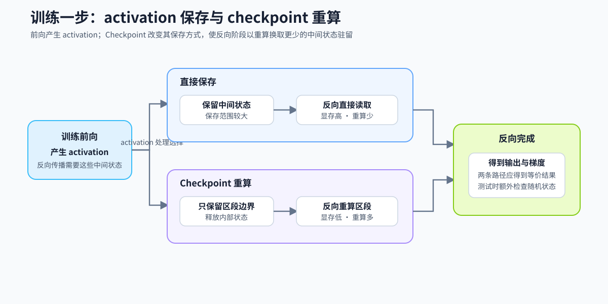
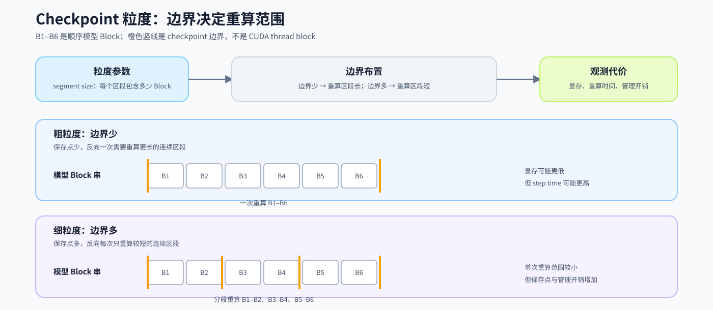

# 19. Activation Checkpointing | 激活检查点

**难度：** Hard | **环境：** [CPU 主线，GPU 可选](#runtime-environment) | **标签：** `显存优化`, `激活值`, `Checkpointing` | **目标人群：** 显存优化学习者

> 🚀 **云端运行环境**
>
> 本章节的实战代码可以点击以下链接在免费 GPU 算力平台上直接运行：
>
> [](https://colab.research.google.com/github/datawhalechina/llm-algo-leetcode/blob/main/02_PyTorch_Algorithms/19_Activation_Checkpointing.ipynb)
> [](https://modelscope.cn/my/mynotebook) *(国内推荐：魔搭社区免费实例)*


---

## 本节导读

训练大模型时，参数只是显存账本的一部分；随着训练规模和上下文长度变化，计算过程中产生的中间状态也会形成资源压力。本节从“反向传播需要哪些中间状态”这个问题出发，带你观察直接保存与重算分别改变了什么代价。

本节沿着一次训练的前向—反向链路，比较“直接保存激活值”和“保存边界、反向重算”两条路径。学习重点是判断哪些状态仍需保存、哪些计算会被重放，以及检查点粒度如何共同改变容量与计算代价。

**关键词：** `activation checkpointing`, `recompute`

<a id="runtime-environment"></a>

## 运行环境

- **基础练习：** 默认使用 [`BASE-CPU`](../guide.md#base-cpu)，运行 [Step 4 的题目与测试](#mechanism-practice)。
- **框架核对：** 使用 [`TRAIN-CPU`](../topic_discussion/backpropagation_training_mechanism/quickstart.md#train-cpu-quickstart)，完成 Step 4 后运行 [框架一致性核对](#framework-check)。
- **GPU 实测：** 使用 `TRAIN-CUDA-MECHANISM`，按 [Step 5](#gpu-experiment) 的说明配置并运行。

---
## 前置阅读

**导语：** 阅读本节前，先确认你能说清一次训练中前向、loss 与 backward 的关系，以及 activation 为什么会在反向阶段被使用；随后再把“保存 activation”的需要转化为“保存边界、按需重算”的实现问题。

- [09. Activation and Loss Backward | 激活与损失反向](../02_PyTorch_Algorithms/09_Activation_and_Loss_Backward.md)：理解 activation 如何参与 loss 的反向传播。
- [P0: 12. PyTorch Data Interface and Training Lifecycle | 数据接口与训练生命周期](../00_Prerequisites/12_PyTorch_Minimal_Training_Interface.md)：若训练循环还不熟悉，先回顾前向、loss、backward 与参数更新的顺序。
---

## Step 1：Checkpoint 保存哪些状态、反向重算哪些计算

一次训练步骤先执行前向计算，再执行反向传播。前向会产生 activation，反向需要利用这些中间状态计算梯度；当序列长度、batch 或层数增加时，activation 可能成为显存压力来源。Activation checkpointing（激活检查点，下文简称 checkpoint）是前向阶段的保存策略：它将“保留区段内部 activation”改为“保留边界、在反向时重算区段”，以额外计算换取更少的 activation 驻留。

这里的模型 Block 指可顺序执行的计算单元，例如 [05. LLaMA3 Block Tutorial](../02_PyTorch_Algorithms/05_LLaMA3_Block_Tutorial.md) 中的 Transformer Decoder Layer，而不是 CUDA thread block。设连续区段接收边界状态 $h_{in}$，内部依次产生若干中间 activation，最后输出 $h_{out}$；普通路径保留这些中间状态，checkpoint 路径只保留重算所需的边界状态，并在反向阶段重新执行该区段。

| 比较阶段 | 普通保存路径 | Checkpoint 路径 | 主要观察量 |
| --- | --- | --- | --- |
| 前向阶段 | 保存区段内部的中间状态 | 只保存重算所需的区段边界 | activation 驻留量与 peak memory |
| 反向阶段 | 直接读取已保存的中间状态 | 重新执行区段前向，再读取重算结果 | 重算次数、step time 与吞吐 |
| 机制验证 | 输出和梯度作为比较基线 | 输出和梯度应与普通路径一致 | 输出、输入梯度、参数梯度与随机状态 |



## Step 2：为什么重算后仍应得到相同梯度
进入反向时，checkpoint 会从已保存的区段边界重新执行该段前向，恢复局部反向所需的中间状态。设区段函数为 $f_\theta$，普通路径与重算路径要满足

$$
f_\theta^{save}(h_{in})=f_\theta^{recompute}(h_{in}),\qquad
\nabla_{h_{in},\theta}L_{save}=\nabla_{h_{in},\theta}L_{recompute}.
$$

其中 $\theta$ 是区段参数；第一项约束输出，第二项约束输入与参数梯度。要得到这些等价结果，重算必须重放与原前向等价的计算上下文。

随机层说明了这条条件为何必要：若区段内包含 Dropout，而重算时使用了不同的随机状态，新的 activation 就可能不同，随后得到的梯度也不再能与普通路径对齐。外部副作用同样会破坏这项前提。

| 一致性对象 | 重算时必须保持什么 | 未保持时可能出现什么 | 本节如何验证 |
| --- | --- | --- | --- |
| 区段输入与执行顺序 | 从同一边界状态按相同 Block 顺序重跑 | 重算 activation 偏离原前向 | 比较输出与输入梯度 |
| 参数与随机状态 | 使用相同参数；随机层恢复对应随机状态 | Dropout 等随机结果变化，梯度失配 | 比较参数梯度；检查随机状态 |
| 无外部副作用 | 不读取两次执行之间可能变化的外部状态 | 第二次执行产生不同结果 | 将重算函数保持为可重放的前向计算 |

## Step 3：区段边界与粒度如何影响显存和重算次数

checkpoint 粒度决定每个重算区段覆盖多少个连续模型 Block。设模型共有 $L$ 个 Block，每段覆盖 $g$ 个，则区段数约为 $N_{seg}=\lceil L/g\rceil$；尾部不足 $g$ 个 Block 时仍形成一个完整区段。较小的 $g$ 产生更多边界和更短的单次重算，较大的 $g$ 减少边界但扩大每次重算范围。

下面的比较只说明执行组织方式：粒度不会给出固定的显存节省比例。参数、梯度和 optimizer state 仍在训练账本中，实际收益必须在固定模型、输入形状和运行环境下测量。

| 区段粒度 | 保存边界的变化 | 反向重算范围 | 需要实际测量的结果 |
| --- | --- | --- | --- |
| 每个 Block 单独成段 | 边界较多 | 每次只重算一个 Block | peak memory、重算次数与 step time |
| 多个连续 Block 成段 | 边界数量下降 | 每次重算一个连续区段 | 与细粒度方案的显存—时间交换 |
| 整条连续路径作为一段 | 只保留外部边界 | 单次重算范围最大 | 是否仍满足显存与时间预算 |



<a id="mechanism-practice"></a>

## Step 4：实现区段重算并核对输出与梯度

现在把前面的重算机制落实为三步：先为单个 Block 建立 checkpoint 路径，再规划连续 Block 的 segment 边界，最后将该边界计划用于分段 checkpoint。题目区只要求补全这三处机制；闭包绑定、普通前向 baseline 和循环骨架已提供。

| TODO / 函数 | 学习者完成的机制 | 必须满足的约束 | 测试证据 |
| --- | --- | --- | --- |
| TODO 1 · `run_with_checkpointing` | 为当前 Block 应用 checkpoint | 输入为当前 `x`；使用 `use_reentrant=False` | 输出、输入梯度与参数梯度一致；反向阶段的 Block 调用次数增加 |
| TODO 2 · `build_checkpoint_segments` | 生成 segment 边界 | `[start, end)` 连续、不重叠、覆盖尾段；非法粒度报错 | 尾段、空序列、`segment_size=1` 与非法输入 |
| TODO 3 · `run_with_segment_checkpointing` | 对当前 segment 应用 checkpoint | 使用已绑定的 `segment_forward`；更新当前 `x` | 分段路径与 baseline 一致；`segment_size=1` 等价于逐 Block 路径 |


```python
import torch
import torch.nn as nn
from torch.utils.checkpoint import checkpoint
```


```python
class SimpleTransformerBlock(nn.Module):
    """提供前向 activation 的简化残差 FFN Block。

    本节只借它观察 activation 的保存与重算，不代表完整 Transformer Block。
    """
    def __init__(self, dim):
        super().__init__()
        self.ffn = nn.Sequential(
            nn.Linear(dim, dim * 4),
            nn.ReLU(),
            nn.Linear(dim * 4, dim)
        )
        self.norm = nn.LayerNorm(dim)

    def forward(self, x):
        # out 代表反向传播可能需要读取的区段内部 activation。
        out = self.ffn(self.norm(x))
        return x + out

def run_without_checkpointing(blocks: nn.ModuleList, x: torch.Tensor) -> torch.Tensor:
    """普通前向 baseline，不使用 checkpoint 按顺序执行所有 Block。

    与两条 checkpoint 路径保持相同输入和输出接口，作为输出与梯度对照。

    Args:
        blocks: 按顺序排列、可接收隐藏状态的 Block 列表。
        x: 输入隐藏状态，形状通常为 [batch, seq, dim]，需与 Block 维度兼容。

    Returns:
        所有 Block 执行后的隐藏状态。
    """
    for block in blocks:
        x = block(x)
    return x

def run_with_checkpointing(blocks: nn.ModuleList, x: torch.Tensor) -> torch.Tensor:
    """对每个 Block 单独启用梯度 checkpoint。

    Args:
        blocks: 按顺序排列、可接收隐藏状态的 Block 列表。
        x: 输入隐藏状态，形状通常为 [batch, seq, dim]；测试中令其参与梯度计算。

    Returns:
        经过逐 Block checkpoint 的输出隐藏状态。

    Note:
        使用 use_reentrant=False；区段内部 activation 会在反向阶段按需重算。
    """
    for block in blocks:
        # ==========================================
        # TODO 1：建立逐 Block 重算边界
        # 作用：通过 checkpoint 执行当前 block，并把结果写回隐藏状态。
        # 注意：使用 use_reentrant=False，输入仍为当前 x。
        # x = ???  # 当前 Block 的 checkpoint 输出
        # ==========================================
        raise NotImplementedError("TODO 1：请用 checkpoint 更新 x")
    return x

def build_checkpoint_segments(num_blocks: int, segment_size: int) -> list[tuple[int, int]]:
    """将 checkpoint 粒度转换为可执行的连续区间计划。

    区间覆盖 `[0, num_blocks)` 且不重叠；分段路径据此确定保存边界和重算范围。

    Args:
        num_blocks: 连续模型 Block 的总数（例如 Transformer Block 层数），不是 CUDA thread block；必须非负。
        segment_size: 每个 checkpoint segment 覆盖的连续模型 Block 数，必须为正。

    Returns:
        `(start, end)` 列表；当 `num_blocks=0` 时为空，尾段仍被保留。
    """
    if num_blocks < 0:
        raise ValueError("num_blocks must be non-negative")
    if segment_size <= 0:
        raise ValueError("segment_size must be positive")

    # ==========================================
    # TODO 2：生成连续的 checkpoint 区段
    # 作用：用半开区间覆盖 [0, num_blocks)，并保留不足 segment_size 的尾段。
    # ranges = ???  # 连续且不重叠的 (start, end) 列表
    # ==========================================
    raise NotImplementedError("TODO 2：请生成 ranges")
    return ranges

def run_with_segment_checkpointing(
    blocks: nn.ModuleList, x: torch.Tensor, segment_size: int = 2
) -> torch.Tensor:
    """按 segment 边界计划对连续 Block 启用 checkpoint。

    每个区段使用已绑定的 `segment_forward`；`segment_size` 改变保存边界和单次重算范围。

    Args:
        blocks: 按顺序排列、可接收隐藏状态的 Block 列表。
        x: 输入隐藏状态，形状通常为 [batch, seq, dim]，需与 Block 维度兼容。
        segment_size: 每个 checkpoint segment 覆盖的连续模型 Block 数，必须为正；
            默认值 2 仅用于演示分段与尾段：5 个 Block 会得到 `(0, 2)`、`(2, 4)`、`(4, 5)`；
            它不是通用性能推荐，最后一个 segment 可以不足该大小。

    Returns:
        经过分段 checkpoint 的输出隐藏状态。

    Note:
        `segment_size=1` 对应逐 Block 粒度；更大的值会扩大单次重算范围。
    """
    if segment_size <= 0:
        raise ValueError("segment_size must be positive")

    for start, end in build_checkpoint_segments(len(blocks), segment_size):
        segment = blocks[start:end]

        # 当前 segment 已通过默认参数绑定，避免反向重算时读取后续循环的区段。
        def segment_forward(hidden, blocks=segment):
            return run_without_checkpointing(blocks, hidden)


        # ==========================================
        # TODO 3：建立分段重算边界
        # 作用：通过 checkpoint 执行已绑定的 segment_forward，并更新隐藏状态。
        # 注意：使用 use_reentrant=False，避免改变本节的反向语义。
        # x = ???  # 当前 segment 的 checkpoint 输出
        # ==========================================
        raise NotImplementedError("TODO 3：请对 segment_forward 应用 checkpoint")
    return x

```

## 测试

运行下方 CPU 机制测试，检查 segment 边界、checkpoint 路径与普通路径的结果和梯度一致性，以及 backward 是否确实发生重算。GPU 显存与时间测量见 Step 5。

```python
# 各路径使用初始权重相同但彼此独立的 Block 副本，避免比较受到状态共享影响。
import copy

class CountingBlock(SimpleTransformerBlock):
    """记录 forward 次数，以区分普通前向与反向重算。"""
    def __init__(self, dim):
        super().__init__(dim)
        self.forward_calls = 0

    def forward(self, x):
        self.forward_calls += 1
        return super().forward(x)

def _forward_calls(blocks):
    return sum(block.forward_calls for block in blocks)

def _parameter_grads(blocks):
    return [parameter.grad.detach().clone() for parameter in blocks.parameters()]

def _run_and_collect(runner, blocks, x):
    """运行一条路径并收集数值、梯度与重算证据。

    使用 `output.sum()` 仅为统一构造反向传播，不代表训练 loss。
    """
    output = runner(blocks, x)
    calls_before_backward = _forward_calls(blocks)
    output.sum().backward()
    return {
        "output": output.detach(),
        "input_grad": x.grad.detach().clone(),
        "parameter_grads": _parameter_grads(blocks),
        "calls_before_backward": calls_before_backward,
        "calls_after_backward": _forward_calls(blocks),
    }

def _assert_matches_baseline(label, baseline, checkpoint_evidence):
    assert torch.allclose(baseline["output"], checkpoint_evidence["output"], atol=1e-5, rtol=1e-4), \
        f"{label}：输出与 baseline 不一致"
    assert torch.allclose(baseline["input_grad"], checkpoint_evidence["input_grad"], atol=1e-5, rtol=1e-4), \
        f"{label}：输入梯度与 baseline 不一致"
    assert len(baseline["parameter_grads"]) == len(checkpoint_evidence["parameter_grads"]), \
        f"{label}：参数数量与 baseline 不一致"
    for baseline_grad, checkpoint_grad in zip(baseline["parameter_grads"], checkpoint_evidence["parameter_grads"]):
        assert torch.allclose(baseline_grad, checkpoint_grad, atol=1e-5, rtol=1e-4), \
            f"{label}：参数梯度与 baseline 不一致"

def _assert_recomputed(label, evidence):
    assert evidence["calls_after_backward"] > evidence["calls_before_backward"], \
        f"{label}：backward 中没有重新执行 Block"

def _assert_segment_plan(num_layers):
    expected_two_block_segments = [
        (start, min(start + 2, num_layers)) for start in range(0, num_layers, 2)
    ]
    assert build_checkpoint_segments(num_layers, segment_size=2) == expected_two_block_segments, \
        "segment 边界应覆盖尾段且不重叠"
    assert build_checkpoint_segments(num_layers, segment_size=1) == [(i, i + 1) for i in range(num_layers)]
    assert build_checkpoint_segments(num_layers, segment_size=num_layers + 1) == [(0, num_layers)]
    assert build_checkpoint_segments(0, segment_size=2) == []
    for invalid_num_blocks, invalid_segment_size in [(num_layers, 0), (-1, 2)]:
        try:
            build_checkpoint_segments(invalid_num_blocks, invalid_segment_size)
        except ValueError:
            continue
        raise AssertionError("非法 segment 参数应被拒绝")

def test_activation_checkpointing_mechanism():
    """验证区段计划、数值一致性、参数梯度与反向重算。"""
    torch.manual_seed(42)
    dim = 128
    num_layers = 5  # 特意让最后一个 segment 不完整
    _assert_segment_plan(num_layers)

    template_blocks = nn.ModuleList([CountingBlock(dim) for _ in range(num_layers)])
    x_template = torch.randn(2, 32, dim)
    normal_blocks = copy.deepcopy(template_blocks)
    baseline = _run_and_collect(
        run_without_checkpointing, normal_blocks, x_template.detach().clone().requires_grad_(True)
    )
    assert baseline["calls_after_backward"] == num_layers, \
        "普通路径不应在 backward 中重算 Block"

    checkpoint_paths = {
        "逐 Block checkpoint": (run_with_checkpointing, copy.deepcopy(template_blocks)),
        "分段 checkpoint": (
            lambda blocks, x: run_with_segment_checkpointing(blocks, x, segment_size=2),
            copy.deepcopy(template_blocks),
        ),
        "细粒度 segment": (
            lambda blocks, x: run_with_segment_checkpointing(blocks, x, segment_size=1),
            copy.deepcopy(template_blocks),
        ),
        "单段 checkpoint": (
            lambda blocks, x: run_with_segment_checkpointing(blocks, x, segment_size=num_layers + 1),
            copy.deepcopy(template_blocks),
        ),
    }

    evidence = {}
    for label, (runner, blocks) in checkpoint_paths.items():
        evidence[label] = _run_and_collect(
            runner, blocks, x_template.detach().clone().requires_grad_(True)
        )
        assert evidence[label]["calls_before_backward"] == num_layers, \
            f"{label}：前向阶段不应重复执行 Block"
        _assert_matches_baseline(label, baseline, evidence[label])
        _assert_recomputed(label, evidence[label])

    _assert_matches_baseline("segment_size=1 与逐 Block 路径", evidence["逐 Block checkpoint"], evidence["细粒度 segment"])
    print("✅ CPU mechanism 测试通过：边界、输出、输入/参数梯度与 backward 重算均符合预期。")

def run_checkpointing_test():
    try:
        test_activation_checkpointing_mechanism()

    except NotImplementedError:
        print("请先完成 TODO 部分的代码！")
        raise
    except Exception as e:
        print(f"❌ 实现或机制测试失败: {e}")
        raise


run_checkpointing_test()

```

---

🛑 **STOP HERE** 🛑
<br><br><br><br><br><br><br><br><br><br>
> 请先尝试自己完成代码并跑通测试。<br>
> 如果你正在 Colab 中运行，并且遇到困难没有思路，可以向下滚动查看参考答案。
<br><br><br><br><br><br><br><br><br><br>

---
## 参考代码与解析

### 代码

```python
import torch
import torch.nn as nn
from torch.utils.checkpoint import checkpoint

class SimpleTransformerBlock(nn.Module):
    """提供前向 activation 的简化残差 FFN Block。

    本节只借它观察 activation 的保存与重算，不代表完整 Transformer Block。
    """
    def __init__(self, dim):
        super().__init__()
        self.ffn = nn.Sequential(
            nn.Linear(dim, dim * 4),
            nn.ReLU(),
            nn.Linear(dim * 4, dim)
        )
        self.norm = nn.LayerNorm(dim)

    def forward(self, x):
        out = self.ffn(self.norm(x))
        return x + out

def run_without_checkpointing(blocks: nn.ModuleList, x: torch.Tensor) -> torch.Tensor:
    """普通前向 baseline，不使用 checkpoint 按顺序执行所有 Block。

    与两条 checkpoint 路径保持相同输入和输出接口，作为输出与梯度对照。

    Args:
        blocks: 按顺序排列、可接收隐藏状态的 Block 列表。
        x: 输入隐藏状态，形状通常为 [batch, seq, dim]，需与 Block 维度兼容。

    Returns:
        所有 Block 执行后的隐藏状态。
    """
    for block in blocks:
        x = block(x)
    return x

def run_with_checkpointing(blocks: nn.ModuleList, x: torch.Tensor) -> torch.Tensor:
    """
    对每个 Block 单独启用梯度 checkpoint。

    Args:
        blocks: 按顺序排列、可接收隐藏状态的 Block 列表。
        x: 输入隐藏状态，形状通常为 [batch, seq, dim]；测试中令其参与梯度计算。

    Returns:
        经过逐 Block checkpoint 的输出隐藏状态。

    Note:
        使用 use_reentrant=False；区段内部 activation 会在反向阶段按需重算。
    """
    for block in blocks:
        # TODO 1：逐 Block checkpoint，更新当前隐藏状态。
        x = checkpoint(block, x, use_reentrant=False)
    return x

def build_checkpoint_segments(num_blocks: int, segment_size: int) -> list[tuple[int, int]]:
    """将 checkpoint 粒度转换为可执行的连续区间计划。

    区间覆盖 `[0, num_blocks)` 且不重叠；分段路径据此确定保存边界和重算范围。

    Args:
        num_blocks: 连续模型 Block 的总数（例如 Transformer Block 层数），不是 CUDA thread block；必须非负。
        segment_size: 每个 checkpoint segment 覆盖的连续模型 Block 数，必须为正。

    Returns:
        `(start, end)` 列表；当 `num_blocks=0` 时为空，尾段仍被保留。
    """
    if num_blocks < 0:
        raise ValueError("num_blocks must be non-negative")
    if segment_size <= 0:
        raise ValueError("segment_size must be positive")

    # TODO 2：生成覆盖完整 Block 序列的半开区间。
    ranges = [(start, min(start + segment_size, num_blocks)) for start in range(0, num_blocks, segment_size)]
    return ranges

def run_with_segment_checkpointing(
    blocks: nn.ModuleList, x: torch.Tensor, segment_size: int = 2
) -> torch.Tensor:
    """按 segment 边界计划对连续 Block 启用 checkpoint。

    每个区段使用已绑定的 `segment_forward`；`segment_size` 改变保存边界和单次重算范围。

    Args:
        blocks: 按顺序排列、可接收隐藏状态的 Block 列表。
        x: 输入隐藏状态，形状通常为 [batch, seq, dim]，需与 Block 维度兼容。
        segment_size: 每个 checkpoint segment 覆盖的连续模型 Block 数，必须为正；
            默认值 2 仅用于演示分段与尾段：5 个 Block 会得到 `(0, 2)`、`(2, 4)`、`(4, 5)`；
            它不是通用性能推荐，最后一个 segment 可以不足该大小。

    Returns:
        经过分段 checkpoint 的输出隐藏状态。

    Note:
        `segment_size=1` 对应逐 Block 粒度；更大的值会扩大单次重算范围。
    """
    if segment_size <= 0:
        raise ValueError("segment_size must be positive")

    for start, end in build_checkpoint_segments(len(blocks), segment_size):
        segment = blocks[start:end]

        def segment_forward(hidden, blocks=segment):
            return run_without_checkpointing(blocks, hidden)

        # TODO 3：对当前 segment 启用 checkpoint，更新隐藏状态。
        x = checkpoint(segment_forward, x, use_reentrant=False)
    return x

```

### 解析

#### TODO 1：逐 Block checkpoint

- 使用 `checkpoint(block, x, use_reentrant=False)` 更新当前隐藏状态。
- 它为单个模型 Block 建立重算边界，减少区段内部部分 activation 的长期驻留。

#### TODO 2：生成 segment 边界

- 使用连续的半开区间 `[start, end)` 覆盖完整 Block 序列。
- 末段不足 `segment_size` 时仍保留；空序列返回空计划。

#### TODO 3：分段 checkpoint

- 用 `blocks=segment` 绑定当前区段，再对 `segment_forward` 调用 checkpoint。
- 这样反向重算的是当前连续 Block 区段，而不是循环结束后的最后一个区段。
<a id="framework-check"></a>

## 框架一致性核对（可选）

下面直接核对 PyTorch 非重入 checkpoint 的输出、梯度和重算行为；显存—时间交换仍由 Step 5 测量。

| 核对对象 | 本节实现 | 成熟框架入口 | 通过条件 |
| --- | --- | --- | --- |
| 前向输出 | 普通 Block 顺序执行 | `torch.utils.checkpoint.checkpoint` | 相同参数和输入下输出一致 |
| 输入与参数梯度 | 普通路径反向 | 非重入 checkpoint 反向 | 输入梯度和全部参数梯度一致 |
| 反向重算 | 普通路径调用次数 | checkpoint 路径调用次数 | checkpoint 路径在反向阶段再次执行区段 |

```python
from importlib.metadata import version


def check_checkpoint_framework_conformance():
    """核对 PyTorch checkpoint 的输出、梯度与反向重算行为。"""
    torch.manual_seed(42)

    class CountedBlock(SimpleTransformerBlock):
        def __init__(self, dim):
            super().__init__(dim)
            self.calls = 0

        def forward(self, x):
            self.calls += 1
            return super().forward(x)

    direct = CountedBlock(8)
    recompute = CountedBlock(8)
    recompute.load_state_dict(direct.state_dict())
    x_direct = torch.randn(2, 3, 8, requires_grad=True)
    x_recompute = x_direct.detach().clone().requires_grad_(True)
    direct_out = run_without_checkpointing(torch.nn.ModuleList([direct]), x_direct)
    checkpoint_out = run_with_checkpointing(torch.nn.ModuleList([recompute]), x_recompute)
    direct_out.square().mean().backward()
    checkpoint_out.square().mean().backward()
    checks = {
        'output_match': bool(torch.allclose(direct_out, checkpoint_out, atol=1e-6, rtol=1e-6)),
        'input_gradient_match': bool(torch.allclose(x_direct.grad, x_recompute.grad, atol=1e-6, rtol=1e-6)),
        'parameter_gradients_match': all(
            torch.allclose(left.grad, right.grad, atol=1e-6, rtol=1e-6)
            for left, right in zip(direct.parameters(), recompute.parameters())
        ),
        'backward_recomputed_segment': recompute.calls > direct.calls,
    }
    failed = [name for name, passed in checks.items() if not passed]
    if failed:
        raise AssertionError(f'框架一致性核对失败：{failed}')
    return {
        'status': 'passed',
        'check_kind': 'framework_conformance',
        'versions': {'torch': version('torch')},
        'checks': checks,
        'direct_calls': direct.calls,
        'checkpoint_calls': recompute.calls,
    }


framework_check = check_checkpoint_framework_conformance()
framework_check
```

<a id="gpu-experiment"></a>

## Step 5：可选 GPU 实验——Checkpoint 显存—时间对照

CPU 题目确认保存、重算和分段边界；GPU 实验进一步比较普通路径与逐 Block checkpoint 的输出、梯度、峰值显存和训练 step 时间。

| 学习问题 | CPU 已确认 | GPU 要确认与后续使用 |
| --- | --- | --- |
| 激活检查点能否用可接受的重算时间降低真实训练峰值 | checkpoint 边界、分段计划和反向重算语义 | 输出/梯度是否一致，以及当前 shape 下的显存收益和时间代价；结果可进入组合策略复测 |

#### 5.1 环境与固定工作负载

本实验使用 `TRAIN-CUDA-MECHANISM`。首次运行先完成[专题 Quickstart](../topic_discussion/backpropagation_training_mechanism/quickstart.md#train-cuda-mechanism-quickstart)，已有环境需先通过同名 Profile 预检。本页下载固定的 Qwen2.5-0.5B checkpoint，以固定文本构造训练批次，不下载外部数据集。

| 配置层 | 本节固定口径 | 修改规则 |
| --- | --- | --- |
| 运行环境 | 单张 CUDA GPU；`TRAIN-CUDA-MECHANISM` | Profile 预检未返回 `status=ok` 时停止实验 |
| 资源档位 | 建议至少 8 GiB；RTX 5070 Ti 上 baseline 峰值约 4.22 GiB | baseline 与 checkpoint 都必须成功；显存不足时依次减小序列长度和 batch，并使用新标签 |
| 工作负载 | `Qwen/Qwen2.5-0.5B`；batch 2；序列长度 512 | 改变模型、commit、长度或重复次数后使用新的运行标签 |
| 配对变量 | 普通训练图 → Transformers 原生 gradient checkpointing | 共用 checkpoint、Token、dtype、损失和随机种子 |
| 测量方法 | loss/全局梯度范数差异；step median/P95；allocated/reserved 峰值 | 先过正确性门槛，再解释容量—时间交换 |
| 结果资产 | `benchmarks/results/train_activation_checkpointing/<semantic_id>_<run_label>.json` | 正式复测使用唯一标签并保留旧结果 |


```python
RUN_MODE = "dry_run"  # 默认值 dry_run：只核对配置；改为 real_gpu 执行真实 GPU 矩阵。
RUN_LABEL = "default"  # 默认值 default；正式复测改为唯一标签，已验证结果使用 b2s512_default2。
PROFILE_ID = "TRAIN-CUDA-MECHANISM"  # 默认环境 Profile；本节不支持与其他专题环境混装。
SEMANTIC_ID = "TRAIN-CHECKPOINT"  # 默认稳定机制 ID；结果聚合与跨页引用均使用该值。
MODEL_ID = "Qwen/Qwen2.5-0.5B"  # 默认真实模型；四节共用同一 checkpoint。
MODEL_REVISION = "main"  # 默认请求主分支；5.2 会解析并记录不可变 commit。
LOCAL_FILES_ONLY = False  # 默认值 False：允许首次下载；确认相同 commit 已缓存后可改为 True。
GPU_CONFIG = {
    "dtype": "bfloat16", # 默认值 bfloat16；降低直接 FP16 反向的溢出风险。
    "batch_size": 2,      # 本轮值 2；与序列 512 共同放大 activation 压力。
    "seq_len": 512,       # 本轮值 512 Token；用于验证容量收益是否越过门槛。
    "warmup": 1,          # 默认值 1；不计入统计的预热轮数。
    "repeats": 20,        # 默认值 20；用于稳定比较 median 与 P95。
    "min_memory_reduction_mb": 32.0,  # 至少减少 32 MB，排除 allocator 微小波动。
    "min_memory_reduction_ratio": 0.01, # 至少降低 1%，才视为可用容量收益。
    "seed": 42,           # 默认值 42；固定模型初始化与输入。
    "prompts": ["Explain why activation checkpointing trades compute for memory."],  # 固定训练文本。
}
RESULTS_RELATIVE_DIR = "benchmarks/results/train_activation_checkpointing"  # 默认结果目录；正式结果按 RUN_LABEL 分文件保存。

```

#### 5.2 执行并保存 JSON

运行下方单元会从同一 Qwen checkpoint 分别加载普通路径与 Transformers 原生 gradient checkpointing 路径，先检查 loss 和全局梯度范数，再将模型 commit、配置与资源指标保存为结果 JSON。


```python
from pathlib import Path
import gc
import json
import torch
from tools.project_runtime import resolve_project_root
from tools.training_mechanism_runtime import (
    cuda_hardware_snapshot, gradient_l2_norm, load_causal_lm, median_and_p95, move_batch, prepare_causal_lm_batch,
)

REPO_ROOT = resolve_project_root()
RESULTS_DIR = REPO_ROOT / RESULTS_RELATIVE_DIR

if RUN_MODE == "real_gpu":
    if not torch.cuda.is_available():
        raise RuntimeError('需要 CUDA GPU；无 GPU 时保持 RUN_MODE="dry_run"。')
    DEVICE = torch.device("cuda")
    dtype_map = {"float16": torch.float16, "bfloat16": torch.bfloat16, "float32": torch.float32}
    DTYPE = dtype_map[GPU_CONFIG["dtype"]]
    if DTYPE == torch.bfloat16 and not torch.cuda.is_bf16_supported():
        raise RuntimeError("当前 GPU 不支持 BF16；请改用 float16 或 float32。")
    torch.manual_seed(GPU_CONFIG["seed"])
    torch.cuda.manual_seed_all(GPU_CONFIG["seed"])
    prepared = prepare_causal_lm_batch(
        MODEL_ID, MODEL_REVISION, GPU_CONFIG["prompts"], GPU_CONFIG["batch_size"], GPU_CONFIG["seq_len"],
        local_files_only=LOCAL_FILES_ONLY,
    )
    resolved_commit = prepared.pop("resolved_model_commit")
    resolution_source = prepared.pop("revision_resolution_source")
    tokenizer_class = prepared.pop("tokenizer_class")

    def _run_gpu_step(model, batch):
        model.zero_grad(set_to_none=True)
        torch.cuda.synchronize(DEVICE)
        torch.cuda.reset_peak_memory_stats(DEVICE)
        start, end = torch.cuda.Event(enable_timing=True), torch.cuda.Event(enable_timing=True)
        start.record()
        loss = model(**batch).loss
        loss.backward()
        end.record()
        torch.cuda.synchronize(DEVICE)
        peak_allocated_mb = torch.cuda.max_memory_allocated(DEVICE) / 2**20
        peak_reserved_mb = torch.cuda.max_memory_reserved(DEVICE) / 2**20
        gradient_norm = gradient_l2_norm(model.parameters())
        return {
            "loss": float(loss.detach()),
            "gradient_l2_norm": gradient_norm,
            "gradient_is_finite": bool(torch.isfinite(torch.tensor(gradient_norm)).item()),
            "step_ms": start.elapsed_time(end),
            "peak_allocated_mb": peak_allocated_mb,
            "peak_reserved_mb": peak_reserved_mb,
        }

    def _measure_gpu_path(label, use_checkpoint):
        model = load_causal_lm(
            MODEL_ID, resolved_commit, DEVICE, parameter_dtype=DTYPE, local_files_only=LOCAL_FILES_ONLY,
        )
        if use_checkpoint:
            model.gradient_checkpointing_enable(gradient_checkpointing_kwargs={"use_reentrant": False})
        else:
            model.gradient_checkpointing_disable()
        model.train()
        batch = move_batch(prepared, DEVICE)
        for _ in range(GPU_CONFIG["warmup"]):
            _run_gpu_step(model, batch)
        samples = [_run_gpu_step(model, batch) for _ in range(GPU_CONFIG["repeats"])]
        last = samples[-1]
        median_ms, p95_ms = median_and_p95([sample["step_ms"] for sample in samples])
        result = {
            "label": label,
            "step_median_ms": median_ms,
            "step_p95_ms": p95_ms,
            "peak_allocated_mb": max(sample["peak_allocated_mb"] for sample in samples),
            "peak_reserved_mb": max(sample["peak_reserved_mb"] for sample in samples),
            "loss": last["loss"],
            "gradient_l2_norm": last["gradient_l2_norm"],
            "gradient_is_finite": last["gradient_is_finite"],
            "checkpoint_enabled": bool(model.is_gradient_checkpointing),
        }
        del model, batch
        gc.collect(); torch.cuda.empty_cache()
        return result

    GPU_RESULTS = {
        "普通路径": _measure_gpu_path("普通路径", use_checkpoint=False),
        "原生 checkpoint": _measure_gpu_path("原生 checkpoint", use_checkpoint=True),
    }

    baseline, checkpoint_result = GPU_RESULTS["普通路径"], GPU_RESULTS["原生 checkpoint"]
    loss_abs_diff = abs(baseline["loss"] - checkpoint_result["loss"])
    gradient_norm_abs_diff = abs(baseline["gradient_l2_norm"] - checkpoint_result["gradient_l2_norm"])

    for result in GPU_RESULTS.values():
        print(
            f"{result['label']}: median={result['step_median_ms']:.2f} ms, p95={result['step_p95_ms']:.2f} ms, "
            f"allocated={result['peak_allocated_mb']:.1f} MB, reserved={result['peak_reserved_mb']:.1f} MB"
        )
    print(
        f"checkpoint - baseline: allocated={checkpoint_result['peak_allocated_mb'] - baseline['peak_allocated_mb']:.1f} MB, "
        f"median={checkpoint_result['step_median_ms'] - baseline['step_median_ms']:.2f} ms"
    )

    def _checkpoint_metrics(result):
        float_keys = ("step_median_ms", "step_p95_ms", "peak_allocated_mb", "peak_reserved_mb", "loss", "gradient_l2_norm")
        metrics = {key: round(float(result[key]), 6) for key in float_keys}
        metrics["gradient_is_finite"] = result["gradient_is_finite"]
        metrics["checkpoint_enabled"] = result["checkpoint_enabled"]
        return metrics

    memory_reduction_mb = baseline["peak_allocated_mb"] - checkpoint_result["peak_allocated_mb"]
    memory_reduction_ratio = memory_reduction_mb / max(baseline["peak_allocated_mb"], 1e-12)
    resource_gate_passed = (
        memory_reduction_mb >= GPU_CONFIG["min_memory_reduction_mb"]
        and memory_reduction_ratio >= GPU_CONFIG["min_memory_reduction_ratio"]
    )
    gradient_norm_relative_diff = gradient_norm_abs_diff / max(abs(baseline["gradient_l2_norm"]), 1e-12)
    correctness_passed = (
        baseline["gradient_is_finite"]
        and checkpoint_result["gradient_is_finite"]
        and loss_abs_diff <= 5e-3
        and gradient_norm_relative_diff <= 1e-3
    )
    record = {
        "schema_version": "training-mechanism-gpu/v4",
        "semantic_id": SEMANTIC_ID,
        "profile_id": PROFILE_ID,
        "run_label": RUN_LABEL,
        "model": {"id": MODEL_ID, "requested_revision": MODEL_REVISION, "resolved_commit": resolved_commit, "resolution_source": resolution_source, "tokenizer_class": tokenizer_class},
        "workload": GPU_CONFIG,
        "hardware": cuda_hardware_snapshot(),
        "metrics": {"baseline": _checkpoint_metrics(baseline), "candidate": _checkpoint_metrics(checkpoint_result)},
        "correctness": {"loss_abs_diff": loss_abs_diff, "gradient_norm_abs_diff": gradient_norm_abs_diff, "gradient_norm_relative_diff": gradient_norm_relative_diff, "passed": correctness_passed},
        "resource_gate": {"memory_reduction_mb": memory_reduction_mb, "memory_reduction_ratio": memory_reduction_ratio, "passed": resource_gate_passed},
        "failure": None,
        "evidence_level": "real_model_mechanism_benchmark",
        "decision": "accept" if resource_gate_passed and correctness_passed else ("tune" if correctness_passed else "reject"),
    }
    RESULTS_DIR.mkdir(parents=True, exist_ok=True)
    RESULT_PATH = RESULTS_DIR / f"{SEMANTIC_ID.lower()}_{RUN_LABEL}.json"
    RESULT_PATH.write_text(json.dumps(record, ensure_ascii=False, indent=2, allow_nan=False), encoding="utf-8")
    print(f"结果已保存：{RESULT_PATH}")
else:
    print('GPU 实验默认关闭；完成 Profile 预检后设置 RUN_MODE="real_gpu"。')

```

#### 5.3 读取结果

读取同一 `RUN_LABEL` 的稳定结果文件；本单元不重新执行模型。先核对证据等级和数值一致性，再比较 checkpoint 的峰值显存与训练 step 时间。


```python
if RUN_MODE == "real_gpu":
    result_path = RESULTS_DIR / f"{SEMANTIC_ID.lower()}_{RUN_LABEL}.json"
    if not Path(result_path).is_file():
        raise FileNotFoundError(f"未找到结果，请先运行 5.2：{result_path}")
    record = json.loads(Path(result_path).read_text(encoding="utf-8"))
    baseline_metrics = record["metrics"]["baseline"]
    candidate_metrics = record["metrics"]["candidate"]
    print(f"baseline: median={baseline_metrics['step_median_ms']:.2f} ms, p95={baseline_metrics['step_p95_ms']:.2f} ms, {baseline_metrics['peak_allocated_mb']:.1f} MB")
    print(f"checkpoint: median={candidate_metrics['step_median_ms']:.2f} ms, p95={candidate_metrics['step_p95_ms']:.2f} ms, {candidate_metrics['peak_allocated_mb']:.1f} MB")
    print(f"correctness={record['correctness']} | resource_gate={record['resource_gate']}")
    print(f"decision={record['decision']} | evidence={record['evidence_level']}")
else:
    print("dry_run：没有读取 GPU 结果。")

```

#### 5.4 解释证据与决策

`b2s512_default2` 已在 RTX 5070 Ti Laptop GPU 上完成配对复测。普通路径与原生 checkpoint 的 loss、全局梯度范数完全一致；候选峰值 allocated 从 4221.73 MB 降至 2799.57 MB，越过 32 MB 与 1% 的双重资源门槛。

Checkpoint 将 median step 时间从 139.56 ms 增至 166.42 ms，代价约 19.2%，但换得约 33.7% 的 allocated 峰值下降，因此本工作负载判定为 `accept`。该结论只说明容量—时间交换成立，不代表 checkpoint 会提升训练吞吐。

| 观察项 | 读取字段 | 当前结果 | 解释与动作 |
| --- | --- | --- | --- |
| 运行与口径 | `failure`、`profile_id`、`workload` | 无失败；Qwen2.5-0.5B，batch 2 × 512，BF16 | 改变模型、shape、dtype 或随机种子后使用新标签 |
| 机制与路径 | baseline / candidate、原生 checkpoint 状态 | 普通路径 → 原生 gradient checkpointing | 候选确实启用逐 Block 重算路径 |
| 正确性 | `loss_abs_diff`、`gradient_norm_relative_diff` | 均为 0，检查通过 | 当前确定性工作负载下未观察到语义漂移 |
| 资源与性能 | allocated 峰值、step median/P95 | 峰值 −33.7%；median +19.2%；P95 +12.4% | 容量收益显著，代价是反向重算时间 |
| 证据与决策 | `evidence_level`、`decision` | `real_model_mechanism_benchmark`；`accept` | 可进入 checkpoint / offload 组合项目复测 |

## 相关阅读

Checkpoint 的核心思想是用重算换取更少 activation 驻留。机制、单策略复测与多策略决策可按下面顺序延伸。

- [P0: 18. Memory Accounting and Runtime Evidence | 显存账本与运行时证据](../00_Prerequisites/18_Memory_Profiling_and_Optimization.md)：将参数、梯度、optimizer state 与 activation 放入同一训练显存账本。
- [Training Deep Nets with Sublinear Memory Cost 原论文](https://arxiv.org/abs/1604.06174)
- [PyTorch `torch.utils.checkpoint` 官方文档](https://pytorch.org/docs/stable/checkpoint.html)
- [42. 激活卸载](../02_PyTorch_Algorithms/42_Activation_Offload.md)：理解将 activation 移出设备的另一条策略。
- [74. Profiling 与证据收口](../02_PyTorch_Algorithms/74_Profiling_Driven_End_to_End_Optimization.md)：学习用 trace 与指标解释训练侧瓶颈。
- [76. Checkpoint 与 Offload 对比项目](../02_PyTorch_Algorithms/76_Activation_Checkpoint_Offload_Benchmark.md)：在固定预算下比较多种显存策略，并形成决策。
