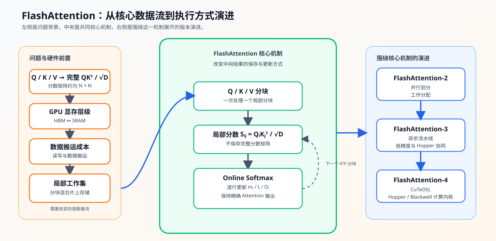
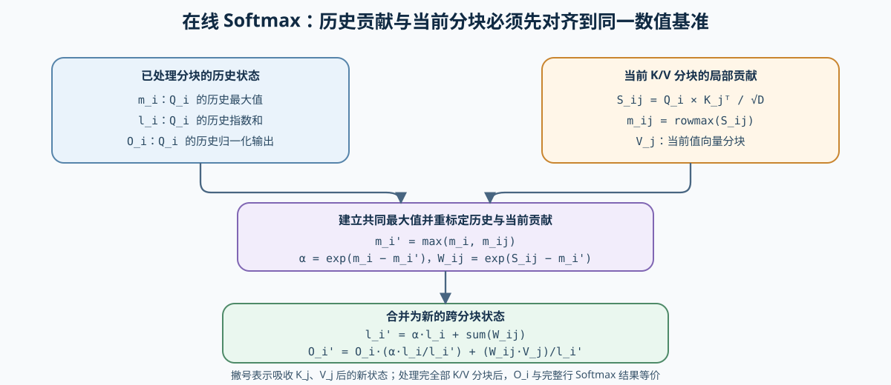
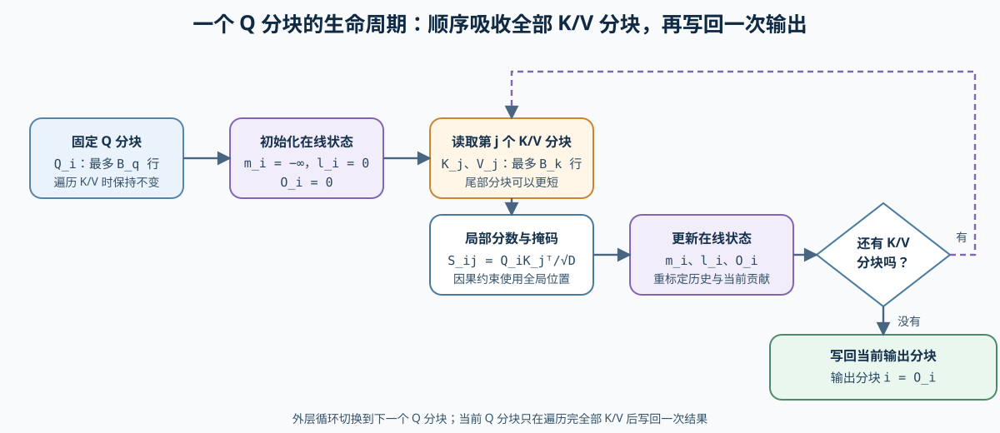

# 20. FlashAttention Sim | FlashAttention 模拟
**难度：** Hard | **环境：** [CPU 主线，GPU 可选](#runtime-environment) | **标签：** `推理优化`, `Attention`, `FlashAttention` | **目标人群：** 理解基础注意力的学习者

> 🚀 **云端运行环境**
>
> 本章节的实战代码可以点击以下链接在免费 GPU 算力平台上直接运行：
>
> [](https://colab.research.google.com/github/datawhalechina/llm-algo-leetcode/blob/main/02_PyTorch_Algorithms/20_FlashAttention_Sim.ipynb)
> [](https://modelscope.cn/my/mynotebook) *(国内推荐：魔搭社区免费实例)*


---

## 本节导读

标准注意力会先形成完整分数矩阵；当序列变长，这个中间矩阵会同时带来存储和读写压力。本节从这一问题出发，理解分块计算如何缩小当前工作集、在线 Softmax 如何保持结果等价。

学完后，你应能解释跨分块归一化需要保留哪些逐行状态，并判断真实 SDPA 路径是否同时满足正确性、显存和延迟要求。

**关键词：** `FlashAttention`、在线 Softmax、分块、SDPA

---

<a id="runtime-environment"></a>

## 运行环境

基础练习使用 [BASE-CPU](../guide.md#base-cpu)，不需要 GPU。Step 5 的单卡实验使用 [INF-CUDA-MECHANISM](../topic_discussion/inference_optimization/quickstart.md#inf-cuda-mechanism-quickstart)，与 CPU 练习分开运行。

## 前置阅读

先用 FlashAttention 显存模型理解完整分数矩阵与分块工作集的差异；需要追溯读写代价时，再回查 GPU 内存层级。
- [Part 01 · 14 FlashAttention 显存模型](../01_Hardware_Math_and_Systems/14_FlashAttention_Memory_Model.md)
- [Part 01 · 03 GPU 物理架构与内存层级](../01_Hardware_Math_and_Systems/03_GPU_Architecture_and_Memory.md)

---

## Step 1：注意力中间工作集与分块动机

给定 $Q、K、V$ 后，标准实现先计算完整的分数矩阵 $S=QK^T/\sqrt{D}$，再对每一行做 Softmax，最后与 $V$ 相乘。其中 $D$ 是注意力头的特征宽度。序列长度为 $N$ 时， $S$ 包含 $N^2$ 个元素；它不是最终输出，却可能作为大块中间数据写入并再次读取GPU 显存。

这里的**算法分块（tile）**指词元维度上的一小段 Q，与一小段 K/V 形成的局部分数矩阵；它不是 Transformer 模型块，也不是 CUDA 线程块。真实 FlashAttention 会把当前分块尽量放在寄存器或共享内存等片上存储中处理，减少完整分数矩阵的 显存往返。

先比较完整分数矩阵与局部分块：分块不会删去注意力计算所需的信息，而是改变中间结果的出现、保留和合并方式；下一步关注这种方式怎样保持结果一致。

| 阶段 | 标准注意力 | 分块路径 |
|---|---|---|
| 分数矩阵 | 先得到完整 `QKᵀ / √D` | 只计算当前 `Q 分块 × K 分块 / √D` |
| Softmax | 对完整行统一计算 | 用跨分块状态逐步合并 |
| 输出 | 最后与完整概率矩阵相乘 | 逐块累加当前 V 分块的贡献 |
| 工作集 | 完整分数矩阵需要长期处理较大的中间区域 | 单个分块限制当前暂存区域 |


## Step 2：在线 Softmax 如何保持数值等价
这里的分块工作集由当前 Q 分块与当前 K/V 分块交叉形成，对应一块局部分数和一块 V 贡献。记固定的 Q 分块为 $Q_i$，当前 K/V 分块为 $K_j$、 $V_j$，局部分数统一写作 $S_{ij}=Q_i K_j^T/\sqrt{D}$。

分块以后不能对每个局部分数独立执行 Softmax 再相加，因为同一 Q 行的归一化分母覆盖全部 K/V。对 $Q_i$ 中的每一行， $m_i$、 $l_i$ 分别保存该行的最大值和指数和， $O_i$ 保存该行的归一化输出；它们是逐行状态，不是整个分块共享的标量。新分块到来时，先把历史状态和当前贡献对齐到同一最大值基准，再合并指数权重和输出贡献。

初始状态为 $m_i=-\infty$、 $l_i=0$、 $O_i=0$。每轮先计算 $m_i'=\max(m_i,\mathrm{rowmax}(S_{ij}))$，再用 $\alpha=\exp(m_i-m_i')$ 重标定历史贡献；当前权重为 $W_{ij}=\exp(S_{ij}-m_i')$。因此 $l_i'=\alpha l_i+\mathrm{rowsum}(W_{ij})$，归一化输出为 $O_i'=(\alpha l_i O_i+W_{ij}V_j)/l_i'$。这些运算逐行广播；因果约束在计算最大值和权重之前，把未来位置的分数设为负无穷。

| 跨分块状态 | 保存的信息 | 合并新分块时的职责 |
|---|---|---|
| 最大值 | 已处理局部分数中的数值基准 | 选择新的共同基准，避免指数计算溢出 |
| 指数和 | 已处理词元的归一化累计量 | 重标定历史贡献后，加上当前分块的贡献 |
| 累计输出 | 已处理词元对输出的加权贡献 | 按新的归一化比例合并历史与当前 V 的贡献 |


## Step 3：一个 Q 分块如何吸收全部 K/V 分块
Q 方向的分块长度记为 $B_q$，K/V 方向的分块长度记为 $B_k$。 $Q_i$ 最多包含 $B_q$ 个查询位置， $K_j$、 $V_j$ 最多包含 $B_k$ 个键和值位置；序列尾部分块可以更短，局部分数 $S_{ij}$ 的形状因此是 $|Q_i| \times |K_j|$。

固定 $Q_i$ 后，让它依次接收全部 $K_j$、 $V_j$；每轮把 $S_{ij}$ 的贡献并入逐行状态 $m_i$、 $l_i$、 $O_i$，直到当前 Q 分块获得与完整注意力计算相同的输出。

| 计算阶段 | 保持不变的对象 | 状态变化 |
|---|---|---|
| 开始处理一个 Q 分块 | 当前 Q 分块 | 建立对应的跨分块状态 |
| 接收一个 K/V 分块 | 当前 Q 分块与历史状态 | 形成局部分数，并合并新的上下文贡献 |
| 接收完全部 K/V 分块 | 当前 Q 分块 | 得到包含完整上下文信息的注意力输出 |




## Step 4：实现并验证分块注意力
本题用一组二维 Q、K、V 复现分块注意力。题目区已提供输入校验、双层分块循环和状态写回；你将补全跨分块状态、局部分数、因果约束、在线 Softmax 重标定和归一化输出。

测试区分别覆盖普通路径、因果路径、尾块、大分数和非法输入，确认数值结果与完整注意力等价，并保持状态形状和数据类型不变量。

| TODO / 函数 | 学习者完成的机制 | 必须满足的约束 | 测试证据 |
|:---|:---|:---|:---|
| TODO 1：初始化跨分块状态<br>`flash_attention_forward_sim` | 初始化每行最大值与指数和 | 最大值以负无穷开始，指数和以零开始 | `test_noncausal_equivalence` 覆盖普通路径与尾块 |
| TODO 2：形成局部分数与因果约束<br>`flash_attention_forward_sim` | 计算局部分数并屏蔽未来位置 | 使用全局词元位置；未来位置权重为零 | `test_causal_equivalence` 验证跨分块因果等价 |
| TODO 3：执行数值重标定<br>`flash_attention_forward_sim` | 把历史状态与当前分块对齐到同一最大值 | 指数和与输出贡献使用相同重标定因子 | `test_dtype_and_stability` 验证大分数与数据类型 |
| TODO 4：合并归一化输出<br>`flash_attention_forward_sim` | 更新指数和并合并当前输出 | 与完整注意力在误差门槛内一致 | `test_noncausal_equivalence` 覆盖多组形状与尾块 |


```python
import torch
import math
```


```python
def flash_attention_forward_sim(q, k, v, block_size=2, causal=False):
    """计算二维输入上的 FlashAttention 前向模拟。

    Args:
        q, k, v: [seq_len, dim] 张量，device 和 dtype 应保持一致。
        block_size: Q/K/V 的分块大小，必须为正数。
        causal: 是否只允许关注当前位置及之前的 K 位置。

    Returns:
        [seq_len, dim] 的注意力输出。

    """
    if q.ndim != 2 or k.ndim != 2 or v.ndim != 2:
        raise ValueError('q、k、v 必须是 [seq_len, dim] 二维张量')
    if q.shape != k.shape or k.shape != v.shape:
        raise ValueError('q、k、v 的形状必须一致')
    if q.device != k.device or k.device != v.device:
        raise ValueError('q、k、v 必须位于同一 device')
    if q.dtype != k.dtype or k.dtype != v.dtype:
        raise TypeError('q、k、v 必须使用相同 dtype')
    if block_size <= 0:
        raise ValueError('block_size 必须为正数')

    seq_len, dim = q.shape

    out = torch.zeros((seq_len, dim), device=q.device, dtype=q.dtype)
    # ==========================================
    # TODO 1：初始化跨分块状态
    # ==========================================
    # m = ???  # 每行最大值基准；形状 [seq_len, 1]，初始值为负无穷。
    # l = ???  # 每行指数和；形状 [seq_len, 1]，初始值为零。
    raise NotImplementedError("TODO 1：请初始化 m 与 l")

    scale = 1.0 / math.sqrt(dim)

    # 外层循环：遍历 Q 的分块
    for i in range(0, seq_len, block_size):
        q_block = q[i:i+block_size] * scale
        m_i = m[i:i+block_size]
        l_i = l[i:i+block_size]
        out_i = out[i:i+block_size]

        # 内层循环：遍历 K, V 的分块
        for j in range(0, seq_len, block_size):
            k_block = k[j:j+block_size]
            v_block = v[j:j+block_size]

            # ==========================================
            # TODO 2：形成局部分数与因果约束
            # ==========================================
            # scores = ???  # 当前 Q/K 分块的局部分数；形状 [Q 分块长度, K 分块长度]。
            if causal:
                query_pos = torch.arange(i, i + q_block.shape[0], device=q.device)[:, None]
                key_pos = torch.arange(j, j + k_block.shape[0], device=q.device)[None, :]
                # future_mask = ???  # K 的全局位置晚于 Q 时为真。
                scores = scores.masked_fill(future_mask, -float('inf'))
            raise NotImplementedError("TODO 2：请计算 scores 与 future_mask")

            # ==========================================
            # TODO 3：执行数值重标定
            # ==========================================
            # tile_max = ???  # 当前分块逐行最大值；保留列维。
            # new_max = ???  # 历史与当前分块共享的新最大值基准。
            # history_scale = ???  # 历史状态迁移到新基准的缩放因子。
            # tile_weights = ???  # 当前分块相对新基准的指数权重。
            raise NotImplementedError("TODO 3：请完成最大值基准与指数权重的重标定")

            # ==========================================
            # TODO 4：合并归一化输出
            # ==========================================
            # new_l = ???  # 同一最大值基准下的历史与当前指数和。
            # out_i = ???  # 使用同一归一化比例合并历史与当前输出。
            raise NotImplementedError("TODO 4：请更新指数和与归一化输出")
            m_i = new_max
            l_i = new_l

        out[i:i+block_size] = out_i
        m[i:i+block_size] = m_i
        l[i:i+block_size] = l_i

    return out

```

## 测试

测试分别覆盖非因果与因果路径、尾块、大分数稳定性和非法输入，并用工作集代理检查分块是否消除了完整分数矩阵的二次暂存。


```python
def _reference_attention(q, k, v, causal=False):
    """构造完整分数矩阵，作为分块注意力的数值参考。"""
    scores = (q @ k.transpose(-2, -1)) / math.sqrt(q.shape[-1])
    if causal:
        mask = torch.triu(torch.ones(scores.shape, dtype=torch.bool), diagonal=1)
        scores = scores.masked_fill(mask, -float('inf'))
    return torch.softmax(scores, dim=-1) @ v

def test_noncausal_equivalence():
    """TODO 1–4：非因果分块路径应与完整注意力等价，含尾块。"""
    for seq_len, dim, block_size, seed in [(8, 4, 2, 42), (5, 3, 3, 7), (3, 2, 1, 123)]:
        torch.manual_seed(seed)
        q, k, v = (torch.randn(seq_len, dim) for _ in range(3))
        diff = (_reference_attention(q, k, v) - flash_attention_forward_sim(q, k, v, block_size)).abs().max()
        assert diff < 1e-5, f"非因果结果失配：seq={seq_len}, block={block_size}"

def test_causal_equivalence():
    """TODO 2：因果掩码必须屏蔽未来 K/V。"""
    torch.manual_seed(11)
    q, k, v = (torch.randn(6, 4) for _ in range(3))
    assert torch.allclose(_reference_attention(q, k, v, causal=True), flash_attention_forward_sim(q, k, v, 2, causal=True), atol=1e-5, rtol=1e-5)

def test_dtype_and_stability():
    """TODO 3：重标定应保留数据类型，并让大分数输出保持有限。"""
    torch.manual_seed(9)
    q, k, v = (torch.randn(4, 3, dtype=torch.float64) for _ in range(3))
    out = flash_attention_forward_sim(q, k, v, 2)
    assert out.dtype == torch.float64
    assert torch.allclose(_reference_attention(q, k, v), out, atol=1e-10, rtol=1e-10)
    stable_out = flash_attention_forward_sim(torch.full((3, 2), 100.0), torch.full((3, 2), 100.0), torch.randn(3, 2), 2)
    assert torch.isfinite(stable_out).all()

def test_working_set_proxy():
    """验证局部分数工作集在固定分块下不随总序列长度平方增长。"""
    block_size = 8
    proxies = []
    for seq_len in [64, 256, 1024]:
        full_score_elements = seq_len * seq_len
        tile_score_elements = block_size * block_size
        proxies.append((full_score_elements, tile_score_elements))
        assert tile_score_elements == 64
        assert tile_score_elements < full_score_elements
    assert [full // tile for full, tile in proxies] == [64, 1024, 16384]

    seq_len = 256
    assert [block * block for block in [4, 8, 16]] == [16, 64, 256]

def test_input_contract():
    """输入形状、数据类型、设备与分块大小契约应拒绝非法值。"""
    try:
        flash_attention_forward_sim(torch.randn(2, 2), torch.randn(2, 2), torch.randn(2, 2), block_size=0)
    except ValueError:
        return
    raise AssertionError('block_size <= 0 应被拒绝')

def run_flash_attention_sim_tests():
    try:
        test_noncausal_equivalence()
        test_causal_equivalence()
        test_dtype_and_stability()
        test_working_set_proxy()
        test_input_contract()
    except NotImplementedError:
        print("请先完成 TODO 部分的代码！")
        raise
    print("✅ FlashAttention CPU 机制测试通过：数值等价、因果约束、稳定性、工作集代理与输入契约均符合预期。")

run_flash_attention_sim_tests()

```

---

🛑 **STOP HERE** 🛑
<br><br><br><br><br><br><br><br><br><br>
> 请先尝试自己完成代码并跑通测试。<br>
> 如果你正在 Colab 中运行，并且遇到困难没有思路，可以向下滚动查看参考答案。
<br><br><br><br><br><br><br><br><br><br>

---
## 参考代码与解析

### 代码

```python
def flash_attention_forward_sim(q, k, v, block_size=2, causal=False):
    """计算二维输入上的 FlashAttention 前向模拟。

    Args:
        q, k, v: [seq_len, dim] 张量，device 和 dtype 应保持一致。
        block_size: Q/K/V 的分块大小，必须为正数。
        causal: 是否只允许关注当前位置及之前的 K 位置。

    Returns:
        [seq_len, dim] 的注意力输出。

    """
    if q.ndim != 2 or k.ndim != 2 or v.ndim != 2:
        raise ValueError('q、k、v 必须是 [seq_len, dim] 二维张量')
    if q.shape != k.shape or k.shape != v.shape:
        raise ValueError('q、k、v 的形状必须一致')
    if q.device != k.device or k.device != v.device:
        raise ValueError('q、k、v 必须位于同一 device')
    if q.dtype != k.dtype or k.dtype != v.dtype:
        raise TypeError('q、k、v 必须使用相同 dtype')
    if block_size <= 0:
        raise ValueError('block_size 必须为正数')

    seq_len, dim = q.shape

    out = torch.zeros((seq_len, dim), device=q.device, dtype=q.dtype)
    # TODO 1：初始化跨分块状态
    m = torch.full((seq_len, 1), -float('inf'), device=q.device, dtype=q.dtype)
    l = torch.zeros((seq_len, 1), device=q.device, dtype=q.dtype)

    scale = 1.0 / math.sqrt(dim)

    # 外层循环：遍历 Q 的分块
    for i in range(0, seq_len, block_size):
        q_block = q[i:i+block_size] * scale
        m_i = m[i:i+block_size]
        l_i = l[i:i+block_size]
        out_i = out[i:i+block_size]

        # 内层循环：遍历 K, V 的分块
        for j in range(0, seq_len, block_size):
            k_block = k[j:j+block_size]
            v_block = v[j:j+block_size]

            # TODO 2：形成局部分数与因果约束
            scores = q_block @ k_block.transpose(-2, -1)
            if causal:
                query_pos = torch.arange(i, i + q_block.shape[0], device=q.device)[:, None]
                key_pos = torch.arange(j, j + k_block.shape[0], device=q.device)[None, :]
                future_mask = key_pos > query_pos
                scores = scores.masked_fill(future_mask, -float('inf'))

            # TODO 3：执行数值重标定
            tile_max = torch.max(scores, dim=-1, keepdim=True)[0]
            new_max = torch.maximum(m_i, tile_max)
            history_scale = torch.exp(m_i - new_max)
            tile_weights = torch.exp(scores - new_max)

            # TODO 4：合并归一化输出
            new_l = l_i * history_scale + tile_weights.sum(dim=-1, keepdim=True)
            out_i = out_i * (l_i * history_scale / new_l) + (tile_weights @ v_block) / new_l
            m_i = new_max
            l_i = new_l

        out[i:i+block_size] = out_i
        m[i:i+block_size] = m_i
        l[i:i+block_size] = l_i

    return out
```

### 解析

#### TODO 1：初始化跨分块状态

- 每个查询位置维护跨 K/V 分块的最大值与指数和。最大值以负无穷开始、指数和以零开始，二者保留列维以便逐行广播。
- 非因果等价测试用多组形状和尾块验证初始化能够进入正确递推。

#### TODO 2：形成局部分数与因果约束

- 固定 Q 分块与当前 K 分块形成局部分数，再施加可见性约束。因果约束比较全局位置，不能使用分块内部下标。
- 因果等价测试覆盖跨分块未来位置，确认后续 K/V 不可见。

#### TODO 3：执行数值重标定

- 新最大值统一历史分块与当前分块的指数基准。历史指数和、历史输出和当前权重必须迁移到同一指数基准。
- 稳定性测试用大分数与双精度输入确认输出有限、类型不漂移且数值等价。

#### TODO 4：合并归一化输出

- 新指数和汇总历史贡献与当前分块贡献，再归一化输出。分子和分母必须使用同一重标定比例，只更新分母会破坏 Softmax 等价性。
- 非因果等价测试覆盖多组长度、维度和分块大小，确认尾块没有遗漏。

## Step 5：GPU 机制实验——显式注意力与 PyTorch SDPA

CPU 题目验证分块数据流和在线 Softmax 的数值等价；GPU 实验在同一组 Q/K/V 上比较显式物化分数矩阵的基线与 PyTorch SDPA 候选，记录输出误差、延迟、峰值显存和实际算子路径。SDPA 会按设备、数据类型、形状和运行时能力选择执行后端，因此结论以性能数据和 profiler 路径共同为准。

| 学习问题 | CPU 已确认 | GPU 要确认与后续使用 |
|---|---|---|
| 分块算法的机制收益能否落到当前执行路径 | 在线 Softmax、因果约束与完整注意力数值等价 | 相同输入下的正确性、延迟、峰值显存和实际算子路径；供推理执行路径与项目页复测 |

### 5.1 环境与固定工作负载

本实验使用 `INF-CUDA-MECHANISM`。首次运行先完成[推理机制 GPU 环境 Quickstart](../topic_discussion/inference_optimization/quickstart.md#inf-cuda-mechanism-quickstart)，通过 Profile 预检，并在[推理优化实验资产表](../topic_discussion/inference_optimization/experiment_assets.md#机制实验注册表)核对当前证据状态后，再把 `RUN_MODE` 改为 `real_gpu`。

| 配置层 | 固定口径 | 修改规则 |
|---|---|---|
| 运行环境 | `INF-CUDA-MECHANISM`；单张 NVIDIA GPU；参考显存为 12 GB 级 | 参考显存不是最低门槛；不与 vLLM、SGLang 等服务环境混装，预检失败时停止实验 |
| 工作负载 | batch=1、8 个注意力头、单头维度 64、序列长度 512/1024/2048/4096；默认自动选择 BF16 或 FP16 | 改变形状矩阵、数据类型或因果条件后递增工作负载版本 |
| 配对变量 | 显式分数矩阵基线 → PyTorch SDPA 候选 | 两条路径共用 Q/K/V、随机种子和测量方法，只改变注意力执行路径 |
| 测量方法 | 输出误差、Median/P95、峰值已分配/保留显存和 profiler 算子名 | 不用后端能力开关替代实际算子命中证据 |
| 结果资产 | `benchmarks/results/20_flashattention/` 下的版本化 JSON；运行标签标识一次复测 | 正式复测使用唯一标签，旧协议结果不得混入新协议 |

```python
# 运行入口与结果身份
RUN_MODE = "dry_run"  # 默认值 dry_run：只登记计划；改为 real_gpu 才执行真实 GPU 对照。
RUN_LABEL = "default"  # 默认值 default；正式复测改为唯一标签，避免覆盖同名结果。

ENVIRONMENT_PROFILE = "INF-CUDA-MECHANISM"  # 固定环境身份；运行前必须通过同名 Profile 预检。
WORKLOAD_ID = "inference-attention-sdpa"  # 稳定工作负载身份。
WORKLOAD_VERSION = "v3"  # v3 使用长度矩阵、dtype 感知容差与分路径显存口径。

GPU_DTYPE = "auto"  # 默认值 auto：优先原生 BF16，否则使用 FP16；也可指定 float16 / bfloat16。
GPU_BATCH_SIZE = 1  # 默认值 1；batch 维度，两条路径保持一致。
GPU_NUM_HEADS = 8  # 默认值 8；Q head 数，两条路径共用。
GPU_SEQ_LENGTHS = [512, 1024, 2048, 4096]  # 默认长度矩阵；增大会放大显式分数矩阵的二次增长。
GPU_HEAD_DIM = 64  # 默认值 64；单头维度，增大会提高每次注意力计算量。
GPU_CAUSAL = False  # 默认值 False；改为 True 可验证因果掩码路径。
GPU_ATOL = 1e-2  # 默认绝对容差；用于 FP16/BF16 两条执行路径的数值比较。
GPU_RTOL = 1e-2  # 默认相对容差；避免只按单点最大误差误判低精度结果。

GPU_WARMUP = 5  # 默认值 5 次；预热不进入统计。
GPU_ITERS = 20  # 默认值 20 次；用于计算 Median 与 P95。
GPU_SEED = 42  # 默认值 42；固定 Q/K/V 随机输入。
OUTPUT_RELATIVE_PATH = f"benchmarks/results/20_flashattention/{WORKLOAD_ID}_{RUN_LABEL}.json"  # 仓库相对结果路径。
```

### 5.2 执行显式注意力 / SDPA 配对实验

保持 5.1 的工作负载和配对条件不变。`dry_run` 只生成执行计划；`real_gpu` 构造共享 Q/K/V，依次测量两条路径并保存 JSON。先检查输出误差，再比较延迟、显存和 profiler 算子路径。

```python
"""运行显式 Attention 与 PyTorch SDPA 的固定 workload GPU 对照。"""

from datetime import datetime, timezone
import json
import math
import platform
import statistics

import torch

from tools.project_runtime import resolve_project_root

def _select_gpu_dtype():
    """根据配置选择 dtype，并区分原生 BF16 与模拟支持。"""
    if GPU_DTYPE == 'float16':
        return torch.float16
    if GPU_DTYPE == 'bfloat16':
        return torch.bfloat16
    if GPU_DTYPE != 'auto':
        raise ValueError('GPU_DTYPE 只能是 auto / float16 / bfloat16')
    # including_emulation=False 避免把软件模拟误当成硬件 BF16 支持。
    try:
        native_bf16 = torch.cuda.is_bf16_supported(including_emulation=False)
    except TypeError:
        major, _ = torch.cuda.get_device_capability()
        native_bf16 = major >= 8
    return torch.bfloat16 if native_bf16 else torch.float16

def _naive_attention(q, k, v, causal=False):
    """显式物化 score 的 Attention baseline，用于同 workload 对照。"""
    scale = 1.0 / math.sqrt(q.shape[-1])
    scores = (q @ k.transpose(-2, -1)) * scale
    if causal:
        mask = torch.triu(torch.ones(scores.shape[-2:], device=q.device, dtype=torch.bool), diagonal=1)
        scores = scores.masked_fill(mask, -float('inf'))
    return torch.softmax(scores, dim=-1) @ v

def _measure_attention(fn, q, k, v, causal):
    """预热后使用 CUDA Event 记录 Median、P95 与该路径的显存峰值。"""
    with torch.inference_mode():
        for _ in range(GPU_WARMUP):
            fn(q, k, v, causal)
        torch.cuda.synchronize()
        torch.cuda.reset_peak_memory_stats()
        samples = []
        for _ in range(GPU_ITERS):
            start = torch.cuda.Event(enable_timing=True)
            end = torch.cuda.Event(enable_timing=True)
            start.record()
            fn(q, k, v, causal)
            end.record()
            end.synchronize()
            samples.append(start.elapsed_time(end))
    ordered = sorted(samples)
    p95_index = min(len(ordered) - 1, math.ceil(0.95 * len(ordered)) - 1)
    return {
        'median_ms': round(statistics.median(samples), 4),
        'p95_ms': round(ordered[p95_index], 4),
        'peak_allocated_mb': round(torch.cuda.max_memory_allocated() / 2**20, 2),
        'peak_reserved_mb': round(torch.cuda.max_memory_reserved() / 2**20, 2),
    }

def _profile_attention_path(fn, q, k, v, causal):
    """读取 SDPA 的算子名，区分能力可用与实际执行路径。"""
    activities = [torch.profiler.ProfilerActivity.CPU, torch.profiler.ProfilerActivity.CUDA]
    with torch.inference_mode(), torch.profiler.profile(activities=activities) as profile:
        fn(q, k, v, causal)
        torch.cuda.synchronize()
    keys = [event.key for event in profile.key_averages()]
    return [key for key in keys if 'attention' in key.lower() or 'scaled_dot_product' in key.lower()]

def _run_gpu_attention_experiment():
    """执行两条 Attention 路径，并保存可复查的环境与结果记录。"""
    if RUN_MODE != 'real_gpu':
        print("GPU 对照未启动：将 RUN_MODE 从 dry_run 改为 real_gpu 后重新运行。")
        return None
    # 先做环境和 workload 校验，避免在 CPU 环境中静默产生伪 GPU 结果。
    if not torch.cuda.is_available():
        raise RuntimeError('RUN_MODE=real_gpu，但当前环境没有可用 CUDA。')
    if not GPU_SEQ_LENGTHS or min(GPU_SEQ_LENGTHS) <= 0:
        raise ValueError('GPU_SEQ_LENGTHS 必须包含正整数。')
    if min(GPU_BATCH_SIZE, GPU_NUM_HEADS, GPU_HEAD_DIM, GPU_WARMUP, GPU_ITERS) <= 0:
        raise ValueError('batch、heads、head_dim、warmup 和 iters 必须为正数。')
    if min(GPU_ATOL, GPU_RTOL) < 0:
        raise ValueError('GPU_ATOL 与 GPU_RTOL 不能为负数。')
    torch.manual_seed(GPU_SEED)
    device = torch.device('cuda')
    dtype = _select_gpu_dtype()
    methods = {
        'naive': _naive_attention,
        'SDPA': lambda a, b, c, causal: torch.nn.functional.scaled_dot_product_attention(
            a, b, c, is_causal=causal
        ),
    }
    cases = []
    failures = []
    for seq_len in GPU_SEQ_LENGTHS:
        shape = (GPU_BATCH_SIZE, GPU_NUM_HEADS, seq_len, GPU_HEAD_DIM)
        q = torch.randn(shape, device=device, dtype=dtype)
        k = torch.randn(shape, device=device, dtype=dtype)
        v = torch.randn(shape, device=device, dtype=dtype)
        path_metrics = {}
        for name, fn in methods.items():
            try:
                path_metrics[name] = {'implementation': name, **_measure_attention(fn, q, k, v, GPU_CAUSAL), 'status': 'ok'}
            except RuntimeError as exc:
                if 'out of memory' not in str(exc).lower():
                    raise
                torch.cuda.empty_cache()
                path_metrics[name] = {'implementation': name, 'median_ms': None, 'p95_ms': None, 'peak_allocated_mb': None, 'peak_reserved_mb': None, 'status': 'OOM'}
                failures.append({'seq_len': seq_len, 'implementation': name, 'status': 'OOM'})
        correctness = None
        speedup = None
        allocated_reduction = None
        sdpa_operator_keys = []
        if all(path_metrics[name]['status'] == 'ok' for name in methods):
            with torch.inference_mode():
                naive_output = methods['naive'](q, k, v, GPU_CAUSAL)
                sdpa_output = methods['SDPA'](q, k, v, GPU_CAUSAL)
            difference = naive_output.float() - sdpa_output.float()
            reference_norm = torch.linalg.vector_norm(naive_output.float()).clamp_min(torch.finfo(torch.float32).eps)
            correctness = {
                'output_close': bool(torch.allclose(naive_output, sdpa_output, atol=GPU_ATOL, rtol=GPU_RTOL)),
                'max_abs_error': float(difference.abs().max().item()),
                'relative_l2_error': float((torch.linalg.vector_norm(difference) / reference_norm).item()),
                'atol': GPU_ATOL,
                'rtol': GPU_RTOL,
            }
            speedup = path_metrics['naive']['median_ms'] / path_metrics['SDPA']['median_ms']
            allocated_reduction = 1.0 - path_metrics['SDPA']['peak_allocated_mb'] / path_metrics['naive']['peak_allocated_mb']
            sdpa_operator_keys = _profile_attention_path(methods['SDPA'], q, k, v, GPU_CAUSAL)
            del naive_output, sdpa_output, difference
        cases.append({
            'seq_len': seq_len,
            'baseline': path_metrics['naive'],
            'candidate': path_metrics['SDPA'],
            'correctness': correctness,
            'speedup': speedup,
            'allocated_memory_reduction': allocated_reduction,
            'sdpa_operator_keys': sdpa_operator_keys,
        })
        del q, k, v
        torch.cuda.empty_cache()
    # evidence_level 说明这是单 GPU、固定 workload 的对照，不是稳定 benchmark。
    result = {
        'schema_version': 'inference-mechanism-gpu/v2',
        'semantic_id': 'INF-SDPA-ATTENTION',
        'environment_profile': ENVIRONMENT_PROFILE,
        'run_mode': RUN_MODE,
        'run_label': RUN_LABEL,
        'workload': {'id': WORKLOAD_ID, 'version': WORKLOAD_VERSION},
        'created_at_utc': datetime.now(timezone.utc).strftime('%Y%m%dT%H%M%SZ'),
        'config': {
            'dtype': str(dtype), 'batch_size': GPU_BATCH_SIZE, 'num_heads': GPU_NUM_HEADS,
            'seq_lengths': GPU_SEQ_LENGTHS, 'head_dim': GPU_HEAD_DIM, 'causal': GPU_CAUSAL,
            'atol': GPU_ATOL, 'rtol': GPU_RTOL,
            'warmup': GPU_WARMUP, 'iters': GPU_ITERS, 'seed': GPU_SEED,
        },
        'environment': {
            'device': torch.cuda.get_device_name(0), 'torch': torch.__version__,
            'cuda': torch.version.cuda, 'python': platform.python_version(),
        },
        'cases': cases,
        'evidence_level': 'local_mechanism_benchmark',
        'note': 'naive 与 SDPA 的对照不能直接命名为 FlashAttention-3/4；稳定结论需要重复运行。',
    }
    output_path = resolve_project_root() / OUTPUT_RELATIVE_PATH
    output_path.parent.mkdir(parents=True, exist_ok=True)
    result['artifact'] = {'result_path': str(output_path), 'artifact_type': 'json_result'}
    result['failure'] = failures or None
    comparable = [case for case in cases if case['correctness'] is not None]
    all_correct = bool(comparable) and all(case['correctness']['output_close'] for case in comparable)
    has_efficiency_gain = any(
        (case['speedup'] is not None and case['speedup'] > 1.0)
        or (case['allocated_memory_reduction'] is not None and case['allocated_memory_reduction'] > 0.0)
        for case in comparable
    )
    if not comparable:
        result['decision'] = {'decision': 'reject', 'reason': '没有形成可比较的显式 Attention / SDPA 配对结果'}
    elif not all_correct:
        result['decision'] = {'decision': 'reject', 'reason': '至少一档长度未通过 dtype 感知的数值一致性检查'}
    elif failures:
        result['decision'] = {'decision': 'tune_capacity_boundary', 'reason': '已形成有效低长度证据，同时观察到容量边界'}
    elif has_efficiency_gain:
        result['decision'] = {'decision': 'accept_for_mechanism_evidence', 'reason': '长度矩阵通过正确性检查，并观察到延迟或显存收益'}
    else:
        result['decision'] = {'decision': 'tune', 'reason': '正确性通过，但当前长度矩阵未观察到效率收益'}
    output_path.write_text(json.dumps(result, ensure_ascii=False, indent=2), encoding='utf-8')
    print(f'已保存 GPU 结果: {output_path}')
    print(json.dumps(result, ensure_ascii=False, indent=2))
    return result

gpu_result = _run_gpu_attention_experiment()
```

### 5.3 读取配对实验结果

读取 5.2 保存的 JSON，先核对 Profile、工作负载版本、形状和失败状态，再比较显式注意力与 SDPA；没有通过数值检查的结果不能进入性能判断。

```python
# 读取固定运行标签对应的 JSON，不重复执行注意力计算。
import json
from tools.project_runtime import resolve_project_root

output_path = resolve_project_root() / OUTPUT_RELATIVE_PATH
if not output_path.exists():
    print(f"等待 GPU 配对实验结果：{output_path}")
else:
    record = json.loads(output_path.read_text(encoding="utf-8"))
    print(json.dumps({
        key: record.get(key)
        for key in ("schema_version", "environment_profile", "workload", "config", "environment", "failure", "evidence_level", "decision")
    }, ensure_ascii=False, indent=2))
    print("\n长度 × 执行路径摘要")
    for case in record.get("cases", []):
        print({
            'seq_len': case['seq_len'],
            'output_close': case['correctness']['output_close'] if case['correctness'] else None,
            'max_abs_error': case['correctness']['max_abs_error'] if case['correctness'] else None,
            'relative_l2_error': case['correctness']['relative_l2_error'] if case['correctness'] else None,
            'naive_median_ms': case['baseline']['median_ms'],
            'sdpa_median_ms': case['candidate']['median_ms'],
            'speedup': round(case['speedup'], 4) if case['speedup'] is not None else None,
            'allocated_memory_reduction': round(case['allocated_memory_reduction'], 4) if case['allocated_memory_reduction'] is not None else None,
            'sdpa_operator_keys': case['sdpa_operator_keys'],
        })
```

### 5.4 解释正确性、显存与执行路径

先检查 `failure`、`output_close` 和相对误差；只有两条路径成功且输出可比，才读取延迟与峰值显存。SDPA 的收益依赖 GPU、数据类型、形状和执行后端，本节结果只支持固定长度矩阵下的局部判断。

| 观察项 | 读取字段 | 当前结果 | 解释与动作 |
|:---|:---|:---|:---|
| 运行与口径 | `config`、`workload`、`failure` | `rtx5070ti_sdpa_matrix_v3`：RTX 5070 Ti、BF16、长度 512–4096、无失败 | 该结论只适用于当前形状、精度和 PyTorch 后端 |
| 正确性 | `output_close`、`max_abs_error`、`relative_l2_error` | 四档均通过；最大绝对误差 `0.00195–0.00586`，相对 L2 误差约 `0.48%–0.50%` | `atol=rtol=1e-2` 适配当前 BF16 配对实验 |
| 资源与性能 | Median、P95、峰值显存、`speedup` | 加速比由 `2.13×` 增至 `6.18×`；已分配显存降幅由 `44.0%` 增至 `95.5%` | 长度增大后显式分数矩阵的时间和工作集代价更突出 |
| 证据与决策 | 算子名、`evidence_level`、`decision` | 命中 `_scaled_dot_product_flash_attention` / `_flash_attention_forward`；`accept_for_mechanism_evidence` | 已形成机制级执行证据，不外推为完整模型或服务吞吐 |
## 相关阅读

以下资料把分块计算和在线 Softmax 连接到官方实现与后续缓存机制。

- [FlashAttention 论文：Fast and Memory-Efficient Exact Attention with IO-Awareness](https://arxiv.org/abs/2205.14135)
- [FlashAttention-2 论文：Faster Attention with Better Parallelism and Work Partitioning](https://arxiv.org/abs/2307.08691)
- [FlashAttention 官方实现（FlashAttention / FlashAttention-2）](https://github.com/Dao-AILab/flash-attention)
- [PyTorch `scaled_dot_product_attention` 文档](https://docs.pytorch.org/docs/stable/generated/torch.nn.functional.scaled_dot_product_attention)
- [Part 02 · 22 vLLM 分页注意力](./22_vLLM_PagedAttention.md)
