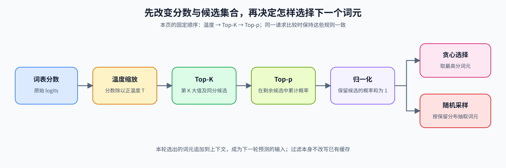

# 21. Decoding Strategies | Decoding Strategies｜解码策略

**难度：** Medium | **环境：** [CPU 主线](#runtime-environment) | **标签：** `推理优化`, `解码`, `采样` | **目标人群：** 理解概率与张量运算的学习者

> 🚀 **云端运行环境**
>
> 本章节的实战代码可以点击以下链接在免费 GPU 算力平台上直接运行：
>
> [](https://colab.research.google.com/github/datawhalechina/llm-algo-leetcode/blob/main/02_PyTorch_Algorithms/21_Decoding_Strategies.ipynb)
> [](https://modelscope.cn/my/mynotebook) *(国内推荐：魔搭社区免费实例)*


## 本节导读

模型在每个生成位置给出词表中各词元的未归一化分数（logits）。解码策略决定如何改变分布、限制候选集合，并从中选择下一个词元（token），从而在确定性与多样性之间取舍。

本节先建立贪心解码基线，再比较温度、Top-K 和 Top-p 对分布与候选集合的影响。

<a id="runtime-environment"></a>

## 运行环境

- **基础练习：** 使用 [BASE-CPU](../guide.md#base-cpu)，运行本页的 CPU 题目与测试。

## 前置阅读

先回顾注意力模块如何产生当前位置的表示，以及模型如何将表示映射为词表 logits；然后观察不同解码规则怎样改变候选集合和采样结果。
- [04. Attention MHA GQA | 注意力机制：MHA、MQA、GQA](./04_Attention_MHA_GQA.md)

---

## Step 1：从词表分数到下一个 Token

贪心解码始终选择最高分 Token，结果确定；采样解码则从归一化概率中抽取结果。温度和候选截断位于选择之前，它们在本轮处理分数，不直接改写模型权重或已有 KV 缓存；选出的词元会进入下一轮上下文，因此会影响后续状态。正温度 $T$ 把分数 $z$ 变为 $z/T$，再经 Softmax 得到概率。

| 路径 | 主要处理 | 输出与观察重点 |
| --- | --- | --- |
| 原始词表分数 | 描述各 Token 的相对偏好 | 排序与分布形状 |
| 贪心解码 | 选择最高分 Token | 结果确定，可作为基线 |
| 采样解码 | 按归一化概率抽样 | 结果具有随机性 |
| Top-K / Top-p | 在采样前缩小候选集合 | 候选数量或累计概率质量变化 |



## Step 2：候选处理顺序如何改变分布

本节采用“温度缩放 → Top-K → Top-p → 概率归一化 → 选择”的顺序。温度改变分布尖锐程度但保持排序；Top-K 固定排名范围；Top-p 根据累计概率质量决定候选边界。温度很低仍不等同于贪心解码，因为采样路径仍可能选择非最高分 Token。

| 阶段 | 输入 | 输出或作用 | 观察重点 |
| --- | --- | --- | --- |
| 温度缩放 | 原始词表分数、温度 $T$ | 缩放后的分数 | 排序不变，尖锐程度改变 |
| Top-K | 缩放后的分数、$K$ | 排名前 K 的候选 | 同分边界可能保留更多候选 |
| Top-p | 候选分布、$p$ | 覆盖累计概率阈值的最小集合 | 必须保留首次达到阈值的边界 Token |
| 选择 | 最终候选分布 | 一个下一个 Token | 贪心取最大值，采样按概率抽取 |

## Step 3：Top-p 如何确定候选边界

Top-p 先按概率从高到低累计，保留累计质量首次达到或超过阈值的边界 Token。若排序后的概率为 `[0.5, 0.3, 0.1, 0.05, 0.05]`，当 $p=0.85$ 时，前三个 Token 构成最小候选集合。若累计概率恰好等于阈值，也应在该位置停止扩展，而不是再多保留一个词元。候选集合确定后，其内部概率重新归一化。

| 处理阶段 | 机制作用 | 示例检查点 |
| --- | --- | --- |
| 概率排序 | 建立从高到低的累计顺序 | 原词表位置暂不参与边界判断 |
| 累计概率 | 找到首次达到阈值的位置 | $0.5, 0.8, 0.9$ 在第三项越过 $0.85$ |
| 保留边界 | 把首次达到阈值的 Token 纳入集合 | 不能误删第三个 Token |
| 重新归一化 | 在保留集合内恢复总概率为 1 | 被排除 Token 不再参与采样 |


## Step 4：实现候选过滤并验证解码流程

本题给定词表分数，补全温度缩放和两类候选过滤；选择与逐词元追加循环由骨架提供。循环按固定新增长度结束，不包含 EOS（终止词元）处理；完整请求还需记录停止原因。测试核对边界候选、批量维度、非法参数与固定种子的选择结果。

| TODO / 函数 | 学习者完成的机制 | 必须满足的约束 | 测试证据 |
| --- | --- | --- | --- |
| TODO 1 · `apply_temperature` | 校验温度并缩放词表分数 | 保持排序、形状、数据类型与设备 | 正常缩放、排序不变与非法温度 |
| TODO 2 · `apply_top_k` | 按第 K 大值过滤候选 | 同分候选一起保留，其余位置被屏蔽 | 普通候选、同分边界与批量输入 |
| TODO 3 · `apply_top_p` | 保留累计概率边界并恢复词表顺序 | 首次达到阈值的 Token 不能被删除 | 边界集合、非法阈值与批量输入 |


```python
import torch
import torch.nn.functional as F
```


```python
def apply_temperature(logits: torch.Tensor, temperature: float) -> torch.Tensor:
    """在概率归一化前缩放词表分数。"""
    # ==========================================
    # TODO 1：校验温度并缩放词表分数。
    # ==========================================
    # temperature_is_valid = ???  # temperature 是有限正数时为 True。
    # scaled_logits = ???  # 保持形状、数据类型、设备和排序的缩放结果。
    raise NotImplementedError("TODO 1：请校验温度并缩放")
    if not temperature_is_valid:
        raise ValueError("temperature 必须是有限正数")
    return scaled_logits


def apply_top_k(logits: torch.Tensor, top_k: int) -> torch.Tensor:
    """按第 K 大值筛选词表分数，同分边界一起保留。"""
    if top_k is None:
        return logits
    if not isinstance(top_k, int) or isinstance(top_k, bool) or top_k < 0:
        raise ValueError("top_k 必须为非负整数")
    if top_k == 0 or top_k >= logits.size(-1):
        return logits
    # ==========================================
    # TODO 2：按第 K 大值形成候选掩码。
    # ==========================================
    # kth_values = ???  # 每个样本的第 K 大阈值，保留最后一维。
    # filtered_logits = ???  # 小于阈值的位置设为负无穷。
    raise NotImplementedError("TODO 2：请实现 Top-K 过滤")
    return filtered_logits


def apply_top_p(logits: torch.Tensor, top_p: float) -> torch.Tensor:
    """保留累计概率首次达到阈值的最小候选集合。"""
    if top_p is None or top_p == 1.0:
        return logits
    if not 0.0 < top_p < 1.0:
        raise ValueError("top_p 必须满足 0 < top_p <= 1")
    sorted_logits, sorted_indices = torch.sort(logits, descending=True)
    cumulative_probs = torch.cumsum(F.softmax(sorted_logits, dim=-1), dim=-1)
    remove_mask = cumulative_probs >= top_p
    # ==========================================
    # TODO 3：保留边界 Token，并恢复原词表顺序。
    # ==========================================
    # shifted_mask = ???  # remove_mask 右移一位后的边界保留掩码。
    # restored_logits = ???  # 屏蔽候选后恢复到原词表顺序的结果。
    raise NotImplementedError("TODO 3：请实现 Top-p 边界过滤")
    remove_mask[..., 1:] = shifted_mask
    remove_mask[..., 0] = False
    sorted_logits[remove_mask] = float("-inf")
    return restored_logits


def decode_next_token(logits, temperature=0.7, top_k=50, top_p=0.9, do_sample=True, generator=None):
    """应用候选策略并选择一个 Token。"""
    if logits.dim() == 1:
        logits = logits.unsqueeze(0)
    elif logits.dim() != 2:
        raise ValueError("logits 必须是 [vocab] 或 [batch, vocab]")
    logits = apply_temperature(logits, temperature)
    logits = apply_top_k(logits, top_k)
    logits = apply_top_p(logits, top_p)
    probabilities = F.softmax(logits, dim=-1)
    if not do_sample:
        return torch.argmax(logits, dim=-1, keepdim=True)
    return torch.multinomial(probabilities, num_samples=1, generator=generator)


def autoregressive_decode(prompt_ids, logits_fn, max_new_tokens, **decode_kwargs):
    """逐 Token 调用词表分数函数并追加结果。"""
    tokens = prompt_ids.clone()
    for _ in range(max_new_tokens):
        step_logits = logits_fn(tokens)
        if step_logits.dim() == 3:
            step_logits = step_logits[:, -1, :]
        next_token = decode_next_token(step_logits, **decode_kwargs)
        tokens = torch.cat([tokens, next_token], dim=-1)
    return tokens

```

## 测试

测试分别验证温度、Top-K、Top-p、选择路径和批量输入契约。


```python
def _fixture_logits():
    """返回包含明确排序关系的固定词表分数。"""
    return torch.tensor([[0.1, 2.3, 0.4, 1.2, -0.5, 4.0, 3.1, 0.0, 1.1, -1.0]])


def test_temperature_contract():
    """验证温度缩放保持排序、形状和数据类型，并拒绝非法温度。"""
    logits = _fixture_logits()
    scaled = apply_temperature(logits, 0.5)
    assert torch.allclose(scaled[0, 5] - scaled[0, 6], (logits[0, 5] - logits[0, 6]) * 2)
    assert scaled.shape == logits.shape and scaled.dtype == logits.dtype
    assert torch.equal(torch.argsort(logits), torch.argsort(scaled))
    try:
        apply_temperature(logits, 0.0)
    except ValueError:
        pass
    else:
        raise AssertionError("非法 temperature 应失败")


def test_top_k_filtering():
    """验证 Top-K 阈值、同分边界和张量属性。"""
    logits = _fixture_logits().to(dtype=torch.float64)
    filtered = apply_top_k(logits, 3)
    assert torch.isfinite(filtered).sum().item() == 3
    assert filtered.shape == logits.shape and filtered.dtype == logits.dtype and filtered.device == logits.device
    tied = torch.tensor([[2.0, 2.0, 2.0, 1.0]])
    assert torch.isfinite(apply_top_k(tied, 2)).sum().item() == 3


def test_top_p_boundary():
    """验证 Top-p 保留首次越过阈值的边界 Token。"""
    logits = _fixture_logits().to(dtype=torch.float64)
    filtered = apply_top_p(logits, 0.8)
    assert torch.isfinite(filtered).sum().item() == 3
    assert torch.equal(filtered[0, [5, 6, 1]], logits[0, [5, 6, 1]])
    exact_logits = torch.log(torch.tensor([[0.5, 0.25, 0.125, 0.125]], dtype=torch.float64))
    exact_filtered = apply_top_p(exact_logits, 0.75)
    assert torch.equal(torch.isfinite(exact_filtered), torch.tensor([[True, True, False, False]]))
    for invalid_p in (0.0, 1.1):
        try:
            apply_top_p(logits, invalid_p)
        except ValueError:
            continue
        raise AssertionError("非法 top_p 应失败")


def test_selection_and_autoregressive_loop():
    """验证贪心选择、可复现采样和逐 Token 状态推进。"""
    logits = _fixture_logits()
    assert decode_next_token(logits, 1.0, 0, 1.0, do_sample=False).item() == 5
    g1, g2 = torch.Generator().manual_seed(7), torch.Generator().manual_seed(7)
    assert torch.equal(decode_next_token(logits, generator=g1), decode_next_token(logits, generator=g2))
    prompt = torch.tensor([[1, 2]])

    def fake_logits(tokens):
        result = torch.zeros(tokens.size(0), tokens.size(1), 10)
        result[..., 3] = 2.0
        return result

    generated = autoregressive_decode(prompt, fake_logits, 3, temperature=1.0, top_k=0, top_p=1.0, do_sample=False)
    assert generated.shape == (1, 5) and torch.equal(generated[0, -3:], torch.tensor([3, 3, 3]))


def test_batch_and_input_contract():
    """验证批量输入沿词表维处理，并保持批量维。"""
    logits = _fixture_logits().repeat(2, 1)
    assert apply_top_k(logits, 3).shape == logits.shape
    assert apply_top_p(logits, 0.8).shape == logits.shape
    assert decode_next_token(logits[0], 1.0, 0, 1.0, do_sample=False).shape == (1, 1)


test_temperature_contract()
test_top_k_filtering()
test_top_p_boundary()
test_selection_and_autoregressive_loop()
test_batch_and_input_contract()
print("✅ 解码策略测试通过")

```

---

🛑 **STOP HERE** 🛑
<br><br><br><br><br><br><br><br><br><br>
> 请先尝试自己完成代码并跑通测试。<br>
> 如果遇到困难，再向下查看参考代码与解析。
<br><br><br><br><br><br><br><br><br><br>

---

## 参考代码与解析

### 代码


```python
# ==========================================
# TODO 1：校验温度并缩放词表分数。
# ==========================================
def apply_temperature(logits: torch.Tensor, temperature: float) -> torch.Tensor:
    """在概率归一化前缩放词表分数。"""
    temperature_is_valid = torch.isfinite(torch.tensor(temperature)).item() and temperature > 0
    if not temperature_is_valid:
        raise ValueError("temperature 必须是有限正数")
    scaled_logits = logits / temperature
    return scaled_logits


# ==========================================
# TODO 2：按第 K 大值形成候选掩码。
# ==========================================
def apply_top_k(logits: torch.Tensor, top_k: int) -> torch.Tensor:
    """按第 K 大值筛选词表分数，同分边界一起保留。"""
    if top_k is None:
        return logits
    if not isinstance(top_k, int) or isinstance(top_k, bool) or top_k < 0:
        raise ValueError("top_k 必须为非负整数")
    if top_k == 0 or top_k >= logits.size(-1):
        return logits
    kth_values = torch.topk(logits, top_k, dim=-1).values[..., -1:]
    filtered_logits = torch.where(logits < kth_values, torch.full_like(logits, float("-inf")), logits)
    return filtered_logits


# ==========================================
# TODO 3：保留边界 Token，并恢复原词表顺序。
# ==========================================
def apply_top_p(logits: torch.Tensor, top_p: float) -> torch.Tensor:
    """保留累计概率首次达到阈值的最小候选集合。"""
    if top_p is None or top_p == 1.0:
        return logits
    if not 0.0 < top_p < 1.0:
        raise ValueError("top_p 必须满足 0 < top_p <= 1")
    sorted_logits, sorted_indices = torch.sort(logits, descending=True)
    cumulative_probs = torch.cumsum(F.softmax(sorted_logits, dim=-1), dim=-1)
    remove_mask = cumulative_probs >= top_p
    shifted_mask = remove_mask[..., :-1].clone()
    remove_mask[..., 1:] = shifted_mask
    remove_mask[..., 0] = False
    sorted_logits[remove_mask] = float("-inf")
    restored_logits = torch.zeros_like(logits).scatter_(-1, sorted_indices, sorted_logits)
    return restored_logits


def decode_next_token(logits, temperature=0.7, top_k=50, top_p=0.9, do_sample=True, generator=None):
    """应用候选策略并选择一个 Token。"""
    if logits.dim() == 1:
        logits = logits.unsqueeze(0)
    elif logits.dim() != 2:
        raise ValueError("logits 必须是 [vocab] 或 [batch, vocab]")
    logits = apply_temperature(logits, temperature)
    logits = apply_top_k(logits, top_k)
    logits = apply_top_p(logits, top_p)
    probabilities = F.softmax(logits, dim=-1)
    if not do_sample:
        return torch.argmax(logits, dim=-1, keepdim=True)
    return torch.multinomial(probabilities, num_samples=1, generator=generator)


def autoregressive_decode(prompt_ids, logits_fn, max_new_tokens, **decode_kwargs):
    """逐 Token 调用词表分数函数并追加结果。"""
    tokens = prompt_ids.clone()
    for _ in range(max_new_tokens):
        step_logits = logits_fn(tokens)
        if step_logits.dim() == 3:
            step_logits = step_logits[:, -1, :]
        next_token = decode_next_token(step_logits, **decode_kwargs)
        tokens = torch.cat([tokens, next_token], dim=-1)
    return tokens

```

### 解析

#### TODO 1：温度缩放

- 温度对全部词表分数使用同一缩放比例，改变归一化后的尖锐程度。温度必须是有限正数；缩放保持形状、数据类型、设备和 Token 排序。
- 测试核对分数差的缩放比例、排序不变和非法温度错误。

#### TODO 2：Top-K 候选过滤

- 用第 K 大分数作为候选边界，保留所有不低于边界的位置。同分 Token 一起保留，因此候选数可能超过 K；输出张量属性保持不变。
- 测试覆盖普通候选、同分边界、批量输入和张量属性。

#### TODO 3：Top-p 候选过滤

- 在概率排序空间找到累计质量边界，保留边界 Token 后恢复原词表顺序。首次达到阈值的 Token 必须保留；候选之外的位置不再参与最终采样。
- 测试核对保留集合、原词表位置、批量输入和非法阈值。

## 相关阅读

继续观察一次选择如何扩展为请求生成，以及投机验证怎样保持采样语义。

- [Nucleus Sampling 原论文](https://arxiv.org/abs/1904.09751)
- [Transformers 文本生成策略文档](https://huggingface.co/docs/transformers/main/en/main_classes/text_generation)
- [vLLM SamplingParams 文档](https://docs.vllm.ai/en/latest/api/vllm/sampling_params.html)
- [Part 02 · 23 投机解码](./23_Speculative_Decoding.md)
- [Part 02 · 35 原生多 Token 预测](./35_Multi_Token_Decoding.md)
- [Part 02 · 36 解码调度](./36_Decode_Scheduling.md)
