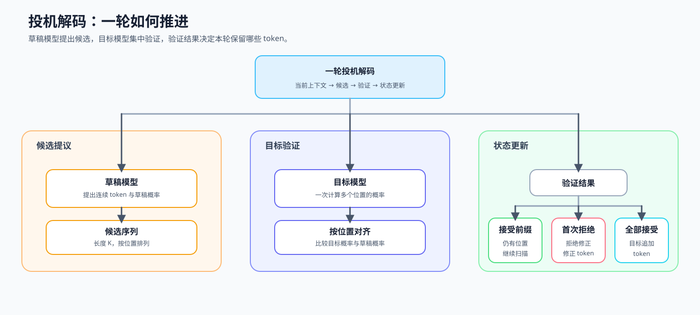
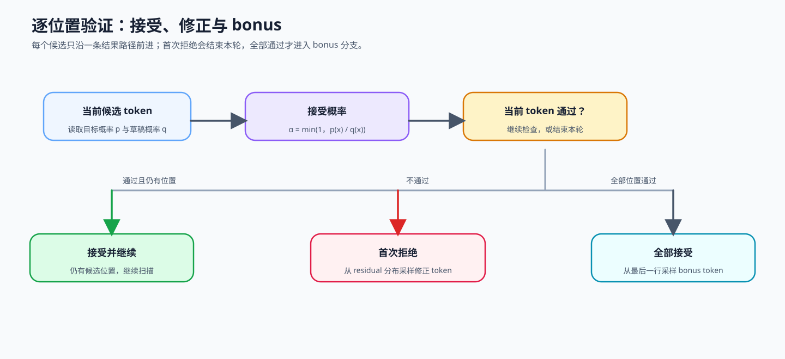

# 23. Speculative Decoding | Speculative Decoding｜投机解码

**难度：** Hard | **环境：** [CPU 主线，GPU 可选](#runtime-environment) | **标签：** `推理优化`, `解码`, `投机解码` | **目标人群：** 理解自回归生成的学习者

> 🚀 **云端运行环境**
>
> 本章节的实战代码可以点击以下链接在免费 GPU 算力平台上直接运行：
>
> [](https://colab.research.google.com/github/datawhalechina/llm-algo-leetcode/blob/main/02_PyTorch_Algorithms/23_Speculative_Decoding.ipynb)
> [](https://modelscope.cn/my/mynotebook) *(国内推荐：魔搭社区免费实例)*


## 本节导读

投机解码先用成本较低的草稿模型提出多个候选，再由目标模型集中验证。它可能减少目标模型逐个推进的次数；接受与拒绝修正共同保持目标分布，草稿和验证的额外成本则决定是否真正加速。

本节沿着“草稿提议 → 位置对齐 → 接受或修正 → 状态推进”展开，重点理解接受概率、拒绝修正和全部接受后的追加 Token。

<a id="runtime-environment"></a>

## 运行环境

- **基础练习：** 使用 [BASE-CPU](../guide.md#base-cpu)，运行本页的 CPU 题目与测试。
- **GPU 实验：** 使用 [INF-CUDA-MECHANISM](../topic_discussion/inference_optimization/quickstart.md#inf-cuda-mechanism-quickstart)，模型与工作负载见 5.1。

## 前置阅读

先能区分词表分数、采样分布与逐词元推进，再理解草稿后缀为何需要回退。

- [Part 02 · 21 解码策略](./21_Decoding_Strategies.md)
- [Part 01 · 11 KV Cache 与显存增长](../01_Hardware_Math_and_Systems/11_KV_Cache_and_Memory_Growth.md)

## Step 1：草稿—验证如何增加单轮推进量

草稿模型先连续提出候选，目标模型再用一次验证覆盖这些位置。草稿负责提议，目标负责决定最终输出；两者不是并列投票。候选通过时继续向后检查；首次拒绝时输出修正结果并结束本轮；全部候选通过时，目标模型还能从额外位置继续推进一个 Token。

这里的提交是把词元纳入最终生成序列，不是把整段草稿直接交给用户。首次拒绝后，未提交候选的缓存不能留作有效历史；修正或追加词元的 K/V 通常在随后处理该词元时产生。

| 环节 | 输入 | 机制责任 | 输出 |
| --- | --- | --- | --- |
| 草稿提议 | 当前上下文 | 低成本地产生连续候选及其分布 | 候选 Token 与草稿分布 |
| 目标验证 | 候选序列 | 同时给出各候选位置的目标分布 | 与候选位置对齐的验证证据 |
| 接受或修正 | 草稿分布与目标分布 | 保持接受前缀，首次拒绝时修正 | 本轮输出与新状态 |
| 全部接受 | 完整候选块 | 使用额外目标位置继续推进 | 追加 Token |



## Step 2：草稿分布与目标分布如何按位置对齐

设一轮共有 $K$ 个草稿候选。第 $i$ 个候选对应草稿分布 $q_i$ 和目标分布 $p_i$；两者必须以同一已验证前缀为条件、描述同一位置和同一词表，并采用各自声明的温度和候选过滤规则，才能计算接受概率。目标模型还提供第 $K+1$ 个位置，供全部候选接受后继续采样。

| 对象 | 位置关系 | 作用 |
| --- | --- | --- |
| 候选 $x_i$ | 第 $i$ 个草稿位置 | 指出本轮实际提出的 Token |
| 草稿分布 $q_i$ | 与候选 $x_i$ 对齐 | 描述草稿路径对该位置的预测 |
| 目标分布 $p_i$ | 与候选 $x_i$ 对齐 | 决定接受概率或拒绝修正 |
| 额外目标分布 $p_{K+1}$ | 位于候选块之后 | 全部候选接受后产生追加 Token |

## Step 3：接受、拒绝修正与追加 Token

验证从左向右进行。设同一位置的目标、草稿分布分别为 $p$、$q$，候选 $x$ 从 $q$ 采出，因此 $q(x)>0$。标准随机验证中，候选的接受概率为：

$$\alpha(x)=\min\left(1,\frac{p(x)}{q(x)}\right).$$

若候选被拒绝，就从正残差分布 $r(v)=\max(p(v)-q(v),0)/\sum_u\max(p(u)-q(u),0)$ 采样修正词元并结束本轮，其中 $u$ 遍历词表、$v$ 是待采样词元；直接从 $p$ 重采样会改变结果分布。若接受则继续检查，全部接受后从额外目标位置采样追加词元。例如 $q=(0.8,0.2)$、$p=(0.4,0.6)$，两项接受概率是 0.5 和 1，拒绝后只能修正为第二项，最终仍得到 $(0.4,0.6)$。这些是随机采样规则；贪心路径改为逐位置核对目标最大分词元。

| 验证结果 | 使用的证据 | 本轮状态变化 |
| --- | --- | --- |
| 接受 | 目标概率与草稿概率的比值 | 提交当前候选并继续验证 |
| 首次拒绝 | 两个分布的正概率差 | 输出修正 Token，关闭候选后缀 |
| 全部接受 | 完整接受前缀与额外目标位置 | 提交候选块并追加一个 Token |



## Step 4：实现单轮投机解码

本题直接给出按位置对齐的草稿和目标概率，不运行模型或维护物理缓存。你将补全接受概率、正残差与单轮分支；测试使用固定分布检查拒绝、追加和总概率质量。零草稿概率属于辅助函数的防御性用例，不是正常从草稿分布采出的候选。

| TODO / 函数 | 学习者完成的机制 | 必须满足的约束 | 测试证据 |
| --- | --- | --- | --- |
| TODO 1 · `_accept_probability` | 计算候选接受概率 | 处理草稿概率为零，并将比例截断到 1 | 零概率、确定接受与比例接受 |
| TODO 2 · `_normalized_residual` | 构造拒绝修正分布 | 只保留正概率差并归一化 | 正常修正与零质量错误 |
| TODO 3 · `speculative_decode_step` | 根据随机样本决定是否接受 | 接受时继续，首次拒绝时立即停止 | 接受数量、拒绝位置与关闭后缀 |
| TODO 4 · `speculative_decode_step` | 全部接受后采样追加 Token | 使用额外目标位置 | 全部接受与追加 Token |


```python
import torch
```


```python
def _validate_probability_contract(draft_probs, target_probs, draft_tokens):
    """检查草稿、目标和候选 token 是否能按位置一一对应。"""
    if draft_probs.dim() != 2 or target_probs.dim() != 2:
        raise ValueError('概率张量必须是二维 [K, vocab]')
    K, vocab_size = draft_probs.shape
    if target_probs.shape != (K + 1, vocab_size) or len(draft_tokens) != K:
        raise ValueError('draft/target/token 的长度或词表维度不匹配')
    if not (torch.isfinite(draft_probs).all() and torch.isfinite(target_probs).all()):
        raise ValueError('概率分布不能包含 NaN 或 Inf')
    if (draft_probs < 0).any() or (target_probs < 0).any():
        raise ValueError('概率分布不能包含负数')
    expected_draft = torch.ones(K, device=draft_probs.device, dtype=draft_probs.dtype)
    expected_target = torch.ones(K + 1, device=target_probs.device, dtype=target_probs.dtype)
    if not (torch.allclose(draft_probs.sum(-1), expected_draft, atol=1e-5) and torch.allclose(target_probs.sum(-1), expected_target, atol=1e-5)):
        raise ValueError('输入必须是归一化概率分布')
    if any(not isinstance(token_id, int) or not 0 <= token_id < vocab_size for token_id in draft_tokens):
        raise ValueError('draft token id 必须是词表范围内的整数')
    return K, vocab_size

def _accept_probability(target_prob, draft_prob):
    """返回当前候选的接受概率 alpha。"""
    # ==========================================
    # TODO 1：计算候选接受概率
    # 作用：处理 q=0，并把 p/q 截断到 [0, 1]。
    # alpha = ???  # 当前候选的接受概率
    # ==========================================
    raise NotImplementedError('TODO 1：请计算接受概率')

def _normalized_residual(target_row, draft_row):
    """构造拒绝时用于 correction 的归一化 residual 分布。"""
    # ==========================================
    # TODO 2：构造拒绝修正分布
    # 作用：保留 target-draft 的正概率质量并归一化。
    # residual = ???  # 未归一化的正概率差
    # residual_mass = ???  # residual 的总概率质量
    # ==========================================
    raise NotImplementedError('TODO 2：请构造 residual 分布')

def speculative_decode_step(draft_probs, target_probs, draft_tokens, generator=None):
    """
    验证 K 个草稿，并在拒绝或全接受时生成修正 token。

    Args:
        draft_probs: 草稿模型在 K 个位置上的概率分布, shape [K, vocab_size]
        target_probs: 目标模型在 K 个验证位置及 1 个 bonus 位置的概率分布, shape [K+1, vocab_size]
        draft_tokens: 草稿模型实际提出的 K 个 token_id, shape [K]

    Returns:
        dict: 包含最终 token 序列、接受数量、拒绝状态和检查位置。
    """
    K, vocab_size = _validate_probability_contract(draft_probs, target_probs, draft_tokens)
    accepted_tokens = []

    for i in range(K):
        token_id = draft_tokens[i]

        if not 0 <= int(token_id) < vocab_size:
            raise ValueError('draft token id 超出词表范围')
        p = target_probs[i, token_id]
        q = draft_probs[i, token_id]

        alpha = _accept_probability(p, q)
        random_draw = torch.rand((), generator=generator).item()
        # ==========================================
        # TODO 3：判断当前候选是否接受
        # 作用：比较随机样本与接受概率。
        # accepted = ???  # 当前候选的布尔接受状态
        # ==========================================
        raise NotImplementedError('TODO 3：请判断当前候选是否接受')
        if accepted:
            accepted_tokens.append(int(token_id))
            continue
        residual = _normalized_residual(target_probs[i], draft_probs[i])
        correction = torch.multinomial(residual, 1, generator=generator).item()
        return {'tokens': accepted_tokens + [correction], 'accepted_count': len(accepted_tokens), 'rejected': True, 'target_positions_checked': i + 1}

    # ==========================================
    # TODO 4：采样全部接受后的追加 token
    # 作用：从额外的第 K 行目标分布采样，而不是复用验证位置。
    # bonus = ???  # 追加 token 的整数 ID
    # ==========================================
    raise NotImplementedError('TODO 4：请采样全部接受后的追加 token')
    return {'tokens': accepted_tokens + [bonus], 'accepted_count': K, 'rejected': False, 'target_positions_checked': K}


```

## 测试

测试分别验证输入契约、接受概率、首次拒绝、拒绝修正和全部接受路径。


```python
# 按机制拆分测试，分别定位输入契约、接受、residual、bonus 和边界状态。
def _build_speculative_fixture():
    draft_tokens = [0, 1, 2]
    draft_probs = torch.zeros(3, 5)
    target_probs = torch.zeros(4, 5)
    draft_probs[0, 0] = 1.0; target_probs[0, 0] = 1.0
    draft_probs[1, 1] = 1.0; target_probs[1, 3] = 1.0
    draft_probs[2, 2] = 1.0; target_probs[2, 2] = 1.0
    target_probs[3, 4] = 1.0
    return draft_tokens, draft_probs, target_probs

def test_probability_contract():
    """输入概率、形状和 token 位置不合法时应明确拒绝。"""
    draft_tokens, draft_probs, target_probs = _build_speculative_fixture()
    invalid = draft_probs.clone()
    invalid[0, 0] = -0.1
    try:
        speculative_decode_step(invalid, target_probs, draft_tokens)
    except ValueError:
        return
    raise AssertionError('负概率应明确被拒绝')

def test_rejection_and_residual():
    """首次拒绝时应从修正分布采样并停止本轮验证。"""
    draft_tokens, draft_probs, target_probs = _build_speculative_fixture()
    result = speculative_decode_step(draft_probs, target_probs, draft_tokens)
    assert result['tokens'] == [0, 3]
    assert result['accepted_count'] == 1 and result['rejected']
    assert result['target_positions_checked'] == 2

def test_all_accept_and_bonus():
    """全部候选接受后应从额外目标位置采样追加 token。"""
    _, _, target_probs = _build_speculative_fixture()
    all_accepted = speculative_decode_step(target_probs[:3], target_probs, [0, 3, 2])
    assert all_accepted['tokens'] == [0, 3, 2, 4]
    assert all_accepted['accepted_count'] == 3
    assert not all_accepted['rejected']

def test_zero_q_acceptance():
    """草稿概率为零而目标概率为正时，候选应被接受。"""
    zero_q_draft = torch.tensor([[0.0, 1.0, 0.0]])
    zero_q_target = torch.tensor([[0.5, 0.5, 0.0], [0.0, 1.0, 0.0]])
    result = speculative_decode_step(zero_q_draft, zero_q_target, [0])
    assert result['accepted_count'] == 1 and not result['rejected']

def test_zero_residual_failure():
    """拒绝位置没有正修正质量时应明确报错。"""
    draft = torch.tensor([[1.0, 0.0]])
    target = torch.tensor([[1.0, 0.0], [1.0, 0.0]])
    try:
        speculative_decode_step(draft, target, [1])
    except ValueError:
        return
    raise AssertionError('residual 概率质量为 0 时应明确报错')

def test_probability_mass_recovery():
    """接受质量与正残差修正之和恢复目标分布。"""
    draft = torch.tensor([0.8, 0.2], dtype=torch.float64)
    target = torch.tensor([0.4, 0.6], dtype=torch.float64)
    alpha = torch.tensor([_accept_probability(p, q) for p, q in zip(target, draft)], dtype=torch.float64)
    accepted_mass = draft * alpha
    rejected_mass = 1.0 - accepted_mass.sum()
    recovered = accepted_mass + rejected_mass * _normalized_residual(target, draft)
    torch.testing.assert_close(recovered, target)
    assert not torch.allclose(accepted_mass + rejected_mass * target, target)


def test_speculative_decoding():
    """汇总运行单轮投机解码的机制测试。"""
    try:
        torch.manual_seed(42)
        test_probability_contract()
        test_rejection_and_residual()
        test_all_accept_and_bonus()
        test_zero_q_acceptance()
        test_zero_residual_failure()
        test_probability_mass_recovery()
        print("✅ 投机解码机制测试通过：输入契约、接受、拒绝修正和追加 Token 均通过。")
    except NotImplementedError:
        print("请先完成 TODO 代码。")
        raise
    except Exception as error:
        print(f"❌ 投机解码测试失败: {type(error).__name__}: {error}")
        raise

test_speculative_decoding()

```

---

🛑 **STOP HERE** 🛑
<br><br><br><br><br><br><br><br><br><br>
> 请先尝试自己完成代码并跑通测试。<br>
> 如果遇到困难，再向下查看参考代码与解析。
<br><br><br><br><br><br><br><br><br><br>

---

## 参考代码与解析

### 代码

```python
def _validate_probability_contract(draft_probs, target_probs, draft_tokens):
    """检查草稿、目标和候选 token 是否能按位置一一对应。"""
    if draft_probs.dim() != 2 or target_probs.dim() != 2:
        raise ValueError('概率张量必须是二维 [K, vocab]')
    K, vocab_size = draft_probs.shape
    if target_probs.shape != (K + 1, vocab_size) or len(draft_tokens) != K:
        raise ValueError('draft/target/token 的长度或词表维度不匹配')
    if not (torch.isfinite(draft_probs).all() and torch.isfinite(target_probs).all()):
        raise ValueError('概率分布不能包含 NaN 或 Inf')
    if (draft_probs < 0).any() or (target_probs < 0).any():
        raise ValueError('概率分布不能包含负数')
    ones_draft = torch.ones(K, device=draft_probs.device, dtype=draft_probs.dtype)
    ones_target = torch.ones(K + 1, device=target_probs.device, dtype=target_probs.dtype)
    if not (torch.allclose(draft_probs.sum(-1), ones_draft, atol=1e-5) and torch.allclose(target_probs.sum(-1), ones_target, atol=1e-5)):
        raise ValueError('输入必须是归一化概率分布')
    if any(not isinstance(token_id, int) or not 0 <= token_id < vocab_size for token_id in draft_tokens):
        raise ValueError('draft token id 必须是词表范围内的整数')
    return K, vocab_size

def _accept_probability(target_prob, draft_prob):
    """返回当前候选的接受概率 alpha。"""
    # TODO 1（接受概率）：处理 q=0，并计算 alpha = min(1, p / q)。
    p, q = float(target_prob), float(draft_prob)
    if q == 0.0:
        return 1.0 if p > 0.0 else 0.0
    return min(1.0, p / q)

def _normalized_residual(target_row, draft_row):
    """构造拒绝时用于 correction 的归一化 residual 分布。"""
    # TODO 2（拒绝修正）：保留 target-draft 的正概率质量并归一化。
    residual = torch.clamp(target_row - draft_row, min=0)
    residual_mass = residual.sum()
    if residual_mass <= 0:
        raise ValueError('residual 概率质量必须大于 0')
    return residual / residual_mass

def speculative_decode_step(draft_probs, target_probs, draft_tokens, generator=None):
    """完成一次 speculative decoding step。

    `target_probs[:K]` 验证草稿，`target_probs[K]` 生成 bonus token。
    """
    K, vocab_size = _validate_probability_contract(draft_probs, target_probs, draft_tokens)
    accepted_tokens = []

    for i in range(K):
        token_id = draft_tokens[i]
        alpha = _accept_probability(target_probs[i, token_id], draft_probs[i, token_id])
        random_draw = torch.rand((), generator=generator).item()
        # TODO 3（接受判断）：比较随机样本与接受概率。
        accepted = random_draw < alpha
        if accepted:
            accepted_tokens.append(int(token_id))
            continue
        residual = _normalized_residual(target_probs[i], draft_probs[i])
        correction = torch.multinomial(residual, 1, generator=generator).item()
        return {'tokens': accepted_tokens + [correction], 'accepted_count': len(accepted_tokens), 'rejected': True, 'target_positions_checked': i + 1}

    # TODO 4（全部接受）：从额外的第 K 行目标分布采样追加 token。
    bonus = torch.multinomial(target_probs[K], 1, generator=generator).item()
    return {'tokens': accepted_tokens + [bonus], 'accepted_count': K, 'rejected': False, 'target_positions_checked': K}


```

### 解析

#### TODO 1：计算接受概率

- 用目标概率与草稿概率的比值描述候选被目标分布接受的机会，并把结果限制在 1 以内。接受概率位于 $[0,1]$；草稿概率为零时不能发生除零。
- 测试覆盖确定接受、比例接受和零草稿概率。

#### TODO 2：构造拒绝修正分布

- 只保留目标分布超过草稿分布的概率质量，再将其归一化为修正分布。修正分布非负且总和为 1；不存在正概率质量时必须失败。
- 测试核对修正分布数值、归一化结果和零质量错误；两词元概率账本还把接受质量与拒绝修正质量相加，检查结果恢复目标分布。

#### TODO 3：维护连续接受前缀

- 随机样本低于接受概率时提交当前候选，否则在该位置执行拒绝修正。首次拒绝立即关闭后缀，后续候选不能重新进入本轮输出。
- 测试覆盖确定接受、首次拒绝、检查位置和接受数量。

#### TODO 4：全部接受后追加 Token

- 候选块全部通过后，从额外目标位置继续采样一个 Token。追加 Token 不能复用最后一个候选位置的验证分布。
- 测试覆盖全部接受路径及最终输出长度。

## Step 5：GPU 机制实验——真实草稿模型与目标模型对照

| 学习问题 | CPU 已确认 | GPU 要确认与后续使用 |
| --- | --- | --- |
| 草稿—验证能否在保持输出语义的前提下减少目标模型调用 | 接受概率、拒绝修正和追加 Token | 使用真实目标/草稿模型比较输出、目标前向次数、Median/P95、峰值显存与净收益；结果进入 68 的后端复测 |

### 5.1 环境与固定工作负载

使用 `INF-CUDA-MECHANISM` Profile；首次运行需要下载目标模型与草稿模型，不需要外部数据集。环境创建和预检见[推理优化实验 Quickstart](../topic_discussion/inference_optimization/quickstart.md#inf-cuda-mechanism-quickstart)。CPU 题目区只验证概率机制；真实实验必须完成 Draft–Verify，并对照仅目标模型生成，不使用概率夹具替代后端证据。

| 配置层 | 本实验固定口径 | 修改规则 |
| --- | --- | --- |
| 模型 | Qwen2.5 3B 目标模型 + 0.5B 草稿模型 | 与历史 1.5B/0.5B 结果分开登记 |
| 工作负载 | 三条固定提示，贪心生成 64 Token；两条路径各预热 3 次、正式重复 10 次 | 修改提示、长度或测量协议时递增工作负载版本 |
| 对照 | 仅目标模型 → 固定 5-Token 草稿预算 | 两条路径共用输入、数据类型、预热和重复次数 |
| 结果 | 输出一致性、前向次数、每次目标调用推进量、Median/P95、TPOT、峰值显存和失败状态 | 逐候选接受率只有后端直接暴露时才登记 |


```python
RUN_MODE = 'dry_run'  # 默认 dry_run；复测时改为 real_gpu。
RUN_LABEL = 'dry_run'  # 默认不覆盖已登记结果；正式复测必须改为唯一标签。
PROFILE_ID = 'INF-CUDA-MECHANISM'  # 默认单卡推理机制环境。
SEMANTIC_ID = 'INF-SPECULATIVE-DECODING'  # 稳定机制身份。
WORKLOAD_ID = 'inf-classic-draft-verify'  # 稳定工作负载身份。
WORKLOAD_VERSION = 'v6'  # v6 为 baseline 与 candidate 分别预热，并记录 BF16 ULP 诊断。
TARGET_MODEL_ID = 'Qwen/Qwen2.5-3B-Instruct'  # 默认 3B 目标模型，扩大 target/assistant 成本差。
TARGET_MODEL_REVISION = 'main'  # 5.2 自动解析实际 commit。
ASSISTANT_MODEL_ID = 'Qwen/Qwen2.5-0.5B-Instruct'  # 默认草稿模型。
ASSISTANT_MODEL_REVISION = 'main'  # 5.2 自动解析实际 commit。
MODEL_DTYPE = 'bfloat16'  # 默认 BF16；用于复测 FP16 批量验证路径的数值漂移。
PROMPTS = ('请解释 KV Cache 的增长原因。', 'Write a Python binary search.', 'Diagnose high TPOT in an LLM service.')
MAX_NEW_TOKENS = 64  # 默认每条提示最多生成 64 token。
ASSISTANT_TOKENS = 5  # 默认每轮最多提出 5 个候选。
WARMUP_STEPS = 3  # 默认每条路径独立预热 3 次，不进入统计。
REPEAT_STEPS = 10  # 默认重复 10 次，计算 Median/P95。
SEED = 42  # 默认随机种子；贪心生成仍保留记录。
OUTPUT_RELATIVE_PATH = f'benchmarks/results/inf_speculative_decoding_{RUN_LABEL}.json'

```

### 5.2 执行并保存 JSON

执行单元只消费 5.1 配置，先测 target-only，再测固定预算的真实 assistant 路径。逐候选接受日志未由 Transformers 暴露，因此本实验不从前向次数反推接受率。


```python
import importlib
from tools.project_runtime import resolve_project_root
import tools.speculative_mechanism_runtime as speculative_runtime

speculative_runtime = importlib.reload(speculative_runtime)  # 确保 Notebook 使用仓库中的最新运行时。
RESULT_PATH = resolve_project_root() / OUTPUT_RELATIVE_PATH
GPU_REPORT = speculative_runtime.run_transformers_assisted_benchmark(
    semantic_id=SEMANTIC_ID, profile_id=PROFILE_ID, run_mode=RUN_MODE, run_label=RUN_LABEL,
    workload_id=WORKLOAD_ID, workload_version=WORKLOAD_VERSION,
    target_model_id=TARGET_MODEL_ID, target_revision=TARGET_MODEL_REVISION,
    assistant_model_id=ASSISTANT_MODEL_ID, assistant_revision=ASSISTANT_MODEL_REVISION,
    dtype_name=MODEL_DTYPE, prompts=PROMPTS, max_new_tokens=MAX_NEW_TOKENS,
    assistant_tokens=ASSISTANT_TOKENS, warmup_steps=WARMUP_STEPS,
    repeat_steps=REPEAT_STEPS, seed=SEED, output_path=RESULT_PATH,
)
GPU_REPORT

```

### 5.3 读取结果

只读取 5.2 保存的 JSON，先检查失败、模型 commit、baseline/候选稳定性、逐提示首个分歧 token、目标 top-1/top-2 margin 及其 BF16 ULP 倍数，再比较目标前向次数、Median/P95 和显存。


```python
from tools.speculative_mechanism_runtime import read_mechanism_result

from tools.project_runtime import resolve_project_root

report = read_mechanism_result(resolve_project_root() / OUTPUT_RELATIVE_PATH)
summary = {key: report.get(key) for key in ('semantic_id', 'framework', 'hardware', 'workload', 'failure', 'evidence_level', 'decision')}
summary, report.get('baseline'), report.get('candidates', [])

```

### 5.4 解释结果并作出决策

`rtx5070ti_qwen3b_05b_v2` 在两条路径分别预热 3 次、正式重复 10 次后稳定复现收益：Median 由 4661.6 ms 降至 3634.8 ms，P95 由 4742.8 ms 降至 3699.8 ms，约为 1.28× 加速；目标模型前向次数由 192 降至 64，峰值显存由 5.87 GiB 增至 6.81 GiB。三条提示中两条逐 token 一致；第三条仍在第 4 个生成 token 稳定分歧，目标 top-1/top-2 margin 为 0.125，等于一个 BF16 ULP。该结果通过机制与性能证据门，但不通过严格逐 token 复现门。

| 观察项 | 读取字段 | 当前结果 | 解释与动作 |
| --- | --- | --- | --- |
| 运行与口径 | `failure`、模型 commit、workload | v2 成功；模型 commit 与 v1 一致 | baseline/candidate 各自预热，10 次结果稳定 |
| 正确性 | stability、output hashes、first mismatch、margin in ULPs | 两条一致；一条在 1 BF16 ULP 处分歧 | 保留严格复现失败，并标记近并列数值边界 |
| 推进机制 | target/assistant calls、tokens per target call | 目标前向 192 → 64；每次目标前向推进 3 token | 不把该字段等同于逐候选接受率 |
| 性能与资源 | Median/P95、峰值显存、延迟比 | Median/P95 均降低约 22.0%；显存增加约 0.94 GiB | 3B/0.5B 成本差已形成稳定净收益 |
| 决策 | `evidence_level`、`decision` | `tune_numeric_equivalence` | 接受机制证据；严格复现与真实后端准入继续分开判断 |

## 相关阅读

接着比较候选长度如何影响验证成本，或了解模型内置的多词元候选。

- [Speculative Sampling 原论文](https://arxiv.org/abs/2302.01318)
- [Fast Inference from Transformers via Speculative Decoding](https://arxiv.org/abs/2211.17192)
- [Transformers Assisted Generation 文档](https://huggingface.co/docs/transformers/main/en/generation_strategies#speculative-decoding)
- [Part 02 · 35 原生多 Token 预测](./35_Multi_Token_Decoding.md)
- [Part 02 · INF-PROPOSAL 动态候选与验证预算](./INF-PROPOSAL_Dynamic_Proposal_and_Verification_Budget.md)
