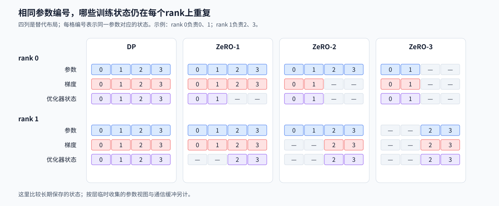
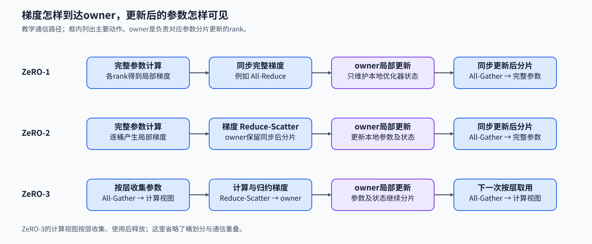

# 27. ZeRO Optimizer Sim | ZeRO 优化器模拟

**难度：** Hard | **环境：** CPU-first | **标签：** `并行通信`, `ZeRO`, `参数切分` | **目标人群：** 并行通信学习者

> 🚀 **云端运行环境**
>
> 本章节的实战代码可以点击以下链接在免费 GPU 算力平台上直接运行：
>
> [](https://colab.research.google.com/github/datawhalechina/llm-algo-leetcode/blob/main/02_PyTorch_Algorithms/27_ZeRO_Optimizer_Sim.ipynb)
> [](https://modelscope.cn/my/mynotebook) *(国内推荐：魔搭社区免费实例)*


---

## 本节导读

数据并行能把 batch 分到多张卡上计算，但它有一个明显浪费：每张卡都保存完整参数、完整梯度和完整优化器状态。模型一大，真正压垮显存的往往不是前向本身，而是这些训练状态在每张卡上的重复存储。

ZeRO 将重复训练状态分给不同 GPU 维护，并按阶段逐步切分优化器状态、梯度和参数。它可以与 Pipeline、Tensor 或 Expert Parallelism 组合使用。本节先用同一组参数编号比较 Data Parallel、ZeRO-1、ZeRO-2 与 ZeRO-3 的状态归属，再沿一次 ZeRO-1 更新追踪局部状态如何参与参数更新。完成后，你应能解释每个阶段省下了什么，以及额外需要什么通信。

**关键词：** `ZeRO`, `optimizer state`, `gradient synchronization`

---

<a id="runtime-environment"></a>

## 运行环境

- **基础练习：** 使用 [`BASE-CPU`](../guide.md#base-cpu)，运行 [Step 4 的题目与测试](#mechanism-practice)。
- **多 GPU 实测：** 使用 `PAR-CUDA-MECHANISM`；环境、运行配置与固定工作负载见 [Step 5](#gpu-experiment)。

---
## 前置阅读

**导语：** 进入本节前，先能区分参数、梯度和优化器状态，并能从显存账本中看出它们为什么会在每张 GPU 上重复保存。

- [P0: 11. PyTorch Optimizers and Loss | PyTorch 优化器与损失函数](../00_Prerequisites/11_PyTorch_Optimizers_and_Loss.md)
- [P0: 18. Memory Accounting and Runtime Evidence | 显存账本与运行时证据](../00_Prerequisites/18_Memory_Profiling_and_Optimization.md)
- [P1: 20. NCCL and AllReduce Basics | NCCL 与 AllReduce 基础](../01_Hardware_Math_and_Systems/20_NCCL_and_AllReduce_Basics.md)


---
## Step 1：从重复训练状态理解 ZeRO 分阶段

Data Parallel 中，每张卡都保存完整参数、梯度和优化器状态；梯度同步后，每张卡仍重复维护同一份训练状态。ZeRO 把这些重复副本逐步改为分片：ZeRO-1 先切优化器状态，ZeRO-2 再切梯度，ZeRO-3 最后连参数也切分。

同一个参数在不同阶段的“谁保存、谁更新、何时临时聚合”会改变。下面的主图先给出状态从复制到分片的全景；Step 2 再沿一次更新解释这些状态如何流动。



## Step 2：沿一次更新追踪状态与通信

一次训练更新包含前向、反向、梯度同步和参数更新。三种 ZeRO 阶段的差异不在数学上的梯度公式，而在每一步中哪些张量保留副本、哪些张量由 owner rank 保存。

- **ZeRO-1**：每张卡仍可见完整参数和梯度；优化器状态只在 owner rank 保存并更新。
- **ZeRO-2**：梯度也只保留在 owner rank，通常通过 Reduce-Scatter 将同步后的梯度直接送到对应 owner。
- **ZeRO-3**：参数同样按 owner 切分；某一层参与计算前，才临时收集这一层需要的参数。

因此，切分越深入，单卡状态越少，但参数收集与释放越频繁；这也是 ZeRO-3 对链路和调度更敏感的原因。



## Step 3：用显存账本选择 ZeRO 阶段

下面用同一份 FP16 + Adam 账本比较四种状态布局。选择不只看“节省多少显存”：当参数本身放不下时才需要 ZeRO-3；若只是不想复制 Adam 状态，ZeRO-1 往往拥有更低的通信复杂度。

令 $\Phi$ 为参数量， $P$ 为数据并行进程数， $b_p,b_g,b_o$ 分别表示每参数的参数、梯度和优化器状态字节数。忽略激活与临时聚合缓冲区时：

$$
M_{\mathrm{DP}}\approx\Phi(b_p+b_g+b_o),
$$

$$
M_{\mathrm{Z1}}\approx\Phi\left(b_p+b_g+\frac{b_o}{P}\right),\quad
M_{\mathrm{Z2}}\approx\Phi\left(b_p+\frac{b_g+b_o}{P}\right),\quad
M_{\mathrm{Z3}}\approx\frac{\Phi(b_p+b_g+b_o)}P.
$$

对本节 FP16 参数、FP16 梯度和 FP32 主权重加 Adam 状态，可取 $b_p=2,b_g=2,b_o=12$。这些式子描述常驻状态下界；参数 All-Gather、梯度桶、激活和碎片必须在实测峰值中另计。

| 策略 | 分片对象 | 单卡状态（近似） | 主要通信 | 适用信号 |
|---|---|---:|---|---|
| Data Parallel | 无分片 | $16\Phi$ | All-Reduce 梯度 | 模型和训练状态都能放下 |
| ZeRO-1 | 优化器状态 | $2\Phi + 2\Phi + 12\Phi/P$ | 局部梯度分发与参数同步 | 优化器状态主导显存 |
| ZeRO-2 | 优化器状态 + 梯度 | $2\Phi + 14\Phi/P$ | 梯度 Reduce-Scatter | 梯度也成为压力 |
| ZeRO-3 | 优化器状态 + 梯度 + 参数 | $16\Phi/P$ | 按层 All-Gather，通信更频繁 | 参数本身已经放不下 |

<a id="mechanism-practice"></a>

## Step 4：CPU 实现——比较 ZeRO 分片布局与局部更新

本题先用参数编号建立 DP、ZeRO-1、ZeRO-2、ZeRO-3 的 owner 布局，再用两个逻辑 rank 观察 ZeRO-1 如何只保留局部优化器状态。骨架已提供参数、分片和梯度输入；你将补全状态归属、owner 初始化和局部更新。

测试区分别检查分片是否完整覆盖、优化器状态是否只属于 owner，以及同步后的局部梯度是否只更新对应参数。

| TODO / 函数 | 学习者完成的机制 | 必须满足的约束 | 测试证据 |
|:---|:---|:---|:---|
| TODO 1：建立阶段 owner<br>`build_zero_stage_layout` | 按 ZeRO 阶段确定参数、梯度和优化器状态归属 | 分片完整且不重叠，阶段每增加一级只多切一类状态 | 检查各阶段三类 owner 的长度与覆盖范围 |
| TODO 2：分配参数 owner<br>`ZeRO1_Optimizer_Sim.__init__` | 让每个逻辑进程负责连续参数分片 | 每个参数恰好属于一个进程 | 检查参数覆盖与重复归属 |
| TODO 3：初始化局部状态<br>`ZeRO1_Optimizer_Sim.__init__` | 只为 owner 参数建立优化器状态 | 不为远端参数复制状态 | 检查每个进程的状态字典大小 |
| TODO 4：执行局部更新<br>`ZeRO1_Optimizer_Sim.step` | 用同步后的局部梯度更新 owner 参数 | 梯度数量与本地参数一致，不更新非 owner 参数 | 检查更新幅度、状态值与数量边界 |


```python
import torch
import torch.nn as nn
```


```python
class SimpleModel(nn.Module):
    def __init__(self, dim):
        super().__init__()
        # 为了演示切分，我们用一个包含偶数个参数的线性层
        self.fc1 = nn.Linear(dim, dim, bias=False)
        self.fc2 = nn.Linear(dim, dim, bias=False)

    def forward(self, x):
        return self.fc2(torch.relu(self.fc1(x)))

def build_zero_stage_layout(num_params, num_ranks, stage):
    """
    返回不同 ZeRO 阶段中参数、梯度和优化器状态的逻辑 owner。

    stage 可取 'dp'、'zero1'、'zero2' 或 'zero3'。每个 owner 列表保存
    参数编号；它描述状态归属，不模拟真实 GPU 张量或 collective。
    """
    if num_params <= 0 or num_ranks <= 0 or num_params % num_ranks != 0:
        raise ValueError('参数数量与 rank 数必须为正，且参数数量能被 rank 数整除')
    if stage not in {'dp', 'zero1', 'zero2', 'zero3'}:
        raise ValueError('stage 必须是 dp、zero1、zero2 或 zero3')

    param_ids = list(range(num_params))
    replicated = {rank: param_ids[:] for rank in range(num_ranks)}
    shard_size = num_params // num_ranks
    sharded = {
        rank: param_ids[rank * shard_size:(rank + 1) * shard_size]
        for rank in range(num_ranks)
    }

    # ==========================================
    # TODO 1（阶段状态归属）：决定三类状态在当前 ZeRO 阶段复制还是分片。
    # parameter_owner = ???  # 当前阶段的参数 owner 布局。
    # gradient_owner = ???  # 当前阶段的梯度 owner 布局。
    # optimizer_owner = ???  # 当前阶段的优化器状态 owner 布局。
    # ==========================================
    raise NotImplementedError
    return {
        'parameters': parameter_owner,
        'gradients': gradient_owner,
        'optimizer_states': optimizer_owner,
    }

class ZeRO1_Optimizer_Sim:
    """
    模拟多个逻辑 rank 上的 ZeRO-1 优化器状态分片。

    每个参数对象只归属于一个 rank；本类接收的局部梯度已经完成同步。
    """
    def __init__(self, model_params, lr=0.1, num_gpus=2):
        self.lr = lr
        self.num_gpus = num_gpus

        # 保留参数对象引用；这个 CPU 模拟不复制真实 GPU 张量。
        self.params = list(model_params)

        if self.num_gpus <= 0 or len(self.params) % self.num_gpus != 0:
            raise ValueError('num_gpus 必须为正，且参数对象数量必须能被它整除')
        params_per_rank = len(self.params) // self.num_gpus

        # ==========================================
        self.gpu_partitions = {}
        for rank in range(self.num_gpus):
            # ==========================================
            # TODO 2（参数 owner）：取出当前 rank 连续负责的参数切片。
            # local_params = ???  # 长度为 params_per_rank，且各 rank 之间不重叠。
            # ==========================================
            raise NotImplementedError
            self.gpu_partitions[rank] = local_params

        # ==========================================
        self.optimizer_states = {}
        for rank, local_params in self.gpu_partitions.items():
            # ==========================================
            # TODO 3（局部状态）：只为当前 rank 的 owner 参数创建零状态。
            # local_states = ???  # 键为参数对象 id，值与对应参数形状一致。
            # ==========================================
            raise NotImplementedError
            self.optimizer_states[rank] = local_states


    def step(self, gradients_from_all_gpus: dict):
        """
        local_gradients_by_rank 是同步后的局部梯度。
        结构：{rank: [该 rank 负责参数的梯度]}。
        """
        # ==========================================
        for rank in range(self.num_gpus):
            params = self.gpu_partitions[rank]
            grads = gradients_from_all_gpus[rank]
            states = self.optimizer_states[rank]
            if len(params) != len(grads):
                raise ValueError('局部梯度数量必须与该 rank 的参数数量一致')
            for param, grad in zip(params, grads):
                state = states[id(param)]
                # ==========================================
                # TODO 4（局部更新）：更新 owner 状态与对应参数。
                # updated_state = ???  # 合并当前状态与同步后的局部梯度。
                # updated_parameter = ???  # 使用 lr 和新状态得到更新后参数。
                # ==========================================
                raise NotImplementedError
                states[id(param)] = updated_state
                param.data = updated_parameter

    def zero_grad(self):
        for p in self.params:
            if p.grad is not None:
                p.grad.zero_()

```


```python
# 测试你的实现
def test_zero_stage_state_ownership():
    """不同 ZeRO 阶段只切分规定的训练状态。"""
    dp = build_zero_stage_layout(num_params=8, num_ranks=2, stage='dp')
    zero1 = build_zero_stage_layout(num_params=8, num_ranks=2, stage='zero1')
    zero2 = build_zero_stage_layout(num_params=8, num_ranks=2, stage='zero2')
    zero3 = build_zero_stage_layout(num_params=8, num_ranks=2, stage='zero3')

    assert all(len(items) == 8 for items in dp['optimizer_states'].values())
    assert all(len(items) == 8 for items in zero1['parameters'].values())
    assert all(len(items) == 8 for items in zero1['gradients'].values())
    assert all(len(items) == 4 for items in zero1['optimizer_states'].values())
    assert all(len(items) == 4 for items in zero2['gradients'].values())
    assert all(len(items) == 4 for items in zero3['parameters'].values())

def test_zero_stage_shards_cover_each_state_once():
    """被分片的状态必须完整覆盖，且任一编号不能重复归属。"""
    for stage, field in [('zero1', 'optimizer_states'), ('zero2', 'gradients'), ('zero3', 'parameters')]:
        layout = build_zero_stage_layout(num_params=8, num_ranks=2, stage=stage)
        owned = [item for items in layout[field].values() for item in items]
        assert sorted(owned) == list(range(8))
        assert len(owned) == len(set(owned))

def test_zero1_partition_state():
    """每个 rank 只持有自己负责参数的优化器状态。"""
    model = SimpleModel(dim=4)
    optimizer = ZeRO1_Optimizer_Sim(model.parameters(), num_gpus=2)
    assert all(len(states) == 1 for states in optimizer.optimizer_states.values())

def test_zero1_local_update_value():
    """局部梯度只改变所属 rank 的参数，并写回局部状态。"""
    model = SimpleModel(dim=4)
    optimizer = ZeRO1_Optimizer_Sim(model.parameters(), lr=0.1, num_gpus=2)
    before = [p.detach().clone() for p in model.parameters()]
    grads = {0: [torch.ones_like(model.fc1.weight)], 1: [torch.ones_like(model.fc2.weight)]}
    optimizer.step(grads)
    deltas = [old - new for old, new in zip(before, model.parameters())]
    assert all(torch.allclose(delta, torch.full_like(delta, 0.1)) for delta in deltas)
    assert all(torch.allclose(state, torch.ones_like(state)) for states in optimizer.optimizer_states.values() for state in states.values())

def test_zero1_parameter_visibility():
    """参数分片必须完整覆盖，且任一参数不能同时属于两个 rank。"""
    model = SimpleModel(dim=4)
    optimizer = ZeRO1_Optimizer_Sim(model.parameters(), num_gpus=2)
    owned = [id(param) for params in optimizer.gpu_partitions.values() for param in params]
    assert len(owned) == len(set(owned)) == len(list(model.parameters()))

def test_zero1_gradient_count_contract():
    """局部梯度数量必须与当前 rank 的 owner 参数数量一致。"""
    model = SimpleModel(dim=4)
    optimizer = ZeRO1_Optimizer_Sim(model.parameters(), num_gpus=2)
    invalid_grads = {0: [], 1: [torch.ones_like(model.fc2.weight)]}
    try:
        optimizer.step(invalid_grads)
    except ValueError:
        pass
    else:
        raise AssertionError('梯度数量不匹配时应抛出 ValueError')

test_zero_stage_state_ownership()
test_zero_stage_shards_cover_each_state_once()
test_zero1_partition_state()
test_zero1_local_update_value()
test_zero1_parameter_visibility()
test_zero1_gradient_count_contract()

```

---

🛑 **STOP HERE** 🛑
<br><br><br><br><br><br><br><br><br><br>
> 请先尝试自己完成代码并跑通测试。<br>
> 如果你正在 Colab 中运行，并且遇到困难没有思路，可以向下滚动查看参考答案。
<br><br><br><br><br><br><br><br><br><br>

---
## 参考代码与解析

### 代码

```python
class SimpleModel(nn.Module):
    def __init__(self, dim):
        super().__init__()
        self.fc1 = nn.Linear(dim, dim, bias=False)
        self.fc2 = nn.Linear(dim, dim, bias=False)

    def forward(self, x):
        return self.fc2(torch.relu(self.fc1(x)))

def build_zero_stage_layout(num_params, num_ranks, stage):
    """返回 DP、ZeRO-1、ZeRO-2、ZeRO-3 的逻辑训练状态 owner。"""
    if num_params <= 0 or num_ranks <= 0 or num_params % num_ranks != 0:
        raise ValueError('参数数量与 rank 数必须为正，且参数数量能被 rank 数整除')
    if stage not in {'dp', 'zero1', 'zero2', 'zero3'}:
        raise ValueError('stage 必须是 dp、zero1、zero2 或 zero3')

    param_ids = list(range(num_params))
    replicated = {rank: param_ids[:] for rank in range(num_ranks)}
    shard_size = num_params // num_ranks
    sharded = {
        rank: param_ids[rank * shard_size:(rank + 1) * shard_size]
        for rank in range(num_ranks)
    }

    # TODO 1（阶段状态归属）：ZeRO 每增加一个阶段，就多切分一类训练状态。
    parameter_owner = sharded if stage == 'zero3' else replicated
    gradient_owner = sharded if stage in {'zero2', 'zero3'} else replicated
    optimizer_owner = sharded if stage in {'zero1', 'zero2', 'zero3'} else replicated
    return {
        'parameters': parameter_owner,
        'gradients': gradient_owner,
        'optimizer_states': optimizer_owner,
    }

class ZeRO1_Optimizer_Sim:
    """
    模拟多个逻辑 rank 上的 ZeRO-1 优化器状态分片。
    """
    def __init__(self, model_params, lr=0.1, num_gpus=2):
        self.lr = lr
        self.num_gpus = num_gpus

        # 保留参数对象引用；这个 CPU 模拟不复制真实 GPU 张量。
        self.params = list(model_params)

        if self.num_gpus <= 0 or len(self.params) % self.num_gpus != 0:
            raise ValueError('num_gpus 必须为正，且参数对象数量必须能被它整除')
        params_per_rank = len(self.params) // self.num_gpus

        self.gpu_partitions = {}
        for rank in range(self.num_gpus):
            start = rank * params_per_rank
            end = start + params_per_rank
            # TODO 2（参数 owner）：取出当前 rank 连续负责的参数切片。
            local_params = self.params[start:end]
            self.gpu_partitions[rank] = local_params

        self.optimizer_states = {}
        for rank, local_params in self.gpu_partitions.items():
            # TODO 3（局部状态）：只为 owner 参数初始化优化器状态。
            local_states = {id(param): torch.zeros_like(param.data) for param in local_params}
            self.optimizer_states[rank] = local_states

    def step(self, gradients_from_all_gpus: dict):
        """
        gradients_from_all_gpus 是同步后的局部梯度。
        """
        for rank in range(self.num_gpus):
            params = self.gpu_partitions[rank]
            grads = gradients_from_all_gpus[rank]
            states = self.optimizer_states[rank]
            if len(params) != len(grads):
                raise ValueError('局部梯度数量必须与该 rank 的参数数量一致')

            for param, grad in zip(params, grads):
                state = states[id(param)]
                # TODO 4（局部更新）：每个 rank 只更新自己负责的状态与参数。
                updated_state = state + grad  # 教学用累积状态，不等同于 Adam。
                updated_parameter = param.data - self.lr * updated_state
                states[id(param)] = updated_state
                param.data = updated_parameter

    def zero_grad(self):
        for p in self.params:
            if p.grad is not None:
                p.grad.zero_()

```

### 解析

**TODO 1：比较分阶段状态 owner**
- Data Parallel 不切分三类状态；ZeRO-1 只切优化器状态；ZeRO-2 再切梯度；ZeRO-3 再切参数。
- `replicated` 与 `sharded` 是逻辑所有权账本：它们不执行 collective，但能验证每个阶段实际减少了哪一类副本。

**TODO 2、TODO 3：建立 ZeRO-1 的参数 owner 与局部状态**
- `params_per_rank` 把参数对象均匀分给逻辑 rank；每个对象必须恰好出现一次。
- 每个 rank 只为自己负责的参数创建状态张量；参数对象的 id 只用于把状态映射回参数对象。

**TODO 4：局部状态更新**
- `gradients_from_all_gpus` 被视为同步后交给每个 rank 的局部梯度。
- 每个 rank 更新自己的参数和教学用累积状态；共享 Python 引用只让测试读取完整参数。

<a id="framework-check"></a>

## 框架一致性核对（可选）

下面在两个本地 Gloo 进程中运行 PyTorch `ZeroRedundancyOptimizer`，核对优化器状态的 owner 分片与更新后的参数一致性。该核对不测量 GPU 峰值、NCCL 通信或训练吞吐。

| 核对项 | 对比内容 | 通过条件 |
|:---|:---|:---|
| 状态归属 | 本节 ZeRO-1 owner 与 PyTorch 本地优化器分片 | 所有参数只进入一个本地分片 |
| 参数更新 | 两个进程更新后的模型参数 | 所有进程保持一致 |
| 优化器状态 | SGD momentum 本地状态 | 只为本地 owner 参数创建状态 |

```python
import torch.distributed as dist
from torch.distributed.optim import ZeroRedundancyOptimizer

from tools.parallel_cpu_conformance import run_local_gloo_world


def _zero_framework_worker(rank, world_size):
    torch.manual_seed(42)
    model = nn.Sequential(
        nn.Linear(4, 4, bias=False),
        nn.Linear(4, 2, bias=False),
    )
    optimizer = ZeroRedundancyOptimizer(
        model.parameters(), optimizer_class=torch.optim.SGD,
        lr=0.05, momentum=0.9,
    )
    inputs = torch.arange(8, dtype=torch.float32).reshape(2, 4) / 8.0
    loss = model(inputs).square().mean()
    loss.backward()
    optimizer.step()
    flat = torch.cat([parameter.detach().reshape(-1) for parameter in model.parameters()])
    gathered = [torch.empty_like(flat) for _ in range(world_size)]
    dist.all_gather(gathered, flat)
    local_parameters = optimizer.optim.param_groups[0]["params"]
    return {
        "rank": rank,
        "local_parameter_tensors": len(local_parameters),
        "local_state_tensors": len(optimizer.optim.state),
        "total_parameter_tensors": len(list(model.parameters())),
        "parameters": flat.tolist(),
        "all_parameters": [item.tolist() for item in gathered],
    }


def check_zero_framework_conformance():
    """核对本节 ZeRO-1 owner 语义与 PyTorch ZeroRedundancyOptimizer。"""
    results = run_local_gloo_world(_zero_framework_worker, world_size=2)
    layout = build_zero_stage_layout(num_params=2, num_ranks=2, stage="zero1")
    checks = {
        "local_shards_cover_parameters": sum(item["local_parameter_tensors"] for item in results) == 2,
        "local_states_match_shards": all(
            item["local_state_tensors"] == item["local_parameter_tensors"] for item in results
        ),
        "parameters_consistent": all(
            item["all_parameters"][0] == item["all_parameters"][1] for item in results
        ),
        "teaching_owner_cover": sorted(
            parameter for shard in layout["optimizer_states"].values() for parameter in shard
        ) == [0, 1],
    }
    failed = [name for name, passed in checks.items() if not passed]
    if failed:
        raise AssertionError(f"框架一致性核对失败：{failed}")
    return {
        "status": "passed", "versions": {"torch": torch.__version__},
        "checks": checks, "world_size": 2, "rank_results": results,
    }


framework_check = check_zero_framework_conformance()
framework_check
```

<a id="gpu-experiment"></a>

### Step 5（可选）：GPU ZeRO 分片复测

先用 CPU 实验理解训练状态如何分片，再在同一 workload 下观察不同 ZeRO 阶段的实际显存与时间代价。

| 学习问题 | CPU 已确认 | GPU 要确认与后续使用 |
| --- | --- | --- |
| ZeRO 各阶段如何减少训练状态副本 | 参数、梯度、优化器状态的 owner、分片覆盖和局部更新 | 记录 DDP 与 ZeRO 各阶段的峰值显存和最慢 rank step time，用于固定 workload 下的策略判断 |

#### 5.1 环境与固定 workload

安装与双卡预检见通信专题 Quickstart。以下配置使 DDP 与各 ZeRO 阶段使用同一训练口径。

| 类别 | 固定并记录的字段 | 用途 |
| --- | --- | --- |
| 运行环境 | GPU 数、DeepSpeed、PyTorch / CUDA、NCCL | 确认多卡分片路径可运行 |
| workload | 合成模型、dtype、global / micro batch、序列长度、warmup、repeats | 保持各阶段输入一致 |
| 对照 | DDP baseline、ZeRO-1 / 2 / 3 | 只比较状态分片策略 |
| 输出 | `RESULT_DIR`、每 stage 的 JSON、默认关闭开关 | 保留复测与 failure |

```python
RUN_MODE = 'dry_run'  # 默认 dry_run；双卡 Profile 预检通过后改为 real_gpu。
RUN_LABEL = 'default'  # 默认 default；正式复测改为唯一标签并保留历史 JSON。
ENVIRONMENT_PROFILE = 'PAR-CUDA-MECHANISM'  # DeepSpeed 与 NCCL 使用的独立多卡环境。
WORLD_SIZE = 2  # DDP 与 ZeRO 候选使用相同 rank 数。
MODEL_KIND = 'synthetic_transformer_mlp'  # 固定 Transformer-shaped 合成模型，隔离状态分片变量。
MODEL_WIDTH = 1024  # 隐藏维度；增大会同时提高状态和计算成本。
MODEL_LAYERS = 4  # 层数；所有候选保持一致。
DTYPE = 'bf16'  # 参数与计算数据类型。
GLOBAL_BATCH_SIZE = 4  # 所有 rank 合计的有效 batch。
MICRO_BATCH_SIZE = 1  # 每 rank 单次前向 batch。
SEQ_LEN = 512  # 每个样本的 Token 长度。
WARMUP = 2  # 预热步数，不进入统计。
REPEATS = 5  # 正式训练步数，用于比较峰值和最慢 rank 时间。
from tools.project_runtime import resolve_project_root
PROJECT_ROOT = resolve_project_root()
RESULT_DIR = PROJECT_ROOT / f'benchmarks/results/27_zero/{RUN_LABEL}'  # 运行标签隔离历史结果。
STRATEGIES = ['ddp', 'zero1', 'zero2', 'zero3']
print({'run_mode': RUN_MODE, 'profile': ENVIRONMENT_PROFILE, 'strategies': STRATEGIES, 'world_size': WORLD_SIZE, 'model': MODEL_KIND, 'dtype': DTYPE, 'result_dir': RESULT_DIR})

```

#### 5.2 执行并保存 JSON

使用 DeepSpeed 在同一个合成 Transformer-shaped workload 上分别运行 DDP、ZeRO-1、ZeRO-2 与 ZeRO-3，并为每种策略保存一份 JSON。结果将把状态分片带来的每 rank 显存、最慢 rank 时间和运行状态放在同一份证据中。

```python
# 5.2：依次运行真实 DeepSpeed stage；默认关闭。
if RUN_MODE == 'real_gpu':
    import subprocess
    from pathlib import Path
    Path(RESULT_DIR).mkdir(parents=True, exist_ok=True)
    for strategy in STRATEGIES:
        output = str(Path(RESULT_DIR) / f'{strategy}.json')
        command = [
            'torchrun', '--standalone', '--nproc_per_node', str(WORLD_SIZE),
            'tools/run_zero_stage_benchmark.py', '--strategy', strategy, '--output', output,
            '--width', str(MODEL_WIDTH), '--layers', str(MODEL_LAYERS),
            '--micro-batch', str(MICRO_BATCH_SIZE), '--seq-len', str(SEQ_LEN),
            '--warmup', str(WARMUP), '--repeats', str(REPEATS), '--dtype', DTYPE,
        ]
        subprocess.run(command, check=False)  # stage failure 会写入各自 JSON。
else:
    print('dry_run：完成配置检查后，将 RUN_MODE 改为 real_gpu 再执行 5.2。')

```

#### 5.3 读取结果

读取四个 stage 的真实 JSON，检查 workload、hardware、metrics、evidence_level、failure 和 decision 是否齐全。字段解释和策略选择集中放在 5.4。

```python
# 5.3：汇总各 stage 的真实结果；没有 JSON 时不输出性能结论。
import json
from pathlib import Path
results = {}
required = {'strategy', 'workload', 'hardware', 'metrics', 'evidence_level', 'failure', 'decision'}
for strategy in STRATEGIES:
    path = Path(RESULT_DIR) / f'{strategy}.json'
    if not path.exists():
        continue
    result = json.loads(path.read_text())
    missing = required - set(result)
    if missing:
        raise ValueError(f'{strategy} 结果 JSON 缺少字段：{sorted(missing)}')
    results[strategy] = result
print(results if results else f'尚无真实 ZeRO 结果：{RESULT_DIR}')

```

#### 5.4 解释证据并形成决策

ZeRO 阶段越高，常驻状态通常越少，但参数收集、梯度归约和临时 buffer 可能增加。先排除失败和不可比结果，再同时检查显存收益与最慢 rank step time；不能只按理论状态除法选择阶段。

| 观察项 | 读取字段 | 当前结果 | 解释与动作 |
| --- | --- | --- | --- |
| 运行与可比性 | `failure`、`workload`、`hardware` | 运行后填写 | 不可比时重新运行，不比较指标 |
| 状态与峰值 | 每 rank 状态字节、峰值显存 | 运行后填写 | 确认分片是否转化为实际容量收益 |
| 时间代价 | 最慢 rank step time、吞吐代理 | 运行后填写 | 判断通信与临时聚合是否吞掉收益 |
| 策略结论 | `evidence_level`、`decision` | 运行后填写 | 在满足容量目标的候选中选择时间代价最低者 |
## 相关阅读

ZeRO 的核心是训练状态分片；读完本节后，可以再用论文、DeepSpeed 实现和并行策略页面核对通信与显存取舍。

- [ZeRO 原论文：Memory Optimizations Toward Training Trillion Parameter Models](https://arxiv.org/abs/1910.02054)
- [DeepSpeed ZeRO 官方文档](https://www.deepspeed.ai/tutorials/zero/)
- [28. Pipeline 并行微批次](../02_PyTorch_Algorithms/28_Pipeline_Parallelism_MicroBatch.md)
- [29. Tensor 并行模拟](../02_PyTorch_Algorithms/29_Tensor_Parallelism_Sim.md)
- [P1: 并行策略决策框架](../01_Hardware_Math_and_Systems/26_Parallel_Strategy_Decision_Framework.md)
