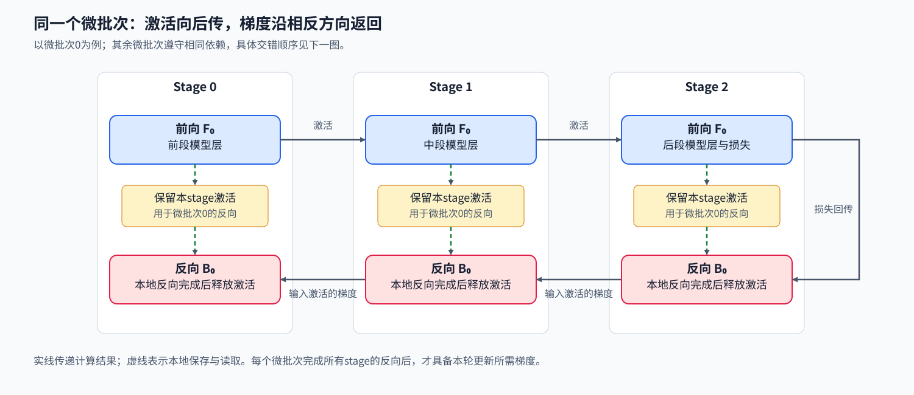
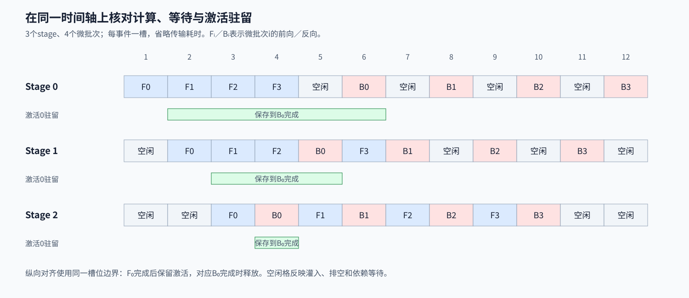

# 28. Pipeline Parallelism MicroBatch | Pipeline 并行微批次

**难度：** Hard | **环境：** CPU-first | **标签：** `并行通信`, `Pipeline Parallelism`, `MicroBatch` | **目标人群：** 并行通信学习者

> 🚀 **云端运行环境**
>
> 本章节的实战代码可以点击以下链接在免费 GPU 算力平台上直接运行：
>
> [](https://colab.research.google.com/github/datawhalechina/llm-algo-leetcode/blob/main/02_PyTorch_Algorithms/28_Pipeline_Parallelism_MicroBatch.ipynb)
> [](https://modelscope.cn/my/mynotebook) *(国内推荐：魔搭社区免费实例)*


---

## 本节导读

当完整模型无法放入一张 GPU 时，可以把连续的模型层分配给多个 stage，让不同设备分别承担不同片段的计算。真正的难点在于：如果每个 batch 都要从第一个 stage 依次走到最后一个 stage，stage 之间会频繁等待，设备利用率就会被流水线气泡拉低。

本节从一个可画清楚的灌入—排空时间轴开始，观察 micro-batch 如何让多个 stage 交错工作；训练路径继续比较 fill-drain 与 1F1B 的前反向依赖，推理路径则观察前向请求如何跨 stage 传递以及为什么仍会出现 bubble。学习完后，你应能解释为什么 micro-batch 不是越多越好，以及为什么 stage 切分、负载均衡和通信路径必须一起考虑。

**关键词：** `Pipeline Parallelism`, `Micro-batch`, `stage`, `bubble ratio`, `负载均衡`

---

<a id="runtime-environment"></a>

## 运行环境

- **基础练习：** 使用 [`BASE-CPU`](../guide.md#base-cpu)，运行 [Step 4 的题目与测试](#mechanism-practice)。
- **框架核对：** 使用 [`PAR-CPU`](../topic_discussion/communication_parallelism/quickstart.md#par-cpu-quickstart)；完成 Step 4 后运行 [框架一致性核对](#framework-check)。
- **多 GPU 实测：** 使用 `PAR-CUDA-MECHANISM`；环境、运行配置与固定工作负载见 [Step 5](#gpu-experiment)。

---
## 前置阅读

**导语：** 进入本节前，先能根据模型层和设备之间的连接关系选择并行方式，再观察 micro-batch 如何让不同 stage 交错执行。
- [P1: 26. Parallel Strategy Decision Framework | 并行策略决策框架](../01_Hardware_Math_and_Systems/26_Parallel_Strategy_Decision_Framework.md)
- [P1: 05. Communication Topologies | 通信拓扑与分布式基石](../01_Hardware_Math_and_Systems/05_Communication_Topologies.md)

---
## Step 1：理解 stage、micro-batch 与跨阶段依赖

Pipeline 并行先把模型层划分为多个 stage，再把一个大 batch 切成 $m$ 个 micro-batch。一个 micro-batch 的前向必须按 `stage 0 → stage 1 → …` 推进；反向则沿相反方向返回。当前 stage 把前向结果交给下游后，才有机会接收下一个 micro-batch 或处理已经返回的反向。

观察时间轴时，可以把每个格子读成“某个 stage 在某个时间步处理哪个 micro-batch 的前向或反向”。开始时，后面的 stage 尚未收到数据；结束时，前面的 stage 已经没有新的工作。没有被计算占用的区域就是流水线气泡。

前向通过后留下的 activation 要等对应 micro-batch 的反向完成才能释放，因此调度不仅决定空闲槽位，也决定每个 stage 同时保留多少 activation。

推理 Pipeline 使用相同的层切分和 stage 边界，但没有训练反向。它可以把一个请求批次拆成推理 micro-batch，也可以让多个请求连续流过 stage；每个边界仍要传递 activation，慢 stage、短批次和请求间空档仍会产生 bubble。这里的推理 micro-batch 是 Pipeline 执行单元，不等同于梯度累积中的 micro-batch。

| 场景 | stage 间传递 | 主要依赖 | 主要代价 |
|---|---|---|---|
| 训练 Pipeline | activation 与反向梯度 | 前向后才能反向，更新前需完成本轮依赖 | bubble、activation 驻留、梯度通信 |
| 推理 Pipeline | activation、token 状态或请求批次 | 上游 stage 完成后下游才能继续 | bubble、stage 间传输、单请求延迟 |



## Step 2：比较训练调度与推理流水线

**fill-drain（GPipe 风格）**先完成所有 micro-batch 的前向，再统一开始反向；实现直观，但早期 stage 会同时保留较多 activation。**1F1B** 在满足依赖后优先安排反向，使前向和反向交错，从而更早释放 activation。两者都要经历灌入和排空，差异主要体现在 activation 生命周期与时间线的交错方式。

对于均衡 stage 的简化前向时间线，令 $S$ 为 stage 数、 $m$ 为 micro-batch 数。总槽位为 $S(m+S-1)$，有效计算槽位为 $Sm$，所以理想气泡比例为

$$
\rho_{\mathrm{bubble}}=
\frac{S(m+S-1)-Sm}{S(m+S-1)}
=\frac{S-1}{m+S-1}.
$$

当 $m\gg S$ 时， $\rho_{\mathrm{bubble}}\approx(S-1)/m$。若第 $s$ 个 stage 的单个 micro-batch 时间为 $t_s$，稳态时钟仍满足 $T_{\mathrm{clock}}\ge\max_s t_s$；因此该比例只解释均衡时间轴的灌入—排空，不替代完整 step time。

对于前向-only 推理，同一公式仍可描述一批 micro-batch 的灌入与排空；但在线服务还要区分单请求延迟和跨请求吞吐。持续到达的请求可以摊薄部分排空气泡，却会引入排队、动态 batch 和 stage 间 handoff。请求选择属于 Serving 调度，本节只分析既定请求进入 Pipeline 后的 stage 执行。



## Step 3：在 bubble、activation 与负载均衡间取舍

理想 bubble ratio 只描述均衡时间轴上的空槽位。实际选择 schedule 时，还要同时看 activation 留存、每个 stage 的计算时间和边界通信：较小的 bubble 并不自动等于更高的端到端吞吐。

| 变化 | bubble 与设备利用率 | 显存与调度代价 | 下一步判断 |
|---|---|---|---|
| 增加 micro-batch | 灌入、排空占比通常下降 | 更多 activation 片段与调度事件 | 先检查单卡显存与 activation 生命周期 |
| fill-drain 改为 1F1B | 空槽位不一定显著减少 | activation 更早被反向释放 | 检查峰值 activation 与反向依赖 |
| 增加 stage 数 | 单卡层数下降，但灌入更慢 | stage 边界通信和气泡可能上升 | 检查层切分是否均衡 |
| stage 耗时不均 | 快 stage 等待慢 stage | 吞吐受最慢 stage 限制 | 重新切分层或调整 micro-batch |
| 通信落在关键路径 | 理想公式低估真实等待 | step time 上升 | 分开记录计算、通信和等待时间 |
| 推理请求持续进入 | 可摊薄部分排空气泡 | 排队、动态 batch 与状态 handoff 增加 | 同时观察单请求延迟和跨请求吞吐 |

<a id="mechanism-practice"></a>

## Step 4：CPU 实现——验证前反向依赖与调度取舍

本题先构造简化前向时间轴，再把每个 `(stage, micro-batch)` 的前向和反向依赖排进 `fill_drain` 或简化 `1f1b` 时间线。骨架已提供依赖集合和事件容器；你将补全时间轴、事件选择和 activation 生命周期统计。

测试区分别检查时间轴覆盖、bubble 的槽位关系、前反向依赖，以及两种策略的 activation 驻留差异。

| TODO / 函数 | 学习者完成的机制 | 必须满足的约束 | 测试证据 |
|:---|:---|:---|:---|
| TODO 1：构造灌入—排空时间线<br>`build_pipeline_timeline` | 让 micro-batch 逐 stage 推进 | 每个 `(stage, micro_batch)` 恰好出现一次 | 检查时间轴长度、坐标范围与覆盖次数 |
| TODO 2：计算理想气泡<br>`compute_bubble_ratio` | 用活跃槽位与总槽位计算空闲比例 | 结果在 0–1 内，增加 micro-batch 不放大理想气泡 | 检查槽位守恒与 micro-batch 对照 |
| TODO 3：选择前反向事件<br>`select_pipeline_event` | 按 fill-drain 或 1F1B 优先级选择事件 | 每 stage 每步最多一个事件，依赖全部满足 | 检查前反向依赖、事件唯一性与策略差异 |
| TODO 4：统计激活生命周期<br>`summarize_pipeline_schedule` | 从前向完成到对应反向完成跟踪激活 | 释放时机与反向完成一致 | 比较 fill-drain 与 1F1B 的峰值激活 |


```python
import torch
```


```python

def build_pipeline_timeline(p: int, m: int) -> list[list[tuple[int, int]]]:
    """
    构造一个简化的流水线时间轴，并保留 stage/micro-batch 的占用契约。

    `timeline[t]` 记录第 t 个时间步里活跃的 `(stage, micro_batch)`。
    每个 micro-batch 应恰好经过全部 `p` 个 stage，总活跃槽位为 `p * m`。

    Args:
        p: Pipeline stage 数量，必须为正整数。
        m: Micro-batch 数量，必须为正整数。
    """
    p, m = int(p), int(m)
    if p <= 0 or m <= 0:
        raise ValueError('p 和 m 必须为正整数')
    total_steps = p + m - 1
    timeline = []
    # ==========================================
    # TODO 1（前向推进）：确定当前 stage 在时间步 t 对应的 micro-batch。
    # micro_idx = ???  # 当前 stage 候选处理的 micro-batch 编号。
    # is_active = ???  # 候选编号是否落在有效 micro-batch 范围内。
    # ==========================================
    for t in range(total_steps):
        active = []
        for stage in range(p):
            raise NotImplementedError
            if is_active:
                active.append((stage, micro_idx))
        timeline.append(active)
    return timeline


def compute_bubble_ratio(p: int, m: int) -> float:
    """
    根据时间轴计算流水线并行的气泡率。

    先用时间轴统计实际活跃槽位，再用所有 stage 在所有时间步都满载时
    的槽位数作为分母，避免把 bubble ratio 写成只依赖 `p`、`m` 的孤立公式。

    Args:
        p: Pipeline Stage 数量 (GPU 数量)
        m: Micro-batch 的数量

    Returns:
        float: 气泡占比 [0, 1]
    """
    # 输入契约由 build_pipeline_timeline 统一检查。
    # ==========================================
    # TODO 2（气泡率）：比较已占用槽位与时间轴的全部可用槽位。
    # active_slots = ???  # 时间轴中实际执行计算的 stage 槽位数。
    # total_slots = ???  # 全部 stage 在所有时间步可提供的槽位数。
    # bubble_ratio = ???  # 未被计算占用的槽位比例。
    # ==========================================
    timeline = build_pipeline_timeline(p, m)
    raise NotImplementedError
    return bubble_ratio


def select_pipeline_event(policy, forward_remaining, ready_forward, ready_backward):
    """从当前 stage 已就绪的事件中选择至多一个事件。"""
    # ==========================================
    # TODO 3（事件优先级）：按调度策略选择当前 stage 的下一项工作。
    # ==========================================
    if policy == 'fill_drain':
        # candidates = ???  # 根据前向阶段是否结束选择一种已就绪事件。
        raise NotImplementedError
    else:
        # candidates = ???  # 优先释放 activation，同时保留前向回退。
        raise NotImplementedError
    # selected_event = ???  # 第一个候选事件；没有候选时为 None。
    raise NotImplementedError
    return selected_event


def build_training_schedule(p: int, m: int, policy: str) -> list[list[tuple[str, int, int]]]:
    """
    构造包含前向 ``'F'`` 与反向 ``'B'`` 事件的简化流水线时间线。

    ``fill_drain`` 在所有前向完成后才开始反向；``1f1b`` 在反向事件就绪时
    优先执行反向。每个 stage 在同一时间步最多执行一个事件。
    """
    if policy not in {'fill_drain', '1f1b'}:
        raise ValueError('policy 必须是 fill_drain 或 1f1b')
    build_pipeline_timeline(p, m)  # 统一验证 p/m 输入契约。
    all_forward = {('F', stage, micro) for stage in range(p) for micro in range(m)}
    all_backward = {('B', stage, micro) for stage in range(p) for micro in range(m)}
    completed, timeline = set(), []

    while len(completed) < len(all_forward) + len(all_backward):
        step_events = []
        forward_remaining = bool(all_forward - completed)
        for stage in range(p):
            ready_forward = [
                ('F', stage, micro) for micro in range(m)
                if ('F', stage, micro) not in completed
                and (stage == 0 or ('F', stage - 1, micro) in completed)
            ]
            ready_backward = [
                ('B', stage, micro) for micro in range(m)
                if ('B', stage, micro) not in completed
                and ('F', stage, micro) in completed
                and (stage == p - 1 or ('B', stage + 1, micro) in completed)
            ]
            selected_event = select_pipeline_event(
                policy, forward_remaining, ready_forward, ready_backward
            )
            if selected_event is not None:
                step_events.append(selected_event)
        if not step_events:
            raise RuntimeError('调度没有可执行事件，前反向依赖可能错误')
        completed.update(step_events)
        timeline.append(step_events)
    return timeline


def summarize_pipeline_schedule(p: int, m: int, policy: str) -> dict:
    """统计策略时间线中的 bubble 与每个 stage 的峰值 activation 驻留。"""
    timeline = build_training_schedule(p, m, policy)
    completed_forward = set()
    completed_backward = set()
    peak_live_activations = [0 for _ in range(p)]
    active_slots = 0

    # ==========================================
    # TODO 4（activation 生命周期）：统计前向已产生但反向尚未释放的状态。
    # ==========================================
    for step_events in timeline:
        # active_slots = ???  # 加上当前时间步实际执行的事件数。
        raise NotImplementedError
        for direction, stage, micro in step_events:
            # completed_events = ???  # 按事件方向选择对应的完成集合。
            raise NotImplementedError
            completed_events.add((stage, micro))
        for stage in range(p):
            # live_count = ???  # 已完成前向但尚未完成反向的 micro-batch 数。
            raise NotImplementedError
            peak_live_activations[stage] = max(peak_live_activations[stage], live_count)

    total_slots = len(timeline) * p
    return {
        'policy': policy,
        'time_steps': len(timeline),
        'bubble_ratio': 1 - active_slots / total_slots,
        'peak_live_activations': peak_live_activations,
    }


```


```python
def test_pipeline_bubble():
    """验证时间轴活跃槽位与 bubble ratio 的数量关系。"""
    try:
        # 用固定 p/m 检查实现是否符合时间轴推导出的精确公式。
        ratio = compute_bubble_ratio(p=8, m=32)
        expected = (8 - 1) / (32 + 8 - 1)
        assert abs(ratio - expected) < 1e-12, f"Bubble Ratio 应为 {expected}，实际为 {ratio}"

        print("✅ 时间轴与 bubble ratio 一致；增加 micro-batch 通常降低理想气泡，但还需检查激活与调度开销。")
    except NotImplementedError:
        print("请先完成 TODO 部分的代码！")
        raise
    except (AttributeError, NameError, TypeError, ValueError, AssertionError, RuntimeError) as e:
        if isinstance(e, AttributeError):
            print("代码未完成，无法找到必要的属性")
        elif isinstance(e, NameError):
            print("代码可能未完成，导致了变量未定义")
        elif isinstance(e, TypeError):
            print("代码可能未完成，导致了类型错误")
        elif isinstance(e, ValueError):
            print("代码可能未完成，导致了张量维度错误")
        elif isinstance(e, AssertionError):
            print("代码可能未完成，导致了断言失败")
        else:
            print("代码可能未完成，导致了运行时错误")
        raise NotImplementedError("请先完成 TODO 部分的代码！") from e
    except Exception as e:
        print(f"❌ 测试失败: {e}")
        raise

def test_pipeline_timeline_structure():
    """验证时间轴长度、坐标范围以及每个 stage/micro-batch 的覆盖次数。"""
    timeline = build_pipeline_timeline(p=3, m=5)
    assert len(timeline) == 7
    assert all(0 <= stage < 3 and 0 <= micro < 5 for step in timeline for stage, micro in step)
    pairs = [pair for step in timeline for pair in step]
    assert len(pairs) == len(set(pairs)) == 15
    assert all(sum(micro == i for stage, micro in pairs) == 3 for i in range(5))
    assert all(sum(stage == i for stage, micro in pairs) == 5 for i in range(3))

def test_pipeline_active_slots():
    """验证活跃槽位总量等于 micro-batch 与 stage 的笛卡尔积。"""
    timeline = build_pipeline_timeline(p=3, m=5)
    assert sum(len(step) for step in timeline) == 15

def test_pipeline_progression_order():
    """验证每个 micro-batch 按 stage 顺序前进，每次只跨过一个 stage。"""
    timeline = build_pipeline_timeline(p=4, m=3)
    positions = {}
    for t, step in enumerate(timeline):
        for stage, micro in step:
            assert (stage, micro) not in positions
            assert t == stage + micro
            positions[(stage, micro)] = t
    for micro in range(3):
        assert [positions[(stage, micro)] for stage in range(4)] == [micro + stage for stage in range(4)]

def test_pipeline_bubble_boundary():
    """验证增加 micro-batch 不会放大理想流水线的 bubble ratio。"""
    assert compute_bubble_ratio(3, 8) <= compute_bubble_ratio(3, 4)

def test_pipeline_input_contract():
    """验证非法 stage 或 micro-batch 配置不会静默产生错误结果。"""
    for p, m in [(0, 4), (3, 0), (-1, 4)]:
        try:
            build_pipeline_timeline(p, m)
            raise AssertionError("非法配置应抛出 ValueError")
        except ValueError:
            pass
        try:
            compute_bubble_ratio(p, m)
            raise AssertionError("非法配置应抛出 ValueError")
        except ValueError:
            pass

def test_training_schedule_dependencies():
    """前反向事件必须唯一，且严格满足跨 stage 的依赖顺序。"""
    for policy in ['fill_drain', '1f1b']:
        timeline = build_training_schedule(p=3, m=4, policy=policy)
        positions = {event: t for t, step in enumerate(timeline) for event in step}
        assert len(positions) == 2 * 3 * 4
        for stage in range(3):
            for micro in range(4):
                assert positions[('F', stage, micro)] < positions[('B', stage, micro)]
                if stage > 0:
                    assert positions[('F', stage - 1, micro)] < positions[('F', stage, micro)]
                if stage < 2:
                    assert positions[('B', stage + 1, micro)] < positions[('B', stage, micro)]

def test_schedule_activation_tradeoff():
    """简化 1F1B 应不增加峰值 activation 驻留，并保留完整训练事件。"""
    fill_drain = summarize_pipeline_schedule(p=3, m=6, policy='fill_drain')
    one_f_one_b = summarize_pipeline_schedule(p=3, m=6, policy='1f1b')
    assert all(value > 0 for value in fill_drain['peak_live_activations'])
    assert max(one_f_one_b['peak_live_activations']) <= max(fill_drain['peak_live_activations'])

def run_pipeline_test():
    """统一执行结构、槽位、边界和输入契约测试。"""
    try:
        test_pipeline_timeline_structure()
        test_pipeline_active_slots()
        test_pipeline_progression_order()
        test_pipeline_bubble_boundary()
        test_pipeline_input_contract()
        test_training_schedule_dependencies()
        test_schedule_activation_tradeoff()
        test_pipeline_bubble()
    except NotImplementedError:
        print("请先完成 TODO 部分的代码！")
        raise
    except Exception as e:
        print(f"❌ Pipeline 机制测试失败: {e}")
        raise

run_pipeline_test()


```

---

🛑 **STOP HERE** 🛑
<br><br><br><br><br><br><br><br><br><br>
> 请先尝试自己完成代码并跑通测试。<br>
> 如果你正在 Colab 中运行，并且遇到困难没有思路，可以向下滚动查看参考答案。
<br><br><br><br><br><br><br><br><br><br>

---

## 参考代码与解析

### 代码

```python
def build_pipeline_timeline(p: int, m: int) -> list[list[tuple[int, int]]]:
    if p <= 0 or m <= 0:
        raise ValueError("p 和 m 必须为正数")
    # TODO 1: 构造 Pipeline 的时间轴
    timeline = []
    total_steps = p + m - 1
    for t in range(total_steps):
        active = []
        for stage in range(p):
            micro_idx = t - stage
            is_active = 0 <= micro_idx < m
            if is_active:
                active.append((stage, micro_idx))
        timeline.append(active)
    return timeline


def compute_bubble_ratio(p: int, m: int) -> float:
    if p <= 0 or m <= 0:
        raise ValueError("p 和 m 必须为正数")
    # TODO 2: 基于时间轴统计活跃槽位并计算 Bubble Ratio
    timeline = build_pipeline_timeline(p, m)
    active_slots = sum(len(step) for step in timeline)
    total_slots = len(timeline) * p
    bubble_ratio = 1 - active_slots / total_slots
    return bubble_ratio


def select_pipeline_event(policy, forward_remaining, ready_forward, ready_backward):
    """按 fill-drain 或简化 1F1B 优先级选择一个已就绪事件。"""
    # TODO 3：fill-drain 分阶段执行；1F1B 优先释放已就绪的 activation。
    if policy == 'fill_drain':
        candidates = ready_forward if forward_remaining else ready_backward
    else:
        candidates = ready_backward or ready_forward
    selected_event = candidates[0] if candidates else None
    return selected_event


def build_training_schedule(p: int, m: int, policy: str) -> list[list[tuple[str, int, int]]]:
    """构造 fill-drain 或简化 1F1B 的前反向事件时间线。"""
    if policy not in {'fill_drain', '1f1b'}:
        raise ValueError('policy 必须是 fill_drain 或 1f1b')
    build_pipeline_timeline(p, m)
    all_forward = {('F', stage, micro) for stage in range(p) for micro in range(m)}
    all_backward = {('B', stage, micro) for stage in range(p) for micro in range(m)}
    completed, timeline = set(), []

    while len(completed) < len(all_forward) + len(all_backward):
        step_events = []
        forward_remaining = bool(all_forward - completed)
        for stage in range(p):
            ready_forward = [
                ('F', stage, micro) for micro in range(m)
                if ('F', stage, micro) not in completed
                and (stage == 0 or ('F', stage - 1, micro) in completed)
            ]
            ready_backward = [
                ('B', stage, micro) for micro in range(m)
                if ('B', stage, micro) not in completed
                and ('F', stage, micro) in completed
                and (stage == p - 1 or ('B', stage + 1, micro) in completed)
            ]
            selected_event = select_pipeline_event(
                policy, forward_remaining, ready_forward, ready_backward
            )
            if selected_event is not None:
                step_events.append(selected_event)
        if not step_events:
            raise RuntimeError('调度没有可执行事件，前反向依赖可能错误')
        completed.update(step_events)
        timeline.append(step_events)
    return timeline


def summarize_pipeline_schedule(p: int, m: int, policy: str) -> dict:
    """统计调度时间线中的 bubble 与峰值 activation 驻留。"""
    timeline = build_training_schedule(p, m, policy)
    completed_forward = set()
    completed_backward = set()
    peak_live_activations = [0 for _ in range(p)]
    active_slots = 0

    # TODO 4：前向创建 activation；对应反向完成后才释放。
    for step_events in timeline:
        active_slots += len(step_events)
        for direction, stage, micro in step_events:
            completed_events = completed_forward if direction == 'F' else completed_backward
            completed_events.add((stage, micro))
        for stage in range(p):
            live_count = sum(
                (stage, micro) in completed_forward and (stage, micro) not in completed_backward
                for micro in range(m)
            )
            peak_live_activations[stage] = max(peak_live_activations[stage], live_count)

    total_slots = len(timeline) * p
    return {
        'policy': policy,
        'time_steps': len(timeline),
        'bubble_ratio': 1 - active_slots / total_slots,
        'peak_live_activations': peak_live_activations,
    }


```

### 解析

**TODO 1：构造前向时间轴**
- 通过 `timeline[t]` 记录每个时间步里哪些 stage 正在处理哪些 micro-batch。
- `micro_idx = t - stage` 体现了灌入—排空阶段的对角线式前向占用关系。
- 只要 `0 <= micro_idx < m`，就说明该 stage 在这个时间步是活跃的。

**TODO 2：统计前向 Bubble Ratio**
- `active_slots` 统计时间轴里所有活跃的 stage/micro-batch 组合数。
- `total_slots = len(timeline) * p` 表示如果每个时间步都满载时的槽位总数。
- `bubble = 1 - active_slots / total_slots` 就是气泡占比。

**TODO 3：选择可执行事件**
- 前向事件依赖上游 stage 的前向；反向事件依赖本 stage 的前向和下游 stage 的反向。
- `fill_drain` 先排空全部前向；简化 `1f1b` 则优先已就绪的反向，以便尽早释放对应 activation。

**TODO 4：统计 activation 驻留**
- 一个 `(stage, micro_batch)` 的 activation 从前向完成后开始存活，到该 stage 的反向完成后释放。
- 因此，时间轴不仅能计算 bubble，也能比较不同策略的峰值 activation 驻留。

<a id="framework-check"></a>

## 框架一致性核对（可选）

下面在两个本地 Gloo 进程中使用 PyTorch Distributed Pipelining 的 GPipe 调度，把一个 batch 切成两个 micro-batch 并跨两个 stage 执行。该核对验证阶段边界、micro-batch 形状和输出一致性，不测量 GPU 气泡或跨卡带宽。

| 核对项 | 对比内容 | 通过条件 |
|:---|:---|:---|
| 阶段划分 | 两层模型与 PyTorch Pipeline stage | 每个进程只执行对应 stage |
| micro-batch 调度 | 完整 batch 与两个 GPipe micro-batch | 输出恢复为完整 batch 形状 |
| 数值结果 | Pipeline 输出与相同权重的 dense 前向 | 两条路径数值一致 |

```python
import torch.distributed as dist
import torch.nn as nn

from tools.parallel_cpu_conformance import run_local_gloo_world


def _pipeline_framework_worker(rank, world_size):
    from torch.distributed.pipelining import SplitPoint, ScheduleGPipe, pipeline

    class TinyPipelineModel(nn.Module):
        def __init__(self):
            super().__init__()
            self.stage0 = nn.Linear(4, 4)
            self.relu = nn.ReLU()
            self.stage1 = nn.Linear(4, 2)

        def forward(self, inputs):
            return self.stage1(self.relu(self.stage0(inputs)))

    torch.manual_seed(42)
    model = TinyPipelineModel()
    batch = torch.arange(16, dtype=torch.float32).reshape(4, 4) / 16.0
    with torch.no_grad():
        expected = model(batch).clone()
    pipe = pipeline(
        model,
        mb_args=(batch[:2],),
        split_spec={"stage1": SplitPoint.BEGINNING},
    )
    stage = pipe.build_stage(rank, torch.device("cpu"), group=dist.group.WORLD)
    schedule = ScheduleGPipe(stage, n_microbatches=2)
    if rank == 0:
        output = schedule.step(batch)
        return {"rank": rank, "source_stage_returns_none": output is None}
    output = schedule.step()
    return {
        "rank": rank,
        "output_shape": list(output.shape),
        "max_abs_error": float((output - expected).abs().max()),
    }


def check_pipeline_framework_conformance():
    """核对本节两 stage、两 micro-batch 语义与 PyTorch GPipe 调度。"""
    results = run_local_gloo_world(_pipeline_framework_worker, world_size=2)
    source, destination = results
    checks = {
        "source_stage_contract": source["source_stage_returns_none"],
        "merged_output_shape": destination["output_shape"] == [4, 2],
        "dense_output_match": destination["max_abs_error"] < 1e-7,
    }
    failed = [name for name, passed in checks.items() if not passed]
    if failed:
        raise AssertionError(f"框架一致性核对失败：{failed}")
    return {
        "status": "passed", "versions": {"torch": torch.__version__},
        "checks": checks, "world_size": 2, "rank_results": results,
    }


framework_check = check_pipeline_framework_conformance()
framework_check
```

<a id="gpu-experiment"></a>

### Step 5（可选）：GPU Pipeline 并行复测

先用 CPU 时间线理解 micro-batch 如何减少 stage 空闲，再在固定 workload 下观察 Pipeline 的实际执行记录。单 stage 使用一张 GPU，两 stage Pipeline 使用两张 GPU；结合每 rank 的显存、最慢 stage 时间和所用 GPU 数，判断下一轮应优先调整 stage 切分还是 micro-batch。

| 学习问题 | CPU 已确认 | GPU 要确认与后续使用 |
| --- | --- | --- |
| micro-batch 调度如何影响空闲槽位和 activation 驻留 | fill-drain / 1F1B 的依赖、bubble 与 activation 生命周期 | 记录单 stage 与两 stage 的每 rank 峰值显存、最慢 rank step time 与 GPU 数，决定如何调整 stage 切分或 micro-batch |

#### 5.1 环境与固定 workload

安装与双卡预检见通信专题 Quickstart。单 stage 与两 stage 使用相同模型、micro-batch 和累计 micro-batch，只改变 stage 划分。

| 类别 | 固定并记录的字段 | 用途 |
| --- | --- | --- |
| 运行环境 | GPU 数、DeepSpeed、PyTorch / CUDA、NCCL | 确认 Pipeline 路径可运行 |
| workload | 合成模型、dtype、micro-batch、累计 micro-batch、序列长度、warmup、repeats | 固定有效 batch 与输入规模 |
| 对照 | 单 stage baseline、两 stage Pipeline | 比较分段执行的显存与时间 |
| 输出 | `RESULT_DIR`、每个 run 的 JSON、默认关闭开关 | 保留复测与 failure |

```python
RUN_MODE = 'dry_run'  # 默认 dry_run；双卡 Profile 预检通过后改为 real_gpu。
RUN_LABEL = 'default'  # 默认 default；正式复测改为唯一标签并保留历史 JSON。
ENVIRONMENT_PROFILE = 'PAR-CUDA-MECHANISM'  # DeepSpeed Pipeline 使用的独立环境。
MODEL_WIDTH = 1024  # 合成 Transformer stage 的隐藏维度。
MODEL_LAYERS = 8  # 总层数，必须能按候选 stage 数切分。
MICRO_BATCH = 1  # 每次进入 Pipeline 的样本数。
MICRO_BATCHES = 4  # 一个训练步内依次进入的 micro-batch 数。
SEQ_LEN = 256  # 每个样本的 Token 长度。
DTYPE = 'bf16'  # 参数与计算数据类型。
WARMUP = 2  # 预热步数，不进入统计。
REPEATS = 5  # 正式训练步数。
from tools.project_runtime import resolve_project_root
PROJECT_ROOT = resolve_project_root()
RESULT_DIR = PROJECT_ROOT / f'benchmarks/results/28_pipeline/{RUN_LABEL}'  # 标签隔离历史结果。
PIPELINE_RUNS = [
    {'name': 'single_stage_baseline', 'world_size': 1, 'pipeline_stages': 1},
    {'name': 'two_stage_pipeline', 'world_size': 2, 'pipeline_stages': 2},
]
print({'run_mode': RUN_MODE, 'profile': ENVIRONMENT_PROFILE, 'model_width': MODEL_WIDTH, 'layers': MODEL_LAYERS, 'micro_batch': MICRO_BATCH, 'micro_batches': MICRO_BATCHES, 'runs': PIPELINE_RUNS})

```

#### 5.2 执行并保存 JSON

使用 `tools/run_pipeline_benchmark.py` 为每种 stage 划分单独保存 JSON。脚本使用 DeepSpeed `PipelineModule` 和 CUDA/NCCL；缺少环境时结果 JSON 会保留 failure，方便区分未执行与不可用。

```python
# 5.2：运行真实 DeepSpeed Pipeline benchmark。
from pathlib import Path
import subprocess

if RUN_MODE == 'real_gpu':
    Path(RESULT_DIR).mkdir(parents=True, exist_ok=True)
    for run in PIPELINE_RUNS:
        result_path = Path(RESULT_DIR) / f"{run['name']}.json"
        command = [
            'torchrun', '--standalone', f"--nproc_per_node={run['world_size']}",
            'tools/run_pipeline_benchmark.py',
            '--pipeline-stages', str(run['pipeline_stages']),
            '--micro-batches', str(MICRO_BATCHES),
            '--width', str(MODEL_WIDTH), '--layers', str(MODEL_LAYERS),
            '--micro-batch', str(MICRO_BATCH), '--seq-len', str(SEQ_LEN),
            '--warmup', str(WARMUP), '--repeats', str(REPEATS),
            '--dtype', DTYPE, '--output', str(result_path),
        ]
        print(' '.join(command))
        subprocess.run(command, check=False)  # failure 也应保留在对应 JSON。
else:
    print('dry_run：完成配置检查后，将 RUN_MODE 改为 real_gpu 再执行 5.2。')

```

#### 5.3 读取结果

读取每个 run 保存的 JSON 并检查公共证据字段。指标解释和下一步决策集中放在 5.4。

```python
# 5.3：读取每组真实 benchmark JSON，并验证统一证据字段。
import json
from pathlib import Path

required = {'workload', 'hardware', 'metrics', 'evidence_level', 'failure', 'decision'}
for run in PIPELINE_RUNS:
    result_path = Path(RESULT_DIR) / f"{run['name']}.json"
    if not result_path.exists():
        print(f'尚无真实 Pipeline 结果：{result_path}')
        continue
    result = json.loads(result_path.read_text())
    missing = required - set(result)
    if missing:
        raise ValueError(f'{result_path} 缺少字段：{sorted(missing)}')
    print({'name': run['name'], 'metrics': result['metrics'], 'failure': result['failure'], 'decision': result['decision']})

```

#### 5.4 解释证据并形成决策

单 stage 与两 stage 使用的 GPU 数不同，因此本节首先验证容量、stage 时间和 Pipeline 执行机制，不直接把总吞吐差异写成扩展效率。两 stage 仍有明显 bubble 时，应先调整 stage 平衡或 micro-batch 数。

| 观察项 | 读取字段 | 当前结果 | 解释与动作 |
| --- | --- | --- | --- |
| 运行与可比性 | `failure`、模型形状、micro-batch、dtype | 运行后填写 | 输入不一致时重新运行 |
| 容量 | 每 rank 峰值显存、world size | 运行后填写 | 确认切层是否解决单卡容量约束 |
| 调度 | 最慢 stage / rank 时间、bubble 或吞吐代理 | 运行后填写 | 判断 stage 不均衡与 micro-batch 是否需要调整 |
| 证据出口 | `evidence_level`、`decision` | 运行后填写 | 机制通过后再进入同 GPU 预算的组合并行项目 |
## 相关阅读

流水线并行可以继续从 GPipe 和 Megatron-LM 的实现进入真实训练调度，再和 ZeRO、Tensor Parallelism 对照。

- [GPipe 原论文](https://arxiv.org/abs/1811.06965)
- [Megatron-LM 开源仓库](https://github.com/NVIDIA/Megatron-LM)
- [27. ZeRO 优化器模拟](../02_PyTorch_Algorithms/27_ZeRO_Optimizer_Sim.md)
- [29. Tensor 并行模拟](../02_PyTorch_Algorithms/29_Tensor_Parallelism_Sim.md)
- [P1: CUDA Stream 与异步执行](../01_Hardware_Math_and_Systems/17_CUDA_Stream_and_Asynchrony.md)
