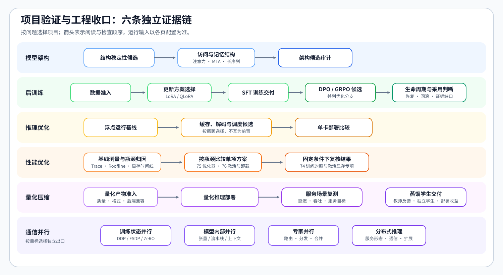

# Group 2.10: Project Validation and Engineering Closure | 2.10: 项目验证与工程收口

本组用于承接综合项目、性能对比与训练分析，是 Part 2 的项目收束层。这里不再展开单个方法原理，而是把前面各组的能力收成可比较、可复现、可决策的工程验证入口。

## Group Overview | 组概览

这一组把前面各组的机制放回真实 workload，形成后训练与对齐、推理优化与部署、性能优化、大模型架构演进、量化与压缩、通信与并行六条项目链。每个页面只有一个主归属；其他专题只复用其结果和链接。

## Project Chains and Stable IDs | 项目链与稳定身份

数字编号用于定位当前文件，语义 ID 用于项目注册、结果 JSON 和跨专题引用。语义 ID 不随文件调号变化；每个项目只有一个主归属，其他专题只复用其机制或证据。机器可读登记见 [`benchmarks/project_registry.json`](https://github.com/datawhalechina/llm-algo-leetcode/blob/main/benchmarks/project_registry.json)。

| 项目链 | 推荐顺序（语义 ID） | 主归属 |
| --- | --- | --- |
| 大模型架构演进 | [60 `ARCH-BLOCK-STABILITY`](./60_Decoder_Block_Stability_Benchmark.md) → [78 `ARCH-ATTENTION-ACCESS`](./78_Attention_Access_Pattern_Benchmark.md) → [71 `ARCH-MLA-KV`](./71_MLA_KV_Cache_Architecture_Benchmark.md) → [77 `ARCH-LONG-SEQUENCE-MEMORY`](./77_Long_Sequence_Memory_Architecture_Benchmark.md) → [61 `ARCH-MODEL-AUDIT`](./61_Model_Architecture_Exploration.md) | 大模型架构演进 |
| 后训练优化 | [64 `PT-SFT-DATA-QUALITY`](./64_SFT_Data_Quality_Project.md) → [63 `PT-LORA-VARIANTS`](./63_LoRA_Variants_Benchmark.md) / [65 `PT-QLORA-SELECTION`](./65_QLoRA_Selection_Project.md) → [62 `PT-SFT-DELIVERY`](./62_Instruction_Fine_Tuning_Project.md) → [84 `PT-DPO-OFFLINE`](./84_DPO_Preference_Project.md) / [85 `PT-GRPO-GROUPWISE`](./85_GRPO_Groupwise_Alignment_Project.md) → [86 `PT-POST-TRAINING-LIFECYCLE`](./86_DPO_Online_Benchmark.md) | 后训练优化 |
| 推理优化 | [66 `INF-FLOAT-BASELINE`](./66_Inference_Performance_Comparison.md) → [68 `INF-SPECULATIVE-BENCH`](./68_Speculative_Decoding_Benchmark.md) / [69 `INF-PREFIX-CACHE`](./69_Prefix_Caching_Benchmark.md) / [70 `INF-SERVING-SCHEDULER`](./70_Serving_Scheduler_Benchmark.md) → [72 `INF-SINGLE-GPU-DEPLOY`](./72_Multi_Model_Deployment_Comparison.md) | 推理优化 |
| 性能优化 | [73 `PERF-TRAINING-BASELINE`](./73_Training_Performance_Analysis.md) 建立基线；按瓶颈选择 [75 `PERF-OPTIMIZER-PATH`](./75_Optimizer_Execution_Path_Benchmark.md) 或 [76 `PERF-MEMORY-STRATEGY`](./76_Activation_Checkpoint_Offload_Benchmark.md)（含预算敏感性）；[74 `PERF-PROFILING-CLOSURE`](./74_Profiling_Driven_End_to_End_Optimization.md)核对固定训练条件与剖析结果 | 性能优化 |
| 通信与并行 | [79 `PAR-TRAINING-STATE`](./79_Distributed_Parallel_Benchmark.md)；[87 `PAR-MODEL-INTERNAL`](./87_Model_Internal_Parallel_Benchmark.md)；[80 `PAR-MOE-EXPERT`](./80_MoE_Expert_Parallel_Benchmark.md)；[81 `PAR-DISTRIBUTED-INFERENCE`](./81_Distributed_Inference_Project.md) | 通信与并行 |
| 量化与压缩 | 量化：[82 `QUANT-ARTIFACT-GATE`](./82_Quantization_Artifact_Evaluation_Project.md) → [67 `QUANT-INFERENCE-DEPLOY`](./67_Quantized_Inference_and_Deployment.md) → [83 `QUANT-SERVING-PROFILE`](./83_Quantized_Serving_Profile_Benchmark.md) 蒸馏：[88 `DISTILL-STUDENT-DELIVERY`](./88_Distilled_Student_Delivery_Project.md) | 量化与压缩 |

后训练项目按实际输入选择阅读顺序：64 先判断数据能否进入训练，63 或 65 再选择参数更新方案，62 负责训练、恢复与产物交付。完成 SFT 基线后，84 的离线偏好优化与 85 的在线奖励优化是两个并列候选分支；86 检查策略版本、产物哈希和可用恢复状态，通过后保留候选供后续任务评测。

需要继续比较完整流程时，可进入 [Part 05 后训练综合项目](../05_Integrated_Projects_and_Decisions/02_Post_Training_Delivery/index.md)或[性能优化综合项目](../05_Integrated_Projects_and_Decisions/03_Performance_Optimization_Delivery/index.md)。这两个项目分别固定自己的模型、数据或工作负载，独立测量候选；本组结果用于学习和背景参考。

## Group Asset Overview | 组内资产总览

项目页交付可追溯产物，基准页在固定工作负载下比较候选，分析页汇总证据并形成选择。“运行环境”同时说明硬件与执行栈；缺少对应硬件时只能完成 CPU 逻辑验证，不能把模拟结果解释为真实性能。

| 项目类型 | 项目 | 主要作用 | 主归属与复用 | 运行环境 | Infra 层 |
| --- | --- | --- | --- | --- | --- |
| Project | [64 SFT 数据质量项目](./64_SFT_Data_Quality_Project.md) | 判断数据、切分、模板与监督目标能否进入训练 | 主归属：[2.4](./2_4.md) / 后训练优化 | CPU · Datasets / tokenizer | Infra-L3 |
|  | [65 QLoRA 选型项目](./65_QLoRA_Selection_Project.md) | 在显存受限时选择低比特基座与适配器方案 | 主归属：[2.4](./2_4.md) / 后训练优化；量化路线只引用其低比特训练证据 | 单 GPU · Transformers / PEFT | Infra-L1–L3 |
|  | [62 指令微调项目](./62_Instruction_Fine_Tuning_Project.md) | 按选定方案完成 SFT 训练、恢复、评测与产物交付 | 主归属：[2.4](./2_4.md) / 后训练优化；消费 64 与 63/65 的上游报告 | 单 GPU · Transformers / PEFT | Infra-L3 |
|  | [67 量化推理与部署项目](./67_Quantized_Inference_and_Deployment.md) | 量化产物接入 backend 并形成部署结论 | 主归属：[2.8](./2_8.md) / 量化与压缩；推理优化复用运行结果 | 单 GPU · Transformers / vLLM / SGLang | Infra-L2–L4 |
|  | [72 多模型部署对比项目](./72_Multi_Model_Deployment_Comparison.md) | 单卡模型、产物与 backend 的部署方案比较 | 主归属：[2.6](./2_6.md) / 推理优化；部署与异构专题复用 | 单 GPU · Transformers / vLLM / SGLang | Infra-L2–L4 |
|  | [82 量化产物评估项目](./82_Quantization_Artifact_Evaluation_Project.md) | 审计量化 artifact、质量门槛与 backend 兼容性 | 主归属：[2.8](./2_8.md) / 量化 | CPU；可选单 GPU · backend loader | Infra-L1–L3 |
|  | [88 蒸馏学生交付项目](./88_Distilled_Student_Delivery_Project.md) | 对比学生基线、固定轨迹 KD 与 on-policy 蒸馏，并审计学生产物和部署收益 | 主归属：[2.8](./2_8.md) / 量化与压缩；后训练优化复用教师反馈机制 | CPU 逻辑验证；单 GPU · Transformers / TRL | Infra-L1–L4 |
|  | [84 DPO 偏好优化项目](./84_DPO_Preference_Project.md) | 从 SFT 基线产生并评测离线偏好优化候选 | 主归属：[2.5](./2_5.md) / 偏好优化与对齐；与 85 并列 | 单 GPU · Transformers / TRL | Infra-L3–L5 |
|  | [85 GRPO 组内对齐项目](./85_GRPO_Groupwise_Alignment_Project.md) | 从 SFT 基线产生并评测在线奖励优化候选 | 主归属：[2.5](./2_5.md) / 偏好优化与对齐；与 84 并列 | 单 GPU · Transformers / TRL | Infra-L3–L5 |
| Qualification | [86 在线后训练生命周期与恢复](./86_DPO_Online_Benchmark.md) | 检查候选来源、文件哈希与可用恢复状态，保存待评测清单 | 主归属：[2.5](./2_5.md) / 偏好优化与对齐；消费 84 或 85 的候选结果 | CPU / 单机状态回放；多工作进程扩展 | Infra-L3–L5 |
| Benchmark | [60 Decoder Block 稳定性基准](./60_Decoder_Block_Stability_Benchmark.md) | 对比 Block 变体的稳定性、质量与成本 | 主归属：[2.2](./2_2.md) / 大模型架构演进 | CPU · PyTorch；可选单 GPU · Transformers | Infra-L1–L3 |
|  | [63 LoRA 变体对比](./63_LoRA_Variants_Benchmark.md) | 在固定任务与预算下比较更新范围、秩和资源代价 | 主归属：[2.4](./2_4.md) / 后训练优化；为 62 提供选型报告 | 单 GPU · Transformers / PEFT | Infra-L3 |
|  | [66 推理性能对比实验](./66_Inference_Performance_Comparison.md) | 统一 workload 下的推理 baseline | 主归属：[2.6](./2_6.md) / 推理优化；量化项目共享其输出契约 | 单 GPU · vLLM / SGLang | Infra-L2–L4 |
|  | [68 投机解码基准](./68_Speculative_Decoding_Benchmark.md) | proposal、verify 与净收益对照 | 主归属：[2.7](./2_7.md) / 推理优化 | 单 GPU · vLLM / SGLang | Infra-L3–L4 |
|  | [69 前缀缓存基准](./69_Prefix_Caching_Benchmark.md) | Prefix Cache 命中、收益与代价对照 | 主归属：[2.7](./2_7.md) / 推理优化 | 单 GPU · vLLM / SGLang | Infra-L3–L4 |
|  | [70 推理服务调度基准](./70_Serving_Scheduler_Benchmark.md) | 调度策略、队列与尾延迟对照 | 主归属：[2.7](./2_7.md) / 推理优化 | 单 GPU · vLLM / SGLang | Infra-L3–L5 |
|  | [71 MLA / KV Cache 结构基准](./71_MLA_KV_Cache_Architecture_Benchmark.md) | KV 表示、容量账本与 MLA 代价对照 | 主归属：[2.2](./2_2.md) / 大模型架构演进；推理优化复用容量与运行证据 | 单 GPU · vLLM / SGLang | Infra-L3–L4 |
|  | [73 训练性能分析](./73_Training_Performance_Analysis.md) | 训练 step、显存与吞吐的统一测量 | 主归属：[2.3](./2_3.md) / 性能优化 | 单 GPU · PyTorch Profiler | Infra-L1–L3 |
|  | [75 AdamW 执行路径基准](./75_Optimizer_Execution_Path_Benchmark.md) | 固定训练条件下比较单张量、foreach 与 fused 更新路径 | 主归属：[2.3](./2_3.md) / 性能优化 | 单 GPU · PyTorch | Infra-L1–L2 |
|  | [76 Activation / Checkpoint / Offload 对比](./76_Activation_Checkpoint_Offload_Benchmark.md) | 训练显存策略的质量—成本对照 | 主归属：[2.3](./2_3.md) / 性能优化 | 单 GPU · Transformers | Infra-L1–L3 |
|  | [77 长序列记忆架构基准](./77_Long_Sequence_Memory_Architecture_Benchmark.md) | 显式 KV、递推状态与混合记忆对照 | 主归属：[2.2](./2_2.md) / 大模型架构演进 | 单 GPU（可选）· Transformers | Infra-L2–L4 |
|  | [78 Attention 访问模式基准](./78_Attention_Access_Pattern_Benchmark.md) | 全局、窗口、块稀疏与选择性稀疏访问的覆盖—成本对照 | 主归属：[2.2](./2_2.md) / 大模型架构演进 | CPU · NumPy；可选单 GPU · PyTorch SDPA | Infra-L1–L2 |
|  | [79 训练状态并行基准](./79_Distributed_Parallel_Benchmark.md) | DDP / FSDP / ZeRO 的状态驻留、通信与扩展效率比较 | 主归属：[2.9](./2_9.md) / 通信与并行 | 多 GPU · PyTorch Distributed / Accelerate | Infra-L1–L3 |
|  | [87 模型内部并行基准](./87_Model_Internal_Parallel_Benchmark.md) | PP / TP / CP 与 Device Mesh 的布局、容量和通信比较 | 主归属：[2.9](./2_9.md) / 通信与并行 | CPU；可选多 GPU · PyTorch Distributed / DeviceMesh | Infra-L1–L4 |
|  | [80 MoE 专家并行 benchmark](./80_MoE_Expert_Parallel_Benchmark.md) | 路由、overflow、dispatch 与通信对照 | 主归属：[2.9](./2_9.md) / 通信与并行；大模型架构演进专题引用 | 多 GPU · PyTorch Distributed / MoE | Infra-L2–L4 |
|  | [83 量化 Serving Profile 基准](./83_Quantized_Serving_Profile_Benchmark.md) | 同一量化 artifact 在 latency / balanced / throughput 下的 SLO 对照 | 主归属：[2.8](./2_8.md) / 量化 | CPU；可选单 GPU · serving backend | Infra-L2–L4 |
| Analysis | [61 架构验证项目](./61_Model_Architecture_Exploration.md) | 汇总架构证据并形成选型建议 | 主归属：[2.2](./2_2.md) / 大模型架构演进 | 单 GPU · Transformers | Infra-L3 |
|  | [74 性能剖析与训练结果复核](./74_Profiling_Driven_End_to_End_Optimization.md) | 核对固定训练配置及激活显存专项的结果和剖析记录 | 主归属：[2.3](./2_3.md) / 性能优化 | 单 GPU · PyTorch Profiler / backend | Infra-L1–L5 |
|  | [81 分布式推理逻辑验证](./81_Distributed_Inference_Project.md) | 汇总服务形态、通信与扩展证据 | 主归属：[2.9](./2_9.md) / 通信与并行 | 多 GPU · PyTorch Distributed | Infra-L3–L5 |

## Learning Path | 学习路径

先在“项目链与稳定身份”中选择目标路线，再按箭头完成上游报告、候选实验和最终采用判断。项目页需要补机制时，分别回到[反向传播与训练控制](./2_3.md)、[监督微调与参数适配](./2_4.md)、[偏好优化与对齐](./2_5.md)、[推理执行](./2_6.md)、[服务策略](./2_7.md)、[量化](./2_8.md)或[通信并行](./2_9.md)；跨专题复用项目结果时不改变项目主归属。

## Environment Notes | 环境说明

- 默认先完成 CPU 逻辑与正确性验证，再按单页说明进入真实环境。
- 项目中的性能分析、分布式或部署验证，若需要 GPU / 多卡 / 工具链支持，以单页说明为准。
