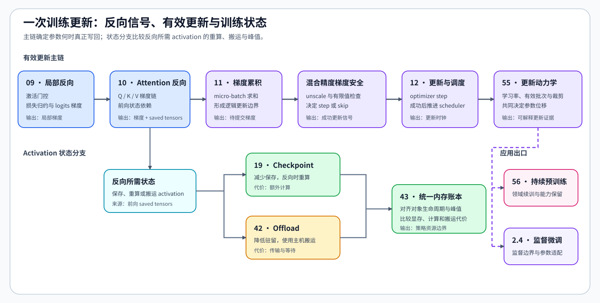

# Group 2.3: Backpropagation and Training Control | 2.3: 反向传播与训练控制

本组沿一次训练更新展开：先追踪损失和 Attention 的局部梯度，再确定梯度累积、混合精度、优化器与学习率调度的更新边界，最后比较 activation 重算、搬运和训练状态驻留。持续预训练是参数更新动力学的应用分支，不是所有训练任务的必经步骤。

## Group Asset Overview | 组内资产总览

| 页 | 处理的对象 | 成熟框架入口 | 产生的结果 |
|:---|:---|:---|:---|
| [09](./09_Activation_and_Loss_Backward.md) | ReLU、交叉熵与 logits 梯度 | PyTorch · Autograd / `CrossEntropyLoss` | 局部梯度对照 |
| [10](./10_Attention_Backward_and_Custom_Autograd.md) | Q、K、V、Softmax 与 saved tensors | PyTorch · `scaled_dot_product_attention` / `gradcheck` | `dQ/dK/dV` 与保存状态清单 |
| [11](./11_Gradient_Accumulation.md) | micro-batch、累计窗口与有效批次 | Accelerate · `Accelerator.accumulate` | 一次逻辑更新使用的梯度 |
| [TRAIN-MIXED-PRECISION-BACKWARD](./TRAIN-MIXED-PRECISION-BACKWARD_Mixed_Precision_Backward.md) | loss scale、有限值、裁剪与跳步 | PyTorch · `autocast` / `GradScaler` | `step / skip` 结果与真实梯度 |
| [12](./12_Optimizer_Updates_and_Learning_Rate_Scheduling.md) | optimizer step 与 scheduler step | PyTorch · `LambdaLR` | 成功更新后的调度时钟 |
| [55](./55_Training_Update_Dynamics.md) | 学习率、有效批次、裁剪与参数 | PyTorch · `clip_grad_norm_` / `SGD` | 参数位移与更新记录 |
| [19](./19_Activation_Checkpointing.md) | activation 保存范围与反向重算 | PyTorch · `checkpoint` | 显存节省量与重算时间 |
| [42](./42_Activation_Offload.md) | activation 驻留位置与往返搬运 | PyTorch · `saved_tensors_hooks` | 搬运量、暴露等待与显存变化 |
| [43](./43_Unified_Training_Memory_Ledger.md) | 参数、梯度、优化器状态和 activation | PyTorch profiler（`memory_snapshot`） | 峰值阶段与主导对象 |
| [56](./56_Continual_Pretraining_and_Retention.md) | 全序列领域续训与能力保留 | Transformers · `AutoModelForCausalLM` | 领域增益、保留集变化与恢复条件 |

## Learning Path | 学习路径

### 基础入口

| 遇到的问题 | 回看入口 | 带回本组的内容 |
|:---|:---|:---|
| 不清楚梯度为什么能够回到参数 | [Part 00 · 07 自动求导](../00_Prerequisites/07_PyTorch_Autograd_and_Backward.md)、[08 梯度控制](../00_Prerequisites/08_PyTorch_Grad_Hygiene_and_No_Grad.md) | VJP、梯度汇合、切断与清理 |
| 不清楚一次参数更新何时完成 | [Part 00 · 11 优化器与损失](../00_Prerequisites/11_PyTorch_Optimizers_and_Loss.md)、[12 最小训练接口](../00_Prerequisites/12_PyTorch_Minimal_Training_Interface.md) | optimizer、scheduler 与训练循环的更新边界 |
| 无法展开 Attention 反向 | [Part 00 · 16 Attention](../00_Prerequisites/16_Attention_Mechanism_Intro.md)、[Part 01 · 04 Attention 内存](../01_Hardware_Math_and_Systems/04_Attention_Memory_Optimization.md)、[14 FlashAttention 内存模型](../01_Hardware_Math_and_Systems/14_FlashAttention_Memory_Model.md) | QKV、Softmax、反向保存状态与分块工作集 |
| 无法解释混合精度或训练显存 | [Part 01 · 01 精度](../01_Hardware_Math_and_Systems/01_Data_Types_and_Precision.md)、[03 GPU 内存](../01_Hardware_Math_and_Systems/03_GPU_Architecture_and_Memory.md)、[06 训练状态](../01_Hardware_Math_and_Systems/06_VRAM_Calculation_and_ZeRO.md)、[12 TensorCore](../01_Hardware_Math_and_Systems/12_TensorCore_and_Mixed_Precision.md) | dtype、状态字节与低精度执行条件 |
| GPU 结果缺少可信对照 | [Part 00 · 17–20 运行诊断与实验](../00_Prerequisites/0E.md)、[Part 01 · 13 瓶颈分析](../01_Hardware_Math_and_Systems/13_Profiling_and_Bottleneck_Analysis.md) | 时间、显存、异常、基线与重复测量方法 |

### 组内路径

- 反向信号：[P0 · 07](../00_Prerequisites/07_PyTorch_Autograd_and_Backward.md) → [09](./09_Activation_and_Loss_Backward.md) → [10](./10_Attention_Backward_and_Custom_Autograd.md)。
- 有效更新：[11](./11_Gradient_Accumulation.md) → [TRAIN-MIXED-PRECISION-BACKWARD](./TRAIN-MIXED-PRECISION-BACKWARD_Mixed_Precision_Backward.md) → [12](./12_Optimizer_Updates_and_Learning_Rate_Scheduling.md) → [55](./55_Training_Update_Dynamics.md)。混合精度先判断本次梯度是否有限、参数是否实际更新，scheduler 再决定是否推进。
- 训练状态：[19](./19_Activation_Checkpointing.md) 与 [42](./42_Activation_Offload.md) 是重算和搬运两条并列策略，随后在 [43](./43_Unified_Training_Memory_Ledger.md) 中统一比较驻留量、峰值和时间代价。
- 应用出口：需要全序列领域续训时，从 55 进入 [56](./56_Continual_Pretraining_and_Retention.md)；需要监督微调与参数适配时进入 [2.4](./2_4.md)。

横向路线见[反向传播与训练机制专题](../topic_discussion/backpropagation_training_mechanism/intro.md)。

## Environment Notes | 环境说明

| 使用范围 | 环境 | 入口 |
|:---|:---|:---|
| 基础机制练习、题目与测试 | `BASE-CPU` | [基础环境说明](../gpu_environment_assets.md#base-cpu) |
| PyTorch、Transformers 与 Accelerate 一致性核对 | `TRAIN-CPU` | [训练机制 Quickstart](../topic_discussion/backpropagation_training_mechanism/quickstart.md#train-cpu-quickstart) |
| 真实模型的数值、更新与资源证据 | `TRAIN-CUDA-MECHANISM` | 各页 Step 5 与[训练机制 Quickstart](../topic_discussion/backpropagation_training_mechanism/quickstart.md#train-cuda-mechanism-quickstart) |
