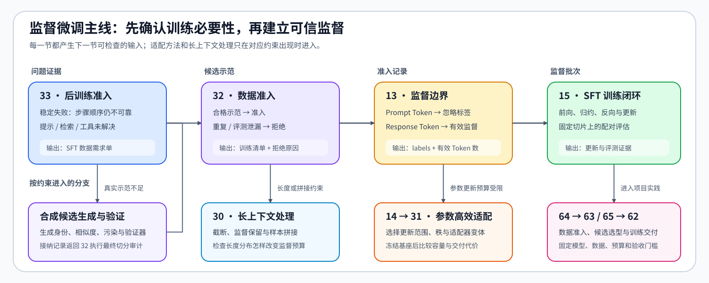

# Group 2.4: Supervised Fine-Tuning and Adaptation | 2.4: 监督微调与参数适配

模型反复答错同一类问题，应该先补资料、改提示，还是更新参数？本组先判断是否需要监督微调（SFT），再确定训练样本、哪些词元参与损失、哪些参数更新，以及训练后怎样评估和保存。遇到截断或显存不足时，再选择长上下文处理或参数高效适配方法。

## Pages and Frameworks | 页面与框架

直接列出的框架已经在 Notebook 中执行 CPU 框架核对；括号中的框架表示尚未接入代码的后续入口。

| 页 | 核心问题 | 成熟框架入口 | 何时阅读 |
|:---|:---|:---|:---|
| [33 后训练准入与阶段选择](./33_Fine_Tuning_Readiness.md) | 稳定失败是否需要参数更新，应进入哪个后训练阶段 | TRL · `SFTConfig` / `DPOConfig` / `GRPOConfig` | 先判断是否需要更新参数 |
| [32 SFT 数据契约与泄漏审计](./32_Data_Engineering_for_SFT.md) | 数据如何去重、去污染并形成可训练清单 | Hugging Face Datasets · `Dataset` / `Features` | 训练前检查数据 |
| [PT-SYNTHETIC-DATA 合成指令生成与验证准入](./PT-SYNTHETIC-DATA_Instruction_Generation_and_Verifier_Admission.md) | 怎样生成示范，检查答案与重复内容，并筛出可用于训练的样本 | Hugging Face Datasets · `Dataset.from_list` / `Dataset.filter` | 真实示范不足，需要补充训练覆盖时 |
| [13 SFT 监督边界与损失](./13_SFT_Training_Loop.md) | 哪些 Token 参与监督，SFT 损失如何对齐与归约 | Transformers · `AutoModelForCausalLM` | 确定监督 Token 与损失 |
| [15 SFT 有效更新与训练闭环](./15_End_to_End_Fine_Tuning_Experiment.md) | 已验证的损失与参数集合如何形成有效更新、评估和记录 | Accelerate · `Accelerator`；TRL · `SFTTrainer` | 执行更新、评估与保存 |
| [14 低秩适配教程](./14_LoRA_Tutorial.md) | 哪些参数更新，低秩路径如何缩放与合并 | PEFT · `LoraConfig` / `get_peft_model` / `merge_and_unload` | 需要减少可训练参数时 |
| [30 长上下文微调机制](./30_Long_Context_Fine_Tuning.md) | 长度分布、窗口预算、Packing 与课程如何协调 | Hugging Face Datasets · `Dataset`；TRL · `pack_dataset` | 出现截断或 Packing 问题时 |
| [31 LoRA 变体缩放与预算](./31_LoRA_Variants_Theory.md) | LoRA、rsLoRA、DoRA 如何在同预算下比较 | PEFT · `LoraConfig` / `get_peft_model` | 比较 LoRA 变体时 |

## Learning Path | 学习路径

- 先读 [33 后训练准入与阶段选择](./33_Fine_Tuning_Readiness.md)，判断问题是否需要参数更新；决定进入 SFT 后，再检查数据与监督目标。
- 基本顺序是 [32 SFT 数据契约与泄漏审计](./32_Data_Engineering_for_SFT.md) → [13 SFT 监督边界与损失](./13_SFT_Training_Loop.md) → [15 SFT 有效更新与训练闭环](./15_End_to_End_Fine_Tuning_Experiment.md)，依次确定数据、监督损失和训练过程；真实示范不足时，在32之后使用 [PT-SYNTHETIC-DATA 合成指令生成与验证准入](./PT-SYNTHETIC-DATA_Instruction_Generation_and_Verifier_Admission.md) 生成并验证候选，再返回32执行最终切分审计。
- 使用 LoRA 时，[13 SFT 监督边界与损失](./13_SFT_Training_Loop.md) 确定监督目标，[14 低秩适配教程](./14_LoRA_Tutorial.md) 限定可训练参数，然后在 [15 SFT 有效更新与训练闭环](./15_End_to_End_Fine_Tuning_Experiment.md) 执行训练；需要比较秩、缩放和变体时再读 [31 LoRA 变体缩放与预算](./31_LoRA_Variants_Theory.md)。
- 当截断、监督保留或跨样本拼接成为问题时，在 [32 SFT 数据契约与泄漏审计](./32_Data_Engineering_for_SFT.md) 和 [13 SFT 监督边界与损失](./13_SFT_Training_Loop.md) 之后进入 [30 长上下文微调机制](./30_Long_Context_Fine_Tuning.md)。
- 后续学习：完成数据、损失和训练过程后，进入 [2.5 偏好优化与对齐](./2_5.md) 学习偏好与奖励驱动更新；跨页核对公式时使用[后训练公式索引](../topic_discussion/post_training_optimization/formula_reference.md)。
- 回补训练机制：梯度、累积步数或训练状态出现异常时，回到[2.3 反向传播与训练控制](./2_3.md)检查一次更新怎样完成。

## Project Validation | 项目验证顺序

固定模型、数据和预算后，先用64检查训练数据，再选择63的LoRA比较或65的低比特训练比较。当前62读取63的选型清单，继续完成训练、恢复和重载检查；采用65的配置时，按其保存的模型与数据设置另行确认训练入口是否兼容。项目目录见[2.10 项目验证与工程收口](./2_10.md)，当前实验状态与复测标签见[后训练优化实验资产表](../topic_discussion/post_training_optimization/experiment_assets.md)。

| 项目 | 何时进入 | 直接输入 | 主要输出 | 验证内容 |
|:---|:---|:---|:---|:---|
| [64 SFT 数据质量](./64_SFT_Data_Quality_Project.md) | 原始数据准备进入训练前 | 数据版本、模板与训练／验证切分 | 样本清单、切分成员与文件哈希 | 空内容、重复、任务重合与监督词元 |
| [63 LoRA 变体对比](./63_LoRA_Variants_Benchmark.md) | 需要在固定训练预算下选择秩配置 | 64 的数据清单 | 选型清单与所选适配器 | 配对验证损失、显存与步时 |
| [65 QLoRA 选型](./65_QLoRA_Selection_Project.md) | 冻结基座后仍受显存或批次容量限制 | 64 的对应数据清单 | LoRA／QLoRA配对结果、适配器及哈希 | 固定批次下的质量与成本、最大可运行微批次 |
| [62 SFT 训练交付](./62_Instruction_Fine_Tuning_Project.md) | 数据和LoRA配置已经确定 | 63 的选型清单及其引用的数据 | 检查点、适配器、恢复与重载记录、基线清单 | 训练步数连续、验证损失与重载一致性 |

## Environment Notes | 环境说明

| 运行目标 | 环境入口 | 适用内容 |
|:---|:---|:---|
| 基础机制练习 | [`BASE-CPU`](../gpu_environment_assets.md#base-cpu) | 33、32、PT-SYNTHETIC-DATA、13、14、15、30、31 的 Step 4 与测试 |
| 成熟框架核对 | [`PT-CPU`](../topic_discussion/post_training_optimization/quickstart.md#pt-cpu-quickstart) | 上述机制页的“框架一致性核对”；该环境包含基础练习依赖 |
| 真实实验与交付 | 各页 Step 5 或项目环境说明 | 14、15、30、31 的可选 GPU 实测；64 的 CPU 准入；63、65、62 的隔离项目环境 |
