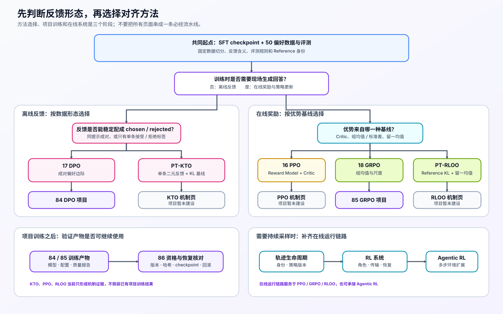

# Group 2.5: Preference Optimization and Alignment | 2.5: 偏好优化与对齐

本组从 2.4 保存的 SFT checkpoint 开始。选择方法前，先固定偏好数据、回答评测规则和奖励含义：成对偏好进入 DPO，单条二元反馈进入 KTO；在线采样再根据是否使用 Critic、组均值或留一基线选择 PPO、GRPO 或 RLOO。持续采样与滚动更新还要记录轨迹身份、策略版本和恢复状态。

## Pages and Frameworks | 页面与框架

直接列出的框架已有 Notebook 一致性验证；括号中的框架表示可选的后续入口。

| 页 | 核心问题 | 成熟框架入口 | 何时阅读 |
|:---|:---|:---|:---|
| [50](./50_Preference_Data_and_Evaluation.md) | 偏好对如何隔离，训练结果如何接受固定协议评测 | （Hugging Face Datasets · `Dataset`） | 先固定数据与评测规则 |
| [PT-REWARD-SIGNAL](./PT-REWARD-SIGNAL_Reward_Model_Value_and_Advantage.md) | reward、return、value、advantage 如何形成不同更新信号 | — | 区分在线算法的更新信号时 |
| [17](./17_DPO_Loss_Tutorial.md) | chosen / rejected 与 reference 如何形成离线 DPO 目标 | TRL · `DPOTrainer` | 使用成对偏好数据时 |
| [PT-KTO](./PT-KTO_Binary_Feedback_Alignment.md) | 单条点赞、点踩或验收标签如何形成 KTO 目标 | TRL · `KTOTrainer` | 只有单条二元反馈时 |
| [PT-REWARD-MODEL](./PT-REWARD-MODEL_Reward_Model_Training_and_Calibration.md) | 偏好对如何训练标量奖励，怎样校准并识别过度优化 | TRL · `RewardTrainer` | 需要学习标量奖励时 |
| [16](./16_RLHF_PPO_Memory.md) | actor、reference、reward、critic 如何协同更新 | （TRL · `PPOTrainer`） | 使用 Critic 的在线训练时 |
| [18](./18_GRPO_Loss_Tutorial.md) | 组采样和组内基线如何形成相对优势 | TRL · `GRPOTrainer` | 有可验证奖励和组采样时 |
| [PT-RLOO](./PT-RLOO_Leave_One_Out_Policy_Optimization.md) | 同组多回答如何用留一基线形成在线策略更新 | TRL · `RLOOTrainer` | 不使用 Critic、采用留一基线时 |
| [PT-ROLLOUT-LIFECYCLE](./PT-ROLLOUT-LIFECYCLE_Rollout_and_Policy_Freshness.md) | 怎样根据 rollout 身份和策略版本判断轨迹能否进入当前更新批次 | （vLLM · OpenAI-compatible server；TRL · `PPOTrainer` / `GRPOTrainer` / `RLOOTrainer`） | 持续生成并复用轨迹时 |
| [PT-AGENTIC-RL](./PT-AGENTIC-RL_Environment_Trajectory_and_Credit_Assignment.md) | 模型动作、工具观察和环境反馈如何形成可训练的多步轨迹 | Gymnasium · `Env` / `check_env` | 训练包含工具调用的多步行为时 |
| [PT-RL-SYSTEM](./PT-RL-SYSTEM_Rollout_Training_and_Reward_System.md) | rollout、reward / reference 与 learner 如何分工 | （TRL · `PPOTrainer` / `GRPOTrainer` / `RLOOTrainer`；Accelerate · `Accelerator`；vLLM · OpenAI-compatible server） | 拆分生成、评分与训练角色时 |
| [51](./51_Online_DPO.md) | 在线反馈何时采用、延迟、回滚或停止 | （TRL · `DPOTrainer`） | 持续接收新反馈时 |

## Learning Path | 学习路径

先用 [50](./50_Preference_Data_and_Evaluation.md) 固定数据切分、反馈含义和评测规则，再根据已有信号选择对应的方法分支。在线分支从 [PT-REWARD-SIGNAL](./PT-REWARD-SIGNAL_Reward_Model_Value_and_Advantage.md) 开始，区分 reward、return、value 与 advantage。

| 已有训练信号 | 是否在线生成 | 比较基线 | 对应页面 | 项目验证 |
|:---|:---:|:---|:---|:---|
| 同一提示的 chosen / rejected | 否 | Reference 下的偏好边际 | [17 DPO](./17_DPO_Loss_Tutorial.md) | [84 DPO 项目](./84_DPO_Preference_Project.md) |
| 单条回答的接受 / 拒绝标签 | 否 | 独立 KL 样本基线 | [PT-KTO](./PT-KTO_Binary_Feedback_Alignment.md) | 暂无独立项目 |
| 学习到的标量奖励，并训练 Critic | 是 | Value / GAE | [PT-REWARD-MODEL](./PT-REWARD-MODEL_Reward_Model_Training_and_Calibration.md) → [16 PPO](./16_RLHF_PPO_Memory.md) | 暂无独立项目 |
| 同提示多回答的奖励 | 是 | 组均值与可选标准差 | [18 GRPO](./18_GRPO_Loss_Tutorial.md) | [85 GRPO 项目](./85_GRPO_Groupwise_Alignment_Project.md) |
| 同提示多回答的奖励 | 是 | 排除当前回答的留一均值 | [PT-RLOO](./PT-RLOO_Leave_One_Out_Policy_Optimization.md) | 暂无独立项目 |

### 在线更新与系统验证

算法页先确定训练信号和损失；持续采样时，还要检查轨迹版本、环境交互、角色容量、传输和恢复条件。

| 场景 | 后续入口 | 解决的问题 |
|:---|:---|:---|
| 在线 DPO | [17](./17_DPO_Loss_Tutorial.md) 或 [84](./84_DPO_Preference_Project.md) → [51](./51_Online_DPO.md) | 固定反馈窗口，并决定采用、延迟或回滚 |
| PPO / GRPO / RLOO 持续采样 | [PT-ROLLOUT-LIFECYCLE](./PT-ROLLOUT-LIFECYCLE_Rollout_and_Policy_Freshness.md) → [PT-RL-SYSTEM](./PT-RL-SYSTEM_Rollout_Training_and_Reward_System.md) | 固定轨迹身份、策略版本、角色容量、传输与恢复条件 |
| 多步工具和环境交互 | [PT-AGENTIC-RL](./PT-AGENTIC-RL_Environment_Trajectory_and_Credit_Assignment.md) | 表达环境状态、模型动作、工具观察、终态 / 过程奖励与信用分配 |

## Project Validation | 项目验证顺序

固定模型、数据与评测协议后，84 和 85 分别训练 DPO 与 GRPO 模型，86 再核对模型或适配器哈希、检查点恢复结果和回滚记录。执行配置见 [2.10](./2_10.md)，当前实验状态与复测标签见[后训练优化实验资产表](../topic_discussion/post_training_optimization/experiment_assets.md)。

| 项目 | 何时进入 | 直接输入 | 主要输出 | 验证内容 |
|:---|:---|:---|:---|:---|
| [84 DPO 偏好优化](./84_DPO_Preference_Project.md) | 已有隔离偏好数据与 SFT 基线 | SFT checkpoint、偏好数据 manifest 与评测协议 | DPO 模型或适配器、质量报告与运行 manifest | 偏好边际、质量与训练稳定性 |
| [85 GRPO 组内对齐](./85_GRPO_Groupwise_Alignment_Project.md) | 已有可执行验证器、组采样配置与 SFT 基线 | SFT checkpoint、奖励规范与固定工作负载 | GRPO 模型或适配器、奖励 / 质量报告与运行 manifest | 奖励、质量与训练稳定性 |
| [86 在线后训练生命周期与恢复](./86_DPO_Online_Benchmark.md) | 84 或 85 已形成可恢复产物 | 运行 manifest、策略版本、产物哈希与检查点记录 | 生命周期报告、恢复验证与 Part 05 交接清单 | 身份核对、恢复与回滚 |

## Environment Notes | 环境说明

| 运行目标 | 环境入口 | 适用内容 |
|:---|:---|:---|
| 基础机制练习 | [`BASE-CPU`](../gpu_environment_assets.md#base-cpu) | 本组机制页的 Step 4 与测试 |
| 成熟框架核对 | [`PT-CPU`](../topic_discussion/post_training_optimization/quickstart.md#pt-cpu-quickstart) | 带“框架一致性核对”层级的奖励模型、奖励信号、DPO、KTO、GRPO、RLOO 与 Agent 环境机制页；该环境包含基础练习依赖 |
| 真实实验与项目 | 各页 Step 5 或项目环境说明 | 奖励模型、奖励信号、DPO、GRPO 的可选 GPU 实测；84、85 的隔离训练环境；86 的生命周期验证环境 |
