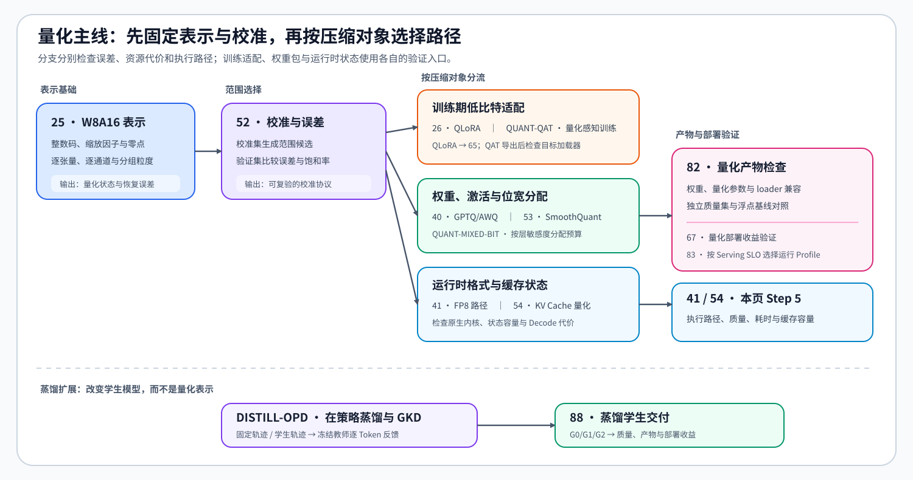

# Group 2.8: Quantization and Low-Bit Adaptation | 2.8：量化与低比特适配

本组以量化与低比特适配为主线，目标是把“怎样表示、范围如何选择、采用哪条路径、怎样证明值得部署”串成一条路线。学习先用 25 建立 W8A16 表示和粒度，再由 52 搜索校准范围与 clipping quantile，随后进入 QLoRA、QAT、GPTQ/AWQ、SmoothQuant、混合位宽、FP8 与 KV Cache 量化。需要通过教师反馈训练独立学生模型时，从蒸馏扩展页进入；剪枝与一般稀疏化仍保留在专题正文中。



## Group Overview | 组概览

这一组围绕“怎样在可接受误差下减少存储、带宽或计算成本”展开。25 建立基础表示，52 负责数据驱动的范围选择；26 与 QUANT-QAT 区分低比特 adapter 训练和量化感知训练，40、53 与 QUANT-MIXED-BIT 处理权重、激活和跨层位宽分配，41、54 分别处理 FP8 运行时和 KV Cache 状态量化。

需要部署量化权重包时，经 82 检查产物、质量和加载兼容性，再进入 67／83。QLoRA 的训练选型进入 65，FP8 执行与 KV Cache 量化分别在 41、54 的 Step 5 对照；QAT 导出推理产物后，再按目标加载器检查兼容性。

跨页使用的量化、反量化、误差与预算公式集中在[量化与压缩公式索引](../topic_discussion/quantization_compression/formula_reference.md)。

## Group Asset Overview | 组内资产总览

| 页 | 职责作用 | 成熟框架入口 | 定位 |
|:---|:---|:---|:---|
| [25](./25_Quantization_W8A16.md) | 判断 W8A16 的对象、表示与收益边界 | PyTorch · `MinMaxObserver` / `fake_quantize_per_tensor_affine` | 核心机制 |
| [52](./52_Quantization_Calibration_and_Error.md) | 在独立 validation 数据上搜索校准范围与 clipping quantile | PyTorch · `MinMaxObserver` / `fake_quantize_per_tensor_affine` | 核心机制 |
| [26](./26_QLoRA_and_4bit_Quantization.md) | 理解 QLoRA 和 4bit 训练适配 | Transformers · `BitsAndBytesConfig`；PEFT · `LoraConfig` | 核心机制 |
| [QUANT-QAT](./QUANT-QAT_Quantization_Aware_Training.md) | 理解 observer、STE 与量化感知训练的状态关系 | PyTorch · `MinMaxObserver` / `fake_quantize_per_tensor_affine` | QAT 机制 |
| [40](./40_GPTQ_and_AWQ_Weight_Quantization.md) | 理解校准、误差与 GPTQ/AWQ artifact | LLM Compressor · `GPTQModifier` / `AWQModifier` | 核心机制 |
| [53](./53_Activation_Quantization_and_SmoothQuant.md) | 理解激活异常值、通道平滑与 W8A8 误差 | LLM Compressor · `SmoothQuantModifier` | 核心机制 |
| [QUANT-MIXED-BIT](./QUANT-MIXED-BIT_Mixed_Bit_Allocation.md) | 根据逐层敏感度、预算和 backend 支持分配位宽 | TorchAO · `FqnToConfig` / `quantize_` | 混合位宽机制 |
| [41](./41_FP8_Runtime_Low_Precision_Paths.md) | 区分 FP8 格式、缩放策略与原生运行时路径 | TorchAO · `Float8WeightOnlyConfig` / `Float8DynamicActivationFloat8WeightConfig` | 核心机制 |
| [54](./54_KV_Cache_Quantization_Strategies.md) | 比较 K/V 异轴量化、追加状态与缓存容量账本 | Transformers · `QuantizedCache`；HQQ · 缓存量化后端 | 核心机制 |
| [DISTILL-OPD](./DISTILL-OPD_On_Policy_Distillation_and_GKD.md) | 用学生轨迹和冻结教师分布训练独立学生模型 | PyTorch · `Categorical` / `kl_divergence`；TRL · `DistillationTrainer` | 蒸馏扩展 |
| [88](./88_Distilled_Student_Delivery_Project.md) | 比较学生基线、固定轨迹 KD 与 on-policy 蒸馏，并形成学生交付判断 | Transformers · `AutoModelForCausalLM` | 蒸馏项目 |
| [65](./65_QLoRA_Selection_Project.md) | 低资源 QLoRA 训练适配与 adapter 交付 | Transformers · `BitsAndBytesConfig`；PEFT · `LoraConfig` | 后训练交叉入口 |
| [66](./66_Inference_Performance_Comparison.md) | 建立浮点 baseline 与统一 workload | vLLM · OpenAI 兼容服务接口 | 项目基线 |
| [82](./82_Quantization_Artifact_Evaluation_Project.md) | 审计量化 artifact、校准/评测隔离与 loader 兼容性 | vLLM · artifact loader | 量化产物 gate |
| [67](./67_Quantized_Inference_and_Deployment.md) | 验证 artifact、backend 与部署收益 | vLLM · OpenAI 兼容服务接口 | 项目收口 |
| [83](./83_Quantized_Serving_Profile_Benchmark.md) | 在三类 Serving profile 下比较量化配置与 SLO | vLLM · OpenAI 兼容服务接口 | Serving 专项基准 |

## Learning Path | 学习路径

### Recommended Order | 推荐顺序

主机制路线如下，25 先建立量化表示，52 再回答范围如何从数据中选出：

```text
25 W8A16 基础
→ 52 校准范围与 clipping
  ├─ 26 QLoRA 低比特训练
  ├─ QUANT-QAT 量化感知训练
  ├─ 40 GPTQ / AWQ 权重量化
  ├─ 53 SmoothQuant 激活量化
  ├─ QUANT-MIXED-BIT 混合位宽分配
  ├─ 41 FP8 运行时路径
  └─ 54 KV Cache 量化
```

- 训练显存受限时从 26 进入项目 65；PTQ 质量不足且允许继续训练时选择 QUANT-QAT。两条训练路径都不能替代推理量化 artifact 的验证。
- QUANT-MIXED-BIT 应在 40/53 已产出可比较敏感度后学习，负责跨层预算分配，不重复各页的量化算法。
- 推理压缩分别按权重、激活、运行时计算和缓存状态选择 40、53、41、54，四条分支可按问题独立学习。
- 如果目标不是改变数值表示，而是把教师能力迁移到独立学生模型，先用 [DISTILL-OPD](./DISTILL-OPD_On_Policy_Distillation_and_GKD.md) 理解固定轨迹与学生策略轨迹的差异，再由 [88](./88_Distilled_Student_Delivery_Project.md) 比较 G0/G1/G2，并检查学生质量、产物与部署收益。
- 项目阶段先用 [82](./82_Quantization_Artifact_Evaluation_Project.md) 检查 artifact gate，再由 [67](./67_Quantized_Inference_and_Deployment.md) 运行匹配的浮点—量化部署对照，最后用 [83](./83_Quantized_Serving_Profile_Benchmark.md) 按服务目标选择 Profile。[66](./66_Inference_Performance_Comparison.md) 可作为浮点历史对照，但不是 67 的必需上游。

### Next Steps | 后续衔接

- 看完本组后，可以进入 [2.9](./2_9.md)，把并行与通信边界接起来。
- 如果目标是项目验证或显存调优，也可以继续进入 [2.10](./2_10.md)，或回看 [43](./43_Unified_Training_Memory_Ledger.md) 与 [76](./76_Activation_Checkpoint_Offload_Benchmark.md)；自动调优方法见[算子优化 Task4](../topic_discussion/operator_optimization/05_measurement_profiling_and_autotuning.md)。


## Environment Notes | 环境说明

- **基础练习：** `BASE-CPU` 运行机制代码与答案测试，并执行 25、52、QUANT-QAT 的 PyTorch 框架核对。
- **框架核对：** `Q-CPU` 执行 40 的 GPTQ、53、54 与 QUANT-MIXED-BIT；40 的 AWQ 路径仍由 GPU 实测覆盖。
- **单卡实测：** `Q-CUDA-MECHANISM` 验证校准、低精度执行与显存变化；QLoRA、蒸馏、FP8 和部署后端分别使用单页 Step 5 指定的 `Q-QLORA`、`PT-DISTILL-CUDA` 或后端环境。
- **证据边界：** CPU 结果说明数值关系和接口语义，真实精度、吞吐、显存及 artifact 兼容性以匹配硬件和后端的实验结果为准。
