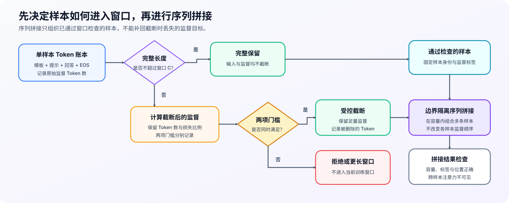

# 30. Long Context Fine Tuning | Long-Context Fine-Tuning Mechanics
**难度：** Medium | **环境：** [CPU 主线，GPU 可选](#runtime-environment) | **标签：** `后训练`, `长上下文`, `数据组织` | **目标人群：** 训练机制学习者

> 🚀 **云端运行环境**
>
> 本章节的实战代码可以点击以下链接在免费 GPU 算力平台上直接运行：
>
> [](https://colab.research.google.com/github/datawhalechina/llm-algo-leetcode/blob/main/02_PyTorch_Algorithms/30_Long_Context_Fine_Tuning.ipynb)
> [](https://modelscope.cn/my/mynotebook) *(国内推荐：魔搭社区免费实例)*


---

## 本节导读

同一条样本经过对话模板和分词器后，实际 Token 长度可能超过模型窗口；直接截断可能删除回答监督，大量填充又会浪费计算。长上下文微调首先要判断样本能否完整进入目标窗口、溢出时会损失多少监督，再决定如何组织通过检查的样本。本节从真实 Token 长度出发，建立窗口容量、监督保留和训练资源之间的关系。

**关键词：** `length distribution`, `packing`, `context budget`, `length curriculum`

---
<a id="runtime-environment"></a>

## 运行环境

- **基础练习：** 默认使用 [`BASE-CPU`](../guide.md#base-cpu)，运行 [Step 4 的题目与测试](#mechanism-practice)。
- **框架核对：** 如需核对 TRL 的 Packing 数据路径，使用 [`PT-CPU`](../topic_discussion/post_training_optimization/quickstart.md#pt-cpu-quickstart)；该环境已包含基础练习依赖，可在完成 Step 4 后直接运行 [框架一致性核对](#framework-check)。
- **GPU 实测：** 如需验证序列长度、Packing 与训练资源关系，阅读 [Step 5](#gpu-experiment)；实验环境与固定工作负载见其中 5.1。

---
## 前置阅读

**导语：** 进入本节前，先理解 SFT 的监督边界和最小训练基线，再比较样本长度分布与目标窗口是否匹配。

- [13. SFT Training Loop | SFT 训练循环](./13_SFT_Training_Loop.md)
- [15. End-to-End Fine-Tuning Experiment | 端到端微调实验](./15_End_to_End_Fine_Tuning_Experiment.md)

---

## Step 1：用真实 Token 长度判断样本能否进入目标窗口

长度统计需要回答两个问题：一条样本实际占用多少 Token，以及数据集中有多少样本超过目标窗口。前者决定单条样本能否完整保留，后者描述当前窗口对数据主体和长尾的覆盖程度。长度必须从“固定分词器 + 固定对话模板”渲染出的完整序列中测量：先统一分词，再根据对齐后的 Token 区间统计模板、提示和监督部分，不能把几段文本分别分词后直接相加。

对样本 $i$，回答与参与监督的结束标记共同构成监督长度：

$$
L_{\text{sup},i}=L_{\text{response},i}+L_{\text{EOS},i}.
$$

完整序列长度及数据集溢出比例为：

$$
L_{\text{total},i}
=L_{\text{template},i}+L_{\text{prompt},i}+L_{\text{sup},i},
\qquad
r_{\text{overflow}}
=\frac{\left|\left\{i\in\{1,\ldots,N\}:L_{\text{total},i}>C\right\}\right|}{N}.
$$

其中，$i$ 是样本编号，$N$ 是参与统计的有效样本数，$|\{\cdot\}|$ 表示满足条件的样本数量，$C$ 是目标上下文窗口；$L_{\text{template},i}$、$L_{\text{prompt},i}$ 和 $L_{\text{sup},i}$ 分别表示模板 Token、非监督输入 Token 和监督 Token。若 EOS 被标签掩码排除，则 $L_{\text{EOS},i}=0$。代码中的 `template_tokens`、`prompt_tokens` 和 `supervised_tokens` 与这三个分量对应，并接收已经完成分词与区间对齐的长度。

| 观察项 | 如何计算或比较 | 对训练设计的影响 |
|:---|:---|:---|
| 分词器与模板版本 | 固定模型快照、对话模板和特殊 Token 规则 | 保证不同实验的长度结果可以直接比较 |
| 完整样本长度 | 在完整渲染序列上按对齐区间计算 $L_{\text{total},i}$ | 判断单条样本能否完整进入窗口 |
| P50 / P95 / 最大值 | 对全部 $L_{\text{total},i}$ 汇总分位数和极值 | 识别数据主体、长尾和异常长样本 |
| 溢出比例 | 计算 $r_{\text{overflow}}$ | 估计需要截断、拒绝或更长窗口的样本规模 |
| 监督 Token 分布 | 统计 $L_{\text{sup},i}=L_{\text{response},i}+L_{\text{EOS},i}$ | 判断截断可能损失多少训练目标 |
| 长度分桶 | 按 $L_{\text{total},i}$ 统计各长度区间的样本数 | 设计 Packing 和分阶段采样比例 |


## Step 2：如何处理溢出样本并安全拼接合格样本

完成长度账本后，先逐条决定样本是否完整保留。若 `模板 + 提示 + 监督` 超过目标窗口，固定保留模板和提示，只在监督尾部执行既定截断；保留监督量和监督损失比例必须同时通过门槛，否则拒绝该样本。Packing 只接收已经通过窗口策略的样本，用剩余容量减少 Padding，同时保持标签、位置和注意力边界。

| 处理环节 | 必须保持的不变量 | 违反后的结果 |
|:---|:---|:---|
| 长度账本 | 分别记录模板、提示、原始监督和保留监督 Token | 无法解释样本为什么被保留、截断或拒绝 |
| 受控截断 | 模板和提示保持不变；监督保留量与损失比例同时通过 | 残余监督不足或输入语义被破坏 |
| Packing 容量 | 只拼接已准入样本，容器总 Token 不超过目标窗口 | 训练序列越界或混入已拒绝样本 |
| 样本边界 | 标签对齐、位置语义正确、跨样本注意力隔离 | 上下文泄漏或监督污染 |


## Step 3：何时扩大长样本比例和目标窗口

序列长度课程逐步提高中长样本比例和目标窗口，但候选阶段必须与短窗口基线使用相同的模型、优化器、评测集和每优化器步有效监督 Token。扩大窗口不是只看长上下文得分：质量增益、短上下文保持、数值稳定、运行稳定和资源预算需要同时通过，任一门槛失败都应停留在当前阶段。

| 晋级门槛 | 比较口径 | 停止晋级的条件 |
|:---|:---|:---|
| Token 预算一致 | 基线与候选的每优化器步有效监督 Token | 监督 Token 预算不同，质量与成本不可直接比较 |
| 长上下文收益 | 候选得分减基线得分 | 增量低于最低收益门槛 |
| 短上下文保持 | 基线得分减候选得分 | 回退超过允许上限 |
| 数值稳定 | Loss 与梯度是否均为有限值 | 任一出现非有限值 |
| 运行稳定 | 失败运行次数 | 超过允许次数 |
| 资源预算 | 峰值显存与每监督 Token 成本 | 任一超过预算 |
<a id="mechanism-practice"></a>

## Step 4：实现窗口策略与边界隔离序列拼接

代码接收已经完成分词与区间对齐的长度账本：`supervised_tokens` 包含回答和受监督 EOS。它先根据监督保留量执行窗口策略，再构造边界隔离的序列拼接。序列长度课程的阶段门槛作为完整比较契约提供，用于验证两项机制产生的数据能否进入更长窗口训练。

| TODO / 函数 | 学习者完成的机制 | 必须满足的约束 | 测试证据 |
|:---|:---|:---|:---|
| TODO 1：执行窗口策略<br>`audit_context_fit` | 计算保留监督量，并区分完整保留、受控截断和拒绝 | 截断必须同时通过最少监督量与最大损失比例 | 检查窗口边界、合法截断、严格拒绝、零监督和非法阈值 |
| TODO 2：隔离样本边界<br>`build_boundary_isolated_packing` | 重置每条样本的位置索引，并构造样本内因果注意力掩码 | 标签与 Token 对齐，后一条样本不能看到前一条样本 | 检查标签与位置保留、样本内因果可见、跨样本隔离和错位输入 |

```python
from typing import Dict, List

```


```python
def summarize_length_distribution(
    lengths: List[int], short_threshold: int, long_threshold: int
) -> Dict[str, object]:
    """统计长度分桶、P50 与 P95。"""
    if short_threshold < 0 or long_threshold < short_threshold or any(length < 0 for length in lengths):
        raise ValueError("长度必须非负，且 short_threshold <= long_threshold")
    ordered = sorted(int(length) for length in lengths)
    buckets = {"short": sum(length <= short_threshold for length in ordered), "medium": sum(short_threshold < length <= long_threshold for length in ordered), "long": sum(length > long_threshold for length in ordered)}
    p50_tokens = ordered[max(0, int(0.50 * len(ordered) + 0.999999) - 1)] if ordered else 0
    p95_tokens = ordered[max(0, int(0.95 * len(ordered) + 0.999999) - 1)] if ordered else 0
    return {"count": len(ordered), "buckets": buckets, "p50_tokens": p50_tokens, "p95_tokens": p95_tokens}


def audit_context_fit(
    samples: List[Dict[str, int]],
    target_context_len: int,
    template_tokens: int,
    min_kept_supervised_tokens: int = 1,
    max_supervision_loss_ratio: float = 0.0,
) -> Dict[str, object]:
    """按监督保留量区分完整保留、受控截断和拒绝。"""
    if target_context_len <= 0 or template_tokens < 0 or min_kept_supervised_tokens <= 0:
        raise ValueError("窗口和最少监督量必须为正，模板长度必须非负")
    if not 0.0 <= max_supervision_loss_ratio <= 1.0:
        raise ValueError("监督损失比例必须位于 [0, 1]")
    records = []
    for sample in samples:
        prompt_tokens = int(sample["prompt_tokens"])
        supervised_tokens = int(sample["supervised_tokens"])
        if prompt_tokens < 0 or supervised_tokens <= 0:
            raise ValueError("提示长度必须非负，监督长度必须为正")
        prompt_and_template_tokens = template_tokens + prompt_tokens
        available_supervision_slots = max(0, target_context_len - prompt_and_template_tokens)
        # ==========================================
        # TODO 1：计算监督保留量并执行窗口门槛。
        # kept_supervised_tokens = ???  # 窗口内能够保留的回答 Token 数。
        # loss_ratio = ???  # 被截断监督量占原始回答 Token 的比例。
        # admitted = ???  # 同时满足最少监督量与最大损失比例。
        # ==========================================
        raise NotImplementedError("TODO 1：执行窗口策略")
        total_tokens = prompt_and_template_tokens + supervised_tokens
        decision = "fit" if kept_supervised_tokens == supervised_tokens else ("truncate" if admitted else "overflow")
        records.append({"name": sample["name"], "total_tokens": total_tokens, "kept_supervised_tokens": kept_supervised_tokens if admitted else 0, "supervision_loss_ratio": loss_ratio, "decision": decision})
    fit_names = [item["name"] for item in records if item["decision"] == "fit"]
    truncated_names = [item["name"] for item in records if item["decision"] == "truncate"]
    overflow_names = [item["name"] for item in records if item["decision"] == "overflow"]
    return {"records": records, "fit_names": fit_names, "truncated_names": truncated_names, "overflow_names": overflow_names}


def pack_sample_lengths(lengths: List[int], max_tokens_per_bin: int) -> Dict[str, object]:
    """使用 first-fit decreasing 构造 Packing 容器。"""
    if max_tokens_per_bin <= 0 or any(length <= 0 or length > max_tokens_per_bin for length in lengths):
        raise ValueError("每个长度必须位于 (0, max_tokens_per_bin] 区间")
    bins: List[List[int]] = []
    for length in sorted(lengths, reverse=True):
        target_bin = next((bin_lengths for bin_lengths in bins if sum(bin_lengths) + length <= max_tokens_per_bin), None)
        if target_bin is None:
            bins.append([length])
        else:
            target_bin.append(length)
    capacity = len(bins) * max_tokens_per_bin
    return {"bins": bins, "utilization": sum(lengths) / capacity if capacity else 0.0}


def build_boundary_isolated_packing(samples: List[Dict[str, List[int]]]) -> Dict[str, object]:
    """拼接已准入样本，同时保留标签并隔离样本边界。"""
    if not samples:
        raise ValueError("至少需要一条样本")
    input_ids: List[int] = []
    labels: List[int] = []
    segment_ids: List[int] = []
    position_ids: List[int] = []
    for segment_id, sample in enumerate(samples):
        sample_input_ids = list(sample["input_ids"])
        sample_labels = list(sample["labels"])
        if not sample_input_ids or len(sample_input_ids) != len(sample_labels):
            raise ValueError("每条样本必须非空，且 input_ids 与 labels 等长")
        input_ids.extend(sample_input_ids)
        labels.extend(sample_labels)
        segment_ids.extend([segment_id] * len(sample_input_ids))
        position_ids.extend(range(len(sample_input_ids)))
    # ==========================================
    # TODO 2：构造边界隔离的因果注意力掩码
    # ==========================================
    # attention_allowed = ???  # [总 Token 数, 总 Token 数]；仅允许关注同一样本内的当前与历史位置。
    raise NotImplementedError("TODO 2：构造边界隔离的因果注意力掩码")
    return {"input_ids": input_ids, "labels": labels, "segment_ids": segment_ids, "position_ids": position_ids, "attention_allowed": attention_allowed}


def evaluate_length_curriculum_stage(
    baseline: Dict[str, object], candidate: Dict[str, object], limits: Dict[str, float]
) -> Dict[str, object]:
    """用得分变化、有限性、失败次数与资源上限判断是否进入下一阶段。"""
    baseline_required = {"long_context_score", "short_context_score", "supervised_tokens_per_optimizer_step"}
    candidate_required = baseline_required | {"loss_finite", "gradients_finite", "failed_runs", "peak_memory_gb", "cost_per_supervised_token"}
    limit_required = {"min_long_context_gain", "max_short_context_regression", "max_failed_runs", "max_peak_memory_gb", "max_cost_per_supervised_token"}
    if baseline_required - baseline.keys() or candidate_required - candidate.keys() or limit_required - limits.keys():
        raise ValueError("序列长度课程比较缺少必要字段")
    evidence = {
        "token_budget_matches": baseline["supervised_tokens_per_optimizer_step"] == candidate["supervised_tokens_per_optimizer_step"],
        "long_context_gain": float(candidate["long_context_score"]) - float(baseline["long_context_score"]),
        "short_context_regression": float(baseline["short_context_score"]) - float(candidate["short_context_score"]),
    }
    gate_failures = [
        ("token_budget_mismatch", not evidence["token_budget_matches"]),
        ("insufficient_long_context_gain", evidence["long_context_gain"] < limits["min_long_context_gain"]),
        ("short_context_regression", evidence["short_context_regression"] > limits["max_short_context_regression"]),
        ("nonfinite_loss", candidate["loss_finite"] is not True),
        ("nonfinite_gradients", candidate["gradients_finite"] is not True),
        ("failed_runs", int(candidate["failed_runs"]) > limits["max_failed_runs"]),
        ("peak_memory_budget", float(candidate["peak_memory_gb"]) > limits["max_peak_memory_gb"]),
        ("cost_budget", float(candidate["cost_per_supervised_token"]) > limits["max_cost_per_supervised_token"]),
    ]
    failed_gates = [name for name, failed in gate_failures if failed]
    return {"decision": "advance" if not failed_gates else "hold", "failed_gates": failed_gates, "evidence": evidence}
```

## 测试

运行下方 CPU 机制测试，检查长度分布、窗口预算、序列拼接容量、样本边界隔离与长度阶段晋级门槛。


```python
def _assert_raises_value_error(callback) -> None:
    """确认非法长度、窗口或容量被显式拒绝。"""
    try:
        callback()
    except ValueError:
        return
    raise AssertionError("非法输入应抛出 ValueError")


def test_context_fit_preserves_supervision() -> None:
    """长度统计与窗口准入必须保留真实回答监督。"""
    summary = summarize_length_distribution([64, 128, 300, 900], 128, 512)
    assert summary["buckets"] == {"short": 2, "medium": 1, "long": 1}
    assert summary["p50_tokens"] == 128
    assert summary["p95_tokens"] == 900
    samples = [
        {"name": "short", "prompt_tokens": 300, "supervised_tokens": 80},
        {"name": "boundary", "prompt_tokens": 1760, "supervised_tokens": 256},
        {"name": "overflow", "prompt_tokens": 1761, "supervised_tokens": 256},
    ]
    plan = audit_context_fit(samples, 2048, 32)
    assert plan["fit_names"] == ["short", "boundary"]
    assert plan["truncated_names"] == []
    assert plan["overflow_names"] == ["overflow"]
    assert plan["records"][1]["total_tokens"] == 2048
    assert plan["records"][2]["kept_supervised_tokens"] == 0


def test_controlled_truncation() -> None:
    """只有监督保留量和损失比例同时通过时才允许截断。"""
    samples = [{"name": "long-supervision", "prompt_tokens": 80, "supervised_tokens": 40}]
    accepted = audit_context_fit(samples, 112, 8, min_kept_supervised_tokens=20, max_supervision_loss_ratio=0.4)
    rejected = audit_context_fit(samples, 112, 8, min_kept_supervised_tokens=20, max_supervision_loss_ratio=0.1)
    assert accepted["truncated_names"] == ["long-supervision"]
    assert accepted["records"][0]["kept_supervised_tokens"] == 24
    assert rejected["overflow_names"] == ["long-supervision"]


def test_packing_preserves_capacity_and_samples() -> None:
    """Packing 不得超出 bin 容量，也不能丢失样本。"""
    report = pack_sample_lengths([7, 6, 4, 3], 10)
    assert report["bins"] == [[7, 3], [6, 4]]
    assert all(sum(bin_lengths) <= 10 for bin_lengths in report["bins"])
    assert sorted(sum(report["bins"], [])) == [3, 4, 6, 7]
    assert report["utilization"] == 1.0


def test_boundary_isolated_packing() -> None:
    """拼接后必须保留标签、重置位置，并禁止跨样本注意力。"""
    packed = build_boundary_isolated_packing([
        {"input_ids": [11, 12, 13], "labels": [-100, 12, 13]},
        {"input_ids": [21, 22], "labels": [-100, 22]},
    ])
    assert packed["input_ids"] == [11, 12, 13, 21, 22]
    assert packed["labels"] == [-100, 12, 13, -100, 22]
    assert packed["segment_ids"] == [0, 0, 0, 1, 1]
    assert packed["position_ids"] == [0, 1, 2, 0, 1]
    attention = packed["attention_allowed"]
    assert attention[2] == [True, True, True, False, False]
    assert attention[3] == [False, False, False, True, False]
    assert attention[4] == [False, False, False, True, True]


def test_length_curriculum_stage_decision() -> None:
    """长度阶段必须同时通过得分、有限性、失败次数与资源上限。"""
    baseline = {"long_context_score": 0.56, "short_context_score": 0.82, "supervised_tokens_per_optimizer_step": 8192}
    limits = {"min_long_context_gain": 0.04, "max_short_context_regression": 0.02, "max_failed_runs": 0, "max_peak_memory_gb": 10.5, "max_cost_per_supervised_token": 1.4}
    accepted = evaluate_length_curriculum_stage(baseline, {"long_context_score": 0.63, "short_context_score": 0.81, "supervised_tokens_per_optimizer_step": 8192, "loss_finite": True, "gradients_finite": True, "failed_runs": 0, "peak_memory_gb": 9.8, "cost_per_supervised_token": 1.25}, limits)
    assert accepted["decision"] == "advance"
    assert accepted["failed_gates"] == []
    rejected = evaluate_length_curriculum_stage(baseline, {"long_context_score": 0.64, "short_context_score": 0.77, "supervised_tokens_per_optimizer_step": 4096, "loss_finite": True, "gradients_finite": True, "failed_runs": 0, "peak_memory_gb": 11.2, "cost_per_supervised_token": 1.3}, limits)
    assert rejected["decision"] == "hold"
    assert rejected["failed_gates"] == ["token_budget_mismatch", "short_context_regression", "peak_memory_budget"]
    nonfinite = evaluate_length_curriculum_stage(baseline, {"long_context_score": 0.63, "short_context_score": 0.81, "supervised_tokens_per_optimizer_step": 8192, "loss_finite": False, "gradients_finite": False, "failed_runs": 1, "peak_memory_gb": 9.8, "cost_per_supervised_token": 1.25}, limits)
    assert nonfinite["failed_gates"] == ["nonfinite_loss", "nonfinite_gradients", "failed_runs"]


def test_invalid_length_inputs() -> None:
    """负长度、空监督、超长样本和错位标签必须被拒绝。"""
    _assert_raises_value_error(lambda: summarize_length_distribution([-1, 8], 16, 32))
    _assert_raises_value_error(lambda: audit_context_fit([{"name": "bad", "prompt_tokens": 64, "supervised_tokens": 0}], 128, 8))
    _assert_raises_value_error(lambda: audit_context_fit([], 128, 8, max_supervision_loss_ratio=1.1))
    _assert_raises_value_error(lambda: pack_sample_lengths([129], 128))
    _assert_raises_value_error(lambda: build_boundary_isolated_packing([]))
    _assert_raises_value_error(lambda: build_boundary_isolated_packing([{"input_ids": [1, 2], "labels": [-100]}]))


try:
    test_context_fit_preserves_supervision()
    test_controlled_truncation()
    test_packing_preserves_capacity_and_samples()
    test_boundary_isolated_packing()
    test_length_curriculum_stage_decision()
    test_invalid_length_inputs()
    print("✅ 长度、窗口、边界隔离与长度阶段晋级测试通过。")
except (AttributeError, NameError, TypeError, ValueError, AssertionError) as error:
    raise NotImplementedError("请先完成 TODO 代码！") from error
```

---

🛑 **STOP HERE** 🛑
<br><br><br><br><br><br><br><br><br><br>
> 请先尝试自己完成代码并跑通测试。<br>
> 如果遇到困难没有思路，可以向下滚动查看参考答案。
<br><br><br><br><br><br><br><br><br><br>

---

## 参考代码与解析

### 代码


```python
def summarize_length_distribution(
    lengths: List[int], short_threshold: int, long_threshold: int
) -> Dict[str, object]:
    """统计长度分桶、P50 与 P95。"""
    if short_threshold < 0 or long_threshold < short_threshold or any(length < 0 for length in lengths):
        raise ValueError("长度必须非负，且 short_threshold <= long_threshold")
    ordered = sorted(int(length) for length in lengths)
    buckets = {"short": sum(length <= short_threshold for length in ordered), "medium": sum(short_threshold < length <= long_threshold for length in ordered), "long": sum(length > long_threshold for length in ordered)}
    p50_tokens = ordered[max(0, int(0.50 * len(ordered) + 0.999999) - 1)] if ordered else 0
    p95_tokens = ordered[max(0, int(0.95 * len(ordered) + 0.999999) - 1)] if ordered else 0
    return {
        "count": len(ordered),
        "buckets": buckets,
        "p50_tokens": p50_tokens,
        "p95_tokens": p95_tokens,
    }


def audit_context_fit(
    samples: List[Dict[str, int]],
    target_context_len: int,
    template_tokens: int,
    min_kept_supervised_tokens: int = 1,
    max_supervision_loss_ratio: float = 0.0,
) -> Dict[str, object]:
    """按监督保留量区分完整保留、受控截断和拒绝。"""
    if target_context_len <= 0 or template_tokens < 0 or min_kept_supervised_tokens <= 0:
        raise ValueError("窗口和最少监督量必须为正，模板长度必须非负")
    if not 0.0 <= max_supervision_loss_ratio <= 1.0:
        raise ValueError("监督损失比例必须位于 [0, 1]")
    records = []
    for sample in samples:
        prompt_tokens = int(sample["prompt_tokens"])
        supervised_tokens = int(sample["supervised_tokens"])
        if prompt_tokens < 0 or supervised_tokens <= 0:
            raise ValueError("提示长度必须非负，监督长度必须为正")
        prompt_and_template_tokens = template_tokens + prompt_tokens
        available_supervision_slots = max(0, target_context_len - prompt_and_template_tokens)
        # TODO 1：计算监督保留量并应用两道窗口门槛。
        kept_supervised_tokens = min(supervised_tokens, available_supervision_slots)
        loss_ratio = (supervised_tokens - kept_supervised_tokens) / supervised_tokens
        admitted = kept_supervised_tokens >= min_kept_supervised_tokens and loss_ratio <= max_supervision_loss_ratio
        total_tokens = prompt_and_template_tokens + supervised_tokens
        decision = "fit" if kept_supervised_tokens == supervised_tokens else ("truncate" if admitted else "overflow")
        records.append({"name": sample["name"], "total_tokens": total_tokens, "kept_supervised_tokens": kept_supervised_tokens if admitted else 0, "supervision_loss_ratio": loss_ratio, "decision": decision})
    fit_names = [item["name"] for item in records if item["decision"] == "fit"]
    truncated_names = [item["name"] for item in records if item["decision"] == "truncate"]
    overflow_names = [item["name"] for item in records if item["decision"] == "overflow"]
    return {"records": records, "fit_names": fit_names, "truncated_names": truncated_names, "overflow_names": overflow_names}


def pack_sample_lengths(lengths: List[int], max_tokens_per_bin: int) -> Dict[str, object]:
    """使用 first-fit decreasing 构造 packing bins。"""
    if max_tokens_per_bin <= 0 or any(length <= 0 or length > max_tokens_per_bin for length in lengths):
        raise ValueError("每个长度必须位于 (0, max_tokens_per_bin] 区间")
    bins: List[List[int]] = []
    for length in sorted(lengths, reverse=True):
        target_bin = next((bin_lengths for bin_lengths in bins if sum(bin_lengths) + length <= max_tokens_per_bin), None)
        if target_bin is None:
            bins.append([length])
        else:
            target_bin.append(length)
    capacity = len(bins) * max_tokens_per_bin
    return {
        "bins": bins,
        "utilization": sum(lengths) / capacity if capacity else 0.0,
    }


def build_boundary_isolated_packing(samples: List[Dict[str, List[int]]]) -> Dict[str, object]:
    """拼接已准入样本，同时保留标签并隔离样本边界。"""
    if not samples:
        raise ValueError("至少需要一条样本")
    input_ids: List[int] = []
    labels: List[int] = []
    segment_ids: List[int] = []
    position_ids: List[int] = []
    for segment_id, sample in enumerate(samples):
        sample_input_ids = list(sample["input_ids"])
        sample_labels = list(sample["labels"])
        if not sample_input_ids or len(sample_input_ids) != len(sample_labels):
            raise ValueError("每条样本必须非空，且 input_ids 与 labels 等长")
        input_ids.extend(sample_input_ids)
        labels.extend(sample_labels)
        segment_ids.extend([segment_id] * len(sample_input_ids))
        position_ids.extend(range(len(sample_input_ids)))
    # TODO 2：构造边界隔离的因果注意力掩码。
    attention_allowed = [
        [query_segment == key_segment and key_position <= query_position for key_segment, key_position in zip(segment_ids, position_ids)]
        for query_segment, query_position in zip(segment_ids, position_ids)
    ]
    return {"input_ids": input_ids, "labels": labels, "segment_ids": segment_ids, "position_ids": position_ids, "attention_allowed": attention_allowed}


def evaluate_length_curriculum_stage(
    baseline: Dict[str, object], candidate: Dict[str, object], limits: Dict[str, float]
) -> Dict[str, object]:
    baseline_required = {"long_context_score", "short_context_score", "supervised_tokens_per_optimizer_step"}
    candidate_required = baseline_required | {"loss_finite", "gradients_finite", "failed_runs", "peak_memory_gb", "cost_per_supervised_token"}
    limit_required = {"min_long_context_gain", "max_short_context_regression", "max_failed_runs", "max_peak_memory_gb", "max_cost_per_supervised_token"}
    if baseline_required - baseline.keys() or candidate_required - candidate.keys() or limit_required - limits.keys():
        raise ValueError("序列长度课程比较缺少必要字段")
    evidence = {
        "token_budget_matches": baseline["supervised_tokens_per_optimizer_step"] == candidate["supervised_tokens_per_optimizer_step"],
        "long_context_gain": float(candidate["long_context_score"]) - float(baseline["long_context_score"]),
        "short_context_regression": float(baseline["short_context_score"]) - float(candidate["short_context_score"]),
    }
    # 阶段晋级逐项比较，不使用加权总分。
    failed_gates = []
    if not evidence["token_budget_matches"]:
        failed_gates.append("token_budget_mismatch")
    if evidence["long_context_gain"] < limits["min_long_context_gain"]:
        failed_gates.append("insufficient_long_context_gain")
    if evidence["short_context_regression"] > limits["max_short_context_regression"]:
        failed_gates.append("short_context_regression")
    if candidate["loss_finite"] is not True:
        failed_gates.append("nonfinite_loss")
    if candidate["gradients_finite"] is not True:
        failed_gates.append("nonfinite_gradients")
    if int(candidate["failed_runs"]) > limits["max_failed_runs"]:
        failed_gates.append("failed_runs")
    if float(candidate["peak_memory_gb"]) > limits["max_peak_memory_gb"]:
        failed_gates.append("peak_memory_budget")
    if float(candidate["cost_per_supervised_token"]) > limits["max_cost_per_supervised_token"]:
        failed_gates.append("cost_budget")
    return {"decision": "advance" if not failed_gates else "hold", "failed_gates": failed_gates, "evidence": evidence}
```

### 解析

#### TODO 1：执行窗口策略

- 机制：`supervised_tokens` 已包含回答与受监督 EOS；先计算提示和模板占用，再用剩余槽位得到监督保留量；完整保留记为 `fit`，门槛允许的部分保留记为 `truncate`，其余记为 `overflow`。
- 不变量：受控截断必须同时满足最少监督量和最大监督损失比例；测试覆盖窗口边界、允许截断、严格拒绝与非法阈值。

#### TODO 2：隔离样本边界

- 机制：每条样本的位置索引从 0 重新开始，注意力同时检查“同一样本”和“键位置不晚于查询位置”。
- 不变量：Token 与标签顺序不变，样本内保持因果可见性，跨样本位置全部不可见；测试直接检查两条样本的掩码矩阵。
<a id="framework-check"></a>

## 框架一致性核对（可选）

下面使用 TRL 的 `bfd` Packing 和 padding-free 批处理器核对数据路径，不下载模型，也不执行训练。本核对只确认 Token、标签和边界元数据与本节手工契约一致；跨样本 Attention 是否在真实执行中隔离，仍由 Step 5 验证。

| 核对项 | 对比内容 | 通过条件 |
| --- | --- | --- |
| Packing 容量 | 原始样本与 TRL `bfd` 结果 | 每个 Packed Row 不超过窗口，每个输入样本恰好出现一次 |
| Token 与标签 | Packing 前后序列片段 | Token 顺序和标签逐样本保持不变 |
| 样本边界 | `seq_lengths`、`position_ids` 与本节手工结果 | 长度和等于 Packed Row 长度，每条样本的位置从 0 开始，样本起点标签被屏蔽 |
| 内核元数据 | `cu_seq_lens`、`seq_idx` 与批处理字段 | 累计边界和样本编号与 `seq_lengths` 一致，且不生成普通 Attention Mask |

```python
from collections import Counter
from importlib.metadata import version

try:
    import torch
    from datasets import Dataset
    from trl import pack_dataset
    from trl.trainer.sft_trainer import DataCollatorForLanguageModeling
except ImportError:
    framework_check = {
        "status": "skipped",
        "reason": "请使用 PT-CPU 环境运行本单元",
    }
else:
    def check_long_context_framework_conformance():
        """核对 TRL Packing 布局与本节边界隔离契约。"""
        max_length = 6
        source_examples = [
            {"input_ids": [11, 12, 13, 14], "labels": [-100, -100, 13, 14]},
            {"input_ids": [21, 22, 23], "labels": [-100, 22, 23]},
            {"input_ids": [31, 32], "labels": [-100, 32]},
        ]
        packed_dataset = pack_dataset(
            Dataset.from_list(source_examples),
            seq_length=max_length,
            strategy="bfd",
        )
        packed_rows = [packed_dataset[index] for index in range(len(packed_dataset))]

        # `bfd` 会重排并拼接样本；按 `seq_lengths` 还原片段后才能核对样本守恒。
        reconstructed_samples = []
        for row in packed_rows:
            offset = 0
            for sequence_length in row["seq_lengths"]:
                end = offset + sequence_length
                reconstructed_samples.append({
                    "input_ids": row["input_ids"][offset:end],
                    "labels": row["labels"][offset:end],
                })
                offset = end

        # Packed Row 的顺序不是契约，使用多重集合只比较每个样本是否完整保留。
        def sample_counter(samples):
            return Counter(
                (tuple(sample["input_ids"]), tuple(sample["labels"]))
                for sample in samples
            )

        # padding-free 批处理把边界编码到位置、累计长度和样本编号，而不是普通 Attention Mask。
        collator = DataCollatorForLanguageModeling(
            pad_token_id=0,
            padding_free=True,
        )
        framework_batch = collator(packed_rows)
        sequence_lengths = [
            sequence_length
            for row in packed_rows
            for sequence_length in row["seq_lengths"]
        ]
        expected_cu_seq_lens = [0]
        for sequence_length in sequence_lengths:
            expected_cu_seq_lens.append(expected_cu_seq_lens[-1] + sequence_length)
        expected_seq_idx = [
            sequence_index
            for sequence_index, sequence_length in enumerate(sequence_lengths)
            for _ in range(sequence_length)
        ]
        manual_contract = build_boundary_isolated_packing(reconstructed_samples)

        checks = {
            "packed_rows_within_capacity": all(
                len(row["input_ids"]) <= max_length
                and sum(row["seq_lengths"]) == len(row["input_ids"])
                for row in packed_rows
            ),
            "sample_identity_preserved": sample_counter(reconstructed_samples) == sample_counter(source_examples),
            "token_order_preserved": framework_batch["input_ids"].tolist()[0] == manual_contract["input_ids"],
            "labels_preserved": framework_batch["labels"].tolist()[0] == manual_contract["labels"],
            "position_ids_reset": framework_batch["position_ids"].tolist()[0] == manual_contract["position_ids"],
            "cumulative_boundaries_match": framework_batch["cu_seq_lens_q"].tolist() == expected_cu_seq_lens
            and framework_batch["cu_seq_lens_k"].tolist() == expected_cu_seq_lens,
            "sequence_indices_match": framework_batch["seq_idx"].tolist()[0] == expected_seq_idx,
            "boundary_labels_masked": all(
                framework_batch["labels"][0, start].item() == -100
                for start in expected_cu_seq_lens[:-1]
            ),
            "padding_free_fields_present": "attention_mask" not in framework_batch
            and framework_batch["max_length_q"] == max(sequence_lengths)
            and framework_batch["max_length_k"] == max(sequence_lengths),
        }
        failed_checks = [name for name, passed in checks.items() if not passed]
        if failed_checks:
            raise AssertionError(f"框架一致性核对失败：{failed_checks}")
        return {
            "status": "passed",
            "versions": {
                "datasets": version("datasets"),
                "trl": version("trl"),
            },
            "checks": checks,
            "packing_strategy": "bfd",
            "max_length": max_length,
            "packed_row_lengths": [len(row["input_ids"]) for row in packed_rows],
            "sequence_lengths": sequence_lengths,
        }

    framework_check = check_long_context_framework_conformance()

framework_check
```

<a id="gpu-experiment"></a>

## Step 5：可选 GPU 实验——序列长度与训练资源曲线

CPU 题目确认长度分布、窗口预算与 Packing 决策；GPU 实验先固定真实模型、batch 和输入语义扫描序列长度，再固定原始样本与有效监督 Token 比较 padding 和边界隔离 Packing。

| 学习问题 | CPU 已确认 | GPU 要确认与后续使用 |
| --- | --- | --- |
| 序列变长如何改变训练资源 | 窗口、覆盖率与阶段比较条件 | 真实模型反向传播的时间、每 Token 时间和显存曲线 |
| Packing 是否在保持样本边界后减少无效计算 | Padding 与 Packing 的 Token 账本 | 固定原始样本和有效监督 Token，比较处理 Token、吞吐、显存及边界隔离 |

### 5.1 环境与固定工作负载

本实验使用 [`PT-SFT-CUDA`](../gpu_environment_assets.md#pt-sft-cuda)。首次运行先完成[后训练实验 Quickstart](../topic_discussion/post_training_optimization/quickstart.md#pt-sft-cuda-quickstart)；已有环境只需通过 Profile 预检，并从同一解释器启动 JupyterLab。页面、工作负载和结果状态见[后训练优化实验资产表](../topic_discussion/post_training_optimization/experiment_assets.md)。

| 配置层 | 本节固定条件 | 修改规则 |
| --- | --- | --- |
| 运行环境 | `PT-SFT-CUDA`；单张 NVIDIA GPU；参考显存 8 GiB | 预检失败时停止实验 |
| 模型 / 数据来源 | `Qwen/Qwen2.5-0.5B`；内置固定文本 | 自动固定模型 commit；本实验不下载数据集 |
| 工作负载 | 长度曲线：batch 1、长度 128 / 256 / 512；Packing：4 条固定样本 | 改变长度矩阵、样本长度或次数后递增 workload version |
| 配对变量 | 长度曲线只改变序列长度；Packing 对照只改变 padding / 边界隔离组织方式 | 模型、dtype、SDPA backend、原始样本、随机种子和硬件保持一致 |
| 测量方法 | loss 与梯度有限性、有效监督 Token、处理 Token、前向 / 反向时间、吞吐和峰值显存 | Packing 必须先通过标签边界与跨样本 Attention 隔离检查 |
| 结果资产 | `benchmarks/results/pt_long_context/pt-long-context_<run_label>.json` | 正式复测使用唯一标签并保留旧结果 |

```python
RUN_MODE = "dry_run"  # 默认值 dry_run：只登记计划；改为 real_gpu 执行长度曲线与 Packing 对照。
RUN_LABEL = "default"  # 默认值 default；正式复测改为唯一标签，避免覆盖旧结果。
ENVIRONMENT_PROFILE = "PT-SFT-CUDA"  # 默认值 PT-SFT-CUDA；运行前必须通过同名 Profile 预检。
MODEL_ID = "Qwen/Qwen2.5-0.5B"  # 默认基础模型；更换后不得与旧结果直接合并。
MODEL_REVISION = "main"  # 默认 main；5.2 自动解析并记录实际模型 commit。
WORKLOAD_ID = "pt-long-context"  # 固定工作负载身份。
WORKLOAD_VERSION = "v4"  # v4 为显存趋势检查增加分配器波动容差。
SEQUENCE_LENGTHS = [128, 256, 512]  # 默认三个 Token 长度点；增加长度会提高耗时与显存。
PACKING_SAMPLE_LENGTHS = [48, 96, 32, 64]  # 四条固定样本的 Token 长度；padding 与 Packing 复用同一组 Token。
BATCH_SIZE = 1  # 默认值 1；改变后同时改变 Token 工作量与峰值显存。
WARMUP_STEPS = 2  # 默认值 2 次；不进入计时统计。
REPEAT_STEPS = 10  # 默认值 10 次；用于降低单次 GPU 抖动对中位数和 P95 的影响。
MEMORY_TREND_TOLERANCE = 0.005  # 默认值 0.005；允许相邻长度点出现 0.5% 以内的分配器波动。
ATTENTION_BACKEND = "sdpa"  # 默认值 sdpa；改变 backend 后结果不可与本工作负载直接合并。
SEED = 42  # 默认值 42；固定模型和输入构造。
LOCAL_FILES_ONLY = False  # 默认值 False；已缓存相同 commit 且离线运行时改为 True。
OUTPUT_RELATIVE_PATH = f"benchmarks/results/pt_long_context/{WORKLOAD_ID}_{RUN_LABEL}.json"  # 由运行标签派生的仓库相对路径。
```

### 5.2 执行并保存 JSON

5.2 先从同一模型快照构造三个长度点，再用同一组原始样本构造 padding 与边界隔离 Packing。两组实验分别计时；每次测量前清空梯度并重置峰值显存统计。

```python
import gc
import platform
import time

import torch
from tools.notebook_runtime import failure_record, package_version, resolve_model_commit, save_json
from tools.project_runtime import resolve_project_root
from tools.training_mechanism_runtime import cuda_hardware_snapshot, gradient_l2_norm, median_and_p95

REPO_ROOT = resolve_project_root()
OUTPUT_PATH = REPO_ROOT / OUTPUT_RELATIVE_PATH
result = {
    "schema_version": "post-training-mechanism-gpu/v1", "semantic_id": "PT-LONG-CONTEXT",
    "environment_profile": ENVIRONMENT_PROFILE, "run_mode": RUN_MODE, "run_label": RUN_LABEL,
    "framework": {"python": platform.python_version(), "torch": torch.__version__, "transformers": package_version("transformers")},
    "hardware": {"cuda_available": torch.cuda.is_available(), "cuda": torch.version.cuda},
    "model": {"id": MODEL_ID, "requested_revision": MODEL_REVISION, "resolved_commit": None},
    "workload": {"id": WORKLOAD_ID, "version": WORKLOAD_VERSION, "sequence_lengths": SEQUENCE_LENGTHS, "packing_sample_lengths": PACKING_SAMPLE_LENGTHS, "batch_size": BATCH_SIZE, "warmup_steps": WARMUP_STEPS, "repeat_steps": REPEAT_STEPS, "memory_trend_tolerance": MEMORY_TREND_TOLERANCE, "attention_backend": ATTENTION_BACKEND, "seed": SEED},
    "measurements": [], "packing_comparison": [], "failure": None, "evidence_level": "dry_run", "decision": "not_measured",
}
execution_stage = "environment_preflight"
if RUN_MODE == "real_gpu":
    model = None
    try:
        if not torch.cuda.is_available():
            raise RuntimeError("RUN_MODE=real_gpu，但 CUDA 不可用")
        if not SEQUENCE_LENGTHS or sorted(set(SEQUENCE_LENGTHS)) != SEQUENCE_LENGTHS or min(SEQUENCE_LENGTHS) <= 1:
            raise ValueError("SEQUENCE_LENGTHS 必须是严格递增且大于 1 的唯一长度列表")
        if len(PACKING_SAMPLE_LENGTHS) < 2 or min(PACKING_SAMPLE_LENGTHS) <= 1:
            raise ValueError("PACKING_SAMPLE_LENGTHS 至少包含两个大于 1 的样本长度")
        from transformers import AutoModelForCausalLM, AutoTokenizer
        torch.manual_seed(SEED)
        torch.cuda.manual_seed_all(SEED)
        device = torch.device("cuda")
        dtype = torch.bfloat16 if torch.cuda.is_bf16_supported() else torch.float16
        execution_stage = "revision_and_model"
        model_commit, revision_source = resolve_model_commit(MODEL_ID, MODEL_REVISION, local_files_only=LOCAL_FILES_ONLY)
        result["model"].update({"resolved_commit": model_commit, "resolution_source": revision_source})
        tokenizer = AutoTokenizer.from_pretrained(MODEL_ID, revision=model_commit, local_files_only=LOCAL_FILES_ONLY)
        seed_ids = tokenizer("Long context training must preserve supervision while controlling memory and time.", add_special_tokens=False)["input_ids"]
        model = AutoModelForCausalLM.from_pretrained(MODEL_ID, revision=model_commit, local_files_only=LOCAL_FILES_ONLY, dtype=dtype, attn_implementation=ATTENTION_BACKEND).to(device)
        model.config.use_cache = False
        result["workload"]["parameter_dtype"] = str(dtype).replace("torch.", "")
        model.train()
        execution_stage = "length_matrix"
        for sequence_length in SEQUENCE_LENGTHS:
            repeated = (seed_ids * ((sequence_length + len(seed_ids) - 1) // len(seed_ids)))[:sequence_length]
            input_ids = torch.tensor([repeated] * BATCH_SIZE, dtype=torch.long, device=device)
            batch = {"input_ids": input_ids, "attention_mask": torch.ones_like(input_ids), "labels": input_ids.clone()}
            timings, losses, gradient_norms = [], [], []
            for step in range(WARMUP_STEPS + REPEAT_STEPS):
                model.zero_grad(set_to_none=True)
                if step == WARMUP_STEPS:
                    torch.cuda.reset_peak_memory_stats()
                torch.cuda.synchronize()
                started = time.perf_counter()
                with torch.autocast("cuda", dtype=dtype):
                    loss = model(**batch).loss
                loss.backward()
                torch.cuda.synchronize()
                if step >= WARMUP_STEPS:
                    timings.append((time.perf_counter() - started) * 1000)
                    losses.append(float(loss.detach().item()))
                    gradient_norms.append(gradient_l2_norm(model.parameters()))
            median_ms, p95_ms = median_and_p95(timings)
            result["measurements"].append({"sequence_length": sequence_length, "tokens_per_step": sequence_length * BATCH_SIZE, "median_step_ms": median_ms, "p95_step_ms": p95_ms, "median_ms_per_token": median_ms / (sequence_length * BATCH_SIZE), "losses": losses, "gradient_norms": gradient_norms, "peak_allocated_bytes": int(torch.cuda.max_memory_allocated()), "peak_reserved_bytes": int(torch.cuda.max_memory_reserved())})

        execution_stage = "packing_comparison"
        packing_texts = [
            "Explain why sample boundaries matter in supervised fine-tuning.",
            "Describe how padding changes the amount of work in a training batch.",
            "Give one invariant that a packed sequence must preserve.",
            "Summarize the difference between useful tokens and processed tokens.",
        ]
        sample_token_ids = []
        for text, target_length in zip(packing_texts, PACKING_SAMPLE_LENGTHS):
            base_ids = tokenizer(text, add_special_tokens=False)["input_ids"]
            expanded = (base_ids * ((target_length + len(base_ids) - 1) // len(base_ids)))[:target_length]
            sample_token_ids.append(expanded)

        pad_token_id = tokenizer.pad_token_id if tokenizer.pad_token_id is not None else tokenizer.eos_token_id
        padded_length = max(PACKING_SAMPLE_LENGTHS)
        padded_input_ids = torch.full((len(sample_token_ids), padded_length), pad_token_id, dtype=torch.long, device=device)
        padded_attention_mask = torch.zeros_like(padded_input_ids)
        padded_labels = torch.full_like(padded_input_ids, -100)
        for row, token_ids in enumerate(sample_token_ids):
            length = len(token_ids)
            padded_input_ids[row, :length] = torch.tensor(token_ids, dtype=torch.long, device=device)
            padded_attention_mask[row, :length] = 1
            padded_labels[row, :length] = padded_input_ids[row, :length]
            padded_labels[row, 0] = -100
        padded_batch = {"input_ids": padded_input_ids, "attention_mask": padded_attention_mask, "labels": padded_labels}

        packed_ids = torch.tensor([sum(sample_token_ids, [])], dtype=torch.long, device=device)
        total_packed_length = packed_ids.shape[1]
        packed_labels = packed_ids.clone()
        packed_position_ids = torch.empty_like(packed_ids)
        segment_ids = torch.empty(total_packed_length, dtype=torch.long, device=device)
        packed_attention_mask = torch.full((1, 1, total_packed_length, total_packed_length), torch.finfo(dtype).min, dtype=dtype, device=device)
        segment_starts, offset = [], 0
        for segment_id, token_ids in enumerate(sample_token_ids):
            segment_starts.append(offset)
            end = offset + len(token_ids)
            packed_labels[0, offset] = -100
            packed_position_ids[0, offset:end] = torch.arange(len(token_ids), device=device)
            segment_ids[offset:end] = segment_id
            local_causal = torch.tril(torch.ones((len(token_ids), len(token_ids)), dtype=torch.bool, device=device))
            packed_attention_mask[0, 0, offset:end, offset:end].masked_fill_(local_causal, 0.0)
            offset = end
        packed_batch = {"input_ids": packed_ids, "attention_mask": packed_attention_mask, "position_ids": packed_position_ids, "labels": packed_labels}

        def measure_training_batch(candidate_name, candidate_batch):
            timings, losses, gradient_norms = [], [], []
            for step in range(WARMUP_STEPS + REPEAT_STEPS):
                model.zero_grad(set_to_none=True)
                if step == WARMUP_STEPS:
                    torch.cuda.reset_peak_memory_stats()
                torch.cuda.synchronize()
                started = time.perf_counter()
                with torch.autocast("cuda", dtype=dtype):
                    loss = model(**candidate_batch).loss
                loss.backward()
                torch.cuda.synchronize()
                if step >= WARMUP_STEPS:
                    timings.append((time.perf_counter() - started) * 1000)
                    losses.append(float(loss.detach().item()))
                    gradient_norms.append(gradient_l2_norm(model.parameters()))
            median_ms, p95_ms = median_and_p95(timings)
            effective_tokens = int(candidate_batch["labels"][:, 1:].ne(-100).sum().item())
            processed_tokens = int(candidate_batch["input_ids"].numel())
            return {"candidate": candidate_name, "processed_tokens": processed_tokens, "effective_supervised_tokens": effective_tokens, "padding_tokens": processed_tokens - sum(PACKING_SAMPLE_LENGTHS), "padding_ratio": 1.0 - sum(PACKING_SAMPLE_LENGTHS) / processed_tokens, "median_step_ms": median_ms, "p95_step_ms": p95_ms, "effective_tokens_per_second": effective_tokens / (median_ms / 1000.0), "losses": losses, "gradient_norms": gradient_norms, "peak_allocated_bytes": int(torch.cuda.max_memory_allocated()), "peak_reserved_bytes": int(torch.cuda.max_memory_reserved())}

        result["packing_comparison"].append(measure_training_batch("padding", padded_batch))
        result["packing_comparison"].append(measure_training_batch("boundary_isolated_packing", packed_batch))
        cross_segment = segment_ids[:, None].ne(segment_ids[None, :])
        packing_checks = {
            "same_effective_supervised_tokens": result["packing_comparison"][0]["effective_supervised_tokens"] == result["packing_comparison"][1]["effective_supervised_tokens"],
            "segment_start_labels_masked": bool(packed_labels[0, segment_starts].eq(-100).all().item()),
            "position_ids_reset": bool(packed_position_ids[0, segment_starts].eq(0).all().item()),
            "cross_sample_attention_blocked": bool((packed_attention_mask[0, 0][cross_segment] < 0).all().item()),
        }
        result["packing_checks"] = packing_checks
        finite = all(torch.isfinite(torch.tensor(item["losses"] + item["gradient_norms"])).all().item() for item in result["measurements"])
        packing_finite = all(torch.isfinite(torch.tensor(item["losses"] + item["gradient_norms"])).all().item() for item in result["packing_comparison"])
        memory_trend_passed = all(right["peak_allocated_bytes"] >= left["peak_allocated_bytes"] * (1 - MEMORY_TREND_TOLERANCE) for left, right in zip(result["measurements"], result["measurements"][1:]))
        result["length_checks"] = {"finite_losses_and_gradients": finite, "memory_non_decreasing_with_tolerance": memory_trend_passed, "memory_trend_tolerance": MEMORY_TREND_TOLERANCE}
        passed = finite and packing_finite and memory_trend_passed and all(packing_checks.values())
        result.update({"hardware": cuda_hardware_snapshot(), "evidence_level": "real_model_length_and_packing_mechanism_benchmark", "decision": "accept_mechanism" if passed else "tune"})
    except Exception as error:
        result["failure"] = failure_record(execution_stage, error)
        result["evidence_level"] = "failed_real_gpu_attempt"
        result["decision"] = "reject_until_fixed"
    finally:
        del model
        gc.collect()
        torch.cuda.empty_cache()
elif RUN_MODE == "dry_run":
    result["decision"] = "ready_to_measure"
else:
    raise ValueError("RUN_MODE 只能是 dry_run 或 real_gpu")
save_json(OUTPUT_PATH, result)
print(OUTPUT_PATH)
print(result["decision"], result["failure"])
```

### 5.3 读取长度曲线与 Packing 对照

先检查失败阶段和模型 commit，再读取长度曲线以及 padding / 边界隔离 Packing 的有效监督 Token、处理 Token、边界检查、吞吐和峰值显存。

```python
import json
if not OUTPUT_PATH.exists():
    print(f"尚未找到结果文件：{OUTPUT_PATH}")
else:
    record = json.loads(OUTPUT_PATH.read_text(encoding="utf-8"))
    print(json.dumps({key: record.get(key) for key in ("run_label", "model", "failure", "evidence_level", "decision")}, ensure_ascii=False, indent=2))
    for item in record.get("measurements", []):
        print({key: item.get(key) for key in ("sequence_length", "tokens_per_step", "median_step_ms", "p95_step_ms", "median_ms_per_token", "peak_allocated_bytes", "peak_reserved_bytes")})
    print("长度趋势检查", record.get("length_checks"))
    print("Packing 边界检查", record.get("packing_checks"))
    for item in record.get("packing_comparison", []):
        print({key: item.get(key) for key in ("candidate", "processed_tokens", "effective_supervised_tokens", "padding_ratio", "median_step_ms", "p95_step_ms", "effective_tokens_per_second", "peak_allocated_bytes")})
```

### 5.4 解释长度、Packing 与资源证据

先检查 `failure`、模型 commit 和两组实验的固定条件。长度曲线用于判断资源随长度的变化；Packing 只有在有效监督 Token 一致、样本起点标签被屏蔽、位置编号重置且跨样本 Attention 被阻断后，才能解释吞吐和显存差异。RTX 5070 Ti 的 `rtx5070ti_length_packing_v4` 实测已通过长度趋势与四项 Packing 边界检查。

| 观察项 | 读取字段 | 当前结果 | 解释与动作 |
| --- | --- | --- | --- |
| 运行与可比性 | `failure`、model commit、sequence lengths、packing sample lengths | 无失败；长度 128 / 256 / 512，固定四条 Packing 样本 | 当前矩阵可复查 |
| 长度机制 | `tokens_per_step`、`gradient_norms`、`length_checks` | 三个长度点均有有限梯度；0.5% 容差下显存趋势通过 | 256→512 的微小分配波动不再误判为机制失败 |
| Packing 正确性 | `packing_checks`、`effective_supervised_tokens` | 四项检查全部通过；两候选均为 236 个有效监督 Token | 性能差异来自样本组织，不是监督量变化 |
| 资源与性能 | 处理 Token、`median_step_ms`、有效 Token/s、峰值显存 | 384→240 Token；63.4→48.8 ms；3724→4835 Token/s；最高峰值分配约 2.90 GiB | 边界隔离 Packing 减少 37.5% 处理量，中位时间下降约 23%，有效吞吐提升约 30% |
| 证据与决策 | `evidence_level`、`decision` | `accept_mechanism` | 接受当前 Packing 机制证据，不把重复文本 loss 当作任务质量 |
## 相关阅读

完成长度分布、上下文预算和 CPU 观察后，可以继续阅读长上下文方法、显存动作与真实微调项目。

- [LongLoRA 原论文：Efficient Fine-tuning of Long-Context Large Language Models](https://arxiv.org/abs/2309.12307)
- [Hugging Face Transformers：长文本生成文档](https://huggingface.co/docs/transformers/main/en/llm_tutorial)
- [32. SFT Dataset Contract and Leakage Audit | SFT 数据契约与泄漏审计](./32_Data_Engineering_for_SFT.md)
- [42. Activation Offload | 激活卸载](./42_Activation_Offload.md)
- [62. Instruction Fine-Tuning Project | 指令微调项目](./62_Instruction_Fine_Tuning_Project.md)
