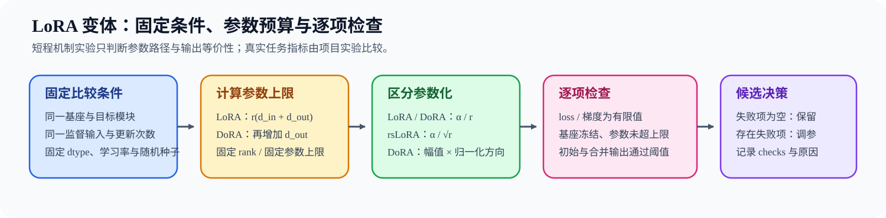
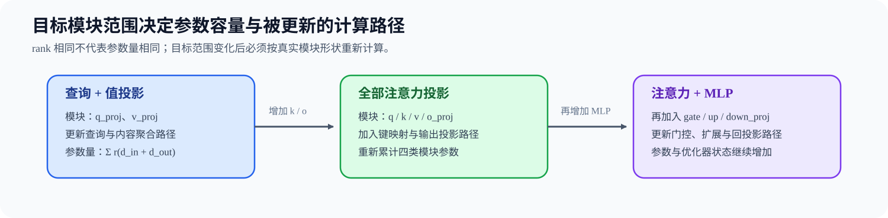

# 31. LoRA Variants Theory | LoRA Variant Scaling and Budget
**难度：** Medium | **环境：** [CPU 主线，GPU 可选](#runtime-environment) | **标签：** `训练微调`, `LoRA`, `低秩适配` | **目标人群：** 训练机制学习者

> 🚀 **云端运行环境**
>
> 本章节的实战代码可以点击以下链接在免费 GPU 算力平台上直接运行：
>
> [](https://colab.research.google.com/github/datawhalechina/llm-algo-leetcode/blob/main/02_PyTorch_Algorithms/31_LoRA_Variants_Theory.ipynb)
> [](https://modelscope.cn/my/mynotebook) *(国内推荐：魔搭社区免费实例)*


---

## 本节导读

LoRA 变体改变低秩增量的缩放、参数化或挂载范围。比较这些方案时，需要固定基座、目标模块、监督输入与更新次数，再记录可训练参数量、loss 与梯度有限性、初始输出差异、合并输出差异和资源占用。真实任务指标的候选排序由后续项目完成。

**关键词：** `rank`, `alpha`, `dropout`, `target modules`

---

<a id="runtime-environment"></a>

## 运行环境

- **基础练习：** 默认使用 [`BASE-CPU`](../guide.md#base-cpu)，运行 [Step 4 的题目与测试](#mechanism-practice)。
- **框架核对：** 如需核对 PEFT 的 rsLoRA、DoRA 配置、缩放与可训练参数量，使用 [`PT-CPU`](../topic_discussion/post_training_optimization/quickstart.md#pt-cpu-quickstart)，并运行 [框架一致性核对](#framework-check)。
- **GPU 实测：** 如需验证真实模型上的变体路径、参数预算与资源差异，阅读 [Step 5](#gpu-experiment)；实验环境与固定工作负载见其中 5.1。

---
## 前置阅读

**导语：** 进入本节前，先能说明 LoRA 旁路、缩放与合并如何工作。
- [14. LoRA Tutorial | LoRA 教程](./14_LoRA_Tutorial.md)

---

## Step 1：LoRA、rsLoRA 与 DoRA 改变了哪些参数化规则

LoRA、rsLoRA 与 DoRA 都从低秩增量出发，差别在于增量怎样随 Rank 缩放，以及是否额外建模权重幅值。先写出三者共享的低秩路径，再比较缩放规则和附加参数，可以避免把 Rank、缩放与模型容量混为一谈。对一个输入维度为 $d_{in}$、输出维度为 $d_{out}$ 的线性层，LoRA 把权重增量限制在秩至多为 $r$ 的子空间：

$$
\Delta W=sBA,\qquad
A\in\mathbb R^{r\times d_{in}},\quad
B\in\mathbb R^{d_{out}\times r},
$$

其中，$W,\Delta W\in\mathbb R^{d_{out}\times d_{in}}$ 分别是基座权重与适配器增量，$A$、$B$ 是两个低秩矩阵，$r$ 是 Rank，$s$ 是增量缩放系数。由矩阵形状可得到单个目标模块的参数量和两种缩放规则：

$$
N_{LoRA}=r(d_{in}+d_{out}),\qquad
s_{LoRA}=\frac{\alpha}{r},\qquad
s_{rsLoRA}=\frac{\alpha}{\sqrt r}.
$$

这里，$N_{LoRA}$ 是单个目标模块的可训练参数量，$\alpha$ 是配置中的缩放参数。标准初始化通常让一侧低秩矩阵为零，使适配器挂载后先保持基座输出。DoRA 进一步把幅值与方向分开，并为每个输出通道维护 $m\in\mathbb R^{d_{out}}$：

$$
W'=m\odot\frac{W+sBA}{\lVert W+sBA\rVert_{2,\,row}},\qquad
N_{DoRA}=r(d_{in}+d_{out})+d_{out}.
$$

$\odot$ 表示逐输出通道缩放，$\lVert\cdot\rVert_{2,\,row}$ 表示按输出通道对应的权重行计算二范数；因此 $N_{DoRA}$ 比同一 Rank 的 LoRA 多 $d_{out}$ 个幅值参数。

比较时既要固定 Rank，也要在同一参数上限内反推 Rank，避免把参数量差异误认为变体收益。

| 变体 | 低秩增量或有效权重 | 缩放 | 附加状态 |
|:---|:---|:---|:---|
| LoRA | `ΔW = BA` | `alpha / r` | 无 |
| rsLoRA | `ΔW = BA` | `alpha / sqrt(r)` | 无 |
| DoRA | `W' = m × (W + (alpha / r)BA) / ‖W + (alpha / r)BA‖₂` | 低秩增量采用 `alpha / r` | 每个输出通道增加一个幅值参数 `m` |


## Step 2：目标模块如何改变参数量与更新路径

同一个 Rank 放在 `q_proj`、`v_proj` 或全部 Attention/MLP 投影上，会更新不同的计算路径，也会产生不同的参数量。设目标模块集合为 $T$，多模块参数量是各模块参数量之和：

$$
N_{LoRA}(T,r)=r\sum_{\ell\in T}(d_{in,\ell}+d_{out,\ell}),\qquad
N_{DoRA}(T,r)=N_{LoRA}(T,r)+\sum_{\ell\in T}d_{out,\ell}.
$$

若参数上限为 $B$，用 $\delta_{DoRA}\in\{0,1\}$ 表示是否启用 DoRA，则预算允许的最大 Rank 为

$$
r_{max}=\left\lfloor\frac{B-\delta_{DoRA}\sum_{\ell\in T}d_{out,\ell}}{\sum_{\ell\in T}(d_{in,\ell}+d_{out,\ell})}\right\rfloor.
$$

当 $r_{max}<1$ 时，当前预算连 Rank 1 都无法容纳，应拒绝该配置。因此 Rank 相同不代表容量相同，目标模块变化后必须重新计算总参数量。

| 目标范围 | 主要改变 | 参数与训练代价 |
|:---|:---|:---|
| `q_proj` / `v_proj` | 注意力查询与取值映射 | 在本表三种范围中参数量最少，只更新查询和值路径 |
| 全部 Attention 投影 | Q/K/V/O 共同适配 | 参数增加，注意力路径更完整 |
| Attention + MLP | 同时适配信息交互与通道变换 | 参数和优化状态最多，需要重新核对预算 |


## Step 3：如何在固定 rank 与固定参数预算下比较变体

比较分为两组：固定 rank 组观察参数化带来的参数量、更新时间和显存差异；固定参数上限组让 LoRA、rsLoRA 与 DoRA 的可训练参数量不超过同一上限。机制候选还必须通过逐项检查：loss 与梯度均为有限值、基座参数保持冻结、挂载适配器后的初始输出满足一致性阈值、合并前后输出满足余弦相似度、Top-1 一致率和 loss 差阈值。这里不使用短程 loss 排列真实任务质量。

| 检查对象 | 读取字段 | 不通过时的动作 |
|:---|:---|:---|
| 参数上限 | `trainable_params` 与 `parameter_budget` | 固定预算候选超出上限时调整 rank |
| 数值路径 | `losses`、`gradient_norms` | 任一数值非有限时停止该候选 |
| 初始输出 | 余弦相似度、Top-1 一致率、loss 绝对差 | 任一指标越过阈值时检查初始化与配置 |
| 合并输出 | 合并前后的余弦相似度、Top-1 一致率、loss 绝对差 | 任一指标越过阈值时调整 rank、精度或合并方式 |
| 真实任务指标 | 冻结评测集上的任务指标 | 留给 63 节项目比较，不由本节短程更新决定 |
<a id="mechanism-practice"></a>

## Step 4：实现参数预算、变体规格与 rank 对齐

本题使用目标模块形状与参数上限复现固定 rank 和固定参数上限两种比较。你需要补全单模块适配器参数量、变体缩放与总参数量，并反推出参数上限允许的最大 rank。测试覆盖 LoRA / rsLoRA / DoRA、未知模块、非法配置和预算不足路径。

| TODO / 函数 | 学习者完成的机制 | 必须满足的约束 | 测试证据 |
|:---|:---|:---|:---|
| TODO 1：计算模块适配器参数<br>`count_adapter_parameters` | 按模块形状累计 LoRA / DoRA 可训练参数 | 只统计目标模块，DoRA 额外计入幅值状态 | 参数量符合公式；未知、重复或非法模块被拒绝 |
| TODO 2：建立变体规格<br>`build_lora_variant_spec` | 计算 LoRA / rsLoRA 缩放与参数量 | rank、alpha、变体和目标模块必须有效 | 三种变体使用正确缩放并生成完整参数账本 |
| TODO 3：反推预算允许的 rank<br>`max_rank_for_budget` | 从目标模块形状与参数上限求最大 rank | DoRA 先扣除幅值参数，结果不得超过预算 | 最大 rank 不越过预算；无法容纳 rank 1 时拒绝 |

```python
import math
from typing import Dict, List

```


```python
def count_adapter_parameters(
    module_shapes: Dict[str, tuple[int, int]],
    target_modules: List[str],
    rank: int,
    use_dora: bool,
) -> int:
    """计算目标模块上的 LoRA / DoRA 可训练参数。"""
    if rank <= 0:
        raise ValueError("rank 必须为正数")
    if len(set(target_modules)) != len(target_modules):
        raise ValueError("目标模块不能重复")
    adapter_params = 0
    for name in target_modules:
        if name not in module_shapes:
            raise KeyError(f"未知目标模块：{name}")
        in_features, out_features = module_shapes[name]
        if in_features <= 0 or out_features <= 0:
            raise ValueError("模块输入和输出维度必须为正数")
        # ==========================================
        # TODO 1：计算模块适配器参数
        # ==========================================
        # module_params = ???  # 当前模块的整数参数量；DoRA 还包含每个输出通道的幅值状态。
        raise NotImplementedError("TODO 1：计算模块适配器参数")
        adapter_params += module_params
    return adapter_params


def build_lora_variant_spec(
    variant: Dict[str, object], module_shapes: Dict[str, tuple[int, int]]
) -> Dict[str, object]:
    """生成包含缩放与参数量的统一变体规格。"""
    rank = int(variant["rank"])
    alpha = float(variant["alpha"])
    variant_type = str(variant.get("variant", "lora")).lower()
    target_modules = list(variant.get("target_modules", []))
    if variant_type not in {"lora", "rslora", "dora"}:
        raise ValueError(f"未知 LoRA 变体：{variant_type}")
    if rank <= 0 or alpha <= 0 or not target_modules:
        raise ValueError("rank、alpha 必须为正数且 target_modules 不能为空")
    # ==========================================
    # TODO 2：建立变体规格
    # ==========================================
    # scaling = ???  # 正标量；按变体定义保持 rank 缩放语义。
    # trainable_params = ???  # 所有目标模块的适配器参数总量。
    raise NotImplementedError("TODO 2：建立变体规格")
    return {**variant, "variant": variant_type, "target_modules": target_modules, "scaling": scaling, "trainable_params": trainable_params}


def max_rank_for_budget(
    module_shapes: Dict[str, tuple[int, int]],
    target_modules: List[str],
    max_trainable_params: int,
    use_dora: bool,
) -> Dict[str, object]:
    """在固定参数上限内求目标模块可使用的最大 rank。"""
    if max_trainable_params <= 0 or not target_modules:
        raise ValueError("参数上限必须为正数且 target_modules 不能为空")
    if len(set(target_modules)) != len(target_modules):
        raise ValueError("目标模块不能重复")
    for name in target_modules:
        if name not in module_shapes:
            raise KeyError(f"未知目标模块：{name}")
        if any(dimension <= 0 for dimension in module_shapes[name]):
            raise ValueError("模块输入和输出维度必须为正数")
    rank_unit = sum(sum(module_shapes[name]) for name in target_modules)
    fixed_params = sum(module_shapes[name][1] for name in target_modules) if use_dora else 0
    # ==========================================
    # TODO 3：反推预算允许的 rank
    # ==========================================
    # max_rank = ???  # 整数；先扣除固定状态，再按每阶增量容量取整。
    raise NotImplementedError("TODO 3：反推预算允许的 rank")
    if max_rank < 1:
        return {"max_rank": 0, "trainable_params": 0, "decision": "reject"}
    trainable_params = count_adapter_parameters(module_shapes, target_modules, max_rank, use_dora)
    return {"max_rank": max_rank, "trainable_params": trainable_params, "decision": "accept"}
```

## 测试

运行下方 CPU 机制测试，检查参数账本、变体缩放和固定预算下的 rank 对齐。


```python
def test_parameter_budget_and_scaling() -> None:
    """模块形状、DoRA magnitude 与缩放规则应显式进入规格。"""
    shapes = {"q_proj": (16, 16), "v_proj": (16, 8)}
    assert count_adapter_parameters(shapes, ["q_proj", "v_proj"], 4, False) == 224
    assert count_adapter_parameters(shapes, ["q_proj", "v_proj"], 4, True) == 248
    lora = build_lora_variant_spec({"name": "lora", "rank": 4, "alpha": 8, "target_modules": ["q_proj"], "variant": "lora"}, shapes)
    rslora = build_lora_variant_spec({"name": "rslora", "rank": 4, "alpha": 8, "target_modules": ["q_proj"], "variant": "rslora"}, shapes)
    assert lora["scaling"] == 2.0
    assert rslora["scaling"] == 4.0


def test_budget_aligned_rank() -> None:
    """DoRA 固定幅值状态会占用预算；预算余量不足时最大 rank 才会下降。"""
    shapes = {"q_proj": (16, 16), "v_proj": (16, 8)}
    lora = max_rank_for_budget(shapes, ["q_proj", "v_proj"], 248, use_dora=False)
    dora = max_rank_for_budget(shapes, ["q_proj", "v_proj"], 248, use_dora=True)
    assert lora == {"max_rank": 4, "trainable_params": 224, "decision": "accept"}
    assert dora == {"max_rank": 4, "trainable_params": 248, "decision": "accept"}
    tighter_dora = max_rank_for_budget(shapes, ["q_proj", "v_proj"], 224, use_dora=True)
    assert tighter_dora["max_rank"] == 3
    assert lora["trainable_params"] <= 248 and dora["trainable_params"] <= 248
    assert tighter_dora["trainable_params"] <= 224


def _assert_raises(error_type, fn) -> None:
    """断言调用抛出指定异常。"""
    try:
        fn()
    except error_type:
        return
    raise AssertionError(f"预期抛出 {error_type.__name__}")


def test_invalid_variant_inputs() -> None:
    """非法 rank、目标模块和变体名必须被拒绝。"""
    shapes = {"q_proj": (16, 16)}
    _assert_raises(ValueError, lambda: count_adapter_parameters(shapes, ["q_proj"], 0, False))
    _assert_raises(KeyError, lambda: count_adapter_parameters(shapes, ["k_proj"], 4, False))
    _assert_raises(ValueError, lambda: count_adapter_parameters(shapes, ["q_proj", "q_proj"], 4, False))
    _assert_raises(ValueError, lambda: count_adapter_parameters({"q_proj": (16, 0)}, ["q_proj"], 4, False))
    bad = {"name": "bad", "variant": "unknown", "rank": 4, "alpha": 8, "target_modules": ["q_proj"]}
    _assert_raises(ValueError, lambda: build_lora_variant_spec(bad, shapes))
    empty = {"name": "empty", "variant": "lora", "rank": 4, "alpha": 8, "target_modules": []}
    _assert_raises(ValueError, lambda: build_lora_variant_spec(empty, shapes))


def test_insufficient_budget() -> None:
    """连 rank=1 都无法容纳时，应返回可解释的拒绝结果。"""
    shapes = {"q_proj": (16, 16)}
    result = max_rank_for_budget(shapes, ["q_proj"], 31, use_dora=False)
    assert result == {"max_rank": 0, "trainable_params": 0, "decision": "reject"}


try:
    test_parameter_budget_and_scaling()
    test_budget_aligned_rank()
    test_invalid_variant_inputs()
    test_insufficient_budget()
    print("✅ LoRA 参数预算、缩放与预算对齐测试通过。")
except (AttributeError, KeyError, NameError, TypeError, ValueError, AssertionError) as error:
    raise NotImplementedError("请先完成 TODO 代码！") from error
```

---

🛑 **STOP HERE** 🛑
<br><br><br><br><br><br><br><br><br><br>
> 请先尝试自己完成代码并跑通测试。<br>
> 如果遇到困难没有思路，可以向下滚动查看参考答案。
<br><br><br><br><br><br><br><br><br><br>

---

## 参考代码与解析

### 代码


```python
import math


def count_adapter_parameters(
    module_shapes: Dict[str, tuple[int, int]],
    target_modules: List[str],
    rank: int,
    use_dora: bool,
) -> int:
    """计算目标模块上的 LoRA / DoRA 可训练参数。"""
    if rank <= 0:
        raise ValueError("rank 必须为正数")
    if len(set(target_modules)) != len(target_modules):
        raise ValueError("目标模块不能重复")
    adapter_params = 0
    for name in target_modules:
        if name not in module_shapes:
            raise KeyError(f"未知目标模块：{name}")
        in_features, out_features = module_shapes[name]
        if in_features <= 0 or out_features <= 0:
            raise ValueError("模块输入和输出维度必须为正数")
        # TODO 1：计算模块适配器参数。
        adapter_params += rank * (in_features + out_features)
        if use_dora:
            adapter_params += out_features
    return adapter_params


def build_lora_variant_spec(
    variant: Dict[str, object], module_shapes: Dict[str, tuple[int, int]]
) -> Dict[str, object]:
    """生成包含缩放与参数量的统一变体规格。"""
    rank = int(variant["rank"])
    alpha = float(variant["alpha"])
    variant_type = str(variant.get("variant", "lora")).lower()
    target_modules = list(variant.get("target_modules", []))
    if variant_type not in {"lora", "rslora", "dora"}:
        raise ValueError(f"未知 LoRA 变体：{variant_type}")
    if rank <= 0 or alpha <= 0 or not target_modules:
        raise ValueError("rank、alpha 必须为正数且 target_modules 不能为空")
    # TODO 2：建立变体规格。
    scaling = alpha / math.sqrt(rank) if variant_type == "rslora" else alpha / rank
    trainable_params = count_adapter_parameters(
        module_shapes, target_modules, rank, use_dora=variant_type == "dora"
    )
    return {
        **variant,
        "variant": variant_type,
        "target_modules": target_modules,
        "scaling": scaling,
        "trainable_params": trainable_params,
    }


def max_rank_for_budget(
    module_shapes: Dict[str, tuple[int, int]],
    target_modules: List[str],
    max_trainable_params: int,
    use_dora: bool,
) -> Dict[str, object]:
    """在固定参数上限内求目标模块可使用的最大 rank。"""
    if max_trainable_params <= 0 or not target_modules:
        raise ValueError("参数上限必须为正数且 target_modules 不能为空")
    if len(set(target_modules)) != len(target_modules):
        raise ValueError("目标模块不能重复")
    for name in target_modules:
        if name not in module_shapes:
            raise KeyError(f"未知目标模块：{name}")
        if any(dimension <= 0 for dimension in module_shapes[name]):
            raise ValueError("模块输入和输出维度必须为正数")
    # TODO 3：反推预算允许的 rank。
    rank_unit = sum(sum(module_shapes[name]) for name in target_modules)
    fixed_params = sum(module_shapes[name][1] for name in target_modules) if use_dora else 0
    max_rank = (max_trainable_params - fixed_params) // rank_unit
    if max_rank < 1:
        return {"max_rank": 0, "trainable_params": 0, "decision": "reject"}
    trainable_params = count_adapter_parameters(module_shapes, target_modules, max_rank, use_dora)
    return {"max_rank": max_rank, "trainable_params": trainable_params, "decision": "accept"}
```

### 解析

#### TODO 1：计算模块适配器参数

- 机制：每个目标线性层贡献 `rank × (d_in + d_out)` 个低秩参数；DoRA 再增加 `d_out` 个幅值参数。
- 不变量：rank、输入维度和输出维度必须为正，目标模块必须存在且不能重复。
- 测试证据：`test_parameter_budget_and_scaling` 核对 LoRA 与 DoRA 参数量，`test_invalid_variant_inputs` 覆盖未知、重复和零维模块。

#### TODO 2：建立变体规格

- 机制：LoRA 与 DoRA 使用 `alpha / rank`，rsLoRA 使用 `alpha / sqrt(rank)`；规格同时记录目标模块和总可训练参数。
- 不变量：变体只能属于 LoRA、rsLoRA、DoRA，且 rank、alpha 和目标模块列表均有效。
- 测试证据：`test_parameter_budget_and_scaling` 对比缩放结果，`test_invalid_variant_inputs` 检查非法变体和空目标范围。

#### TODO 3：反推预算允许的 rank

- 机制：先从参数上限扣除 DoRA 幅值参数，再除以所有目标模块每增加一阶所需的参数量并向下取整。
- 不变量：返回的 `trainable_params` 不能超过参数上限；如果 rank 1 也无法容纳，则返回 `reject`。DoRA 幅值状态可能降低最大 rank，但预算余量足够时也可能保持不变。
- 测试证据：`test_budget_aligned_rank` 检查参数上限与两种余量情况，`test_insufficient_budget` 检查 rank 1 无法容纳的路径。
<a id="framework-check"></a>

## 框架一致性核对（可选）

下面在随机初始化的微型 Llama 上挂载 PEFT 适配器，比较 LoRA / rsLoRA 缩放、DoRA 幅值参数和可训练参数量。整个核对使用受控配置，不下载模型权重。

| 核对项 | 本节口径 | PEFT 路径 | 通过条件 |
| --- | --- | --- | --- |
| LoRA 缩放 | $\alpha/r$ | `LoraConfig(r, lora_alpha)` | 目标投影的缩放值等于理论值 |
| rsLoRA 缩放 | $\alpha/\sqrt r$ | `use_rslora=True` | 目标投影的缩放值等于理论值 |
| DoRA 状态 | 每个目标模块增加 $d_{out}$ 个幅值参数 | `use_dora=True` | 幅值参数存在，且可训练参数量符合预算 |
| 参数量 | 仅统计目标模块的可训练适配器参数 | `requires_grad=True` 参数总量 | LoRA 与 rsLoRA 参数量相同，DoRA 只增加幅值参数 |

```python
from importlib.metadata import version

try:
    from peft import LoraConfig, get_peft_model
    from transformers import LlamaConfig, LlamaForCausalLM
except ImportError:
    framework_check = {
        "status": "skipped",
        "reason": "请使用 PT-CPU 环境运行本单元",
    }
else:
    def check_peft_lora_variant_conformance():
        """核对 PEFT 三种适配器的缩放规则与参数预算。"""
        rank, alpha, hidden_size = 4, 8, 16
        target_modules = ["q_proj", "v_proj"]

        def build_variant(**kwargs):
            config = LlamaConfig(
                vocab_size=32, hidden_size=hidden_size, intermediate_size=32,
                num_hidden_layers=1, num_attention_heads=2,
                num_key_value_heads=2, max_position_embeddings=32,
            )
            model = LlamaForCausalLM(config)
            return get_peft_model(model, LoraConfig(
                r=rank, lora_alpha=alpha,
                target_modules=target_modules, **kwargs,
            ))

        lora = build_variant()
        rslora = build_variant(use_rslora=True)
        dora = build_variant(use_dora=True)

        def trainable_count(model):
            return sum(parameter.numel() for parameter in model.parameters() if parameter.requires_grad)

        def q_scaling(model):
            projection = model.base_model.model.model.layers[0].self_attn.q_proj
            return float(projection.scaling["default"])

        # q_proj 与 v_proj 是两个同形目标模块，预算需要同时计入两组 A/B。
        expected_lora = 2 * rank * (hidden_size + hidden_size)
        expected_dora = expected_lora + 2 * hidden_size
        checks = {
            "lora_scaling_match": abs(q_scaling(lora) - alpha / rank) < 1e-8,
            "rslora_scaling_match": abs(q_scaling(rslora) - alpha / rank ** 0.5) < 1e-8,
            "lora_parameter_count_match": trainable_count(lora) == expected_lora,
            "rslora_parameter_count_match": trainable_count(rslora) == expected_lora,
            "dora_parameter_count_match": trainable_count(dora) == expected_dora,
            "dora_magnitude_present": any(
                "lora_magnitude_vector" in name
                for name, parameter in dora.named_parameters() if parameter.requires_grad
            ),
        }
        failed = [name for name, passed in checks.items() if not passed]
        if failed:
            raise AssertionError(f"框架一致性核对失败：{failed}")
        return {
            "status": "passed",
            "versions": {"peft": version("peft"), "transformers": version("transformers")},
            "framework_path": "peft.get_peft_model",
            "checks": checks,
            "trainable_parameters": {
                "lora": trainable_count(lora),
                "rslora": trainable_count(rslora),
                "dora": trainable_count(dora),
            },
        }

    framework_check = check_peft_lora_variant_conformance()

framework_check
```

<a id="gpu-experiment"></a>

## Step 5：可选 GPU 实验——真实模型变体路径与预算对齐

CPU 题目确认缩放、参数账本和参数上限允许的 rank；GPU 实验固定真实模型、目标模块和监督输入，先在相同 rank 下比较 LoRA、rsLoRA、DoRA，再加入不超过同一参数上限的 DoRA 候选。每个候选单独记录检查结果、失败项和决策。

| 学习问题 | CPU 已确认 | GPU 要确认与后续使用 |
|:---|:---|:---|
| 变体参数化与预算对齐是否进入真实训练路径 | 缩放公式、目标模块参数量、DoRA 幅值状态和最大 rank | PEFT 配置、实际可训练参数、短程梯度与损失、更新时间、峰值显存和 merge 等价性；质量排序交给 63 节项目 |

### 5.1 环境与固定工作负载

本实验复用 [`PT-SFT-CUDA`](../gpu_environment_assets.md#pt-sft-cuda)，不新增环境。首次运行先完成[后训练实验 Quickstart](../topic_discussion/post_training_optimization/quickstart.md#pt-sft-cuda-quickstart)；已有环境只需通过 Profile 预检，并从同一解释器启动 JupyterLab。页面、工作负载和结果状态见[后训练优化实验资产表](../topic_discussion/post_training_optimization/experiment_assets.md)。

| 配置层 | 本节固定条件 | 修改规则 |
|:---|:---|:---|
| 运行环境 | `PT-SFT-CUDA`；单张 NVIDIA GPU | 预检失败时停止实验；实测峰值显存见 5.4 |
| 模型 / 数据来源 | `Qwen/Qwen2.5-0.5B`；两条内置监督样本 | 自动固定模型 commit；不下载数据集 |
| 固定 rank 矩阵 | LoRA / rsLoRA / DoRA，均使用 rank 8、alpha 16 | 用于隔离缩放与参数化差异 |
| 固定预算矩阵 | 以 LoRA rank 8 的参数量为上限，反推 DoRA rank | 改变目标模块或参数上限后递增 workload version |
| 工作负载 | `q_proj + v_proj`；长度 128；5 次更新 | 模型、输入、dtype、学习率和随机种子保持一致 |
| 测量方法 | 配置缩放、参数 / adapter 字节、loss / 梯度有限性、更新时间、峰值显存、合并前后输出差异 | 不把短程 loss 变化解释为任务质量 |
| 结果资产 | `benchmarks/results/pt_lora_variants/pt-lora-variants_<run_label>.json` | 正式复测使用唯一标签并保留旧结果 |

```python
# 学习者入口：普通复测通常只修改这两项。
RUN_MODE = "dry_run"  # 默认值 dry_run；改为 real_gpu 才执行真实 LoRA 变体矩阵。
RUN_LABEL = "default"  # 默认值 default；正式复测改为唯一标签，避免覆盖旧结果。

ENVIRONMENT_PROFILE = "PT-SFT-CUDA"  # 默认值 PT-SFT-CUDA；运行前必须通过同名 Profile 预检。
MODEL_ID = "Qwen/Qwen2.5-0.5B"  # 默认基础模型；更换模型后不得与旧结果直接合并。
MODEL_REVISION = "main"  # 默认 main；5.2 自动解析并记录实际模型 commit。
WORKLOAD_ID = "pt-lora-variants"  # 固定工作负载身份；不随运行标签变化。
WORKLOAD_VERSION = "v3"  # v3 为每个候选记录逐项检查、失败原因与决策。
MAX_LENGTH = 128  # 默认值 128 token；增大会提高激活占用和更新时间。
FIXED_RANK = 8  # 默认值 8；固定 rank 矩阵中的共同 rank。
LORA_ALPHA = 16  # 默认值 16；固定三种变体的 alpha。
UPDATE_STEPS = 5  # 默认值 5；用于检查短程数值与资源，不代表模型收敛。
LEARNING_RATE = 1e-3  # 默认值 1e-3；所有候选使用相同短程学习率。
MIN_OUTPUT_COSINE = 0.999  # 默认值 0.999；约束初始与合并前后的完整 logits 方向一致性。
MIN_OUTPUT_TOP1_AGREEMENT = 0.98  # 默认值 0.98；约束逐位置贪心预测一致率。
MAX_OUTPUT_LOSS_DIFF = 0.02  # 默认值 0.02；约束同一监督批次上的 loss 绝对差。
SEED = 42  # 默认值 42；固定初始化、输入和候选对照。
LOCAL_FILES_ONLY = False  # 默认值 False；已缓存相同 commit 且离线运行时改为 True。
TARGET_MODULES = ["q_proj", "v_proj"]  # 固定 q/v，避免与 14 节的挂载范围实验重复。
OUTPUT_RELATIVE_PATH = f"benchmarks/results/pt_lora_variants/{WORKLOAD_ID}_{RUN_LABEL}.json"

```

### 5.2 执行双口径变体矩阵并保存 JSON

5.2 从同一模型 commit 构造监督输入，先读取真实 q/v 模块形状，再生成三个固定 rank 候选和一个参数上限对齐的 DoRA 候选。每个候选从相同基座重新加载，依次检查初始输出、短程更新、合并输出和参数上限，并写入 `checks`、`failed_checks` 与候选决策。

```python
import gc
import math
import platform
import time

import torch
from tools.notebook_runtime import failure_record, package_version, resolve_model_commit, save_json
from tools.project_runtime import resolve_project_root
from tools.training_mechanism_runtime import cuda_hardware_snapshot, gradient_l2_norm, logit_agreement, median_and_p95

REPO_ROOT = resolve_project_root()
OUTPUT_PATH = REPO_ROOT / OUTPUT_RELATIVE_PATH
result = {
    "schema_version": "post-training-mechanism-gpu/v1",
    "semantic_id": "PT-LORA-VARIANTS",
    "environment_profile": ENVIRONMENT_PROFILE,
    "run_mode": RUN_MODE,
    "run_label": RUN_LABEL,
    "framework": {"python": platform.python_version(), "torch": torch.__version__, "transformers": package_version("transformers"), "peft": package_version("peft")},
    "hardware": {"cuda_available": torch.cuda.is_available(), "cuda": torch.version.cuda},
    "model": {"id": MODEL_ID, "requested_revision": MODEL_REVISION, "resolved_commit": None},
    "workload": {"id": WORKLOAD_ID, "version": WORKLOAD_VERSION, "max_length": MAX_LENGTH, "fixed_rank": FIXED_RANK, "alpha": LORA_ALPHA, "update_steps": UPDATE_STEPS, "learning_rate": LEARNING_RATE, "target_modules": TARGET_MODULES, "output_thresholds": {"min_cosine": MIN_OUTPUT_COSINE, "min_top1_agreement": MIN_OUTPUT_TOP1_AGREEMENT, "max_loss_diff": MAX_OUTPUT_LOSS_DIFF}, "seed": SEED},
    "budget": None, "candidates": [], "failure": None,
    "evidence_level": "dry_run", "decision": "not_measured",
}

execution_stage = "environment_preflight"
if RUN_MODE == "real_gpu":
    model = merged_model = optimizer = inspection_model = None
    try:
        if not torch.cuda.is_available():
            raise RuntimeError("RUN_MODE=real_gpu，但 CUDA 不可用")
        from peft import LoraConfig, TaskType, get_peft_model
        from transformers import AutoModelForCausalLM, AutoTokenizer

        torch.manual_seed(SEED)
        torch.cuda.manual_seed_all(SEED)
        device = torch.device("cuda")
        dtype = torch.bfloat16 if torch.cuda.is_bf16_supported() else torch.float16
        execution_stage = "revision_and_workload"
        model_commit, revision_source = resolve_model_commit(MODEL_ID, MODEL_REVISION, local_files_only=LOCAL_FILES_ONLY)
        result["model"].update({"resolved_commit": model_commit, "resolution_source": revision_source})
        tokenizer = AutoTokenizer.from_pretrained(MODEL_ID, revision=model_commit, local_files_only=LOCAL_FILES_ONLY)
        if tokenizer.pad_token_id is None:
            tokenizer.pad_token = tokenizer.eos_token
        prompts = ["Instruction: Explain gradient accumulation.\nResponse:", "Instruction: Explain low-rank adaptation.\nResponse:"]
        responses = [" It combines gradients before one optimizer update.", " It trains a small low-rank weight update."]
        full_texts = [prompt + response + tokenizer.eos_token for prompt, response in zip(prompts, responses)]
        encoded = tokenizer(full_texts, add_special_tokens=False, padding="max_length", truncation=True, max_length=MAX_LENGTH, return_tensors="pt")
        labels = encoded["input_ids"].clone()
        for row, prompt in enumerate(prompts):
            prompt_len = min(len(tokenizer(prompt, add_special_tokens=False)["input_ids"]), MAX_LENGTH)
            labels[row, :prompt_len] = -100
        labels[encoded["attention_mask"] == 0] = -100
        batch = {"input_ids": encoded["input_ids"].to(device), "attention_mask": encoded["attention_mask"].to(device), "labels": labels.to(device)}

        inspection_model = AutoModelForCausalLM.from_pretrained(MODEL_ID, revision=model_commit, local_files_only=LOCAL_FILES_ONLY, dtype=dtype)
        matched_shapes = [(name, (module.in_features, module.out_features)) for name, module in inspection_model.named_modules() if isinstance(module, torch.nn.Linear) and name.rsplit(".", 1)[-1] in TARGET_MODULES]
        if not matched_shapes:
            raise ValueError("目标模块未命中真实线性层")
        rank_unit = sum(in_features + out_features for _, (in_features, out_features) in matched_shapes)
        dora_fixed_params = sum(out_features for _, (_, out_features) in matched_shapes)
        parameter_budget = FIXED_RANK * rank_unit
        budget_aligned_dora_rank = (parameter_budget - dora_fixed_params) // rank_unit
        if budget_aligned_dora_rank < 1:
            raise ValueError("当前参数预算无法容纳 DoRA rank=1")
        result["budget"] = {"matched_module_count": len(matched_shapes), "rank_unit_params": rank_unit, "dora_fixed_params": dora_fixed_params, "parameter_budget": parameter_budget, "budget_aligned_dora_rank": budget_aligned_dora_rank}
        del inspection_model
        inspection_model = None
        gc.collect()

        candidate_specs = [
            {"name": "lora_r8", "variant": "lora", "rank": FIXED_RANK, "roles": ["fixed_rank", "fixed_budget"]},
            {"name": "rslora_r8", "variant": "rslora", "rank": FIXED_RANK, "roles": ["fixed_rank", "fixed_budget"]},
            {"name": "dora_r8", "variant": "dora", "rank": FIXED_RANK, "roles": ["fixed_rank"]},
            {"name": f"dora_r{budget_aligned_dora_rank}", "variant": "dora", "rank": budget_aligned_dora_rank, "roles": ["fixed_budget"]},
        ]

        for spec in candidate_specs:
            execution_stage = f"candidate:{spec['name']}"
            gc.collect()
            torch.cuda.empty_cache()
            torch.cuda.reset_peak_memory_stats()
            torch.manual_seed(SEED)
            model = AutoModelForCausalLM.from_pretrained(MODEL_ID, revision=model_commit, local_files_only=LOCAL_FILES_ONLY, dtype=dtype).to(device)
            model.config.use_cache = False
            model.eval()
            with torch.no_grad(), torch.autocast("cuda", dtype=dtype):
                base_output = model(**batch)
                base_logits = base_output.logits
            config = LoraConfig(r=spec["rank"], lora_alpha=LORA_ALPHA, lora_dropout=0.0, target_modules=TARGET_MODULES, bias="none", task_type=TaskType.CAUSAL_LM, use_rslora=spec["variant"] == "rslora", use_dora=spec["variant"] == "dora")
            model = get_peft_model(model, config)
            trainable = [parameter for parameter in model.parameters() if parameter.requires_grad]
            trainable_params = sum(parameter.numel() for parameter in trainable)
            adapter_bytes = sum(parameter.numel() * parameter.element_size() for parameter in trainable)
            base_frozen = all((not parameter.requires_grad) or ("lora_" in name) or ("magnitude" in name) for name, parameter in model.named_parameters())
            scaling_values = []
            for module in model.modules():
                scaling = getattr(module, "scaling", None)
                if isinstance(scaling, dict) and "default" in scaling:
                    scaling_values.append(float(scaling["default"]))
            model.eval()
            with torch.no_grad(), torch.autocast("cuda", dtype=dtype):
                initial_output = model(**batch)
                initial_logits = initial_output.logits
            initial_agreement = logit_agreement(base_logits, initial_logits)
            initial_loss_abs_diff = abs(float(base_output.loss.item()) - float(initial_output.loss.item()))
            del base_output, initial_output, initial_logits, base_logits

            optimizer = torch.optim.AdamW(trainable, lr=LEARNING_RATE)
            update_times_ms, losses, gradient_norms = [], [], []
            model.train()
            for _ in range(UPDATE_STEPS):
                optimizer.zero_grad(set_to_none=True)
                torch.cuda.synchronize()
                started = time.perf_counter()
                with torch.autocast("cuda", dtype=dtype):
                    loss = model(**batch).loss
                loss.backward()
                gradient_norms.append(gradient_l2_norm(trainable))
                optimizer.step()
                torch.cuda.synchronize()
                update_times_ms.append((time.perf_counter() - started) * 1000)
                losses.append(float(loss.detach().item()))
            model.eval()
            with torch.no_grad(), torch.autocast("cuda", dtype=dtype):
                premerge_output = model(**batch)
                premerge_logits = premerge_output.logits
            merged_model = model.merge_and_unload()
            merged_model.eval()
            with torch.no_grad(), torch.autocast("cuda", dtype=dtype):
                merged_output = merged_model(**batch)
                merged_logits = merged_output.logits
            merge_agreement = logit_agreement(premerge_logits, merged_logits)
            merge_loss_abs_diff = abs(float(premerge_output.loss.item()) - float(merged_output.loss.item()))
            median_ms, p95_ms = median_and_p95(update_times_ms)
            checks = {
                "finite_loss_and_gradients": all(math.isfinite(value) for value in losses + gradient_norms),
                "base_parameters_frozen": base_frozen and trainable_params > 0,
                "initial_output_equivalent": initial_agreement["cosine_similarity"] >= MIN_OUTPUT_COSINE and initial_agreement["top1_agreement"] >= MIN_OUTPUT_TOP1_AGREEMENT and initial_loss_abs_diff <= MAX_OUTPUT_LOSS_DIFF,
                "merged_output_equivalent": merge_agreement["cosine_similarity"] >= MIN_OUTPUT_COSINE and merge_agreement["top1_agreement"] >= MIN_OUTPUT_TOP1_AGREEMENT and merge_loss_abs_diff <= MAX_OUTPUT_LOSS_DIFF,
            }
            if "fixed_budget" in spec["roles"]:
                checks["within_parameter_budget"] = trainable_params <= parameter_budget
            failed_checks = [name for name, passed in checks.items() if not passed]
            candidate_decision = "accept_candidate" if not failed_checks else "tune_candidate"
            result["candidates"].append({**spec, "actual_scaling": scaling_values[0] if scaling_values else None, "trainable_params": trainable_params, "adapter_bytes": adapter_bytes, "base_frozen": base_frozen, "initial_agreement": initial_agreement, "initial_loss_abs_diff": initial_loss_abs_diff, "losses": losses, "gradient_norms": gradient_norms, "median_update_ms": median_ms, "p95_update_ms": p95_ms, "peak_allocated_bytes": int(torch.cuda.max_memory_allocated()), "peak_reserved_bytes": int(torch.cuda.max_memory_reserved()), "merge_agreement": merge_agreement, "merge_loss_abs_diff": merge_loss_abs_diff, "checks": checks, "failed_checks": failed_checks, "decision": candidate_decision})
            del premerge_output, merged_output, premerge_logits, merged_logits, merged_model, model, optimizer
            merged_model = model = optimizer = None

        result["hardware"] = cuda_hardware_snapshot()
        result["evidence_level"] = "local_mechanism_benchmark"
        result["decision"] = "accept_mechanism" if all(item["decision"] == "accept_candidate" for item in result["candidates"]) else "tune"
    except Exception as error:
        result["failure"] = failure_record(execution_stage, error)
        result["evidence_level"] = "failed_real_gpu_attempt"
        result["decision"] = "reject_until_fixed"
    finally:
        del model, merged_model, optimizer, inspection_model
        gc.collect()
        if torch.cuda.is_available():
            torch.cuda.empty_cache()
else:
    result["decision"] = "ready_to_measure"

save_json(OUTPUT_PATH, result)
print(f"结果已保存：{OUTPUT_PATH}")

```

### 5.3 读取双口径候选矩阵

先检查失败阶段和模型 commit，再核对参数上限、实际 rank、PEFT scaling、短程更新资源、合并误差以及每个候选的 `checks`、`failed_checks` 和 `decision`。

```python
import json

if not OUTPUT_PATH.exists():
    print(f"尚未找到结果文件：{OUTPUT_PATH}")
else:
    record = json.loads(OUTPUT_PATH.read_text(encoding="utf-8"))
    print(json.dumps({key: record.get(key) for key in ("run_label", "model", "budget", "failure", "evidence_level", "decision")}, ensure_ascii=False, indent=2))
    for candidate in record.get("candidates", []):
        print({key: candidate.get(key) for key in ("name", "roles", "rank", "actual_scaling", "trainable_params", "adapter_bytes", "initial_agreement", "initial_loss_abs_diff", "median_update_ms", "p95_update_ms", "peak_allocated_bytes", "merge_agreement", "merge_loss_abs_diff", "checks", "failed_checks", "decision")})

```

### 5.4 解释变体、预算与资源证据

先检查 `failure`、模型 commit 和参数上限；确认候选来自同一基座与输入后，再比较固定 rank 与固定参数上限两组证据。`rtx5070ti_lora_variants_v3` 已记录候选级 `checks`、`failed_checks` 和 `decision`，可以直接定位未通过的机制条件。

| 观察项 | 读取字段 | 当前结果 | 解释与动作 |
|:---|:---|:---|:---|
| 运行与比较条件 | `failure`、model commit、target modules、roles | 无失败；四候选复用 q/v 模块、固定输入与模型 commit | 固定 rank 与固定参数上限两组结果可比较 |
| 机制与路径 | variant、rank、`actual_scaling`、`checks` | LoRA / rsLoRA rank 8；DoRA rank 8 / 7；四组均保持基座冻结且 loss、梯度有限 | 变体、缩放与参数预算路径正确 |
| 数值与等价性 | `initial_agreement`、`merge_agreement`、`failed_checks` | 前三组通过；`dora_r7` 合并余弦为 0.99839，低于 0.999 | 固定预算 DoRA 未通过 `merged_output_equivalent`，不能直接采用 |
| 资源与性能 | `trainable_params`、更新时间、峰值显存 | 0.50M–0.57M；中位更新 38.3–50.8 ms；最高峰值分配约 1.97 GiB | DoRA 增加幅值参数与更新时间，本轮显存差异较小 |
| 证据与决策 | `evidence_level`、候选 `decision`、整体 `decision` | 三组 `accept_candidate`，`dora_r7` 为 `tune_candidate`；整体为 `tune` | 保留前三组机制证据；调整固定预算 DoRA 的 rank、精度或合并阈值后复测 |
## 相关阅读

完成变体规格和比较指标后，可以继续阅读 LoRA 原论文、PEFT 实现和项目基准，核对方案是否适合具体训练预算。

- [LoRA 原论文：Low-Rank Adaptation of Large Language Models](https://arxiv.org/abs/2106.09685)
- [Hugging Face PEFT 官方仓库](https://github.com/huggingface/peft)
- [63. LoRA Variants Benchmark | LoRA 变体基准对比](./63_LoRA_Variants_Benchmark.md)
- [65. QLoRA Selection Project | QLoRA 方案选择项目](./65_QLoRA_Selection_Project.md)
