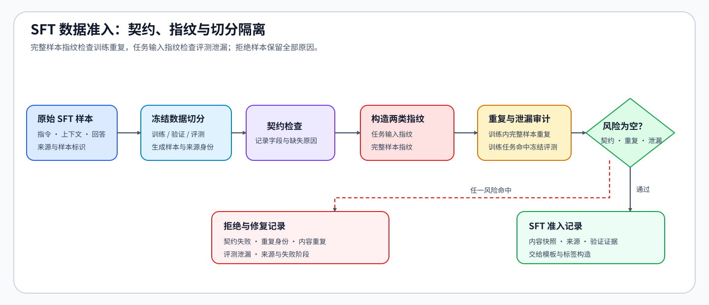
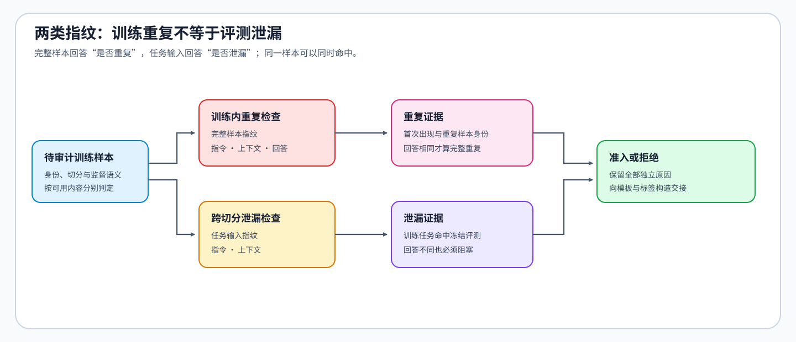

# 32. Data Engineering for SFT | SFT 数据契约与泄漏审计
**难度：** Medium | **环境：** [CPU 主线](#runtime-environment) | **标签：** `后训练`, `SFT`, `数据治理` | **目标人群：** 后训练学习者

> 🚀 **云端运行环境**
>
> 本章节的实战代码可以点击以下链接在免费 GPU 算力平台上直接运行：
>
> [](https://colab.research.google.com/github/datawhalechina/llm-algo-leetcode/blob/main/02_PyTorch_Algorithms/32_Data_Engineering_for_SFT.ipynb)
> [](https://modelscope.cn/my/mynotebook) *(国内推荐：魔搭社区免费实例)*


---

## 本节导读

确定要用示范回答进行SFT后，还要检查这些示范从哪里来、是否重复、是否包含原本用于评测的任务。来源不清时，无法确认模型用了哪批数据；重复样本会改变各类任务在训练中的比重；评测任务进入训练或候选调整过程，则构成评测泄漏，使成绩无法说明模型对未见任务的表现。

本节先检查来源、用途、指令和回答是否齐全，再分别比较任务输入与完整样本：前者发现训练与评测的任务重合，后者发现训练集中的重复示范。检查通过后，保存实际采用的记录及来源；被拒绝的记录保留全部原因。随后用通过的具体内容构造提示、回答和监督标签。

**关键词：** `data contract`, `deduplication`, `split isolation`, `decontamination`

---
<a id="runtime-environment"></a>

## 运行环境

- **基础练习：** 默认使用 [`BASE-CPU`](../guide.md#base-cpu)，运行 [Step 4 的题目与测试](#mechanism-practice)。
- **框架核对：** 如需检查准入记录能否无损进入 Hugging Face Datasets，使用 [`PT-CPU`](../topic_discussion/post_training_optimization/quickstart.md#pt-cpu-quickstart)；完成 Step 4 后运行[框架一致性核对](#framework-check)。

---
## 前置阅读

**导语：** 33 节先确定是否需要 SFT 并生成数据需求单；本节再用结构化样本与稳定身份检查候选示范能否进入训练。
- [33. Post-Training Admission and Stage Selection | 后训练准入与阶段选择](./33_Fine_Tuning_Readiness.md)
- [04. Python Config and Data Entry | Python 配置与数据组织](../00_Prerequisites/04_Python_Config_and_Data_Entry.md)

---

## Step 1：一条 SFT 样本如何从来源进入监督数据

候选示范需要同时说明来源、所属切分、任务条件与期望回答。数据契约（data contract）就是对这些内容的共同约定：身份用于回查，训练／验证／测试切分决定用途，指令和上下文描述任务，回答提供监督目标。字段完整后，还要检查重复与评测重合，才能形成可训练记录。

例如退款任务的一条示范有明确来源和回答；另一条更换了标识，却复制了同一任务与回答；第三条任务已经用于独立评测。这些记录都可能具有完整字段，却不能因此一起进入训练。审计结果需要携带通过的具体内容，而不是仅凭一个可能被复用的标识回查原始候选池。

| 契约维度 | 接受条件 | 不满足时说明什么 |
|:---|:---|:---|
| 可追溯身份 | 样本标识和来源非空，生成数据还保留生成与验证记录 | 无法回查数据来源与失败样本 |
| 切分角色 | 明确属于训练、验证或测试 | 无法确定该记录的用途 |
| 任务输入 | 指令非空，可选上下文与指令共同定义任务 | 模型缺少任务条件 |
| 监督目标 | 回答非空，并与任务输入分离 | 缺少有效目标或无法限定监督范围 |


## Step 2：如何识别训练集重复与评测数据泄漏

身份重复只能发现同一样本身份被重复使用，无法发现更换身份后的同一内容。冻结评测集是预先固定成员与用途的验证或测试集合，其任务不进入训练池。验证集可用于候选选择，最终测试集用于方案确定后的独立检验。训练集去重需要比较完整样本，训练与评测之间的泄漏检查只比较任务输入；如果泄漏检查混入回答，同一任务换一个回答就可能逃过检查。指纹（fingerprint）在这里是用于相等比较的内容键，不是语义相似度分数。本例去掉首尾空白并统一大小写，保留正文内部空白；比较范围不同，规范化规则则保持一致。

设规范化后的指令、上下文和回答分别为 $i(x)$、$c(x)$、$r(x)$，则两类比较键为

$$
f_{\mathrm{task}}(x)=\big(i(x),c(x)\big),\qquad
f_{\mathrm{example}}(x)=\big(i(x),c(x),r(x)\big).
$$

任务输入指纹刻画“模型要回答什么”，完整样本指纹还包含“希望模型怎样回答”。这样的精确比较可以发现换标识或换回答的重复任务；改写后的近重复还需要相似度筛查与复核。大小写本身影响含义的代码等数据，应调整规范化规则并重新审计。

| 比较键 | 组成 | 比较范围 | 发现的问题 |
|:---|:---|:---|:---|
| 样本身份 | 数据来源声明的稳定标识 | 训练集内部 | 同一身份被重复使用 |
| 任务输入指纹 | 规范化后的完整任务条件，不包含目标回答 | 训练集与独立评测集 | 训练任务泄漏到评测集 |
| 完整样本指纹 | 规范化后的任务条件与目标回答 | 训练集内部 | 不同身份指向相同监督样本 |


## Step 3：准入结果如何保留风险并限定训练内容

字段缺失、身份重复、内容重复和评测泄漏可能同时发生。例如回答为空的记录仍可能命中评测任务；若在字段检查失败后立即停止，就丢失了已经能识别的污染原因。可比较的风险应分别记录；字段不完整的记录则不能占用后续合法样本的去重位置。

把命中的拒绝原因记为集合 $R(x)$，样本 $x$ 的准入决定为 $A(x)$：

$$
R(x)=R_{\mathrm{contract}}(x)\cup R_{\mathrm{id}}(x)\cup R_{\mathrm{duplicate}}(x)\cup R_{\mathrm{leak}}(x),\qquad
A(x)=\mathbf{1}[R(x)=\varnothing].
$$

四个子集分别对应契约、身份重复、完整样本重复与评测泄漏；$\mathbf{1}$ 在条件成立时取1，否则取0。记录快照是审计通过时内容的独立副本，包含任务、回答、来源和已有验证记录。通过审计后，保留这份快照及来源证据，再用这份内容构造提示与回答；仅保存准入标识再回查候选池，可能把同标识的被拒行重新带回训练。

| 风险或结果 | 判断依据 | 后续动作 |
|:---|:---|:---|
| 契约失败 | 来源、切分、指令或回答缺失，或切分值非法 | 保留具体缺项，补齐后重新审计 |
| 身份重复 | 已见训练记录使用相同标识 | 核对来源和数据版本 |
| 完整样本重复 | 任务输入与回答均已出现 | 去重并保留来源 |
| 评测任务泄漏 | 任务输入命中冻结的验证或测试集合 | 移除污染训练记录，保留独立评测 |
| 记录准入 | 所有可判定风险均未命中 | 用已审计内容构造监督数据，继续保留来源与验证证据 |
<a id="mechanism-practice"></a>
## Step 4：实现 SFT 数据契约与泄漏审计

题目给出候选记录、训练／评测用途和来源信息。骨架提供记录结构并保存通过检查时的内容副本；你将构造任务输入与完整样本的比较键，分别判断重复和评测任务重合。测试检查更换回答、重复编号、空回答和来源信息保留，也检查被拒绝的记录是否会因复用编号重新进入训练。

| TODO / 函数 | 学习者完成的机制 | 必须满足的约束 | 测试证据 |
|:---|:---|:---|:---|
| TODO 1：构造两类指纹<br>`build_sft_fingerprints` | 分离任务输入与完整监督样本的比较键 | 回答变化只能改变完整样本指纹 | 修改回答后，任务输入指纹保持不变，完整样本指纹随之改变 |
| TODO 2：审计重复与泄漏<br>`audit_sft_dataset` | 分别判断完整样本重复和任务输入泄漏 | 风险独立记录，同一样本可同时命中；交接使用具体准入记录而非标识回查 | 重复身份、重复样本、评测泄漏和缺失监督被分别记录；同标识被拒行和评测行不会重新进入训练；内容与生成验证证据保持不变 |

```python
from copy import deepcopy
from typing import Dict, List

```


```python
def normalize_sft_record(record: Dict[str, object]) -> Dict[str, object]:
    """规范化文本字段，并保留合成数据的生成与验证证据。"""
    normalized = {}
    for field in ("sample_id", "source_id", "split", "instruction", "input", "response"):
        value = record.get(field)
        if value is not None and not isinstance(value, str):
            raise ValueError(f"{field} 必须为字符串或空值")
        normalized[field] = value.strip() if value is not None else ""
    provenance = record.get("provenance", {})
    if not isinstance(provenance, dict):
        raise ValueError("provenance 必须为字典")
    normalized["provenance"] = deepcopy(provenance)
    return normalized


def assess_sft_contract(record: Dict[str, object]) -> Dict[str, object]:
    """判定身份与监督契约，并保留可解释的缺失字段。"""
    required_identity_fields = ("sample_id", "source_id", "split")
    missing_identity_fields = [name for name in required_identity_fields if not record[name]]
    split_allowed = record["split"] in {"train", "validation", "test"}
    supervision_complete = bool(record["instruction"] and record["response"])
    contract_issues = [f"missing_{name}" for name in missing_identity_fields]
    if record["split"] and not split_allowed:
        contract_issues.append("invalid_split")
    if not record["instruction"]:
        contract_issues.append("missing_instruction")
    if not record["response"]:
        contract_issues.append("missing_response")
    admitted = not contract_issues
    return {"missing_identity_fields": missing_identity_fields, "supervision_complete": supervision_complete, "contract_issues": contract_issues, "admitted": admitted}


def build_sft_fingerprints(record: Dict[str, str]) -> Dict[str, tuple]:
    """分别构造任务输入与完整监督样本的比较键。"""
    instruction = record["instruction"].casefold()
    input_text = record["input"].casefold()
    response = record["response"].casefold()
    # ==========================================
    # TODO 1：分离任务输入指纹与完整样本指纹。
    # ==========================================
    # task_fingerprint = ???  # 二元组；标识任务条件，不随回答变化。
    # example_fingerprint = ???  # 三元组；标识完整监督样本。
    raise NotImplementedError("TODO 1：构造两类指纹")
    return {"task": task_fingerprint, "example": example_fingerprint}


def audit_sft_dataset(records: List[Dict[str, object]], evaluation_task_fingerprints: set[tuple[str, str]]) -> Dict[str, object]:
    """输出训练重复、跨切分泄漏和准入原因清单。"""
    seen_sample_ids = set()
    seen_training_examples = set()
    rows = []
    admitted_sample_ids = []
    admitted_records = []
    for record in records:
        if record["split"] in {"validation", "test"}:
            continue
        contract = assess_sft_contract(record)
        fingerprints = build_sft_fingerprints(record)
        is_duplicate_identity = bool(record["sample_id"]) and record["sample_id"] in seen_sample_ids
        # ==========================================
        # TODO 2：分别判断完整样本重复和任务输入泄漏。
        # ==========================================
        # is_duplicate_example = ???  # bool；有完整监督内容，且与已见训练样本重复。
        # is_evaluation_leak = ???  # bool；任务输入已命中冻结评测，独立于回答是否完整。
        raise NotImplementedError("TODO 2：审计重复与泄漏")
        reasons = []
        reasons.extend(contract["contract_issues"])
        if is_duplicate_identity:
            reasons.append("duplicate_identity")
        if is_duplicate_example:
            reasons.append("duplicate_example")
        if is_evaluation_leak:
            reasons.append("evaluation_task_leak")
        admitted = not reasons
        rows.append({"sample_id": record["sample_id"], "source_id": record["source_id"], "task_fingerprint": fingerprints["task"], "example_fingerprint": fingerprints["example"], "decision": "admit" if admitted else "reject", "reasons": reasons})
        if admitted:
            admitted_sample_ids.append(record["sample_id"])
            admitted_records.append(deepcopy(record))
        if contract["admitted"]:
            seen_sample_ids.add(record["sample_id"])
            seen_training_examples.add(fingerprints["example"])
    return {"rows": rows, "admitted_sample_ids": admitted_sample_ids, "admitted_records": admitted_records}


def build_sft_training_examples(audit_report: Dict[str, object], template_prefix: str) -> List[Dict[str, object]]:
    """从审计时保存的准入记录构造训练示例，而非按ID回查候选池。"""
    examples = []
    for record in audit_report["admitted_records"]:
        prompt = template_prefix + record["instruction"]
        if record["input"]:
            prompt += "\n### Input\n" + record["input"]
        examples.append({
            "sample_id": record["sample_id"], "source_id": record["source_id"],
            "split": record["split"], "prompt": prompt, "response": record["response"],
            "provenance": deepcopy(record["provenance"]),
        })
    return examples

```

## 测试

运行下方 CPU 机制测试，检查样本字段、重复与泄漏风险、最终准入清单，以及交给 13 节的训练记录合同。


```python
def _sample_sft_records():
    """返回包含身份重复、内容重复、评测污染、空监督与干净样本的样例。"""
    raw = [
        {"sample_id": "train-1", "source_id": "source-a", "split": "train", "instruction": " 按三步处理退款请求 ", "input": "订单已签收", "response": " 申请、核验、确认。 "},
        {"sample_id": "train-2", "source_id": "source-b", "split": "train", "instruction": "按三步处理退款请求", "input": "订单已签收", "response": "申请、核验、确认。"},
        {"sample_id": "train-3", "source_id": "source-c", "split": "train", "instruction": "说明退款进度", "input": "已经提交申请", "response": ""},
        {"sample_id": "train-1", "source_id": "source-d", "split": "train", "instruction": "解释退款时限", "input": "订单已签收", "response": "核验后告知处理时限。"},
        {"sample_id": "train-4", "source_id": "source-e", "split": "train", "instruction": "说明修改地址步骤", "input": "订单尚未发货", "response": "核对订单、更新地址、确认结果。"},
    ]
    return [normalize_sft_record(record) for record in raw]


def _assert_raises(error_type, fn) -> None:
    """断言调用抛出指定异常。"""
    try:
        fn()
    except error_type:
        return
    raise AssertionError(f"预期抛出 {error_type.__name__}")


def test_contract_assessment():
    """身份与监督必须分别判定，且同时满足才准入。"""
    valid, duplicate, empty = _sample_sft_records()[:3]
    assert assess_sft_contract(valid) == {"missing_identity_fields": [], "supervision_complete": True, "contract_issues": [], "admitted": True}
    assert assess_sft_contract(empty) == {"missing_identity_fields": [], "supervision_complete": False, "contract_issues": ["missing_response"], "admitted": False}
    missing_source = {**duplicate, "source_id": ""}
    assert assess_sft_contract(missing_source)["missing_identity_fields"] == ["source_id"]
    invalid_split = {**duplicate, "split": "holdout"}
    assert assess_sft_contract(invalid_split)["contract_issues"] == ["invalid_split"]


def test_fingerprint_semantics():
    """回答变化只改变完整样本指纹，不改变任务输入指纹。"""
    first = normalize_sft_record({"instruction": "解释 LoRA", "input": "", "response": "答案 A"})
    second = normalize_sft_record({"instruction": "解释 LoRA", "input": "", "response": "答案 B"})
    first_keys = build_sft_fingerprints(first)
    second_keys = build_sft_fingerprints(second)
    assert first_keys["task"] == second_keys["task"]
    assert first_keys["example"] != second_keys["example"]


def test_dataset_audit():
    """完整重复和评测任务泄漏必须独立记录。"""
    records = _sample_sft_records()
    evaluation_tasks = {build_sft_fingerprints(records[0])["task"]}
    report = audit_sft_dataset(records, evaluation_tasks)
    assert report["admitted_sample_ids"] == ["train-4"]
    assert report["rows"][0]["reasons"] == ["evaluation_task_leak"]
    assert report["rows"][1]["reasons"] == ["duplicate_example", "evaluation_task_leak"]
    assert report["rows"][2]["reasons"] == ["missing_response"]
    assert report["rows"][3]["reasons"] == ["duplicate_identity"]


def test_admission_handoff():
    """只有准入清单通过的样本才能进入模板化。"""
    records = _sample_sft_records()
    evaluation_tasks = {build_sft_fingerprints(records[0])["task"]}
    report = audit_sft_dataset(records, evaluation_tasks)
    examples = build_sft_training_examples(report, "### Instruction\n")
    assert [example["sample_id"] for example in examples] == ["train-4"]


def test_training_interface_contract():
    """交给 13 节的记录必须同时保留监督内容和审计身份。"""
    records = _sample_sft_records()
    evaluation_tasks = {build_sft_fingerprints(records[0])["task"]}
    report = audit_sft_dataset(records, evaluation_tasks)
    examples = build_sft_training_examples(report, "### Instruction\n")
    assert set(examples[0]) == {"sample_id", "source_id", "split", "prompt", "response", "provenance"}
    assert examples[0]["source_id"] == "source-e" and examples[0]["split"] == "train"
    assert [(row["sample_id"], row["source_id"], row["response"]) for row in examples] == [
        (row["sample_id"], row["source_id"], row["response"]) for row in report["admitted_records"]
    ]


def test_rejected_record_does_not_poison_seen_state():
    """字段不完整的记录不能让后续合法样本被误判为重复身份。"""
    records = [
        normalize_sft_record({"sample_id": "same", "source_id": "", "split": "train", "instruction": "解释 SFT", "response": "坏记录"}),
        normalize_sft_record({"sample_id": "same", "source_id": "source-ok", "split": "train", "instruction": "解释 SFT", "response": "监督微调"}),
    ]
    report = audit_sft_dataset(records, set())
    assert report["rows"][0]["reasons"] == ["missing_source_id"]
    assert report["rows"][1]["decision"] == "admit"


def test_reused_identity_cannot_reenter_handoff():
    """同一ID的被拒行与评测行不能通过ID回查重新进入训练。"""
    records = _sample_sft_records()
    records.append({**records[0], "split": "validation"})
    report = audit_sft_dataset(records, set())
    assert report["admitted_sample_ids"] == ["train-1", "train-4"]
    records[0]["response"] = "审计后的外部修改"
    examples = build_sft_training_examples(report, "")
    assert [row["response"] for row in examples] == ["申请、核验、确认。", "核对订单、更新地址、确认结果。"]
    assert all(row["split"] == "train" for row in examples)
    assert not any(row["source_id"] == "source-d" for row in examples)


def test_incomplete_supervision_still_reports_leak():
    """空回答不能掩盖已经可识别的评测任务泄漏。"""
    record = normalize_sft_record({
        "sample_id": "empty", "source_id": "source", "split": "train",
        "instruction": "评测任务", "response": None,
    })
    report = audit_sft_dataset([record], {build_sft_fingerprints(record)["task"]})
    assert report["rows"][0]["reasons"] == ["missing_response", "evaluation_task_leak"]
    assert report["admitted_records"] == []


def test_provenance_survives_handoff():
    """验证器证据在规范化、准入与模板化后保持内容且不共享可变对象。"""
    raw = {
        "sample_id": "generated", "source_id": "teacher-v1", "split": "train",
        "instruction": "解释 SFT", "response": "监督微调",
        "provenance": {"verifier_evidence": {"format": {"passed": True, "version": "v1"}}},
    }
    record = normalize_sft_record(raw)
    report = audit_sft_dataset([record], set())
    examples = build_sft_training_examples(report, "")
    assert examples[0]["provenance"] == raw["provenance"]
    raw["provenance"]["verifier_evidence"]["format"]["version"] = "changed"
    assert examples[0]["provenance"]["verifier_evidence"]["format"]["version"] == "v1"
    _assert_raises(ValueError, lambda: normalize_sft_record({**raw, "response": 123}))


test_contract_assessment()
test_fingerprint_semantics()
test_dataset_audit()
test_admission_handoff()
test_training_interface_contract()
test_rejected_record_does_not_poison_seen_state()
print("✅ SFT 契约、指纹、泄漏审计与准入清单测试通过。")
test_reused_identity_cannot_reenter_handoff()
test_incomplete_supervision_still_reports_leak()
test_provenance_survives_handoff()

```

---

🛑 **STOP HERE** 🛑
<br><br><br><br><br><br><br><br><br><br>
> 请先尝试自己完成代码并跑通测试。<br>
> 如果遇到困难没有思路，可以向下滚动查看参考答案。
<br><br><br><br><br><br><br><br><br><br>

---

## 参考代码与解析

### 代码


```python
def normalize_sft_record(record: Dict[str, object]) -> Dict[str, object]:
    """规范化文本字段，并保留合成数据的生成与验证证据。"""
    normalized = {}
    for field in ("sample_id", "source_id", "split", "instruction", "input", "response"):
        value = record.get(field)
        if value is not None and not isinstance(value, str):
            raise ValueError(f"{field} 必须为字符串或空值")
        normalized[field] = value.strip() if value is not None else ""
    provenance = record.get("provenance", {})
    if not isinstance(provenance, dict):
        raise ValueError("provenance 必须为字典")
    normalized["provenance"] = deepcopy(provenance)
    return normalized


def assess_sft_contract(record: Dict[str, object]) -> Dict[str, object]:
    """判定身份与监督契约，并保留可解释的缺失字段。"""
    required_identity_fields = ("sample_id", "source_id", "split")
    missing_identity_fields = [name for name in required_identity_fields if not record[name]]
    split_allowed = record["split"] in {"train", "validation", "test"}
    supervision_complete = bool(record["instruction"] and record["response"])
    contract_issues = [f"missing_{name}" for name in missing_identity_fields]
    if record["split"] and not split_allowed:
        contract_issues.append("invalid_split")
    if not record["instruction"]:
        contract_issues.append("missing_instruction")
    if not record["response"]:
        contract_issues.append("missing_response")
    admitted = not contract_issues
    return {"missing_identity_fields": missing_identity_fields, "supervision_complete": supervision_complete, "contract_issues": contract_issues, "admitted": admitted}


def build_sft_fingerprints(record: Dict[str, str]) -> Dict[str, tuple]:
    """分别构造任务输入与完整监督样本的比较键。"""
    instruction = record["instruction"].casefold()
    input_text = record["input"].casefold()
    response = record["response"].casefold()
    # TODO 1：分离任务输入指纹与完整样本指纹。
    task_fingerprint = (instruction, input_text)
    example_fingerprint = (instruction, input_text, response)
    return {"task": task_fingerprint, "example": example_fingerprint}


def audit_sft_dataset(records: List[Dict[str, object]], evaluation_task_fingerprints: set[tuple[str, str]]) -> Dict[str, object]:
    """输出训练重复、跨切分泄漏和准入原因清单。"""
    seen_sample_ids = set()
    seen_training_examples = set()
    rows = []
    admitted_sample_ids = []
    admitted_records = []
    for record in records:
        if record["split"] in {"validation", "test"}:
            continue
        contract = assess_sft_contract(record)
        fingerprints = build_sft_fingerprints(record)
        is_duplicate_identity = bool(record["sample_id"]) and record["sample_id"] in seen_sample_ids
        # TODO 2：分别判断完整样本重复和任务输入泄漏。
        is_duplicate_example = bool(record["instruction"] and record["response"]) and fingerprints["example"] in seen_training_examples
        is_evaluation_leak = bool(record["instruction"]) and fingerprints["task"] in evaluation_task_fingerprints
        reasons = []
        reasons.extend(contract["contract_issues"])
        if is_duplicate_identity:
            reasons.append("duplicate_identity")
        if is_duplicate_example:
            reasons.append("duplicate_example")
        if is_evaluation_leak:
            reasons.append("evaluation_task_leak")
        admitted = not reasons
        rows.append({"sample_id": record["sample_id"], "source_id": record["source_id"], "task_fingerprint": fingerprints["task"], "example_fingerprint": fingerprints["example"], "decision": "admit" if admitted else "reject", "reasons": reasons})
        if admitted:
            admitted_sample_ids.append(record["sample_id"])
            admitted_records.append(deepcopy(record))
        if contract["admitted"]:
            seen_sample_ids.add(record["sample_id"])
            seen_training_examples.add(fingerprints["example"])
    return {"rows": rows, "admitted_sample_ids": admitted_sample_ids, "admitted_records": admitted_records}


def build_sft_training_examples(audit_report: Dict[str, object], template_prefix: str) -> List[Dict[str, object]]:
    """从审计时保存的准入记录构造训练示例，而非按ID回查候选池。"""
    examples = []
    for record in audit_report["admitted_records"]:
        prompt = template_prefix + record["instruction"]
        if record["input"]:
            prompt += "\n### Input\n" + record["input"]
        examples.append({
            "sample_id": record["sample_id"], "source_id": record["source_id"],
            "split": record["split"], "prompt": prompt, "response": record["response"],
            "provenance": deepcopy(record["provenance"]),
        })
    return examples

```

### 解析

#### TODO 1：构造两类指纹

- 同一任务换回答时仍可能污染评测，因此任务输入键只描述指令与上下文；训练去重则同时比较回答。
- 答案分别构造二元组与三元组。`test_fingerprint_semantics` 改变回答后检查两类键的不同变化，防止把目标答案混入任务身份。

#### TODO 2：审计重复与泄漏

- 多项风险独立判断：回答缺失不会让已知的评测任务重合消失。`test_incomplete_supervision_still_reports_leak` 检查缺失监督与污染原因同时保留，字段不完整记录也不会占用已见集合。
- 骨架保存通过记录的独立副本，而不凭编号回查原始列表。`test_reused_identity_cannot_reenter_handoff` 放入同编号的被拒记录和评测记录，再修改原始内容，确认训练仍只使用先前通过的副本；来源与验证信息也随副本保留。
<a id="framework-check"></a>

## 框架一致性核对（可选）

使用相同的原始记录与冻结评测指纹，比较 Step 4 审计结果和 Hugging Face Datasets 中的字段结构、准入集合与样本血缘。

| 核对对象 | Step 4 教学实现 | 成熟框架 CPU 路径 | 共同输入与通过条件 |
| --- | --- | --- | --- |
| 字段结构 | `build_sft_training_examples` 生成训练记录 | `Features` 与 `Dataset.from_list` | 使用相同准入样本；身份、切分、提示和回答字段完整且类型一致 |
| 准入集合 | `audit_sft_dataset` 排除合同错误、重复和泄漏样本 | `Dataset.to_list` 读取准入行 | 使用相同原始记录与评测指纹；准入 ID 集合一致，被拒记录不进入 Dataset，核对完整行及顺序 |
| 样本血缘 | 保留 `sample_id`、`source_id`、`split` | Dataset 行与特征定义 | 使用相同准入样本；转换后身份及嵌套生成验证字段值保持不变 |
| 下游监督字段 | 输出 `prompt` 与 `response` | Dataset 字符串列 | 使用相同准入样本；两列非空且可供 SFT 批处理器读取 |

```python
from importlib.metadata import version

try:
    from datasets import Dataset, Features, Value
except ImportError:
    framework_check = {
        "status": "skipped",
        "reason": "请使用 PT-CPU 环境运行本单元",
    }
else:
    def check_sft_data_interface():
        """核对准入后的 SFT 记录能否无损进入 Hugging Face Dataset。"""
        raw_records = [
            {"sample_id": "train-1", "source_id": "source-a", "split": "train", "instruction": "按三步处理退款请求", "input": "订单已签收", "response": "申请、核验、确认。"},
            {"sample_id": "train-2", "source_id": "source-b", "split": "train", "instruction": "说明修改地址步骤", "input": "订单尚未发货", "response": "核对订单、更新地址、确认结果。"},
            {"sample_id": "train-3", "source_id": "source-c", "split": "train", "instruction": "说明退款进度", "input": "已经提交申请", "response": ""},
        ]
        raw_records[1]["provenance"] = {
            "generator_id": "teacher-v2", "verifier_versions": {"format": "format-v1"},
        }
        raw_records.append({**raw_records[1], "source_id": "rejected-source", "response": "同标识的被拒内容"})
        records = [normalize_sft_record(record) for record in raw_records]
        evaluation_tasks = {build_sft_fingerprints(records[0])["task"]}
        audit = audit_sft_dataset(records, evaluation_tasks)
        examples = build_sft_training_examples(
            audit, "### Instruction\n"
        )
        features = Features({
            "sample_id": Value("string"),
            "source_id": Value("string"),
            "split": Value("string"),
            "prompt": Value("string"),
            "response": Value("string"),
            "provenance": {
                "generator_id": Value("string"),
                "verifier_versions": {"format": Value("string")},
            },
        })
        dataset = Dataset.from_list(examples, features=features)
        dataset_rows = dataset.to_list()
        checks = {
            "schema_preserved": dataset.features == features,
            "values_and_order_preserved": dataset_rows == examples,
            "admitted_rows_only": [row["sample_id"] for row in dataset_rows] == audit["admitted_sample_ids"],
            "rejected_duplicate_excluded": not any(row["source_id"] == "rejected-source" for row in dataset_rows),
            "lineage_preserved": all(row["source_id"] and row["split"] == "train" for row in dataset_rows),
            "supervision_fields_readable": all(row["prompt"] and row["response"] for row in dataset_rows),
        }
        failed_checks = [name for name, passed in checks.items() if not passed]
        if failed_checks:
            raise AssertionError(f"框架数据接口核对失败：{failed_checks}")
        return {
            "status": "passed",
            "check_kind": "data_interface",
            "versions": {"datasets": version("datasets")},
            "checks": checks,
            "admitted_rows": len(dataset),
            "rejected_rows": sum(row["decision"] == "reject" for row in audit["rows"]),
        }

    framework_check = check_sft_data_interface()

framework_check
```

## 相关阅读

完成样本身份、重复和训练—评测泄漏审计后，可以继续检查长度处理与真实训练交付。

- [Hugging Face Datasets 官方文档](https://huggingface.co/docs/datasets)
- [30. Long-Context Fine-Tuning Mechanics | 长上下文微调机制](./30_Long_Context_Fine_Tuning.md)
- [62. Instruction Fine-Tuning Project | 指令微调项目](./62_Instruction_Fine_Tuning_Project.md)
- [64. SFT Data Quality Project | SFT 数据质量项目](./64_SFT_Data_Quality_Project.md)
