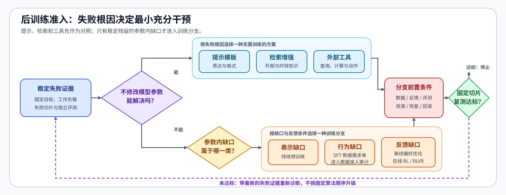
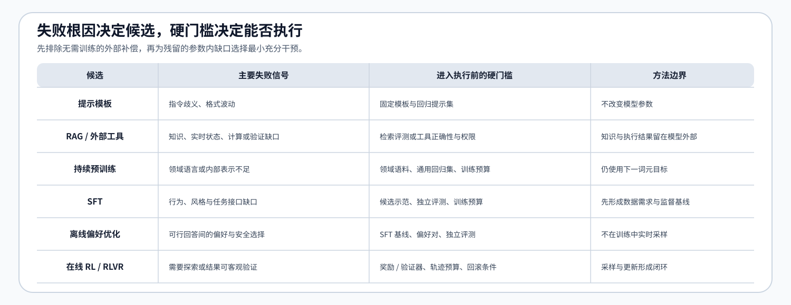

# 33. Fine Tuning Readiness | 后训练准入与阶段选择
**难度：** Medium | **环境：** [CPU 主线](#runtime-environment) | **标签：** `后训练`, `准入决策`, `评测` | **目标人群：** 微调项目设计者

> 🚀 **云端运行环境**
>
> 本章节的实战代码可以点击以下链接在免费 GPU 算力平台上直接运行：
>
> [](https://colab.research.google.com/github/datawhalechina/llm-algo-leetcode/blob/main/02_PyTorch_Algorithms/33_Fine_Tuning_Readiness.ipynb)
> [](https://modelscope.cn/my/mynotebook) *(国内推荐：魔搭社区免费实例)*


---

## 本节导读

模型在固定任务上持续失败时，第一步不是选择训练算法，而是确认失败是否稳定、缺少的能力是什么，以及问题能否在不修改参数的情况下解决。判断顺序是：固定失败样本和验收门槛，复测提示词、RAG 或工具方案，再为仍未解决的模型内部缺口选择持续预训练、SFT、偏好优化或强化学习。

**关键词：** `admission gate`, `parameter update`, `SFT baseline`, `preference`, `RLVR`

---
<a id="runtime-environment"></a>

## 运行环境

- **基础练习：** 默认使用 [`BASE-CPU`](../guide.md#base-cpu)，运行 [Step 4 的题目与测试](#mechanism-practice)。
- **框架核对：** 如需检查阶段决策能否生成后续数据与训练入口需要的字段，使用 [`PT-CPU`](../topic_discussion/post_training_optimization/quickstart.md#pt-cpu-quickstart)；完成 Step 4 后运行[框架一致性核对](#framework-check)。

---
## 前置阅读

**导语：** 进入本节前，先理解可比较实验为什么需要固定目标、工作负载与基线。
- [20. Performance Evidence and Experiment Design | 性能证据与实验设计](../00_Prerequisites/20_Performance_Evidence_and_Experiment_Design.md)

---

## Step 1：如何复测稳定失败并定位问题来源

先固定目标、验收门槛、工作负载和失败切片，并记录每个切片的复测次数与失败次数；达到重复次数和失败率门槛后，再判断缺口来自表达格式、外部知识、查询计算、外部动作，还是模型内部表示与行为。以 `procedure_order` 为例：模型已经获得完整规则，却仍不能稳定按“申请、核验、确认”的顺序回答；格式提示和检索复测仍未解决时，该切片才进入参数更新候选。

对失败切片 $s$，设复测次数为 $n_s$、失败次数为 $k_s$，则经验失败率与可重复失败条件为

$$
\hat p_s=\frac{k_s}{n_s},\qquad
Q(s)=\mathbf{1}[n_s\ge n_{\min}]\,\mathbf{1}[\hat p_s\ge p_{\min}].
$$

其中，$n_{\min}$ 是最少复测次数，$p_{\min}$ 是最低失败率，$\mathbf{1}[\cdot]$ 是条件成立时取 1、否则取 0 的指示函数。只有 $Q(s)=1$、评测样本已经隔离且基线覆盖该切片时，候选方案的前后比较才有意义。

| 检查项 | 要回答的问题 | 结果如何流转 |
|:---|:---|:---|
| 可测目标 | 指标与验收门槛是否明确 | 不明确时先定义目标，暂不选择干预方案 |
| 可重复失败 | 重复次数是否达到下限，失败率是否达到门槛 | 未达到时继续复测或排除运行异常 |
| 失败切片 | 哪些任务、样本或场景持续失败 | 补齐切片级基线，避免总体指标掩盖问题 |
| 独立评测 | 评测数据是否与候选数据和训练过程隔离 | 未隔离时重新划分评测集 |
| 能力需求 | 缺少的是表达、外部知识、查询计算、外部动作，还是模型内部表示与行为 | 外部能力优先进入不修改参数路线；内部缺口进入参数更新候选路线 |


## Step 2：提示词、RAG 和工具能否在不更新参数时解决问题

根据已识别的能力需求，只测试与当前失败相关的方案，并在相同工作负载、失败切片和验收门槛下比较原始基线与候选方案。每条候选记录目标指标值和新增失败切片；指标达到门槛且新增失败集合为空时，才把对应切片记为已解决。其余切片继续判断是否来自模型内部能力。工具可以通过 MCP、函数调用或业务 API 接入，这里比较工具结果，不比较接入协议。

设候选 $c$ 在切片 $s$ 上的指标为 $M(c,s)$，验收门槛为 $\tau$，新增失败集合为 $N(c,s)$，则

$$
\operatorname{resolved}(c,s)=\mathbf{1}[M(c,s)\ge\tau]\,\mathbf{1}[N(c,s)=\varnothing].
$$

若可重复失败集合为 $F$，被非参数方案解决的切片集合为 $S$，则仍需考虑参数更新的集合是 $F_{\mathrm{param}}=F\setminus S$。

| 能力缺口 | 候选方案 | 必须检查的证据 | 验证结果 |
|:---|:---|:---|:---|
| 表达、格式或指令歧义 | 固定提示模板 | 指令遵循率、格式正确率或任务指标值；新增失败切片 | 指标达到门槛且无新增失败时移出参数更新候选 |
| 外部或时效知识 | RAG | 检索命中、来源支持、引用正确性、任务指标值；新增失败切片 | 通过时移出候选；未通过时区分检索失败与模型内部缺口 |
| 实时查询、精确计算、规则验证或外部动作 | 数据库、计算器、搜索接口、业务 API 或验证器 | 调用、参数与结果检查；任务指标值；新增失败切片 | 通过时移出候选；未通过时区分工具链失败与模型内部缺口 |
## Step 3：何时选择持续预训练、SFT、偏好优化或在线强化学习

提示词、RAG 和工具复测后仍未解决的问题，再按缺口来源分流：领域语料不足且缺少领域表示时进入持续预训练；已有候选监督示范、冻结评测清单和训练预算时进入 SFT 数据准备。SFT 产物、评测结果与版本清单已经登记后，偏好数据进入离线偏好优化，学习型奖励与探索需求进入在线 RL，客观验证器与多轨迹预算进入 RLVR；没有新的反馈信号时停在 SFT。

阶段选择和阶段准入是两个连续判断。先根据参数缺口类型 $g$、SFT 基线状态 $b$ 和反馈形态 $f$ 选择候选阶段 $z^*$；再把该阶段所需资产集合记为 $P_{z^*}$，当前已经提供的资产集合记为 $A$：

$$
z^*=\operatorname{route}(g,b,f),\qquad
G(z^*)=\mathbf{1}[F_{\mathrm{param}}\neq\varnothing]\,\mathbf{1}[P_{z^*}\subseteq A].
$$

$\operatorname{route}$ 对应本节的阶段分流规则，$G(z^*)$ 只检查被选阶段能否启动；它不允许绕过分流规则任意选择资产齐全的阶段。最终采用仍需要该阶段自己的质量、资源和回退门槛。

| 阶段 | 必要输入 | 不满足时的动作 |
|:---|:---|:---|
| 持续预训练 | 领域语料版本、冻结评测清单、GPU 小时预算 | 缺哪项就补哪项；预算为零时停止 |
| SFT | 候选示范数据版本、冻结评测清单、GPU 小时预算 | 生成数据需求单，交给 32 节完成契约与泄漏审计 |
| 离线偏好优化 | SFT 产物清单、偏好数据版本、冻结评测清单 | 缺少上游产物或数据时停在 SFT |
| 在线 RL | SFT 产物清单、奖励模型版本、探索需求、轨迹预算、回滚检查点 | 缺少奖励、轨迹或恢复条件时停止启动 |
| RLVR | SFT 产物清单、验证器版本、探索需求、轨迹预算、回滚检查点 | 缺少验证器、轨迹或恢复条件时停止启动 |


<a id="mechanism-practice"></a>
## Step 4：实现后训练阶段准入

题目区使用失败切片、无参数方案复测和训练前置资产复现阶段判断。骨架提供输入校验和结果结构；学习者补全失败切片筛选、复测后残留计算与训练分支选择。测试覆盖字段缺失、评测污染、无新增失败、不同训练入口和前置资产不足。

| TODO / 函数 | 学习者完成的机制 | 必须满足的约束 | 测试证据 |
|:---|:---|:---|:---|
| TODO 1：计算可重复失败切片<br>`assess_problem_evidence` | 用重复次数和失败率筛选切片，再检查基线是否覆盖 | 字段缺失、评测未隔离和切片未覆盖分别记录 | 只有达到复测次数与失败率门槛的切片被保留；缺失字段、评测未隔离和基线未覆盖分别触发阻断 |
| TODO 2：计算参数更新残留<br>`assess_parameter_update_need` | 根据候选指标和新增失败集合识别已解决切片 | 未登记切片、指标未过门槛或引入新失败时不得扣除 | 达标且没有新增失败的切片被移除；未登记、未达标或引入新失败的切片继续保留 |
| TODO 3：选择下一训练阶段<br>`select_next_training_stage` | 根据缺口类型、SFT 基线与反馈形态选择持续预训练、SFT、偏好优化、在线 RL 或 RLVR | 各分支必须满足自己的前置条件；SFT 决策必须携带数据需求单 | 不同缺口与反馈形态进入对应训练阶段；前置条件不足时返回具体缺口，SFT 分支输出完整数据需求单 |

```python
from typing import Dict, List

```


```python
def assess_problem_evidence(evidence: Dict[str, object]) -> Dict[str, object]:
    """用复测次数与失败率确定可重复失败，并检查评测隔离与基线覆盖。"""
    required_fields = ["goal_metric", "target_threshold", "minimum_repeats", "minimum_failure_rate", "failure_runs"]
    required_checks = ["evaluation_ids_isolated"]
    baseline_slices = set(evidence.get("baseline_slices", []))
    missing_fields = [name for name in required_fields if name not in evidence]
    failed_checks = [name for name in required_checks if evidence.get(name) is not True]
    # ==========================================
    # TODO 1：按重复次数和失败率筛选可重复失败切片，再找出基线未覆盖项。
    # repeatable_failure_slices = ???
    # uncovered_failure_slices = ???
    # ==========================================
    raise NotImplementedError("TODO 1：计算切片缺口")
    ready = bool(repeatable_failure_slices) and not missing_fields and not failed_checks and not uncovered_failure_slices
    return {"ready": ready, "repeatable_failure_slices": repeatable_failure_slices, "missing_fields": missing_fields, "failed_checks": failed_checks, "uncovered_failure_slices": uncovered_failure_slices}


def assess_parameter_update_need(failure_slices: List[str], candidate_results: List[Dict[str, object]], target_threshold: float) -> Dict[str, object]:
    """根据候选指标与新增失败，计算仍需参数更新的切片。"""
    repeatable_failures = set(failure_slices)
    unknown_slices = sorted({item["failure_slice"] for item in candidate_results} - repeatable_failures)
    if unknown_slices:
        raise ValueError(f"候选结果包含未登记切片：{unknown_slices}")
    # ==========================================
    # TODO 2：指标达到门槛且未引入新失败时，才把切片记为已解决。
    # resolved_slices = ???
    # residual_parameter_slices = ???
    # ==========================================
    raise NotImplementedError("TODO 2：计算参数内残留")
    return {"parameter_update_required": bool(residual_parameter_slices), "resolved_slices": resolved_slices, "residual_parameter_slices": residual_parameter_slices}


def select_next_training_stage(
    evidence_report: Dict[str, object],
    parameter_report: Dict[str, object],
    context: Dict[str, object],
) -> Dict[str, object]:
    """根据参数缺口、SFT 基线和反馈形态选择下一训练阶段。"""
    if not evidence_report["ready"]:
        missing = evidence_report["missing_fields"] + evidence_report["failed_checks"] + evidence_report["uncovered_failure_slices"]
        return {"decision": "blocked", "reason": "missing_problem_evidence", "missing": missing}
    if not parameter_report["parameter_update_required"]:
        return {"decision": "no_parameter_update", "reason": "non_parameter_baseline_resolved_failures", "missing": []}
    parameter_gap = context.get("parameter_gap", "behavior")
    feedback_mode = context.get("feedback_mode", "demonstrations")
    requirements = {
        "continued_pretraining": ["domain_corpus_version", "evaluation_manifest", "training_budget_gpu_hours"],
        "sft": ["candidate_demonstration_version", "evaluation_manifest", "training_budget_gpu_hours"],
        "offline_preference": ["sft_baseline_manifest", "preference_dataset_version", "evaluation_manifest"],
        "online_rl": ["sft_baseline_manifest", "reward_model_version", "exploration_required", "rollout_budget", "rollback_checkpoint"],
        "rlvr": ["sft_baseline_manifest", "verifier_version", "exploration_required", "rollout_budget", "rollback_checkpoint"],
    }
    # ==========================================
    # TODO 3：根据参数缺口、SFT 基线和反馈形态选择下一阶段。
    # next_stage = ???
    # ==========================================
    raise NotImplementedError("TODO 3：选择下一训练阶段")
    missing = [name for name in requirements[next_stage] if context.get(name) in (None, False, "", 0)]
    if missing:
        return {"decision": "blocked", "reason": "stage_requirements_not_ready", "missing": missing}
    result = {"decision": next_stage, "reason": "stage_requirements_ready", "missing": []}
    if next_stage == "sft":
        result["data_request"] = {
            "residual_failure_slices": list(parameter_report["residual_parameter_slices"]),
            "candidate_demonstration_version": context["candidate_demonstration_version"],
            "required_record_fields": ["sample_id", "source_id", "split", "instruction", "input", "response"],
            "next_section": "32_Data_Engineering_for_SFT",
        }
    return result

```

## 测试

运行下方 CPU 机制测试，检查问题证据、候选准入、训练阶段选择，以及 SFT 数据需求单的字段合同。

```python
def test_problem_evidence_gate():
    """分别报告字段缺失、检查未通过和切片未覆盖。"""
    missing = assess_problem_evidence({"goal_metric": "accuracy", "minimum_repeats": 3, "minimum_failure_rate": 0.6, "failure_runs": {"json_format": {"attempts": 3, "failures": 2}}, "evaluation_ids_isolated": True, "baseline_slices": ["json_format"]})
    assert missing == {"ready": False, "repeatable_failure_slices": ["json_format"], "missing_fields": ["target_threshold"], "failed_checks": [], "uncovered_failure_slices": []}
    report = assess_problem_evidence({"goal_metric": "accuracy", "target_threshold": 0.9, "minimum_repeats": 3, "minimum_failure_rate": 0.6, "failure_runs": {"json_format": {"attempts": 3, "failures": 2}, "long_input": {"attempts": 4, "failures": 3}, "rare": {"attempts": 2, "failures": 2}}, "evaluation_ids_isolated": False, "baseline_slices": ["json_format"]})
    assert report == {"ready": False, "repeatable_failure_slices": ["json_format", "long_input"], "missing_fields": [], "failed_checks": ["evaluation_ids_isolated"], "uncovered_failure_slices": ["long_input"]}


def test_parameter_update_gate():
    """只有不修改参数的方案复测后仍存在的失败才能进入参数更新。"""
    results = [{"failure_slice": "format", "metric_value": 0.94, "introduced_failures": []}, {"failure_slice": "fresh_knowledge", "metric_value": 0.91, "introduced_failures": []}]
    resolved = assess_parameter_update_need(["format", "fresh_knowledge"], results, 0.9)
    assert resolved == {"parameter_update_required": False, "resolved_slices": ["format", "fresh_knowledge"], "residual_parameter_slices": []}
    residual = assess_parameter_update_need(["format", "behavior"], [{"failure_slice": "format", "metric_value": 0.95, "introduced_failures": []}, {"failure_slice": "behavior", "metric_value": 0.92, "introduced_failures": ["safety"]}], 0.9)
    assert residual == {"parameter_update_required": True, "resolved_slices": ["format"], "residual_parameter_slices": ["behavior"]}
    try:
        assess_parameter_update_need(["format"], [{"failure_slice": "unknown", "metric_value": 0.99, "introduced_failures": []}], 0.9)
    except ValueError:
        pass
    else:
        raise AssertionError("未登记切片不应进入候选结果")


def test_training_stage_branches():
    """参数缺口、SFT 基线与反馈形态共同决定下一训练阶段。"""
    evidence = {"ready": True, "repeatable_failure_slices": ["behavior"], "missing_fields": [], "failed_checks": [], "uncovered_failure_slices": []}
    parameter = {"parameter_update_required": True, "residual_parameter_slices": ["behavior"]}
    pretraining = select_next_training_stage(evidence, parameter, {"parameter_gap": "representation", "domain_corpus_version": "corpus-v1", "evaluation_manifest": "eval-v1.json", "training_budget_gpu_hours": 8})
    assert pretraining["decision"] == "continued_pretraining"
    sft = select_next_training_stage(evidence, parameter, {"candidate_demonstration_version": "candidate-v1", "evaluation_manifest": "eval-v1.json", "training_budget_gpu_hours": 4})
    assert sft["decision"] == "sft"
    preference = select_next_training_stage(evidence, parameter, {"sft_baseline_ready": True, "sft_baseline_manifest": "sft.json", "feedback_mode": "preference_pairs", "preference_dataset_version": "prefs-v1", "evaluation_manifest": "eval-v1.json"})
    assert preference["decision"] == "offline_preference"
    rlvr = select_next_training_stage(evidence, parameter, {"sft_baseline_ready": True, "sft_baseline_manifest": "sft.json", "feedback_mode": "verifier", "verifier_version": "math-v1", "exploration_required": True, "rollout_budget": 128, "rollback_checkpoint": "checkpoint-100"})
    assert rlvr["decision"] == "rlvr"


def test_sft_data_request_contract():
    """SFT 准入结果必须把残留失败和候选数据合同交给 32 节。"""
    evidence = {"ready": True, "repeatable_failure_slices": ["procedure_order"], "missing_fields": [], "failed_checks": [], "uncovered_failure_slices": []}
    parameter = {"parameter_update_required": True, "residual_parameter_slices": ["procedure_order"]}
    result = select_next_training_stage(evidence, parameter, {"candidate_demonstration_version": "refund-procedure-v1", "evaluation_manifest": "refund-eval-v1.json", "training_budget_gpu_hours": 4})
    assert result["data_request"] == {"residual_failure_slices": ["procedure_order"], "candidate_demonstration_version": "refund-procedure-v1", "required_record_fields": ["sample_id", "source_id", "split", "instruction", "input", "response"], "next_section": "32_Data_Engineering_for_SFT"}


def test_training_stage_blockers():
    """阶段前置条件不足时返回具体缺口。"""
    evidence = {"ready": True, "repeatable_failure_slices": ["behavior"], "missing_fields": [], "failed_checks": [], "uncovered_failure_slices": []}
    parameter = {"parameter_update_required": True, "residual_parameter_slices": ["behavior"]}
    result = select_next_training_stage(evidence, parameter, {"candidate_demonstration_version": "candidate-v1"})
    assert result == {"decision": "blocked", "reason": "stage_requirements_not_ready", "missing": ["evaluation_manifest", "training_budget_gpu_hours"]}
    pretraining = select_next_training_stage(evidence, parameter, {"parameter_gap": "representation", "evaluation_manifest": "eval-v1.json", "training_budget_gpu_hours": 8})
    assert pretraining == {"decision": "blocked", "reason": "stage_requirements_not_ready", "missing": ["domain_corpus_version"]}


def test_invalid_evidence_and_candidate_domains():
    """非法计数、重复候选和非有限指标不能进入阶段决策。"""
    invalid_counts = {"goal_metric": "accuracy", "target_threshold": 0.9, "minimum_repeats": 3,
                      "minimum_failure_rate": 0.6, "failure_runs": {"format": {"attempts": 0, "failures": 0}},
                      "evaluation_ids_isolated": True, "baseline_slices": ["format"]}
    for evidence in [invalid_counts, invalid_counts | {"failure_runs": {"format": {"attempts": 2, "failures": 3}}}]:
        try:
            assess_problem_evidence(evidence)
        except ValueError:
            pass
        else:
            raise AssertionError("非法失败计数必须被拒绝")
    duplicate = [
        {"failure_slice": "format", "metric_value": 0.91, "introduced_failures": []},
        {"failure_slice": "format", "metric_value": 0.92, "introduced_failures": []},
    ]
    for rows in [duplicate, [{"failure_slice": "format", "metric_value": float("nan"), "introduced_failures": []}]]:
        try:
            assess_parameter_update_need(["format"], rows, 0.9)
        except ValueError:
            pass
        else:
            raise AssertionError("冲突或非有限候选结果必须被拒绝")


def test_remaining_training_stage_outcomes():
    """在线 RL、停在 SFT、无需更新和证据阻塞都应有独立结果。"""
    evidence = {"ready": True, "repeatable_failure_slices": ["behavior"], "missing_fields": [], "failed_checks": [], "uncovered_failure_slices": []}
    parameter = {"parameter_update_required": True, "residual_parameter_slices": ["behavior"]}
    online = select_next_training_stage(evidence, parameter, {
        "sft_baseline_ready": True, "sft_baseline_manifest": "sft.json", "feedback_mode": "learned_reward",
        "reward_model_version": "rm-v1", "exploration_required": True, "rollout_budget": 128,
        "rollback_checkpoint": "checkpoint-100",
    })
    assert online["decision"] == "online_rl"
    stopped = select_next_training_stage(evidence, parameter, {"sft_baseline_ready": True, "feedback_mode": "none"})
    assert stopped == {"decision": "stop_at_sft", "reason": "no_new_feedback_signal", "missing": []}
    no_update = select_next_training_stage(evidence, {"parameter_update_required": False}, {})
    assert no_update["decision"] == "no_parameter_update"
    blocked = select_next_training_stage(
        {"ready": False, "missing_fields": ["target_threshold"], "failed_checks": [], "uncovered_failure_slices": []},
        parameter, {},
    )
    assert blocked == {"decision": "blocked", "reason": "missing_problem_evidence", "missing": ["target_threshold"]}


test_problem_evidence_gate()
test_parameter_update_gate()
test_training_stage_branches()
test_sft_data_request_contract()
test_training_stage_blockers()
test_invalid_evidence_and_candidate_domains()
test_remaining_training_stage_outcomes()
print("✅ 后训练证据、参数更新与阶段准入测试通过。")
```

---

🛑 **STOP HERE** 🛑
<br><br><br><br><br><br><br><br><br><br>
> 请先尝试自己完成代码并跑通测试。<br>
> 如果遇到困难没有思路，可以向下滚动查看参考答案。
<br><br><br><br><br><br><br><br><br><br>

---

## 参考代码与解析

### 代码


```python
def assess_problem_evidence(evidence: Dict[str, object]) -> Dict[str, object]:
    required_fields = ["goal_metric", "target_threshold", "minimum_repeats", "minimum_failure_rate", "failure_runs"]
    required_checks = ["evaluation_ids_isolated"]
    baseline_slices = set(evidence.get("baseline_slices", []))
    missing_fields = [name for name in required_fields if name not in evidence]
    failed_checks = [name for name in required_checks if evidence.get(name) is not True]
    # TODO 1：按重复次数和失败率计算可重复失败，再检查基线覆盖。
    minimum_repeats = int(evidence.get("minimum_repeats", 0))
    minimum_failure_rate = float(evidence.get("minimum_failure_rate", 0.0))
    if minimum_repeats <= 0:
        raise ValueError("minimum_repeats 必须为正整数")
    if not 0.0 <= minimum_failure_rate <= 1.0:
        raise ValueError("minimum_failure_rate 必须位于 [0, 1]")
    failure_runs = evidence.get("failure_runs", {})
    for name, run in failure_runs.items():
        attempts, failures = int(run["attempts"]), int(run["failures"])
        if attempts <= 0 or failures < 0 or failures > attempts:
            raise ValueError(f"失败切片 {name} 的计数无效")
    repeatable_failure_slices = sorted(
        name for name, run in failure_runs.items()
        if int(run["attempts"]) >= minimum_repeats
        and int(run["failures"]) / int(run["attempts"]) >= minimum_failure_rate
    )
    uncovered_failure_slices = sorted(set(repeatable_failure_slices) - baseline_slices)
    ready = bool(repeatable_failure_slices) and not missing_fields and not failed_checks and not uncovered_failure_slices
    return {"ready": ready, "repeatable_failure_slices": repeatable_failure_slices, "missing_fields": missing_fields, "failed_checks": failed_checks, "uncovered_failure_slices": uncovered_failure_slices}


def assess_parameter_update_need(failure_slices: List[str], candidate_results: List[Dict[str, object]], target_threshold: float) -> Dict[str, object]:
    import math

    repeatable_failures = set(failure_slices)
    result_slices = [item["failure_slice"] for item in candidate_results]
    unknown_slices = sorted(set(result_slices) - repeatable_failures)
    if unknown_slices:
        raise ValueError(f"候选结果包含未登记切片：{unknown_slices}")
    if len(result_slices) != len(set(result_slices)):
        raise ValueError("同一失败切片只能提供一条候选结果")
    if not math.isfinite(float(target_threshold)):
        raise ValueError("target_threshold 必须为有限数")
    if any(not math.isfinite(float(item["metric_value"])) for item in candidate_results):
        raise ValueError("候选指标必须为有限数")
    # TODO 2：只有指标达到门槛且未引入新失败的候选才能解决切片。
    resolved_slices = sorted({item["failure_slice"] for item in candidate_results if float(item["metric_value"]) >= target_threshold and not item.get("introduced_failures", [])})
    residual_parameter_slices = sorted(repeatable_failures - set(resolved_slices))
    return {"parameter_update_required": bool(residual_parameter_slices), "resolved_slices": resolved_slices, "residual_parameter_slices": residual_parameter_slices}


def select_next_training_stage(evidence_report: Dict[str, object], parameter_report: Dict[str, object], context: Dict[str, object]) -> Dict[str, object]:
    if not evidence_report["ready"]:
        missing = evidence_report["missing_fields"] + evidence_report["failed_checks"] + evidence_report["uncovered_failure_slices"]
        return {"decision": "blocked", "reason": "missing_problem_evidence", "missing": missing}
    if not parameter_report["parameter_update_required"]:
        return {"decision": "no_parameter_update", "reason": "non_parameter_baseline_resolved_failures", "missing": []}
    parameter_gap = context.get("parameter_gap", "behavior")
    feedback_mode = context.get("feedback_mode", "demonstrations")
    requirements = {
        "continued_pretraining": ["domain_corpus_version", "evaluation_manifest", "training_budget_gpu_hours"],
        "sft": ["candidate_demonstration_version", "evaluation_manifest", "training_budget_gpu_hours"],
        "offline_preference": ["sft_baseline_manifest", "preference_dataset_version", "evaluation_manifest"],
        "online_rl": ["sft_baseline_manifest", "reward_model_version", "exploration_required", "rollout_budget", "rollback_checkpoint"],
        "rlvr": ["sft_baseline_manifest", "verifier_version", "exploration_required", "rollout_budget", "rollback_checkpoint"],
    }
    # TODO 3：根据参数缺口、SFT 基线和反馈形态选择下一阶段。
    if parameter_gap == "representation":
        next_stage = "continued_pretraining"
    elif not context.get("sft_baseline_ready", False):
        next_stage = "sft"
    elif feedback_mode == "preference_pairs":
        next_stage = "offline_preference"
    elif feedback_mode == "learned_reward":
        next_stage = "online_rl"
    elif feedback_mode == "verifier":
        next_stage = "rlvr"
    else:
        return {"decision": "stop_at_sft", "reason": "no_new_feedback_signal", "missing": []}
    missing = [name for name in requirements[next_stage] if context.get(name) in (None, False, "", 0)]
    if missing:
        return {"decision": "blocked", "reason": "stage_requirements_not_ready", "missing": missing}
    result = {"decision": next_stage, "reason": "stage_requirements_ready", "missing": []}
    if next_stage == "sft":
        result["data_request"] = {
            "residual_failure_slices": list(parameter_report["residual_parameter_slices"]),
            "candidate_demonstration_version": context["candidate_demonstration_version"],
            "required_record_fields": ["sample_id", "source_id", "split", "instruction", "input", "response"],
            "next_section": "32_Data_Engineering_for_SFT",
        }
    return result
```

### 解析

#### TODO 1：计算切片缺口

- 机制：每个切片先比较 `attempts` 与最少重复次数，再比较 `failures / attempts` 与失败率门槛；通过两项比较的切片减去基线已覆盖集合，得到证据缺口。
- 不变量：只有可重复失败集合非空、评测样本已隔离、必需字段齐全且基线覆盖全部切片时，才允许比较候选。测试分别构造字段缺失、评测未隔离、重复次数不足和切片未覆盖。

#### TODO 2：计算参数内残留

- 机制：提示词、RAG 或工具候选的 `metric_value` 达到目标门槛且 `introduced_failures` 为空时，才从可重复失败集合中扣除对应切片。
- 不变量：候选结果只能引用已登记切片；指标不足或产生新增失败时必须保留原切片。测试分别覆盖完全解决、引入安全失败和未知切片。

#### TODO 3：选择下一训练阶段

- 机制：领域表示缺口转入持续预训练；行为缺口先建立 SFT 基线，再根据偏好对、学习型奖励或客观验证器进入离线偏好、在线 RL 或 RLVR。
- 不变量：持续预训练必须给出领域语料版本、冻结评测清单和非零 GPU 小时预算；偏好与强化学习分支必须给出 SFT 产物清单。SFT 分支接收候选示范版本，并把残留失败切片、必需字段和下一节写入数据需求单。缺少数据版本、评测清单、轨迹预算或回滚检查点时返回具体字段；没有新反馈信号时停在 SFT。
<a id="framework-check"></a>

## 框架一致性核对（可选）

使用相同的阶段输入，核对 Step 4 路由结果能否形成完整的数据请求，并探测对应的 TRL 配置入口。

| 核对对象 | Step 4 教学实现 | 成熟框架 CPU 路径 | 共同输入与通过条件 |
| --- | --- | --- | --- |
| SFT 路由 | `select_next_training_stage` 生成 `data_request` | `trl.SFTConfig` 接口探测 | 使用相同阶段输入；候选数据版本、残留失败、必需字段和下一节完整 |
| 离线偏好路由 | 输出离线偏好阶段决策 | `trl.DPOConfig` 接口探测 | 使用相同阶段输入；SFT 基线与偏好对资产齐全后通过 |
| 验证器强化学习路由 | 输出 RLVR 阶段决策 | `trl.GRPOConfig` 接口探测 | 使用相同阶段输入；SFT 基线、验证器与轨迹预算齐全后通过 |
| 阻塞结果 | 输出 `decision=blocked` 与缺失字段 | 配置创建前的输入检查 | 使用相同不完整输入；返回具体缺失字段，不生成训练入口 |

```python
from importlib.metadata import version

try:
    import trl
except ImportError:
    framework_check = {
        "status": "skipped",
        "reason": "请使用 PT-CPU 环境运行本单元",
    }
else:
    def check_downstream_stage_contracts():
        """核对阶段决策输出与后续训练配置入口的字段契约。"""
        evidence = {
            "ready": True,
            "repeatable_failure_slices": ["procedure_order"],
            "missing_fields": [],
            "failed_checks": [],
            "uncovered_failure_slices": [],
        }
        parameter = {
            "parameter_update_required": True,
            "residual_parameter_slices": ["procedure_order"],
        }
        sft = select_next_training_stage(evidence, parameter, {
            "candidate_demonstration_version": "refund-procedure-v1",
            "evaluation_manifest": "refund-eval-v1.json",
            "training_budget_gpu_hours": 4,
        })
        blocked = select_next_training_stage(evidence, parameter, {
            "candidate_demonstration_version": "refund-procedure-v1",
        })
        preference = select_next_training_stage(evidence, parameter, {
            "sft_baseline_ready": True,
            "sft_baseline_manifest": "sft.json",
            "feedback_mode": "preference_pairs",
            "preference_dataset_version": "prefs-v1",
            "evaluation_manifest": "eval-v1.json",
        })
        rlvr = select_next_training_stage(evidence, parameter, {
            "sft_baseline_ready": True,
            "sft_baseline_manifest": "sft.json",
            "feedback_mode": "verifier",
            "verifier_version": "refund-v1",
            "exploration_required": True,
            "rollout_budget": 32,
            "rollback_checkpoint": "checkpoint-100",
        })
        required_request_fields = {
            "residual_failure_slices",
            "candidate_demonstration_version",
            "required_record_fields",
            "next_section",
        }
        entrypoints = {
            "sft": getattr(trl, "SFTConfig", None),
            "offline_preference": getattr(trl, "DPOConfig", None),
            "rlvr": getattr(trl, "GRPOConfig", None),
        }
        checks = {
            "sft_request_complete": sft["decision"] == "sft" and required_request_fields <= set(sft["data_request"]),
            "sft_routes_to_data_audit": sft["data_request"]["next_section"] == "32_Data_Engineering_for_SFT",
            "blocked_stage_exposes_missing": blocked["decision"] == "blocked" and bool(blocked["missing"]),
            "preference_contract_ready": preference["decision"] == "offline_preference" and not preference["missing"],
            "rlvr_contract_ready": rlvr["decision"] == "rlvr" and not rlvr["missing"],
            "trl_entrypoints_available": all(callable(entrypoint) for entrypoint in entrypoints.values()),
        }
        failed_checks = [name for name, passed in checks.items() if not passed]
        if failed_checks:
            raise AssertionError(f"下游配置接口核对失败：{failed_checks}")
        return {
            "status": "passed",
            "check_kind": "downstream_contract",
            "versions": {"trl": version("trl")},
            "checks": checks,
            "entrypoints": {stage: entrypoint.__name__ for stage, entrypoint in entrypoints.items()},
        }

    framework_check = check_downstream_stage_contracts()

framework_check
```

## 相关阅读

完成问题与干预准入后，可以继续检查 SFT 数据、训练循环与项目交付。

- [32. SFT Dataset Contract and Leakage Audit | SFT 数据契约与泄漏审计](./32_Data_Engineering_for_SFT.md)
- [13. SFT Training Loop | SFT 训练循环](./13_SFT_Training_Loop.md)
- [62. Instruction Fine-Tuning Project | 指令微调项目](./62_Instruction_Fine_Tuning_Project.md)
