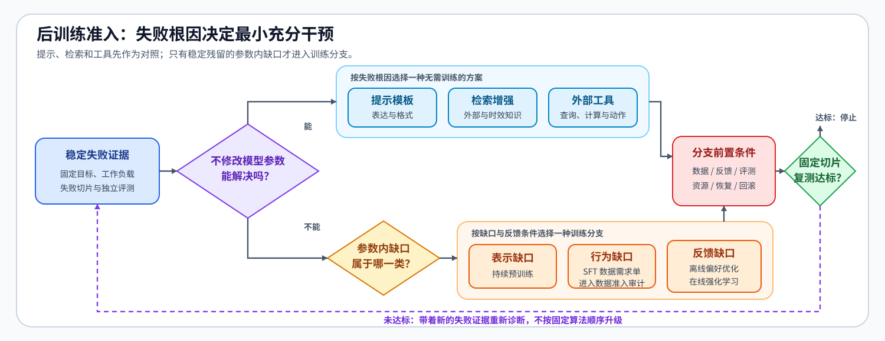
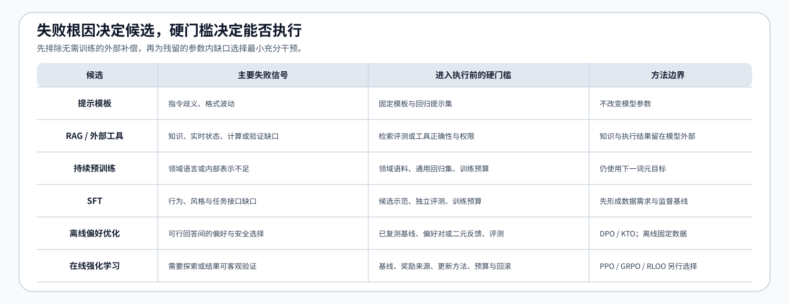

# 33. Fine Tuning Readiness | 后训练准入与阶段选择
**难度：** Medium | **环境：** [CPU 主线](#runtime-environment) | **标签：** `后训练`, `准入决策`, `评测` | **目标人群：** 微调项目设计者

> 🚀 **云端运行环境**
>
> 本章节的实战代码可以点击以下链接在免费 GPU 算力平台上直接运行：
>
> [](https://colab.research.google.com/github/datawhalechina/llm-algo-leetcode/blob/main/02_PyTorch_Algorithms/33_Fine_Tuning_Readiness.ipynb)
> [](https://modelscope.cn/my/mynotebook) *(国内推荐：魔搭社区免费实例)*


---

## 本节导读

模型在固定任务上持续失败时，先确认失败是否稳定、缺少的能力是什么，以及提示、检索增强生成（RAG）或工具能否解决问题。仍需修改参数时，再根据已有基线与反馈选择训练阶段：示范形成监督目标，偏好对或单条正负标签形成离线反馈，模型按当前参数生成的新回答则需要可靠奖励。

策略是模型根据输入生成回答的行为；可用策略基线指固定版本、已经复测的生成模型，用作后续更新和比较的起点。它可以来自已有指令模型，也可以来自本地监督微调（SFT），即使用示范回答继续训练。奖励来自模型评分还是客观验证器，与选择PPO、GRPO或RLOO等在线更新方法，是两个不同问题。把这些条件分开，才能知道现在可以开始哪一种训练、还缺什么输入。

**关键词：** `阶段准入`, `策略基线`, `反馈来源`, `更新方法`

---

<a id="runtime-environment"></a>

## 运行环境

- **基础练习：** 默认使用 [`BASE-CPU`](../guide.md#base-cpu)，运行 [Step 4 的题目与测试](#mechanism-practice)。
- **框架核对：** 使用 [`PT-CPU`](../topic_discussion/post_training_optimization/quickstart.md#pt-cpu-quickstart)，完成 Step 4 后运行[框架一致性核对](#framework-check)，检查阶段决策与数据需求经过 Hugging Face Datasets 转换后是否保留原值。

---

## 前置阅读

**导语：** 进入本节前，先理解可比较实验为什么需要固定目标、工作负载与基线。
- [20. Performance Evidence and Experiment Design | 性能证据与实验设计](../00_Prerequisites/20_Performance_Evidence_and_Experiment_Design.md)

---

## Step 1：如何复测稳定失败并定位问题来源

失败切片是按同类任务或场景划出的样本子集，例如“已签收订单的退款流程”；它用于定位整体平均分掩盖的问题。先固定目标、验收门槛、工作负载和这些切片，并记录每个切片的复测次数与失败次数；达到重复次数和失败率门槛后，再判断缺口来自表达格式、外部知识、查询计算、外部动作，还是模型内部表示与行为。以流程顺序错误为例：模型已经获得完整规则，却仍不能稳定按“申请、核验、确认”的顺序回答；格式提示和检索复测仍未解决时，该切片才进入参数更新候选。

基线覆盖表示每个待处理切片都有已测结果；评测隔离表示训练或候选调整不能接触独立评测答案。先把问题与这些条件对应，再检查重复失败和候选方案是否达标。

| 检查项 | 要回答的问题 | 结果如何流转 |
|:---|:---|:---|
| 可测目标 | 指标与验收门槛是否明确 | 不明确时先定义目标，暂不选择干预方案 |
| 可重复失败 | 重复次数是否达到下限，失败率是否达到门槛 | 未达到时继续复测或排除运行异常 |
| 失败切片 | 哪些任务、样本或场景持续失败 | 补齐切片级基线，避免总体指标掩盖问题 |
| 独立评测 | 评测数据是否与候选数据和训练过程隔离 | 未隔离时重新划分评测集 |
| 能力需求 | 缺少的是表达、外部知识、查询计算、外部动作，还是模型内部表示与行为 | 外部能力优先进入不修改参数路线；内部缺口进入参数更新候选路线 |


## Step 2：怎样筛选重复失败与已经解决的切片

根据已识别的能力需求，只测试与当前失败相关的方案，并在相同工作负载、失败切片和验收门槛下比较原始基线与候选方案。每条候选记录目标指标值和新增失败切片；指标达到门槛且新增失败集合为空时，才把对应切片记为已解决。其余切片继续判断是否来自模型内部能力。

对失败切片 $s$，设复测次数为 $n_s>0$、失败次数为 $k_s$，最少复测次数为 $n_{\min}$、最低失败率为 $p_{\min}$。只有复测充分且失败率达到门槛，才把它纳入可重复失败集合：

$$
\hat p_s=\frac{k_s}{n_s},\qquad Q(s)=\mathbf{1}[n_s\ge n_{\min}]\,\mathbf{1}[\hat p_s\ge p_{\min}].
$$

$\mathbf{1}[\cdot]$ 是条件成立时为 1、否则为 0 的指示函数。随后再核对评测隔离与基线覆盖，避免把样本不足或未测的切片当作参数缺口。

设候选 $c$ 在切片 $s$ 上的指标为 $M(c,s)$，验收门槛为 $\tau$，新增失败集合为 $N(c,s)$，则

$$
\operatorname{resolved}(c,s)=\mathbf{1}[M(c,s)\ge\tau]\,\mathbf{1}[N(c,s)=\varnothing].
$$

若可重复失败集合为 $F$，被非参数方案解决的切片集合为 $S$，则仍需考虑参数更新的集合是 $F_{\mathrm{param}}=F\setminus S$。

| 能力缺口 | 候选方案 | 必须检查的证据 | 验证结果 |
|:---|:---|:---|:---|
| 表达、格式或指令歧义 | 固定提示模板 | 指令遵循率、格式正确率或任务指标值；新增失败切片 | 指标达到门槛且无新增失败时移出参数更新候选 |
| 外部或时效知识 | RAG | 检索命中、来源支持、引用正确性、任务指标值；新增失败切片 | 通过时移出候选；未通过时区分检索失败与模型内部缺口 |
| 实时查询、精确计算、规则验证或外部动作 | 数据库、计算器、搜索接口、业务 API 或验证器 | 调用、参数与结果检查；任务指标值；新增失败切片 | 通过时移出候选；未通过时区分工具链失败与模型内部缺口 |
## Step 3：基线与反馈怎样决定下一训练阶段

重复失败仍未解决时，先区分需要补充领域表示，还是改变任务行为。领域语料支持持续预训练；示范回答支持 SFT。已有合适指令模型通过复测后，也可作为固定策略基线，和本地 SFT 产物一样进入偏好或在线更新，不必为了满足阶段名称重新训练一遍。

在行为更新中，成对偏好比较同一输入下哪份回答更好，进入直接偏好优化（DPO）分支；单条二元反馈只标记某份回答可取或不可取，进入KTO分支。在线训练还需要当前策略生成轨迹，即一次生成的输入、回答及对应奖励等记录，用来把反馈对齐到实际生成行为：学习型奖励检查评分模型版本，规则或环境奖励检查验证器版本；PPO、GRPO、RLOO 是另行选择的更新方法。可验证奖励强化学习（RLVR）描述奖励来源，不是与在线强化学习并列的下一阶段，也不自动指定 GRPO。

先选择阶段 $z^*$，再检查现有训练输入集合 $A$ 是否包含该阶段所需集合 $P_{z^*}$。$F_{\mathrm{param}}$ 表示提示、检索或工具尝试后仍未解决、需要考虑修改模型参数的问题。只有这个集合非空且所需输入齐全，才允许开始所选训练：

$$
G(z^*)=\mathbf{1}[F_{\mathrm{param}}\neq\varnothing]\,\mathbf{1}[P_{z^*}\subseteq A].
$$

该判断检查声明的启动条件；参数更新后的任务收益、资源与回滚表现仍需独立验证。没有可用的新反馈时，保留当前基线并检查反馈缺口，而不是强行切换算法。

| 阶段 | 必要输入 | 条件分支与缺失处理 |
|:---|:---|:---|
| 持续预训练 | 领域语料版本、冻结评测清单、训练预算 | 缺少语料、评测或预算时停止启动 |
| SFT | 候选示范版本、冻结评测清单、训练预算 | 生成数据需求，随后审计示范的字段、重复与泄漏 |
| 离线偏好优化 | 已复测基线及其来源、反馈数据版本、冻结评测清单 | 回答对进入 DPO；单条二元反馈进入 KTO；缺少基线时先复测或建立基线 |
| 在线强化学习 | 已复测基线、冻结评测清单、探索需求、轨迹预算、回滚点与更新方法 | 学习型奖励提供评分模型版本；可验证奖励提供验证器版本；缺少任一声明输入时停止 |



<a id="mechanism-practice"></a>

## Step 4：实现后训练阶段准入

给定失败切片、非参数方案的复测结果和训练输入，补全三个机制判断：哪些失败可重复，哪些已被解决，以及剩余问题应进入哪一阶段。骨架校验输入、检查所需模型和数据并整理结果；已有指令模型与本地SFT模型都要先通过相同的基线复测。

| TODO / 函数 | 学习者完成的机制 | 必须满足的约束 | 测试证据 |
|:---|:---|:---|:---|
| TODO 1：筛选可重复失败切片<br>`assess_problem_evidence` | 根据复测次数与失败率筛选切片，并找出基线未覆盖项 | 评测隔离与必需字段独立检查 | 达到门槛的切片保留；缺字段、未隔离或未覆盖分别阻断 |
| TODO 2：找出仍需考虑参数更新的问题<br>`assess_parameter_update_need` | 从失败集合中扣除非参数方案已解决的切片 | 达到指标门槛且没有新增失败才算解决 | 通过、未达标及新增安全失败得到不同残留结果；未知或重复候选报错 |
| TODO 3：选择训练阶段<br>`select_next_training_stage` | 按表示缺口与反馈形态选择持续预训练、SFT、离线偏好或在线训练 | 阶段、反馈来源与更新方法分别记录；基线来源不限定为 SFT | 指令模型可直接进入 DPO/KTO；两类奖励均可选择 PPO/GRPO/RLOO；缺少基线、反馈或评测时阻断 |


```python
from typing import Dict, List

```


```python
def assess_problem_evidence(evidence: Dict[str, object]) -> Dict[str, object]:
    """筛出反复失败的任务组，并记录缺少的基线或评测信息。"""
    required_fields = ["goal_metric", "target_threshold", "minimum_repeats", "minimum_failure_rate", "failure_runs"]
    required_checks = ["evaluation_ids_isolated"]
    baseline_slices = set(evidence.get("baseline_slices", []))
    missing_fields = [name for name in required_fields if name not in evidence]
    failed_checks = [name for name in required_checks if evidence.get(name) is not True]
    # 输入计数由骨架校验，避免把非法比例送入筛选。
    minimum_repeats = int(evidence.get("minimum_repeats", 0))
    minimum_failure_rate = float(evidence.get("minimum_failure_rate", 0.0))
    if minimum_repeats <= 0:
        raise ValueError("minimum_repeats 必须为正整数")
    if not 0.0 <= minimum_failure_rate <= 1.0:
        raise ValueError("minimum_failure_rate 必须位于 [0, 1]")
    failure_runs = evidence.get("failure_runs", {})
    for name, run in failure_runs.items():
        attempts, failures = int(run["attempts"]), int(run["failures"])
        if attempts <= 0 or failures < 0 or failures > attempts:
            raise ValueError(f"失败切片 {name} 的计数无效")
    # ==========================================
    # TODO 1：筛选可重复失败切片
    # ==========================================
    # repeatable_failure_slices = ???  # 已达到复测次数与失败率门槛的切片，按名称排序。
    # uncovered_failure_slices = ???  # 可重复失败中没有基线记录的切片，按名称排序。
    raise NotImplementedError("TODO 1：筛选可重复失败切片")
    ready = bool(repeatable_failure_slices) and not missing_fields and not failed_checks and not uncovered_failure_slices
    return {"ready": ready, "repeatable_failure_slices": repeatable_failure_slices, "missing_fields": missing_fields, "failed_checks": failed_checks, "uncovered_failure_slices": uncovered_failure_slices}


def assess_parameter_update_need(failure_slices: List[str], candidate_results: List[Dict[str, object]], target_threshold: float) -> Dict[str, object]:
    """扣除已达标且没有新增失败的非参数候选切片。"""
    import math

    repeatable_failures = set(failure_slices)
    result_slices = [item["failure_slice"] for item in candidate_results]
    unknown_slices = sorted(set(result_slices) - repeatable_failures)
    if unknown_slices:
        raise ValueError(f"候选结果包含未登记切片：{unknown_slices}")
    if len(result_slices) != len(set(result_slices)):
        raise ValueError("同一失败切片只能提供一条候选结果")
    if not math.isfinite(float(target_threshold)):
        raise ValueError("target_threshold 必须为有限数")
    if any(not math.isfinite(float(item["metric_value"])) for item in candidate_results):
        raise ValueError("候选指标必须为有限数")
    # ==========================================
    # TODO 2：找出仍需考虑参数更新的问题
    # ==========================================
    # resolved_slices = ???  # 达到指标门槛且没有新增失败的切片，按名称排序。
    # residual_parameter_slices = ???  # 尚未被上述候选解决的失败切片，按名称排序。
    raise NotImplementedError("TODO 2：找出仍需考虑参数更新的问题")
    return {"parameter_update_required": bool(residual_parameter_slices), "resolved_slices": resolved_slices, "residual_parameter_slices": residual_parameter_slices}

def select_next_training_stage(
    evidence_report: Dict[str, object],
    parameter_report: Dict[str, object],
    context: Dict[str, object],
) -> Dict[str, object]:
    """按问题与反馈选择训练阶段，再检查所需模型、数据和预算。"""
    if not evidence_report["ready"]:
        missing = evidence_report["missing_fields"] + evidence_report["failed_checks"] + evidence_report["uncovered_failure_slices"]
        return {"decision": "blocked", "reason": "missing_problem_evidence", "missing": missing}
    if not parameter_report["parameter_update_required"]:
        return {"decision": "no_parameter_update", "reason": "non_parameter_baseline_resolved_failures", "missing": []}
    parameter_gap = context.get("parameter_gap", "behavior")
    feedback_mode = context.get("feedback_mode", "demonstrations")
    if parameter_gap not in {"representation", "behavior"}:
        raise ValueError("parameter_gap 必须为 representation 或 behavior")
    if feedback_mode not in {"demonstrations", "preference_pairs", "binary_feedback", "learned_reward", "verifier", "none"}:
        raise ValueError("未知反馈形态")
    baseline_source = context.get("baseline_source")
    if baseline_source not in (None, "", "instruction_model", "sft"):
        raise ValueError("baseline_source 必须为 instruction_model 或 sft")
    requirements = {
        "continued_pretraining": ["domain_corpus_version", "evaluation_manifest", "training_budget_gpu_hours"],
        "sft": ["candidate_demonstration_version", "evaluation_manifest", "training_budget_gpu_hours"],
        "offline_preference": ["baseline_ready", "baseline_manifest", "baseline_source", "evaluation_manifest"],
        "online_rl": ["baseline_ready", "baseline_manifest", "baseline_source", "evaluation_manifest",
                      "exploration_required", "rollout_budget", "rollback_checkpoint", "update_method"],
    }
    # ==========================================
    # TODO 3：选择训练阶段
    # ==========================================
    # next_stage = ???  # 由 parameter_gap 与 feedback_mode 选择 requirements 中的阶段。
    # 无新增反馈时直接返回 stop_at_baseline，不创建新的训练分支。
    raise NotImplementedError("TODO 3：选择训练阶段")
    required = list(requirements[next_stage])
    if next_stage == "offline_preference":
        data_field = "preference_dataset_version" if feedback_mode == "preference_pairs" else "binary_feedback_dataset_version"
        required.append(data_field)
    elif next_stage == "online_rl":
        required.append("reward_model_version" if feedback_mode == "learned_reward" else "verifier_version")
        if context.get("update_method") not in (None, "", "ppo", "grpo", "rloo"):
            raise ValueError("在线更新方法必须为 ppo、grpo 或 rloo")
    missing = [name for name in required if context.get(name) in (None, False, "", 0)]
    if "baseline_ready" in required and context.get("baseline_ready") is not True and "baseline_ready" not in missing:
        missing.append("baseline_ready")
    if missing:
        return {"decision": "blocked", "reason": "stage_requirements_not_ready", "missing": missing}
    result = {"decision": next_stage, "reason": "stage_requirements_ready", "missing": []}
    if next_stage == "sft":
        result["data_request"] = {
            "residual_failure_slices": list(parameter_report["residual_parameter_slices"]),
            "candidate_demonstration_version": context["candidate_demonstration_version"],
            "required_record_fields": ["sample_id", "source_id", "split", "instruction", "input", "response"],
            "next_section": "32_Data_Engineering_for_SFT",
        }
    elif next_stage in {"offline_preference", "online_rl"}:
        result.update({
            "baseline_source": baseline_source,
            "baseline_manifest": context["baseline_manifest"],
            "feedback_source": feedback_mode,
            "update_method": (
                "dpo" if feedback_mode == "preference_pairs" else "kto"
            ) if next_stage == "offline_preference" else context["update_method"],
        })
    return result

```

## 测试

运行下方CPU机制测试，检查能否复现失败、提示或工具是否已解决问题、选择哪种训练，以及SFT数据需求是否包含必需信息。

```python
def test_problem_evidence_gate():
    """分别报告字段缺失、检查未通过和切片未覆盖。"""
    missing = assess_problem_evidence({"goal_metric": "accuracy", "minimum_repeats": 3, "minimum_failure_rate": 0.6, "failure_runs": {"json_format": {"attempts": 3, "failures": 2}}, "evaluation_ids_isolated": True, "baseline_slices": ["json_format"]})
    assert missing == {"ready": False, "repeatable_failure_slices": ["json_format"], "missing_fields": ["target_threshold"], "failed_checks": [], "uncovered_failure_slices": []}
    report = assess_problem_evidence({"goal_metric": "accuracy", "target_threshold": 0.9, "minimum_repeats": 3, "minimum_failure_rate": 0.6, "failure_runs": {"json_format": {"attempts": 3, "failures": 2}, "long_input": {"attempts": 4, "failures": 3}, "rare": {"attempts": 2, "failures": 2}}, "evaluation_ids_isolated": False, "baseline_slices": ["json_format"]})
    assert report == {"ready": False, "repeatable_failure_slices": ["json_format", "long_input"], "missing_fields": [], "failed_checks": ["evaluation_ids_isolated"], "uncovered_failure_slices": ["long_input"]}


def test_parameter_update_gate():
    """只有不修改参数的方案复测后仍存在的失败才能进入参数更新。"""
    results = [{"failure_slice": "format", "metric_value": 0.94, "introduced_failures": []}, {"failure_slice": "fresh_knowledge", "metric_value": 0.91, "introduced_failures": []}]
    resolved = assess_parameter_update_need(["format", "fresh_knowledge"], results, 0.9)
    assert resolved == {"parameter_update_required": False, "resolved_slices": ["format", "fresh_knowledge"], "residual_parameter_slices": []}
    residual = assess_parameter_update_need(["format", "behavior"], [{"failure_slice": "format", "metric_value": 0.95, "introduced_failures": []}, {"failure_slice": "behavior", "metric_value": 0.92, "introduced_failures": ["safety"]}], 0.9)
    assert residual == {"parameter_update_required": True, "resolved_slices": ["format"], "residual_parameter_slices": ["behavior"]}
    try:
        assess_parameter_update_need(["format"], [{"failure_slice": "unknown", "metric_value": 0.99, "introduced_failures": []}], 0.9)
    except ValueError:
        pass
    else:
        raise AssertionError("未登记切片不应进入候选结果")


def test_sft_data_request_contract():
    """SFT 准入结果必须把残留失败和候选数据合同交给 32 节。"""
    evidence = {"ready": True, "repeatable_failure_slices": ["procedure_order"], "missing_fields": [], "failed_checks": [], "uncovered_failure_slices": []}
    parameter = {"parameter_update_required": True, "residual_parameter_slices": ["procedure_order"]}
    result = select_next_training_stage(evidence, parameter, {"candidate_demonstration_version": "refund-procedure-v1", "evaluation_manifest": "refund-eval-v1.json", "training_budget_gpu_hours": 4})
    assert result["data_request"] == {"residual_failure_slices": ["procedure_order"], "candidate_demonstration_version": "refund-procedure-v1", "required_record_fields": ["sample_id", "source_id", "split", "instruction", "input", "response"], "next_section": "32_Data_Engineering_for_SFT"}


def test_training_stage_blockers():
    """阶段前置条件不足时返回具体缺口。"""
    evidence = {"ready": True, "repeatable_failure_slices": ["behavior"], "missing_fields": [], "failed_checks": [], "uncovered_failure_slices": []}
    parameter = {"parameter_update_required": True, "residual_parameter_slices": ["behavior"]}
    result = select_next_training_stage(evidence, parameter, {"candidate_demonstration_version": "candidate-v1"})
    assert result == {"decision": "blocked", "reason": "stage_requirements_not_ready", "missing": ["evaluation_manifest", "training_budget_gpu_hours"]}
    pretraining = select_next_training_stage(evidence, parameter, {"parameter_gap": "representation", "evaluation_manifest": "eval-v1.json", "training_budget_gpu_hours": 8})
    assert pretraining == {"decision": "blocked", "reason": "stage_requirements_not_ready", "missing": ["domain_corpus_version"]}


def test_invalid_evidence_and_candidate_domains():
    """非法计数、重复候选和非有限指标不能进入阶段决策。"""
    invalid_counts = {"goal_metric": "accuracy", "target_threshold": 0.9, "minimum_repeats": 3,
                      "minimum_failure_rate": 0.6, "failure_runs": {"format": {"attempts": 0, "failures": 0}},
                      "evaluation_ids_isolated": True, "baseline_slices": ["format"]}
    for evidence in [invalid_counts, invalid_counts | {"failure_runs": {"format": {"attempts": 2, "failures": 3}}}]:
        try:
            assess_problem_evidence(evidence)
        except ValueError:
            pass
        else:
            raise AssertionError("非法失败计数必须被拒绝")
    duplicate = [
        {"failure_slice": "format", "metric_value": 0.91, "introduced_failures": []},
        {"failure_slice": "format", "metric_value": 0.92, "introduced_failures": []},
    ]
    for rows in [duplicate, [{"failure_slice": "format", "metric_value": float("nan"), "introduced_failures": []}]]:
        try:
            assess_parameter_update_need(["format"], rows, 0.9)
        except ValueError:
            pass
        else:
            raise AssertionError("冲突或非有限候选结果必须被拒绝")

def _stage_inputs():
    """提供相同的失败证据与已复测指令模型，供各反馈分支比较。"""
    evidence = {"ready": True, "repeatable_failure_slices": ["behavior"],
                "missing_fields": [], "failed_checks": [], "uncovered_failure_slices": []}
    parameter = {"parameter_update_required": True, "residual_parameter_slices": ["behavior"]}
    baseline = {"baseline_ready": True, "baseline_source": "instruction_model",
                "baseline_manifest": "instruction-baseline-v1.json", "evaluation_manifest": "eval-v1.json"}
    return evidence, parameter, baseline


def test_instruction_and_sft_baselines():
    """指令模型与本地SFT基线均可直接进入离线反馈，标签决定DPO或KTO分支。"""
    evidence, parameter, baseline = _stage_inputs()
    for source in ("instruction_model", "sft"):
        for feedback, field, method in (
            ("preference_pairs", "preference_dataset_version", "dpo"),
            ("binary_feedback", "binary_feedback_dataset_version", "kto"),
        ):
            result = select_next_training_stage(evidence, parameter, baseline | {
                "baseline_source": source, "feedback_mode": feedback, field: "feedback-v1",
            })
            assert result["decision"] == "offline_preference"
            assert result["update_method"] == method
            assert result["feedback_source"] == feedback
            assert result["baseline_source"] == source
            assert result["baseline_manifest"] == baseline["baseline_manifest"]


def test_online_feedback_and_method_are_independent():
    """两类奖励均可进入在线阶段，更新方法由独立配置指定。"""
    evidence, parameter, baseline = _stage_inputs()
    for feedback, field in (("learned_reward", "reward_model_version"), ("verifier", "verifier_version")):
        for method in ("ppo", "grpo", "rloo"):
            result = select_next_training_stage(evidence, parameter, baseline | {
                "feedback_mode": feedback, field: "reward-v1", "update_method": method,
                "exploration_required": True, "rollout_budget": 32, "rollback_checkpoint": "checkpoint-100",
            })
            assert result["decision"] == "online_rl"
            assert result["feedback_source"] == feedback
            assert result["update_method"] == method


def test_representation_and_stage_prerequisites():
    """表示缺口进入持续预训练，离线和在线分支分别阻断缺失输入。"""
    evidence, parameter, baseline = _stage_inputs()
    pretraining = select_next_training_stage(evidence, parameter, {
        "parameter_gap": "representation", "domain_corpus_version": "corpus-v1",
        "evaluation_manifest": "eval-v1.json", "training_budget_gpu_hours": 8,
    })
    assert pretraining["decision"] == "continued_pretraining"
    offline = baseline | {"feedback_mode": "binary_feedback", "binary_feedback_dataset_version": "binary-v1"}
    for field in ("baseline_ready", "baseline_manifest", "baseline_source", "evaluation_manifest", "binary_feedback_dataset_version"):
        incomplete = {key: value for key, value in offline.items() if key != field}
        result = select_next_training_stage(evidence, parameter, incomplete)
        assert result["decision"] == "blocked" and field in result["missing"]
    online = baseline | {
        "feedback_mode": "verifier", "verifier_version": "tests-v1", "update_method": "ppo",
        "exploration_required": True, "rollout_budget": 32, "rollback_checkpoint": "checkpoint-100",
    }
    for field in ("verifier_version", "update_method", "rollout_budget", "rollback_checkpoint", "evaluation_manifest"):
        incomplete = {key: value for key, value in online.items() if key != field}
        result = select_next_training_stage(evidence, parameter, incomplete)
        assert result["decision"] == "blocked" and field in result["missing"]
    result = select_next_training_stage(evidence, parameter, offline | {"baseline_ready": "yes"})
    assert result["decision"] == "blocked" and "baseline_ready" in result["missing"]


def test_no_update_and_invalid_routing_inputs():
    """无新反馈时停在当前基线；未知来源、方法或反馈不静默回退。"""
    evidence, parameter, baseline = _stage_inputs()
    assert select_next_training_stage(evidence, parameter, baseline | {"feedback_mode": "none"}) == {
        "decision": "stop_at_baseline", "reason": "no_new_feedback_signal", "missing": [],
    }
    assert select_next_training_stage(evidence, {"parameter_update_required": False}, {})["decision"] == "no_parameter_update"
    assert select_next_training_stage(
        {"ready": False, "missing_fields": ["target_threshold"], "failed_checks": [], "uncovered_failure_slices": []},
        parameter, {},
    )["reason"] == "missing_problem_evidence"
    for changes in ({"parameter_gap": "unknown"}, {"feedback_mode": "unknown"}, {"baseline_source": "unknown"},
                    {"feedback_mode": "verifier", "update_method": "unknown"}):
        try:
            select_next_training_stage(evidence, parameter, baseline | changes)
        except ValueError:
            pass
        else:
            raise AssertionError("未知阶段输入必须报错")


test_problem_evidence_gate()
test_parameter_update_gate()
test_sft_data_request_contract()
test_training_stage_blockers()
test_invalid_evidence_and_candidate_domains()
test_instruction_and_sft_baselines()
test_online_feedback_and_method_are_independent()
test_representation_and_stage_prerequisites()
test_no_update_and_invalid_routing_inputs()
print("✅ 失败证据、策略基线、反馈分支与阶段准入测试通过。")

```

---

🛑 **STOP HERE** 🛑
<br><br><br><br><br><br><br><br><br><br>
> 请先尝试自己完成代码并跑通测试。<br>
> 如果遇到困难没有思路，可以向下滚动查看参考答案。
<br><br><br><br><br><br><br><br><br><br>

---

## 参考代码与解析

### 代码


```python
def assess_problem_evidence(evidence: Dict[str, object]) -> Dict[str, object]:
    """筛出反复失败的任务组，并记录缺少的基线或评测信息。"""
    required_fields = ["goal_metric", "target_threshold", "minimum_repeats", "minimum_failure_rate", "failure_runs"]
    required_checks = ["evaluation_ids_isolated"]
    baseline_slices = set(evidence.get("baseline_slices", []))
    missing_fields = [name for name in required_fields if name not in evidence]
    failed_checks = [name for name in required_checks if evidence.get(name) is not True]
    # 输入计数由骨架校验，避免把非法比例送入筛选。
    minimum_repeats = int(evidence.get("minimum_repeats", 0))
    minimum_failure_rate = float(evidence.get("minimum_failure_rate", 0.0))
    if minimum_repeats <= 0:
        raise ValueError("minimum_repeats 必须为正整数")
    if not 0.0 <= minimum_failure_rate <= 1.0:
        raise ValueError("minimum_failure_rate 必须位于 [0, 1]")
    failure_runs = evidence.get("failure_runs", {})
    for name, run in failure_runs.items():
        attempts, failures = int(run["attempts"]), int(run["failures"])
        if attempts <= 0 or failures < 0 or failures > attempts:
            raise ValueError(f"失败切片 {name} 的计数无效")
    # TODO 1：筛选可重复失败切片。
    repeatable_failure_slices = sorted(
        name for name, run in failure_runs.items()
        if int(run["attempts"]) >= minimum_repeats
        and int(run["failures"]) / int(run["attempts"]) >= minimum_failure_rate
    )
    uncovered_failure_slices = sorted(set(repeatable_failure_slices) - baseline_slices)
    ready = bool(repeatable_failure_slices) and not missing_fields and not failed_checks and not uncovered_failure_slices
    return {"ready": ready, "repeatable_failure_slices": repeatable_failure_slices, "missing_fields": missing_fields, "failed_checks": failed_checks, "uncovered_failure_slices": uncovered_failure_slices}


def assess_parameter_update_need(failure_slices: List[str], candidate_results: List[Dict[str, object]], target_threshold: float) -> Dict[str, object]:
    """扣除已达标且没有新增失败的非参数候选切片。"""
    import math

    repeatable_failures = set(failure_slices)
    result_slices = [item["failure_slice"] for item in candidate_results]
    unknown_slices = sorted(set(result_slices) - repeatable_failures)
    if unknown_slices:
        raise ValueError(f"候选结果包含未登记切片：{unknown_slices}")
    if len(result_slices) != len(set(result_slices)):
        raise ValueError("同一失败切片只能提供一条候选结果")
    if not math.isfinite(float(target_threshold)):
        raise ValueError("target_threshold 必须为有限数")
    if any(not math.isfinite(float(item["metric_value"])) for item in candidate_results):
        raise ValueError("候选指标必须为有限数")
    # TODO 2：找出仍需考虑参数更新的问题。
    resolved_slices = sorted({item["failure_slice"] for item in candidate_results if float(item["metric_value"]) >= target_threshold and not item.get("introduced_failures", [])})
    residual_parameter_slices = sorted(repeatable_failures - set(resolved_slices))
    return {"parameter_update_required": bool(residual_parameter_slices), "resolved_slices": resolved_slices, "residual_parameter_slices": residual_parameter_slices}

def select_next_training_stage(
    evidence_report: Dict[str, object],
    parameter_report: Dict[str, object],
    context: Dict[str, object],
) -> Dict[str, object]:
    """按问题与反馈选择训练阶段，再检查所需模型、数据和预算。"""
    if not evidence_report["ready"]:
        missing = evidence_report["missing_fields"] + evidence_report["failed_checks"] + evidence_report["uncovered_failure_slices"]
        return {"decision": "blocked", "reason": "missing_problem_evidence", "missing": missing}
    if not parameter_report["parameter_update_required"]:
        return {"decision": "no_parameter_update", "reason": "non_parameter_baseline_resolved_failures", "missing": []}
    parameter_gap = context.get("parameter_gap", "behavior")
    feedback_mode = context.get("feedback_mode", "demonstrations")
    if parameter_gap not in {"representation", "behavior"}:
        raise ValueError("parameter_gap 必须为 representation 或 behavior")
    if feedback_mode not in {"demonstrations", "preference_pairs", "binary_feedback", "learned_reward", "verifier", "none"}:
        raise ValueError("未知反馈形态")
    baseline_source = context.get("baseline_source")
    if baseline_source not in (None, "", "instruction_model", "sft"):
        raise ValueError("baseline_source 必须为 instruction_model 或 sft")
    requirements = {
        "continued_pretraining": ["domain_corpus_version", "evaluation_manifest", "training_budget_gpu_hours"],
        "sft": ["candidate_demonstration_version", "evaluation_manifest", "training_budget_gpu_hours"],
        "offline_preference": ["baseline_ready", "baseline_manifest", "baseline_source", "evaluation_manifest"],
        "online_rl": ["baseline_ready", "baseline_manifest", "baseline_source", "evaluation_manifest",
                      "exploration_required", "rollout_budget", "rollback_checkpoint", "update_method"],
    }
    # TODO 3：选择训练阶段。
    if parameter_gap == "representation":
        next_stage = "continued_pretraining"
    elif feedback_mode == "demonstrations":
        next_stage = "sft"
    elif feedback_mode in {"preference_pairs", "binary_feedback"}:
        next_stage = "offline_preference"
    elif feedback_mode in {"learned_reward", "verifier"}:
        next_stage = "online_rl"
    else:
        return {"decision": "stop_at_baseline", "reason": "no_new_feedback_signal", "missing": []}
    required = list(requirements[next_stage])
    if next_stage == "offline_preference":
        data_field = "preference_dataset_version" if feedback_mode == "preference_pairs" else "binary_feedback_dataset_version"
        required.append(data_field)
    elif next_stage == "online_rl":
        required.append("reward_model_version" if feedback_mode == "learned_reward" else "verifier_version")
        if context.get("update_method") not in (None, "", "ppo", "grpo", "rloo"):
            raise ValueError("在线更新方法必须为 ppo、grpo 或 rloo")
    missing = [name for name in required if context.get(name) in (None, False, "", 0)]
    if "baseline_ready" in required and context.get("baseline_ready") is not True and "baseline_ready" not in missing:
        missing.append("baseline_ready")
    if missing:
        return {"decision": "blocked", "reason": "stage_requirements_not_ready", "missing": missing}
    result = {"decision": next_stage, "reason": "stage_requirements_ready", "missing": []}
    if next_stage == "sft":
        result["data_request"] = {
            "residual_failure_slices": list(parameter_report["residual_parameter_slices"]),
            "candidate_demonstration_version": context["candidate_demonstration_version"],
            "required_record_fields": ["sample_id", "source_id", "split", "instruction", "input", "response"],
            "next_section": "32_Data_Engineering_for_SFT",
        }
    elif next_stage in {"offline_preference", "online_rl"}:
        result.update({
            "baseline_source": baseline_source,
            "baseline_manifest": context["baseline_manifest"],
            "feedback_source": feedback_mode,
            "update_method": (
                "dpo" if feedback_mode == "preference_pairs" else "kto"
            ) if next_stage == "offline_preference" else context["update_method"],
        })
    return result

```

### 解析

#### TODO 1：筛选可重复失败切片

- 次数不足或失败率未达门槛的切片尚不足以支持本练习的干预判断；先筛出满足两项条件的切片，再找出缺少基线结果的部分。
- `test_problem_evidence_gate` 分别改变重复次数、隔离条件与基线覆盖，检查这些缺口各自保留，不被汇总成同一个布尔值。

#### TODO 2：找出仍需考虑参数更新的问题

- 候选达到指标门槛但新增安全失败时，不能把原切片记为已解决。答案仅扣除同时达标且没有新增失败的切片，未知或重复候选由骨架拒绝。
- `test_parameter_update_gate` 比较完全解决与新增失败两条路径，非法输入测试另外检查重复候选和非有限指标。

#### TODO 3：选择训练阶段

- 阶段由缺口与反馈形态决定，可用策略基线的来源不限定为SFT。答案先区分持续预训练、监督、离线与在线阶段，再检查模型、数据与运行预算是否齐全，分别记录反馈来源和更新方法。
- 指令模型与本地SFT、偏好对与二元标签分别形成交叉用例；两类奖励与三种在线方法的组合说明验证器不会自动选择GRPO。前置条件测试逐项删除输入，检查阻断原因；SFT数据需求仍由原交接测试验证。

<a id="framework-check"></a>

## 框架一致性核对（可选）

将 Step 4 生成的阶段决策与 SFT 数据需求写入 Hugging Face Datasets，再逐项读回，检查字段、列表和分支身份是否保持。这里核对数据接口保持，不比较训练算法的数值结果。

| 核对对象 | Step 4 教学实现 | 成熟框架 CPU 路径 | 共同输入与通过条件 |
| --- | --- | --- | --- |
| SFT 数据需求 | `select_next_training_stage` 输出的 `data_request` | `datasets.Dataset.from_list` 后逐列读取 | 使用同一残留失败和示范版本；所需字段、样本字段列表与下一入口完全一致 |
| 离线反馈分支 | 指令模型起点的 DPO 与 KTO 决策 | `Dataset.from_list` 保留列与行顺序 | 同一基线下，阶段、反馈来源、方法和基线身份读回后不变 |
| 在线奖励分支 | 两类奖励分别选择 PPO、GRPO、RLOO | `Dataset.from_list` 保留六条分支记录 | 奖励来源与更新方法分别保存，验证器来源不会变成独立训练阶段 |
| 阻断结果 | 缺少输入时返回具体缺失项 | `Dataset.from_list` 保留拒绝记录 | 读回同一不完整输入的缺失字段，不把阻断结果作为可执行候选 |


```python
from importlib.metadata import version

try:
    from datasets import Dataset
except ImportError:
    framework_check = {"status": "skipped", "reason": "请使用 PT-CPU 环境安装已登记的 Datasets 依赖"}
else:
    def check_stage_data_interface():
        """检查阶段输出与数据需求经Datasets转换后保持字段和顺序。"""
        evidence = {"ready": True, "repeatable_failure_slices": ["procedure_order"],
                    "missing_fields": [], "failed_checks": [], "uncovered_failure_slices": []}
        parameter = {"parameter_update_required": True, "residual_parameter_slices": ["procedure_order"]}
        baseline = {"baseline_ready": True, "baseline_source": "instruction_model",
                    "baseline_manifest": "instruction-v1.json", "evaluation_manifest": "eval-v1.json"}
        sft = select_next_training_stage(evidence, parameter, {
            "candidate_demonstration_version": "procedure-v1", "evaluation_manifest": "eval-v1.json",
            "training_budget_gpu_hours": 4,
        })
        request = sft["data_request"]
        request_dataset = Dataset.from_list([request])
        decisions = []
        for feedback, field in (("preference_pairs", "preference_dataset_version"),
                                ("binary_feedback", "binary_feedback_dataset_version")):
            decisions.append(select_next_training_stage(evidence, parameter, baseline | {
                "feedback_mode": feedback, field: "feedback-v1",
            }))
        for feedback, field in (("learned_reward", "reward_model_version"), ("verifier", "verifier_version")):
            for method in ("ppo", "grpo", "rloo"):
                decisions.append(select_next_training_stage(evidence, parameter, baseline | {
                    "feedback_mode": feedback, field: "reward-v1", "update_method": method,
                    "exploration_required": True, "rollout_budget": 32, "rollback_checkpoint": "checkpoint-100",
                }))
        decisions_dataset = Dataset.from_list(decisions)
        restored = [decisions_dataset[i] for i in range(len(decisions_dataset))]
        blocked = select_next_training_stage(evidence, parameter, {
            "feedback_mode": "binary_feedback", "binary_feedback_dataset_version": "binary-v1",
        })
        blocked_dataset = Dataset.from_list([blocked])
        checks = {
            "sft_request_fields_preserved": request_dataset[0] == request,
            "sft_data_audit_entry_preserved": request_dataset[0]["next_section"] == "32_Data_Engineering_for_SFT",
            "decision_fields_and_order_preserved": restored == decisions,
            "offline_feedback_methods_preserved": [r["update_method"] for r in restored[:2]] == ["dpo", "kto"],
            "online_feedback_and_method_independent": {
                (r["feedback_source"], r["update_method"]) for r in restored[2:]
            } == {(f, m) for f in ("learned_reward", "verifier") for m in ("ppo", "grpo", "rloo")},
            "blocked_missing_fields_preserved": blocked_dataset[0] == blocked and blocked["decision"] == "blocked",
        }
        if not all(checks.values()):
            raise AssertionError(f"阶段数据接口核对失败：{checks}")
        return {"status": "passed", "check_kind": "data_interface",
                "versions": {"datasets": version("datasets")}, "checks": checks}

    framework_check = check_stage_data_interface()

framework_check

```

## 相关阅读

阶段准入后，按所选反馈准备输入，再用独立评测检查训练候选。

- [Part 02 · 32 SFT 数据契约与泄漏审计](./32_Data_Engineering_for_SFT.md)：把示范需求变成可训练记录。
- [Part 02 · 50 偏好数据与评测](./50_Preference_Data_and_Evaluation.md)：核对反馈含义与评测隔离。
- [后训练优化学习路线](../topic_discussion/post_training_optimization/intro.md)：按监督、离线反馈或在线奖励继续学习。
